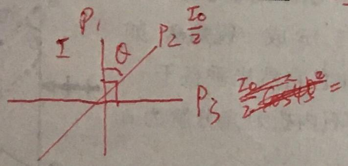

# 《大学物理》同步练习册（上）习题参考答案

原件经识别和整理；“参考解答”是我们补的。

## 三、计算 1

一衍射光栅，每厘米 200 条透光缝，每条透光缝宽为 $a = 2 \times 10^{-3}\ \mathrm{cm}$，在光栅后放一焦距 $f = 1\ \mathrm{m}$ 的凸透镜，现以 $\lambda = 600\ \mathrm{nm}$（$1\ \mathrm{nm} = 10^{-9}\ \mathrm{m}$）的单色平行光垂直照射光栅，求：

(1) 透光缝 $a$ 的单缝衍射中央明条纹宽度为多少？

(2) 在该宽度内，有几个光栅衍射主极大？

（见 P108）第 5 题。

参考解答：

$$
d = \frac{1\ \mathrm{cm}}{200} = 0.5 \times 10^{-4}\ \mathrm{m} = 5 \times 10^{-5}\ \mathrm{m}
$$

$$
a = 2 \times 10^{-5}\ \mathrm{m} \quad \therefore\ d/a = 5:2
$$

$$
\Delta x = \frac{2 f \lambda}{a} = 6 \times 10^{-3}\ \mathrm{m}
$$

(2) ±5 级，0～±4。

## 四、计算 2

一束平行光垂直入射到某个光栅上，该光束有两种波长的光，$\lambda_1 = 440\ \mathrm{nm}$，$\lambda_2 = 660\ \mathrm{nm}$（$1\ \mathrm{nm} = 10^{-9}\ \mathrm{m}$）。实验发现，两种波长的谱线（不计中央明纹）第二次重合于衍射角 $\varphi = 60^{\circ}$ 的方向上。求此光栅的光栅常数 $d$。

答案：$d = 3.05 \times 10^{-3}\ \mathrm{nm}$（见 P105）第 6 题。

## 五、计算 3

有三个偏振片叠在一起，已知第一个与第三个的偏振化方向相互垂直。一束光强为 $I_0$ 的自然光垂直入射在偏振片上，求第二个偏振片与第一个偏振片的偏振化方向之间的夹角为多大时，该入射光连续通过三个偏振片之后的光强为最大。

见 P110 第 4 题。

---

## 附：偏振片相关题目

出射光的光强为 $I = I_0/8$。已知 $P_1$ 和 $P_3$ 的偏振化方向相互垂直，若以入射光线为轴，旋转 $P_2$，要使出射光的光强为零，$P_2$ 最少要转过的角度是 \_\_\_\_，和 $P_1$ 垂直。

参考解答：

$$
\frac{I_0}{2} \cos^2 \theta \cdot \cos^2 (90^{\circ} - \theta) = \frac{I_0}{2} \cdot \frac{\sin^2 (2\theta)}{4} = \frac{I_0}{8}
$$

$$
\sin^2 (2\theta) = 1 \quad \theta = 45^{\circ}
$$
