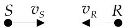
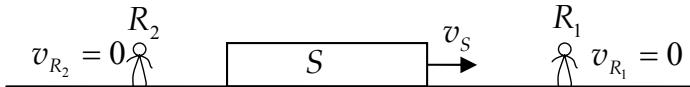
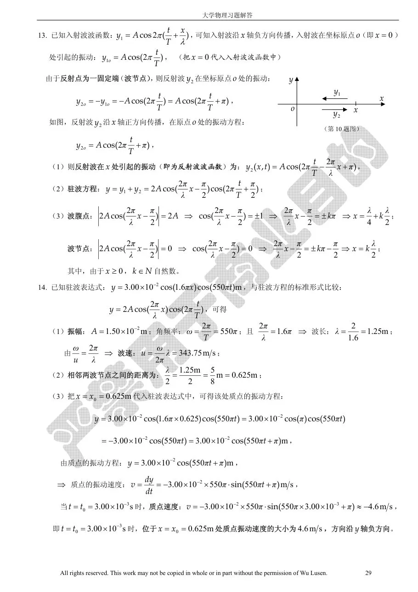

# 《大学物理》同步练习册上册第15章 波的干涉 驻波 参考答案

原件经识别和整理；“参考解答”是我们补的。

## 波的干涉 驻波

### 简答 1

已知波源 $S_1$ 的振动方程：$y_1 = A\cos\left(2\pi t + \frac{\pi}{2}\right)$，则可设相干波源 $S_2$ 的振动方程为：$y_2 = A'\cos(2\pi t + \varphi)$。注意相干条件：（1）振动方向相同，振幅大小可不同；（2）频率相同，角频率相同，$\omega = 2\pi$；（3）相位差恒定。

$$
\Delta\phi = (\varphi_2 - \varphi_1) - \frac{2\pi}{\lambda}(r_2 - r_1) = (\varphi_2 - \varphi_1) - \frac{2\pi}{\lambda}\left(\overline{S_2P} - \overline{S_1P}\right) = \varphi - 0.5\pi - 0.4\pi = \pm(2k+1)\pi
$$

并且合振幅：$A_{\triangle} = |A - A'| = 0$

波源 $S_2$ 的振动振幅：$A' = A$，振动初相位：$\varphi = -0.1\pi \pm 2k\pi$

所以波源 $S_2$ 的振动方程：$y_2 = A\cos(2\pi t - 0.1\pi \pm 2k\pi) = A\cos(2\pi t - 0.1\pi)$。题目有误，各选项都不对。

知识点：[平面简谐波的波函数 y=Acos(ω(t±x/u)+φ)](../../../topics/大学物理/平面简谐波方程.md)、[波的叠加原理与干涉条件](../../../topics/大学物理/波的干涉.md)、[简谐振动的运动学方程（振幅、角频率、相位）](../../../topics/大学物理/简谐振动运动学.md)

### 选择 2

电磁波在自由空间传播时，电场强度 $\vec{E}$ 和磁场强度 $\vec{H}$ 总是互相垂直，且都垂直于波的传播方向；电场强度 $\vec{E}$ 和磁场强度 $\vec{H}$ 的振动相位相同。

答案：C

知识点：[电磁波的基本性质](../../../topics/大学物理/电磁波.md)、[电场强度的定义与叠加原理](../../../topics/大学物理/电场强度.md)、[磁场与磁感应强度的定义](../../../topics/大学物理/磁感应强度.md)

### 填空 3

$\frac{\lambda}{2}$

知识点：[光程、光程差与反射时的半波损失](../../../topics/大学物理/光程与半波损失.md)

### 选择 4

在驻波中，两个相邻波节点间各质点的振动振幅不同，相位相同（步调相同，一起上，一起下）。

答案：B

知识点：[驻波的形成、波节与波腹](../../../topics/大学物理/驻波.md)

### 计算 5

$$
v_S = v_R = 64.8\ \mathrm{km/h} = 18\ \mathrm{m/s}
$$

接收到的频率：$\nu_R = \frac{u + v_R}{u - v_S}\nu_S = \frac{340 + 18}{340 - 18} \times 600\ \mathrm{Hz} = 667\ \mathrm{Hz}$。

答案：D

知识点：[机械波的形成、横波与纵波](../../../topics/大学物理/机械波的产生与传播.md)

### 选择 6

如果声源 $S$ 不动，则媒质中各质点的振动频率等于波源的频率，所以 $S$、$R$ 连线中点的媒质质点 $P$ 的振动频率为 $\nu_S$。

答案：A

知识点：[机械波的形成、横波与纵波](../../../topics/大学物理/机械波的产生与传播.md)、[平面简谐波的波函数 y=Acos(ω(t±x/u)+φ)](../../../topics/大学物理/平面简谐波方程.md)

### 计算 7

$y_1 = A\cos 2\pi\left(\nu t - \frac{x}{\lambda}\right)$ 和 $y_2 = A\cos 2\pi\left(\nu t + \frac{x}{\lambda}\right)$

（1）驻波方程：$y = y_1 + y_2 = 2A\cos\left(\frac{2\pi}{\lambda}x\right)\cos(2\pi\nu t)$

（2）波腹点位置：$\left|2A\cos\left(\frac{2\pi}{\lambda}x\right)\right| = 2A \Rightarrow \cos\left(\frac{2\pi}{\lambda}x\right) = \pm 1 \Rightarrow \frac{2\pi}{\lambda}x = \pm k\pi \Rightarrow x = \pm k\frac{\lambda}{2}$

波节点位置：$2A\cos\left(\frac{2\pi}{\lambda}x\right) = 0 \Rightarrow \cos\left(\frac{2\pi}{\lambda}x\right) = 0 \Rightarrow x = \pm k\frac{\lambda}{2} + \frac{\lambda}{4}$

答案：C

知识点：[平面简谐波的波函数 y=Acos(ω(t±x/u)+φ)](../../../topics/大学物理/平面简谐波方程.md)、[驻波的形成、波节与波腹](../../../topics/大学物理/驻波.md)

### 计算 8

已知驻波表达式：$y = 2A\cos\left(\frac{2\pi}{\lambda}x\right)\cos(\omega t)$，把 $x = -\frac{1}{2}\lambda$ 代入驻波方程，

可得 $x = -\frac{1}{2}\lambda$ 处质点的振动方程：$y = 2A\cos(-\pi)\cos(\omega t) = -2A\cos(\omega t) = 2A\cos(\omega t + \pi)$

该点的振动速度：$v = \frac{dy}{dt} = -2\omega A\sin(\omega t + \pi)$

知识点：[驻波的形成、波节与波腹](../../../topics/大学物理/驻波.md)、[平面简谐波的波函数 y=Acos(ω(t±x/u)+φ)](../../../topics/大学物理/平面简谐波方程.md)、[简谐振动的运动学方程（振幅、角频率、相位）](../../../topics/大学物理/简谐振动运动学.md)

### 计算 9

已知
$$
\begin{cases}
y_1 = 6.0 \times 10^{-2}\cos\left[\frac{\pi}{2}(x - 40t)\right] \\
y_2 = 6.0 \times 10^{-2}\cos\left[\frac{\pi}{2}(x + 40t)\right]
\end{cases}
$$
则合成驻波方程：$y = y_1 + y_2 = 0.12\cos\left(\frac{\pi}{2}x\right)\cos(20\pi t)$；

（1）波节点：$\cos\left(\frac{\pi}{2}x\right) = 0 \Rightarrow \frac{\pi}{2}x = \pm\left(k + \frac{1}{2}\right)\pi \Rightarrow x = \pm(2k+1)$

所以在 $x = 0$ 至 $x = 10\ \mathrm{m}$ 内波节的位置是：1 m，3 m，5 m，7 m，9 m；

（2）波腹点：$\cos\left(\frac{\pi}{2}x\right) = \pm 1 \Rightarrow \frac{\pi}{2}x = \pm k\pi \Rightarrow x = \pm 2k$

所以在 $x = 0$ 至 $x = 10\ \mathrm{m}$ 内波腹的位置是：0 m，2 m，4 m，6 m，8 m，10 m。

知识点：[驻波的形成、波节与波腹](../../../topics/大学物理/驻波.md)、[波的叠加原理与干涉条件](../../../topics/大学物理/波的干涉.md)

### 计算 10

已知 $B$ 点振动比 $A$ 点落后 $\frac{\pi}{3}$ 相位，则

$$
\varphi_A - \varphi_B = \omega\Delta t = \omega\frac{L}{u} = \frac{2\pi}{\lambda}L = \frac{\pi}{3} \Rightarrow L = \frac{\lambda}{6} = \frac{1}{2}\ \mathrm{m}
$$

知识点：[平面简谐波的波函数 y=Acos(ω(t±x/u)+φ)](../../../topics/大学物理/平面简谐波方程.md)、[波的叠加原理与干涉条件](../../../topics/大学物理/波的干涉.md)

### 计算 11

已知入射波波函数：$y_1 = A\cos 2\pi\left(\frac{t}{T} + \frac{x}{\lambda}\right)$，可知入射波沿 $x$ 轴负方向传播，入射波在坐标原点 $O$（即 $x = 0$）处引起的振动：$y_{1O} = A\cos\left(2\pi\frac{t}{T}\right)$（把 $x = 0$ 代入入射波波函数中）

如图，反射波 $y_2$ 沿 $x$ 轴正方向传播，在原点 $O$ 处的振动方程：

$$
y_{2O} = y_{1O} = A\cos\left(2\pi\frac{t}{T}\right)
$$

则反射波在 $x$ 处引起的振动（即为反射波波函数）为：$y_2(x,t) = A\cos\left(2\pi\frac{t}{T} - \frac{2\pi}{\lambda}x\right)$

驻波方程：$y = y_1 + y_2 = 2A\cos\left(\frac{2\pi}{\lambda}x\right)\cos\left(2\pi\frac{t}{T}\right)$；

把 $x = \frac{2}{3}\lambda$ 代入驻波方程可得在 $x = \frac{2}{3}\lambda$ 处的合振动：

$$
\begin{aligned}
y &= 2A\cos\left(\frac{2\pi}{\lambda} \times \frac{2}{3}\lambda\right)\cos\left(2\pi\frac{t}{T}\right) = 2A\cos\left(\frac{4\pi}{3}\right)\cos\left(2\pi\frac{t}{T}\right) \\
&= -2A\cos\left(\frac{\pi}{3}\right)\cos\left(2\pi\frac{t}{T}\right) = -A\cos\left(2\pi\frac{t}{T}\right) = A\cos\left(2\pi\frac{t}{T} + \pi\right)
\end{aligned}
$$

$\Rightarrow$ 在 $x = \frac{2}{3}\lambda$ 处质点合振动的振幅等于 $A$。注意：振幅一定是正数。

知识点：[平面简谐波的波函数 y=Acos(ω(t±x/u)+φ)](../../../topics/大学物理/平面简谐波方程.md)、[驻波的形成、波节与波腹](../../../topics/大学物理/驻波.md)

### 计算 12

设空气中声速为 $u = 340\ \mathrm{m/s}$，

$$
v_s = +20\ \mathrm{m/s},\quad v_{R_1} = 0
$$

$R_1$ 接收到的频率：$\nu_1 = \frac{u + v_{R_1}}{u - v_s}\nu_s = \frac{340 + 0}{340 - 20} \times 600\ \mathrm{Hz} = 637.5\ \mathrm{Hz}$

对于车后观测者 $R_2$，车 $S$ 远离 $R_2$ 运动，则 $v_s = -20\ \mathrm{m/s},\ v_{R_2} = 0$

$R_2$ 接收到的频率：$\nu_2 = \frac{u + v_{R_2}}{u - v_S}\nu_S = \frac{340 + 0}{340 - (-20)} \times 600\ \mathrm{Hz} = 566.7\ \mathrm{Hz}$；

所以，频率：$\nu_1 > \nu_2$；$|\nu_1 - \nu_2| = 70.8\ \mathrm{Hz}$

## 计算 13

已知入射波波函数：$y_1 = A \cos 2\pi (\frac{t}{T} + \frac{x}{\lambda})$，可知入射波沿 $x$ 轴负方向传播。
入射波在坐标原点 $O$（即 $x=0$）处引起的振动：$y_{1o} = A \cos (2\pi \frac{t}{T})$ （把 $x=0$ 代入入射波波函数中）。

由于反射点为一固定端（波节点），则反射波 $y_2$ 在坐标原点 $O$ 处的振动：

$$
y_{2o} = - y_{1o} = - A \cos (2\pi \frac{t}{T}) = A \cos (2\pi \frac{t}{T} + \pi)
$$

*图：反射波沿 x 轴正方向传播的示意图*

如图，反射波 $y_2$ 沿 $x$ 轴正方向传播，在原点 $O$ 处的振动方程为：
$$
y_{2o} = A \cos (2\pi \frac{t}{T} + \pi)
$$

（1）则反射波在 $x$ 处引起的振动（即为反射波波函数）为：
$$
y_2(x, t) = A \cos (2\pi \frac{t}{T} - \frac{2\pi}{\lambda} x + \pi)
$$

（2）驻波方程：
$$
y = y_1 + y_2 = 2A \cos (\frac{2\pi}{\lambda} x - \frac{\pi}{2}) \cos (2\pi \frac{t}{T} + \frac{\pi}{2})
$$

（3）波腹点：
$$
\left| 2A \cos (\frac{2\pi}{\lambda} x - \frac{\pi}{2}) \right| = 2A \Rightarrow \cos (\frac{2\pi}{\lambda} x - \frac{\pi}{2}) = \pm 1 \Rightarrow \frac{2\pi}{\lambda} x - \frac{\pi}{2} = \pm k\pi \Rightarrow x = \frac{\lambda}{4} + k\frac{\lambda}{2}
$$
波节点：
$$
\left| 2A \cos (\frac{2\pi}{\lambda} x - \frac{\pi}{2}) \right| = 0 \Rightarrow \cos (\frac{2\pi}{\lambda} x - \frac{\pi}{2}) = 0 \Rightarrow \frac{2\pi}{\lambda} x - \frac{\pi}{2} = \pm k\pi - \frac{\pi}{2} \Rightarrow x = k\frac{\lambda}{2}
$$
其中，由于 $x \ge 0$，故 $k \in \mathbb{N}$（自然数）。

## 计算 14

已知驻波表达式：$y = 3.00 \times 10^{-2} \cos(1.6\pi x) \cos(550\pi t) \text{ m}$。
与驻波方程的标准形式比较：$y = 2A \cos(\frac{2\pi}{\lambda} x) \cos(2\pi \frac{t}{T})$，可得：

（1）振幅：$A = 1.50 \times 10^{-2} \text{ m}$；
角频率：$\omega = \frac{2\pi}{T} = 550\pi$；
且 $\frac{2\pi}{\lambda} = 1.6\pi \Rightarrow$ 波长：$\lambda = \frac{2}{1.6} = 1.25 \text{ m}$。
由 $\frac{\omega}{u} = \frac{2\pi}{\lambda} \Rightarrow$ 波速：$u = \frac{\omega}{2\pi} \lambda = \frac{550\pi}{2\pi} \times 1.25 = 343.75 \text{ m/s}$。

（2）相邻两波节点之间的距离为：
$$
\frac{\lambda}{2} = \frac{1.25 \text{ m}}{2} = \frac{5}{8} \text{ m} = 0.625 \text{ m}
$$

（3）把 $x = x_0 = 0.625 \text{ m}$ 代入驻波表达式中，可得该处质点的振动方程：
$$
\begin{aligned}
y &= 3.00 \times 10^{-2} \cos(1.6\pi \times 0.625) \cos(550\pi t) \\
&= 3.00 \times 10^{-2} \cos(\pi) \cos(550\pi t) \\
&= -3.00 \times 10^{-2} \cos(550\pi t) \\
&= 3.00 \times 10^{-2} \cos(550\pi t + \pi) \text{ m}
\end{aligned}
$$
由质点的振动方程：$y = 3.00 \times 10^{-2} \cos(550\pi t + \pi) \text{ m}$。
⇒ 质点的振动速度：
$$
v = \frac{dy}{dt} = -3.00 \times 10^{-2} \times 550\pi \cdot \sin(550\pi t + \pi) \text{ m/s}
$$
当 $t = t_0 = 3.00 \times 10^{-3} \text{ s}$ 时，质点速度：
$$
\begin{aligned}
v &= -3.00 \times 10^{-2} \times 550\pi \cdot \sin(550\pi \times 3.00 \times 10^{-3} + \pi) \\
&\approx -4.6 \text{ m/s}
\end{aligned}
$$
即 $t = t_0 = 3.00 \times 10^{-3} \text{ s}$ 时，位于 $x = x_0 = 0.625 \text{ m}$ 处质点振动速度的大小为 $4.6 \text{ m/s}$，方向沿 $y$ 轴负方向。

知识点：[平面简谐波的波函数 y=Acos(ω(t±x/u)+φ)](../../../topics/大学物理/平面简谐波方程.md)、[驻波的形成、波节与波腹](../../../topics/大学物理/驻波.md)
