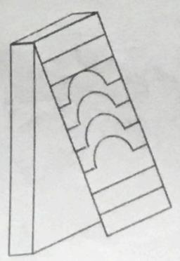

# 《大学物理》同步练习册（上）劈尖 牛顿环 迈克尔逊干涉仪 活页解答

原件经识别和整理；“参考解答”是我们补的。

### 选择 1

(C) 条纹间距变密；

知识点：[杨氏双缝干涉实验与条纹间距](../../../topics/大学物理/杨氏双缝干涉.md)

### 选择 2

(2) 如图所示,两个直径有微小差别的彼此平行的滚柱之间的距离为 $L$ ,夹在两块平晶的中间,形成空气劈尖,当单色光垂直入射时,产生等厚干涉条纹.如果两滚柱之间的距离 $L$ 变大,则在 $L$ 范围内干涉条纹的

知识点：[等倾干涉与等厚干涉（劈尖、牛顿环）](../../../topics/大学物理/薄膜干涉.md)、[光程、光程差与反射时的半波损失](../../../topics/大学物理/光程与半波损失.md)

### 选择 3

(3) 如图所示, 平板玻璃和凸透镜构成牛顿环装置, 全部浸入 $n = 1.60$ 的液体中, 凸透镜可沿 $OO'$ 移动, 用波长 $\lambda = 500 \mathrm{~nm} (1 \mathrm{~nm} = 10^{-9} \mathrm{~m})$ 的单色光垂直入射. 从上向下观察, 看到中心是一个暗斑, 此时凸透镜顶点距平板玻璃的距离最少是 [C]
(A) $156.3 \mathrm{~nm}$

知识点：[等倾干涉与等厚干涉（劈尖、牛顿环）](../../../topics/大学物理/薄膜干涉.md)、[光程、光程差与反射时的半波损失](../../../topics/大学物理/光程与半波损失.md)

### 选择 4

(4) 如图所示, 用劈尖干涉检测工件的表面, 当波长为 $\alpha$ 的单色光垂直入射时, 观察到的干涉条纹中间向劈尖棱边弯曲, 每一条弯曲部分的顶点恰好与左邻的直线部分的连线相切, 则工件表

(A)有一凹陷的槽，深为2/4；(B)有一凹陷的槽，深为2/2；(C)有一凸起的埂，高为2/2；(D)有一凸起的埂，高为2/4。

知识点：[等倾干涉与等厚干涉（劈尖、牛顿环）](../../../topics/大学物理/薄膜干涉.md)、[光程、光程差与反射时的半波损失](../../../topics/大学物理/光程与半波损失.md)

### 选择 5

(5) 波长 $\lambda = {600}\mathrm{\;{nm}}$ 的单色光垂直照射到牛顿环装置上,第二个明环与第五个明环所对应的空气膜厚度之差为

知识点：[等倾干涉与等厚干涉（劈尖、牛顿环）](../../../topics/大学物理/薄膜干涉.md)、[光程、光程差与反射时的半波损失](../../../topics/大学物理/光程与半波损失.md)
