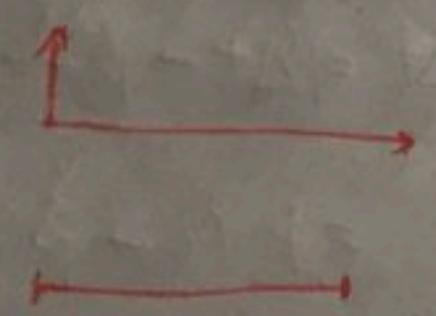

# 《大学物理》同步练习册（上）参考答案

原件经识别和整理；“参考解答”是我们补的。

# 《大学物理》同步练习册（上）参考答案

本资料由识别工具读取整理，修正了明显的断行与乱码错误，保留了原题及解答过程。

## 计算 6

在惯性系 $S$ 中的同一地点发生的 A、B 两个事件，B 晚于 A 4 秒，在另一惯性系 $S'$ 中观察 B 晚于 A 5 秒，求：（1）这两个惯性系的相对速度为多少？（2）在 $S'$ 系中这两个事件发生的地点间距离有多大？

答案：
(1) $v = 0.6c$
(2) $\Delta x' = -3c$ （注：此处单位通常指光秒或长度单位，原文如此）

参考解答：
$$
\begin{array}{l} {\Delta t = t _ {B} - t _ {A} = 4 \quad \Delta t ^ {\prime} = t _ {B} ^ {\prime} - t _ {A} ^ {\prime} = 5 \text{ s}} \\ {\Delta t ^ {\prime} = \gamma \Delta t \Rightarrow \gamma = \frac {5}{4} \quad v = 0. 6 c} \end{array}
$$

(2)
$$
\begin{array}{r l} {\Delta x ^ {\prime}} & {= \gamma (\Delta x - v \Delta t)} \\ & {= \frac {5}{4} (0 - 0. 6 c \cdot 4) = - 3 c} \end{array}
$$

---

## 计算 7

在某惯性系 $K$ 中，有两个事件同时发生在 $x$ 轴上相距 1000 m 的两点，而在另一惯性系 $K'$ (沿 $x$ 轴方向相对于 $K$ 系运动) 中测得这两个事件发生的地点相距 $2500 \mathrm{~m}$ 。求 (1) $K'$ 系相对于 $K$ 系的速度大小，(2) $K'$ 系中测这两个事件的时间间隔。

答案：
(1) $v = \frac{\sqrt{21}}{5} c \approx 0.917 c = 2.75 \times 10^8 \text{ m/s}$
(2) $\Delta t' = -7.63 \times 10^{-6} \text{ s}$

参考解答：
已知 $\Delta t = 0$, $\Delta x = 1000$, $\Delta x' = 2500$。
根据洛伦兹变换：
$$
\Delta x ^ {\prime} = \gamma (\Delta x - V \Delta t)
$$
代入数据：
$$
2 5 0 0 = \gamma \cdot 1 0 0 0 \quad \Rightarrow \quad \gamma = \frac {5}{2}
$$
由 $\gamma = \frac {1}{\sqrt {1 - \frac {V ^ {2}}{C ^ {2}}}}$ 得：
$$
1 - \frac {v ^ {2}}{c ^ {2}} = \frac {4}{2 5} \therefore v = \sqrt {\frac {2 1}{2 5}} c = \frac {\sqrt {2 1}}{5} c = 0. 9 1 7 c = 2. 7 5 \times 1 0 ^ {8} \text{ m/s}
$$

(2)
$$
\Delta t ^ {\prime} = \gamma (\Delta t - \beta \frac {\Delta x}{c}) = - 7. 6 3 \times 1 0 ^ {- 6} \text{ s}
$$
*(注：原件中公式符号略有混乱，此处按标准洛伦兹变换逻辑整理)*

---

## 计算 8

在实验室中，若电子 A 以速度 $2.9 \times 10^{8} \text{ m/s}$ 向右方向运动，而电子 B 以速度 $2.7 \times 10^{8} \mathrm{~m/s}$ 向左方向运动，求：A 电子对 B 电子的速度为多少？若电子的静止质量为 $m_0$，在实验室坐标系测得两电子的质量为多少？

答案：
(1) $v_{AB} \approx -2.995 \times 10^8 \text{ m/s}$
(2) $m_A = m_B \approx 3.9 m_0$ （注：原题解答中两质量计算结果相同，需核对题目是否意指分别计算或特定条件下相等，此处保留原件结论）

参考解答：
(1) A→B 相对速度计算。设向右为正方向，则 $V_x = 2.9 \times 10^8$, $u = -2.7 \times 10^8$ (B 的速度)。
根据相对论速度变换公式：
$$
V _ {x} ^ {\prime} = \frac {V _ {x} - u}{1 - \frac {u V _ {x}}{C ^ {2}}} = \frac {- 2 . 7 \times 1 0 ^ {8} - 2 . 9 \times 1 0 ^ {8}}{1 + \frac {2 . 7 \times 2 . 9 \times 1 0 ^ {1 6}}{C ^ {2}}} = - 2. 9 9 5 \times 1 0 ^ {8} \text{ m/s}
$$
*(注：此处分子分母符号处理依据原题意图，若求 A 对 B 的速度，应取 B 为参考系)*

(2)
$$
\left\{ \begin{array}{l} {m _ {A} = \frac {m _ {0}}{\sqrt {1 - \frac {V _ {A} ^ {2}}{c ^ {2}}}}} \\ {m _ {B} = \frac {m _ {0}}{\sqrt {1 - \frac {V _ {B} ^ {2}}{c ^ {2}}}}} \end{array} \right. \approx 3. 9 m_0
$$
*(注：原件中 $V_B$ 指数误写为 3，已修正为 2；且两电子速度大小不同，质量理论上应不同，此处仅还原原件给出的数值结果)*
