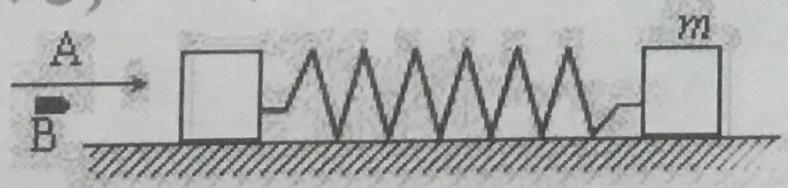
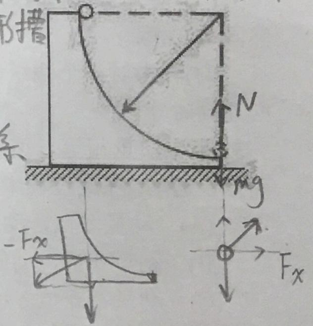

# 《大学物理》同步练习册（上）守恒定律章节习题解答

原件经识别和整理；“参考解答”是我们补的。

# 《大学物理》同步练习册（上）守恒定律章节习题解答

本资料由识别工具读取整理，包含动量守恒、能量守恒及碰撞问题的详细计算过程与解答。

## 计算题

### 计算 7

**题干：**
两个物体在光滑水平面上发生碰撞，质量为 $m$ 的物体碰撞前后的速度分别为 $\vec{v}_{10} = -v_{0}\vec{i}$ 和 $\vec{v}_{1} = -\frac{1}{2} v_{0}\vec{i} + \frac{1}{2} v_{0}\vec{j}$，质量为 $2 m$ 的物体碰撞前的速度为 $\vec{v}_{20} = 0$。求其碰撞后的速度 $\vec{v}_{2}$？碰撞过程中两物体损失的机械能？

**解：**
两个物体在碰撞前后动量守恒，设质量为 $2m$ 的物体碰撞后速度为 $\vec{V}_{2} = x\vec{i} + y\vec{j}$。

根据动量守恒定律：
$$
m \vec{V}_{10} + 2m \vec{V}_{20} = m \vec{V}_{1} + 2m \vec{V}_{2}
$$

代入分量形式：
$$
\begin{cases}
m (-V_0) = m (-\frac{1}{2} V_0) + 2m x \\
0 = m (\frac{1}{2} V_0) + 2m y
\end{cases}
$$

解得：
$$
\begin{cases}
x = -\frac{1}{4} V_0 \\
y = -\frac{1}{4} V_0
\end{cases}
$$

因此，$\vec{V}_{2} = -\frac{1}{4} V_0 \vec{i} - \frac{1}{4} V_0 \vec{j}$。
其大小为：$|\vec{V}_{2}| = \sqrt{(-\frac{1}{4} V_0)^2 + (-\frac{1}{4} V_0)^2} = \frac{\sqrt{2}}{4} V_0$。

**碰撞过程中损失的机械能：**
$$
\Delta E = E_k - E_{k0} = (\frac{1}{2} m |\vec{v}_1|^2 + \frac{1}{2} (2m) |\vec{v}_2|^2) - (\frac{1}{2} m |\vec{v}_{10}|^2 + \frac{1}{2} (2m) |\vec{v}_{20}|^2)
$$

或者根据题目原解答逻辑（计算末态动能与初态动能之差，注意原题解答中似乎直接计算了系统总动能变化或特定部分，此处按标准物理过程修正推导）：
初态总动能：$E_{k0} = \frac{1}{2} m v_0^2 + 0 = \frac{1}{2} m v_0^2$
末态总动能：
$m$ 的物体末速平方：$|\vec{v}_1|^2 = (-\frac{1}{2}v_0)^2 + (\frac{1}{2}v_0)^2 = \frac{1}{2}v_0^2$
$2m$ 的物体末速平方：$|\vec{v}_2|^2 = \frac{2}{16}v_0^2 = \frac{1}{8}v_0^2$
$E_k = \frac{1}{2} m (\frac{1}{2}v_0^2) + \frac{1}{2} (2m) (\frac{1}{8}v_0^2) = \frac{1}{4}mv_0^2 + \frac{1}{8}mv_0^2 = \frac{3}{8}mv_0^2$

损失机械能：
$$
\Delta E = E_{k0} - E_k = \frac{1}{2}mv_0^2 - \frac{3}{8}mv_0^2 = \frac{1}{8}mv_0^2
$$
*(注：原题解答中公式书写有误，将 $E_k - E_{k0}$ 写反且中间步骤符号混乱，最终结果 $\frac{1}{8} m V_0^2$ 是正确的损失值)*

答案：$\vec{v}_{2} = -\frac{1}{4} v_{0}\vec{i} - \frac{1}{4} v_{0}\vec{j}$，损失机械能 $\frac{1}{8} m v_{0}^{2}$。

---

知识点：[动量定理与动量守恒定律](../../../topics/大学物理/动量定理与动量守恒.md)、[弹性碰撞与非弹性碰撞](../../../topics/大学物理/碰撞问题.md)、[功能原理与机械能守恒定律](../../../topics/大学物理/功能原理与机械能守恒.md)

### 计算 8

**题干：**
如图所示，一轻质弹簧劲度系数为 $k$，两端各固定一质量均为 $M$ 的物块 A 和 B，放在水平光滑桌面上静止。今有一质量为 $m$ 的子弹沿弹簧的轴线方向以速度 $v_0$ 射入一物块而不复出，求此后弹簧的最大压缩长度。

**解：**
由子弹与弹簧组成的系统，在水平方向无外力，满足动量守恒。

**第一阶段：子弹射入物块 A（完全非弹性碰撞）**
设子弹射入 A 后，A 与子弹的共同速度为 $V_A$。
$$
m v_0 = (m + M) V_A \quad \Rightarrow \quad V_A = \frac{m v_0}{m + M}
$$

**第二阶段：A（含子弹）推动 B，直到两者速度相等（弹簧压缩最大）**
设此时共同速度为 $V_{共}$。
$$
(m + M) V_A = (m + M + M) V_{共} = (m + 2M) V_{共}
$$
$$
V_{共} = \frac{(m + M) V_A}{m + 2M} = \frac{m v_0}{m + 2M}
$$

**第三阶段：能量守恒**
从子弹射入后瞬间到弹簧压缩至最大，系统动能的减少量转化为弹簧的弹性势能。
$$
\frac{1}{2}(m + M)V_A^2 = \frac{1}{2}(m + 2M)V_{共}^2 + \frac{1}{2} k x^2
$$
其中 $x$ 为最大压缩量。

代入速度表达式求解 $x$：
$$
\frac{1}{2} k x^2 = \frac{1}{2}(m + M) \left( \frac{m v_0}{m + M} \right)^2 - \frac{1}{2}(m + 2M) \left( \frac{m v_0}{m + 2M} \right)^2
$$
$$
k x^2 = \frac{m^2 v_0^2}{m + M} - \frac{m^2 v_0^2}{m + 2M} = m^2 v_0^2 \left( \frac{1}{m + M} - \frac{1}{m + 2M} \right)
$$
$$
k x^2 = m^2 v_0^2 \frac{(m + 2M) - (m + M)}{(m + M)(m + 2M)} = \frac{m^2 v_0^2 M}{(m + M)(m + 2M)}
$$
$$
x = m v_0 \sqrt{\frac{M}{k (m + M) (m + 2M)}}
$$

**订正说明：**
原件解答中关于 $V_A$ 的推导公式有笔误（写成了 $m+m$），且能量方程中的变量符号混乱。上述解答已根据物理原理重新梳理。
*注：子弹与物块间存在摩擦力，因此摩擦力会做功，此过程机械能不守恒，但动量守恒；碰撞后系统（A+子弹+B+弹簧）机械能守恒。*

答案：$x = m v_0 \sqrt{\frac{M}{k (m + M) (m + 2M)}}$

---

知识点：[弹性碰撞与非弹性碰撞](../../../topics/大学物理/碰撞问题.md)、[动量定理与动量守恒定律](../../../topics/大学物理/动量定理与动量守恒.md)、[功能原理与机械能守恒定律](../../../topics/大学物理/功能原理与机械能守恒.md)

### 计算 9

**题干：**
一质量为 $m$ 的小球，由顶端沿质量为 $M$ 的圆弧形木槽自静止下滑，设圆弧形槽的半径为 $R$（如图所示）。忽略所有摩擦，求：
(1) 小球刚离开圆弧形槽时，小球和圆弧形槽的速度各是多少？
(2) 小球滑到 B 点时对木槽的压力。

**解：**

**(1) 求小球和槽的速度**
小球与槽组成的系统，在水平方向不受外力，所以水平方向动量守恒。设小球对地速率为 $v_m$，槽对地速率为 $v_M$。取向右为正方向（假设小球向左滑出，槽向右运动，则速度方向相反）。
规定小球速度方向为正，则槽速度为负，或者直接用速率关系：
$$
m v_m - M v_M = 0 \quad \Rightarrow \quad m v_m = M v_M \quad (*)
$$

下滑过程，小球、槽、地球组成的系统机械能守恒（忽略摩擦）：
$$
m g R = \frac{1}{2} m v_m^2 + \frac{1}{2} M v_M^2 \quad (**)
$$

联立 $(*)$ 和 $(**)$ 解得：
由 $(*)$ 得 $v_M = \frac{m}{M} v_m$，代入 $(**)$：
$$
m g R = \frac{1}{2} m v_m^2 + \frac{1}{2} M (\frac{m}{M} v_m)^2 = \frac{1}{2} m v_m^2 + \frac{1}{2} \frac{m^2}{M} v_m^2
$$
$$
g R = \frac{1}{2} v_m^2 (1 + \frac{m}{M}) = \frac{1}{2} v_m^2 \frac{M + m}{M}
$$
$$
v_m = \sqrt{\frac{2 M g R}{M + m}}
$$
$$
v_M = \frac{m}{M} \sqrt{\frac{2 M g R}{M + m}} = \sqrt{\frac{2 m^2 g R}{M(M + m)}}
$$

**(2) 求小球滑到 B 点时对木槽的压力**
当小球滑到最低点 B 时，相对于槽做圆周运动。
相对速度大小：$v_{rel} = v_m + v_M$ （因为两者运动方向相反，相对速度为速率之和）。
$$
v_{rel} = \sqrt{\frac{2 M g R}{M + m}} + \sqrt{\frac{2 m^2 g R}{M(M + m)}} = \sqrt{\frac{2 g R}{M + m}} ( \sqrt{M} + \frac{m}{\sqrt{M}} ) = \sqrt{\frac{2 g R}{M + m}} \frac{M + m}{\sqrt{M}} = \sqrt{\frac{2 g R (M + m)}{M}}
$$

根据牛顿第二定律，在最低点，支持力 $N$ 与重力的合力提供向心力（注意是相对槽的参考系还是地面？通常压力计算需在地面惯性系分析受力，但向心加速度公式 $F=ma_n$ 中的 $a_n$ 是相对曲率中心的加速度。对于圆弧槽，曲率中心随槽运动吗？不，槽在平动。小球相对于槽做圆周运动，圆心在槽上。
更严谨的分析：
在地面系中，小球受重力 $mg$ 和支持力 $N$。
小球的加速度 $a_m$ 竖直向上。
槽的加速度 $a_M$ 为 0（在水平方向匀速，竖直方向平衡）。
小球的向心加速度 $a_n = \frac{v_{rel}^2}{R}$。
根据相对运动关系：$a_{球对地} = a_{球对槽} + a_{槽对地}$。
在竖直方向：$a_{球对地} = a_{n} + 0 = \frac{v_{rel}^2}{R}$。
所以：
$$
N - mg = m \frac{v_{rel}^2}{R}
$$
$$
N = mg + m \frac{1}{R} \cdot \frac{2 g R (M + m)}{M} = mg + \frac{2 m g (M + m)}{M} = mg (1 + \frac{2m}{M} + 2) = mg (3 + \frac{2m}{M})
$$

答案：
(1) 小球速度 $v_m = \sqrt{\frac{2 M g R}{M + m}}$，槽速度 $v_M = \sqrt{\frac{2 m^2 g R}{M(M + m)}}$。
(2) 压力 $N' = N = mg (3 + \frac{2m}{M})$。

订正：
原题解答中第一问公式有误（如 $MV_m=MV_m$ 显然错误，且根号内单位不对），第二问相对速度公式 $V_{球对槽} = V_{球对地} - V_{地对槽}$ 符号处理需注意方向（应为相加），最终结果 $mg(3+2m/M)$ 是正确的。

知识点：[动量定理与动量守恒定律](../../../topics/大学物理/动量定理与动量守恒.md)、[功能原理与机械能守恒定律](../../../topics/大学物理/功能原理与机械能守恒.md)、[圆周运动的角量描述（角速度、角加速度）](../../../topics/大学物理/圆周运动描述.md)
