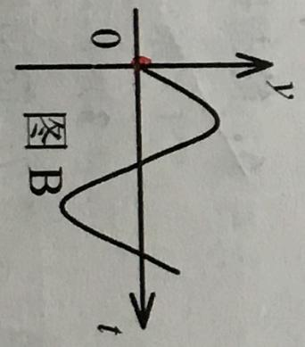
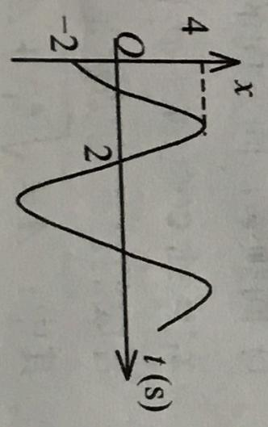
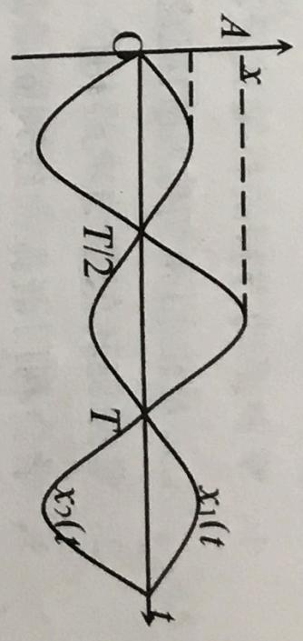

# 《大学物理》同步练习册（上）活页解答

原件经识别和整理；“参考解答”是我们补的。

# 《大学物理》同步练习册（上）活页解答

本资料由识别工具读取《大学物理》同步练习册（上）活页解答整理而成，包含综合练习题目的题干、图表及识别出的答案片段。

## 一、综合练习

### 综合 1

题干：一劲度系数为 k 的轻弹簧截成三等份，取出其中的两根，将……

答案：（原文未提供完整解答，仅列出题干）

知识点：[简谐振动的动力学特征与回复力](../../../topics/大学物理/简谐振动的动力学.md)

### 综合 2

题干：图A表示t=0时的余弦波的波形图，波沿x轴正向传播；图B为一余弦振动曲线，则图A中所表示的x=0处振动的初相位。

$$
\phi = \frac{\pi}{6}
$$

参考解答：图A中 $x=0$ 处质点在 $t=0$ 时位于平衡位置上方，且随后向正方向振动，因此初相位为  

$$
\boxed{\phi=\frac{\pi}{6}}
$$

理由：余弦波沿 $x$ 轴正向传播，$x=0$ 处振动曲线应与图B一致；由图B可知 $t=0$ 时位移为正且斜率为正，对应相位为 $+\frac{\pi}{6}$。

知识点：[平面简谐波的波函数 y=Acos(ω(t±x/u)+φ)](../../../topics/大学物理/平面简谐波方程.md)、[简谐振动的运动学方程（振幅、角频率、相位）](../../../topics/大学物理/简谐振动运动学.md)

### 综合 3

题干：一质点作简谐振动，其振动曲线如图所示. 根据此图, 它的周期 $T$ $= {24}/7$ ,用余弦函数描述时初……

答案：（原文未提供完整解答，仅列出题干及部分参数）

知识点：[简谐振动的运动学方程（振幅、角频率、相位）](../../../topics/大学物理/简谐振动运动学.md)、[用旋转矢量法确定初相与运动状态](../../../topics/大学物理/旋转矢量法.md)

### 综合 4

题干：一系统作简谐振动，周期为T，以余弦函数表达振动时，初相为零. 在 $0 \leqslant t \leqslant \frac{1}{2} T$ 范围内, 系统在 $t = \frac{\sqrt{7}}{8}, \frac{\sqrt[3]{7}}{8}$ 时刻动能和势能相等.

答案：（原文未提供完整解答，仅列出题干）

知识点：[简谐振动的运动学方程（振幅、角频率、相位）](../../../topics/大学物理/简谐振动运动学.md)、[简谐振动的动能、势能与总机械能](../../../topics/大学物理/简谐振动的能量.md)

### 综合 5

题干：两个同方向的简谐振动曲线如图所示,合振动的振幅动的初相位= $\frac{\pi}{2}$ 。

$$
F_{max} = 2.5 \times 10 N
$$

答案：$\frac{\pi}{2}$

知识点：[同方向同频率简谐振动的合成](../../../topics/大学物理/简谐振动的合成.md)
