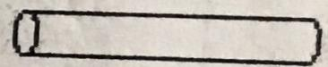

# 《大学物理》同步练习册（上）狭义相对论综合练习题参考答案

原件经识别和整理；“参考解答”是我们补的。

## 一、选择题

### 选择 1

关于经典力学和相对论，下列说法正确的是

- A. 经典力学和相对论是各自独立的学说，互不相容；
- B. 相对论是在否定了经典力学的基础上建立起来的；
- C. 相对论和经典力学是两种不同的学说，二者没有联系；
- D. 经典力学包含于相对论之中，经典力学是相对论的特例。

答案：D。

知识点：[伽利略变换与牛顿绝对时空观的局限性](../../../topics/大学物理/伽利略变换与绝对时空观.md)、[爱因斯坦的两个基本假设](../../../topics/大学物理/狭义相对论基本原理.md)

### 选择 2

以下效应不属于狭义相对论的是

- A. 时间延缓；
- B. 长度收缩；
- C. 质量变大；
- D. 时空弯曲。

答案：D。

知识点：[同时的相对性、时间膨胀与长度收缩](../../../topics/大学物理/狭义相对论时空观.md)、[爱因斯坦的两个基本假设](../../../topics/大学物理/狭义相对论基本原理.md)

### 选择 3

武汉长江大桥全长 $1250\ \text{m}$，在 $1000\ \text{m}$ 高空有一架与大桥平行匀速飞行的客机，客机上的乘客小明看到的大桥长度是

- A. 等于 $1250\ \text{m}$；
- B. 小于 $1250\ \text{m}$；
- C. 大于 $1250\ \text{m}$；
- D. 飞机飞行得越快，大桥将变得越长。

答案：B。

知识点：[同时的相对性、时间膨胀与长度收缩](../../../topics/大学物理/狭义相对论时空观.md)、[洛伦兹坐标变换与速度变换](../../../topics/大学物理/洛伦兹变换.md)

### 选择 4

两个惯性系 $\text{S}$ 和 $\text{S}'$，沿 $x(x')$ 轴方向作匀速相对运动，相对速度为 $u$。设在 $\text{S}'$ 系中某点先后发生两个事件，用静止于该系的钟测出两事件的时间间隔为 $\tau_0$，而用固定在 $\text{S}$ 系的钟测出这两个事件的时间间隔为 $\tau$。又在 $\text{S}'$ 系 $x'$ 轴上放置一静止于该系且长度为 $l_0$ 的细杆，从 $\text{S}$ 系测得此杆的长度为 $l$，则

- (A) $\tau < \tau_0;\ l < l_0$；
- (B) $\tau < \tau_0;\ l > l_0$；
- (C) $\tau > \tau_0;\ l > l_0$；
- (D) $\tau > \tau_0;\ l < l_0$。

答案：D。

知识点：[同时的相对性、时间膨胀与长度收缩](../../../topics/大学物理/狭义相对论时空观.md)

### 选择 5

如果你以接近于光速的速度朝一星体飞行，你是否可以根据下述变化发觉自己是在运动

- A. 你的质量在增加
- B. 你的心脏跳动在慢下来
- C. 你在变小
- D. 以上三种变化同时发生
- E. 你永远不能由自身的变化知道你的速度

答案：E。

知识点：[爱因斯坦的两个基本假设](../../../topics/大学物理/狭义相对论基本原理.md)、[同时的相对性、时间膨胀与长度收缩](../../../topics/大学物理/狭义相对论时空观.md)

### 选择 6

一根 $10\ \text{m}$ 长的梭镖以相对论速度穿过一根 $10\ \text{m}$ 长的管子，它们的长度都是在静止状态下测量的。以下哪种叙述最好地描述了梭镖穿过管子的情况？

- A. 梭镖收缩变短，因此在某些位置上，管子能完全遮住它
- B. 管子收缩变短，因此在某些位置上，梭镖从管子的两端伸出来
- C. 两者都收缩，且收缩量相等，因此在某个位置，管子恰好遮住梭镖
- D. 所有这些都与观察者的运动情况有关

参考解答：**答案：D**

设梭镖与管子的静止长度均为 $L_0=10\ \text{m}$，相对速度为 $v$，则运动物体的长度收缩为

$$
L=L_0\sqrt{1-\frac{v^2}{c^2}}.
$$

- **管子静止系**：梭镖运动而收缩，故梭镖可在某一时刻完全处于管内，对应 A。
- **梭镖静止系**：管子运动而收缩，故梭镖两端可同时伸出管外，对应 B。
- **其他惯性系**：若梭镖和管子速度不同，则收缩程度不同，C 并非普遍结论。

因此，观察到的长度及“是否被遮住”的描述与参考系有关；不同参考系对两端位置事件的**同时性**判断也不同，故表观矛盾并不冲突。

知识点：[伽利略变换与牛顿绝对时空观的局限性](../../../topics/大学物理/伽利略变换与绝对时空观.md)、[爱因斯坦的两个基本假设](../../../topics/大学物理/狭义相对论基本原理.md)、[同时的相对性、时间膨胀与长度收缩](../../../topics/大学物理/狭义相对论时空观.md)

### 选择 7

质子在加速器中被加速，当其动能为静止能量的 4 倍时，其质量为静止质量的

- A. …
- B. …

答案：B。$mc^2 - m_0c^2 = 4m_0c^2$，因此 $m = 5m_0$。

知识点：[相对论动能、静能与质能关系（E=mc²）](../../../topics/大学物理/相对论能量.md)、[相对论中的质量与动量](../../../topics/大学物理/相对论动量与质量.md)
