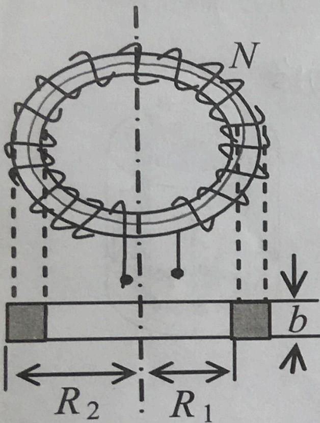

# 《大学物理》同步练习册（上）稳恒磁场习题

原件经识别和整理；“参考解答”是我们补的。

---
title: 《大学物理》同步练习册（上）稳恒磁场习题
kind: 习题
course: 大学物理
source: <原件地址或来源路径>
---

# 《大学物理》同步练习册（上）稳恒磁场习题

本资料由识别工具读取《大学物理》同步练习册（上）稳恒磁场部分习题整理而成。

## 一、计算题

### 计算 5

横截面为矩形的环形螺线管，圆环内外半径分别为 $R_{1}$ 和 $R_{2}$ ，芯子材料的磁导率为 $\mu$ ，导线总匝数为 N，绕得很密，若线圈通电流 I，求：(1) 芯子中的 H 值和芯子截面的磁通量。（2）在 $r < R_{1}$ 和 $r > R_{2}$ 处的 H 值。

解：(1) 在环内做半径为 r 的圆形回路由安培定理得.

$$
H \cdot 2 \pi r = N I
$$

$$
H = \frac {N I}{2 \pi r}
$$

$$
B = \mu H = \frac {\mu N I}{2 \pi r}
$$

在 $r$ 处取微小截面 $ds=b \cdot dr$，通过此小截面的磁通量.

$$
d \Phi = B \cdot d S = \frac {\mu N I}{2 \pi r} \cdot b \cdot d r
$$

穿过截面的磁通量

$$
\Phi = \int_ {S} B \cdot d s = \int_ {R _ {1}} ^ {R _ {2}} \frac {\mu N I}{2 \pi r} \cdot b d r = \frac {\mu N I b}{2 \pi} \ln \frac {R _ {2}}{R _ {1}}
$$

(2). 同样在环外 $(r < R_{1}$ 和 $r > R_{2})$ 作圆形回路.
由于 $\sum I_{i}=0$，$H \cdot 2 \pi r=0$ ∴ $H=0$

答案：见解题过程。

知识点：[安培环路定理及其应用](../../../topics/大学物理/安培环路定理.md)、[磁场与磁感应强度的定义](../../../topics/大学物理/磁感应强度.md)、[磁介质的分类、磁化强度与磁介质中的安培环路定理（H矢量）](../../../topics/大学物理/磁场中的磁介质.md)
