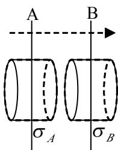

# 《大学物理》同步练习册（上）第21章 静电场中的电介质 参考答案

原件经识别和整理；“参考解答”是我们补的。

# 静电场中的电介质

## 一、选择题

### 选择 1

介质中的高斯定理 $\oint _ { S } \vec { D } \cdot d \vec { S } = \sum _ { ( S \text{内}) } q _ { 0 i }$，积分 $\oint _ { S } \vec { D } \cdot d \vec { S }$ 的结果只与高斯面内包围的自由电荷有关，但空间电位移矢量 $\vec { D }$ 的分布与整个空间中的自由电荷有关。

- A. 高斯面内不包围自由电荷但高斯面外有自由电荷时，高斯面上各点电位移矢量 $\vec { D }$ 不一定都为零。
- B. 高斯面的 $\vec { D }$ 通量 $\oint _ { S } \vec { D } \cdot d \vec { S }$ 仅与面内自由电荷有关。
- C. 高斯面上处处 $\vec { D }$ 为零，则 $\vec { D }$ 的通量 $\oint _ { S } { \vec { D } } \cdot d { \vec { S } } = 0$，说明高斯面内自由电荷代数和为零。

答案：B。

参考解答：根据介质中的高斯定理，$\vec{D}$ 的通量仅取决于高斯面内的自由电荷总量，与面外电荷及介质分布无关。虽然 $\vec{D}$ 的具体分布受所有自由电荷影响，但其通过闭合曲面的总通量只由内部自由电荷决定。选项 A 错误，因为即使内部无自由电荷，外部电荷仍可能使表面某处 $\vec{D} \neq 0$；选项 C 描述的是充分条件而非定义核心，且题目考察的是通量与电荷的关系本质。

知识点：[电介质的极化、电极化强度与有介质时的高斯定理（D矢量）](../../../topics/大学物理/静电场中的电介质.md)、[电通量的概念与静电场的高斯定理](../../../topics/大学物理/电通量与高斯定理.md)

### 选择 2

导体表面附近的电位移矢量 $D_{\perp} = \sigma_0$，其中 $\sigma_0$ 为导体表面自由电荷面密度，则导体表面附近的电场强度：$E_{\perp} = \frac { D_{\perp} } { \varepsilon_r \varepsilon_0 } = \frac { \sigma_0 } { \varepsilon_r \varepsilon_0 }$；本题中导体球表面附近的场强为 $E$，则球面上自由电荷面密度为：$\sigma_0 = \varepsilon_r \varepsilon_0 E$。

答案：A。

参考解答：在导体与介质分界面上，电位移矢量的法向分量等于该处的自由电荷面密度，即 $D_n = \sigma_f$。同时，本构关系给出 $D = \varepsilon E = \varepsilon_r \varepsilon_0 E$。因此，$\sigma_0 = D = \varepsilon_r \varepsilon_0 E$。

知识点：[电介质的极化、电极化强度与有介质时的高斯定理（D矢量）](../../../topics/大学物理/静电场中的电介质.md)、[静电平衡条件、导体表面电荷分布及接地问题](../../../topics/大学物理/静电场中的导体.md)、[电场强度的定义与叠加原理](../../../topics/大学物理/电场强度.md)

### 选择 3

高斯定理始终成立 $\oint _ { S } \vec { E } \cdot d \vec { S } = \frac { 1 } { \varepsilon _ { 0 } } \sum _ { ( S \text{内}) } q _ { i }$，但由于空间电介质分布不对称，使得空间电场强度非对称分布，即在图中闭合球面 $S$ 上各点场强 $E$ 大小不等，所以不能由高斯定理求出闭合球面 $S$ 上各点场强。

答案：B。

参考解答：真空中的高斯定理 $\oint_S \vec{E} \cdot d\vec{S} = Q_{enc}/\varepsilon_0$ 总是成立的。但是，利用高斯定理求解电场 $\vec{E}$ 的前提是具有高度的对称性（如球对称、轴对称或平面对称），以便将 $\vec{E}$ 从积分号中提出。当电介质分布不对称导致电场分布也不对称时，无法直接通过高斯定理解出表面上每一点的场强大小和方向。

知识点：[电通量的概念与静电场的高斯定理](../../../topics/大学物理/电通量与高斯定理.md)、[电介质的极化、电极化强度与有介质时的高斯定理（D矢量）](../../../topics/大学物理/静电场中的电介质.md)、[几种特殊带电体（点电荷、无限长直线、圆环、圆盘等）激发的电场](../../../topics/大学物理/特殊带电体电场.md)

### 选择 4

有电介质存在时，电介质发生极化，端面出现极化电荷（亦称束缚电荷），空间总电场强度 $\vec { E }$ 是由自由电荷与束缚电荷共同产生的。

答案：C。

参考解答：在静电场中引入电介质后，介质内部的正负电荷中心会发生相对位移，产生极化现象，进而在介质表面或体内产生极化电荷（束缚电荷）。此时，空间任意一点的总电场 $\vec{E}$ 是自由电荷产生的电场与极化电荷产生的电场的矢量和。

知识点：[电介质的极化、电极化强度与有介质时的高斯定理（D矢量）](../../../topics/大学物理/静电场中的电介质.md)

### 选择 5

因为平行板电容器始终与电源相连，所以电容器两板的电压 $U_0$ 不变。

当两板间为真空时 $U_0 = E_0 d \implies$ 电场强度大小：$E_0 = \frac { U_0 } { d }$，电位移：$D_0 = \varepsilon_0 E_0 = \varepsilon_0 \frac { U_0 } { d }$ （真空 $\varepsilon_r = 1$）；

当两板间充满电介质时，电介质中场强均匀分布，且电压不变，$U_0 = E d \implies$ 电场强度大小：$E = \frac { U_0 } { d } = E_0$；电位移：$D = \varepsilon_r \varepsilon_0 E = \varepsilon_r \varepsilon_0 \frac { U_0 } { d } = \varepsilon_r \varepsilon_0 E_0 = \varepsilon_r D_0$。

答案：需结合具体选项判断（原题未提供完整选项列表，通常此类题考察 $E$ 不变，$D$ 变为原来的 $\varepsilon_r$ 倍）。

参考解答：电容器始终连接电源，意味着极板间电压 $U$ 保持恒定。
1. **电场强度**：对于平行板电容器，$E = U/d$。由于 $U$ 和 $d$ 均未改变，故电场强度 $E$ 保持不变，即 $E = E_0$。
2. **电位移矢量**：$D = \varepsilon E$。真空时 $D_0 = \varepsilon_0 E_0$；插入介电常数为 $\varepsilon_r$ 的电介质后，$D = \varepsilon_r \varepsilon_0 E = \varepsilon_r D_0$。
结论：电场强度不变，电位移矢量增大为原来的 $\varepsilon_r$ 倍。

知识点：[电介质的极化、电极化强度与有介质时的高斯定理（D矢量）](../../../topics/大学物理/静电场中的电介质.md)、[电容的定义与典型电容器的电容计算](../../../topics/大学物理/电容与电容器.md)

### 选择 6

平行板电容器充电后，相邻两表面带等量异号电荷，设电荷面密度分别为 $+ \sigma_0$ 和 $- \sigma_0$，则两板之间电位移矢量 $D = \sigma_0$。又两板之间为真空 $\varepsilon_r = 1$，则两板之间场强为：$E = \frac { D } { \varepsilon_r \varepsilon_0 } = \frac { \sigma_0 } { \varepsilon_0 }$。

充电后断开电源，两板上电荷电量保持不变，仍分别为 $+ \sigma_0$ 和 $- \sigma_0$。此时插入金属板，则金属板上表面感应出面密度为 $- \sigma_0$ 的负电荷，下表面感应出面密度为 $+ \sigma_0$ 的正电荷，金属板内场强处处为零。

金属板上方和下方区域中，电位移矢量 $D = \sigma_0$ 不变，则电场强度 $E = \frac { D } { \varepsilon_r \varepsilon_0 } = \frac { \sigma_0 } { \varepsilon_0 }$ 也不变，且与金属板位置无关。

答案：需结合具体选项判断（原题未提供完整选项列表，通常此类题考察场强分布及总场强的变化）。

参考解答：
1. **初始状态**：充电后断开电源，极板电荷量 $Q$ 守恒，面电荷密度 $\sigma_0$ 不变。板间为真空，$D = \sigma_0$，$E = \sigma_0 / \varepsilon_0$。
2. **插入金属板后**：
   - 金属板处于静电平衡状态，内部场强为 0。
   - 金属板上下表面感应出等量异号电荷。由于原极板电荷未变，且金属板整体不带电，根据高斯定理分析，金属板上下表面的感应电荷面密度分别为 $-\sigma_0$ 和 $+\sigma_0$（假设原左板为正）。
   - 在金属板左侧空隙和右侧空隙中，电位移矢量 $D$ 依然由自由电荷决定，大小为 $\sigma_0$。
   - 因此，空隙中的电场强度 $E' = D / \varepsilon_0 = \sigma_0 / \varepsilon_0$，大小与原场强相同。
   - 注意：虽然局部场强大小没变，但两极板间的总距离中有一部分被金属板占据（场强为0），所以两板间的总电压会降低。

知识点：[静电平衡条件、导体表面电荷分布及接地问题](../../../topics/大学物理/静电场中的导体.md)、[电容的定义与典型电容器的电容计算](../../../topics/大学物理/电容与电容器.md)

### 选择 7

(1) 充满电介质的平行板电容器中，电场均匀分布。设电介质中的电场强度大小为 $E$。由于电容器始终与电源相连，即 $U_0 = E d$。电介质中的电场强度大小为 $E = \frac { U_0 } { d }$。
$\Rightarrow$ 电位移矢量：$D = \varepsilon_r \varepsilon_0 E = \varepsilon_r \varepsilon_0 \frac { U_0 } { d }$。

答案：需结合具体选项判断（原题未提供完整选项列表，此题通常为计算或填空的一部分，描述了电压不变时的 $E$ 和 $D$ 的计算过程）。

参考解答：同选择 5 的分析逻辑。电压 $U_0$ 恒定，距离 $d$ 不变，故 $E = U_0/d$ 不变。电位移 $D = \varepsilon E = \varepsilon_r \varepsilon_0 (U_0/d)$。

知识点：[电介质的极化、电极化强度与有介质时的高斯定理（D矢量）](../../../topics/大学物理/静电场中的电介质.md)、[电容的定义与典型电容器的电容计算](../../../topics/大学物理/电容与电容器.md)、[电场强度的定义与叠加原理](../../../topics/大学物理/电场强度.md)

### 选择 8

设水平向右为 $x$ 轴正方向，电介质内部三个区域中的电场强度分别为 $E_{\mathrm{I}} = - \frac { E_{0} } { 3 }$，$E_{\mathrm{II}} = - E_{0}$，$E_{\mathrm{III}} = \frac { E_{0} } { 3 }$。

答案：需结合具体选项判断（原题未提供完整选项列表，此题给出了特定边界条件下电介质各区域的电场分布结果）。

参考解答：此题通常涉及多层介质或带有空腔/电极的结构。给出的结果是各区域电场强度的具体数值表达式。解题关键在于应用介质中高斯定理 $\nabla \cdot \vec{D} = \rho_f$ 以及边界条件 $\vec{D}_{1n} - \vec{D}_{2n} = \sigma_f$ 和 $\vec{E}_{1t} = \vec{E}_{2t}$，并结合电位连续性方程进行联立求解。

## 计算 8

相应的电位移矢量为

$$D_{\mathrm{I}} = \varepsilon_{r}\varepsilon_{0}E_{\mathrm{I}} = -\varepsilon_{r}\varepsilon_{0}\frac{E_{0}}{3},\quad D_{\mathrm{II}} = -\varepsilon_{r}\varepsilon_{0}E_{0},\quad D_{\mathrm{III}} = \varepsilon_{r}\varepsilon_{0}\frac{E_{0}}{3};$$

在区域 I 和 II 中作一底面积为 $\Delta S$ 的圆柱面，侧面垂直于 A 平板，如图，由 $\vec{D}$ 的高斯定理：

$$\oint_{S}\vec{D}\cdot d\vec{S} = \sigma_{A}\Delta S \Rightarrow -D_{\mathrm{I}}\cdot\Delta S + D_{\mathrm{II}}\cdot\Delta S = \sigma_{A}\Delta S,$$

$$\Rightarrow\ \varepsilon_{r}\varepsilon_{0}\frac{E_{0}}{3}\cdot\Delta S - \varepsilon_{r}\varepsilon_{0}E_{0}\cdot\Delta S = \sigma_{A}\Delta S \Rightarrow \text{A 平板电荷面密度：}\ \sigma_{A} = -\frac{2}{3}\varepsilon_{r}\varepsilon_{0}E_{0}$$

同理，在区域 II 和 III 中作一底面积为 $\Delta S$ 的圆柱面，侧面垂直于 B 平板，如图，由 $\vec{D}$ 的高斯定理：

$$\oint_{S}\vec{D}\cdot d\vec{S} = \sigma_{B}\Delta S \Rightarrow -D_{\mathrm{II}}\cdot\Delta S + D_{\mathrm{III}}\cdot\Delta S = \sigma_{B}\Delta S,$$

$$\Rightarrow \varepsilon_{r}\varepsilon_{0}E_{0}\cdot\Delta S + \varepsilon_{r}\varepsilon_{0}\frac{E_{0}}{3}\cdot\Delta S = \sigma_{B}\Delta S \Rightarrow \text{B 平板电荷面密度：}\ \sigma_{B} = \frac{4}{3}\varepsilon_{r}\varepsilon_{0}E_{0}$$

## 计算 9

设半径为 $R_{1}$ 的内导体单位长度的电量（电荷线密度）为 $\lambda$，则外导体在半径为 $R_{2}$ 的内表面上感应出电荷线密度为 $-\lambda$ 的电荷。在介质中作一半径为 $r$、高为 $h$ 的圆柱面作为高斯面，由 $\vec{D}$ 的高斯定理：

$$R_{1} < r < R_{2},\quad \oint_{S}\vec{D}\cdot d\vec{S} = \lambda h \Rightarrow D\cdot 2\pi r h = \lambda h \Rightarrow D = \frac{\lambda}{2\pi r}$$

由 $D = \varepsilon_{r}\varepsilon_{0}E \Rightarrow$ 电介质中的电场强度大小 $E = \frac{\lambda}{2\pi\varepsilon_{r}\varepsilon_{0}r}$；

在 $R_{1} < r < R_{2}$ 介质范围中 $r = R_{1}$ 时，介质中场强最大：

$$E(R_{1}) = \frac{\lambda}{2\pi\varepsilon_{r}\varepsilon_{0}R_{1}} \le E_{\max} \Rightarrow \frac{\lambda}{2\pi\varepsilon_{r}\varepsilon_{0}} \le E_{\max}\cdot R_{1};$$

电缆承受的电压：

$$U = \int_{R_{1}}^{R_{2}}\vec{E}\cdot d\vec{r} = \int_{R_{1}}^{R_{2}}\frac{\lambda}{2\pi\varepsilon_{r}\varepsilon_{0}r}dr = \frac{\lambda}{2\pi\varepsilon_{r}\varepsilon_{0}}\int_{R_{1}}^{R_{2}}\frac{1}{r}dr = \frac{\lambda}{2\pi\varepsilon_{r}\varepsilon_{0}}\ln\frac{R_{2}}{R_{1}} \le E_{\max}\cdot R_{1}\cdot\ln\frac{R_{2}}{R_{1}}$$

所以电缆能够承受的最高电压：

$$U_{\max} = E_{\max}\cdot R_{1}\cdot\ln\frac{R_{2}}{R_{1}} = 110\ \mathrm{V}$$

## 计算 10

设半径为 $R_{1}$ 的内导体圆筒单位长度的电量（电荷线密度）为 $\lambda$，则外导体圆筒在半径为 $R_{2}$ 的内表面上感应出电荷线密度为 $-\lambda$ 的电荷。在介质中作一半径为 $r$、高为 $h$ 的圆柱面作为高斯面，由 $\vec{D}$ 的高斯定理：

$$R_{1} < r < R_{2},\quad \oint_{S}\vec{D}\cdot d\vec{S} = \lambda h \Rightarrow D\cdot 2\pi r h = \lambda h \Rightarrow D = \frac{\lambda}{2\pi r};$$

由 $D = \varepsilon_{r}\varepsilon_{0}E \Rightarrow$ 电介质中的电场强度大小 $E = \frac{\lambda}{2\pi\varepsilon_{r}\varepsilon_{0}r}$。

电缆承受的电压：

$$U_{12} = \int_{R_{1}}^{R_{2}}\vec{E}\cdot d\vec{r} = \int_{R_{1}}^{R_{2}}\frac{\lambda}{2\pi\varepsilon_{r}\varepsilon_{0}r}dr = \frac{\lambda}{2\pi\varepsilon_{r}\varepsilon_{0}}\int_{R_{1}}^{R_{2}}\frac{1}{r}dr = \frac{\lambda}{2\pi\varepsilon_{r}\varepsilon_{0}}\ln\frac{R_{2}}{R_{1}} = 32\ \mathrm{V}$$

A 点的电场强度为：

$$E_{A} = \frac{\lambda}{2\pi\varepsilon_{r}\varepsilon_{0}R} = \frac{32\ \mathrm{V}}{R\cdot\ln\dfrac{R_{2}}{R_{1}}} = 997.8\ \mathrm{V/m};$$

A 点与外圆筒的电势差为：

$$U_{A2} = \int_{R}^{R_{2}}\vec{E}\cdot d\vec{r} = \int_{R}^{R_{2}}\frac{\lambda}{2\pi\varepsilon_{r}\varepsilon_{0}r}dr = \frac{\lambda}{2\pi\varepsilon_{r}\varepsilon_{0}}\ln\frac{R_{2}}{R} = \frac{32\ \mathrm{V}}{\ln\dfrac{R_{2}}{R_{1}}}\ln\frac{R_{2}}{R} = 12.5\ \mathrm{V}$$

知识点：[电介质的极化、电极化强度与有介质时的高斯定理（D矢量）](../../../topics/大学物理/静电场中的电介质.md)、[电通量的概念与静电场的高斯定理](../../../topics/大学物理/电通量与高斯定理.md)
