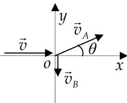
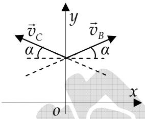

# 《大学物理》同步练习册上第8章 碰撞（答案）

原件经识别和整理；“参考解答”是我们补的。

## 练习

### 简答 1

整个过程分为两部分：（1）子弹 A 击中木块 B 并以共同速度运动过程中，弹簧仍为原长，即墙壁对系统没有作用力，则在此过程中系统在光滑水平面上水平方向合外力为零，水平方向动量守恒；但该过程是非弹性碰撞，系统能量有损失，机械能不守恒。（2）随后，子弹和木块将以共同运动速度推动弹簧发生形变，当子弹和木块的速度减小到零时，弹簧压缩到最短，在此过程中系统在水平方向上受到墙壁的作用力不为零，水平方向动量不守恒；但这段过程中系统只有弹簧的弹性力（保守内力）做功，系统机械能守恒。综上，在子弹开始射入到弹簧压缩到最短的整个过程中系统动量不守恒，机械能不守恒。

答案：本题选（D）。

知识点：[弹性碰撞与非弹性碰撞](../../../topics/大学物理/碰撞问题.md)、[功能原理与机械能守恒定律](../../../topics/大学物理/功能原理与机械能守恒.md)

### 简答 2

（1）保守力做功等于势能的减少，$W_{A \to B} = E_{pA} - E_{pB}$，所以保守力做正功时系统内相应势能减少。

（2）保守力做功与路径无关，保守力沿一闭合路径做功为零。

（3）作用力与反作用力（又称为一对力）做功之和与参照系的选择无关，但一对力做功之和不一定为零，例如子弹打入木块时受到的摩擦阻力及反作用力做功之和就不为零，有部分能量损失。

答案：本题选（C）。

知识点：[保守力及其势能、中心力场与有效势](../../../topics/大学物理/保守力与势能.md)、[功的定义、功率与质点动能定理](../../../topics/大学物理/功与动能定理.md)、[功能原理与机械能守恒定律](../../../topics/大学物理/功能原理与机械能守恒.md)

### 简答 3

（A）（C）由于动量 $\vec{P} = m\vec{v}$，速度 $\vec{v}$ 均为矢量，不仅有大小，还有方向。当斜面倾角不同时，速度方向不同，故速度不同，动量也不同。

答案：本题选（B）。

知识点：[动量定理与动量守恒定律](../../../topics/大学物理/动量定理与动量守恒.md)、[速度、加速度的定义与微分关系](../../../topics/大学物理/速度与加速度定义.md)、[牛顿定律在变力问题中的应用（如 ma_t = -mg sinθ）](../../../topics/大学物理/牛顿定律应用.md)

### 简答 4

（B）（D）斜面光滑且高度相同，下滑过程中重力做功等于质点动能的增加，$mgh = \frac{1}{2}mv^2$，动能相同，速度大小也相同，$v = \sqrt{2gh}$，但因倾角不同，速度在水平方向的分量不同，则动量在水平方向的分量也不同。系统不受外力作用，则系统动量守恒；非弹性碰撞过程中动能不守恒。

答案：本题选（C）。

知识点：[功的定义、功率与质点动能定理](../../../topics/大学物理/功与动能定理.md)、[动量定理与动量守恒定律](../../../topics/大学物理/动量定理与动量守恒.md)、[弹性碰撞与非弹性碰撞](../../../topics/大学物理/碰撞问题.md)

### 简答 5

小球从高度为 $H$ 的地方自由落下，则小球着地前速度大小为 $v = \sqrt{2gH}$；与地面碰撞后弹起的高度为 $h$，则小球弹起的速度大小为 $v' = \sqrt{2gh}$；设竖直向上为正方向，碰撞时间为 $t$，且忽略重力的影响，地面对小球的冲量作用等于小球动量的变化：

$$\overline{F}t = mv' - (-mv) \Rightarrow \overline{F} = \frac{m}{t}\left(\sqrt{2gh} + \sqrt{2gH}\right)$$

答案：本题选（D）。

补充：时间 $t$ 为定值，当质量 $m$ 一定时，$h$ 越大，平均冲击力才越大；当 $h$ 一定时，平均冲击力与小球质量成正比。

知识点：[动量定理与动量守恒定律](../../../topics/大学物理/动量定理与动量守恒.md)、[功的定义、功率与质点动能定理](../../../topics/大学物理/功与动能定理.md)

### 计算 6

质点的加速度：

$$a = \frac{F}{m} = 6t$$

由 $a = \frac{\mathrm{d}v}{\mathrm{d}t}$ 得

$$\int_0^v \mathrm{d}v = \int_0^3 6t\,\mathrm{d}t \Rightarrow v = 27\ \mathrm{m/s}$$

即第 3 s 末的速度大小为 $27\ \mathrm{m/s}$。前 3 s 内该力做功等于质点动能的增加：

$$W_F = \frac{1}{2}mv^2 - 0 = 27^2 = 729\ \mathbf{J}$$

参考解答：**结论：** 第 $3\ \mathrm{s}$ 末质点速度大小为 $27\ \mathrm{m/s}$，前 $3\ \mathrm{s}$ 内该力做功为 $729\ \mathrm{J}$。

**推理与计算过程：**

1. **求加速度**  
   由牛顿第二定律：
   $$a = \frac{F}{m} = 6t$$

2. **求第 $3\ \mathrm{s}$ 末的速度**  
   由 $a = \dfrac{\mathrm{d}v}{\mathrm{d}t}$，分离变量并从静止（$v_0=0$）积分：
   $$\int_0^v \mathrm{d}v = \int_0^3 6t\,\mathrm{d}t$$
   $$v = 3t^2 \Big|_0^3 = 3 \times 9 = 27\ \mathrm{m/s}$$

3. **求前 $3\ \mathrm{s}$ 内力做的功**  
   由动能定理，合外力做功等于动能增量（初动能为零）：
   $$W_F = \Delta E_k = \frac{1}{2}mv^2 - 0$$
   其中由 $a = F/m = 6t$ 可知 $m = 2\ \mathrm{kg}$（对应原题意中 $F = 12t$），代入得：
   $$W_F = \frac{1}{2} \times 2 \times 27^2 = 729\ \mathrm{J}$$

知识点：[牛顿定律在变力问题中的应用（如 ma_t = -mg sinθ）](../../../topics/大学物理/牛顿定律应用.md)、[功的定义、功率与质点动能定理](../../../topics/大学物理/功与动能定理.md)

### 计算 7

质点质量 $m = 0.02\ \mathrm{kg}$，在 A 点处的速度：

$$\vec{v}_A = 20 \times \left(\frac{\sqrt{2}}{2}\vec{i} + \frac{\sqrt{2}}{2}\vec{j}\right)\ \mathrm{m/s}$$

在 B 点处的速度：

$$\vec{v}_B = -20\vec{i}\ \mathrm{m/s}$$

作用于质点的冲量等于质点动量的变化：

$$\vec{I} = m\vec{v}_B - m\vec{v}_A = \left(-\frac{2+\sqrt{2}}{5}\vec{i} - \frac{\sqrt{2}}{5}\vec{j}\right)\ \mathrm{N\cdot s} = \left(-0.683\vec{i} - 0.283\vec{j}\right)\ \mathrm{N\cdot s}$$

参考解答：结论：

$$
\vec{I}=m\vec{v}_B-m\vec{v}_A
=(-0.683\,\vec{i}-0.283\,\vec{j})\ \mathrm{N\cdot s}
$$

关键步骤：

$$
\vec{v}_A=20\left(\frac{\sqrt2}{2}\vec i+\frac{\sqrt2}{2}\vec j\right)
=10\sqrt2\,\vec i+10\sqrt2\,\vec j
$$

$$
\vec{v}_B=-20\,\vec i
$$

$$
\vec{I}=m(\vec{v}_B-\vec{v}_A)
=0.02\big[(-20-10\sqrt2)\vec i-10\sqrt2\,\vec j\big]
$$

$$
=(-0.4-0.2\sqrt2)\vec i-0.2\sqrt2\,\vec j
$$

代入 $\sqrt2\approx1.414$：

$$
\vec{I}\approx -0.683\,\vec i-0.283\,\vec j\ \mathrm{N\cdot s}
$$

知识点：[动量定理与动量守恒定律](../../../topics/大学物理/动量定理与动量守恒.md)

### 计算 8

立定跳远过程可看成斜抛运动。设人站在地面上跳远时，初速度大小为 $v_0$，与水平方向夹角为 $\theta$，可得站在地面上可跳远：

$$x_m = v_0\cos\theta \cdot \frac{2v_0\sin\theta}{g} = 5\ \mathrm{m}$$

人站在小车上跳远时，相对小车的初速度仍为 $v_0$，夹角为 $\theta$，设小车的速度大小为 $u$，由于人和小车构成的系统在水平方向动量守恒：

$$m(v_0\cos\theta - u) - Mu = 0 \Rightarrow (m+M)u = mv_0\cos\theta \Rightarrow u = \frac{m}{m+M}v_0\cos\theta$$

那么，站在小车上可跳远：

$$x_m' = \left(v_0\cos\theta - u\right) \cdot \frac{2v_0\sin\theta}{g} = \frac{M}{m+M}v_0\cos\theta \cdot \frac{2v_0\sin\theta}{g} = 3.5\ \mathrm{m}$$

参考解答：**结论：** 人站在小车上跳远的距离为 $x_m' = 3.5\ \mathrm{m}$。

---

**推理与计算过程：**

**1. 站在地面上跳远**

将立定跳远视为斜抛运动，初速度大小为 $v_0$，与水平方向夹角为 $\theta$。

飞行时间由竖直方向决定：
$$t = \frac{2v_0\sin\theta}{g}$$

水平跳远距离：
$$x_m = v_0\cos\theta \cdot t = \frac{2v_0^2\sin\theta\cos\theta}{g} = 5\ \mathrm{m} \tag{1}$$

**2. 站在小车上跳远**

设小车质量为 $M$，人的质量为 $m$。人相对小车的起跳初速度仍为 $v_0$、仰角仍为 $\theta$，设起跳后小车获得的后退速度大小为 $u$（取人前进方向为正）。

- **人相对地面的水平速度：** $v_x = v_0\cos\theta - u$
- **竖直方向不受影响，** 故空中飞行时间不变，仍为 $t = \dfrac{2v_0\sin\theta}{g}$

人与小车系统在水平方向不受外力，动量守恒。起跳前系统静止，起跳后：
$$m(v_0\cos\theta - u) - Mu = 0$$

解出小车后退速度：
$$(m+M)u = mv_0\cos\theta \implies u = \frac{m}{m+M}v_0\cos\theta$$

因此人对地的水平速度为：
$$v_x = v_0\cos\theta - u = v_0\cos\theta - \frac{m}{m+M}v_0\cos\theta = \frac{M}{m+M}v_0\cos\theta$$

**3. 求小车上的跳远距离**

$$x_m' = v_x \cdot t = \frac{M}{m+M}v_0\cos\theta \cdot \frac{2v_0\sin\theta}{g}$$

注意到 $v_0\cos\theta \cdot \dfrac{2v_0\sin\theta}{g} = x_m = 5\ \mathrm{m}$，代入得：

$$x_m' = \frac{M}{m+M} \cdot x_m = \frac{M}{m+M} \times 5\ \mathrm{m} = 3.5\ \mathrm{m}$$

> **关键物理图像：** 由于水平方向动量守恒，人在起跳时将一部分动能传递给了小车，导致人对地的水平速度减小为原来的 $\dfrac{M}{m+M}$ 倍，而竖直运动不变，因此跳远距离按同一比例缩短。

知识点：[动量定理与动量守恒定律](../../../topics/大学物理/动量定理与动量守恒.md)、[相对运动与伽利略变换](../../../topics/大学物理/相对运动.md)、[位矢及其坐标表示（直角坐标与自然坐标）](../../../topics/大学物理/位矢与坐标表示.md)

### 计算 9

如图，设 B 球以水平速度 $\vec{v} = v\vec{i}$ 入射，碰后 B 球速度 $\vec{v}_B = -\frac{v}{2}\vec{j}$，A 球速度为 $\vec{v}_A$。由动量守恒：

$$m\vec{v} = m\vec{v}_A + m\vec{v}_B \Rightarrow \vec{v}_A = \vec{v} - \vec{v}_B = v\vec{i} + \frac{v}{2}\vec{j}$$

$$\Rightarrow \tan\theta = \frac{1}{2} \Rightarrow \theta = \arctan\frac{1}{2}$$

即碰后 A 球与 B 球入射速度 $v$ 成夹角 $\theta = \arctan\frac{1}{2}$。

参考解答：**结论：** 碰后 A 球的速度方向与 B 球入射速度 $\vec v$ 的夹角为

$$
\boxed{\theta=\arctan\frac12\approx26.6^\circ}
$$

（A 球速度大小为 $\displaystyle v_A=\frac{\sqrt5}{2}v$，方向斜向下。）

两球质量相同，碰撞过程中系统动量守恒：

$$
m\vec v=m\vec v_A+m\vec v_B
$$

所以

$$
\vec v_A=\vec v-\vec v_B
=v\vec i-\left(-\frac v2\vec j\right)
=v\vec i+\frac v2\vec j .
$$

因此

$$
\tan\theta=\frac{|v_{Ay}|}{v_{Ax}}
=\frac{v/2}{v}=\frac12,
\qquad
\boxed{\theta=\arctan\frac12}.
$$

知识点：[动量定理与动量守恒定律](../../../topics/大学物理/动量定理与动量守恒.md)、[弹性碰撞与非弹性碰撞](../../../topics/大学物理/碰撞问题.md)

### 计算 10

如图，发射后 $t$ 秒炮弹的速度为 $(v_0 - gt)\vec{j}$，爆炸过程中动量守恒：

$$
3m\left(v_0 - gt\right)\vec{j} = m\left(v\cos\alpha\,\vec{i} + v\sin\alpha\,\vec{j}\right) + m\left(-v\cos\alpha\,\vec{i} + v\sin\alpha\,\vec{j}\right),
$$

$$
\Rightarrow 3\left(v_0 - gt\right) = 2v\sin\alpha \Rightarrow v = \frac{3\left(v_0 - gt\right)}{2\sin\alpha}.
$$

若炮弹在上升过程中爆炸，$t < \frac{v_0}{g}$，夹角 $\alpha$ 为正值，B、C 两块沿水平方向斜向上，速度大小：$\frac{3(v_0 - gt)}{2\sin\alpha}$。

若炮弹在下降过程中爆炸，$t > \frac{v_0}{g}$，夹角 $\alpha$ 为负值，B、C 两块沿水平方向斜向下，速度大小：$\frac{3(gt - v_0)}{2\sin\alpha}$。

参考解答：爆炸后 B、C 两块的速度大小均为 $\displaystyle \frac{3|v_0 - gt|}{2\sin\alpha}$；当 $t < v_0/g$ 时方向斜向上，当 $t > v_0/g$ 时方向斜向下。

爆炸过程内力远大于外力，系统动量守恒。爆炸前总质量为 $3m$，竖直速度为 $(v_0 - gt)\vec{j}$；爆炸后 B、C 质量各为 $m$，速度分别为 $v(\cos\alpha\,\vec{i}+\sin\alpha\,\vec{j})$ 和 $v(-\cos\alpha\,\vec{i}+\sin\alpha\,\vec{j})$。水平分量自动抵消，竖直分量给出：
$$
3m(v_0 - gt) = 2mv\sin\alpha \quad\Rightarrow\quad v = \frac{3(v_0 - gt)}{2\sin\alpha}.
$$
由于速率 $v>0$，需取绝对值：$v = \dfrac{3|v_0 - gt|}{2\sin\alpha}$。当 $t<v_0/g$ 时 $v_0-gt>0$，$\sin\alpha>0$，碎片斜向上；当 $t>v_0/g$ 时 $v_0-gt<0$，实际运动方向与 $\vec{j}$ 反向，即斜向下，速率表达式中分子变为 $3(gt-v_0)$。

知识点：[速度、加速度的定义与微分关系](../../../topics/大学物理/速度与加速度定义.md)、[动量定理与动量守恒定律](../../../topics/大学物理/动量定理与动量守恒.md)
