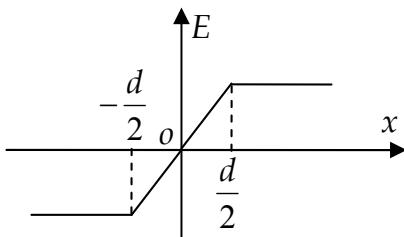
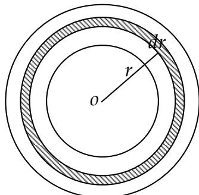

# 《大学物理》同步练习册上答案（第18章 电势与电势能）

原件经识别和整理；“参考解答”是我们补的。

## 电势 电势能

### 选择 1

点电荷 $q$ 在空间产生的电场强度： $\vec { E } = \frac { 1 } { 4 \pi \varepsilon _ { 0 } } \frac { q } { r ^ { 2 } } \hat { r } _ { 0 }$ ，单位矢量 $\hat { r } _ { 0 }$ 方向从点电荷 $q$ 指向该点。

如果 $N$ 个点电荷 $q$ 在圆环上无规则分布，它们在轴线上同一点 P 产生的电场强度大小相等， $E = { \frac { q } { 4 \pi \varepsilon _ { 0 } r ^ { 2 } } }$ ，但方向相对 z 轴不均匀分布，使得各点电荷的电场强度 $\vec { E }$ 在垂直于 z 轴方向上的分量可能不一定刚好抵消，即 P 点总场强可能有垂直于 z 轴方向分量；各点电荷在沿 z 轴方向上的分量大小相等， $E _ { z } = { \frac { q } { 4 \pi \varepsilon _ { 0 } r ^ { 2 } } } \cos \theta$ 。点电荷在 P 点总场强的 z 轴分量： $\frac { N q } { 4 \pi \varepsilon _ { 0 } r ^ { 2 } } { \cos \theta }$ ；

如果 $N$ 个点电荷 $q$ 在圆环上均匀分布，各点电荷在轴线上同一点 P 产生的电场强度大小相等， $E = { \frac { q } { 4 \pi \varepsilon _ { 0 } r ^ { 2 } } }$ 且方向相对 z 轴均匀分布，使得电场强度 $\vec { E }$ 在垂直于 z 轴方向上的分量刚好抵消，即 P 点总场强一定没有垂直于 z 轴方向分量；各点电荷在沿 z 轴方向上的分量大小相等， $E _ { z } = { \frac { q } { 4 \pi \varepsilon _ { 0 } r ^ { 2 } } } \cos \theta$ ，则 $N$ 个点电荷在 P 点总场强的 z 轴分量： $\frac { N q } { 4 \pi \varepsilon _ { 0 } r ^ { 2 } } { \cos \theta }$ ，所以不论电荷在圆环上是无规则分布，还是均匀分布，P 点总场强的 z 轴分量相等。

取无穷远处电势为零， $V _ { \infty } = 0$ ， $V ( r ) = { \frac { q } { 4 \pi \varepsilon _ { 0 } r } }$ ，电势是标量，圆环上各点电荷在轴线上同一点 P 产生的电势都相等，所以不论电荷在圆环上是无规则分布，还是均匀分布， $N$ 个点电荷在 P 点的总电势： $V _ { _ P } = { \frac { N q } { 4 \pi \varepsilon _ { 0 } r } }$ 相等。

答案：C

知识点：[电场强度的定义与叠加原理](../../../topics/大学物理/电场强度.md)、[几种特殊带电体（点电荷、无限长直线、圆环、圆盘等）激发的电场](../../../topics/大学物理/特殊带电体电场.md)

### 选择 2

设圆半径为 $r$，取无穷远处电势为零， $V _ { \infty } = 0$ ，则点电荷 $-q$ 在圆周上各点产生的电势相等， $V ( r ) = { \frac { - q } { 4 \pi \varepsilon _ { 0 } r } }$ ，即 $V _ { _ A } = V _ { _ B } = V _ { _ C } = V _ { _ D } = { \frac { - q } { 4 \pi \varepsilon _ { 0 } r } }$ ;

试验电荷 $q _ { 0 }$ 从 A 点分别移动到 B、C、D 点电场力做功分别为：

$$
W _ {A B} = q _ {0} \left(V _ {A} - V _ {B}\right) = 0, \quad W _ {A C} = q _ {0} \left(V _ {A} - V _ {C}\right) = 0, \quad W _ {A D} = q _ {0} \left(V _ {A} - V _ {D}\right) = 0,
$$

所以 $W _ { _ { A B } } = W _ { _ { A C } } = W _ { _ { A D } } = 0$ ，从 A 到各点，电场力做功相等。

答案：D

知识点：[静电场环路定理、电势与电势差](../../../topics/大学物理/环路定理与电势.md)、[功的定义、功率与质点动能定理](../../../topics/大学物理/功与动能定理.md)

### 简答 3

等边三角形顶点到中心 o 的距离： $r = { \frac { a } { 2 } } \cdot { \frac { 1 } { \sqrt { 3 } } } \cdot 2 = { \frac { a } { \sqrt { 3 } } } = { \frac { \sqrt { 3 } } { 3 } } a$

若取无穷远处电势为零， $V _ { \infty } = 0$ ，则中心 o 处的电势为：

$$
U = V _ {q} + V _ {2 q} + V _ {3 q} = \frac {q}{4 \pi \varepsilon_ {0} r} + \frac {2 q}{4 \pi \varepsilon_ {0} r} + \frac {3 q}{4 \pi \varepsilon_ {0} r} = \frac {6 q}{4 \pi \varepsilon_ {0} \frac {\sqrt {3}}{3} a} = \frac {3 \sqrt {3} q}{2 \pi \varepsilon_ {0} a}.
$$

参考解答：**结论**：等边三角形中心 $o$ 处的电势为  
$$
U = \frac{3\sqrt{3}\, q}{2\pi\varepsilon_0 a}.
$$

**推理与计算过程**  
1. **几何关系**：等边三角形边长 $a$，中心到顶点的距离  
   $$
   r = \frac{a}{\sqrt{3}} = \frac{\sqrt{3}}{3}\,a.
   $$

2. **点电荷电势叠加**：设三个点电荷 $q$、$2q$、$3q$ 分别位于三个顶点，取无穷远为电势零点，则中心 $o$ 处的电势为各点电荷单独存在时产生电势的代数和：  
   $$
   U = \frac{q}{4\pi\varepsilon_0 r} + \frac{2q}{4\pi\varepsilon_0 r} + \frac{3q}{4\pi\varepsilon_0 r} = \frac{(q+2q+3q)}{4\pi\varepsilon_0 r} = \frac{6q}{4\pi\varepsilon_0 r}.
   $$

3. **代入 $r$**：  
   $$
   U = \frac{6q}{4\pi\varepsilon_0 \cdot \frac{\sqrt{3}}{3}a} = \frac{6q \cdot 3}{4\pi\varepsilon_0 \sqrt{3}\, a} = \frac{18q}{4\pi\varepsilon_0 \sqrt{3}\, a} = \frac{9q}{2\pi\varepsilon_0 \sqrt{3}\, a}.
   $$  
   化简有理化分母：  
   $$
   U = \frac{9q}{2\pi\varepsilon_0 \sqrt{3}\, a} \cdot \frac{\sqrt{3}}{\sqrt{3}} = \frac{9\sqrt{3}\, q}{2\pi\varepsilon_0 \cdot 3\, a} = \frac{3\sqrt{3}\, q}{2\pi\varepsilon_0 a}.
   $$

故得上述结论。

知识点：[几种特殊带电体（点电荷、无限长直线、圆环、圆盘等）激发的电场](../../../topics/大学物理/特殊带电体电场.md)、[静电场环路定理、电势与电势差](../../../topics/大学物理/环路定理与电势.md)

### 简答 4

若取无穷远处电势为零， $V _ { \infty } = 0$ ，半径为 R、均匀带电 $Q$ 的球面的电势在空间的分布：

$$
V (r) = \left\{ \begin{array}{l l} \frac {Q}{4 \pi \varepsilon_ {0} R} & (r \leq R) \\ \frac {Q}{4 \pi \varepsilon_ {0} r} & (r > R) \end{array} , \right.
$$

如果球面上电荷面密度为 $\sigma$ ，球面带电： $Q = \sigma \cdot 4 \pi R ^ { 2 }$ ，则球面上的电势为： $U = V ( R ) = { \frac { Q } { 4 \pi \varepsilon _ { 0 } R } } = { \frac { \sigma R } { \varepsilon _ { 0 } } }$

参考解答：## 结论

均匀带电球面的电势分布为：

$$
V(r)=\begin{cases}
\dfrac{Q}{4\pi\varepsilon_0 R}, & r\le R \
$$
6pt]
\dfrac{Q}{4\pi\varepsilon_0 r}, & r>R
\end{cases}
$$

球面上（$r=R$）的电势：

$$
U=\frac{Q}{4\pi\varepsilon_0 R}=\frac{\sigma R}{\varepsilon_0}
$$

## 推理

**球面外（$r>R$）**：由对称性，用高斯定理可得电场等同于电荷集中于球心的点电荷：

$$
\vec E=\frac{Q}{4\pi\varepsilon_0 r^2}\,\hat r
$$

由电势定义 $V(r)=-\displaystyle\int_\infty^r \vec E\cdot d\vec l$：

$$
V(r)=-\int_\infty^r \frac{Q}{4\pi\varepsilon_0 r'^2}\,dr'=\frac{Q}{4\pi\varepsilon_0 r}
$$

**球面内（$r\le R$）**：球面内电场为零，故球面内是等势区，电势处处等于球面处的值：

$$
V(r)=V(R)=\frac{Q}{4\pi\varepsilon_0 R}
$$

**用 $\sigma$ 表示**：代入 $Q=\sigma\cdot 4\pi R^2$：

$$
U=\frac{\sigma\cdot 4\pi R^2}{4\pi\varepsilon_0 R}=\frac{\sigma R}{\varepsilon_0}
$$

知识点：[几种特殊带电体（点电荷、无限长直线、圆环、圆盘等）激发的电场](../../../topics/大学物理/特殊带电体电场.md)、[静电场环路定理、电势与电势差](../../../topics/大学物理/环路定理与电势.md)、[静电场的能量与能量密度](../../../topics/大学物理/静电场的能量.md)

### 简答 5

电荷均匀分布在两个球面上，空间电场具有球对称性，求两带电球面之间 P 点的场强大小，只需在两球面之间作一半径为 $r$ 的同心球面 S 为高斯面，包围电荷电量为 $Q _ { 1 }$ ，由高斯定理：

$\oint _ { S } { \vec { E } } \cdot d { \vec { S } } = \frac { 1 } { \varepsilon _ { 0 } } Q _ { 1 } \ \Rightarrow \ E \cdot 4 \pi r ^ { 2 } = \frac { 1 } { \varepsilon _ { 0 } } Q _ { 1 } \ \Rightarrow$ 球面之间 P 点的场强大小： $E = { \frac { Q _ { 1 } } { 4 \pi \varepsilon _ { 0 } r ^ { 2 } } }$

求两带电球面在 P 点的电势，只需把各个带电球面单独存在时在 P 点产生的电势代数相加即可。

由于 P 点到球心的距离为 $r$ ，且 $R _ { 1 } < r < R _ { 2 }$ ，即 P 点在球面 $Q _ { 1 }$ 外，在球面 $Q _ { 2 }$ 内。

P 点在球面 $Q _ { 1 }$ 外，则球面 $Q _ { 1 }$ 在 P 点产生的电势： $V _ { Q _ { 1 } P } = { \frac { Q _ { 1 } } { 4 \pi \varepsilon _ { 0 } r } }$ ，（取无穷远处电势为零， $V _ { \infty } = 0 \ )$

P 点在球面 $Q _ { 2 }$ 内，则球面 $Q _ { 2 }$ 在 P 点产生的电势： $V _ { Q _ { 2 } P } = \frac { Q _ { 2 } } { 4 \pi \varepsilon _ { 0 } R _ { 2 } }$

所以球面间 P 点的电势： $V _ { P } = V _ { Q _ { 1 } P } + V _ { Q _ { 2 } P } = { \frac { Q _ { 1 } } { 4 \pi \varepsilon _ { 0 } r } } + { \frac { Q _ { 2 } } { 4 \pi \varepsilon _ { 0 } R _ { 2 } } } $

参考解答：**结论**

两带电球面之间 P 点的场强大小为：

$$E = \frac{Q_1}{4\pi\varepsilon_0 r^2}$$

P 点的电势为：

$$V_P = \frac{Q_1}{4\pi\varepsilon_0 r} + \frac{Q_2}{4\pi\varepsilon_0 R_2}$$

---

**推理与计算过程**

**1. 求场强 $E$**

电荷均匀分布在两个同心球面上，空间电场具有球对称性。在两球面之间取半径为 $r$（$R_1 < r < R_2$）的同心球面 $S$ 作为高斯面。该高斯面仅包围内球面的电荷 $Q_1$。

由高斯定理：

$$\oint_S \vec{E} \cdot d\vec{S} = \frac{Q_1}{\varepsilon_0}$$

由于球对称性，高斯面上各点场强大小相等且方向沿径向，故：

$$E \cdot 4\pi r^2 = \frac{Q_1}{\varepsilon_0}$$

解得：

$$E = \frac{Q_1}{4\pi\varepsilon_0 r^2}$$

**2. 求电势 $V_P$**

由电势叠加原理，P 点的总电势等于各带电球面单独存在时在 P 点产生电势的代数和（取无穷远处 $V_\infty = 0$）。

- **内球面 $Q_1$ 的贡献**：P 点在半径为 $R_1$ 的球面 $Q_1$ 之外（$r > R_1$），均匀带电球面在外部产生的电势等效于全部电荷集中在球心的点电荷电势：

$$V_{Q_1 P} = \frac{Q_1}{4\pi\varepsilon_0 r}$$

- **外球面 $Q_2$ 的贡献**：P 点在半径为 $R_2$ 的球面 $Q_2$ 之内（$r < R_2$），均匀带电球面内部各点电势相等，均等于球面上的电势：

$$V_{Q_2 P} = \frac{Q_2}{4\pi\varepsilon_0 R_2}$$

将两者叠加，得 P 点电势：

$$V_P = V_{Q_1 P} + V_{Q_2 P} = \frac{Q_1}{4\pi\varepsilon_0 r} + \frac{Q_2}{4\pi\varepsilon_0 R_2}$$

知识点：[电通量的概念与静电场的高斯定理](../../../topics/大学物理/电通量与高斯定理.md)、[静电场环路定理、电势与电势差](../../../topics/大学物理/环路定理与电势.md)、[几种特殊带电体（点电荷、无限长直线、圆环、圆盘等）激发的电场](../../../topics/大学物理/特殊带电体电场.md)

### 简答 6

无限大均匀带电平板两侧电场关于平板中央平面对称。

（1）当 $| x | < \frac { d } { 2 }$ 时，在平板内作一圆柱面 $S _ { 1 }$ 为高斯面，垂直于中央平面，且关于中央平面对称，圆柱面的底面积为 $\Delta s$ ，高为 $2 | x |$ ，包围的电荷： $\rho \cdot 2 | x | \cdot \Delta s$ ，由高斯定理：

$$
\oint_ {S _ {1}} \vec {E} \cdot d \vec {S} = \frac {1}{\varepsilon_ {0}} \rho \cdot 2 | x | \cdot \Delta s \Rightarrow 2 E \Delta s = \frac {1}{\varepsilon_ {0}} \rho \cdot 2 | x | \cdot \Delta s \Rightarrow E = \frac {\rho}{\varepsilon_ {0}} | x |;
$$

（2）当 $x > \frac { d } { 2 }$ 时，同理，在平板外作一圆柱面 $S _ { 2 }$ 为高斯面，垂直于中央平面，且关于中央平面对称，圆柱面的底面积为 $\Delta s$ ，高为 $2 | x |$ ，包围的电荷： $\rho \cdot d \cdot \Delta s$ ，由高斯定理：

$$
\oint_ {S _ {2}} \vec {E} \cdot d \vec {S} = \frac {1}{\varepsilon_ {0}} \rho \cdot d \cdot \Delta s \Rightarrow 2 E \Delta s = \frac {1}{\varepsilon_ {0}} \rho \cdot d \cdot \Delta s \Rightarrow E = \frac {\rho}{2 \varepsilon_ {0}} d;
$$

参考解答：**结论**

设沿垂直平板方向为 $x$ 轴，中央平面为 $x=0$，平板厚度为 $d$，电荷体密度为 $\rho$。则电场大小为

\[
E(x)=
\begin{cases}
\dfrac{\rho}{\varepsilon_0}|x|, & |x|<\dfrac d2,\\[6pt]
\dfrac{\rho d}{2\varepsilon_0}, & |x|\ge \dfrac d2.
\end{cases}
$$

方向由中央平面指向两侧。

---

**简要推理**

取关于中央平面对称的圆柱形高斯面，底面积为 $\Delta S$，两底面到中央平面等距。

**内部 $|x|<d/2$**  
圆柱高为 $2|x|$，包围电荷  

$$
q_{\text{内}}=\rho\cdot 2|x|\Delta S.
$$

由高斯定理  

$$
2E\Delta S=\frac{\rho\cdot 2|x|\Delta S}{\varepsilon_0},
$$

故  

$$
E=\frac{\rho}{\varepsilon_0}|x|.
$$

**外部 $|x|\ge d/2$**  
圆柱高为 $2|x|$，但包围的平板厚度只有 $d$，故  

$$
q_{\text{内}}=\rho d\Delta S.
$$

由高斯定理  

$$
2E\Delta S=\frac{\rho d\Delta S}{\varepsilon_0},
$$

故  

$$
E=\frac{\rho d}{2\varepsilon_0}.
$$

所以外部为匀强电场，内部场强随到中央平面的距离线性增大。

知识点：[电通量的概念与静电场的高斯定理](../../../topics/大学物理/电通量与高斯定理.md)、[电场强度的定义与叠加原理](../../../topics/大学物理/电场强度.md)

### 计算 6

**答案：**
场强大小：
$$E = \left\{ \begin{array} { l l } { \displaystyle \frac { \rho } { \varepsilon _ { 0 } } \big \vert x \big \vert } & { ( \big \vert x \big \vert \leq \displaystyle \frac { d } { 2 } ) } \\ { \displaystyle \frac { \rho } { 2 \varepsilon _ { 0 } } d } & { ( \big \vert x \big \vert > \displaystyle \frac { d } { 2 } ) } \end{array} \right.$$

方向从中央平面指向两侧，左侧向左，右侧向右。

$E-x$ 变化曲线如图所示。

参考解答：**结论：**

场强大小：

$$
E = \begin{cases} \dfrac{\rho}{\varepsilon_0}|x|, & |x| \leq \dfrac{d}{2} \
$$
10pt] \dfrac{\rho d}{2\varepsilon_0}, & |x| > \dfrac{d}{2} \end{cases}
$$

方向：从中央平面（$x=0$）指向两侧，即 $x>0$ 区域向右，$x<0$ 区域向左。

$E$-$x$ 曲线：在板内（$|x|\leq d/2$）为过原点的折线（斜率 $\pm\rho/\varepsilon_0$），在板外（$|x|>d/2$）为水平直线 $E=\rho d/(2\varepsilon_0)$，关于原点奇对称。

---

**推理与计算过程：**

由题意，无限大平板厚度为 $d$，体电荷密度为 $\rho$，取平板中央平面为 $x=0$。由对称性知 $\vec{E}$ 沿 $x$ 方向，且关于中央平面对称。

**1. 板内（$|x| \leq d/2$）**

取以中央平面为中心、截面积为 $S$、厚度为 $2|x|$ 的柱形高斯面，两底面位于 $\pm x$ 处。由高斯定理：

$$
\oint \vec{E}\cdot d\vec{S} = \frac{q_{\text{enc}}}{\varepsilon_0}
$$

侧面通量为零，两底面通量各为 $ES$，故左端 $= 2ES$。包围电荷 $q_{\text{enc}} = \rho \cdot S \cdot 2|x|$。因此：

$$
2ES = \frac{\rho \cdot 2|x| \cdot S}{\varepsilon_0} \implies E = \frac{\rho}{\varepsilon_0}|x|
$$

**2. 板外（$|x| > d/2$）**

取同样柱形高斯面，但厚度延伸至板外，包围整个板厚 $d$。包围电荷 $q_{\text{enc}} = \rho \cdot S \cdot d$。由高斯定理：

$$
2ES = \frac{\rho d S}{\varepsilon_0} \implies E = \frac{\rho d}{2\varepsilon_0}
$$

此结果与 $x$ 无关，说明板外为匀强电场。

**3. 方向判断**

$\rho > 0$ 时，电场由正电荷向外发散，故从中央平面向两侧指；$\rho < 0$ 时反向。

知识点：[电通量的概念与静电场的高斯定理](../../../topics/大学物理/电通量与高斯定理.md)、[电场强度的定义与叠加原理](../../../topics/大学物理/电场强度.md)、[几种特殊带电体（点电荷、无限长直线、圆环、圆盘等）激发的电场](../../../topics/大学物理/特殊带电体电场.md)

### 计算 7

**答案：**
若取无穷远处电势为零， $V _ { \infty } = 0$ ，点电荷+q在空间的电势： $V ( r ) = { \frac { q } { 4 \pi \varepsilon _ { 0 } r } }$

则 P点的电势： $V _ { \scriptscriptstyle P } = \frac { q } { 4 \pi \varepsilon _ { 0 } a }$ ，M点的电势： $V _ { \scriptscriptstyle M } = \frac { q } { 4 \pi \varepsilon _ { 0 } 2 a }$

M 点和 P点的电势差：
$$V _ { \scriptscriptstyle M } - V _ { \scriptscriptstyle P } = \frac { q } { 4 \pi \varepsilon _ { 0 } 2 a } - \frac { q } { 4 \pi \varepsilon _ { 0 } a } = - \frac { q } { 8 \pi \varepsilon _ { 0 } a }$$

注意：空间某一点的电势和电势零点的选取有关，但两点之间的电势差与电势零点的选取无关！若取 P点的电势为零，即 $V _ { P } = 0$ ，由电势差： $V _ { \scriptscriptstyle M } - V _ { \scriptscriptstyle P } = - \frac { q } { 8 \pi \varepsilon _ { 0 } a }$ 与电势零点的选取无关，$\Rightarrow$ M 点的电势： $V _ { \scriptscriptstyle M } = - \frac { q } { 8 \pi \varepsilon _ { 0 } a }$

参考解答：**结论：** 若取无穷远处为电势零点，则 $V_P=\dfrac{q}{4\pi\varepsilon_0 a}$，$V_M=\dfrac{q}{8\pi\varepsilon_0 a}$，故
\[
V_M-V_P=-\frac{q}{8\pi\varepsilon_0 a}.
$$

若改取 $P$ 点为电势零点，则 $V_P=0$，而

$$
V_M=-\frac{q}{8\pi\varepsilon_0 a}.
$$

**推理与计算：**

点电荷 $+q$ 产生的电场中，取无穷远处电势为零时，距点电荷 $r$ 处的电势为

$$
V(r)=\frac{q}{4\pi\varepsilon_0 r}.
$$

由 $P$、$M$ 到点电荷的距离分别为 $a$、$2a$，得

$$
V_P=\frac{q}{4\pi\varepsilon_0 a},\qquad
V_M=\frac{q}{4\pi\varepsilon_0(2a)}
=\frac{q}{8\pi\varepsilon_0 a}.
$$

因此

$$
V_M-V_P
=\frac{q}{8\pi\varepsilon_0 a}-\frac{q}{4\pi\varepsilon_0 a}
=-\frac{q}{8\pi\varepsilon_0 a}.
$$

电势的数值与电势零点的选取有关，但两点间的电势差与零点选取无关。若取 $V_P=0$，则仍有

$$
V_M-V_P=-\frac{q}{8\pi\varepsilon_0 a},
$$

所以

$$
\boxed{V_M=-\frac{q}{8\pi\varepsilon_0 a}}.
$$

知识点：[静电场环路定理、电势与电势差](../../../topics/大学物理/环路定理与电势.md)

### 计算 8

**答案：**
在球层内取一半径为r 、厚度为 dr 的薄球壳，体积为 $d V = 4 \pi r ^ { 2 } d r$ ，电量为 $d Q = \rho d V = \rho 4 \pi r ^ { 2 } d r$ ，该薄球壳可近似于一带电球面，显然，空腔中任一点 P必定也在该薄球壳内部，则薄球壳在空腔中的电势： $d V = { \frac { d Q } { 4 \pi \varepsilon _ { 0 } r } }$ （注意：r为薄球壳的半径）那么，整个带电球层在空腔中的电势：
$$V = \int_{R_1}^{R_2} dV = \int_{R_1}^{R_2} \frac{\rho 4 \pi r^2 dr}{4 \pi \varepsilon_0 r} = \frac{\rho}{\varepsilon_0} \int_{R_1}^{R_2} r dr = \frac{\rho}{2\varepsilon_0}(R_2^2 - R_1^2)$$

参考解答：空腔内任意一点的电势为 $V = \dfrac{\rho}{2\varepsilon_0}(R_2^2 - R_1^2)$，且空腔内电势处处相等。

在球层中取半径为 $r$、厚度为 $\mathrm{d}r$ 的薄球壳，其电荷量为 $\mathrm{d}q = \rho \cdot 4\pi r^2 \mathrm{d}r$。由于空腔内任一点均位于该薄球壳内部，根据均匀带电球面内部电势等于球面处电势的性质，该薄球壳在空腔内产生的电势贡献为：
$$
\mathrm{d}V = \frac{\mathrm{d}q}{4\pi\varepsilon_0 r} = \frac{\rho \cdot 4\pi r^2 \mathrm{d}r}{4\pi\varepsilon_0 r} = \frac{\rho r}{\varepsilon_0} \mathrm{d}r
$$
对 $r$ 从 $R_1$ 到 $R_2$ 积分，由电势叠加原理得总电势：
$$
V = \int_{R_1}^{R_2} \frac{\rho r}{\varepsilon_0} \mathrm{d}r = \frac{\rho}{\varepsilon_0} \left[ \frac{r^2}{2} \right]_{R_1}^{R_2} = \frac{\rho}{2\varepsilon_0}(R_2^2 - R_1^2)
$$
积分结果与场点位置无关，故空腔内为等势区。注意此处 $\mathrm{d}V$ 表示电势微元而非体积微元，符号相同但物理意义不同；分母中的 $r$ 是源点球壳半径，因场点在壳内，球壳对其内部各点电势贡献恒为 $k\,\mathrm{d}q/r$，与场点具体位置无关。

知识点：[电场强度的定义与叠加原理](../../../topics/大学物理/电场强度.md)、[电介质的极化、电极化强度与有介质时的高斯定理（D矢量）](../../../topics/大学物理/静电场中的电介质.md)、[电通量的概念与静电场的高斯定理](../../../topics/大学物理/电通量与高斯定理.md)

### 计算 9

**答案：**
电荷的分布具有球对称性，则电场在空间的分布也具有球对称性。

（1）在球体内作一半径为r的球面 $S _ { 1 }$ 为高斯面，包围的电荷： $\int _ { 0 } ^ { r } \rho _ { 0 } ( 1 - \frac { r } { R } ) \cdot 4 \pi r ^ { 2 } d r$ ，由高斯定理：

$$
r <   R, \quad \oint_ {S _ {1}} \vec {E} \cdot d \vec {S} = \frac{1}{\varepsilon_ {0}} \int_ {0} ^ {r} \rho_ {0} (1 - \frac{r}{R}) \cdot 4 \pi r ^ {2} d r \Rightarrow E \cdot 4 \pi r ^ {2} = \frac{1}{\varepsilon_ {0}} 4 \pi \rho_ {0} r ^ {3} (\frac {1}{3} - \frac{r}{4 R}) \Rightarrow E = \frac{1}{\varepsilon_ {0}} \rho_ {0} (\frac {r}{3} - \frac {r ^ {2}}{4 R})
$$

（2）在球体外作一半径为r的球面 $S _ { 2 }$ 为高斯面，包围的电荷： $\int _ { 0 } ^ { R } \rho _ { 0 } ( 1 - \frac { r } { R } ) \cdot 4 \pi r ^ { 2 } d r$ ，由高斯定理：

$$
r > R, \quad \oint_ {S _ {2}} \vec {E} \cdot d \vec {S} = \frac{1}{\varepsilon_ {0}} \int_ {0} ^ {R} \rho_ {0} (1 - \frac{r}{R}) \cdot 4 \pi r ^ {2} d r \Rightarrow E \cdot 4 \pi r ^ {2} = \frac{1}{\varepsilon_ {0}} 4 \pi \rho_ {0} \frac {R ^ {3}}{1 2} \Rightarrow E = \frac {\rho_ {0} R ^ {3}}{1 2 \varepsilon_ {0} r ^ {2}};
$$

$\Rightarrow$ 电场强度在空间的分布：
$$E = \left\{ \begin{array} { l l } { \displaystyle \frac { 1 } { \varepsilon _ { 0 } } \rho _ { 0 } \big ( \frac { r } { 3 } - \frac { r ^ { 2 } } { 4 R } \big ) } & { \big ( r \leq R \big ) } \\ { \displaystyle \frac { \rho _ { 0 } R ^ { 3 } } { 1 2 \varepsilon _ { 0 } r ^ { 2 } } } & { \big ( r > R \big ) } \end{array} \right.$$

在球体外，电场强度随半径r增大而减小，场强递减，则球体外场强最大为： $\frac { \rho _ { 0 } R ^ { 3 } } { 1 2 \varepsilon _ { 0 } R ^ { 2 } } { = } \frac { \rho _ { 0 } R } { 1 2 \varepsilon _ { 0 } }$ ；

在球体内，由 $\frac { d E } { d r } = \frac { 1 } { \varepsilon _ { 0 } } \rho _ { 0 } ( \frac { 1 } { 3 } - \frac { r } { 2 R } ) = 0$ ，$\Rightarrow$ 电场强度在 $r = \frac { 2 } { 3 } R$ 取极值，

又由 $\frac { d ^ { 2 } E } { d r ^ { 2 } } = - \frac { \rho _ { 0 } } { \varepsilon _ { 0 } } \frac { r } { 2 R } < 0$ ，$\Rightarrow$ 电场强度在 $r = \frac { 2 } { 3 } R$ 取极大值，球体内场强最大： $\frac { 1 } { \varepsilon _ { 0 } } \rho _ { 0 } [ \frac { \frac { 2 } { 3 } R } { 3 } - \frac { ( \frac { 2 } { 3 } R ) ^ { 2 } } { 4 R } ] = \frac { \rho _ { 0 } R } { 9 \varepsilon _ { 0 } }$ $\Rightarrow$ 电场强度在 $r = \frac { 2 } { 3 } R$ 处有极大值，场强极大值为： $E _ { \mathrm { m a x } } = { \frac { \rho _ { 0 } R } { 9 \varepsilon _ { 0 } } } > { \frac { \rho _ { 0 } R } { 1 2 \varepsilon _ { 0 } } }$

参考解答：电场强度最大值为 $E_{\max} = \dfrac{\rho_0 R}{9\varepsilon_0}$，出现在 $r = \dfrac{2}{3}R$ 处。

由于电荷分布 $\rho(r) = \rho_0(1 - r/R)$ 具有球对称性，电场方向沿径向且大小仅与 $r$ 有关，可应用高斯定理求解。

1.  **球内场强 ($r \leq R$)**：取半径为 $r$ 的高斯球面， enclosed charge 为
    $$
    Q_{\text{enc}} = \int_0^r \rho_0\left(1-\frac{r'}{R}\right) 4\pi r'^2 dr' = 4\pi\rho_0\left(\frac{r^3}{3} - \frac{r^4}{4R}\right)
    $$
    由高斯定理 $E \cdot 4\pi r^2 = Q_{\text{enc}}/\varepsilon_0$，得
    $$
    E(r) = \frac{\rho_0}{\varepsilon_0}\left(\frac{r}{3} - \frac{r^2}{4R}\right)
    $$

2.  **球外场强 ($r > R$)**：高斯面包围总电荷
    $$
    Q_{\text{total}} = \int_0^R \rho_0\left(1-\frac{r'}{R}\right) 4\pi r'^2 dr' = \frac{\pi\rho_0 R^3}{3}
    $$
    故
    $$
    E(r) = \frac{Q_{\text{total}}}{4\pi\varepsilon_0 r^2} = \frac{\rho_0 R^3}{12\varepsilon_0 r^2}
    $$

3.  **求极大值**：球外 $E(r) \propto r^{-2}$ 单调递减，最大值在 $r=R$ 处为 $\rho_0 R/(12\varepsilon_0)$；球内对 $E(r)$ 求导：
    $$
    \frac{dE}{dr} = \frac{\rho_0}{\varepsilon_0}\left(\frac{1}{3} - \frac{r}{2R}\right) = 0 \quad \Rightarrow \quad r = \frac{2}{3}R
    $$
    二阶导数 $\dfrac{d^2E}{dr^2} = -\dfrac{\rho_0}{2\varepsilon_0 R} < 0$，确认该点为极大值。代入得
    $$
    E\left(\frac{2}{3}R\right) = \frac{\rho_0}{\varepsilon_0}\left(\frac{2R}{9} - \frac{4R^2/9}{4R}\right) = \frac{\rho_0 R}{9\varepsilon_0}
    $$
    因 $\dfrac{\rho_0 R}{9\varepsilon_0} > \dfrac{\rho_0 R}{12\varepsilon_0}$，故全局最大值即为 $\dfrac{\rho_0 R}{9\varepsilon_0}$。

知识点：[电荷守恒定律与库仑定律](../../../topics/大学物理/电荷守恒与库仑定律.md)、[电通量的概念与静电场的高斯定理](../../../topics/大学物理/电通量与高斯定理.md)、[电场强度的定义与叠加原理](../../../topics/大学物理/电场强度.md)
