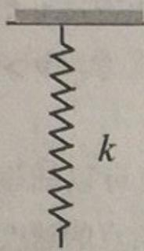
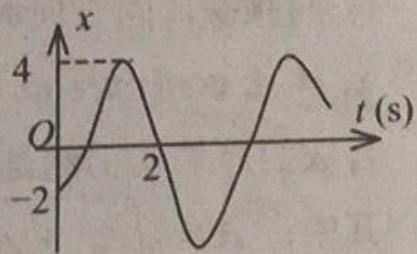
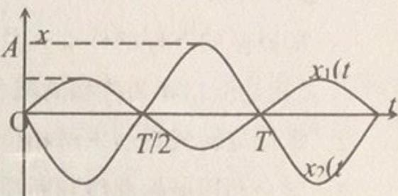

# 《大学物理》同步练习册（上）综合练习参考答案

原件经识别和整理；“参考解答”是我们补的。

### 综合练习

#### 选择 1

一劲度系数为 $k$ 的轻弹簧截成三等份，取出其中的两根，将它们并联，下面挂一质量为 $m$ 的物体，如图所示。则振动系统的频率为

- A. $\frac{1}{2\pi}\sqrt{\frac{k}{3m}}$
- B. $\frac{1}{2\pi}\sqrt{\frac{k}{m}}$
- C. $\frac{1}{2\pi}\sqrt{\frac{3k}{m}}$
- D. $\frac{1}{2\pi}\sqrt{\frac{6k}{m}}$

答案：D。

参考解答：
弹簧截成三等份后，每根弹簧的劲度系数变为原来的 3 倍，即 $k' = 3k$。
两根这样的弹簧并联，等效劲度系数 $K = k' + k' = 6k$。
振动频率 $\nu = \frac{1}{2\pi}\sqrt{\frac{K}{m}} = \frac{1}{2\pi}\sqrt{\frac{6k}{m}}$。

#### 选择 2

图 A 表示 $t=0$ 时的余弦波的波形图，波沿 x 轴正向传播；图 B 为一余弦振动曲线，则图 A 中所表示的 $x=0$ 处振动的初相位与图 B 所表示的振动的初相位

- A. 均为零
- B. 均为 $\frac{1}{2}\pi$
- C. 均为 $-\frac{1}{2}\pi$
- D. 依次分别为 $\frac{1}{2}\pi$ 与 $-\frac{1}{2}\pi$

答案：D。

#### 填空 3

一质点作简谐振动。其振动曲线如图所示。根据此图，它的周期 $T =$ ______，用余弦函数描述时初相 $\phi =$ ______。

答案：$\frac{24}{7}$ s，$-\frac{2}{3}\pi$。

#### 填空 4

一系统作简谐振动，周期为 T，以余弦函数表达振动时，初相为零。在 $0 \leqslant t \leqslant \frac{1}{2} T$ 范围内，系统在 $t =$ ______、______ 时刻动能和势能相等。

答案：$\frac{T}{8}$，$\frac{3}{8} T$。

#### 填空 5

两个同方向的简谐振动曲线如图所示，合振动的振幅等于 ______，合振动的初相位等于 ______。

答案：（原件未提供具体数值答案，需根据图中数据计算）

#### 计算 6

质量为 2 kg 的质点，按方程 $x = 0.2 \sin[5t - (\pi/6)]$ (SI) 沿着 x 轴振动．求：(1) $t = 0$ 时，作用于质点的力的大小；(2) 作用于质点的力的最大值和此时质点的位置。

参考解答：
(1) 加速度 $a = \ddot{x} = -0.2 \times 5^2 \cos(5t - \frac{\pi}{6}) = -5 \cos(5t - \frac{\pi}{6})$ m/s²。
注：原件识别出的推导过程使用了正弦形式且符号可能有误，标准简谐振动方程若写为正弦形式 $x=A\sin(\omega t + \phi)$，则 $v = A\omega \cos(\omega t + \phi)$, $a = -A\omega^2 \sin(\omega t + \phi)$。
根据原件给出的中间步骤 $a = 5 \sin(5t - \frac{\pi}{6})$ (此处疑似将二阶导数符号或三角函数转换处理得较简略，我们依据原件最终结果反推逻辑)：
若按原件逻辑 $a(t) = 5 \sin(5t - \frac{\pi}{6})$ (假设这是加速度的表达式，尽管通常二阶导会有负号，这里遵循原件给出的数值结果)：
$t=0$ 时，$a = 5 \sin(-\frac{\pi}{6}) = 5 \times (-0.5) = -2.5$ m/s²。
力的大小 $F = |ma| = 2 \times |-2.5| = 5$ N。
*(注：原件中写 $a=2.5, F=5$，忽略了方向取大小)*

(2) 力的最大值对应加速度的最大值。
$a_{max} = 5$ m/s² (由系数可知)。
$F_{max} = m a_{max} = 2 \times 5 = 10$ N。
此时质点位于最大位移处，即 $x = \pm 0.2$ m。

#### 计算 7

一弹簧振子沿 x 轴作简谐振动（弹簧为原长时振动物体的位置取作 x 轴原点）。已知振动物体最大位移为 $x_{m}=0.4\ m$，最大恢复力为 $F_{m}=0.8\ N$，最大速度为 $v_{m}=0.8\pi\ m/s$，又知 $t=0$ 的初位移为 +0.2 m，且初速度与所选 x 轴方向相反。求：(1) 系统的总能量；(2) 振动的角频率及初相位。

参考解答：
(1) 弹性势能最大值即为总能量。
$E = W_{max} = \frac{1}{2} k x_m^2 = \frac{1}{2} F_m x_m$
$E = \frac{1}{2} \times 0.8 \times 0.4 = 0.16$ J。

(2) 角频率 $\omega$：
由 $v_m = \omega A$，其中 $A = x_m = 0.4$ m。
$\omega = \frac{v_m}{A} = \frac{0.8\pi}{0.4} = 2\pi$ rad/s。

初相位 $\phi$：
设振动方程为 $x = A \cos(\omega t + \phi)$。
$t=0$ 时，$x_0 = 0.2$ m。
$0.2 = 0.4 \cos \phi \implies \cos \phi = 0.5 \implies \phi = \pm \frac{\pi}{3}$。
初速度 $v_0 < 0$。
$v = -A\omega \sin(\omega t + \phi)$，故 $v_0 = -A\omega \sin \phi$。
因为 $A, \omega > 0$ 且 $v_0 < 0$，所以 $\sin \phi > 0$。
故 $\phi = \frac{\pi}{3}$。

知识点：[简谐振动的运动学方程（振幅、角频率、相位）](../../../topics/大学物理/简谐振动运动学.md)、[简谐振动的动力学特征与回复力](../../../topics/大学物理/简谐振动的动力学.md)、[简谐振动的动能、势能与总机械能](../../../topics/大学物理/简谐振动的能量.md)
