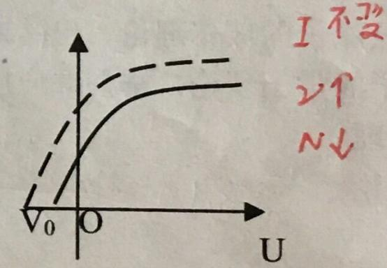
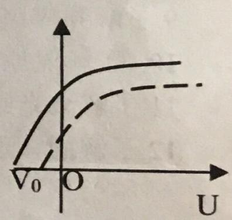
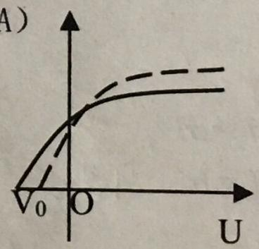

# 《大学物理》同步练习册（上）量子物理综合练习题参考答案

原件经识别和整理；“参考解答”是我们补的。

## 一、选择题

### 选择 1

用频率为 $\nu$ 的单色光照射某种金属时，逸出光电子的最大动能为 $E_{K}$；若改用频率为 $2\nu$ 的单色光照射此种金属时，则逸出光电子的最大动能为

- (A) $2E_{K}$
- (B) $2h\nu - E_{K}$
- (C) $h\nu - E_{K}$
- (D) $h\nu + E_{K}$

答案：D。

知识点：[光电效应的实验规律与爱因斯坦光子理论](../../../topics/大学物理/光电效应.md)

### 选择 2

已知单色光照射在钠表面上，测得光电子的最大动能是 $1.2\ \mathrm{eV}$，而钠的红限波长为 $540\ \mathrm{nm}$，则入射光的波长应为

- (A) $535\ \mathrm{nm}$
- (B) $500\ \mathrm{nm}$
- (C) $435\ \mathrm{nm}$
- (D) $355\ \mathrm{nm}$

答案：D。

参考解答：

$$
\begin{aligned}
\lambda &= \frac{hc}{E_{K} + hc/\lambda_{0}} \\
&= \frac{3\times10^{8}}{1.2\times1.6\times10^{-19}} + \frac{3\times10^{8}}{540\times10^{-9}} \\
&= \frac{3\times10^{8}}{0.29\times10^{-25} + 5.6\times10^{14}} \\
&= 0.353\times10^{-6}\ \mathrm{m} \\
&= 353\ \mathrm{nm}
\end{aligned}
$$

知识点：[光电效应的实验规律与爱因斯坦光子理论](../../../topics/大学物理/光电效应.md)

### 选择 3

以一定频率的单色光照射在某金属上，测出其光电流曲线如图实线所示，然后在光强度不变的条件下增大照射光的频率，测出光电流的曲线如图中虚线所示。则满足题意的图是 [ A ]。

答案：A。

知识点：[光电效应的实验规律与爱因斯坦光子理论](../../../topics/大学物理/光电效应.md)、[黑体辐射规律与普朗克能量子假设](../../../topics/大学物理/黑体辐射与普朗克假设.md)

### 选择 4

一个光子和一个电子具有相同的波长，则 [ C ]

- (A) 光子具有较大的动量
- (B) 电子具有较大的动量

参考解答：**结论：选 (C)。**

（注：题目文本中选项未完整显示，但根据物理原理，(C) 的内容应为“两者具有相同的动量”。）

---

### 推理过程

由德布罗意关系式，任何粒子的动量与波长的关系为：

$$p = \frac{h}{\lambda}$$

光子与电子的波长 $\lambda$ 相同，普朗克常量 $h$ 为常数，因此两者的动量必然相等：

$$p_{\text{光子}} = p_{\text{电子}} = \frac{h}{\lambda}$$

---

### 各选项分析

- **(A) 光子具有较大的动量**：错误。动量仅取决于波长，与粒子种类无关，两者动量相等。
- **(B) 电子具有较大的动量**：错误。理由同上，两者动量相等。
- **(C) 两者动量相同**：正确。由 $p = h/\lambda$ 直接得出。
- **(D)**（通常为“无法比较”或涉及能量的干扰项）：错误。动量可以直接由波长唯一确定，无需知道质量或能量。

知识点：[康普顿散射实验与光子动量](../../../topics/大学物理/康普顿散射.md)、[德布罗意物质波假设](../../../topics/大学物理/实物粒子的波动性.md)
