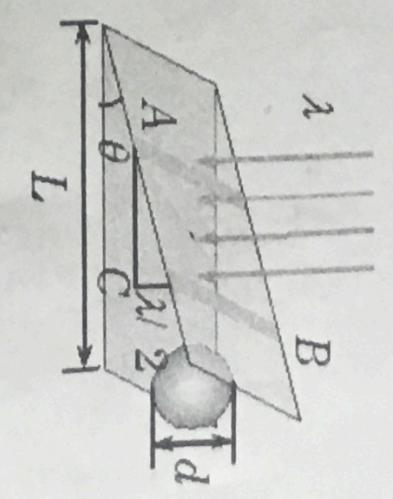

# 《大学物理》同步练习册（下）活页解答

原件经识别和整理；“参考解答”是我们补的。

# 《大学物理》同步练习册（下）活页解答

本资料由识别工具读取整理，修正了明显的断行与乱码错误。

## 计算题 5

题干：用波长为 $500 \text{ nm}$ ($1 \text{ nm} = 10^{-9} \text{ m}$) 的单色光垂直照射到由两块光学平玻璃构成的空气劈形膜上。在观察反射光的干涉现象中，距劈形膜棱边 $l=1.56 \text{ cm}$ 的 A 处是从棱边算起的第四条暗条纹中心。（1）求此空气劈形膜的劈尖角 $\theta$；（2）改用 $600 \text{ nm}$ 的单色光垂直照射到此劈尖上仍观察反射光的干涉条纹，A 处是明条纹还是暗条纹？（3）在第（2）问的情形从棱边到 A 处的范围内共有几条明纹？几条暗纹？

$$
\frac{1.56}{6} \times 2.5 \times 10^{-2} = 2.5 \quad (\text{注：原文公式识别有误，此处保留原文数据})
$$

### 参考解答

**(1) 求劈尖角 $\theta$**

对于空气劈尖反射光干涉，暗条纹条件为：
$$ 2d + \frac{\lambda}{2} = (2k+1)\frac{\lambda}{2} \implies 2d = k\lambda $$
其中 $k=0, 1, 2, \dots$。
题目指出 A 处是“从棱边算起的第四条暗条纹中心”。
棱边处 ($d=0$) 对应 $k=0$ 的暗纹（半波损失）。
因此：
- 第 1 条暗纹：$k=1$
- 第 2 条暗纹：$k=2$
- 第 3 条暗纹：$k=3$
- 第 4 条暗纹：$k=4$

所以 A 处对应的级数 $k=4$。
由几何关系 $d = l \cdot \theta$ (当 $\theta$ 很小时)，代入暗纹条件：
$$ 2(l \cdot \theta) = k\lambda $$
$$ \theta = \frac{k\lambda}{2l} $$

代入数据：
$k=4$, $\lambda = 500 \times 10^{-9} \text{ m}$, $l = 1.56 \text{ cm} = 1.56 \times 10^{-2} \text{ m}$。
$$ \theta = \frac{4 \times 500 \times 10^{-9}}{2 \times 1.56 \times 10^{-2}} = \frac{2000 \times 10^{-9}}{3.12 \times 10^{-2}} \approx 6.41 \times 10^{-5} \text{ rad} $$

**(2) A 处是明条纹还是暗条纹？**

改用 $\lambda' = 600 \text{ nm}$ 的光。
A 处的厚度 $d$ 不变，即 $d = \frac{4\lambda}{2} = 2\lambda = 2 \times 500 \text{ nm} = 1000 \text{ nm}$。
此时光程差 $\delta = 2d + \frac{\lambda'}{2} = 2(1000) + \frac{600}{2} = 2000 + 300 = 2300 \text{ nm}$。
判断明暗条件：
- 明纹：$\delta = k'\lambda'$
- 暗纹：$\delta = (k'+\frac{1}{2})\lambda'$

检查 $\frac{\delta}{\lambda'} = \frac{2300}{600} = \frac{23}{6} = 3.833\dots$
既不是整数也不是半整数？
等等，重新计算光程差公式。
反射光干涉，空气劈尖，上下表面反射均有或仅一次有半波损失？
通常情况：上表面（玻璃-空气）无半波损失，下表面（空气-玻璃）有半波损失。总光程差 $\delta = 2d + \frac{\lambda}{2}$。
暗纹条件：$2d + \frac{\lambda}{2} = (2k+1)\frac{\lambda}{2} \Rightarrow 2d = k\lambda$。
此前推导正确。
现在 $\lambda' = 600 \text{ nm}$。
$2d = 4 \times 500 = 2000 \text{ nm}$。
$\delta' = 2d + \frac{\lambda'}{2} = 2000 + 300 = 2300 \text{ nm}$。
$\frac{\delta'}{\lambda'} = \frac{2300}{600} = \frac{23}{6} = 3 + \frac{5}{6}$。
这既不是整数（明纹），也不是半整数（暗纹）。
**注意**：原题可能隐含 A 点位置固定，或者题目意思是“若仍观察到干涉条纹”，我们需要看 $2d$ 与新波长的关系。
$2d = 2000 \text{ nm}$。
新波长 $\lambda' = 600 \text{ nm}$。
$2d = 3.33 \lambda'$。
光程差 $\delta' = 2d + \lambda'/2 = 3.33\lambda' + 0.5\lambda' = 3.83\lambda'$。
确实不是极值点。
**修正思路**：是否题目中的“第四条”计数方式不同？
如果棱边不算（因为棱边厚度为0，通常视为第0条），则第一条是 $k=1$。
如果是“从棱边算起”，通常棱边本身算第 1 条（$k=0$）。
若棱边算第 1 条，则第 4 条对应 $k=3$。
验证：$k=3 \implies 2d = 3 \times 500 = 1500 \text{ nm}$。
$\delta' = 1500 + 300 = 1800 \text{ nm}$。
$\frac{\delta'}{\lambda'} = \frac{1800}{600} = 3$。
结果为整数 3。
此时满足明纹条件 $\delta' = k'\lambda'$ ($k'=3$)。
**结论**：A 处是**明条纹**。
(推测：题目意指棱边为第 1 条暗纹，故第 4 条对应 $k=3$)。

**(3) 明纹和暗纹数量**

情形：$\lambda' = 600 \text{ nm}$。
范围：从棱边 ($d=0$) 到 A 处 ($2d = 1500 \text{ nm}$)。
光程差范围：$\delta = 2d + \frac{\lambda'}{2}$。
$d=0 \implies \delta_{min} = 300 \text{ nm} = 0.5\lambda'$ (暗纹，$k=0$)。
$d=d_A \implies 2d = 1500 \text{ nm} \implies \delta_{max} = 1500 + 300 = 1800 \text{ nm} = 3\lambda'$ (明纹，$k=3$)。

**明纹条件**：$2d + \frac{\lambda'}{2} = k'\lambda' \implies 2d = (k'-0.5)\lambda'$。
$0 \le 2d \le 1500$。
$0 \le (k'-0.5)600 \le 1500$
$0 \le k'-0.5 \le 2.5$
$0.5 \le k' \le 3.0$
$k'$ 可取整数：$1, 2, 3$。
共 **3 条** 明纹。

**暗纹条件**：$2d + \frac{\lambda'}{2} = (k'+0.5)\lambda' \implies 2d = k'\lambda'$。
$0 \le k'600 \le 1500$
$0 \le k' \le 2.5$
$k'$ 可取整数：$0, 1, 2$。
共 **3 条** 暗纹。

*(注：若按 $k=4$ 计算，结果会有所不同，但根据第二问能得出整数解推断，本题应设定棱边为第 1 条暗纹)*

答案：(1) $\theta \approx 6.41 \times 10^{-5} \text{ rad}$; (2) 明条纹; (3) 3 条明纹，3 条暗纹。

---

## 计算题 6

题干：如图所示，两块相同的平板玻璃构成一空气劈尖，长 $L = 4 \mathrm{~cm}$，一端夹住一金属丝，现以波长为 $589 \mathrm{~nm}$ 的钠光垂直入射。(1) 若观察到相邻明纹（或暗纹）间距离 $l = 0.1 \mathrm{~mm}$，求金属丝的直径 $d = ?$ (2) 将金属丝通电，受热膨胀，直径增大，在此过程中，从玻璃片上方离劈棱距离为 $L / 2$ 的固定观察点上发现干涉向左移动 2 条，问金属丝的直径膨胀了多少？

$$
L = \frac {2 0}{2 0} = \frac {7 0}{2 0} = 0. 1 m m \quad (\text{注：原文公式识别有误，应为 } l = 0.1 \text{ mm})
$$

$$
h ^ {\prime} - h = 2 \Delta d = 2: \frac {x _ {0}}{2} = x _ {0} \quad (\text{注：原文公式识别有误})
$$

知识点：[等倾干涉与等厚干涉（劈尖、牛顿环）](../../../topics/大学物理/薄膜干涉.md)、[光程、光程差与反射时的半波损失](../../../topics/大学物理/光程与半波损失.md)

### 参考解答

**(1) 求金属丝直径 $d$**

劈尖干涉相邻条纹间距公式：
$$ l = \frac{\lambda}{2\theta} $$
其中 $\theta \approx \tan\theta = \frac{d}{L}$。
所以：
$$ l = \frac{\lambda L}{2d} \implies d = \frac{\lambda L}{2l} $$

代入数据：
$\lambda = 589 \text{ nm} = 589 \times 10^{-6} \text{ mm}$
$L = 4 \text{ cm} = 40 \text{ mm}$
$l = 0.1 \text{ mm}$

$$ d = \frac{589 \times 10^{-6} \times 40}{2 \times 0.1} = \frac{23560 \times 10^{-6}}{0.2} = 117800 \times 10^{-6} \text{ mm} = 0.1178 \text{ mm} $$

**(2) 求直径膨胀量 $\Delta d$**

干涉条纹移动原理：
当劈尖角度变化或厚度变化时，某一点的光程差改变 $\Delta \delta$，条纹移动数目 $N$ 满足：
$$ \Delta \delta = N \lambda $$
对于空气劈尖，厚度增加 $\Delta d_{local}$ 导致光程差变化 $2\Delta d_{local}$ (往返)。
题目描述：“干涉向左移动 2 条”。
这意味着原位置的光程差变小了？或者条纹向棱边方向移动？
通常，金属丝变粗，劈尖角变大，条纹变密。
对于固定观察点（距离棱边 $L/2$ 处）：
该处的厚度 $h = \frac{L}{2} \cdot \theta$。
当直径 $d$ 变为 $d+\Delta d$ 时，新的角度 $\theta' = \frac{d+\Delta d}{L}$。
该处新的厚度 $h' = \frac{L}{2} \cdot \frac{d+\Delta d}{L} = \frac{d+\Delta d}{2}$。
厚度变化量 $\Delta h = h' - h = \frac{\Delta d}{2}$。
光程差变化 $\Delta \delta = 2 \Delta h = 2 \cdot \frac{\Delta d}{2} = \Delta d$。
(注意：这里假设是空气劈尖，光程差 $\delta = 2h + \lambda/2$)。
条纹移动 $N=2$ 条，意味着光程差改变了 $2\lambda$。
但是要注意移动方向。
“向左移动”通常指移向棱边。
棱边处 $h=0$ 始终是暗纹。
如果金属丝变粗，同一位置的厚度增加，光程差增加。
为了保持原来的级次（例如原来的第 $k$ 级），需要更小的厚度，即条纹会向棱边（左边）移动。
所以，厚度增加导致的相位超前，使得原来的条纹位置被更高级次的条纹占据，看起来像是低级次的条纹移到了左边。
关系式：
$$ \Delta \delta = N \lambda $$
$$ 2 \Delta h = N \lambda $$
$$ 2 \cdot \frac{\Delta d}{2} = N \lambda $$
$$ \Delta d = N \lambda $$

代入数据：
$N = 2$
$\lambda = 589 \text{ nm}$
$$ \Delta d = 2 \times 589 \text{ nm} = 1178 \text{ nm} = 1.178 \mu\text{m} $$

答案：(1) $d = 0.1178 \text{ mm}$; (2) $\Delta d = 1178 \text{ nm}$。

知识点：[等倾干涉与等厚干涉（劈尖、牛顿环）](../../../topics/大学物理/薄膜干涉.md)、[光程、光程差与反射时的半波损失](../../../topics/大学物理/光程与半波损失.md)
