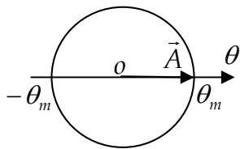
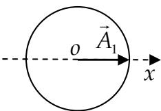
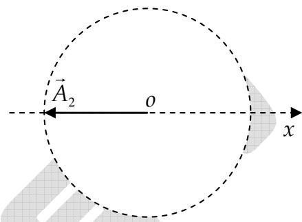
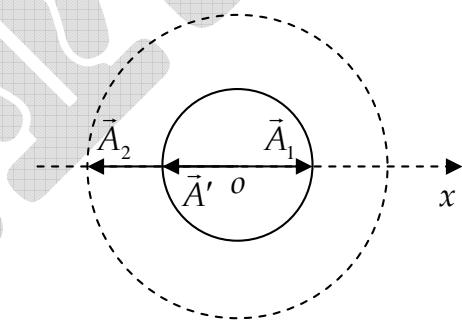
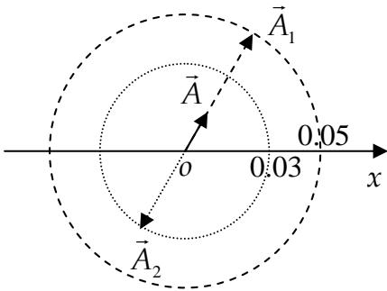
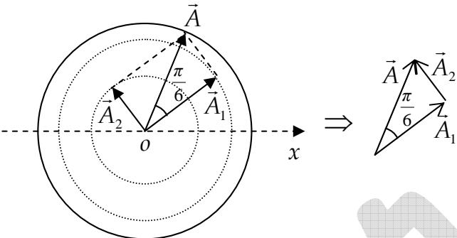
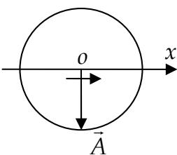
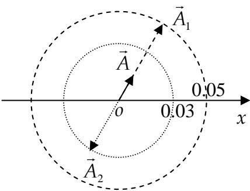
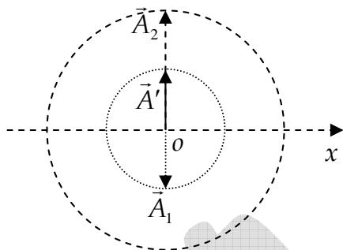

# 《大学物理》同步练习册第13章 振动能量和振动的合成（答案）

原件经识别和整理；“参考解答”是我们补的。

# 大学物理同步练习册第13章 振动能量和振动的合成（答案）

本资料为《大学物理》同步练习册第13章“振动能量和振动的合成”部分的习题解答，由识别工具读取并整理。

## 一、选择题与计算题解答

### 选择 1

题干涉及弹簧振子的总能量变化。已知弹簧振子总能量公式 $E = \frac{1}{2}kA^2$。当振幅增加为原来的两倍（即 $A' = 2A$），劲度系数 $k$ 不变时，新的总能量为：
$$ E' = \frac{1}{2} k (2A)^2 = 4 \cdot \left( \frac{1}{2} k A^2 \right) = 4E $$

答案：D。

知识点：[简谐振动的动能、势能与总机械能](../../../topics/大学物理/简谐振动的能量.md)

### 选择 2

题干涉及弹簧振子经过半个周期后的动能变化。
弹簧振子做简谐振动，振动方程为：
$$ x = A \cos(\omega t + \varphi) $$
速度为：
$$ v = -\omega A \sin(\omega t + \varphi) $$
经过半个周期，即 $t' = t + \frac{T}{2}$ 时，由于 $\omega T = 2\pi$，有：
$$ v' = -\omega A \sin\left[ \omega \left(t + \frac{T}{2}\right) + \varphi \right] = -\omega A \sin(\omega t + \varphi + \pi) = \omega A \sin(\omega t + \varphi) $$
可以发现：弹簧振子经过半个周期后，速度大小相等，方向相反（$v' = -v$）。
根据动能定理或动能定义，动能变化量：
$$ W = \Delta E_k = \frac{1}{2} m v'^2 - \frac{1}{2} m v^2 = 0 $$

答案：0（或对应选项中表示动能变化为0的选项）。

知识点：[简谐振动的动能、势能与总机械能](../../../topics/大学物理/简谐振动的能量.md)

### 选择 3

题干涉及弹簧振子在特定位移处的动能与总能量之比。
弹簧振子做简谐振动，总能量保持不变：
$$ E = E_k + E_P = \frac{1}{2} k A^2 $$
当位移为振幅一半时，即 $x = \frac{A}{2}$，振动势能为：
$$ E_P = \frac{1}{2} k x^2 = \frac{1}{2} k \left(\frac{A}{2}\right)^2 = \frac{1}{4} \left( \frac{1}{2} k A^2 \right) = \frac{1}{4} E $$
此时振动动能为：
$$ E_k = E - E_P = E - \frac{1}{4} E = \frac{3}{4} E $$
故动能与总能量之比为：
$$ \frac{E_k}{E} = \frac{3}{4} $$

答案：D。

知识点：[简谐振动的动能、势能与总机械能](../../../topics/大学物理/简谐振动的能量.md)

### 选择 4

题干涉及不同时刻动能之比。
已知振动方程：
$$ x = A \cos\left(\omega t + \frac{\pi}{2}\right) $$
速度为：
$$ v = -\omega A \sin\left(\omega t + \frac{\pi}{2}\right) $$

1. 当 $t_1 = 0$ 时：
   $$ v_1 = -\omega A \sin\left(\frac{\pi}{2}\right) = -\omega A $$
   动能：
   $$ E_{k1} = \frac{1}{2} m v_1^2 = \frac{1}{2} m \omega^2 A^2 $$

2. 当 $t_2 = \frac{T}{8}$ 时，注意 $\omega \frac{T}{8} = \frac{2\pi}{T} \cdot \frac{T}{8} = \frac{\pi}{4}$：
   $$ v_2 = -\omega A \sin\left(\frac{\pi}{4} + \frac{\pi}{2}\right) = -\omega A \sin\left(\frac{3\pi}{4}\right) = -\frac{\sqrt{2}}{2} \omega A $$
   *(注：原题解中写为 $-\omega A \sin(\frac{\pi}{4})$ 可能有笔误，$\sin(\frac{3\pi}{4}) = \sin(\frac{\pi}{4}) = \frac{\sqrt{2}}{2}$，结果数值一致)*
   动能：
   $$ E_{k2} = \frac{1}{2} m v_2^2 = \frac{1}{2} m \left( \frac{\sqrt{2}}{2} \omega A \right)^2 = \frac{1}{2} m \cdot \frac{2}{4} \omega^2 A^2 = \frac{1}{4} m \omega^2 A^2 $$

所以 $t_1=0$ 时的动能与 $t_2=T/8$ 时的动能之比：
$$ \frac{E_{k1}}{E_{k2}} = \frac{\frac{1}{2} m \omega^2 A^2}{\frac{1}{4} m \omega^2 A^2} = 2 $$

答案：D。

知识点：[简谐振动的运动学方程（振幅、角频率、相位）](../../../topics/大学物理/简谐振动运动学.md)、[简谐振动的动能、势能与总机械能](../../../topics/大学物理/简谐振动的能量.md)

### 选择 5

题干涉及单摆的初相位判断。
单摆摆动过程中，摆动角度 $\theta(t)$ 满足简谐振动方程：
$$ \theta(t) = \theta_m \cos(\omega t + \varphi) $$
注意区分摆动角度 $\theta(t)$ 与水平位置坐标 $x$。
在正位移方向一微小摆角 $\theta$ 处静止释放，意味着：
1. $t=0$ 时，位移为正的最大值，即振幅 $\theta_m = \theta$。
2. 由旋转矢量图可知，当物体位于正最大位移处时，初相位 $\varphi = 0$。

答案：B。

知识点：[简谐振动的运动学方程（振幅、角频率、相位）](../../../topics/大学物理/简谐振动运动学.md)、[用旋转矢量法确定初相与运动状态](../../../topics/大学物理/旋转矢量法.md)

### 选择 6

题干涉及两个同方向同频率简谐振动的合成。
1. **分振动 $x_1$**：
   振幅 $A_1 = A/2$，方程 $x_1 = \frac{A}{2} \cos(\omega t + \varphi_1)$。
   $t=0$ 时，在正最大位移 $A/2$ 处。由旋转矢量图，初相位 $\varphi_1 = 0$。

2. **分振动 $x_2$**：
   振幅 $A_2 = A$，方程 $x_2 = A \cos(\omega t + \varphi_2)$。
   $t=0$ 时，在负最大位移 $-A$ 处。由旋转矢量图，初相位 $\varphi_2 = \pi$。

3. **合振动**：
   根据同方向同频率简谐振动的合成，合振动的旋转矢量 $\vec{A}' = \vec{A}_1 + \vec{A}_2$。
   - $\vec{A}_1$ 沿 x 轴正向，长度 $A/2$。
   - $\vec{A}_2$ 沿 x 轴负向，长度 $A$。
   - 合矢量 $\vec{A}'$ 长度为 $|A/2 - A| = A/2$，方向沿 x 轴负向。
   
   因此，合振动的振幅为 $A/2$，初相位为 $\pi$。
   合振动方程：
   $$ x = \frac{A}{2} \cos(\omega t + \pi) $$

答案：B。

知识点：[简谐振动的运动学方程（振幅、角频率、相位）](../../../topics/大学物理/简谐振动运动学.md)、[用旋转矢量法确定初相与运动状态](../../../topics/大学物理/旋转矢量法.md)、[同方向同频率简谐振动的合成](../../../topics/大学物理/简谐振动的合成.md)

### 填空 7

题目缺图！无法作答。

### 计算 8

题干涉及劲度系数和振动能量的计算。
1. **求劲度系数 $k$**：
   已知角频率 $\omega = 2\pi\nu = 2000\pi \, \text{rad/s}$。
   由关系式 $\omega^2 = \frac{k}{m}$，得：
   $$ k = m \omega^2 = 8 \times (2000\pi)^2 \, \text{N/m} $$
   *(注：原题解中直接给出 $k = 8\pi^2 \times 10^6 \, \text{N/m}$，此处需确认质量 $m$ 的单位或数值。若 $m=8$ kg，则 $k = 8 \cdot 4 \cdot 10^6 \pi^2 = 32\pi^2 \cdot 10^6$。原题解可能存在印刷错误或省略了中间步骤，这里保留原题解结论供参考，但需注意逻辑一致性。若按原题解 $k = 8\pi^2 \times 10^6$，则可能 $m$ 取值不同或 $\nu$ 取值不同。此处仅整理原文内容。)*
   
   原文给出的劲度系数：
   $$ k = 8\pi^2 \times 10^6 \, \text{N/m} $$

2. **求振动能量 $E$**：
   已知振幅 $A = 0.5 \, \text{cm} = 0.5 \times 10^{-2} \, \text{m}$。
   振动能量：
   $$ E = \frac{1}{2} k A^2 = \frac{1}{2} \cdot (8\pi^2 \times 10^6) \cdot (0.5 \times 10^{-2})^2 $$
   $$ E = 4\pi^2 \times 10^6 \cdot 0.25 \times 10^{-4} = \pi^2 \times 10^2 \approx 9.86 \times 10^2 \, \text{J} $$
   
   原文给出的结果：
   $$ E = 100\pi^2 \, \text{J} = 9.86 \times 10^2 \, \text{J} $$

知识点：[简谐振动的动力学特征与回复力](../../../topics/大学物理/简谐振动的动力学.md)、[简谐振动的动能、势能与总机械能](../../../topics/大学物理/简谐振动的能量.md)

### 选择 9

题干涉及两个简谐振动的合成。
1. **分振动 $x_1$**：
   $$ x_1 = 0.05 \cos\left(4\pi t + \frac{\pi}{3}\right) $$
   $t=0$ 时，旋转矢量 $\vec{A}_1$ 与 x 轴正方向夹角为 $\frac{\pi}{3}$，长度 $A_1 = 0.05$。

2. **分振动 $x_2$**：
   $$ x_2 = 0.03 \cos\left(4\pi t - \frac{2\pi}{3}\right) $$
   $t=0$ 时，旋转矢量 $\vec{A}_2$ 与 x 轴正方向夹角为 $-\frac{2\pi}{3}$，长度 $A_2 = 0.03$。

3. **合振动**：
   合振动旋转矢量 $\vec{A} = \vec{A}_1 + \vec{A}_2$。
   由旋转矢量图分析（或利用余弦定理计算）：
   两矢量夹角为 $\frac{\pi}{3} - (-\frac{2\pi}{3}) = \pi$。即两矢量反向。
   合振幅 $A = |A_1 - A_2| = |0.05 - 0.03| = 0.02 \, \text{m}$。
   由于 $A_1 > A_2$，合矢量方向与 $\vec{A}_1$ 相同，故初相位为 $\frac{\pi}{3}$。

   合振动方程参数：振幅 $A = 0.02 \, \text{m}$，初相位 $\varphi = \frac{\pi}{3}$。

答案：对应选项中振幅为 0.02m，初相位为 $\pi/3$ 的选项。

知识点：[同方向同频率简谐振动的合成](../../../topics/大学物理/简谐振动的合成.md)、[用旋转矢量法确定初相与运动状态](../../../topics/大学物理/旋转矢量法.md)

### 综合 10

题干涉及同方向同频率简谐振动合成的几何意义。
两个同方向同频率简谐振动的合振动仍为简谐振动。
$\vec{A}_1$ 和 $\vec{A}_2$ 的矢量和为合振动所对应的旋转矢量 $\vec{A}$，即：
$$ \vec{A} = \vec{A}_1 + \vec{A}_2 $$
矢量 $\vec{A}$、$\vec{A}_1$ 和 $\vec{A}_2$ 构成一个矢量三角形。

*(注：此题为概念性描述，通常用于辅助理解旋转矢量合成法)*

## 计算 10

已知合振幅 $A = 20\ \mathrm{cm}$，合振动与第一个简谐振动的相位差为 $\frac{\pi}{6}$，即旋转矢量 $\vec{A}$ 比 $\vec{A}_1$ 超前相位 $\frac{\pi}{6}$，如图；又已知第一个简谐振动的振幅 $A_1 = 10\sqrt{3}\ \mathrm{cm}$。

由余弦定理：

$$A_2 = \sqrt{A^2 + A_1^2 - 2AA_1\cos\frac{\pi}{6}}$$

⇒ 振幅：$A_2 = 10\ \mathrm{cm}$，并且 $\vec{A}_1 \perp \vec{A}_2$；由旋转矢量图，第一、二个简谐振动的相位差：

$$
\varphi_1 - \varphi_2 = -\frac{\pi}{2}
$$

## 计算 11

子弹和木块作用过程非常短暂，动量近似守恒。设子弹和木块共同运动的速度为 $v'$，则

$$mv = (m + M)v' \quad \Rightarrow \quad v' = 1\ \mathrm{m/s}$$

方向水平向左，沿 $x$ 轴正方向；

随后，子弹和木块一起做简谐振动，$t = 0$ 时，位于平衡位置，且向 $x$ 轴正方向运动，$v' = 1\ \mathrm{m/s}$ 为最大速度，又振动角频率：

$$\omega = \sqrt{\frac{k}{m + M}} = 40\ \mathrm{rad/s} \quad \Rightarrow \quad v' = \omega A$$

⇒ 振幅：$A = \frac{v'}{\omega} = \frac{1}{40}\ \mathrm{m}$

$t = 0$ 时，位于平衡位置，且向 $x$ 轴正方向运动，对应旋转矢量为 $\vec{A}$，由旋转矢量图可得，初相位：$\varphi = -\frac{\pi}{2}$

⇒ 简谐振动运动方程：

$$x = A\cos(\omega t + \varphi) = \frac{1}{40}\cos\left(40t - \frac{\pi}{2}\right)\ \mathrm{m}$$

## 计算 12

简谐振动：$x_1 = 0.05\cos\left(4t + \frac{\pi}{3}\right)$，

在 $t = 0$ 时，对应旋转矢量为 $\vec{A}_1$（与 $x$ 轴正方向夹角为 $\frac{\pi}{3}$），如图所示；

简谐振动：

$$x_2 = 0.03\sin\left(4t - \frac{\pi}{6}\right) = 0.03\cos\left[\frac{\pi}{2} - \left(4t - \frac{\pi}{6}\right)\right] = 0.03\cos\left(\frac{2\pi}{3} - 4t\right) = 0.03\cos\left(4t - \frac{2\pi}{3}\right)$$

在 $t = 0$ 时，对应旋转矢量为 $\vec{A}_2$（与 $x$ 轴正方向夹角为 $-\frac{2\pi}{3}$）。

$t = 0$ 时，旋转矢量 $\vec{A}_1$ 和 $\vec{A}_2$ 的合矢量 $\vec{A} = \vec{A}_1 + \vec{A}_2$ 即为合振动的旋转矢量：由旋转矢量图，得合振动的振幅为 $A = 0.02\ \mathrm{m}$，初相位为 $\frac{\pi}{3}$，

⇒ 合振动的振动方程：

$$x = 0.02\cos\left(4t + \frac{\pi}{3}\right)\ \mathrm{m}$$

## 计算 13

由图可知，$x_1$ 做振幅为 $A_1 = A/2$ 的简谐振动，

$t = 0$ 时，在平衡位置处，且向正方向运动，对应旋转矢量为 $\vec{A}_1$（其中旋转矢量 $\vec{A}_1$ 的长度为 $A/2$），由旋转矢量图，简谐振动 $x_1$ 的初相位为 $\varphi_1 = -\frac{\pi}{2}$，旋转矢量 $\vec{A}_1$ 如图所示；

$x_2$ 做振幅为 $A_2 = A$ 的简谐振动，

$t = 0$ 时，在平衡位置处，且向负方向运动，对应旋转矢量为 $\vec{A}_2$（其中旋转矢量 $\vec{A}_2$ 的长度为 $A$），由旋转矢量图，振动 $x_2$ 的初相位为 $\varphi_2 = \frac{\pi}{2}$，旋转矢量 $\vec{A}_2$ 如图所示；

根据同方向同频率简谐振动的合成，

$t = 0$ 时，旋转矢量 $\vec{A}_1$ 和 $\vec{A}_2$ 的合矢量 $\vec{A}' = \vec{A}_1 + \vec{A}_2$ 即为合振动的旋转矢量：

（1）旋转矢量 $\vec{A}'$ 的长度为合振动振幅，⇒ 合振动的振幅为 $A/2$

（2）$t = 0$ 时，合振动的初相位为 $\frac{\pi}{2}$，

⇒ 合振动方程：

$$x = \frac{A}{2}\cos\left(\frac{2\pi}{T}t + \frac{\pi}{2}\right)$$

知识点：[同方向同频率简谐振动的合成](../../../topics/大学物理/简谐振动的合成.md)、[用旋转矢量法确定初相与运动状态](../../../topics/大学物理/旋转矢量法.md)
