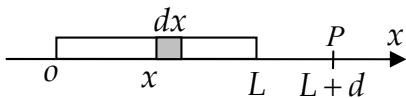
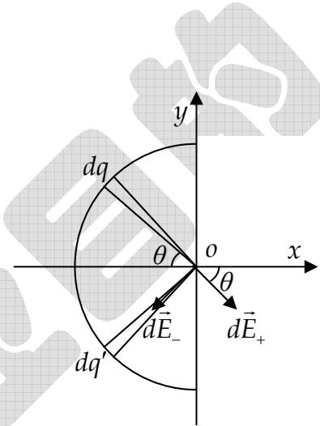

# 《大学物理》同步练习册第16章 库仑定律 电场强度（答案）

原件经识别和整理；“参考解答”是我们补的。

# 《大学物理》同步练习册第16章 库仑定律 电场强度（答案）

本资料由识别工具读取并整理，包含选择题与计算题的详细解答过程。

## 一、选择题

### 选择 1

题干：关于电场强度的理解，下列说法正确的是（ ）

- A. 电场是由场源电荷激发产生的，描述电场的电场强度 $\vec{E}$ 也只与场源电荷有关，而与试验电荷无关。例如点电荷 $q$ 的电场强度：$\vec{E} = \frac{1}{4\pi\varepsilon_0}\frac{q}{r^2}\hat{r}_0$（其中 $\hat{r}_0 = \frac{\vec{r}}{r}$ 为单位矢量），与试验电荷 $q_0$ 无关。
- B. 在电场中，某一点试验电荷受力 $\vec{F}$ 与 $q_0$ 的比值即为电场强度 $\vec{E}$，与试验电荷 $q_0$ 无关。
- C. 试验电荷 $q_0$ 在电场中某一点受到电场力 $\vec{F} = q_0\vec{E}$，电场力 $\vec{F}$ 的方向由 $q_0$ 和 $\vec{E}$ 共同决定。若 $q_0 > 0$，则电场力 $\vec{F}$ 的方向与 $\vec{E}$ 的方向相同；若 $q_0 < 0$，则 $\vec{F}$ 与 $\vec{E}$ 的方向相反。
- D. 电场中某一点的电场强度 $\vec{E}$ 与试验电荷 $q_0$ 的存在与否无关，只与场源电荷有关。

答案：B。

知识点：[电场强度的定义与叠加原理](../../../topics/大学物理/电场强度.md)、[电荷守恒定律与库仑定律](../../../topics/大学物理/电荷守恒与库仑定律.md)

### 选择 2

题干：边长为 $a$ 的立方体体对角线长为 $\sqrt{3}a$，中心到各个顶角的距离为 $\frac{\sqrt{3}}{2}a$，则位于正方体中心的点电荷 $Q$ 在顶角处产生的电场强度大小为：

- A. ...
- B. ...
- C. $\frac{Q}{3\pi\varepsilon_0 a^2}$
- D. ...

知识点：[电荷守恒定律与库仑定律](../../../topics/大学物理/电荷守恒与库仑定律.md)、[电场强度的定义与叠加原理](../../../topics/大学物理/电场强度.md)

### 选择 3

题干：设方向向右为正，均匀带电平面 $+\sigma$ 单独存在时，在 A、B、C 区域的场强如图所示；均匀带电平面 $+2\sigma$ 单独存在时，在 A、B、C 区域的场强如图所示。则均匀带电平面 $+\sigma$ 和 $+2\sigma$ 共同存在时，在 A、B、C 区域的场强分别为多少？

知识点：[电场强度的定义与叠加原理](../../../topics/大学物理/电场强度.md)、[几种特殊带电体（点电荷、无限长直线、圆环、圆盘等）激发的电场](../../../topics/大学物理/特殊带电体电场.md)

### 计算 1

题干：正方形均匀带电线框每条边在中心处的电场强度大小相等，方向垂直于边长。求正方形中心处的电场强度大小。

知识点：[电场强度的定义与叠加原理](../../../topics/大学物理/电场强度.md)、[几种特殊带电体（点电荷、无限长直线、圆环、圆盘等）激发的电场](../../../topics/大学物理/特殊带电体电场.md)

### 计算 2

题干：建立如图所示坐标轴，坐标原点 $o$ 在杆的左端。求该带电细杆在 P 点产生的总场强大小及方向。

知识点：[几种特殊带电体（点电荷、无限长直线、圆环、圆盘等）激发的电场](../../../topics/大学物理/特殊带电体电场.md)、[电场强度的定义与叠加原理](../../../topics/大学物理/电场强度.md)

### 计算 3

题干：如图，在半圆形玻璃棒上均匀分布电荷 $Q$。求圆心 $O$ 处的电场强度。

知识点：[电荷守恒定律与库仑定律](../../../topics/大学物理/电荷守恒与库仑定律.md)、[电场强度的定义与叠加原理](../../../topics/大学物理/电场强度.md)、[几种特殊带电体（点电荷、无限长直线、圆环、圆盘等）激发的电场](../../../topics/大学物理/特殊带电体电场.md)
