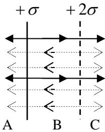
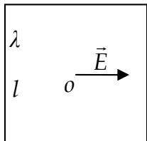

# 《大学物理》同步练习册第16章 库仑定律 电场强度（答案）

原件经识别和整理；“参考解答”是我们补的。

# 《大学物理》同步练习册第16章 库仑定律 电场强度（答案）

本资料由识别工具读取并整理，包含选择题与计算题的详细解答过程。

## 一、选择题

### 选择 1

题干：关于电场强度的理解，下列说法正确的是（ ）

- A. 电场是由场源电荷激发产生的，描述电场的电场强度 $\vec{E}$ 也只与场源电荷有关，而与试验电荷无关。例如点电荷 $q$ 的电场强度：$\vec{E} = \frac{1}{4\pi\varepsilon_0}\frac{q}{r^2}\hat{r}_0$（其中 $\hat{r}_0 = \frac{\vec{r}}{r}$ 为单位矢量），与试验电荷 $q_0$ 无关。
- B. 在电场中，某一点试验电荷受力 $\vec{F}$ 与 $q_0$ 的比值即为电场强度 $\vec{E}$，与试验电荷 $q_0$ 无关。
- C. 试验电荷 $q_0$ 在电场中某一点受到电场力 $\vec{F} = q_0\vec{E}$，电场力 $\vec{F}$ 的方向由 $q_0$ 和 $\vec{E}$ 共同决定。若 $q_0 > 0$，则电场力 $\vec{F}$ 的方向与 $\vec{E}$ 的方向相同；若 $q_0 < 0$，则 $\vec{F}$ 与 $\vec{E}$ 的方向相反。
- D. 电场中某一点的电场强度 $\vec{E}$ 与试验电荷 $q_0$ 的存在与否无关，只与场源电荷有关。

答案：B。

知识点：[电场强度的定义与叠加原理](../../../topics/大学物理/电场强度.md)、[电荷守恒定律与库仑定律](../../../topics/大学物理/电荷守恒与库仑定律.md)

### 选择 2

题干：边长为 $a$ 的立方体体对角线长为 $\sqrt{3}a$，中心到各个顶角的距离为 $\frac{\sqrt{3}}{2}a$，则位于正方体中心的点电荷 $Q$ 在顶角处产生的电场强度大小为：

- A. ...
- B. ...
- C. $\frac{Q}{3\pi\varepsilon_0 a^2}$
- D. ...

参考解答：
位于正方体中心的点电荷 $Q$ 在顶角处产生的电场强度大小为：
$$ E = \frac{1}{4\pi\varepsilon_0}\frac{Q}{r^2} = \frac{1}{4\pi\varepsilon_0}\frac{Q}{(\frac{\sqrt{3}}{2}a)^2} = \frac{Q}{3\pi\varepsilon_0 a^2} $$

答案：C。

知识点：[电荷守恒定律与库仑定律](../../../topics/大学物理/电荷守恒与库仑定律.md)、[电场强度的定义与叠加原理](../../../topics/大学物理/电场强度.md)

### 选择 3

题干：设方向向右为正，均匀带电平面 $+\sigma$ 单独存在时，在 A、B、C 区域的场强如图所示；均匀带电平面 $+2\sigma$ 单独存在时，在 A、B、C 区域的场强如图所示。则均匀带电平面 $+\sigma$ 和 $+2\sigma$ 共同存在时，在 A、B、C 区域的场强分别为多少？

参考解答：
均匀带电平面 $+\sigma$ 单独存在时，在 A、B、C 区域的场强：
$$ E_{\sigma A} = -\frac{\sigma}{2\varepsilon_0}, \quad E_{\sigma B} = E_{\sigma C} = \frac{\sigma}{2\varepsilon_0} $$
如图中实线所示；

均匀带电平面 $+2\sigma$ 单独存在时，在 A、B、C 区域的场强：
$$ E_{2\sigma A} = E_{2\sigma B} = -\frac{2\sigma}{2\varepsilon_0}, \quad E_{2\sigma C} = \frac{2\sigma}{2\varepsilon_0} $$
如图中虚线所示；

则均匀带电平面 $+\sigma$ 和 $+2\sigma$ 共同存在时，在 A、B、C 区域的场强：
$$ E_A = E_{\sigma A} + E_{2\sigma A} = \frac{3\sigma}{2\varepsilon_0} $$
$$ E_B = E_{\sigma B} + E_{2\sigma B} = -\frac{\sigma}{2\varepsilon_0} $$
$$ E_C = E_{\sigma C} + E_{2\sigma C} = \frac{3\sigma}{2\varepsilon_0} $$

## 二、计算题

知识点：[电场强度的定义与叠加原理](../../../topics/大学物理/电场强度.md)、[几种特殊带电体（点电荷、无限长直线、圆环、圆盘等）激发的电场](../../../topics/大学物理/特殊带电体电场.md)

### 计算 1

题干：正方形均匀带电线框每条边在中心处的电场强度大小相等，方向垂直于边长。求正方形中心处的电场强度大小。

参考解答：
如图，正方形均匀带电线框每条边在中心处的电场强度大小相等，方向垂直于边长。所以由对称性，正方形中心处的电场强度大小：
$$ E = 0 $$

知识点：[电场强度的定义与叠加原理](../../../topics/大学物理/电场强度.md)、[几种特殊带电体（点电荷、无限长直线、圆环、圆盘等）激发的电场](../../../topics/大学物理/特殊带电体电场.md)

### 计算 2

题干：建立如图所示坐标轴，坐标原点 $o$ 在杆的左端。求该带电细杆在 P 点产生的总场强大小及方向。

参考解答：
取电荷元 $dq$：
$$ dq = \frac{q}{L} dx $$

该电荷元 $dq$ 在 P 点产生的场强大小：
$$ dE = \frac{1}{4\pi\varepsilon_0}\frac{dq}{(L+d-x)^2} $$
方向：水平向右（设 $q>0$）。

则 P 点总场强大小：
$$ E = \int_0^L \frac{1}{4\pi\varepsilon_0}\frac{dq}{(L+d-x)^2} = \int_0^L \frac{1}{4\pi\varepsilon_0}\frac{\frac{q}{L}dx}{(L+d-x)^2} $$
$$ = \frac{q}{4\pi\varepsilon_0 L} \int_0^L \frac{dx}{(L+d-x)^2} $$
$$ = \frac{q}{4\pi\varepsilon_0 L} \left( \frac{1}{L+d-L} - \frac{1}{L+d} \right) $$
$$ = \frac{q}{4\pi\varepsilon_0 d(L+d)} $$
方向水平向右。

知识点：[几种特殊带电体（点电荷、无限长直线、圆环、圆盘等）激发的电场](../../../topics/大学物理/特殊带电体电场.md)、[电场强度的定义与叠加原理](../../../topics/大学物理/电场强度.md)

### 计算 3

题干：如图，在半圆形玻璃棒上均匀分布电荷 $Q$。求圆心 $O$ 处的电场强度。

参考解答：
在上半部分中任取一小段电荷元，与 $x$ 轴负方向的夹角为 $\theta$，电荷元对圆心的张角为 $d\theta$，则电荷元长为 $Rd\theta$，电量为：
$$ dq = \frac{Q}{\frac{\pi}{2}R} Rd\theta = \frac{2Q}{\pi} d\theta $$

该电荷元 $dq$ 在圆心处产生的场强大小：
$$ dE_+ = \frac{dq}{4\pi\varepsilon_0 R^2} = \frac{\frac{2Q}{\pi}d\theta}{4\pi\varepsilon_0 R^2} $$
方向从 $dq$ 指向圆心，如图，$d\vec{E}_+$ 与 $x$ 轴正方向的夹角为 $\theta$；

分解到 $x, y$ 轴，得到分量形式：
$$ \begin{cases} dE_{+x} = \frac{2Q}{4\pi\varepsilon_0 R^2} \cos\theta \\ dE_{+y} = -\frac{2Q}{4\pi\varepsilon_0 R^2} \sin\theta \end{cases} $$
*(注：原文公式排版有误，根据矢量形式修正)*

或者矢量形式：
$$ d\vec{E}_+ = \frac{\frac{2Q}{\pi}d\theta}{4\pi\varepsilon_0 R^2} (\cos\theta \vec{i} - \sin\theta \vec{j}) $$

同理，在下半部分中关于 $x$ 轴对称地选取一电荷元 $dq'$（注意 $dq' < 0$），电荷元 $dq'$ 产生的场强大小：
$$ dE_- = \frac{\frac{2Q}{\pi}d\theta}{4\pi\varepsilon_0 R^2} $$
方向从圆心指向 $dq'$，如图，$d\vec{E}_-$ 与 $x$ 轴负方向的夹角为 $\theta$；

分解到 $x, y$ 轴，得到分量形式：
$$ \begin{cases} dE_{-x} = -\frac{\frac{2Q}{\pi}d\theta}{4\pi\varepsilon_0 R^2} \cos\theta \\ dE_{-y} = -\frac{\frac{2Q}{\pi}d\theta}{4\pi\varepsilon_0 R^2} \sin\theta \end{cases} $$

或者矢量形式：
$$ d\vec{E}_- = \frac{\frac{2Q}{\pi}d\theta}{4\pi\varepsilon_0 R^2} (-\cos\theta \vec{i} - \sin\theta \vec{j}) $$

则对称的电荷元 $dq$ 和 $dq'$ 在圆心处产生的总场强：
$$ d\vec{E} = d\vec{E}_+ + d\vec{E}_- = -2 \frac{2Q}{4\pi\varepsilon_0 R^2} \sin\theta d\theta \vec{j} = -\frac{Q}{\pi^2\varepsilon_0 R^2} \sin\theta d\theta \vec{j} $$

整个半圆形玻璃棒在圆心 $O$ 处的电场强度：
$$ \vec{E} = \int d\vec{E} = \int_0^{\frac{\pi}{2}} -\frac{Q}{\pi^2\varepsilon_0 R^2} \sin\theta d\theta \vec{j} $$
$$ = -\frac{Q}{\pi^2\varepsilon_0 R^2} \left[ -\cos\theta \right]_0^{\frac{\pi}{2}} \vec{j} $$
$$ = -\frac{Q}{\pi^2\varepsilon_0 R^2} (0 - (-1)) \vec{j} = -\frac{Q}{\pi^2\varepsilon_0 R^2} \vec{j} $$

知识点：[电荷守恒定律与库仑定律](../../../topics/大学物理/电荷守恒与库仑定律.md)、[电场强度的定义与叠加原理](../../../topics/大学物理/电场强度.md)、[几种特殊带电体（点电荷、无限长直线、圆环、圆盘等）激发的电场](../../../topics/大学物理/特殊带电体电场.md)
