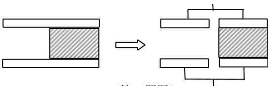

# 《大学物理》同步练习册第22章 电容 静电场中的能量（答案）

原件经识别和整理；“参考解答”是我们补的。

# 电容 静电场中的能量

本资料为《大学物理》同步练习册第 22 章部分习题解答，由识别工具读取并整理。

## 一、选择题

### 选择 1

如图，该平行板电容器可等效为两平行板电容器 $C_1$ 和 $C_2$ 的并联：
由
$$ C_1 = \frac{\varepsilon_0 \frac{S}{2}}{d} = \frac{\varepsilon_0 S}{2d} $$
$$ C_2 = \frac{\varepsilon_r \varepsilon_0 \frac{S}{2}}{d} = \frac{\varepsilon_r \varepsilon_0 S}{2d} $$
并联后总电容：
$$ C = C_1 + C_2 = \frac{\varepsilon_0 S}{2d} + \frac{\varepsilon_r \varepsilon_0 S}{2d} = \frac{(1 + \varepsilon_r) \varepsilon_0 S}{2d} $$

答案：C。

知识点：[电容的定义与典型电容器的电容计算](../../../topics/大学物理/电容与电容器.md)

### 选择 2

平行板电容器充电后仍与电源相连，则两板间电压为电源电压 $U$ 保持不变。
真空平行板电容器的电容为 $C = \frac{\varepsilon_0 S}{d}$，则板上电荷电量：
$$ Q = CU = \frac{\varepsilon_0 S}{d} U $$
两板间电场强度大小：
$$ E = \frac{U}{d} $$
电场能量：
$$ W_e = \frac{1}{2}CU^2 = \frac{\varepsilon_0 S}{2d}U^2 $$
保持与电源相连，电压 $U$ 不变，增大两板之间的距离 $d$，则：
板上电荷电量 $Q = \frac{\varepsilon_0 S}{d}U$ 减小；
电场强度 $E = \frac{U}{d}$ 减小；
电场能量 $W_e = \frac{\varepsilon_0 S}{2d}U^2$ 减小。

答案：B。

知识点：[电容的定义与典型电容器的电容计算](../../../topics/大学物理/电容与电容器.md)、[静电场的能量与能量密度](../../../topics/大学物理/静电场的能量.md)

### 选择 3

电容器 $C_1$ 和 $C_2$ 串联后加上 $1000\text{V}$ 电压，即 $U_1 + U_2 = 1000\text{V}$。
电容器 $C_1$ 和 $C_2$ 串联，则 $C_1$ 和 $C_2$ 上的电量相等，即 $C_1 U_1 = C_2 U_2$。
联立：
$$
\begin{cases}
U_1 + U_2 = 1000\text{V} \\
200 U_1 = 300 U_2
\end{cases}
\Rightarrow
\begin{cases}
U_1 = 600\text{V} \\
U_2 = 400\text{V}
\end{cases}
$$
由于 $U_1 = 600\text{V} > 500\text{V}$（耐压值），所以电容器 $C_1$ 先被击穿。
$C_1$ 先被击穿后，$1000\text{V}$ 电压加在 $C_2$ 上，$1000\text{V} > 900\text{V}$（耐压值），电容器 $C_2$ 也被击穿。

答案：C。

知识点：[电容的定义与典型电容器的电容计算](../../../topics/大学物理/电容与电容器.md)、[静电场的能量与能量密度](../../../topics/大学物理/静电场的能量.md)

### 选择 4

真空平行板电容器电容为 $C_0 = \frac{\varepsilon_0 S}{d}$，插入 $\frac{S}{2}$ 的电介质后，电容为 $C = \frac{(1 + \varepsilon_r) \varepsilon_0 S}{2d}$（由第 1 题可得）。
电容之比：
$$ \frac{C}{C_0} = \frac{\frac{(1 + \varepsilon_r) \varepsilon_0 S}{2d}}{\frac{\varepsilon_0 S}{d}} = \frac{1 + \varepsilon_r}{2} $$

知识点：[电介质的极化、电极化强度与有介质时的高斯定理（D矢量）](../../../topics/大学物理/静电场中的电介质.md)、[电容的定义与典型电容器的电容计算](../../../topics/大学物理/电容与电容器.md)

### 选择 5

真空平行板电容器电容为 $C_0 = \frac{\varepsilon_0 S}{d}$，接到电源上，电源电压为 $U$，保持不变，则电场能量：
$$ W_0 = \frac{1}{2}C_0 U^2 $$
若在电容器中充满相对电容率为 $\varepsilon_r$ 的电介质，则平行板电容器的电容为 $C = \frac{\varepsilon_r \varepsilon_0 S}{d}$。
电源电压仍然为 $U$，则此时电场能量：
$$ W = \frac{1}{2}CU^2 = \frac{1}{2}\varepsilon_r C_0 U^2 $$
所以有：
$$ \frac{W}{W_0} = \frac{\frac{1}{2}\varepsilon_r C_0 U^2}{\frac{1}{2}C_0 U^2} = \varepsilon_r $$

知识点：[电容的定义与典型电容器的电容计算](../../../topics/大学物理/电容与电容器.md)、[电介质的极化、电极化强度与有介质时的高斯定理（D矢量）](../../../topics/大学物理/静电场中的电介质.md)、[静电场的能量与能量密度](../../../topics/大学物理/静电场的能量.md)

### 选择 6

真空平行板电容器电容为 $C_0 = \frac{\varepsilon_0 S}{d}$，接到电源上，电源电压为 $U$ 保持不变，则电场能量：
$$ W_0 = \frac{1}{2}C_0 U^2 $$
若在电容器中充满相对电容率为 $\varepsilon_r$ 的电介质，则平行板电容器的电容为 $C = \frac{\varepsilon_r \varepsilon_0 S}{d}$。
电源电压仍然为 $U$，则此时电场能量：
$$ W = \frac{1}{2}CU^2 = \frac{1}{2}\varepsilon_r C_0 U^2 $$
所以：
$$ \frac{C}{C_0} = \frac{\frac{\varepsilon_r \varepsilon_0 S}{d}}{\frac{\varepsilon_0 S}{d}} = \varepsilon_r, \quad \frac{W}{W_0} = \frac{\frac{1}{2}\varepsilon_r C_0 U^2}{\frac{1}{2}C_0 U^2} = \varepsilon_r $$

知识点：[电容的定义与典型电容器的电容计算](../../../topics/大学物理/电容与电容器.md)、[电介质的极化、电极化强度与有介质时的高斯定理（D矢量）](../../../topics/大学物理/静电场中的电介质.md)、[静电场的能量与能量密度](../../../topics/大学物理/静电场的能量.md)

### 选择 7

假设真空中孤立的球体和球面半径都为 $R$，带电量为 $Q$。由于电荷均匀分布，空间电场具有球对称性。

（1）均匀带电球体的电场分布：球体把空间分成两个区域，在各区域内作一半径为 $r$ 的同心球面 $S$ 作为高斯面。

*(注：原题内容至此结束，后续为页脚信息)*

## 计算 8

**题干：**
设半径为 $R_1$ 的铜导线单位长度的电量（电荷线密度）为 $\lambda$，则外导体铜箔在半径为 $R_2$ 的内表面上感应出电荷线密度为 $-\lambda$ 的电荷。在介质中作一半径为 $r$、高为 $h$ 的圆柱面作为高斯面，由 $\vec{D}$ 的高斯定理：

**参考解答：**

$$
R_1 < r < R_2, \quad \oint_S \vec{D} \cdot d\vec{S} = \lambda h \Rightarrow D \cdot 2\pi r h = \lambda h \Rightarrow D = \frac{\lambda}{2\pi r}
$$

由 $D = \varepsilon_r \varepsilon_0 E$，$\Rightarrow$ 电介质中的电场强度大小：
$$
E = \frac{\lambda}{2\pi \varepsilon_r \varepsilon_0 r}
$$

在 $R_1 < r < R_2$ 介质范围中，$r = R_1$ 时，介质中场强最大：
$$
E(R_1) = \frac{\lambda}{2\pi \varepsilon_r \varepsilon_0 R_1} \leq E_{\mathrm{max}} \quad \Rightarrow \quad \frac{\lambda}{2\pi \varepsilon_r \varepsilon_0} \leq E_{\mathrm{max}} \cdot R_1
$$

电缆承受的电压：
$$
U = \int_{R_1}^{R_2} \vec{E} \cdot d\vec{r} = \int_{R_1}^{R_2} \frac{\lambda}{2\pi \varepsilon_r \varepsilon_0 r} dr = \frac{\lambda}{2\pi \varepsilon_r \varepsilon_0} \int_{R_1}^{R_2} \frac{1}{r} dr = \frac{\lambda}{2\pi \varepsilon_r \varepsilon_0} \ln \frac{R_2}{R_1} \leq E_{\mathrm{max}} \cdot R_1 \cdot \ln \frac{R_2}{R_1}
$$

（1）电缆能够承受的最高电压：
$$
U_{\mathrm{max}} = E_{\mathrm{max}} \cdot R_1 \cdot \ln \frac{R_2}{R_1}
$$

（2）当电压升高时，介质中半径为 $R_1$ 处先被击穿；

（3）题目有些问题应该指明在什么条件（铜导线的电荷线密度）下电缆中存储的静电场能量。

## 计算 9

**题干：**
图 $(a)$ 中电容器两端电压 $U_0$ 不变，初始电容 $C_0 = \frac{\varepsilon_r \varepsilon_0 S}{d}$，初始静电场能量 $W_0 = \frac{1}{2} C_0 U_0^2 = \frac{\varepsilon_r \varepsilon_0 S}{2d} U_0^2$；拉出电介质后电容 $C = \frac{\varepsilon_0 S}{d}$，静电场能量 $W = \frac{1}{2} C U_0^2 = \frac{\varepsilon_0 S}{2d} U_0^2$，静电场能量变小。

图 $(b)$ 中电容器存储电荷 $Q = C_0 U_0$ 不变，初始静电场能量 $W_0 = \frac{Q^2}{2C_0} = \frac{1}{2} C_0 U_0^2 = \frac{\varepsilon_r \varepsilon_0 S}{2d} U_0^2$。拉出电介质后静电场能量 $W = \frac{Q^2}{2C} = \frac{1}{2C} C_0^2 U_0^2 = \frac{\varepsilon_r^2 \varepsilon_0 S}{2d} U_0^2 > W_0 = \frac{\varepsilon_r \varepsilon_0 S}{2d} U_0^2$，静电场能量变大。

**参考解答：**

**情形 (a)：电压 $U_0$ 保持不变**

1.  **初始状态**（插入电介质）：
    *   电容：$C_0 = \frac{\varepsilon_r \varepsilon_0 S}{d}$
    *   能量：$W_0 = \frac{1}{2} C_0 U_0^2 = \frac{\varepsilon_r \varepsilon_0 S}{2d} U_0^2$

2.  **末状态**（拉出电介质）：
    *   电容：$C = \frac{\varepsilon_0 S}{d}$
    *   能量：$W = \frac{1}{2} C U_0^2 = \frac{\varepsilon_0 S}{2d} U_0^2$

3.  **比较**：
    由于 $\varepsilon_r > 1$，故 $W < W_0$，静电场能量变小。

**情形 (b)：电荷 $Q$ 保持不变**

1.  **初始状态**（插入电介质）：
    *   电荷：$Q = C_0 U_0$
    *   能量：$W_0 = \frac{Q^2}{2C_0} = \frac{1}{2} C_0 U_0^2 = \frac{\varepsilon_r \varepsilon_0 S}{2d} U_0^2$

2.  **末状态**（拉出电介质）：
    *   电荷：$Q$ 不变
    *   电容：$C = \frac{\varepsilon_0 S}{d}$
    *   能量：$W = \frac{Q^2}{2C} = \frac{(C_0 U_0)^2}{2C} = \frac{C_0^2 U_0^2}{2C}$
    *   代入 $C_0$ 和 $C$：
        $$
        W = \frac{(\frac{\varepsilon_r \varepsilon_0 S}{d})^2 U_0^2}{2 (\frac{\varepsilon_0 S}{d})} = \frac{\varepsilon_r^2 \varepsilon_0^2 S^2 U_0^2}{d^2} \cdot \frac{d}{2 \varepsilon_0 S} = \frac{\varepsilon_r^2 \varepsilon_0 S}{2d} U_0^2
        $$

3.  **比较**：
    $$
    W = \frac{\varepsilon_r^2 \varepsilon_0 S}{2d} U_0^2 > \frac{\varepsilon_r \varepsilon_0 S}{2d} U_0^2 = W_0
    $$
    静电场能量变大。

知识点：[电通量的概念与静电场的高斯定理](../../../topics/大学物理/电通量与高斯定理.md)、[电场强度的定义与叠加原理](../../../topics/大学物理/电场强度.md)、[静电场的能量与能量密度](../../../topics/大学物理/静电场的能量.md)
