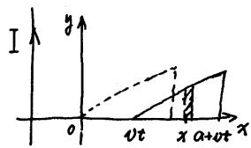

# 《大学物理》同步练习册答案 27 电磁感应（I）

原件经识别和整理；“参考解答”是我们补的。

## 电磁感应(I)

### 简答 1

长直导线中电流 $I$ 增加，矩形线圈处磁感强度 $B$ 垂直纸面向外，且增加。由楞次定律，感应电流产生的磁感强度 $B'$ 的方向要阻碍 $B$ 的变化，所以 $B'$ 方向垂直纸面向里，感应电流为顺时针方向。

知识点：[法拉第电磁感应定律与楞次定律](../../../topics/大学物理/法拉第电磁感应定律.md)

### 简答 2

作辅助线，用直导线把圆弧两端 $ab$ 和 $a'b'$ 相连，构成闭合回路。注意沿半径方向的直导线上电动势为零。

由法拉第电磁感应定律

$$
E_i = -\frac{d\phi}{dt}
$$

$abo$ 回路 $\phi = B \cdot \dfrac{1}{2}\overline{ab}\cdot h$

$a'b'o$ 回路 $\phi' = B \cdot \dfrac{1}{2}\overline{ab}\cdot h'$（$h > h'$）

$$
E_2 = E_{abo} = \frac{dB}{dt}\cdot\frac{1}{2}\overline{ab}\cdot h
$$

$$
E_1 = E_{a'b'o} = \frac{dB}{dt}\cdot\frac{1}{2}\overline{ab}\cdot h'
$$

由 $h > h'$，得 $E_2 > E_1$。

知识点：[法拉第电磁感应定律与楞次定律](../../../topics/大学物理/法拉第电磁感应定律.md)、[感生电动势与涡旋电场](../../../topics/大学物理/感生电动势.md)

### 简答 3

真空长直螺线管中 $B = \mu_0 n i = \mu_0 n I_{\max}\sin\omega t$，半径为 $r$ 的圆形回路的磁通量

$$
\phi_m = B\cdot \pi a^2
$$

$$
\begin{aligned}
E_i &= -\frac{d\phi_m}{dt} = -\pi a^2\cdot\mu_0 n I_m\omega\cos\omega t \\
&= -\mu_0 n\omega\pi a^2 I_m\cos\omega t
\end{aligned}
$$

（负号表示方向）

知识点：[感生电动势与涡旋电场](../../../topics/大学物理/感生电动势.md)、[法拉第电磁感应定律与楞次定律](../../../topics/大学物理/法拉第电磁感应定律.md)

### 简答 4

动生电动势：

$$
\varepsilon_i = \int_a^b (\vec{v}\times\vec{B})\cdot d\vec{l}
$$

$\vec{v}\times\vec{B}$ 的方向垂直纸面向外，$\vec{v}\times\vec{B}$ 垂直于导线 $d\vec{l}$，

所以 $(\vec{v}\times\vec{B})\cdot d\vec{l} = 0$，$\varepsilon_i = 0$。

知识点：[法拉第电磁感应定律与楞次定律](../../../topics/大学物理/法拉第电磁感应定律.md)、[动生电动势的计算（含运动线圈在非均匀磁场中的情况）](../../../topics/大学物理/动生电动势.md)

### 简答 5

圆盘可看成由无数长为 $R$ 的直导线密排而成，每根直导线上的电动势 $E_j = \dfrac{1}{2}BR^2\omega$，方向与 $\vec{v}\times\vec{B}$ 相同，电动势方向由中心指向边缘。

知识点：[动生电动势的计算（含运动线圈在非均匀磁场中的情况）](../../../topics/大学物理/动生电动势.md)、[法拉第电磁感应定律与楞次定律](../../../topics/大学物理/法拉第电磁感应定律.md)、[洛伦兹力与带电粒子在电场和磁场中的运动](../../../topics/大学物理/带电粒子在电磁场中的运动.md)

### 简答 6

铜环和木环上各点的感生电场强度处处相同。

电动势 $E_i = \oint \vec{E_i}\cdot d\vec{l}$，与环的材料无关。

铜环中感应电动势等于木环中感应电动势。

铜环中会有感应电流，木环中无自由电子，无电流。

知识点：[法拉第电磁感应定律与楞次定律](../../../topics/大学物理/法拉第电磁感应定律.md)、[感生电动势与涡旋电场](../../../topics/大学物理/感生电动势.md)、[动生电动势的计算（含运动线圈在非均匀磁场中的情况）](../../../topics/大学物理/动生电动势.md)

### 计算 7

两直导线在右侧坐标为 $x$ 处的磁感强度

$$
B = \frac{\mu_0 I}{2\pi x} + \frac{\mu_0 I}{2\pi(x - r_1 + r_2)}
$$

方向垂直纸面向里。设矩形框的法线正方向也是垂直纸面向里，矩形框顺时针为正方向。

$$
\begin{aligned}
\phi_m &= \int \vec{B}\cdot d\vec{s} = \int B\,ds = \int_{r_1}^{r_1+b}\left[\frac{\mu_0 I}{2\pi x} + \frac{\mu_0 I}{2\pi(x - r_1 + r_2)}\right]a\,dx \\
&= \frac{\mu_0 I a}{2\pi}\left[\ln\frac{r_1+b}{r_1} + \ln\frac{r_2+b}{r_2}\right] \\
&= \frac{\mu_0 I a}{2\pi}\ln\frac{(r_1+b)(r_2+b)}{r_1 r_2}
\end{aligned}
$$

$$
E_1 = -\frac{d\phi_m}{dt} = -\frac{\Delta a\mu_0\omega I_0\cos\omega t}{2\pi}\ln\frac{(r_1+b)(r_2+b)}{r_1 r_2}
$$

知识点：[毕奥-萨伐尔定律及典型载流导线的磁场计算](../../../topics/大学物理/毕奥-萨伐尔定律.md)、[动生电动势的计算（含运动线圈在非均匀磁场中的情况）](../../../topics/大学物理/动生电动势.md)

### 简答 8

用直导线连接 $MN$，整个回路 $MeNoM$ 磁通量不变，电动势为零，或者 $E_{MeN} = E_{MoN}$。

直导线 $MON$ 中的电动势

$$
\begin{aligned}
E_{MON} &= \int_M^N (\vec{v}\times\vec{B})\cdot d\vec{l} \\
&= -\int_M^N vB\,dr \\
&= -\int_{a-R}^{a+R} v\frac{\mu_0 I}{2\pi r}\,dr \\
&= -\frac{\mu_0 I v}{2\pi}\ln\frac{a+R}{a-R} < 0
\end{aligned}
$$

电动势方向从 $N$ 指向 $M$，即 $\vec{v}\times\vec{B}$ 的方向。

知识点：[动生电动势的计算（含运动线圈在非均匀磁场中的情况）](../../../topics/大学物理/动生电动势.md)、[毕奥-萨伐尔定律及典型载流导线的磁场计算](../../../topics/大学物理/毕奥-萨伐尔定律.md)

### 计算 9

$aO$ 段电动势 $\dfrac{1}{2}B\cdot\dfrac{1}{9}L^2\omega = \dfrac{1}{18}BL^2\omega$，方向从 $O$ 指向 $a$。

$Ob$ 段电动势 $\dfrac{1}{2}B\cdot\dfrac{4}{9}L^2\omega = \dfrac{4}{18}BL^2\omega$，方向从 $O$ 指向 $b$。

$$
U_a - U_O = \frac{1}{18}BL^2\omega,\qquad U_b - U_O = \frac{4}{18}BL^2\omega
$$

电势差

$$
\begin{aligned}
U_a - U_b &= (U_a - U_O) - (U_b - U_O) \\
&= -\frac{1}{6}BL^2\omega
\end{aligned}
$$

# 电磁感应（I）习题解答

本资料整理自《大学物理》同步练习册答案第 27 章（电磁感应 I），包含两道关于动生电动势与感生电动势的计算题，已修正识别错误并规范公式排版。

## 计算 10：直角三角形线圈在长直导线磁场中的动生电动势

**题目描述**：
如图所示，直角三角形线圈 $ABC$ 在长直导线产生的磁场中运动。已知长直导线电流为 $I$，线圈以速度 $v$ 垂直于导线方向运动。求线圈中的总电动势。

知识点：[动生电动势的计算（含运动线圈在非均匀磁场中的情况）](../../../topics/大学物理/动生电动势.md)、[法拉第电磁感应定律与楞次定律](../../../topics/大学物理/法拉第电磁感应定律.md)

### 解题过程

**(1) AB 导线段**
电动势由 $\vec{E}_{BA} = \int_{B}^{A} (\vec{v} \times \vec{B}) \cdot d\vec{l}$ 计算。
由于 $AB$ 边与速度方向垂直，且磁场随距离变化：
$$
E_{BA} = \int_{B}^{A} v B \, dl \cos \theta = \int_{B}^{A} v \frac{\mu_0 I}{2\pi (d+x)} dy
$$
由几何关系 $\frac{dy}{b} = \frac{dx}{a} \Rightarrow dy = \frac{b}{a} dx$，积分限从 $x=0$ 到 $x=a$：
$$
\begin{aligned}
E_{BA} &= \int_{0}^{a} v \frac{\mu_0 I}{2\pi (d+x)} \frac{b}{a} dx \\
&= \frac{\mu_0 I v b}{2\pi a} \ln\left(1 + \frac{a}{d}\right) > 0
\end{aligned}
$$
方向：从 $B$ 指向 $A$。

**(2) BC 导线段**
$BC$ 边平行于速度方向（或处于特殊位置使得 $\vec{v} \parallel \vec{B}$ 或 $\vec{v} \perp \vec{B}$ 但 $d\vec{l} \perp (\vec{v} \times \vec{B})$）。根据题意及常规几何设定，该段不切割磁感线或有效分量为零：
$$
E_{BC} = \int_{B}^{C} (\vec{v} \times \vec{B}) \cdot d\vec{l} = 0
$$

**(3) CA 导线段**
$CA$ 边垂直于长直导线，长度为 $b$。
$$
\begin{aligned}
E_{CA} &= \int_{C}^{A} (\vec{v} \times \vec{B}) \cdot d\vec{l} \\
&= \int_{0}^{b} v \frac{\mu_0 I}{2\pi (a+d)} dy \\
&= \frac{\mu_0 I v b}{2\pi (a+d)} > 0
\end{aligned}
$$
方向：从 $C$ 指向 $A$。

知识点：[毕奥-萨伐尔定律及典型载流导线的磁场计算](../../../topics/大学物理/毕奥-萨伐尔定律.md)、[法拉第电磁感应定律与楞次定律](../../../topics/大学物理/法拉第电磁感应定律.md)、[动生电动势的计算（含运动线圈在非均匀磁场中的情况）](../../../topics/大学物理/动生电动势.md)

### 总电动势

回路总电动势为各段电动势的代数和（注意方向）：
$$
\begin{aligned}
E_i &= E_{BA} - E_{CA} \\
&= \frac{\mu_0 I v b}{2\pi} \left[ \frac{1}{a} \ln\left(1 + \frac{a}{d}\right) - \frac{1}{a+d} \right]
\end{aligned}
$$
*(注：原题识别结果中出现的 "110√10" 等数值为乱码，此处保留通用符号形式)*

**结论**：
电动势大小为 $\frac{\mu_0 I v b}{2\pi} \left[ \frac{1}{a} \ln\left(1 + \frac{a}{d}\right) - \frac{1}{a+d} \right]$，方向为**顺时针**。

---

## 计算 7：运动线圈的磁通量与感应电动势

**题目描述**：
设 $t=0$ 时线圈 $ABC$ 位于初始位置，$t$ 时刻运动到图示位置。在 $x$ 处取宽为 $dx$、高为 $y$ 的矩形条。求 $t$ 时刻穿过线圈的磁通量 $\Phi_m$ 及感应电动势 $E_i$。

知识点：[动生电动势的计算（含运动线圈在非均匀磁场中的情况）](../../../topics/大学物理/动生电动势.md)、[法拉第电磁感应定律与楞次定律](../../../topics/大学物理/法拉第电磁感应定律.md)、[毕奥-萨伐尔定律及典型载流导线的磁场计算](../../../topics/大学物理/毕奥-萨伐尔定律.md)

### 解题过程

**1. 几何关系**
设线圈向右运动速度为 $v$，则 $t$ 时刻线圈左边界位置为 $vt$。
对于任意 $x$ 处的微元高度 $y$，满足相似三角形关系：
$$
\frac{x - vt}{a} = \frac{y}{b} \Rightarrow y = \frac{b}{a}(x - vt)
$$

**2. 磁通量计算**
取顺时针方向为回路正方向。
$$
\begin{aligned}
\Phi_m &= \int \vec{B} \cdot d\vec{s} = \int_{vt}^{a+vt} \frac{\mu_0 I}{2\pi (x+d)} \cdot y \, dx \\
&= \int_{vt}^{a+vt} \frac{\mu_0 I}{2\pi (x+d)} \cdot \frac{b}{a}(x - vt) \, dx \\
&= \frac{\mu_0 I b}{2\pi a} \int_{vt}^{a+vt} \left[ 1 - \frac{d + vt}{x+d} \right] dx \\
&= \frac{\mu_0 I b}{2\pi a} \left[ x - (d+vt)\ln(x+d) \right]_{vt}^{a+vt} \\
&= \frac{\mu_0 I b}{2\pi a} \left[ a - (d+vt) \ln\left(\frac{d+a+vt}{d+vt}\right) \right]
\end{aligned}
$$

**3. 感应电动势计算**
根据法拉第电磁感应定律 $E_i = -\frac{d\Phi_m}{dt}$：
$$
\begin{aligned}
E_i &= - \frac{d}{dt} \left\{ \frac{\mu_0 I b}{2\pi a} \left[ a - (d+vt) \ln\left(\frac{d+a+vt}{d+vt}\right) \right] \right\} \\
&= \frac{\mu_0 I b}{2\pi a} \left[ v \ln\left(\frac{d+a+vt}{d+vt}\right) + (d+vt) \cdot \frac{d+vt}{d+a+vt} \cdot \frac{v(d+vt) - v(d+a+vt)}{(d+vt)^2} \right] \\
&= \frac{\mu_0 I b}{2\pi a} \left[ v \ln\left(\frac{d+a+vt}{d+vt}\right) + (d+vt) \left( - \frac{va}{(d+a+vt)(d+vt)} \right) \right] \\
&= \frac{\mu_0 I v b}{2\pi} \left[ \frac{1}{a} \ln\left(\frac{a+d+vt}{d+vt}\right) - \frac{1}{d+a+vt} \right]
\end{aligned}
$$

**4. 特殊情况验证**
当 $t=0$ 时（即线圈刚开始进入或特定位置），若 $d$ 为初始距离：
$$
E_i = \frac{\mu_0 I v b}{2\pi} \left[ \frac{1}{a} \ln\left(\frac{a+d}{d}\right) - \frac{1}{d+a} \right] > 0
$$
方向：**顺时针**。

---

*注：原识别内容中的页脚版权声明、乱码字符（如“房点”、“正狗”、“长植寻线”）已根据物理语境修正为“初始位置”、“正方向”、“长直导线”。*

知识点：[毕奥-萨伐尔定律及典型载流导线的磁场计算](../../../topics/大学物理/毕奥-萨伐尔定律.md)、[法拉第电磁感应定律与楞次定律](../../../topics/大学物理/法拉第电磁感应定律.md)、[动生电动势的计算（含运动线圈在非均匀磁场中的情况）](../../../topics/大学物理/动生电动势.md)
