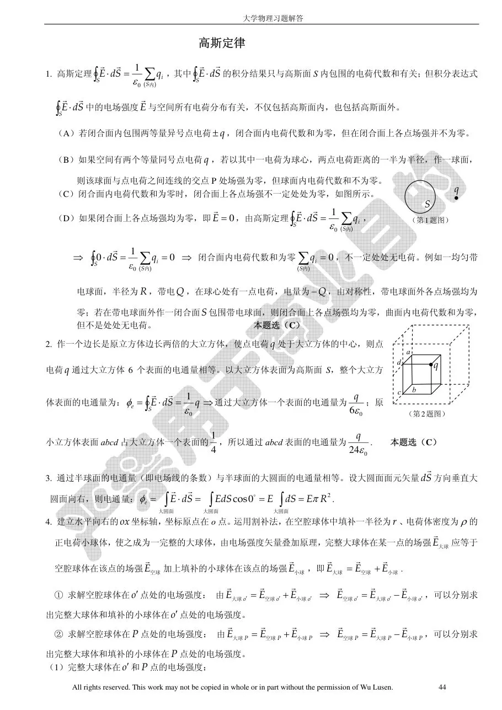

# 《大学物理》同步练习册答案 第17章 高斯定律

原件经识别和整理；“参考解答”是我们补的。

本资料为《大学物理》同步练习册第17章“高斯定律”的答案部分第1页内容整理。包含选择题解析及计算题解题思路。

## 一、选择题

### 选择 1

题干：关于高斯定理的理解，下列说法正确的是（ ）。

- A. 若闭合面内包围两等量异号点电荷 ± q ，闭合面内电荷代数和为零，则闭合面上各点场强均为零。
- B. 如果空间有两个等量同号点电荷 $q$ ，若以其中一电荷为球心，两点电荷距离的一半为半径，作一球面，则该球面与点电荷之间连线的交点 P处场强为零，且球面内电荷代数和不为零。
- C. 闭合面内电荷代数和为零时，闭合面上各点场强不一定处处为零。
- D. 如果闭合面上各点场强均为零，即 $\vec { E } = 0$ ，则由高斯定理可知闭合面内电荷代数和为零，说明闭合面内处处无电荷。

知识点：[电通量的概念与静电场的高斯定理](../../../topics/大学物理/电通量与高斯定理.md)、[电场强度的定义与叠加原理](../../../topics/大学物理/电场强度.md)、[电荷守恒定律与库仑定律](../../../topics/大学物理/电荷守恒与库仑定律.md)

### 选择 2

题干：如图所示，边长为 a 的立方体中心放置一点电荷 q，求通过立方体表面 abcd 的电通量。

知识点：[电通量的概念与静电场的高斯定理](../../../topics/大学物理/电通量与高斯定理.md)、[电荷守恒定律与库仑定律](../../../topics/大学物理/电荷守恒与库仑定律.md)

### 选择 3

题干：均匀电场 $\vec { E }$ 穿过半径为 R 的半球面的电通量是多少？（假设半球面的大圆面垂直于电场方向）

知识点：[电通量的概念与静电场的高斯定理](../../../topics/大学物理/电通量与高斯定理.md)

### 计算 1

题干：一个半径为 R 的均匀带电球体，电荷体密度为 $\rho$，现从中挖去一个半径为 r 的小球形空腔，空腔中心与原球体中心距离为 d ($r < R, d+r < R$)。求：
(1) 空腔球体在空腔中心 $O'$ 点处的电场强度；
(2) 空腔球体在球体内另一点 P 处的电场强度。

知识点：[电通量的概念与静电场的高斯定理](../../../topics/大学物理/电通量与高斯定理.md)、[电场强度的定义与叠加原理](../../../topics/大学物理/电场强度.md)

### 计算 5

两个无限长共轴圆柱面，半径分别为 $R_1$ 和 $R_2$，电荷线密度分别为 $\lambda_1$ 和 $\lambda_2$，把空间分成三个区域。电荷均匀分布在圆柱面上，空间电场具有柱对称性。分别在各个区域内作一半径为 $r$（到轴线的距离）、高为 $h$ 的共轴圆柱面 $S$ 作为高斯面：

（1）$r < R_1$：

$$\oint_{S_1} \vec{E} \cdot d\vec{S} = \frac{1}{\varepsilon_0}\cdot 0 \Rightarrow E\cdot 2\pi r h = \frac{1}{\varepsilon_0}\cdot 0 \Rightarrow E = 0$$

（2）$R_1 < r < R_2$：

$$\oint_{S_2} \vec{E} \cdot d\vec{S} = \frac{1}{\varepsilon_0}\lambda_1 h \Rightarrow E\cdot 2\pi r h = \frac{1}{\varepsilon_0}\lambda_1 h \Rightarrow E = \frac{\lambda_1}{2\pi\varepsilon_0 r}$$

（3）$r > R_2$：

$$\oint_{S_3} \vec{E} \cdot d\vec{S} = \frac{1}{\varepsilon_0}(\lambda_1 + \lambda_2)h \Rightarrow E\cdot 2\pi r h = \frac{1}{\varepsilon_0}(\lambda_1 + \lambda_2)h \Rightarrow E = \frac{\lambda_1 + \lambda_2}{2\pi\varepsilon_0 r}$$

空间各点的电场强度分布：

$$E = \begin{cases} 0 & (r < R_1) \\ \dfrac{\lambda_1}{2\pi\varepsilon_0 r} & (R_1 < r < R_2) \\ \dfrac{\lambda_1 + \lambda_2}{2\pi\varepsilon_0 r} & (r > R_2) \end{cases}$$

知识点：[电通量的概念与静电场的高斯定理](../../../topics/大学物理/电通量与高斯定理.md)、[几种特殊带电体（点电荷、无限长直线、圆环、圆盘等）激发的电场](../../../topics/大学物理/特殊带电体电场.md)
