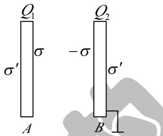
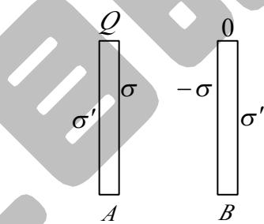
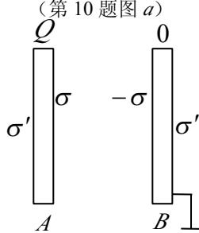

# 《大学物理》同步练习册答案 第20讲 静电场中的导体（2）

原件经识别和整理；“参考解答”是我们补的。

### 简答 1

处于静电平衡的导体是等势体，导体表面是等势面；导体表面附近的电场线与导体表面相互垂直；导体体内的电场处处为零，所以在该区域靠近导体的一侧电场为零。

答案：C。

知识点：[静电平衡条件、导体表面电荷分布及接地问题](../../../topics/大学物理/静电场中的导体.md)、[电场强度的定义与叠加原理](../../../topics/大学物理/电场强度.md)

### 简答 2

金属平板静电平衡后，金属平板 A 和 B 相邻两表面电荷电量等量异号，设电荷面密度分别为 $\sigma$ 和 $-\sigma$；金属平板 A 和 B 最外边两表面电荷电量相等，设电荷面密度为 $\sigma'$，如图所示。

若金属板 B 接地，金属板 B 和无穷远处电势相等，$V_B=V_\infty=0$，则金属板 B 右侧电荷不能存在，即 $\sigma'=0$，$\Rightarrow$ 金属板 A 左侧电荷也为零，$\Rightarrow$ 金属板 A 带电量 $Q_1$ 全部分布在 A 板右表面，即 $\sigma=\frac{Q_1}{S}$。此时金属平板 A 和 B 之间的电场强度大小：

$$E=\frac{\sigma}{\varepsilon_0}=\frac{Q_1}{\varepsilon_0 S}$$

答案：C。

知识点：[静电平衡条件、导体表面电荷分布及接地问题](../../../topics/大学物理/静电场中的导体.md)、[电场强度的定义与叠加原理](../../../topics/大学物理/电场强度.md)

### 简答 3

设导体板 B 左右两个面上感应电荷面密度分别为 $\sigma_1$ 和 $\sigma_2$，导体板 B 原来不带电，则 $\sigma_1+\sigma_2=0$。空间等效为三个无限大均匀带电平面：$\sigma$、$\sigma_1$ 和 $\sigma_2$，它们在导体板 B 内部任一点 P 产生的场强大小为：

$$E_P=\frac{\sigma}{2\varepsilon_0}+\frac{\sigma_1}{2\varepsilon_0}-\frac{\sigma_2}{2\varepsilon_0}=0$$

设水平向右为正方向，导体中场强处处为零，$\sigma+\sigma_1-\sigma_2=0$。联立

$$\begin{cases}\sigma_1+\sigma_2=0\\ \sigma+\sigma_1-\sigma_2=0\end{cases}\Rightarrow\begin{cases}\sigma_1=-\dfrac{\sigma}{2}\\[6pt] \sigma_2=\dfrac{\sigma}{2}\end{cases}$$

答案：B。

知识点：[静电平衡条件、导体表面电荷分布及接地问题](../../../topics/大学物理/静电场中的导体.md)、[电场强度的定义与叠加原理](../../../topics/大学物理/电场强度.md)、[电通量的概念与静电场的高斯定理](../../../topics/大学物理/电通量与高斯定理.md)

### 简答 4

由于点电荷不在球心处，内表面感应电荷分布不均匀；外表面电荷分布只与导体的形状有关，所以外表面电荷分布均匀。

答案：B。

知识点：[静电平衡条件、导体表面电荷分布及接地问题](../../../topics/大学物理/静电场中的导体.md)

### 简答 5

$a$ 点电荷面密度为 $\sigma_1$，导体内电场强度为 $E_{\text{内}}=0$，导体外表面附近电场强度大小为 $E=\frac{\sigma_1}{\varepsilon_0}$；由于导体表面电荷面密度与导体表面的曲率成正比，由 $\sigma_1>\sigma_2$，所以曲率较大的点是 $a$ 点。

知识点：[静电平衡条件、导体表面电荷分布及接地问题](../../../topics/大学物理/静电场中的导体.md)、[电通量的概念与静电场的高斯定理](../../../topics/大学物理/电通量与高斯定理.md)

### 简答 6

导体球壳 $R_1$ 上电量 $q_1$ 均匀分布在导体球壳 $R_1$ 的外表面上，则导体球壳 $R_2$ 的内表面均匀分布感应电荷电量为 $-q_1$，导体球壳 $R_2$ 的外表面上均匀分布电荷电量为 $q_1+q_2$。

空间等效为三个均匀带电球面，电量分别为 $q_1$、$-q_1$、$q_1+q_2$，半径分别为 $R_1$、$R_2$、$R_2$（注意薄导体球壳）。则以无穷远处电势为零，由电势标量叠加，

导体球壳 $R_1$ 的电势：

$$U_1=\frac{q_1}{4\pi\varepsilon_0 R_1}+\frac{-q_1}{4\pi\varepsilon_0 R_2}+\frac{q_1+q_2}{4\pi\varepsilon_0 R_2}=\frac{1}{4\pi\varepsilon_0}\left(\frac{q_1}{R_1}+\frac{q_2}{R_2}\right)$$

导体球壳 $R_2$ 的电势：

$$U_2=\frac{q_1}{4\pi\varepsilon_0 R_2}+\frac{-q_1}{4\pi\varepsilon_0 R_2}+\frac{q_1+q_2}{4\pi\varepsilon_0 R_2}=\frac{q_1+q_2}{4\pi\varepsilon_0 R_2}$$

若用导线连接两球壳，则导体球壳 $R_1$ 外表面上电荷 $q_1$ 和导体球壳 $R_2$ 内表面上电荷 $-q_1$ 中和，只有导体球壳 $R_2$ 外表面上均匀分布电荷 $q_1+q_2$。取无穷远处电势为零，导体球壳的电势为

$$\frac{q_1+q_2}{4\pi\varepsilon_0 R_2}=U_2$$

## 7

导体平板电荷面密度为 $\sigma$，板两侧为匀强电场，场强为 $E = \frac{\sigma}{\varepsilon_0}$，方向如图所示。若取导体平板电势为零，$V_a = -Eh, V_b = -Eh$，a 和 b 的电势差为 $V_{ab} = V_a - V_b = 0$。

（第 7 题图）

## 8

利用“静电场中的导体 (1)”第 3 题中的方法可得实际测得 P 点的场强要更大。

## 9

设金属球半径为 $R$，带电量 $Q = 1.2 \times 10^{-8} \mathrm{C}$ 均匀分布在金属球的表面，则空间电场强度的分布：

$$
E(r) = \begin{cases} 
0 & (r < R) \\ 
\frac{Q}{4 \pi \varepsilon_0 r^2} & (r > R) 
\end{cases}
$$

可得在金属球表面附近场强最大 $E_{\max} = \frac{Q}{4 \pi \varepsilon_0 R^2} \leq 3 \times 10^6 \mathrm{V/m}$ $\Rightarrow$ 金属球的半径：$R \geq 6 \times 10^{-3} \mathrm{m}$

## 10

(1) 金属平板静电平衡后，金属平板 A 和 B 相邻两表面电荷电量等量异号，设电荷面密度分别为 $\sigma$；金属平板 A 和 B 最外边两表面电荷电量相等，设电荷面密度为 $\sigma'$，如图 a，则

$$
\begin{cases} 
(\sigma + \sigma') S = Q \\ 
(\sigma' - \sigma) S = 0 
\end{cases} 
\Rightarrow \sigma = \sigma' = \frac{Q}{2S},
$$

金属平板 A 和 B 之间的电场强度大小：$E = \frac{\sigma}{\varepsilon_0} = \frac{Q}{2 \varepsilon_0 S}$

电势差：$U_{AB} = E \cdot d = \frac{Q}{2 \varepsilon_0 S} d$;

（第 10 题图 a）

(2) 若金属板 B 接地，金属板 B 和无穷远处电势相等 $V_B = V_\infty = 0$，则金属板 B 右侧电荷不能存在，即 $\sigma' = 0 \Rightarrow$ 金属板 A 左侧电荷也为零，金属板 A 带电量 $Q$ 全部分布在 A 板右表面，即 $\sigma = \frac{Q}{S}$。注意由于板接地，板电荷不守恒。此时金属平板 A 和 B 之间的电场强度大小：$E' = \frac{\sigma}{\varepsilon_0} = \frac{Q}{\varepsilon_0 S}$，

电势差：$U'_{AB} = E' \cdot d = \frac{Q}{\varepsilon_0 S} d$。

## 11

导体球外放一点电荷，导体球左右两侧会感应出等量异号的电荷 $\pm q'$。静电平衡后，导体内电势处处相等。导体球球心处的电势等于点电荷 $q$ 和感应电荷 $\pm q'$ 在球心 O 产生的电势之和，取无穷远处电势为零，有：

$$
V_O = \frac{q}{4 \pi \varepsilon_0 a} + \oint_S \frac{dq'}{4 \pi \varepsilon_0 R} = \frac{q}{4 \pi \varepsilon_0 a} + \frac{1}{4 \pi \varepsilon_0 R} \oint_S dq' = \frac{q}{4 \pi \varepsilon_0 a}.
$$

## 12

圆柱面 a 上电荷均匀分布，电荷线密度为 $\lambda$，由静电感应，薄金属圆筒内表面感应出等量异号的电荷，电荷线密度为 $-\lambda$，金属圆筒外表面感应电荷线密度为 $+\lambda$。

由于金属圆筒接地，圆筒和无穷远处电势相等 $V = V_\infty = 0$。由静电屏蔽，金属圆筒外表面电荷被大地中和，空间等效为两个均匀带电圆柱面，半径分别为 $a$ 和 $b$，电荷线密度分别为 $\lambda$ 和 $-\lambda$。电荷分布具有柱对称性，由高斯定理，在各区域作半径为 $r$、高为 $h$ 的闭合圆柱面 $S$ 做为高斯面，可得空间电场强度分布：

$$
E(r) = \begin{cases} 
0 & (r < a) \\ 
\frac{\lambda}{2 \pi \varepsilon_0 r} & (a < r < b) \\ 
0 & (r > b) 
\end{cases}
$$

则内圆柱面里面距离为 $r_P$ 的点 P 电场强度大小 $E_P = 0$。

P 点电势：

$$
V_P = \int_P^b \vec{E} \cdot d\vec{r} = \int_P^a \vec{E} \cdot d\vec{r} + \int_a^b \vec{E} \cdot d\vec{r} = \int_P^a 0 \cdot d\vec{r} + \int_a^b \frac{\lambda}{2 \pi \varepsilon_0 r} dr = \frac{\lambda}{2 \pi \varepsilon_0} \ln \frac{b}{a}.
$$

知识点：[静电平衡条件、导体表面电荷分布及接地问题](../../../topics/大学物理/静电场中的导体.md)、[静电场环路定理、电势与电势差](../../../topics/大学物理/环路定理与电势.md)、[几种特殊带电体（点电荷、无限长直线、圆环、圆盘等）激发的电场](../../../topics/大学物理/特殊带电体电场.md)
