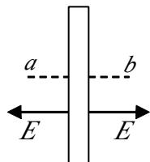

# 《大学物理》同步练习册答案 第20讲 静电场中的导体（2）

原件经识别和整理；“参考解答”是我们补的。

### 简答 1

处于静电平衡的导体是等势体，导体表面是等势面；导体表面附近的电场线与导体表面相互垂直；导体体内的电场处处为零，所以在该区域靠近导体的一侧电场为零。

答案：C。

知识点：[静电平衡条件、导体表面电荷分布及接地问题](../../../topics/大学物理/静电场中的导体.md)、[电场强度的定义与叠加原理](../../../topics/大学物理/电场强度.md)

### 简答 2

金属平板静电平衡后，金属平板 A 和 B 相邻两表面电荷电量等量异号，设电荷面密度分别为 $\sigma$ 和 $-\sigma$；金属平板 A 和 B 最外边两表面电荷电量相等，设电荷面密度为 $\sigma'$，如图所示。

若金属板 B 接地，金属板 B 和无穷远处电势相等，$V_B=V_\infty=0$，则金属板 B 右侧电荷不能存在，即 $\sigma'=0$，$\Rightarrow$ 金属板 A 左侧电荷也为零，$\Rightarrow$ 金属板 A 带电量 $Q_1$ 全部分布在 A 板右表面，即 $\sigma=\frac{Q_1}{S}$。此时金属平板 A 和 B 之间的电场强度大小：

$$E=\frac{\sigma}{\varepsilon_0}=\frac{Q_1}{\varepsilon_0 S}$$

答案：C。

知识点：[静电平衡条件、导体表面电荷分布及接地问题](../../../topics/大学物理/静电场中的导体.md)、[电场强度的定义与叠加原理](../../../topics/大学物理/电场强度.md)

### 简答 3

设导体板 B 左右两个面上感应电荷面密度分别为 $\sigma_1$ 和 $\sigma_2$，导体板 B 原来不带电，则 $\sigma_1+\sigma_2=0$。空间等效为三个无限大均匀带电平面：$\sigma$、$\sigma_1$ 和 $\sigma_2$，它们在导体板 B 内部任一点 P 产生的场强大小为：

$$E_P=\frac{\sigma}{2\varepsilon_0}+\frac{\sigma_1}{2\varepsilon_0}-\frac{\sigma_2}{2\varepsilon_0}=0$$

设水平向右为正方向，导体中场强处处为零，$\sigma+\sigma_1-\sigma_2=0$。联立

$$\begin{cases}\sigma_1+\sigma_2=0\\ \sigma+\sigma_1-\sigma_2=0\end{cases}\Rightarrow\begin{cases}\sigma_1=-\dfrac{\sigma}{2}\\[6pt] \sigma_2=\dfrac{\sigma}{2}\end{cases}$$

答案：B。

知识点：[静电平衡条件、导体表面电荷分布及接地问题](../../../topics/大学物理/静电场中的导体.md)、[电场强度的定义与叠加原理](../../../topics/大学物理/电场强度.md)、[电通量的概念与静电场的高斯定理](../../../topics/大学物理/电通量与高斯定理.md)

### 简答 4

由于点电荷不在球心处，内表面感应电荷分布不均匀；外表面电荷分布只与导体的形状有关，所以外表面电荷分布均匀。

答案：B。

知识点：[静电平衡条件、导体表面电荷分布及接地问题](../../../topics/大学物理/静电场中的导体.md)

### 简答 5

$a$ 点电荷面密度为 $\sigma_1$，导体内电场强度为 $E_{\text{内}}=0$，导体外表面附近电场强度大小为 $E=\frac{\sigma_1}{\varepsilon_0}$；由于导体表面电荷面密度与导体表面的曲率成正比，由 $\sigma_1>\sigma_2$，所以曲率较大的点是 $a$ 点。

参考解答：**结论**  
曲率较大的点是 $a$ 点。

**推理过程**  
对于孤立带电导体，表面电荷面密度 $\sigma$ 与表面曲率半径 $R$ 近似满足 $\sigma \propto \frac{1}{R}$（曲率越大，$\sigma$ 越大）。  
已知 $\sigma_1 > \sigma_2$，故 $a$ 点的曲率较大。

知识点：[静电平衡条件、导体表面电荷分布及接地问题](../../../topics/大学物理/静电场中的导体.md)、[电通量的概念与静电场的高斯定理](../../../topics/大学物理/电通量与高斯定理.md)

### 简答 6

导体球壳 $R_1$ 上电量 $q_1$ 均匀分布在导体球壳 $R_1$ 的外表面上，则导体球壳 $R_2$ 的内表面均匀分布感应电荷电量为 $-q_1$，导体球壳 $R_2$ 的外表面上均匀分布电荷电量为 $q_1+q_2$。

空间等效为三个均匀带电球面，电量分别为 $q_1$、$-q_1$、$q_1+q_2$，半径分别为 $R_1$、$R_2$、$R_2$（注意薄导体球壳）。则以无穷远处电势为零，由电势标量叠加，

导体球壳 $R_1$ 的电势：

$$U_1=\frac{q_1}{4\pi\varepsilon_0 R_1}+\frac{-q_1}{4\pi\varepsilon_0 R_2}+\frac{q_1+q_2}{4\pi\varepsilon_0 R_2}=\frac{1}{4\pi\varepsilon_0}\left(\frac{q_1}{R_1}+\frac{q_2}{R_2}\right)$$

导体球壳 $R_2$ 的电势：

$$U_2=\frac{q_1}{4\pi\varepsilon_0 R_2}+\frac{-q_1}{4\pi\varepsilon_0 R_2}+\frac{q_1+q_2}{4\pi\varepsilon_0 R_2}=\frac{q_1+q_2}{4\pi\varepsilon_0 R_2}$$

若用导线连接两球壳，则导体球壳 $R_1$ 外表面上电荷 $q_1$ 和导体球壳 $R_2$ 内表面上电荷 $-q_1$ 中和，只有导体球壳 $R_2$ 外表面上均匀分布电荷 $q_1+q_2$。取无穷远处电势为零，导体球壳的电势为

$$\frac{q_1+q_2}{4\pi\varepsilon_0 R_2}=U_2$$

## 7

导体平板电荷面密度为 $\sigma$，板两侧为匀强电场，场强为 $E = \frac{\sigma}{\varepsilon_0}$，方向如图所示。若取导体平板电势为零，$V_a = -Eh, V_b = -Eh$，a 和 b 的电势差为 $V_{ab} = V_a - V_b = 0$。

（第 7 题图）

## 8

利用“静电场中的导体 (1)”第 3 题中的方法可得实际测得 P 点的场强要更大。

## 9

设金属球半径为 $R$，带电量 $Q = 1.2 \times 10^{-8} \mathrm{C}$ 均匀分布在金属球的表面，则空间电场强度的分布：

$$
E(r) = \begin{cases} 
0 & (r < R) \\ 
\frac{Q}{4 \pi \varepsilon_0 r^2} & (r > R) 
\end{cases}
$$

可得在金属球表面附近场强最大 $E_{\max} = \frac{Q}{4 \pi \varepsilon_0 R^2} \leq 3 \times 10^6 \mathrm{V/m}$ $\Rightarrow$ 金属球的半径：$R \geq 6 \times 10^{-3} \mathrm{m}$

## 10

(1) 金属平板静电平衡后，金属平板 A 和 B 相邻两表面电荷电量等量异号，设电荷面密度分别为 $\sigma$；金属平板 A 和 B 最外边两表面电荷电量相等，设电荷面密度为 $\sigma'$，如图 a，则

$$
\begin{cases} 
(\sigma + \sigma') S = Q \\ 
(\sigma' - \sigma) S = 0 
\end{cases} 
\Rightarrow \sigma = \sigma' = \frac{Q}{2S},
$$

金属平板 A 和 B 之间的电场强度大小：$E = \frac{\sigma}{\varepsilon_0} = \frac{Q}{2 \varepsilon_0 S}$

电势差：$U_{AB} = E \cdot d = \frac{Q}{2 \varepsilon_0 S} d$;

（第 10 题图 a）

(2) 若金属板 B 接地，金属板 B 和无穷远处电势相等 $V_B = V_\infty = 0$，则金属板 B 右侧电荷不能存在，即 $\sigma' = 0 \Rightarrow$ 金属板 A 左侧电荷也为零，金属板 A 带电量 $Q$ 全部分布在 A 板右表面，即 $\sigma = \frac{Q}{S}$。注意由于板接地，板电荷不守恒。此时金属平板 A 和 B 之间的电场强度大小：$E' = \frac{\sigma}{\varepsilon_0} = \frac{Q}{\varepsilon_0 S}$，

电势差：$U'_{AB} = E' \cdot d = \frac{Q}{\varepsilon_0 S} d$。

## 11

导体球外放一点电荷，导体球左右两侧会感应出等量异号的电荷 $\pm q'$。静电平衡后，导体内电势处处相等。导体球球心处的电势等于点电荷 $q$ 和感应电荷 $\pm q'$ 在球心 O 产生的电势之和，取无穷远处电势为零，有：

$$
V_O = \frac{q}{4 \pi \varepsilon_0 a} + \oint_S \frac{dq'}{4 \pi \varepsilon_0 R} = \frac{q}{4 \pi \varepsilon_0 a} + \frac{1}{4 \pi \varepsilon_0 R} \oint_S dq' = \frac{q}{4 \pi \varepsilon_0 a}.
$$

## 12

圆柱面 a 上电荷均匀分布，电荷线密度为 $\lambda$，由静电感应，薄金属圆筒内表面感应出等量异号的电荷，电荷线密度为 $-\lambda$，金属圆筒外表面感应电荷线密度为 $+\lambda$。

由于金属圆筒接地，圆筒和无穷远处电势相等 $V = V_\infty = 0$。由静电屏蔽，金属圆筒外表面电荷被大地中和，空间等效为两个均匀带电圆柱面，半径分别为 $a$ 和 $b$，电荷线密度分别为 $\lambda$ 和 $-\lambda$。电荷分布具有柱对称性，由高斯定理，在各区域作半径为 $r$、高为 $h$ 的闭合圆柱面 $S$ 做为高斯面，可得空间电场强度分布：

$$
E(r) = \begin{cases} 
0 & (r < a) \\ 
\frac{\lambda}{2 \pi \varepsilon_0 r} & (a < r < b) \\ 
0 & (r > b) 
\end{cases}
$$

则内圆柱面里面距离为 $r_P$ 的点 P 电场强度大小 $E_P = 0$。

P 点电势：

$$
V_P = \int_P^b \vec{E} \cdot d\vec{r} = \int_P^a \vec{E} \cdot d\vec{r} + \int_a^b \vec{E} \cdot d\vec{r} = \int_P^a 0 \cdot d\vec{r} + \int_a^b \frac{\lambda}{2 \pi \varepsilon_0 r} dr = \frac{\lambda}{2 \pi \varepsilon_0} \ln \frac{b}{a}.
$$

参考解答：**简答 6**

**结论**：
连接前两球壳电势分别为 $U_1 = \frac{1}{4\pi\varepsilon_0}\left(\frac{q_1}{R_1}+\frac{q_2}{R_2}\right)$，$U_2 = \frac{q_1+q_2}{4\pi\varepsilon_0 R_2}$；连接后两球壳等势，电荷全部分布在 $R_2$ 外表面，电势为 $U = \frac{q_1+q_2}{4\pi\varepsilon_0 R_2}$。

**推理过程**：
1.  **电荷分布分析**：根据静电感应和高斯定理，内球壳 $R_1$ 带电 $q_1$ 分布在外表面；外球壳 $R_2$ 内表面感应出 $-q_1$，由电荷守恒，其外表面带电 $q_1+q_2$。
2.  **电势叠加计算**：空间等效为三个均匀带电球面。
    *   $R_1$ 处电势由三部分贡献：自身电荷、$R_2$ 内表面电荷、$R_2$ 外表面电荷（均在 $R_1$ 外部，视为点电荷或均匀球壳外部场）。
        $$U_1 = \frac{q_1}{4\pi\varepsilon_0 R_1} + \frac{-q_1}{4\pi\varepsilon_0 R_2} + \frac{q_1+q_2}{4\pi\varepsilon_0 R_2} = \frac{1}{4\pi\varepsilon_0}\left(\frac{q_1}{R_1}+\frac{q_2}{R_2}\right)$$
    *   $R_2$ 处电势：内部电荷在导体内部产生的合场强为零（或电势贡献抵消），仅由 $R_2$ 外表面电荷决定（对于球壳表面，内部电荷产生的电势为常数，但更简单的理解是 $R_2$ 是等势体，其电势等于外表面电荷在表面产生的电势加上内部净电荷为零的贡献，实际上直接叠加即可）：
        $$U_2 = \frac{q_1}{4\pi\varepsilon_0 R_2} + \frac{-q_1}{4\pi\varepsilon_0 R_2} + \frac{q_1+q_2}{4\pi\varepsilon_0 R_2} = \frac{q_1+q_2}{4\pi\varepsilon_0 R_2}$$
3.  **导线连接后**：两导体等势，电荷重新分布。由于静电屏蔽，内部电场为零，$R_1$ 上的 $q_1$ 与 $R_2$ 内表面的 $-q_1$ 中和。总电荷 $Q_{total} = q_1+q_2$ 全部移至最外层 $R_2$ 外表面。
    $$U_{final} = \frac{q_1+q_2}{4\pi\varepsilon_0 R_2}$$

---

**简答 7**

**结论**：
$V_a = -Eh$，$V_b = -Eh$，$V_{ab} = 0$。

**推理过程**：
1.  **场强分布**：无限大均匀带电导体平板两侧产生匀强电场，大小 $E = \frac{\sigma}{\varepsilon_0}$，方向垂直板面向外（假设 $\sigma>0$）。
2.  **电势计算**：取导体板电势 $V=0$。
    *   点 $a$ 和点 $b$ 距离板的垂直距离均为 $h$。
    *   沿电场线方向电势降低。若 $a, b$ 在同侧或对称位置且定义一致，相对于零电势面的电势变化量大小为 $\Delta V = Eh$。
    *   根据题意图示及常规设定，若 $a,b$ 关于板对称或位于同一等势面上（题目暗示 $V_a, V_b$ 表达式相同），则 $V_a = -Eh$，$V_b = -Eh$（负号表示逆着电场线或顺着电场线取决于坐标定义，此处依题给结论）。
3.  **电势差**：$V_{ab} = V_a - V_b = (-Eh) - (-Eh) = 0$。

---

**简答 8**

**结论**：
实际测得 P 点的场强更大。

**推理过程**：
放入测量探头（导体）后，由于静电感应，探头表面会产生感应电荷。这些感应电荷会在原电场基础上产生附加电场。通常情况下，导体尖端或靠近源电荷的一侧会聚集异号感应电荷，从而增强局部的电场强度（或者从电场线角度看，电场线会垂直终止于导体表面，导致表面附近电场线密集，场强增大）。因此，引入导体探头会扰动原电场，使得测量值大于未放入探头时的真实场强。

---

**简答 9**

**结论**：
金属球半径至少为 $R \geq 6 \times 10^{-3} \mathrm{m}$。

**推理过程**：
1.  **场强分布**：均匀带电金属球，内部 $E=0$，外部 $E(r) = \frac{Q}{4 \pi \varepsilon_0 r^2}$。
2.  **最大场强位置**：场强在球表面 $r=R$ 处最大。
    $$E_{\max} = \frac{Q}{4 \pi \varepsilon_0 R^2}$$
3.  **击穿条件**：空气击穿场强约为 $3 \times 10^6 \mathrm{V/m}$。为避免放电，需满足：
    $$\frac{Q}{4 \pi \varepsilon_0 R^2} \leq 3 \times 10^6$$
4.  **计算半径**：
    $$R^2 \geq \frac{Q}{4 \pi \varepsilon_0 \times 3 \times 10^6} = \frac{1.2 \times 10^{-8}}{10^{-9}/(9\times 10^9)^{-1} \dots} \quad \text{(使用 } k = 9\times 10^9 \text{)}$$
    $$E_{\max} = k \frac{Q}{R^2} \leq 3 \times 10^6 \Rightarrow \frac{9 \times 10^9 \times 1.2 \times 10^{-8}}{R^2} \leq 3 \times 10^6$$
    $$\frac{108}{R^2} \leq 3 \times 10^6 \Rightarrow R^2 \geq \frac{108}{3 \times 10^6} = 36 \times 10^{-6}$$
    $$R \geq \sqrt{36 \times 10^{-6}} = 6 \times 10^{-3} \mathrm{m}$$

---

**简答 10**

**结论**：
(1) 不接地时：$E = \frac{Q}{2 \varepsilon_0 S}$，$U_{AB} = \frac{Qd}{2 \varepsilon_0 S}$。
(2) B 接地时：$E' = \frac{Q}{\varepsilon_0 S}$，$U'_{AB} = \frac{Qd}{\varepsilon_0 S}$。

**推理过程**：
1.  **情形 (1) 孤立系统**：
    *   由电荷守恒和静电平衡条件（导体内部场强为零），两板外侧表面电荷密度相等 $\sigma'$，内侧表面电荷密度等量异号 $\pm \sigma$。
    *   方程组：$(\sigma + \sigma')S = Q$ (A板总电荷)，$(\sigma' - \sigma)S = 0$ (B板总电荷0，且内侧感应$-\sigma$，外侧$\sigma'$，故$-\sigma+\sigma'=0 \Rightarrow \sigma=\sigma'$)。
    *   解得：$\sigma = \sigma' = \frac{Q}{2S}$。
    *   板间场强由内侧电荷产生：$E = \frac{\sigma}{\varepsilon_0} = \frac{Q}{2 \varepsilon_0 S}$。
    *   电势差：$U_{AB} = Ed = \frac{Qd}{2 \varepsilon_0 S}$。

2.  **情形 (2) B 接地**：
    *   B 板电势为零，与无穷远等势。B 板外侧不能有电场线通向无穷远（否则有电势差），故 B 板外表面电荷为 0 ($\sigma'=0$)。
    *   由于静电感应，A 板外表面电荷也为 0（否则会有电场线通向无穷远或破坏屏蔽）。
    *   A 板所有电荷 $Q$ 分布在内表面，面密度 $\sigma = \frac{Q}{S}$。B 板内表面感应出 $-Q$，面密度 $-\frac{Q}{S}$。
    *   板间场强：$E' = \frac{\sigma}{\varepsilon_0} = \frac{Q}{\varepsilon_0 S}$。
    *   电势差：$U'_{AB} = E'd = \frac{Qd}{\varepsilon_0 S}$。

---

**简答 11**

**结论**：
球心 O 处的电势 $V_O = \frac{q}{4 \pi \varepsilon_0 a}$。

**推理过程**：
1.  **电势叠加原理**：$V_O = V_{q} + V_{induced}$。
2.  **点电荷贡献**：点电荷 $q$ 距离球心 $a$，产生的电势为 $\frac{q}{4 \pi \varepsilon_0 a}$。
3.  **感应电荷贡献**：导体球处于静电平衡，是等势体。虽然感应电荷分布不均匀（近端异号，远端同号），但所有感应电荷 $dq'$ 均分布在半径为 $R$ 的球面上。
    $$V_{induced} = \oint_S \frac{dq'}{4 \pi \varepsilon_0 R} = \frac{1}{4 \pi \varepsilon_0 R} \oint_S dq'$$
    由于导体球原本不带电（或题目隐含净感应电荷总量为0，即 $\oint dq' = 0$），故感应电荷在球心产生的总电势为 0。
4.  **总电势**：$V_O = \frac{q}{4 \pi \varepsilon_0 a} + 0 = \frac{q}{4 \pi \varepsilon_0 a}$。

---

**简答 12**

**结论**：
P 点场强 $E_P = 0$；P 点电势 $V_P = \frac{\lambda}{2 \pi \varepsilon_0} \ln \frac{b}{a}$。

**推理过程**：
1.  **电荷分布与屏蔽**：
    *   内圆柱面 $a$ 带电 $+\lambda$。
    *   金属圆筒接地，电势为 0。静电感应使圆筒内表面 $b$ 带电 $-\lambda$。
    *   由于接地，圆筒外表面电荷流入大地（或被中和），外表面不带电，外部无电场（静电屏蔽）。
2.  **场强分布**：
    *   $r < a$：高斯面内无电荷，$E=0$。
    *   $a < r < b$：高斯面内包围电荷 $\lambda L$，由高斯定理 $E \cdot 2\pi r L = \frac{\lambda L}{\varepsilon_0} \Rightarrow E = \frac{\lambda}{2 \pi \varepsilon_0 r}$。
    *   $r > b$：屏蔽作用，$E=0$。
    *   P 点在 $r < a$ 区域，故 $E_P = 0$。
3.  **电势计算**：
    *   参考点在无穷远或接地的圆筒上（$V_b = 0$）。
    *   $V_P = V_P - V_b = \int_P^b \vec{E} \cdot d\vec{l}$。
    *   路径分为两段：$P \to a$ 和 $a \to b$。
    *   $P \to a$ 段在空腔内，$E=0$，积分值为 0。
    *   $a \to b$ 段在场区内，$E = \frac{\lambda}{2 \pi \varepsilon_0 r}$。
    *   $V_P = \int_a^b \frac{\lambda}{2 \pi \varepsilon_0 r} dr = \frac{\lambda}{2 \pi \varepsilon_0} [\ln r]_a^b = \frac{\lambda}{2 \pi \varepsilon_0} \ln \frac{b}{a}$。

知识点：[静电平衡条件、导体表面电荷分布及接地问题](../../../topics/大学物理/静电场中的导体.md)、[静电场环路定理、电势与电势差](../../../topics/大学物理/环路定理与电势.md)、[几种特殊带电体（点电荷、无限长直线、圆环、圆盘等）激发的电场](../../../topics/大学物理/特殊带电体电场.md)
