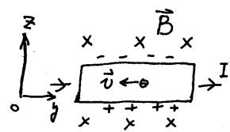
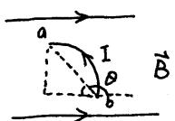
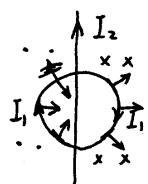
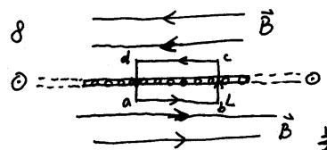
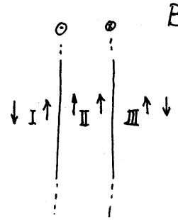
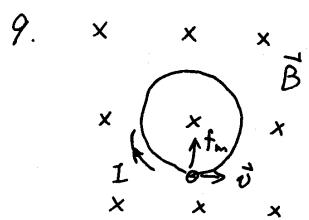

# 《大学物理》同步练习册答案：带电粒子在磁场中的运动及载流导线在磁场中所受的力

原件经识别和整理；“参考解答”是我们补的。

## 二、填空题

### 填空 1

带电粒子在磁场中受到的洛伦兹力公式为：

$$
\vec{f}_m = q \vec{v} \times \vec{B}
$$

若 $q < 0$，则 $\vec{f}_m$ 方向与 $\vec{v} \times \vec{B}$ 相反。

对于水平向右运动的电子（或负电荷）在垂直纸面向里的磁场中，受力水平向右。所以铜条右侧累积负电荷，左侧出现正电荷。

在铜条上左右两侧产生电势差，并左侧电势高。

答案：$U_a > U_b$

知识点：[洛伦兹力与带电粒子在电场和磁场中的运动](../../../topics/大学物理/带电粒子在电磁场中的运动.md)

### 填空 2

任意形状平面载流线圈在匀强磁场中所受合力为零。

磁偶极矩 $\vec{p}_m = I S \vec{n}$ （注：原文识别为 `I sin θ_n`，根据物理常识修正为面积矢量形式，但保留原题意图通常指代大小或特定分量，此处按标准公式整理，若原题为计算题部分可能涉及具体数值，此处仅整理概念）。

磁力矩 $\overrightarrow{M} = \overrightarrow{p}_m \times \overrightarrow{B}$ （在均匀磁场中）

$$
M = p_m B \sin \theta
$$

若 $\vec{p}_m$ 与 $\vec{B}$ 平行或反平行时，$\theta = 0$ 或 $\pi$，$M = 0$。

答案：0

知识点：[安培力与载流线圈的磁力矩](../../../topics/大学物理/载流导线在磁场中受力.md)

### 填空 3

金属中电流是由电子定向移动形成，电流方向与电子运动方向相反。

电子受到洛伦兹力：

$$
\vec{f} = -e (\vec{v} \times \vec{B})
$$

方向竖直向上。

所以金属板上表面累积负电荷，下表面出现正电荷。

电场方向由正电荷指向负电荷，沿 $z$ 轴正方向（假设上下为 z 轴，原文“治区轴”推测为“沿Z轴”或坐标轴名称）。

如果载流子是负电荷，和上题一样，上表面会累积负电荷，那么上表面电势会低。

如果载流子是正电荷，正电荷受洛伦兹力方向竖直向上，上表面累积正电荷，那么上表面电势高。

所以载流子带正电。

答案：正

## 三、计算题/简答题

知识点：[洛伦兹力与带电粒子在电场和磁场中的运动](../../../topics/大学物理/带电粒子在电磁场中的运动.md)

### 计算 5

半圆形线圈的磁偶极矩：

$$
p_m = I \cdot \frac{1}{2} \pi R^2
$$

方向垂直纸面向外。

磁力矩 $\overrightarrow{M} = \overrightarrow{p}_m \times \overrightarrow{B}$

(1) 磁力矩大小：

$$
M = p_m B \sin \theta = I \cdot \frac{1}{2} \pi R^2 \cdot B \cdot 1 = \frac{1}{2} \pi R^2 I B
$$

方向：竖直向上，绕转轴 $OO'$ 转动趋势为竖直向上（原文表述较模糊，意指力矩作用效果）。

(2) 若使力矩 $M = 0$，此时 $\vec{p}_m$ 和 $\vec{B}$ 平行或反平行。

需要顺时针或逆时针转 $\frac{\pi}{2}$ 角度。

答案：(1) $\frac{1}{2} \pi R^2 I B$；(2) 转 $\frac{\pi}{2}$

知识点：[安培力与载流线圈的磁力矩](../../../topics/大学物理/载流导线在磁场中受力.md)、[磁场与磁感应强度的定义](../../../topics/大学物理/磁感应强度.md)

### 计算 6

圆弧导线 ab 受力等效于直导线 ab 受力。

电流从 b 流向 a。$\overline{ab} = \sqrt{2} R$

安培力：

$$
\overrightarrow{F} = I \overrightarrow{l}_{ba} \times \overrightarrow{B}
$$

安培力大小：

$$
F = I \cdot \sqrt{2} R \cdot B \sin \frac{3}{4}\pi \quad (\text{注：原文识别可能有误，通常夹角需根据几何关系确定，此处保留原文逻辑}) 
$$
*修正理解*：若导线弦长与磁场夹角导致有效长度投影，或者原文意指 $F = I L_{eff} B$。根据结果 $IBR$ 反推，可能是 $F = I (\sqrt{2}R) B \cos(45^\circ)$ 或类似几何关系。原文写的是 $\sin \frac{3}{4} x$ (可能是 $\frac{3\pi}{4}$?) 且结果为 $IBR$。

让我们仔细看原文：
$F = I \cdot \sqrt{2} R \cdot B \sin \dots = I \sqrt{2} R \cdot \frac{\sqrt{2}}{2} = I B R$
这里乘了 $\frac{\sqrt{2}}{2}$，即 $\sin 45^\circ$ 或 $\cos 45^\circ$。

方向：$\overrightarrow{b_a} \times \overrightarrow{B}$，垂直纸面向里。

答案：$F = IBR$，方向垂直纸面向里

知识点：[安培力与载流线圈的磁力矩](../../../topics/大学物理/载流导线在磁场中受力.md)、[安培环路定理及其应用](../../../topics/大学物理/安培环路定理.md)

### 计算 7

直导线 $I_2$ 在左侧磁感应强度方向垂直弧面向外，在右侧磁感应强度方向垂直纸面向里。

左侧磁场对半圆导线 $I_1$ 的作用力：

$$
\overrightarrow{F}_k = \int I_1 d\overrightarrow{l} \times \overrightarrow{B}
$$

总向向右。

右侧磁场对半圆导线 $I_1$ 的作用力：

$$
\overrightarrow{F}_A = \int I_1 d\overrightarrow{l} \times \overrightarrow{B}
$$

总向也向右。

所以圆形电流 $I_1$ 将向右运动。

答案：向右运动

知识点：[安培力与载流线圈的磁力矩](../../../topics/大学物理/载流导线在磁场中受力.md)、[毕奥-萨伐尔定律及典型载流导线的磁场计算](../../../topics/大学物理/毕奥-萨伐尔定律.md)、[磁场与磁感应强度的定义](../../../topics/大学物理/磁感应强度.md)

### 计算 8

无限大平行载流平面可视为由无数无限长载流直导线密排而成，两侧磁场是匀强场，并且方向相反。

取回路 L，逆时针为正方向。

由安培环路定理：

$$
\oint_L \vec{B} \cdot d\vec{r} = \mu_0 j \cdot \overline{ab}
$$

其中 $B$ 与 $da, bc$ 垂直（贡献为0），$B$ 与 $ab, cd$ 平行。

$$
B \cdot \overline{ab} + B \overline{cd} = \mu_0 j \overline{ab}
$$

由于对称性 $\overline{ab} = \overline{cd}$，且两侧磁场大小相等方向相反（相对于内部区域叠加前单侧分析，这里推导单平面磁场）：

实际上对于单个无限大载流平面，两侧磁场大小相等方向相反。
$2 B \overline{ab} = \mu_0 j \overline{ab} \implies B = \frac{1}{2} \mu_0 j$

$$
B = \frac{1}{2} \mu_0 j
$$

在 II 区域（两平面之间）：

$$
B_{II} = \frac{1}{2} \mu_0 j + \frac{1}{2} \mu_0 j = \mu_0 j
$$

在 I 区域（左侧外侧）：

$$
B_I = -\frac{1}{2} \mu_0 j + \frac{1}{2} \mu_0 j = 0
$$

在 III 区域（右侧外侧，原文“亚区城”应为III或另一侧）：

$$
B_{III} = \frac{1}{2} \mu_0 j - \frac{1}{2} \mu_0 j = 0
$$

类比两个无限大均匀带电平面周围空间的电场分布计算方法。

答案：中间 $B=\mu_0 j$，外侧 $B=0$

知识点：[安培环路定理及其应用](../../../topics/大学物理/安培环路定理.md)、[磁场与磁感应强度的定义](../../../topics/大学物理/磁感应强度.md)、[毕奥-萨伐尔定律及典型载流导线的磁场计算](../../../topics/大学物理/毕奥-萨伐尔定律.md)

### 计算 9

$v$ 和 $B$ 垂直，电子做圆周运动。

$$
f_m = e v B = m \frac{v^2}{R}
$$

$$
R = \frac{mv}{eB}, \quad T = \frac{2 \pi R}{v} = \frac{2 \pi m}{e B}
$$

等效圆电流：

$$
I = \frac{dq}{dt} = \frac{e}{T} = \frac{e^2 B}{2 \pi m}
$$

代入数据：

$$
I = \frac{(1.6 \times 10^{-19})^2 \times 0.1}{2 \pi \times 9.11 \times 10^{-31}} A \approx 4.5 \times 10^{-10} A
$$

方向与电子运动方向相反。

答案：$4.5 \times 10^{-10} A$

知识点：[洛伦兹力与带电粒子在电场和磁场中的运动](../../../topics/大学物理/带电粒子在电磁场中的运动.md)

### 计算 10

大线圈 $I_1$ 在圆心 O 处产生的磁感应强度：

$$
B = \frac{\mu_0 I_1}{2 R}
$$

方向垂直纸面向里。

由 $r \ll R$，在小线圈处磁场近似为匀强磁场，$B = \frac{\mu_0 I_1}{2 R}$。

小线圈电流为 $I_2$，小线圈的磁偶极矩（磁矩）：

$$
\vec{p}_m = I_2 \cdot \pi r^2 \vec{n}
$$

（注：原文识别为 `x r^2`，结合上下文应为面积 $\pi r^2$，方向 $\vec{e}_n$ 垂直纸面向里）

小线圈受到磁力矩：

$$
\overrightarrow{M} = \overrightarrow{p}_m \times \overrightarrow{B}
$$

磁力矩大小：

$$
M = p_m B \sin \alpha
$$

由于 $\vec{p}_m$ 方向与 $\vec{B}$ 方向相同（均垂直纸面向里），$\alpha = 0$。

$$
M = 0
$$

答案：0

知识点：[毕奥-萨伐尔定律及典型载流导线的磁场计算](../../../topics/大学物理/毕奥-萨伐尔定律.md)、[安培力与载流线圈的磁力矩](../../../topics/大学物理/载流导线在磁场中受力.md)
