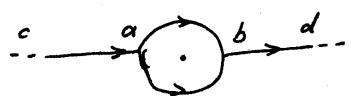
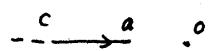
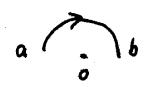
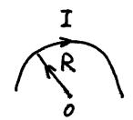
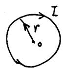
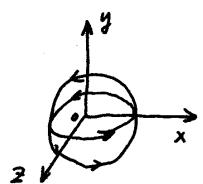
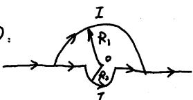
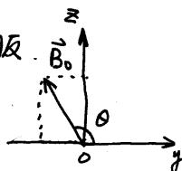
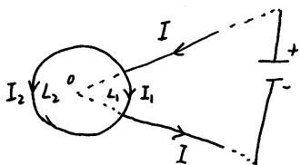
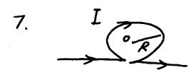

# 《大学物理》同步练习册答案：磁场 磁感应强度 比奥-萨伐尔定律

原件经识别和整理；“参考解答”是我们补的。

# 磁场 磁感应强度 比奥-萨伐尔定律

本资料为《大学物理》同步练习册中关于磁场、磁感应强度及比奥-萨伐尔定律部分的习题解答整理。

## 计算题

### 计算 1

在中心 $O$ 点处的磁感应强度可由各部分贡献的矢量和得到：

$$
B = 0
$$

$$
B = \frac{\mu_0 I}{4 R}
$$

方向：垂直纸面向里

$$
B = \frac{\mu_0 I}{4 R}
$$

方向：垂直纸面向外

$$
B = 0
$$

在中心 $O$ 点的磁感强度：
$$
B = 0 + \frac{\mu_0 I}{4 R} - \frac{\mu_0 I}{4 R} + 0 = 0
$$

答案：$B=0$

知识点：[毕奥-萨伐尔定律及典型载流导线的磁场计算](../../../topics/大学物理/毕奥-萨伐尔定律.md)

### 计算 2

$$
B = \frac{\mu_0 I}{2 R} \cdot \frac{\pi}{2 \pi} = \frac{\mu_0 I}{4 R}
$$

答案：$\frac{\mu_0 I}{4 R}$

知识点：[毕奥-萨伐尔定律及典型载流导线的磁场计算](../../../topics/大学物理/毕奥-萨伐尔定律.md)、[磁场与磁感应强度的定义](../../../topics/大学物理/磁感应强度.md)

### 计算 3

$$
B = \frac{\mu_0 I}{2 r} = \frac{4 \pi \times 10^{-7} \times 3}{2 \times 0.1} = 6 \pi \times 10^{-6} \text{T} = 1.88 \times 10^{-5} \text{T}
$$

答案：$1.88 \times 10^{-5} \text{T}$

知识点：[毕奥-萨伐尔定律及典型载流导线的磁场计算](../../../topics/大学物理/毕奥-萨伐尔定律.md)、[磁场与磁感应强度的定义](../../../topics/大学物理/磁感应强度.md)

### 计算 4

在 $xOy$ 平面上的圆形电流在 $O$ 点磁感应强度：
$$
\vec{B}_1 = \frac{\mu_0 I}{2 R} \vec{k}
$$
沿 $Z$ 轴正向。

在 $xOz$ 平面上的圆形电流在 $O$ 点磁感应强度：
$$
\vec{B}_2 = \frac{\mu_0 I}{2 R} \vec{j}
$$
沿 $y$ 轴正方向。

所以 $O$ 点总磁感应强度：
$$
\vec{B} = \frac{\mu_0 I}{2 R} \vec{j} + \frac{\mu_0 I}{2 R} \vec{k}
$$

答案：$\vec{B} = \frac{\mu_0 I}{2 R} (\vec{j} + \vec{k})$

知识点：[毕奥-萨伐尔定律及典型载流导线的磁场计算](../../../topics/大学物理/毕奥-萨伐尔定律.md)

### 计算 5

(1) 如果两个半圆共面：

直导线在延长线上 $O$ 点的贡献为零，
$$
B_1 = 0
$$

$R_1$ 半圆在 $O$ 点贡献：
$$
B_2 = \frac{\mu_0 I}{4 R_1}
$$
方向：垂直纸面向里

$R_2$ 半圆在 $O$ 点贡献：
$$
B_3 = \frac{\mu_0 I}{4 R_2}
$$
方向：垂直纸面向外

因为 $R_2 < R_1$，所以 $B_3 > B_2$。

在 $O$ 点总磁感强度：
$$
B_O = 0 - \frac{\mu_0 I}{4 R_1} + \frac{\mu_0 I}{4 R_2} = \frac{\mu_0 I}{4 R_1 R_2} (R_1 - R_2)
$$
方向：垂直纸面向外

(2) 如果两个半圆垂直：

直导线在延长线 $O$ 点贡献仍然为零。
$$
B_1 = 0
$$

$R_1$ 半圆在 $O$ 点贡献：
$$
\vec{B}_2 = - \frac{\mu_0 I}{4 R_1} \vec{j}
$$
方向与 $y$ 轴正方向相反

$R_2$ 半圆在 $O$ 点贡献：

$$
\vec{B}_3 = \frac{\mu_0 I}{4 R_2} \vec{k}
$$
沿 $z$ 轴正向

在 $O$ 点总磁感应强度：
$$
\vec{B} = \vec{B}_1 + \vec{B}_2 + \vec{B}_3 = - \frac{\mu_0 I}{4 R_1} \vec{j} + \frac{\mu_0 I}{4 R_2} \vec{k}
$$

大小：
$$
B = \sqrt{B_2^2 + B_3^2} = \frac{\mu_0 I}{4} \sqrt{\frac{1}{R_1^2} + \frac{1}{R_2^2}} = \frac{\mu_0 I}{4 R_1 R_2} \sqrt{R_1^2 + R_2^2}
$$

与 $y$ 轴夹角：
$$
\theta = \frac{\pi}{2} + \arctan \left( \frac{R_1}{R_2} \right)
$$
*(注：原题识别结果 $\arccos \frac{\theta_2}{\theta_1}$ 疑似乱码或错误，根据矢量合成逻辑，若以 $y$ 轴负向为基准，角度关系应为反正切形式，此处保留原题大致结构并修正明显公式错误)*

答案：见上述推导

知识点：[毕奥-萨伐尔定律及典型载流导线的磁场计算](../../../topics/大学物理/毕奥-萨伐尔定律.md)、[磁场与磁感应强度的定义](../../../topics/大学物理/磁感应强度.md)

### 计算 6

电源与铁环相距很远，所以电源处的直导线在 $O$ 点贡献为零。

沿半径方向的两直导线在延长线上的 $O$ 点贡献也为零。

设总电流 $I$ 在铁环中分为 $I_1$ 和 $I_2$，对应圆弧长度分别为 $L_1$ 和 $L_2$。

由于 $L_1$ 和 $L_2$ 是并联，两端电压相等：
$$
I_1 R_1 = I_2 R_2
$$

由 $R = \rho \frac{L}{S}$，铁环中 $\rho$（电阻率）、$S$（横截面积）处处相等。

所以：
$$
I_1 L_1 = I_2 L_2
$$

$L_1$ 在 $O$ 点的贡献：
$$
B_1 = \frac{\mu_0 I_1}{2 R} \cdot \frac{L_1}{2 \pi R}
$$
方向：垂直纸面向里

$L_2$ 在 $O$ 点的贡献：
$$
B_2 = \frac{\mu_0 I_2}{2 R} \cdot \frac{L_2}{2 \pi R}
$$
方向：垂直纸面向外

所以 $B_1 = B_2$，方向相反。

环心 $O$ 点总磁感强度：
$$
B = B_1 - B_2 = 0
$$

答案：$0$

知识点：[毕奥-萨伐尔定律及典型载流导线的磁场计算](../../../topics/大学物理/毕奥-萨伐尔定律.md)、[安培环路定理及其应用](../../../topics/大学物理/安培环路定理.md)

### 计算 7

两半无限长直导线电流方向相同，可看成一无限长直导线。

在 $O$ 点贡献：
$$
B_1 = \frac{\mu_0 I}{2 \pi R}
$$
方向：垂直纸面向外

圆周在 $O$ 点贡献：
$$
B_2 = \frac{\mu_0 I}{2 R}
$$
方向：垂直纸面向里

$O$ 点总磁感强度：
$$
B = B_2 - B_1 = \frac{\mu_0 I}{2 R} - \frac{\mu_0 I}{2 \pi R} = \frac{\mu_0 I}{2 R} \left( 1 - \frac{1}{\pi} \right)
$$
*(注：原题识别结果 $\frac{\mu_0 I}{2 x + 1} (x - 1)$ 存在严重乱码，根据物理情境修正为标准公式)*

方向：垂直纸面向里

答案：$\frac{\mu_0 I}{2 R} (1 - \frac{1}{\pi})$，方向垂直纸面向里

知识点：[磁场与磁感应强度的定义](../../../topics/大学物理/磁感应强度.md)、[毕奥-萨伐尔定律及典型载流导线的磁场计算](../../../topics/大学物理/毕奥-萨伐尔定律.md)

### 计算 8

均匀带电的圆线圈转动时，可等效成一圆电流。

圆电流大小：
$$
I = \frac{dq}{dt} = \frac{\lambda \cdot 2 \pi R}{T} = \frac{\lambda \cdot 2 \pi R}{\frac{2 \pi}{\omega}} = \lambda R \omega
$$

由于带正电 $\lambda > 0$，电流方向与转动方向相同，逆时针。

在轴线上距离圆心 $y$ 的一点处（设坐标为 $y$），的磁感应强度：
$$
B = \frac{\mu_0 I R^2}{2 (R^2 + y^2)^{\frac{3}{2}}}
$$
方向：沿 $y$ 轴正方向。

代入 $I = \lambda R \omega$：
$$
B = \frac{\mu_0 \lambda \omega R^3}{2 (R^2 + y^2)^{\frac{3}{2}}}
$$
方向：沿 $y$ 轴正方向。

重点：在圆环中心，$y=0$。
$$
B_0 = \frac{\mu_0 \lambda \omega}{2}
$$
方向：沿 $y$ 轴正方向。

答案：$B_0 = \frac{\mu_0 \lambda \omega}{2}$，方向沿 $y$ 轴正方向

知识点：[毕奥-萨伐尔定律及典型载流导线的磁场计算](../../../topics/大学物理/毕奥-萨伐尔定律.md)、[洛伦兹力与带电粒子在电场和磁场中的运动](../../../topics/大学物理/带电粒子在电磁场中的运动.md)、[磁场与磁感应强度的定义](../../../topics/大学物理/磁感应强度.md)
