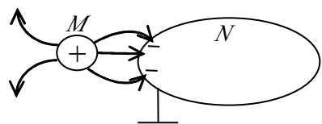
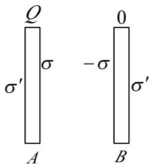
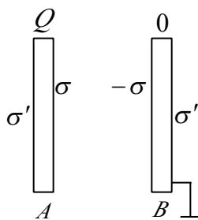

# 《大学物理》同步练习册答案：第19章 静电场中的导体（1）

原件经识别和整理；“参考解答”是我们补的。

## 静电场中的导体（1）

### 选择 1

正电荷 $+Q$ 位于导体球壳球心，则由静电平衡有：导体球壳内表面会感应出 $-Q$ 电量；导体球壳上总电量为 $-3Q$ 保持守恒，导体球壳外表面的电量为 $-2Q$；导体球壳内部在 $a$ 到 $b$ 之间的电场强度处处为零。本题选（C）。

答案：C。

知识点：[静电平衡条件、导体表面电荷分布及接地问题](../../../topics/大学物理/静电场中的导体.md)、[电荷守恒定律与库仑定律](../../../topics/大学物理/电荷守恒与库仑定律.md)、[电场强度的定义与叠加原理](../../../topics/大学物理/电场强度.md)

### 选择 2

正点电荷 $+q$ 位于空腔的球心处，则静电平衡有：空腔导体球内表面会感应出 $-q$ 的电量。注意：内表面 $-q$ 的分布与球心处 $+q$ 的位置有关；空腔导体球外表面会出现 $+q$ 的电量。注意：外表面 $+q$ 的分布与球心处 $+q$ 的位置无关，只与外表面的形状有关，由于外表面是球面，外表面上电荷 $+q$ 均匀分布。本题选（A）。

答案：A。

注意：题目中缺少“正点电荷 $+q$”的条件，所以内表面上不一定均匀分布！

知识点：[静电平衡条件、导体表面电荷分布及接地问题](../../../topics/大学物理/静电场中的导体.md)、[电荷守恒定律与库仑定律](../../../topics/大学物理/电荷守恒与库仑定律.md)、[电场强度的定义与叠加原理](../../../topics/大学物理/电场强度.md)

### 选择 3

库仑定律适用于两点电荷之间的作用力，即把导体球 $+Q$ 看成点电荷，忽略静电感应，则导体球 $+Q$ 和点电荷 $+q$ 之间的库仑力大小：

$$
F_C = \frac{1}{4\pi\varepsilon_0}\frac{Q\cdot q}{r^2}
$$

若考虑到导体球的静电感应，设导体球右侧感应出负电荷为 $-q'$，导体球左侧电荷电量为 $Q+q'$，并且设右侧负感应电荷 $-q'$ 的等效中心距球心 $o$ 的距离为 $b$，左侧电荷 $Q+q'$ 等效中心距球心 $o$ 的距离为 $a$，则负感应电荷 $-q'$ 与球外点电荷 $+q$ 的作用力：

$$
F_1 = \frac{1}{4\pi\varepsilon_0}\frac{-q'\cdot q}{(r-b)^2}
$$

由于 $\dfrac{1}{(r-b)^2}>\dfrac{1}{r^2}$，有

$$
F_1 = \frac{1}{4\pi\varepsilon_0}\frac{-q'\cdot q}{(r-b)^2} < \frac{1}{4\pi\varepsilon_0}\frac{-q'\cdot q}{r^2};
$$

左侧电荷 $Q+q'$ 与点电荷 $+q$ 的作用力：

$$
F_2 = \frac{1}{4\pi\varepsilon_0}\frac{(Q+q')\cdot q}{(r+a)^2}
$$

由于 $\dfrac{1}{(r+a)^2}<\dfrac{1}{r^2}$，有

$$
F_2 = \frac{1}{4\pi\varepsilon_0}\frac{(Q+q')\cdot q}{(r+a)^2} < \frac{1}{4\pi\varepsilon_0}\frac{(Q+q')\cdot q}{r^2},
$$

那么，考虑到静电感应，导体球 $+Q$ 和点电荷 $+q$ 之间的作用力：

$$
F = F_1 + F_2 = \frac{1}{4\pi\varepsilon_0}\frac{-q'\cdot q}{(r-b)^2} + \frac{1}{4\pi\varepsilon_0}\frac{(Q+q')\cdot q}{(r+a)^2} < \frac{1}{4\pi\varepsilon_0}\frac{-q'\cdot q}{r^2} + \frac{1}{4\pi\varepsilon_0}\frac{(Q+q')\cdot q}{r^2} = \frac{1}{4\pi\varepsilon_0}\frac{Q\cdot q}{r^2} = F_C.
$$

答案：B。

知识点：[静电平衡条件、导体表面电荷分布及接地问题](../../../topics/大学物理/静电场中的导体.md)、[电荷守恒定律与库仑定律](../../../topics/大学物理/电荷守恒与库仑定律.md)

### 选择 4

金属导体 N 静电平衡后，导体 N 左侧会感应出负电荷，右侧会感应出正电荷，空间的电场线分布如图 a 所示：

若将 N 接地，则导体 N 的电势：$V_N = V_\infty = 0$，由于导体 N 和无穷远处电势相等，都为零，那么 N 右侧正电荷发出的电场线不能存在，因为沿电场线方向电势降低，所以导体 N 上右侧正电荷不能存在，正感应电荷被大地中和，如图 b 所示。本题选（B）。

答案：B。

知识点：[静电平衡条件、导体表面电荷分布及接地问题](../../../topics/大学物理/静电场中的导体.md)、[静电场环路定理、电势与电势差](../../../topics/大学物理/环路定理与电势.md)

### 选择 5

中空金属球空腔中无电荷时，金属球带电全部分布在外表面，电荷面密度为 $\sigma = 6.37\times10^{-6}\ \mathrm{C/m^2}$，半径为 $R_2 = 0.25\ \mathrm{m}$，金属球带电量

$$
Q = \sigma\cdot 4\pi R_2^2 = 5\times10^{-6}\ \mathrm{C};
$$

现将 $q = 5\ \mu\mathrm{C}$ 的电荷放入空腔内，空腔内表面感应电荷为 $q' = -5\ \mu\mathrm{C}$，金属球外表面电量为 $Q+q = 1\times10^{-5}\ \mathrm{C}$，金属球外表面电荷面密度变为

## 计算 6

金属球外表面场强大小：
$$E = \frac{\sigma'}{\varepsilon_0} = \frac{1.274 \times 10^{-5}}{\varepsilon_0} = 1.44 \times 10^6 \, \mathrm{V/m}$$
其中电荷面密度 $\sigma' = \frac{Q+q}{4\pi R_2^2} = 1.274 \times 10^{-5} \, \mathrm{C/m^2}$。

知识点：[静电平衡条件、导体表面电荷分布及接地问题](../../../topics/大学物理/静电场中的导体.md)

### 题目有误！

**原题背景**：点电荷 $-Q$ 位于空腔导体内，静电平衡后。

1.  **不接地的情况**：
    *   空腔导体内表面感应电荷的电量为 $+Q$。
    *   空腔导体原来电中性不带电，则空腔导体外表面感应电荷的电量为 $-Q$。
    *   所以空腔导体外表面的净余电荷总量是 $-Q$，空腔导体内表面的净余电荷总量是 $+Q$。

2.  **接地的情况**：
    *   如果空腔导体接地，空腔导体的电势 $V_{\text{导体}} = V_{\infty} = 0$。
    *   空腔导体和无穷远处电势都为零，则空腔导体以外的电场线不能存在，即要求外表面感应电荷 $-Q$ 不能存在，外表面不带电。
    *   空腔外表面的净余电荷总量是 $0$，空腔内表面的净余电荷总量仍是 $+Q$。
    *   所以空腔内、外表面的净余电荷总量是 $+Q$（指内表面）。

## 计算 7

设水平向右为 $x$ 轴正方向，导体平板左右两侧电荷面密度分别为 $\sigma_1$ 和 $\sigma_2$，则 $\sigma_1 + \sigma_2 = \sigma$。

由电场叠加原理，导体板内部任一点 $P$ 的场强：
$$E_P = E_0 + \frac{\sigma_1}{2\varepsilon_0} - \frac{\sigma_2}{2\varepsilon_0} = 0 \quad (\text{导体内部场强处处为零})$$

联立方程组：
$$
\left\{
\begin{array}{l}
\displaystyle \sigma_1 + \sigma_2 = \sigma \\
\displaystyle 2\varepsilon_0 E_0 + \sigma_1 - \sigma_2 = 0
\end{array}
\right.
\Longrightarrow
\left\{
\begin{array}{l}
\displaystyle \sigma_1 = \frac{\sigma}{2} - \varepsilon_0 E_0 \\
\displaystyle \sigma_2 = \frac{\sigma}{2} + \varepsilon_0 E_0
\end{array}
\right.
$$

导体平板左右两侧场强：
$$
\left\{
\begin{array}{l}
\displaystyle E_1 = -\frac{\sigma_1}{\varepsilon_0} = E_0 - \frac{\sigma}{2\varepsilon_0} \\
\displaystyle E_2 = \frac{\sigma_2}{\varepsilon_0} = E_0 + \frac{\sigma}{2\varepsilon_0}
\end{array}
\right.
$$

## 计算 8

**题目订正**：题目中“两个同心球壳”应该为“两个同心导体球壳”。

由于小导体球壳空腔内无电荷，小球壳带电 $+2Q$ 均匀分布在半径为 $b$ 的小球壳外表面；大球壳内表面感应电荷 $-2Q$，大球壳原来带电 $+4Q$，则大球壳外表面带电为 $+6Q$，均匀分布在半径为 $d$ 的大球壳外表面。

1.  **区域 $a < r < b$**：
    在小球壳内部作一半径为 $r$ 的同心球面 $S_1$ 为高斯面，包围电荷为 $0$。
    $$
    \oint_{S_1} \vec{E} \cdot d\vec{S} = \frac{1}{\varepsilon_0} \cdot 0 \Rightarrow E \cdot 4\pi r^2 = 0 \Rightarrow E = 0
    $$

2.  **区域 $c < r < d$**：
    在大球壳内部作一半径为 $r$ 的同心球面 $S_2$ 为高斯面，包围电荷为 $2Q + (-2Q) = 0$。
    $$
    \oint_{S_2} \vec{E} \cdot d\vec{S} = \frac{1}{\varepsilon_0} \cdot 0 \Rightarrow E \cdot 4\pi r^2 = 0 \Rightarrow E = 0
    $$

3.  **区域 $r > d$**：
    在大球壳外作一半径为 $r$ 的同心球面 $S_3$ 为高斯面，包围电荷为 $2Q + (-2Q) + 6Q = 6Q$。
    $$
    \oint_{S_3} \vec{E} \cdot d\vec{S} = \frac{1}{\varepsilon_0} \cdot 6Q \Rightarrow E \cdot 4\pi r^2 = \frac{6Q}{\varepsilon_0} \Rightarrow E = \frac{3Q}{2\pi\varepsilon_0 r^2}
    $$

综上，各区域中电场强度的大小：
$$
E = 
\begin{cases} 
0 & (a < r < b) \\
0 & (c < r < d) \\
\displaystyle \frac{3Q}{2\pi\varepsilon_0 r^2} & (r > d)
\end{cases}
$$
可验证导体中场强处处为零。

## 计算 9

三块平行导体板，设中间板为 $A$，左右侧板分别为 $B$ 和 $C$。由于 $A$ 板左表面电荷面密度为 $\sigma_1$，右表面电荷面密度为 $\sigma_2$，静电平衡后，$B$ 板右表面感应电荷面密度为 $-\sigma_1$，$C$ 板左表面感应电荷面密度为 $-\sigma_2$。

*   $A$ 和 $B$ 板之间电场强度大小：$E_1 = \frac{\sigma_1}{\varepsilon_0}$
*   电势差：$U_{AB} = V_A - V_B = E_1 \cdot d = \frac{\sigma_1}{\varepsilon_0} d_1$
*   $A$ 和 $C$ 板之间电场强度大小：$E_2 = \frac{\sigma_2}{\varepsilon_0}$
*   电势差：$U_{AC} = V_A - V_C = E_2 \cdot d = \frac{\sigma_2}{\varepsilon_0} d_2$

由于 $B$ 和 $C$ 板用导线相连，电势相等，即 $V_B = V_C \Rightarrow V_A - V_B = V_A - V_C$。
即：
$$
\frac{\sigma_1}{\varepsilon_0} d_1 = \frac{\sigma_2}{\varepsilon_0} d_2 \Rightarrow \frac{\sigma_1}{\sigma_2} = \frac{d_2}{d_1}
$$

## 计算 10

知识点：[静电平衡条件、导体表面电荷分布及接地问题](../../../topics/大学物理/静电场中的导体.md)、[电通量的概念与静电场的高斯定理](../../../topics/大学物理/电通量与高斯定理.md)、[电场强度的定义与叠加原理](../../../topics/大学物理/电场强度.md)

### （1）金属平板未接地

金属平板静电平衡后，金属平板 $A$ 和 $B$ 相邻两表面电荷电量等量异号，设电荷面密度分别为 $\sigma$ 和 $-\sigma$；金属平板 $A$ 和 $B$ 最外边两表面电荷电量相等，设电荷面密度为 $\sigma'$，如图 a，则：
$$
\left\{
\begin{array}{l}
(\sigma + \sigma') S = Q \\
(\sigma' - \sigma) S = 0
\end{array}
\right.
\Rightarrow \quad \sigma = \sigma' = \frac{Q}{2S}
$$

金属平板 $A$ 和 $B$ 之间的电场强度大小：
$$
E = \frac{\sigma}{\varepsilon_0} = \frac{Q}{2\varepsilon_0 S}
$$

电势差：
$$
U_{AB} = E \cdot d = \frac{Q}{2\varepsilon_0 S} d
$$

知识点：[静电平衡条件、导体表面电荷分布及接地问题](../../../topics/大学物理/静电场中的导体.md)、[电场强度的定义与叠加原理](../../../topics/大学物理/电场强度.md)

### （2）金属板 B 接地

若金属板 $B$ 接地，金属板 $B$ 和无穷远处电势相等 $V_B = V_{\infty} = 0$，则金属板 $B$ 右侧电荷不能存在，即 $\sigma' = 0$。
$\Rightarrow$ 金属板 $A$ 左侧电荷也为零，金属板 $A$ 带电量 $Q$ 全部分布在 $A$ 板右表面，即 $\sigma = \frac{Q}{S}$。
注意：由于板接地，板电荷不守恒。此时金属平板 $A$ 和 $B$ 之间的电场强度大小：
$$
E = \frac{\sigma}{\varepsilon_0} = \frac{Q}{\varepsilon_0 S}
$$

电势差：
$$
U'_{AB} = E \cdot d = \frac{Q}{\varepsilon_0 S} d
$$

知识点：[静电平衡条件、导体表面电荷分布及接地问题](../../../topics/大学物理/静电场中的导体.md)、[电容的定义与典型电容器的电容计算](../../../topics/大学物理/电容与电容器.md)
