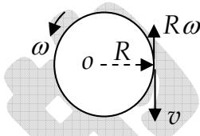
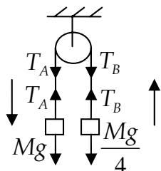

# 《大学物理》同步练习册答案：角动量 角动量守恒

原件经识别和整理；“参考解答”是我们补的。

## 角动量 角动量守恒

### 选择 1

整个过程中合外力矩为零，角动量守恒：
$$J_0 \omega_0 = \left( \frac{1}{3} J_0 \right) \omega \implies \omega = 3 \omega_0$$

答案：C。

知识点：[角动量定理与角动量守恒定律](../../../topics/大学物理/角动量与角动量守恒.md)、[转动惯量的计算与平行轴定理](../../../topics/大学物理/转动惯量.md)、[刚体定轴转动的角量描述](../../../topics/大学物理/刚体定轴转动运动学.md)

### 简答 2

子弹射入圆盘过程中，子弹和圆盘构成的系统外力矩为零，系统角动量守恒。

设圆盘转动惯量为 $J$，初始以角速度 $\omega$ 逆时针旋转，沿转轴向上为正方向；圆盘中心到子弹沿相反方向运动所在直线的距离为 $d$，子弹速度大小为 $v$，则

**子弹入射前：**
① 圆盘的角动量：$L_1 = J \boldsymbol{\omega}$
② 左侧子弹的角动量：$L_2 = - d m v$ （负号表示沿转轴负方向）
③ 右侧子弹的角动量：$L_3 = d m v$

系统总角动量：
$$L = L_1 + L_2 + L_3 = J \omega$$

**子弹入射后：**
子弹和圆盘以共同角速度 $\omega'$ 转动，子弹和圆盘对转轴的转动惯量为 $J'$（显然 $J' > J$）。

此时系统总角动量：
$$L' = J' \omega'$$

由角动量守恒 $L = L'$ 得：
$$J \omega = J' \omega' \implies \omega' = \frac{J}{J'} \omega < \omega$$

结论：角速度减小。

答案：C。

知识点：[角动量定理与角动量守恒定律](../../../topics/大学物理/角动量与角动量守恒.md)、[刚体定轴转动的角量描述](../../../topics/大学物理/刚体定轴转动运动学.md)、[转动惯量的计算与平行轴定理](../../../topics/大学物理/转动惯量.md)

### 简答 3

小球和杆构成的系统外力矩为零，系统角动量守恒。取垂直纸面向里为转轴 $o$ 的正方向。

**碰撞前：**
① 细杆静止，角动量：$L_1 = 0$
② 上方小球的角动量：$L_2 = L m v$ （方向沿转轴正方向）
③ 下方小球的角动量：$L_3 = L m v$

系统总角动量：
$$L_{\text{前}} = L_1 + L_2 + L_3 = 2 L m v$$

**碰撞后：**
小球和细杆以共同角速度 $\omega'$ 转动，小球和细杆对转轴 $o$ 的转动惯量为：
$$J = \frac{1}{3} m L^2 + 2 m L^2 = \frac{7}{3} m L^2$$

此时系统总角动量：
$$L_{\text{后}} = J \omega' = \left( \frac{7}{3} m L^2 \right) \omega'$$

由角动量守恒 $L_{\text{前}} = L_{\text{后}}$ 得：
$$2 L m v = \left( \frac{7}{3} m L^2 \right) \omega' \implies \omega' = \frac{6 v}{7 L}$$

答案：C。

知识点：[角动量定理与角动量守恒定律](../../../topics/大学物理/角动量与角动量守恒.md)、[刚体定轴转动的角量描述](../../../topics/大学物理/刚体定轴转动运动学.md)、[弹性碰撞与非弹性碰撞](../../../topics/大学物理/碰撞问题.md)

### 简答 4

卫星受到地球的万有引力作用，在有心力作用下相对地心的角动量守恒。

**近地点 A：**
$\vec{r}_A$ 和 $\vec{v}_A$ 垂直，故：
$$L_A = r_A m v_A \sin \frac{\pi}{2} = r_A m v_A$$

**远地点 B：**
$\vec{r}_B$ 和 $\vec{v}_B$ 垂直，故：
$$L_B = r_B m v_B \sin \frac{\pi}{2} = r_B m v_B$$

由角动量守恒 $\vec{L}_A = \vec{L}_B$ 得：
$$r_A m v_A = r_B m v_B$$

又因 $r_A < r_B$，所以 $v_A > v_B$。

比较动能：
近地点动能 $E_{kA} = \frac{1}{2} m v_A^2$
远地点动能 $E_{kB} = \frac{1}{2} m v_B^2$

由 $v_A > v_B$ 可得 $E_{kA} > E_{kB}$。

答案：C。

知识点：[角动量定理与角动量守恒定律](../../../topics/大学物理/角动量与角动量守恒.md)、[功能原理与机械能守恒定律](../../../topics/大学物理/功能原理与机械能守恒.md)、[保守力及其势能、中心力场与有效势](../../../topics/大学物理/保守力与势能.md)

### 简答 5

两圆柱体半径分别为 $R_1$ 和 $R_2$，相互间的摩擦力 $f$ 大小相等，方向相反，对各自转轴产生的力矩分别为 $M_1 = - R_1 f$ 和 $M_2 = R_2 f$。若 $R_1 \neq R_2$，整个系统摩擦力力矩之和不为零，系统角动量不守恒。

已知大圆柱体初始角速度为 $\omega_0$，小圆柱体静止。设两圆柱体最终运动的角速度大小分别为 $\omega_1$ 和 $\omega_2'$。当两圆柱体相对滑动停止时，两圆柱体边缘运动速度大小相等：
$$v_1 = v_2 \implies R_1 \omega_1 = R_2 \omega_2'$$

由转动定律：
$$
\begin{cases}
M_1 = - R_1 f = J_1 \alpha_1 = J_1 \displaystyle \frac{d \omega}{d t} \\
M_2 = R_2 f = J_2 \alpha_2 = J_2 \displaystyle \frac{d \omega'}{d t}
\end{cases}
$$

消去 $f$ 并整理得：
$$- \frac{J_1}{R_1} \frac{d \omega}{d t} = \frac{J_2}{R_2} \frac{d \omega'}{d t} \implies - \frac{J_1}{R_1} d \omega = \frac{J_2}{R_2} d \omega'$$

## 计算 5

答案：
$$
\Rightarrow \int_ {\omega_ {0}} ^ {\omega_ {1}} - \frac {J _ {1}}{R _ {1}} d \omega = \int_ {0} ^ {\omega_ {2} ^ {\prime}} \frac {J _ {2}}{R _ {2}} d \omega^ {\prime} \Rightarrow \frac {J _ {1}}{R _ {1}} \omega_ {0} = \frac {J _ {1}}{R _ {1}} \omega_ {1} + \frac {J _ {2}}{R _ {2}} \omega_ {2} ^ {\prime} \Rightarrow J _ {1} \omega_ {0} = \left(\frac {J _ {1} R _ {2}}{R _ {1}} + \frac {J _ {2} R _ {1}}{R _ {2}}\right) \omega_ {2} ^ {\prime},
$$

小圆柱最终的角速度大小为： $\omega _ { 2 } ^ { \prime } = \frac { J _ { 1 } \omega _ { 0 } } { \displaystyle \frac { J _ { 1 } R _ { 2 } } { R _ { 1 } } + \frac { J _ { 2 } R _ { 1 } } { R _ { 2 } } }$

## 计算 6

答案：
质点在整个过程中受到指向中心o的拉力作用，在有心力作用下相对中心o的角动量守恒：

$r m v = \frac { r } { 2 } m v ^ { \prime } \Rightarrow v ^ { \prime } = 2 v$ ， 又 $v ^ { \prime } = \frac { r } { 2 } \omega ^ { \prime } \ \Rightarrow$ 此时质点的角速度： $\omega ^ { \prime } = \frac { 4 v } { r }$

## 计算 7

答案：
人和转台构成的系统外力矩为零，系统角动量守恒。

初始系统角动量： $L _ { 0 } = 0$ ，（系统原来静止）

若人相对地面的速度大小为 $v = 1 \mathrm { m } / \mathrm { s }$ ，如图，方向向下，则转台将逆时针转动，设角速度大小为$\omega$，方向沿转轴向上，如图，垂直纸面向外，取垂直纸面向外为转轴正方向。此时，人相对转轴的角动量： ${ \vec { L } } _ { 1 } = { \vec { R } } \times m { \vec { v } } \Rightarrow L _ { 1 } = - R m v$ ，负号表示沿转轴负方向，

$$
L _ {2} = J \omega , \quad \Rightarrow
$$

$$
L = L _ {1} + L _ {2} = J \omega - R m v
$$

由角动量守恒： $L _ { 0 } = L \implies 0 = J \omega - R m v \Rightarrow J \omega = R m v \Rightarrow \omega = \frac { R m v } { I } = 0 . 0 5 \mathrm { r a d / s }$

设从t = 0时刻开始，经过t时间人回到初始位置，则在这段时间内：

人相对地面走过的路程： $s _ { 1 } = v t$ ， 转台边缘转过的圆弧长： $s _ { 2 } = R \omega t$

由于 $s _ { 1 } + s _ { 2 } = 2 \pi R \Rightarrow v t + R \omega t = 2 \pi R \Rightarrow$ 回到初始位置所需时间： $t = { \frac { 2 \pi R } { v + R \omega } } = { \frac { 2 \times 3 . 1 4 \times 2 } { 1 + 2 \times 0 . 0 5 } } = 1 1 . 4 \mathrm { s }$

## 计算 8

答案：
设左右两侧轻绳中张力大小分别为 $T _ { A }$ 和 $T _ { B }$ ，由于绳与滑轮无相对滑动，则物体 B 上升的加速度大小a等于左端绳下降的加速度大小，又由于人相对绳匀速运动，所以人相对地面向下的加速度大小也为a，分别以人 A、物体 B 以及定滑轮为研究对象：

$$
\left\{ \begin{array} { l } { { M g - T _ { A } = M a } } \\ { { T _ { B } - { \displaystyle { \frac { 1 } { 4 } } } M g = { \displaystyle { \frac { 1 } { 4 } } } M a } } \\ { { R T _ { A } - R T _ { B } = J \alpha = ( { \displaystyle { \frac { M } { 4 } } } R ^ { 2 } ) \alpha } } \\ { { a = R \alpha } } \end{array} \right. \Rightarrow \left\{ \begin{array} { l } { { \alpha = { \displaystyle { \frac { g } { 2 R } } } } } \\ { { a = { \displaystyle { \frac { g } { 2 } } } } } \end{array} \right. \Rightarrow { \textbf { B } }
$$

B 上升的加速度大小： $a = { \frac { g } { 2 } }$

## 计算 9

答案：
碰撞过程中，小球和杆构成的系统所受外力矩为零，系统角动量守恒。

设沿转轴o向上为正方向（即垂直纸面向外为正方向），碰撞后轻杆的角速度为$\omega$.

①小球的角动量： $L _ { 1 } = \frac { 2 } { 3 } l m v _ { 0 }$ ，方向沿转轴正方向，②轻杆静止，角动量： $L _ { 2 } = 0$

碰撞后：①小球的角动量： $L _ { 1 } ^ { \prime } = - \frac { 2 } { 3 } l m \frac { v _ { 0 } } { 2 }$ ，负号表示方向沿转轴负方向，

②轻杆角动量： $L _ { 2 } ^ { \prime } = J \omega = [ m ( \frac { 2 } { 3 } l ) ^ { 2 } + 2 m ( \frac { 1 } { 3 } l ) ^ { 2 } ] \omega$ ；

由角动量守恒： $L _ { 1 } + L _ { 2 } = L _ { 1 } ^ { \prime } + L _ { 2 } ^ { \prime } \Rightarrow \frac { 2 } { 3 } l m v _ { 0 } = - \frac { 2 } { 3 } l m \frac { v _ { 0 } } { 2 } + [ m ( \frac { 2 } { 3 } l ) ^ { 2 } + 2 m ( \frac { 1 } { 3 } l ) ^ { 2 } ] \omega$

碰撞后轻杆的角速度为： $\omega = \frac { 3 v _ { 0 } } { 2 l }$

知识点：[转动惯量的计算与平行轴定理](../../../topics/大学物理/转动惯量.md)、[角动量定理与角动量守恒定律](../../../topics/大学物理/角动量与角动量守恒.md)、[刚体定轴转动定律（M=Jα）](../../../topics/大学物理/刚体转动定律.md)
