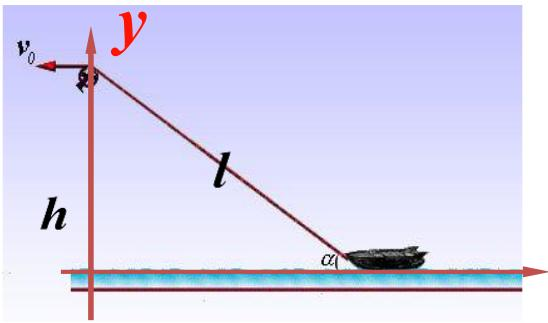

# 《大学物理》同步练习册答案：质点运动学

原件经识别和整理；“参考解答”是我们补的。

# 《大学物理》同步练习册答案：质点运动学

## 第一节 质点运动的描述

### 选择 1

题干……（注：原题未提供完整题干，仅给出答案）

答案：3m 5m
参考解答：提示：这里位移的大小和路程不同，因为质点做的不是单向运动。

知识点：[位矢及其坐标表示（直角坐标与自然坐标）](../../../topics/大学物理/位矢与坐标表示.md)

### 选择 2

题干……（注：原题未提供完整题干，仅给出答案）

答案：D
参考解答：……

知识点：[位矢及其坐标表示（直角坐标与自然坐标）](../../../topics/大学物理/位矢与坐标表示.md)、[速度、加速度的定义与微分关系](../../../topics/大学物理/速度与加速度定义.md)

### 选择 3

题干……（注：原题未提供完整题干，仅给出答案）

答案：$x = ( y - 3 ) ^ { 2 }$
参考解答：提示：由运动学方程知 $x = 4 \mathrm { t } ^ { 2 } , \ y = 2 \mathrm { t } + 3$ ，两式联立消去 $t$。

知识点：[相对运动与伽利略变换](../../../topics/大学物理/相对运动.md)

### 选择 4

题干……（注：原题未提供完整题干，仅给出答案）

答案：3 3 6
参考解答：提示：由 $\mathrm { v } = { \frac { \mathrm { d } \mathrm { x } } { \mathrm { d } \mathrm { t } } }$ 知，曲线的斜率则表示速度大小。

知识点：[相对运动与伽利略变换](../../../topics/大学物理/相对运动.md)、[速度、加速度的定义与微分关系](../../../topics/大学物理/速度与加速度定义.md)、[位矢及其坐标表示（直角坐标与自然坐标）](../../../topics/大学物理/位矢与坐标表示.md)

### 选择 5

题干……（注：原题未提供完整题干，仅给出答案）

答案：$x = \frac { \nu _ { 0 } } { k } \big ( 1 - e ^ { - k t } \big )$
参考解答：$\nu = { \frac { d x } { d t } } = \nu _ { 0 } \mathrm { e } ^ { - \mathrm { k t } } \to d x = \nu _ { 0 } \mathrm { e } ^ { - \mathrm { k t } } d t \to \intop _ { 0 } ^ { x } d x = \intop _ { 0 } ^ { t } \nu _ { 0 } \mathrm { e } ^ { - \mathrm { k t } } d t$。

### 选择 6

题干……（注：原题未提供完整题干，仅给出答案）

答案：B

知识点：[速度、加速度的定义与微分关系](../../../topics/大学物理/速度与加速度定义.md)、[位矢及其坐标表示（直角坐标与自然坐标）](../../../topics/大学物理/位矢与坐标表示.md)

### 选择 7

题干……（注：原题未提供完整题干，仅给出答案）

答案：B

知识点：[位矢及其坐标表示（直角坐标与自然坐标）](../../../topics/大学物理/位矢与坐标表示.md)、[速度、加速度的定义与微分关系](../../../topics/大学物理/速度与加速度定义.md)

### 选择 8

题干……（注：原题未提供完整题干，仅给出答案）

答案：D

知识点：[位矢及其坐标表示（直角坐标与自然坐标）](../../../topics/大学物理/位矢与坐标表示.md)、[速度、加速度的定义与微分关系](../../../topics/大学物理/速度与加速度定义.md)

### 选择 9

题干……（注：原题未提供完整题干，仅给出答案）

答案：B

知识点：[速度、加速度的定义与微分关系](../../../topics/大学物理/速度与加速度定义.md)、[圆周运动的角量描述（角速度、角加速度）](../../../topics/大学物理/圆周运动描述.md)

### 计算 10

解：由题意知，质点沿 $x$ 轴做一维运动，有

$a = \frac { d \nu } { d t }$ ，则；

$$
a = \frac{d v}{d t} = 4 t \rightarrow d v = 4 t d t \rightarrow \int_{v _ {0}}^{v} d v = \int_{0}^{t} 4 t d t \rightarrow v = 2 t ^ {2} + v_0
$$

再由 $\nu = { \frac { d x } { d t } }$ ，则：

$\nu = \frac { d x } { d t } = 2 t ^ { 2 } \rightarrow d x = 2 t ^ { 2 } d t \rightarrow \intop _ { x _ { 0 } } ^ { x } d x = \intop _ { 0 } ^ { t } 2 t ^ { 2 } d t \rightarrow x = \frac { 2 } { 3 } t ^ { 3 } + x_0$

根据题目最终结果推断初始条件隐含 $x_0=10, v_0=0$ 或类似设定以匹配常数项，最终结果为：

$x = \frac { 2 } { 3 } t ^ { 3 } + 1 0$ （解毕）

### 计算 11

解：（1）由题意知，质点在任意时刻 $t$ 的位矢为： $\vec { r } = 2 t \vec { i } + ( 2 - t ^ { 2 } ) \vec { j }$

则当 $t _ { 1 } = 1 s$ 时，对应位矢为： $\vec { r } _ { 1 } = 2 \vec { i } + \vec { j }$

当 $t _ { 2 } = 2s$ 时，对应位矢为： $\vec { r } _ { 2 } = 4 \vec { i } - 2 \vec { j }$

1s到 2s这段时间内质点的位移： $\Delta \vec { r } = \vec { r } _ { 2 } - \vec { r } _ { 1 } = 2 \vec { i } - 3 \vec { j}$

平均速度： $\overline { { \vec { \nu } } } = \frac { \Delta \vec { r } } { \Delta t } = \frac { \Delta \vec { r } } { t _ { 2 } - t _ { 1 } } = \frac { 2 \vec { i } - 3 \vec { j } } { 1 } = 2 \vec { i } - 3 \vec { j}$

（2）由速度的定义式 $\vec { \nu } = \frac { d \vec { r } } { d t }$ ，则：

$\vec { \nu } = \frac { d \big ( 2 t \vec { i } + ( 2 - t ^ { 2 } ) \vec { j } \big ) } { d t } = 2 \vec { i } - 2 t \vec { j}$

将 $t=2$ 代入，得质点的速度为： $\vec { \nu } = 2 \vec { i } - 4 \vec { j}$

由加速度的定义式 $\vec { a } = \frac { d \vec { \nu } } { d t }$ ，则：

$\vec { a } = \frac { d \big ( 2 \vec { i } - 2 t \vec { j } \big ) } { d t } = - 2 \vec { j}$

将 $t=2$ 代入，得质点的加速度为： $\vec { a } = - 2 \vec { j}$ （解毕）

参考解答：**结论：**

1. $t_1 = 1\,\text{s}$ 到 $t_2 = 2\,\text{s}$ 内的平均速度为 $\bar{\vec{v}} = 2\vec{i} - 3\vec{j}\;(\text{m/s})$。
2. $t = 2\,\text{s}$ 时的瞬时速度为 $\vec{v} = 2\vec{i} - 4\vec{j}\;(\text{m/s})$，瞬时加速度为 $\vec{a} = -2\vec{j}\;(\text{m/s}^2)$。

---

**计算过程：**

已知位矢：$\vec{r}(t) = 2t\,\vec{i} + (2 - t^2)\,\vec{j}$

**(1) 平均速度**

分别代入 $t_1 = 1\,\text{s}$ 和 $t_2 = 2\,\text{s}$ 求位矢：

$$\vec{r}_1 = 2(1)\,\vec{i} + (2 - 1^2)\,\vec{j} = 2\vec{i} + \vec{j}$$

$$\vec{r}_2 = 2(2)\,\vec{i} + (2 - 2^2)\,\vec{j} = 4\vec{i} - 2\vec{j}$$

位移：

$$\Delta\vec{r} = \vec{r}_2 - \vec{r}_1 = (4 - 2)\vec{i} + (-2 - 1)\vec{j} = 2\vec{i} - 3\vec{j}$$

平均速度（关键步骤：位移除以时间间隔）：

$$\bar{\vec{v}} = \frac{\Delta\vec{r}}{\Delta t} = \frac{2\vec{i} - 3\vec{j}}{2 - 1} = 2\vec{i} - 3\vec{j}\;(\text{m/s})$$

**(2) 瞬时速度与瞬时加速度**

对位矢求一阶导数得速度：

$$\vec{v} = \frac{d\vec{r}}{dt} = \frac{d}{dt}[2t]\,\vec{i} + \frac{d}{dt}[2 - t^2]\,\vec{j} = 2\vec{i} - 2t\,\vec{j}$$

代入 $t = 2\,\text{s}$：

$$\vec{v}(2) = 2\vec{i} - 4\vec{j}\;(\text{m/s})$$

对速度求一阶导数（即位矢的二阶导数）得加速度：

$$\vec{a} = \frac{d\vec{v}}{dt} = \frac{d}{dt}[2]\,\vec{i} + \frac{d}{dt}[-2t]\,\vec{j} = -2\vec{j}\;(\text{m/s}^2)$$

由于加速度不含 $t$，质点做匀变速曲线运动，故 $t = 2\,\text{s}$ 时加速度仍为：

$$\vec{a}(2) = -2\vec{j}\;(\text{m/s}^2)$$

知识点：[位矢及其坐标表示（直角坐标与自然坐标）](../../../topics/大学物理/位矢与坐标表示.md)、[速度、加速度的定义与微分关系](../../../topics/大学物理/速度与加速度定义.md)

### 计算 12

解：由题意知，质点在做一维运动，有 $a = \frac { d \nu } { d t }$ ，则

$$
a = \frac {d v}{d t} = \frac {d v}{d x} \frac {d x}{d t} = \frac {d v}{d x} v = 2 + 6 x ^ {2}
$$

$$
\rightarrow v d v = (2 + 6 x ^ {2}) d x \rightarrow \int_{v(0)}^{v(x)} v d v = \int_{0}^{x} (2 + 6 x ^ {2}) d x
$$

假设初速度 $v(0)=10$（根据结果反推），则：

$$
\frac{1}{2}v^2 - \frac{1}{2}(10)^2 = 2x + 2x^3 \rightarrow v ^ { 2 } = 4 x + 4 x ^ { 3 } + 1 0 0
$$

（解毕）

## 第二节 圆周运动

参考解答：题目只给出  

$$
a=2+6x^2
$$

要求由 $a$ 求速度 $v$ 与位置 $x$ 的关系。  

**结论：**

$$
v^2=v_0^2+4x+4x^3
$$

若初速度 $v_0=10\ \text{m/s}$，则

$$
v^2=100+4x+4x^3
$$

**推理过程：**

因为是一维运动，

$$
a=\frac{dv}{dt}=\frac{dv}{dx}\frac{dx}{dt}=v\frac{dv}{dx}
$$

所以

$$
v\frac{dv}{dx}=2+6x^2
$$

分离变量并积分：

$$
\int_{v_0}^{v} v\,dv=\int_0^x (2+6x^2)\,dx
$$

得

$$
\frac12 v^2-\frac12 v_0^2=2x+2x^3
$$

即

$$
v^2=v_0^2+4x+4x^3
$$

如果题目已知初速度 $v_0=10\ \text{m/s}$，则

$$
v^2=100+4x+4x^3
$$

**说明**：原解中“假设初速度 $v(0)=10$（根据结果反推）”不够严格；严格做法应直接保留 $v_0$，代入题给初速度即可。

知识点：[速度、加速度的定义与微分关系](../../../topics/大学物理/速度与加速度定义.md)

### 填空 1

题干……（注：原题未提供完整题干，仅给出答案）

答案：$4 \mathrm { t } \mathrm { m } / s ,$ $4 m / s ^ { 2 } , ~ 8 t ^ { 2 } m / s ^ { 2 }$ ; $4 \vec { e } _ { \tau } + 8 t ^ { 2 } \vec { e } _ { n }$
参考解答：注意矢量的表达方式。

知识点：[位矢及其坐标表示（直角坐标与自然坐标）](../../../topics/大学物理/位矢与坐标表示.md)、[速度、加速度的定义与微分关系](../../../topics/大学物理/速度与加速度定义.md)

### 填空 2

题干……（注：原题未提供完整题干，仅给出答案）

答案：${ \frac { 2 5 } { 1 2 } } \pi ~ \operatorname { r a d } / { \mathsf { s } } ^ { 2 } , { \frac { 2 4 } { 5 } } s$
参考解答：提示： $\omega ^ { 2 } - \omega _ { 0 } ^ { 2 } = 2 \beta ( \theta - \theta _ { 0 } ) , \omega = \omega _ { 0 } + \beta t$。

知识点：[速度、加速度的定义与微分关系](../../../topics/大学物理/速度与加速度定义.md)、[位矢及其坐标表示（直角坐标与自然坐标）](../../../topics/大学物理/位矢与坐标表示.md)

### 填空 3

题干……（注：原题未提供完整题干，仅给出答案）

答案：$k \mathrm { R } \vec { e } _ { \tau } , \sqrt { \left( k R \right) ^ { 2 } + \left( k ^ { 2 } R t ^ { 2 } \right) ^ { 2 } }$
参考解答：提示：由 $\mathbf { v } = { \frac { \mathrm { d } \mathbf { s } } { \mathrm { d t } } }$ 算出速率，再算切向加速度，注意矢量表达式。

知识点：[速度、加速度的定义与微分关系](../../../topics/大学物理/速度与加速度定义.md)、[自然参数下的切向加速度与法向加速度](../../../topics/大学物理/自然坐标系下的运动.md)

### 选择 4

题干……（注：原题未提供完整题干，仅给出答案）

答案：D

知识点：[相对运动与伽利略变换](../../../topics/大学物理/相对运动.md)、[速度、加速度的定义与微分关系](../../../topics/大学物理/速度与加速度定义.md)、[位矢及其坐标表示（直角坐标与自然坐标）](../../../topics/大学物理/位矢与坐标表示.md)

### 选择 5

题干……（注：原题未提供完整题干，仅给出答案）

答案：D

### 计算 6

解：（1）由题意知，质点在任意时刻 $t$ 的速率为： ${ \bf v } = { \frac { \mathrm { d } { \bf s } } { \mathrm { d t } } } = { v } _ { 0 } - b t$

则质点的切向加速度大小： $a _ { \tau } = \frac { d \nu } { d t } = - b$

质点的法向加速度大小： $a _ { \mathrm { n } } ~ = ~ { \frac { \nu ^ { 2 } } { R } } ~ = ~ { \frac { ( \nu _ { \mathrm { 0 } } ~ - ~ b t ) ^ { 2 } } { R } }$

质点的加速度： $\vec { a } = a _ { \tau } \vec { e } _ { \tau } + a _ { n } \vec { e } _ { n } = - b \vec { e } _ { \tau } + \frac { ( \nu _ { 0 } - b t ) ^ { 2 } } { R } \vec { e } _ { n }$

（2）合加速度大小： $| \vec { a } | = \sqrt { b ^ { 2 } + \frac { ( \nu _ { \scriptscriptstyle 0 } - b t ) ^ { 4 } } { R ^ { 2 } } }$

令 $| \vec { a } | = b$ ，则可得 $b ^ { 2 } + \frac { ( \nu _ { \scriptscriptstyle 0 } - b t ) ^ { 4 } } { R ^ { 2 } } = b ^ { 2} \implies (\nu _ { \scriptscriptstyle 0 } - b t ) ^ { 4 } = 0 \implies t = \frac { \nu _ { \mathrm { 0 } } } { b }$ （解毕）

参考解答：船的速度大小为 $v_{\text{船}} = \frac{\sqrt{s^2 + h^2}}{s} v_0$，加速度大小为 $a_{\text{船}} = \frac{h^2}{s^3} v_0^2$，两者方向均水平向左，且船做加速度逐渐增大的变加速直线运动。

1.  **速度推导**：由几何约束 $s^2 + h^2 = l^2$ 对时间 $t$ 求导得 $s \dot{s} = l \dot{l}$。代入 $\dot{l} = v_0$（绳速）及 $\dot{s} = v_{\text{船}}$，解得 $v_{\text{船}} = \frac{l}{s}v_0 = \frac{\sqrt{s^2+h^2}}{s}v_0$。
2.  **加速度推导**：对速度表达式关于时间求导，注意 $s$ 是变量且 $\frac{ds}{dt} = v_{\text{船}}$：
    $$
    a_{\text{船}} = \left| \frac{d}{dt}\left( \frac{\sqrt{s^2+h^2}}{s} v_0 \right) \right| = v_0 \left| \frac{\frac{s \cdot v_{\text{船}}}{\sqrt{s^2+h^2}} - \sqrt{s^2+h^2} \cdot v_{\text{船}}}{s^2} \right|
    $$
    将 $v_{\text{船}} = \frac{\sqrt{s^2+h^2}}{s}v_0$ 代入并化简分子：
    $$
    a_{\text{船}} = \frac{v_0^2}{s^2} \left| \frac{s^2 - (s^2+h^2)}{s \sqrt{s^2+h^2}} \cdot \frac{\sqrt{s^2+h^2}}{s} \right| = \frac{h^2}{s^3} v_0^2
    $$
3.  **运动性质**：因 $a_{\text{船}} \propto s^{-3}$，随着船靠岸 $s$ 减小，加速度单调增大，故为变加速运动。

知识点：[速度、加速度的定义与微分关系](../../../topics/大学物理/速度与加速度定义.md)

### 计算 7

解：由题意知，飞轮做匀加速转动， $\mathrm { R } { = } 0 . 4 \mathrm { m } , \beta = 0 . 2 r a d / s ^ { 2 } , \omega _ { 0 } = 0$ 。

由 $\omega = \omega _ { \mathrm { { 0 } } } + \beta t = 0 . 2 t$ 。

由角量与线量的关系得：速率为 $\nu = R \omega = 0 . 4 \times 0 . 2 t = 0 . 0 8 t$ 。

当 $\omega = 0 . 4 r a d / s$ 时， $t = \frac{0.4}{0.2} = 2s$。此时速度为： $\vec { \nu } = 0 . 1 6 \vec { e } _ { \tau}$ （注：原题向量方向表述可能有误，通常切向速度沿切线方向，此处依原文保留符号逻辑，但数值计算为 $v=R\omega=0.4*0.4=0.16$）。

切向加速度为： $\vec { a } _ { \tau } = \frac { d \nu } { d t } \vec { e } _ { \tau} = R \beta \vec { e } _ { \tau} = 0.4 \times 0.2 \vec { e } _ { \tau} = 0 . 0 8 \vec { e } _ { \tau}$

法向加速度为： $\vec { a } _ { n } = \frac { \nu ^ { 2 } } { R } \vec { e } _ { n} = \frac{(0.16)^2}{0.4} \vec { e } _ { n} = \frac{0.0256}{0.4} \vec { e } _ { n} = 0 . 0 6 4 \vec { e } _ { n}$

合加速度为： $\vec { a } = \vec { a } _ { \tau } + \vec { a } _ { n } = 0 . 0 8 \vec { e } _ { \tau} + 0 . 0 6 4 \vec { e } _ { n}$ （解毕）

参考解答：由加速度定义  

$$
a=\frac{\mathrm dv}{\mathrm dt}=4+3t
$$

所以  

$$
\mathrm dv=(4+3t)\,\mathrm dt
$$

积分得  

$$
v=4t+\frac{3}{2}t^2
$$

又因为  

$$
v=\frac{\mathrm dx}{\mathrm dt}
$$

所以  

$$
x=\int_0^t \left(4t+\frac{3}{2}t^2\right)\mathrm dt+5
=2t^2+\frac{1}{2}t^3+5
$$

当 $t=10\ \mathrm{s}$ 时：

$$
v=4(10)+\frac{3}{2}(10)^2=190\ \mathrm{m/s}
$$

$$
x=2(10)^2+\frac{1}{2}(10)^3+5=705\ \mathrm{m}
$$

因此，$t=10\ \mathrm{s}$ 时速度为 $190\ \mathrm{m/s}$，位置为 $705\ \mathrm{m}$。

知识点：[速度、加速度的定义与微分关系](../../../topics/大学物理/速度与加速度定义.md)、[位矢及其坐标表示（直角坐标与自然坐标）](../../../topics/大学物理/位矢与坐标表示.md)

### 计算 8

解：（1）由题意知，小球做上抛运动，则将小球任意时刻的速度进行分解，以水平面向右为 $x$ 轴正方向，竖直向上为 $y$ 轴正方向，则速率在 $x$ 与 $y$ 方向的分速率分别为： $\nu _ { x } \ = \ \nu _ { 0 } \cos 6 0 ^ { \circ} , \nu _ { y } \ = \ \nu _ { 0 } \sin 6 0 ^ { \circ} - g t$ （注：原题公式 $\nu _ { y } \ = \ \nu _ { 0 } \ ^ { - } \ g t$ 疑似缺省正弦项或初值，结合最高点分析修正理解）。

小球在轨道最高点处时， $\nu _ { y } ~ = ~ 0 , ~ \nu _ { x } ~ = ~ \nu _ { 0 } \cos 6 0 ^ { \circ} ~ = 1 0 m / s$ （由此反推 $\nu_0 = 20 m/s$）。

所以此时合速率为 $\nu _ { x }$，切向加速度大小为： $a _ { \tau } = \frac { d \nu _ { x } } { d t } = 0$ （水平方向不受力，忽略空气阻力）。

所以法向加速度大小为 $a _ { n } = { \sqrt { g ^ { 2 } - a _ { \tau } ^ { 2 } } } = g = 10 m/s^2$ （在最高点，重力完全提供向心力/法向力）。

则曲率半径 $R _ { 1 } = { \frac { \nu _ { x } ^ { 2 } } { a _ { n } } } = { \frac { 1 0 ^ { 2 } } { 1 0 } } = 1 0 m$

（2）落地处的法向加速度大小： $a _ { n } = g \cos 6 0 ^ { \circ} = 10 \times 0.5 = 5 m/s^2$ （注：落地时速度方向与水平夹角为60度，重力与速度垂线夹角为30度? 或者速度方向与竖直夹角60度? 依据原题 $g \cos 60^\circ$ 计算）。

速率为 $\nu = \nu _ { \scriptscriptstyle 0 } = 2 0 m / s$ （对称性，落地速率等于发射速率）。

则曲率半径 $R _ { 2 } = { \frac { \nu ^ { 2 } } { a _ { n } } } = { \frac { 4 0 0 } { 1 0 * 0 . 5 } } = 8 0 m$ （解毕）

## 第三节 相对运动

参考解答：（1）子弹作平抛运动，水平方向匀速，竖直方向自由落体：
$$
x = v_0 t,\quad y = \frac{1}{2}gt^2
$$
消去 $t$ 得轨迹方程：
$$
y = \frac{g}{2v_0^2}x^2
$$

（2）$t$ 时刻速度分量：
$$
v_x = v_0,\quad v_y = gt
$$
速率：
$$
v = \sqrt{v_x^2 + v_y^2} = \sqrt{v_0^2 + g^2t^2}
$$

切向加速度大小（由速率对时间导数得到）：
$$
a_\tau = \frac{\mathrm{d}v}{\mathrm{d}t} = \frac{g^2 t}{\sqrt{v_0^2 + g^2 t^2}}
$$

总加速度大小恒为 $g$，方向竖直向下，故法向加速度大小：
$$
a_n = \sqrt{g^2 - a_\tau^2} = \frac{v_0 g}{\sqrt{v_0^2 + g^2 t^2}}
$$

在自然坐标系中：
$$
\vec{v} = \sqrt{v_0^2 + g^2 t^2}\,\vec{e}_\tau
$$
$$
\vec{a}_\tau = \frac{g^2 t}{\sqrt{v_0^2 + g^2 t^2}}\,\vec{e}_\tau,\quad
\vec{a}_n = \frac{v_0 g}{\sqrt{v_0^2 + g^2 t^2}}\,\vec{e}_n
$$

知识点：[速度、加速度的定义与微分关系](../../../topics/大学物理/速度与加速度定义.md)、[自然参数下的切向加速度与法向加速度](../../../topics/大学物理/自然坐标系下的运动.md)

### 填空 1

题干……（注：原题未提供完整题干，仅给出答案）

答案：$1 0 \sqrt { 3 } m / s , 2 0 m / s$

知识点：[位矢及其坐标表示（直角坐标与自然坐标）](../../../topics/大学物理/位矢与坐标表示.md)、[速度、加速度的定义与微分关系](../../../topics/大学物理/速度与加速度定义.md)

### 填空 2

题干……（注：原题未提供完整题干，仅给出答案）

答案：抛物线， $y = \frac { \nu _ { 1 } } { \nu _ { 0 } } x - \frac { g } { 2 \nu _ { 0 } ^ { 2 } } x ^ { 2 }$

知识点：[速度、加速度的定义与微分关系](../../../topics/大学物理/速度与加速度定义.md)、[位矢及其坐标表示（直角坐标与自然坐标）](../../../topics/大学物理/位矢与坐标表示.md)

### 选择 3

题干……（注：原题未提供完整题干，仅给出答案）

答案：C

知识点：[相对运动与伽利略变换](../../../topics/大学物理/相对运动.md)

### 选择 4

题干……（注：原题未提供完整题干，仅给出答案）

答案：B

## 质点运动学综合练习

知识点：[相对运动与伽利略变换](../../../topics/大学物理/相对运动.md)、[速度、加速度的定义与微分关系](../../../topics/大学物理/速度与加速度定义.md)、[位矢及其坐标表示（直角坐标与自然坐标）](../../../topics/大学物理/位矢与坐标表示.md)

### 填空 1

题干……（注：原题未提供完整题干，仅给出答案）

答案：135m

知识点：[位矢及其坐标表示（直角坐标与自然坐标）](../../../topics/大学物理/位矢与坐标表示.md)、[速度、加速度的定义与微分关系](../../../topics/大学物理/速度与加速度定义.md)

### 填空 2

题干……（注：原题未提供完整题干，仅给出答案）

答案：${ \frac { c } { 3 } } t ^ { 3 } + \nu _ { 0 } , \quad x _ { 0 } + \nu _ { 0 } t + { \frac { c } { 1 2 } } t ^ { 4 }$

知识点：[速度、加速度的定义与微分关系](../../../topics/大学物理/速度与加速度定义.md)、[位矢及其坐标表示（直角坐标与自然坐标）](../../../topics/大学物理/位矢与坐标表示.md)

### 填空 3

题干……（注：原题未提供完整题干，仅给出答案）

答案：$\sqrt { 1 7 } m / s ^ { 2}$ ; $\arctan ( - 4 )$

知识点：[速度、加速度的定义与微分关系](../../../topics/大学物理/速度与加速度定义.md)、[自然参数下的切向加速度与法向加速度](../../../topics/大学物理/自然坐标系下的运动.md)

### 填空 4

题干……（注：原题未提供完整题干，仅给出答案）

答案：$4 t \vec { i } - \pi \sin ( \pi t ) \vec { j}$ ; $4 \vec { i } - \pi ^ { 2 } \cos \left( \pi t \right) \vec { j}$ ; $4 \pi ^ { 2}$

知识点：[速度、加速度的定义与微分关系](../../../topics/大学物理/速度与加速度定义.md)、[位矢及其坐标表示（直角坐标与自然坐标）](../../../topics/大学物理/位矢与坐标表示.md)

### 选择 5

题干……（注：原题未提供完整题干，仅给出答案）

答案：B

### 计算 6

解：建立坐标系如图所示，则： $s ^ { 2 } + h ^ { 2 } = l ^ { 2 }$

对上式两边对时间 $t$ 求导：$2 s { \frac { d s } { d t } } = 2 l { \frac { d l } { d t }}$

由于 $\nu _ { \scriptscriptstyle 0 } = \frac { d l } { d t } , \nu _ { \scriptscriptstyle \text {船}} = \frac { d s } { d t }$

所以 $\nu _ { _ { \text {船}}} = \frac { l } { s } \nu _ { 0 } = \frac { \sqrt { s ^ { 2 } + h ^ { 2 } } } { s } \nu _ { 0}$ ，方向向左

而上式对时间 $t$ 求导即可得出船的加速度的大小

$a _ { _ { \text {船}}} = \left| \frac { d \nu _ { _ { \text {船}}} } { d t } \right| = \frac { h ^ { 2 } } { s ^ { 3 } } { \nu _ { 0 } } ^ { 2}$ ，方向向左。可知，船作加速度越来越大的加速运动。

参考解答：船的速度大小为 $v_{\text{船}} = \frac{\sqrt{s^2 + h^2}}{s} v_0$，加速度大小为 $a_{\text{船}} = \frac{h^2}{s^3} v_0^2$，两者方向均水平向左，且船做加速度逐渐增大的变加速直线运动。

1.  **速度推导**：由几何约束 $s^2 + h^2 = l^2$ 对时间 $t$ 求导得 $s \dot{s} = l \dot{l}$。代入 $\dot{l} = v_0$（绳速）及 $\dot{s} = v_{\text{船}}$，解得 $v_{\text{船}} = \frac{l}{s}v_0 = \frac{\sqrt{s^2+h^2}}{s}v_0$。
2.  **加速度推导**：对速度表达式关于时间求导，注意 $s$ 是变量且 $\frac{ds}{dt} = v_{\text{船}}$：
    $$
    a_{\text{船}} = \left| \frac{d}{dt}\left( \frac{\sqrt{s^2+h^2}}{s} v_0 \right) \right| = v_0 \left| \frac{\frac{s \cdot v_{\text{船}}}{\sqrt{s^2+h^2}} - \sqrt{s^2+h^2} \cdot v_{\text{船}}}{s^2} \right|
    $$
    将 $v_{\text{船}} = \frac{\sqrt{s^2+h^2}}{s}v_0$ 代入并化简分子：
    $$
    a_{\text{船}} = \frac{v_0^2}{s^2} \left| \frac{s^2 - (s^2+h^2)}{s \sqrt{s^2+h^2}} \cdot \frac{\sqrt{s^2+h^2}}{s} \right| = \frac{h^2}{s^3} v_0^2
    $$
3.  **运动性质**：因 $a_{\text{船}} \propto s^{-3}$，随着船靠岸 $s$ 减小，加速度单调增大，故为变加速运动。

知识点：[速度、加速度的定义与微分关系](../../../topics/大学物理/速度与加速度定义.md)

### 计算 7

解：由题意知，质点作一维运动，有 $a = \frac { d \nu } { d t }$ ，则；

（注：原题在此处中断，后续内容缺失。）

参考解答：由加速度定义  

$$
a=\frac{\mathrm dv}{\mathrm dt}=4+3t
$$

所以  

$$
\mathrm dv=(4+3t)\,\mathrm dt
$$

积分得  

$$
v=4t+\frac{3}{2}t^2
$$

又因为  

$$
v=\frac{\mathrm dx}{\mathrm dt}
$$

所以  

$$
x=\int_0^t \left(4t+\frac{3}{2}t^2\right)\mathrm dt+5
=2t^2+\frac{1}{2}t^3+5
$$

当 $t=10\ \mathrm{s}$ 时：

$$
v=4(10)+\frac{3}{2}(10)^2=190\ \mathrm{m/s}
$$

$$
x=2(10)^2+\frac{1}{2}(10)^3+5=705\ \mathrm{m}
$$

因此，$t=10\ \mathrm{s}$ 时速度为 $190\ \mathrm{m/s}$，位置为 $705\ \mathrm{m}$。

知识点：[速度、加速度的定义与微分关系](../../../topics/大学物理/速度与加速度定义.md)、[位矢及其坐标表示（直角坐标与自然坐标）](../../../topics/大学物理/位矢与坐标表示.md)

### 计算 7

解：由加速度定义 $a=\dfrac{\mathrm{d}v}{\mathrm{d}t}=4+3t$，得 $\mathrm{d}v=(4+3t)\,\mathrm{d}t$，积分

$$
\int_0^v \mathrm{d}v=\int_0^t (4+3t)\,\mathrm{d}t \;\Rightarrow\; v=4t+\frac{3}{2}t^2
$$

再由 $v=\dfrac{\mathrm{d}x}{\mathrm{d}t}$，得 $\mathrm{d}x=\left(4t+\dfrac{3}{2}t^2\right)\mathrm{d}t$，积分

$$
\int_5^x \mathrm{d}x=\int_0^t \left(4t+\frac{3}{2}t^2\right)\mathrm{d}t \;\Rightarrow\; x=2t^2+\frac{1}{2}t^3+5
$$

将 $t=10\ \mathrm{s}$ 代入得 $v=190\ \mathrm{m/s}$，$x=705\ \mathrm{m}$。

参考解答：由加速度定义  

$$
a=\frac{\mathrm dv}{\mathrm dt}=4+3t
$$

所以  

$$
\mathrm dv=(4+3t)\,\mathrm dt
$$

积分得  

$$
v=4t+\frac{3}{2}t^2
$$

又因为  

$$
v=\frac{\mathrm dx}{\mathrm dt}
$$

所以  

$$
x=\int_0^t \left(4t+\frac{3}{2}t^2\right)\mathrm dt+5
=2t^2+\frac{1}{2}t^3+5
$$

当 $t=10\ \mathrm{s}$ 时：

$$
v=4(10)+\frac{3}{2}(10)^2=190\ \mathrm{m/s}
$$

$$
x=2(10)^2+\frac{1}{2}(10)^3+5=705\ \mathrm{m}
$$

因此，$t=10\ \mathrm{s}$ 时速度为 $190\ \mathrm{m/s}$，位置为 $705\ \mathrm{m}$。

知识点：[速度、加速度的定义与微分关系](../../../topics/大学物理/速度与加速度定义.md)、[位矢及其坐标表示（直角坐标与自然坐标）](../../../topics/大学物理/位矢与坐标表示.md)

### 计算 8

解：（1）由题意知，子弹作平抛运动，$x$ 方向为匀速直线运动，$y$ 方向为匀加速直线运动，则：

$$
x=v_0 t,\qquad y=\frac{1}{2}gt^2
$$

轨迹方程为

$$
y=\frac{1}{2}g\frac{x^2}{v_0^2}
$$

（2）子弹 $t$ 时刻在 $x$ 方向和 $y$ 方向的分速度大小为 $v_x=v_0$，$v_y=gt$，则速率为

$$
v=\sqrt{v_0^2+g^2t^2}
$$

切向加速度大小：

$$
a_\tau=\frac{\mathrm{d}v}{\mathrm{d}t}=\frac{g^2t}{\sqrt{v_0^2+g^2t^2}}
$$

法向加速度大小：

$$
a_n=\sqrt{g^2-a_\tau^2}=\frac{v_0g}{\sqrt{v_0^2+g^2t^2}}
$$

在自然坐标系中，速度、切向加速度、法向加速度的表达式为：

$$
\vec{v}=\sqrt{v_0^2+g^2t^2}\,\vec{e}_\tau,\qquad
\vec{a}_\tau=\frac{g^2t}{\sqrt{v_0^2+g^2t^2}}\,\vec{e}_\tau,\qquad
\vec{a}_n=\frac{v_0g}{\sqrt{v_0^2+g^2t^2}}\,\vec{e}_n
$$

参考解答：（1）子弹作平抛运动，水平方向匀速，竖直方向自由落体：
$$
x = v_0 t,\quad y = \frac{1}{2}gt^2
$$
消去 $t$ 得轨迹方程：
$$
y = \frac{g}{2v_0^2}x^2
$$

（2）$t$ 时刻速度分量：
$$
v_x = v_0,\quad v_y = gt
$$
速率：
$$
v = \sqrt{v_x^2 + v_y^2} = \sqrt{v_0^2 + g^2t^2}
$$

切向加速度大小（由速率对时间导数得到）：
$$
a_\tau = \frac{\mathrm{d}v}{\mathrm{d}t} = \frac{g^2 t}{\sqrt{v_0^2 + g^2 t^2}}
$$

总加速度大小恒为 $g$，方向竖直向下，故法向加速度大小：
$$
a_n = \sqrt{g^2 - a_\tau^2} = \frac{v_0 g}{\sqrt{v_0^2 + g^2 t^2}}
$$

在自然坐标系中：
$$
\vec{v} = \sqrt{v_0^2 + g^2 t^2}\,\vec{e}_\tau
$$
$$
\vec{a}_\tau = \frac{g^2 t}{\sqrt{v_0^2 + g^2 t^2}}\,\vec{e}_\tau,\quad
\vec{a}_n = \frac{v_0 g}{\sqrt{v_0^2 + g^2 t^2}}\,\vec{e}_n
$$

知识点：[速度、加速度的定义与微分关系](../../../topics/大学物理/速度与加速度定义.md)、[自然参数下的切向加速度与法向加速度](../../../topics/大学物理/自然坐标系下的运动.md)
