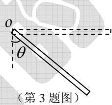

# 《大学物理》同步练习册：力矩做功与刚体定轴转动动能定理（答案）

原件经识别和整理；“参考解答”是我们补的。

## 力矩做功 刚体定轴转动的动能定理

### 简答 1

人在圆盘上走动时，人和圆盘构成的系统所受外力为：转轴对圆盘的作用力，方向：过转动点，垂直于转轴；系统所受内力为：人和圆盘之间的摩擦力，（否则人无法在圆盘上随意走动）。

①由于系统所受外力不为零，系统动量不守恒；

②系统所受外力不为零，但外力方向经过转轴，外力矩为零，系统角动量守恒；

③系统所受外力经过转轴，外力矩为零，外力做功为零，但非保守内力摩擦力做功，系统机械能不守恒。

答案：C。

知识点：[功能原理与机械能守恒定律](../../../topics/大学物理/功能原理与机械能守恒.md)

### 简答 2

①小球和细杆非弹性碰撞，该过程中有非保守内力做功，系统机械能不守恒；

②小球和细杆碰撞过程中，转轴对细杆会有作用力，系统在水平方向合外力不为零，系统动量不守恒；

③转轴对细杆的作用力经过转动点，该作用力的力矩为零；细杆在竖直位置处，小球和细杆的重力矩为零；所以系统的合外力矩为零，系统的角动量守恒。

答案：C。

知识点：[弹性碰撞与非弹性碰撞](../../../topics/大学物理/碰撞问题.md)、[角动量定理与角动量守恒定律](../../../topics/大学物理/角动量与角动量守恒.md)、[功能原理与机械能守恒定律](../../../topics/大学物理/功能原理与机械能守恒.md)

### 简答 3

杆在下摆过程中，杆和地球构成的系统机械能守恒。

取转动点 $O$ 处重力势能为零，则杆在水平位置时机械能：

$$E_1 = E_{k1} + E_{p1} = 0 + 0 = 0$$

杆与竖直方向成 $\theta$ 角时机械能：

$$E_2 = E_{k2} + E_{p2} = \frac{1}{2}\left(\frac{1}{3}ml^2\right)\omega^2 - mg\frac{l}{2}\cos\theta$$

由机械能守恒 $E_1 = E_2$：

$$0 = \frac{1}{2}\left(\frac{1}{3}ml^2\right)\omega^2 - mg\frac{l}{2}\cos\theta \implies \omega^2 = \frac{3g}{l}\cos\theta$$

杆的角速度：

$$\omega = \sqrt{\frac{3g}{l}\cos\theta}$$

答案：B。

知识点：[刚体定轴转动的角量描述](../../../topics/大学物理/刚体定轴转动运动学.md)、[功能原理与机械能守恒定律](../../../topics/大学物理/功能原理与机械能守恒.md)、[转动惯量的计算与平行轴定理](../../../topics/大学物理/转动惯量.md)

### 简答 4

人和转动平台构成的系统外力矩为零，系统角动量守恒：

$$J\omega = J'\omega'$$

当人把哑铃收缩到胸前的过程中，系统的转动惯量变小，$J' < J$，则系统转动的角速度变大，$\omega' > \omega$；系统的转动动能变大，

$$E_k = \frac{1}{2}J'\omega'^2 = \frac{1}{2}J\omega\omega' > \frac{1}{2}J\omega^2$$

又整个过程中系统势能不变，所以系统的机械能不守恒。

答案：C。

知识点：[角动量定理与角动量守恒定律](../../../topics/大学物理/角动量与角动量守恒.md)、[力矩的功与刚体定轴转动的动能定理](../../../topics/大学物理/力矩做功.md)

### 计算 1

（1）整个过程中合外力矩为零，角动量守恒：

$$J_{L0}\omega_{L0} = \left(\frac{3}{4}J_{L0}\right)\omega \implies \omega = \frac{4}{3}\omega_0$$

（2）若运动员的转动惯量 $J$ 不变，外力矩做功：

$$W = \frac{1}{2}J\left(\sqrt{2}\omega_0\right)^2 - \frac{1}{2}J\omega_0^2 = \frac{1}{2}J\omega_0^2$$

参考解答：（1）角速度变为  

$$
\omega=\frac{4}{3}\omega_0
$$

理由：整个过程中合外力矩为零，因此角动量守恒。初始角动量为 $J_{L0}\omega_{L0}$，末态转动惯量为 $\frac{3}{4}J_{L0}$，所以  

$$
J_{L0}\omega_{L0}=\frac{3}{4}J_{L0}\omega
$$

解得  

$$
\omega=\frac{4}{3}\omega_0
$$

---

（2）外力矩做功为  

$$
W=\frac{1}{2}J\omega_0^2
$$

理由：若转动惯量 $J$ 不变，动能增量等于外力矩做的功。末角速度为 $\sqrt{2}\omega_0$，于是  

$$
W=\frac{1}{2}J(\sqrt{2}\omega_0)^2-\frac{1}{2}J\omega_0^2
$$

$$
=\frac{1}{2}J(2\omega_0^2)-\frac{1}{2}J\omega_0^2
=\frac{1}{2}J\omega_0^2
$$

知识点：[角动量定理与角动量守恒定律](../../../topics/大学物理/角动量与角动量守恒.md)、[力矩的功与刚体定轴转动的动能定理](../../../topics/大学物理/力矩做功.md)、[刚体定轴转动定律（M=Jα）](../../../topics/大学物理/刚体转动定律.md)

### 计算 2

由刚体转动动能定理，摩擦力所做的功等于刚体转动动能的增量：

$$W = E_k - E_{k0} = 0 - \frac{1}{2}J\omega^2 = -\frac{1}{2}\left(\frac{1}{2}mR^2\right)\omega^2 = -\frac{1}{4}mR^2\omega^2$$

负号表示摩擦力做负功。

参考解答：**结论：** 摩擦力所做的功为

$$W = -\frac{1}{4}mR^2\omega^2$$

负号表示摩擦力做负功。

---

**推理与计算过程：**

由刚体转动动能定理，合外力矩所做的功等于刚体转动动能的增量：

$$W = \Delta E_k = E_k - E_{k0}$$

圆盘最终停止转动，末态动能 $E_k = 0$；初态以角速度 $\omega$ 转动，初动能为：

$$E_{k0} = \frac{1}{2}J\omega^2$$

对于质量为 $m$、半径为 $R$ 的均匀圆盘（或圆柱），其绕中心轴的转动惯量为：

$$J = \frac{1}{2}mR^2$$

代入得：

$$W = 0 - \frac{1}{2}\left(\frac{1}{2}mR^2\right)\omega^2 = -\frac{1}{4}mR^2\omega^2$$

知识点：[力矩的功与刚体定轴转动的动能定理](../../../topics/大学物理/力矩做功.md)、[刚体定轴转动的角量描述](../../../topics/大学物理/刚体定轴转动运动学.md)

### 计算 3

质点在整个过程中受到指向中心 $O$ 的拉力作用，在有心力作用下相对中心 $O$ 的角动量守恒：

$$rmv_0 = \frac{r}{2}mv \implies rm(r\omega_0) = \frac{r}{2}mv \implies v = 2r\omega_0$$

由质点的动能定理，在此过程中拉力做功等于质点动能的增加。拉力做功：

$$W = \frac{1}{2}mv^2 - \frac{1}{2}mv_0^2 = \frac{1}{2}m(2r\omega_0)^2 - \frac{1}{2}m(r\omega_0)^2 = \frac{3}{2}mr^2\omega_0^2$$

参考解答：质点在整个过程中受到指向中心 $O$ 的拉力作用，在有心力作用下相对中心 $O$ 的角动量守恒：

$$rmv_0 = \frac{r}{2}mv \implies rm(r\omega_0) = \frac{r}{2}mv \implies v = 2r\omega_0$$

由质点的动能定理，在此过程中拉力做功等于质点动能的增加。拉力做功：

$$W = \frac{1}{2}mv^2 - \frac{1}{2}mv_0^2 = \frac{1}{2}m(2r\omega_0)^2 - \frac{1}{2}m(r\omega_0)^2 = \frac{3}{2}mr^2\omega_0^2$$

知识点：[角动量定理与角动量守恒定律](../../../topics/大学物理/角动量与角动量守恒.md)、[圆周运动的角量描述（角速度、角加速度）](../../../topics/大学物理/圆周运动描述.md)、[功的定义、功率与质点动能定理](../../../topics/大学物理/功与动能定理.md)

### 计算 4

弹簧和杆以及地球构成的系统只有保守内力（重力和弹性力）做功，系统的机械能守恒。

若取转动点 $O$ 处重力势能为零，弹簧原长时弹性势能为零。

在 $\theta = 0$ 的位置处，杆的动能：

$$E_k = \frac{1}{2}J\omega^2 = \frac{1}{2}\left(\frac{1}{3}ml^2\right)\omega^2$$

系统的势能（弹性势能为零）：

$$E_p = mg\frac{l}{2} + 0$$

系统的机械能：

$$E = \frac{1}{2}\left(\frac{1}{3}ml^2\right)\omega^2 + mg\frac{l}{2}$$

在水平位置处，弹簧的形变量为：

$$x = \sqrt{h^2 + l^2} - (h - l) = \frac{\sqrt{13} - 1}{2}\ \mathrm{m}$$

设杆的角速度为 $\omega'$，杆的动能：

$$E_k' = \frac{1}{2}J\omega'^2 = \frac{1}{2}\left(\frac{1}{3}ml^2\right)\omega'^2$$

系统的势能（重力势能为零）：

$$E_p' = 0 + \frac{1}{2}kx^2$$

系统的机械能：

$$E' = \frac{1}{2}\left(\frac{1}{3}ml^2\right)\omega'^2 + \frac{1}{2}kx^2$$

由系统的机械能守恒 $E = E'$：

$$\frac{1}{2}\left(\frac{1}{3}ml^2\right)\omega^2 + mg\frac{l}{2} = \frac{1}{2}\left(\frac{1}{3}ml^2\right)\omega'^2 + \frac{1}{2}kx^2$$

$$\implies \frac{1}{2}\left(\frac{1}{3}ml^2\right)\omega'^2 = \frac{1}{2}\left(\frac{1}{3}ml^2\right)\omega^2 + mg\frac{l}{2} - \frac{1}{2}kx^2$$

又由杆在水平位置处的动能：

$$E_k' = \frac{1}{2}\left(\frac{1}{3}ml^2\right)\omega'^2 \geq 0 \implies \frac{1}{2}\left(\frac{1}{3}ml^2\right)\omega^2 + mg\frac{l}{2} - \frac{1}{2}kx^2 \geq 0$$

杆在 $\theta = 0$ 处的角速度：$\omega \geq 3.37\ \mathrm{rad/s}$（取 $g = 9.8\ \mathrm{m/s^2}$）；或 $\omega \geq 3.27\ \mathrm{rad/s}$（取 $g = 10\ \mathrm{m/s^2}$）。

参考解答：杆在 $\theta=0$ 处的最小角速度为 $\omega \geq 3.37\ \mathrm{rad/s}$（取 $g=9.8\ \mathrm{m/s^2}$）或 $\omega \geq 3.27\ \mathrm{rad/s}$（取 $g=10\ \mathrm{m/s^2}$）。

系统仅保守内力做功，机械能守恒。以转动点 $O$ 为重力势能零点、弹簧原长为弹性势能零点，对竖直位置（$\theta=0$）与水平位置列能量方程：

$$
\frac{1}{2} \cdot \frac{1}{3}ml^2 \cdot \omega^2 + mg\frac{l}{2} = \frac{1}{2} \cdot \frac{1}{3}ml^2 \cdot \omega'^2 + \frac{1}{2}kx^2
$$

其中水平位置弹簧形变量 $x = \sqrt{h^2+l^2}-(h-l) = \dfrac{\sqrt{13}-1}{2}\ \mathrm{m}$。杆能到达水平位置的临界条件为 $\omega' \geq 0$，即动能非负，代入上式得：

$$
\frac{1}{6}ml^2\omega^2 \geq \frac{1}{2}kx^2 - mg\frac{l}{2}
$$

解出 $\omega$ 的最小值即为所求结果；若初始角速度小于该值，则杆在到达水平位置前动能已耗尽并反向摆回。

知识点：[刚体定轴转动的角量描述](../../../topics/大学物理/刚体定轴转动运动学.md)、[转动惯量的计算与平行轴定理](../../../topics/大学物理/转动惯量.md)、[功能原理与机械能守恒定律](../../../topics/大学物理/功能原理与机械能守恒.md)

### 计算 5

（1）在子弹射入杆的过程中，子弹和杆构成的系统动量不守恒，机械能不守恒，只有角动量守恒。

射入前系统角动量（初始棒静止不动，棒的角动量为零）：

$$L_0 = \frac{2}{3}lmv_0 + 0 = \frac{2}{3}lmv_0$$

射入后子弹和杆在竖直位置处的角动量：

$$L = J\omega = \left[\frac{1}{3}ml^2 + m\left(\frac{2}{3}l\right)^2\right]\omega$$

由角动量守恒 $L_0 = L$：

$$\frac{2}{3}lmv_0 = \left[\frac{1}{3}ml^2 + m\left(\frac{2}{3}l\right)^2\right]\omega$$

杆的角速度：

$$\omega = \frac{6v_0}{7l}$$

子弹速度大小：

$$v = \frac{2}{3}l\omega = \frac{4}{7}v_0$$

（2）子弹射入后，子弹和杆以相同角速度 $\omega$ 从竖直位置上摆到最大角度 $\theta_m$ 位置，该过程中子弹和杆以及地球构成的系统机械能守恒。

在竖直位置：

$$E_1 = \frac{1}{2}J\omega^2 - mg\frac{l}{2} - mg\frac{2}{3}l$$

在最大角度 $\theta_m$ 位置：

$$E_2 = 0 - mg\frac{l}{2}\cos\theta_m - mg\frac{2}{3}l\cos\theta_m$$

由机械能守恒 $E_1 = E_2$：

$$\cos\theta_m = 1 - \frac{12v_0^2}{49gl} \implies \theta_m = \arccos\left(1 - \frac{12v_0^2}{49gl}\right)$$

参考解答：（1）碰撞后杆的角速度为 $\omega = \dfrac{6v_0}{7l}$，子弹速度大小为 $v = \dfrac{4}{7}v_0$；（2）最大摆角为 $\theta_m = \arccos\left(1 - \dfrac{12v_0^2}{49gl}\right)$。

**推理与计算过程：**

1.  **碰撞阶段（角动量守恒）**
    子弹射入杆的瞬间，系统所受合外力矩为零，故对转轴角动量守恒；因是非弹性碰撞且轴处有约束力，机械能与动量均不守恒。
    *   碰前系统对转轴的角动量（杆静止）：
        $$L_0 = m v_0 \cdot \frac{2}{3}l = \frac{2}{3}mlv_0$$
    *   碰后系统绕端点转动的转动惯量：
        $$J = J_{\text{杆}} + J_{\text{弹}} = \frac{1}{3}ml^2 + m\left(\frac{2}{3}l\right)^2 = \frac{7}{9}ml^2$$
    *   由 $L_0 = J\omega$ 解得角速度：
        $$\omega = \frac{\frac{2}{3}mlv_0}{\frac{7}{9}ml^2} = \frac{6v_0}{7l}$$
    *   子弹嵌在距轴 $\frac{2}{3}l$ 处，其线速度：
        $$v = \frac{2}{3}l \cdot \omega = \frac{4}{7}v_0$$

2.  **上摆阶段（机械能守恒）**
    碰后系统在上摆过程中只有重力做功，系统（杆+子弹+地球）机械能守恒。取竖直位置为重力势能参考零点更方便计算势能变化量，或直接列出两位置能量等式。
    *   竖直位置动能与势能之和：
        $$E_1 = \frac{1}{2}J\omega^2 - mg\frac{l}{2} - mg\frac{2}{3}l$$
    *   最大摆角 $\theta_m$ 处动能为零，势能为：
        $$E_2 = -mg\frac{l}{2}\cos\theta_m - mg\frac{2}{3}l\cos\theta_m$$
    *   由 $E_1 = E_2$ 并将 $J=\frac{7}{9}ml^2$、$\omega=\frac{6v_0}{7l}$ 代入整理：
        $$\frac{1}{2}\cdot\frac{7}{9}ml^2\cdot\left(\frac{6v_0}{7l}\right)^2 = mg\left(\frac{l}{2}+\frac{2}{3}l\right)(1-\cos\theta_m)$$
        $$\frac{2}{7}mv_0^2 = \frac{7}{6}mgl(1-\cos\theta_m)$$
        $$\cos\theta_m = 1 - \frac{12v_0^2}{49gl}$$
    *   故最大摆角：
        $$\theta_m = \arccos\left(1 - \frac{12v_0^2}{49gl}\right)$$

知识点：[角动量定理与角动量守恒定律](../../../topics/大学物理/角动量与角动量守恒.md)、[转动惯量的计算与平行轴定理](../../../topics/大学物理/转动惯量.md)、[功能原理与机械能守恒定律](../../../topics/大学物理/功能原理与机械能守恒.md)
