# 《大学物理》圆周运动（课件）

原件的每一页，下面附识别出的文字。

### 圆周运动

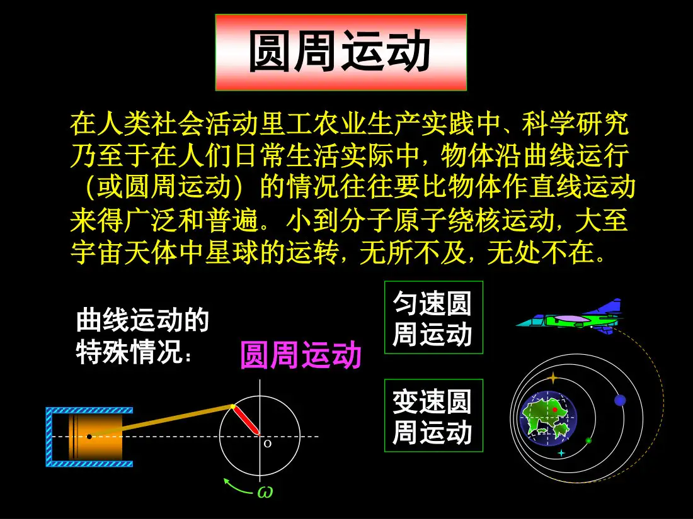

原文：

圆周运动

在人类社会活动里工农业生产实践中、科学研究乃至于在人们日常生活实际中，物体沿曲线运行（或圆周运动）的情况往往要比物体作直线运动来得广泛和普遍。 小到分子原子绕核运动，大至宇宙天体中星球的运转，无所不及，无处不在。

曲线运动的特殊情况：

圆周运动 匀速圆 周运动

变速圆 周运动

### 在研究圆周运动时采用的坐标参考系是平面极坐标系。

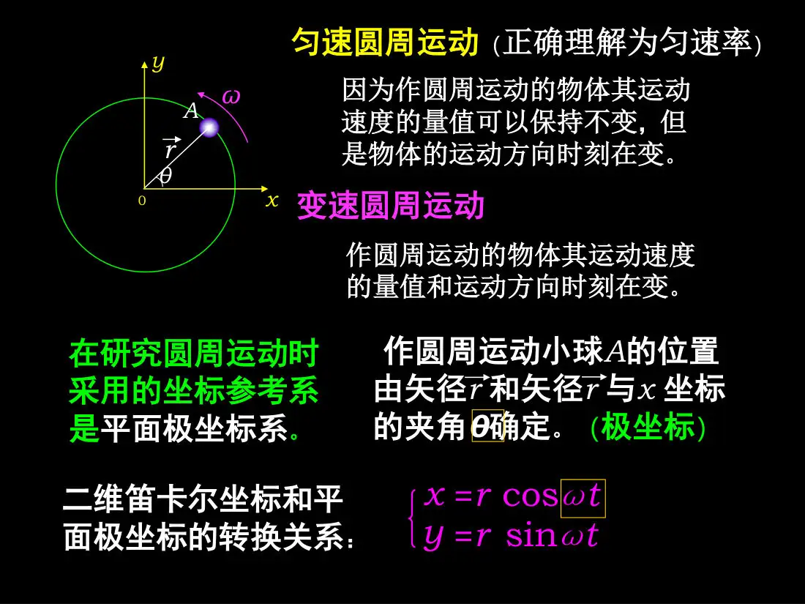

原文：

在研究圆周运动时采用的坐标参考系是平面极坐标系。

二维笛卡尔坐标和平面极坐标的转换关系：

匀速圆周运动（正确理解为匀速率）

因为作圆周运动的物体其运动速度的量值可以保持不变，但是物体的运动方向时刻在变。

变速圆周运动

作圆周运动的物体其运动速度的量值和运动方向时刻在变。

作圆周运动小球A的位置由矢径r 和矢径r 与x 坐标的夹角θ确定。（极坐标）

x = cosωtr ωsin ty =r

### §1-3 圆周运动一、圆周运动中的几个重要物理量：

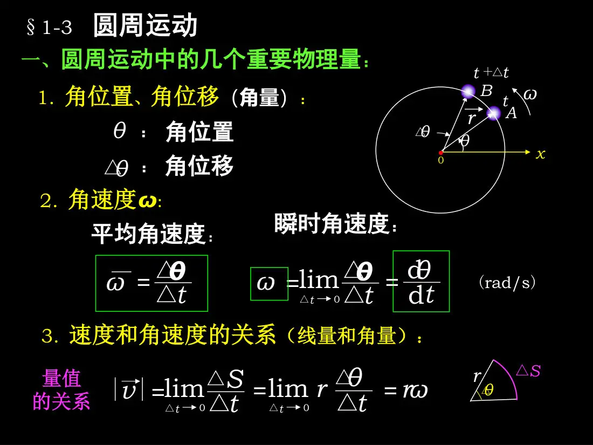

原文：

§1-3 圆周运动一、圆周运动中的几个重要物理量：

1. 角位置、角位移（角量）

θ 角位置：

△θ 角位移：

2. 角速度ω:平均角速度：

△θω =t△ t瞬时角速度：

△θ =lim θd ω = t △△t 0 dt

(rad/s)

3. 速度和角速度的关系（线量和角量）：

量值 $( 2 ) \frac { 1 } { 5 } ( 2 0 0 0 0 0 0 ) \div 2 = \frac { 1 } { 5 } ( 2 0 0 0 0 0 0 0 0 ) \times 2 = 1 0 0 0 0$ 的关系

### 3. 速度和角速度的关系（线量和角量）：

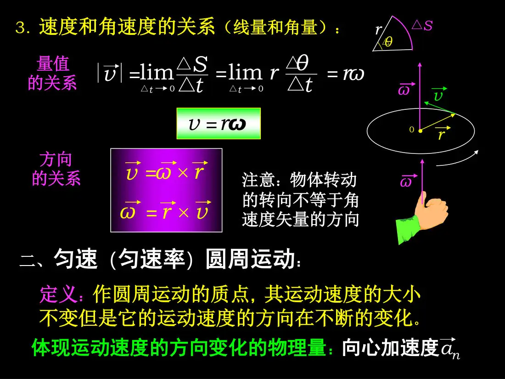

原文：

3. 速度和角速度的关系（线量和角量）：

量值的关系

$$
| \vec {v} | = \lim _ {\triangle t \rightarrow 0} \frac {\triangle S}{\triangle t} = \lim _ {\triangle t \rightarrow 0} r \frac {\triangle \theta}{\triangle t} = r \omega
$$

$$
\boldsymbol {\nu} = r \boldsymbol {\omega}
$$

方向的关系

$$
\begin{array}{c} \overrightarrow {\upsilon} = \overrightarrow {\omega} \times \overrightarrow {r} \\ \overrightarrow {\omega} = \overrightarrow {r} \times \overrightarrow {\upsilon} \end{array}
$$

注意：物体转动的转向不等于角速度矢量的方向

二、匀速（匀速率）圆周运动：

定义：作圆周运动的质点，其运动速度的大小不变但是它的运动速度的方向在不断的变化。

体现运动速度的方向变化的物理量：向心加速度 $\textcircled { \bullet }$ 严格地说：匀速率圆周运动是一种变速曲线运动，描述运动速度的方向变化的物理量：向心加速度 $\textcircled { \bullet }$ 始终指向圆心，它只改变质点的速度方向，而不改变速度的大小。

### 向心加速度 $\textcircled { \bullet }$ 量值的推导：

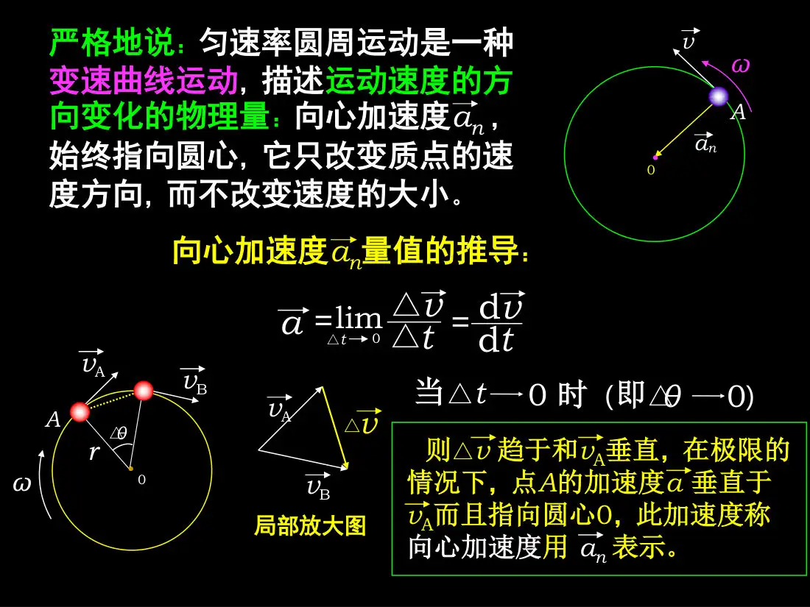

原文：

向心加速度 $\textcircled { \bullet }$ 量值的推导：

a =lim △v dv △t 0 t△ dt

局部放大图

当 $\Delta G C E \cong \Delta G$ 时（即△θ 0（

则 $\boxed { \pm }$ 趋于和 $\boxed { 1 }$ 垂直，在极限的情况下，点A的加速度 $\boxed { \pmb { \mathscr { O } } }$ 垂直于v 而且指向圆心0，此加速度称向心加速度用 $\textcircled { \bullet }$ 表示。

### $$

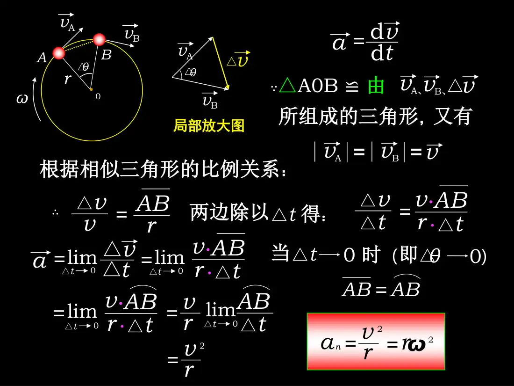

原文：

$$
\overrightarrow {\alpha} = \frac {\mathrm{d} \overrightarrow {\nu}}{\mathrm{d} t}
$$

$$
\because \triangle A O B \cong
$$

$$
\vec {v} _ {\mathrm{A}}, \vec {v} _ {\mathrm{B}}, \triangle \vec {v}
$$

$$
\overrightarrow {\mathcal {V} _ {\mathrm{A}}} \vert = \vert \overrightarrow {\mathcal {V} _ {\mathrm{B}}} \vert = \overrightarrow {\mathcal {V}}
$$

根据相似三角形的比例关系： A B∴ $\frac { A D } { C D } = \frac { A D } { C C }$ 两边除以 $\Delta G$ 得： $\frac { A D } { A B } = \frac { B E } { A B } = \frac { B E } { B C }$ $\frac { 1 } { 2 } \times \frac { 1 } { 2 } = \frac { 1 } { 2 } \times \frac { 1 } { 2 } = \frac { 1 } { 2 } \times \frac { 1 } { 2 } = \frac { 1 } { 2 } \times \frac { 1 } { 2 }$ 当△t 0 时（即△θ 0（AB＝AB=lim ABv· v limAB△t△t 0 r· r △t 0 △tv 2v 2 =an r =rω2r

### 三. 变速圆周运动： 作圆周运动的物体其运动速度的量值和运动方向时刻在变。

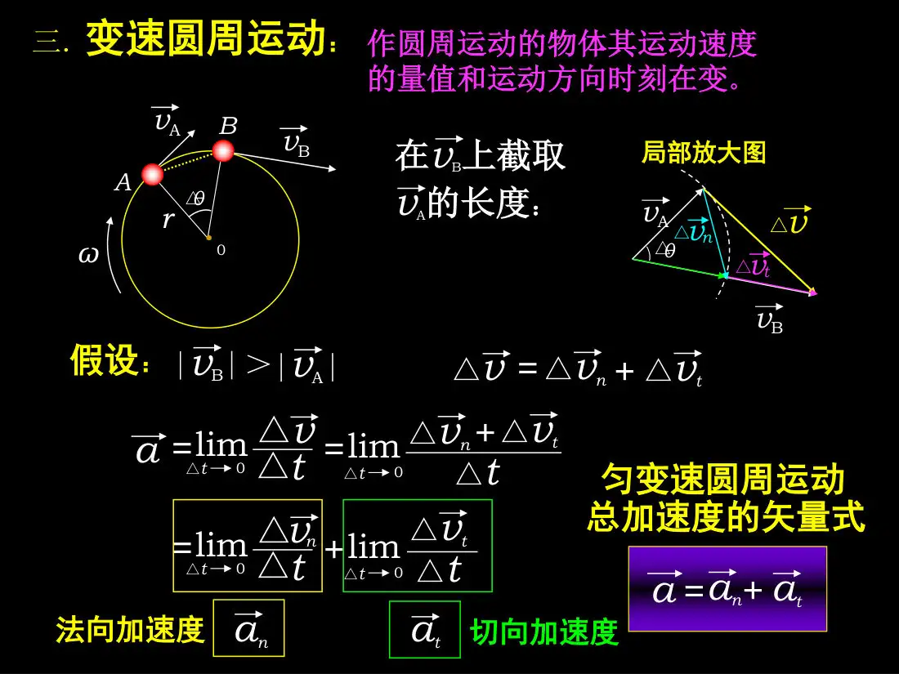

原文：

三. 变速圆周运动： 作圆周运动的物体其运动速度的量值和运动方向时刻在变。

在v上截取v的长度：

局部放大图

假设： $\boxed { 1 0 } \boxed { 1 } \boxed { 1 0 }$

$$
\triangle \overrightarrow {\upsilon} = \triangle \overrightarrow {\upsilon} _ {n} + \triangle \overrightarrow {\upsilon} _ {t}
$$

a =lim △v =lim △v ＋ △v △t 0 t△ △t 0 △t

=lim △ vn lim △vt△t 0 △ t △t 0 △t匀变速圆周运动总加速度的矢量式

$$
\overrightarrow {a} = \overrightarrow {a _ {n}} + \overrightarrow {a _ {t}}
$$

法向加速度 an

切向加速度匀变速圆周运动总加速度的矢量式

### 结论

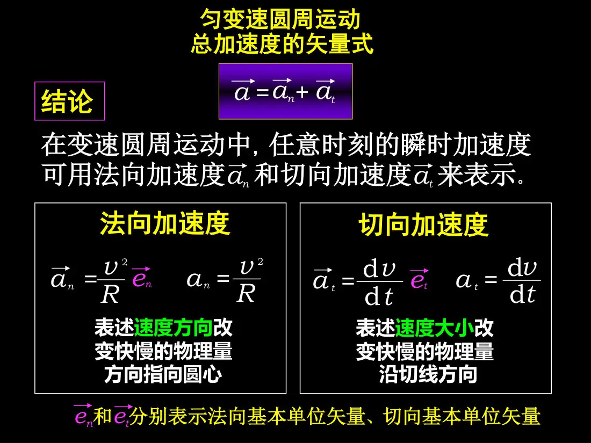

原文：

结论

$$
\overrightarrow {a} = \overrightarrow {a _ {n}} + \overrightarrow {a _ {t}}
$$

在变速圆周运动中，任意时刻的瞬时加速度可用法向加速度 $\textcircled { \bullet }$ 和切向加速度 $\circledcirc$ 来表示。

法向加速度

$$
\vec {a} _ {n} = \frac {\nu^ {2}}{R} \vec {e} _ {n}
$$

$$
a _ {n} = \frac {\nu^ {2}}{R}
$$

切向加速度

表述速度方向改变快慢的物理量方向指向圆心

$$
\vec {a} _ {t} = \frac {\mathrm{d} \nu}{\mathrm{d} t} \vec {e} _ {t}
$$

$$
a _ {t} = \frac {\mathrm{d} \nu}{\mathrm{d} t}
$$

表述速度大小改变快慢的物理量沿切线方向

e 和e分别表示法向基本单位矢量、切向基本单位矢量

### $$

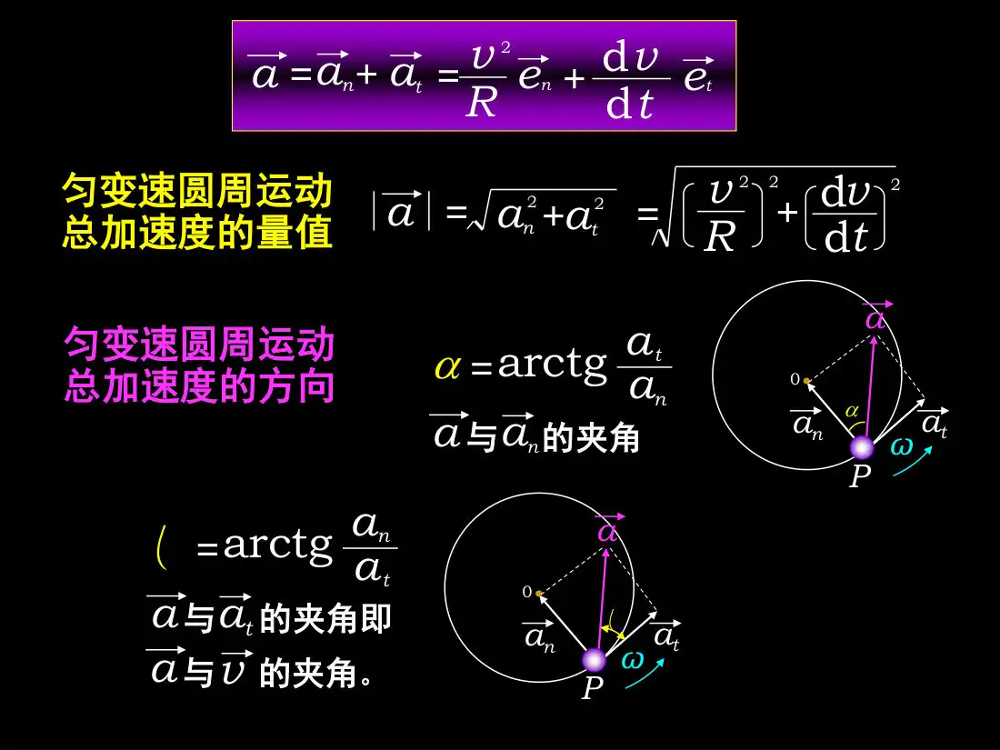

原文：

$$
\overrightarrow {a} = \overrightarrow {a _ {n}} + \overrightarrow {a _ {t}} = \frac {\nu^ {2}}{R} \overrightarrow {e _ {n}} + \frac {\mathrm{d} \nu}{\mathrm{d} t} \overrightarrow {e _ {t}}
$$

匀变速圆周运动总加速度的量值

$$
| \overrightarrow {a} | = \sqrt {a _ {n} ^ {2} + a _ {t} ^ {2}} = \sqrt {\left(\frac {\nu^ {2}}{R}\right) ^ {2} + \left(\frac {\mathrm{d} \nu}{\mathrm{d} t}\right) ^ {2}}
$$

匀变速圆周运动总加速度的方向 =arctg atana 与 $\textcircled { \bullet }$ 的夹角

=arctg $\frac { \langle \theta \rangle } { \langle \theta \rangle } = \frac { \langle \theta \rangle } { \langle \theta \rangle } = \frac { \langle \theta \rangle } { \langle \theta \rangle } = \frac { \langle \theta \rangle } { \langle \theta \rangle } = \frac { \langle \theta \rangle } { \langle \theta \rangle } = \frac { \langle \theta \rangle } { \langle \theta \rangle } = \frac { \langle \theta \rangle } { \langle \theta \rangle } = \frac { \langle \theta \rangle } { \langle \theta \rangle } = \frac { \langle \theta \rangle } { \langle \theta \rangle } = \frac { \langle \theta \rangle } { \langle \theta \rangle } = \frac { \langle \theta \rangle } { \langle \theta \rangle } = \frac { \langle \theta \rangle } { \langle \theta \rangle } = \frac { \langle \theta \rangle } { \langle \theta \rangle } = \frac { \langle \theta \rangle } { \langle \theta \rangle } = \frac { \langle \theta \rangle } { \langle \theta \rangle } = \frac { \langle \theta \rangle } { \langle \theta \rangle } = \frac { \langle \theta \rangle } { \langle \theta \rangle } = \frac { \langle \theta \rangle } { \langle \theta \rangle } = \frac { \langle \theta \rangle } { \langle \theta \rangle }$ a 与 $\textcircled { \bullet }$ 的夹角即 a 与 $\textcircled { 1 }$ 的夹角。

### $$

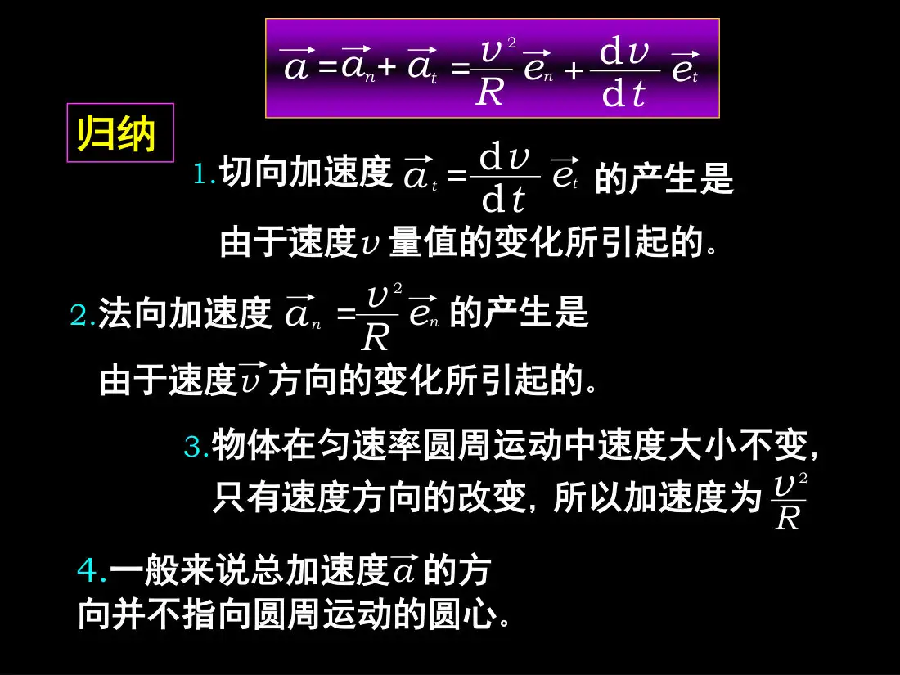

原文：

$$
\overrightarrow {a} = \overrightarrow {a _ {n}} + \overrightarrow {a _ {t}} = \frac {\nu^ {2}}{R} \overrightarrow {e _ {n}} + \frac {\mathrm{d} \nu}{\mathrm{d} t} \overrightarrow {e _ {t}}
$$

归纳

1.切向加速度 $\frac { 1 } { 2 } \times \frac { 1 } { 3 } = \frac { 1 0 } { 1 0 } ( m ^ { 2 } )$ 的产生是由于速度v 量值的变化所引起的。

2.法向加速度 $\frac { 1 0 } { 1 0 } \times \frac { 1 } { 1 0 } = \frac { 1 0 } { 1 0 } = \frac { 1 } { 1 0 }$ 的产生是由于速度v 方向的变化所引起的。

3.物体在匀速率圆周运动中速度大小不变，只有速度方向的改变，所以加速度为 $\frac { 1 0 2 } { 1 0 0 } = \frac { 1 0 0 } { 1 0 0 }$

4.一般来说总加速度a 的方向并不指向圆周运动的圆心。

### 4.一般来说总加速度a 的方向并不指向圆周运动的圆心。

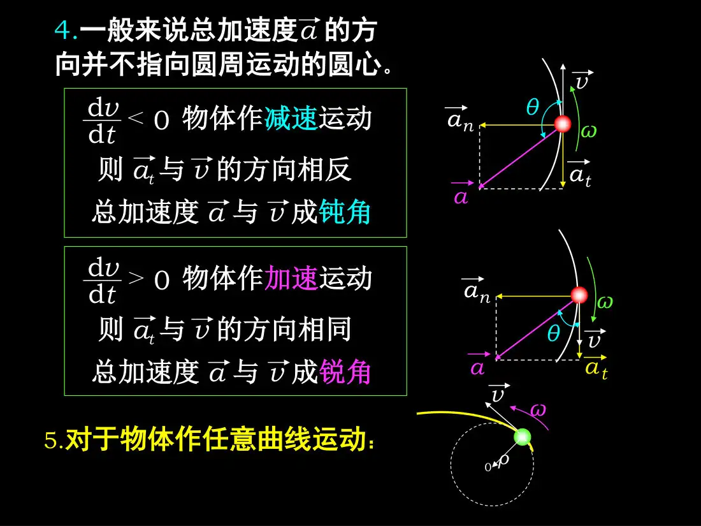

原文：

4.一般来说总加速度a 的方向并不指向圆周运动的圆心。

dv ＜ 0 物体作减速运动dt则 a 与 v 的方向相反总加速度 a 与 v 成钝角

dv ＞ 0 物体作加速运动dt则 $\boxed { \bullet }$ 与 v 的方向相同总加速度 a 与 v 成锐角

5.对于物体作任意曲线运动：

### 5.对于物体作任意曲线运动：

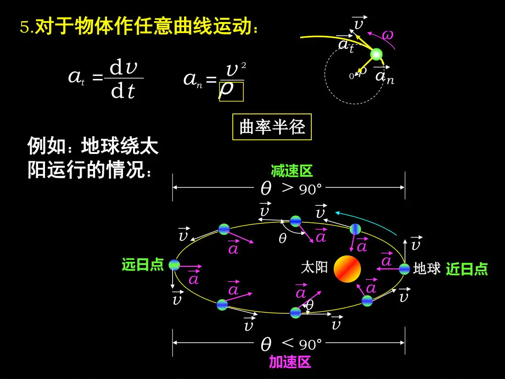

原文：

5.对于物体作任意曲线运动：

$$
a _ {t} = \frac {\mathrm{d} \nu}{\mathrm{d} t}
$$

$$
a _ {n} = \frac {\nu^ {2}}{\rho}
$$

例如：地球绕太阳运行的情况：

曲率半径

远日点

加速区

地球 近日点

### 第 13 页

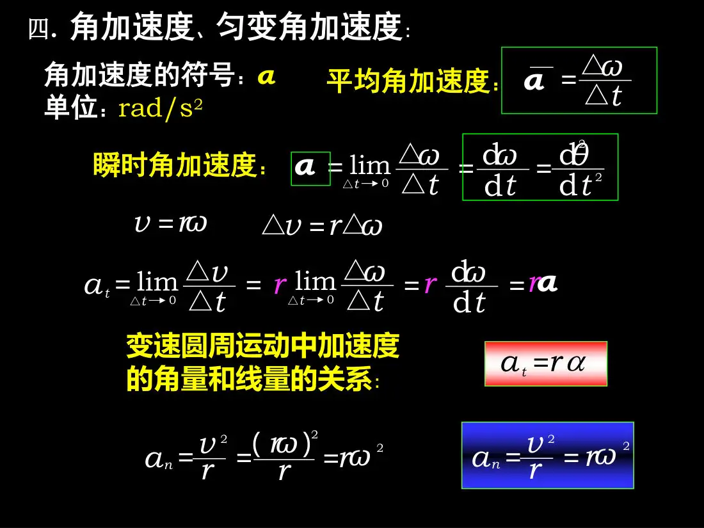

原文：

四. 角加速度、匀变角加速度:角加速度的符号：α 平均角加速度： $\cos = \frac { 4 0 } { 1 5 }$ 单位：rad $1 1 0 \times 2 = 1 1 0 ( c m )$ 瞬时角加速度： $\frac { 1 } { 2 } \times \frac { 1 } { 3 } = \frac { 1 } { 2 } \times \frac { 1 } { 3 } = \frac { 1 } { 2 } \times \frac { 1 } { 3 } = \frac { 1 } { 2 }$ v =rω △v =r△ωa =lim △v = limr △ω =r dω α=r△t 0 t△ △t 0 t△ dt变速圆周运动中加速度a =r的角量和线量的关系:2vr rω r 2 a =vn r =rω 2an =rω

### 圆周运动的运动方程

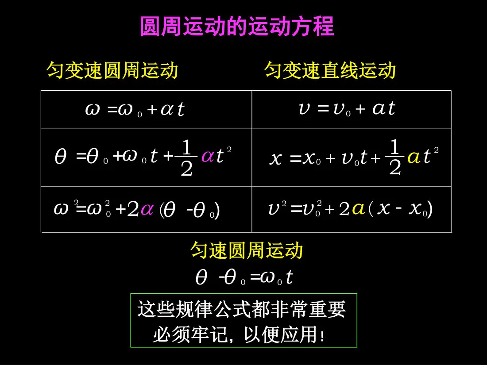

原文：

圆周运动的运动方程

匀变速圆周运动

匀变速直线运动

$$
\omega = \omega_ {0} + \alpha t
$$

$$
\nu = \nu_ {0} + a t
$$

$$
\theta = \theta_ {0} + \omega_ {0} t + \frac {1}{2} \alpha t ^ {2}
$$

$$
x = x _ {0} + \nu_ {0} t + \frac {1}{2} a t ^ {2}
$$

$$
\omega^ {2} = \omega_ {0} ^ {2} + 2 \alpha (\theta - \theta_ {0})
$$

$$
\nu^ {2} = \nu_ {0} ^ {2} + 2 a (x - x _ {0})
$$

匀速圆周运动θ －θ 0＝ω0t

这些规律公式都非常重要必须牢记，以便应用！

### 例题：已知质点的运动方程为：

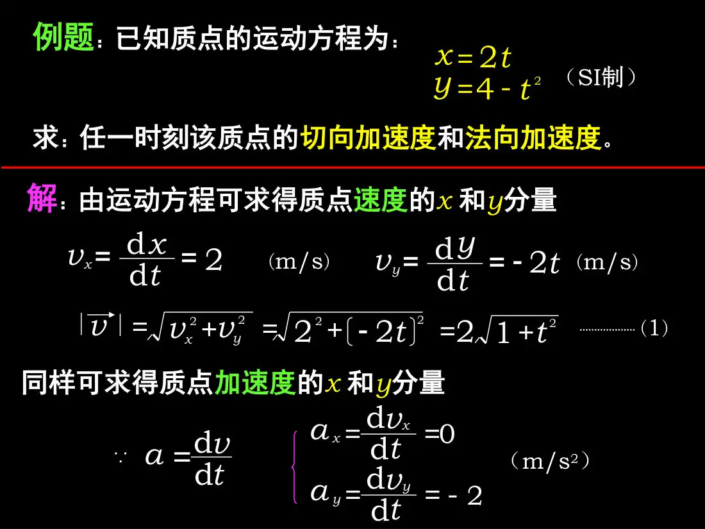

原文：

例题：已知质点的运动方程为：

$$
\begin{array}{l} x = 2 t \\ y = 4 - t ^ {2} \end{array}
$$

（SI制）

求：任一时刻该质点的切向加速度和法向加速度。

解：由运动方程可求得质点速度的x 和y分量

$$
\nu_ {x} = \frac {\mathrm{d} x}{\mathrm{d} t} = 2
$$

(m/s)

$$
\nu_ {y} = \frac {\mathrm{d} y}{\mathrm{d} t} = - 2 t (\mathrm{m/s})
$$

v = vx2 vy2 + = 2 t22 + －2t =2 1+ 2 (1)

同样可求得质点加速度的x 和y分量

$$
\because a = \frac {\mathrm{d} \nu}{\mathrm{d} t}
$$

$$
\left\{ \begin{array}{l} a _ {x} = \frac {\mathrm{d} \nu_ {x}}{\mathrm{d} t} = 0 \\ a _ {y} = \frac {\mathrm{d} \nu_ {y}}{\mathrm{d} t} = - 2 \end{array} \right.
$$

$$
(\mathrm{m} / \mathrm{s} ^ {2})
$$

### ∴ 加速度的量值为：

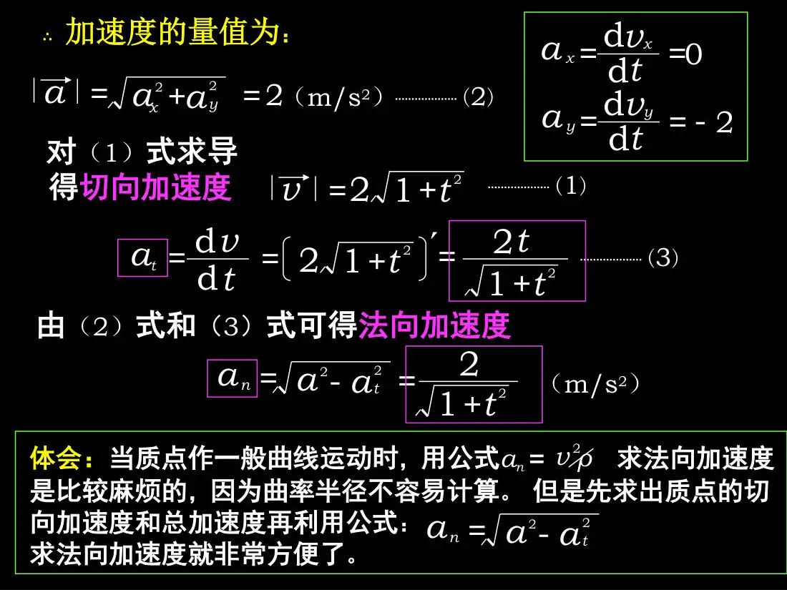

原文：

∴ 加速度的量值为：

a = ax2 ay2 + =2（m/s2） (2)

$$
\begin{array}{l} {a _ {x} = \frac {\mathrm{d} \nu_ {x}}{\mathrm{d} t} = 0} \\ {a _ {y} = \frac {\mathrm{d} \nu_ {y}}{\mathrm{d} t} = - 2} \end{array}
$$

对（1）式求导得切向加速度 $\vert \overrightarrow { D C } \vert = \overrightarrow { D C } / / \overrightarrow { A C }$ (1)

at dv = 2 1+t2 2t dt 1+t2

由（2）式和（3）式可得法向加速度

an = a2 at2- 2 （m/s2） 1+t2

体会：当质点作一般曲线运动时，用公式 $\textcircled { \bullet } \textcircled { = } \textcircled { \bullet } \textcircled { \bullet }$ 求法向加速度是比较麻烦的，因为曲率半径不容易计算。 但是先求出质点的切向加速度和总加速度再利用公式： $\textcircled { \bullet } m = \textcircled { \bullet } m \textcircled { \bullet } m \textcircled { \bullet } m$ 求法向加速度就非常方便了。

### 第 17 页

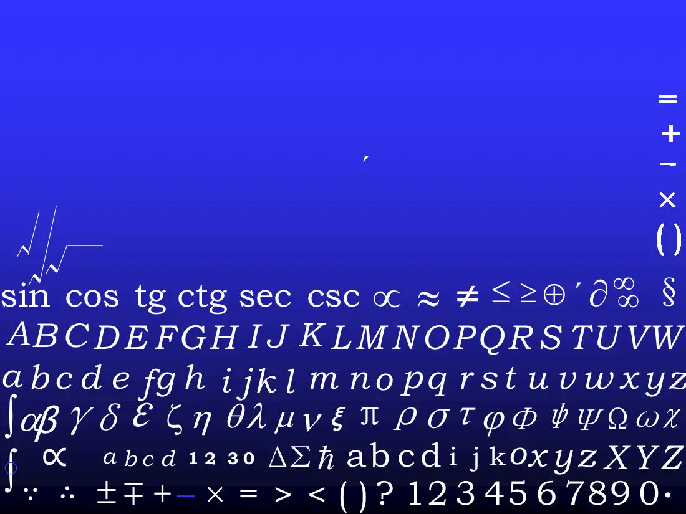

原文：

sin cos tg ctg sec csc ∝ ≈ ≠ ≤ ≥⊕′∂∞ § AB C DEFGH IJ K LMNOPQRSTUVW a b c d e fg h i jk l m no pq r s t u v w x yz ∫α γδεζηλμνξπρστφΦψΨΩωx 0 a b c d 1 2 3 0 ΔΣ a b c d i j kox y z XYZ∝ ±干+-× = > <()?1234567890.
