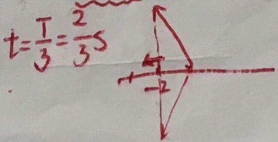
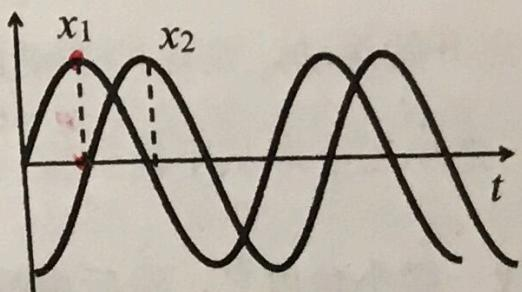
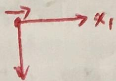
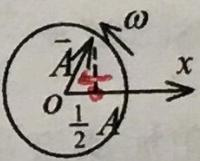
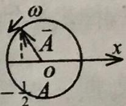
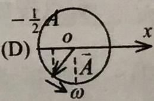

# 《大学物理》机械振动习题作业参考答案

原件经识别和整理；“参考解答”是我们补的。

## 机械振动

### 简谐振动

#### 选择 1

一质点作简谐振动。其位移与时间的曲线如图所示。若质点的振动规律用余弦函数描述，则其初相应为 [ D. ]

- A. $\pi/3$
- B. $2\pi/3$
- C. $-\pi/6$
- D. $-\pi/3$

答案：D

#### 选择 2

一个弹簧振子和一个单摆（只考虑小幅度摆动），在地面上的固有振动周期分别为 $T_{1}$ 和 $T_{2}$。将它们拿到月球上去，相应的周期分别为 $T_{1}^{\prime}$ 和 $T_{2}^{\prime}$。则有 [D.]

- A. $T_{1}^{\prime}>T_{1}$ 且 $T_{2}^{\prime}>T_{2}$
- B. $T_{1}^{\prime}<T_{1}$ 且 $T_{2}^{\prime}<T_{2}$
- C. $T_{1}^{\prime}=T_{1}$ 且 $T_{2}^{\prime}=T_{2}$
- D. $T_{1}^{\prime}=T_{1}$ 且 $T_{2}^{\prime}>T_{2}$

参考解答：
弹簧振子周期 $T_1 = 2\pi\sqrt{m/k}$，与重力加速度无关，故 $T_1' = T_1$。
单摆周期 $T_2 = 2\pi\sqrt{l/g}$，月球表面重力加速度小于地球，故 $T_2' > T_2$。

#### 选择 3

一物体做简谐振动，运动方程为 $x = A\cos \left( {\omega t + \frac{1}{4}\pi }\right)$，在 $t = T/4$ 时刻 ($T$ 为周期)，物体的速度和加速度为 [ B . ]

- A. $- \frac{\sqrt{2}}{2}A\omega , - \frac{\sqrt{2}}{2}A{\omega }^{2}$
- B. $- \frac{\sqrt{2}}{2}A\omega ,\frac{\sqrt{2}}{2}A{\omega }^{2}$
- C. $\frac{\sqrt{2}}{2}A\omega , - \frac{\sqrt{2}}{2}A{\omega }^{2}$
- D. $\frac{\sqrt{2}}{2}A\omega ,\frac{\sqrt{2}}{2}A{\omega }^{2}$

参考解答：
速度 $v = \frac{dx}{dt} = - {A\omega }\sin \left( {{\omega t} + \frac{\pi }{4}}\right)$
加速度 $a = \frac{dv}{dt} = - {A\omega }^{2}\cos \left( {{\omega t} + \frac{\pi }{4}}\right)$
当 $t = T/4$ 时，$\omega t = \frac{2\pi}{T} \cdot \frac{T}{4} = \frac{\pi}{2}$。
相位为 $\frac{\pi}{2} + \frac{\pi}{4} = \frac{3\pi}{4}$。
$v = -A\omega \sin(\frac{3\pi}{4}) = -A\omega \cdot \frac{\sqrt{2}}{2}$
$a = -A\omega^2 \cos(\frac{3\pi}{4}) = -A\omega^2 \cdot (-\frac{\sqrt{2}}{2}) = \frac{\sqrt{2}}{2}A\omega^2$

#### 选择 4

一质点在 $x$ 轴上作简谐振动，振幅 $A = 4\mathrm{\;{cm}}$，周期 $T = 2\mathrm{\;s}$，其平衡位置取作坐标原点。若 $t = 0$ 时刻质点第一次通过 $x = -2$ cm 处，且向 $x$ 轴负方向运动，则质点第二次通过 $x = -2\mathrm{\;{cm}}$ 处的时刻为 [ B - ]

- A. $1\mathrm{s}$
- B. $2/3\mathrm{s}$
- C. $4/3\mathrm{s}$
- D. $2\mathrm{s}$

参考解答：
$t=0$ 时，$x=-2=-A/2$，且向负方向运动。由旋转矢量法可知，此时相位对应第三象限边界附近，具体而言，从平衡位置向负最大位移运动经过 $x=-A/2$ 需要的时间对应相位变化。
更简单的对称性分析：质点从 $x=-A/2$ 向负方向运动到端点 $x=-A$ 再回到 $x=-A/2$。
$x = A\cos(\omega t + \phi_0)$。$t=0, x=-A/2, v<0 \Rightarrow \cos\phi_0 = -1/2, \sin\phi_0 > 0 \Rightarrow \phi_0 = 2\pi/3$。
第二次通过该点，即再次到达 $x=-A/2$ 且速度方向相反（或同侧往返？题目问“第二次通过”，通常指时间上的第二个时刻）。
运动过程：$-A/2 (\downarrow) \to -A \to -A/2 (\uparrow)$。这是第一次返回该位置吗？不，$t=0$ 是第一次。
下一次通过 $x=-A/2$ 是在它从 $-A$ 回来时。
利用旋转矢量图，从 $2\pi/3$ 转到 $4\pi/3$ (对应 $x=-A/2$ 但速度为正? 不，$\cos(4\pi/3)=-1/2$, $\sin(4\pi/3)<0 \Rightarrow v>0$)。
等等，$v = -A\omega\sin(\omega t+\phi)$。
$t=0, \phi=2\pi/3, \sin(2\pi/3)>0 \Rightarrow v<0$ (符合题意)。
下一个时刻 $t'$ 使得 $x=-A/2$。相位可以是 $2\pi/3$ (回到起点，一个周期后) 或者 $4\pi/3$。
在 $4\pi/3$ 处，$\sin(4\pi/3)<0 \Rightarrow v>0$。
所以第二次通过该位置（空间位置相同）的时刻对应的相位差 $\Delta \Phi = 4\pi/3 - 2\pi/3 = 2\pi/3$。
$\Delta t = \frac{\Delta \Phi}{\omega} = \frac{2\pi/3}{2\pi/T} = \frac{T}{3} = \frac{2}{3}\mathrm{s}$。

#### 选择 5

两个同周期简谐振动曲线如图所示。$x_{1}$ 的相位比 $x_{2}$ 的相位 [B]

$$
\pi / 2
$$

答案：B (根据原题选项推测，通常为超前 $\pi/2$ 或落后等，此处保留原标记 [B])

#### 选择 6

一个质点作简谐振动，振幅为 $A$，在起始时刻质点的位移为 $\frac{1}{2}A$，且向 $x$ 轴的负方向运动，代表此简谐振动的旋转矢量图为 (B)(C)(D)

参考解答：
$x = A/2 > 0$，矢量在第一或第四象限。
$v < 0$ (向负方向运动)，投影在向左移动，逆时针旋转，故矢量应在第一象限。
$\cos \phi = 1/2 \Rightarrow \phi = \pm \pi/3$。
$v = -A\omega \sin \phi < 0 \Rightarrow \sin \phi > 0 \Rightarrow \phi = \pi/3$。
对应图中矢量位于第一象限，角度为 $60^\circ$ 的那个选项。

#### 填空 1

一质点作简谐振动，速度最大值 ${v}_{m} = 5\mathrm{\;{cm}}/\mathrm{s}$，振幅 $A = 2$ cm。若令速度具有负最大值的那一刻为 $t = 0$，则振动表达式为 ______。

答案：${0.02}\cos \left( {\frac{5}{2}t + \frac{\pi }{2}}\right)$ (SI单位) 或 $2\cos(2.5t + \pi/2)$ (cm单位)

参考解答：
$\omega = v_m / A = 5 / 2 = 2.5 \, \text{rad/s}$。
$t=0$ 时，$v = -v_m$。
$v(t) = -A\omega \sin(\omega t + \phi_0)$。
$v(0) = -A\omega \sin(\phi_0) = -A\omega \Rightarrow \sin(\phi_0) = 1 \Rightarrow \phi_0 = \pi/2$。
$x(t) = A \cos(\omega t + \phi_0) = 2 \cos(2.5 t + \pi/2) \, \text{cm}$。
转换为米：$0.02 \cos(2.5 t + \pi/2) \, \text{m}$。
注：原题手写答案中频率写为 $5/2$，即 $2.5$，一致。

#### 填空 2

在两个相同的弹簧下各悬挂一物体，两物体的质量比为4:1，则两者做简谐运动的周期之比为 ______。

答案：2:1

参考解答：
$T = 2\pi\sqrt{m/k}$。
$k$ 相同，$T \propto \sqrt{m}$。
$T_1/T_2 = \sqrt{m_1/m_2} = \sqrt{4/1} = 2$。

#### 填空 3

一简谐振动的表达式为 $x = A\cos(3t + \phi)$，已知 $t = 0$ 时的初位移为 $0.04 \, \text{m}$，初速度为 $0.09 \, \text{m/s}$，则振幅 $A = $ ______ ，初相 $\phi = $ ______ 。

答案：$0.05 \, \text{m}$；$-37^\circ$ (或对应弧度值)

参考解答：
$\omega = 3 \, \text{rad/s}$。
$x_0 = A \cos \phi = 0.04$
$v_0 = -A \omega \sin \phi = 0.09 \Rightarrow \sin \phi = -\frac{0.09}{3A} = -\frac{0.03}{A}$
$A = \sqrt{x_0^2 + (\frac{v_0}{\omega})^2} = \sqrt{0.04^2 + (\frac{0.09}{3})^2} = \sqrt{0.0016 + 0.0009} = \sqrt{0.0025} = 0.05 \, \text{m}$。
$\tan \phi = \frac{-v_0/\omega}{x_0} = \frac{-0.03}{0.04} = -0.75$。
$\phi = \arctan(-0.75) \approx -37^\circ$ (或 $-0.6435 \, \text{rad}$)。

知识点：[简谐振动的运动学方程（振幅、角频率、相位）](../../../topics/大学物理/简谐振动运动学.md)、[用旋转矢量法确定初相与运动状态](../../../topics/大学物理/旋转矢量法.md)
