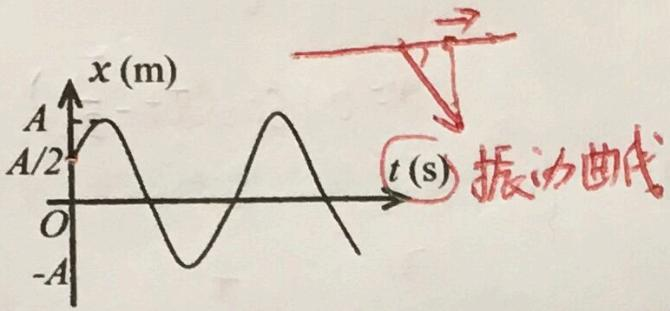

# 《大学物理》机械振动习题作业参考答案

原件经识别和整理；“参考解答”是我们补的。

## 机械振动

### 简谐振动

#### 选择 1

一质点作简谐振动。其位移与时间的曲线如图所示。若质点的振动规律用余弦函数描述，则其初相应为 [ D. ]

- A. $\pi/3$
- B. $2\pi/3$
- C. $-\pi/6$
- D. $-\pi/3$

答案：D

#### 选择 2

一个弹簧振子和一个单摆（只考虑小幅度摆动），在地面上的固有振动周期分别为 $T_{1}$ 和 $T_{2}$。将它们拿到月球上去，相应的周期分别为 $T_{1}^{\prime}$ 和 $T_{2}^{\prime}$。则有 [D.]

- A. $T_{1}^{\prime}>T_{1}$ 且 $T_{2}^{\prime}>T_{2}$
- B. $T_{1}^{\prime}<T_{1}$ 且 $T_{2}^{\prime}<T_{2}$
- C. $T_{1}^{\prime}=T_{1}$ 且 $T_{2}^{\prime}=T_{2}$
- D. $T_{1}^{\prime}=T_{1}$ 且 $T_{2}^{\prime}>T_{2}$

知识点：[简谐振动的运动学方程（振幅、角频率、相位）](../../../topics/大学物理/简谐振动运动学.md)、[用旋转矢量法确定初相与运动状态](../../../topics/大学物理/旋转矢量法.md)
