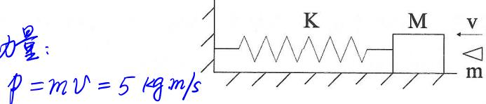
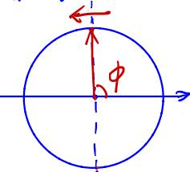
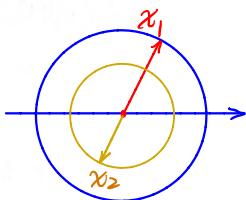
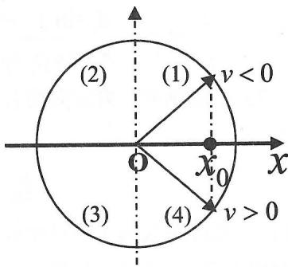

# 《大学物理》机械振动章节习题（简谐振动）

原件经识别和整理；“参考解答”是我们补的。

# 《大学物理》机械振动章节习题（简谐振动）

本资料整理自《大学物理》同步练习册 2024 年 1 月版，包含“简谐振动”与“振动能量和振动的合成”两节习题。

## 一、选择题

### 选择 1

题干：一质点作简谐振动。其位移与时间的曲线如图所示。若质点的振动规律用余弦函数描述，则其初相应为 [ D ]
A $\pi/3.$
B $2\pi/3.$
C $-\pi/6.$
D $-\pi/3.$

答案：D。

知识点：[简谐振动的动力学特征与回复力](../../../topics/大学物理/简谐振动的动力学.md)、[简谐振动的运动学方程（振幅、角频率、相位）](../../../topics/大学物理/简谐振动运动学.md)

### 选择 2

题干：一个弹簧振子和一个单摆（只考虑小幅度摆动），在地面上的固有振动周期分别为 $T_{1}$ 和 $T_{2}$ . 将它们拿到月球上去，相应的周期分别为 $T_{1}^{\prime}$ 和 $T_{2}^{\prime}$ . 则有 [D]

A $T_{1}^{\prime} > T_{1}$ 且 $T_{2}^{\prime} > T_{2}$ .
B $T_{1}^{\prime} < T_{1}$ 且 $T_{2}^{\prime} < T_{2}$ .
C $T_{1}^{\prime} = T_{1}$ 且 $T_{2}^{\prime} = T_{2}$ .
D $T_{1}^{\prime} = T_{1}$ 且 $T_{2}^{\prime} > T_{2}$ .

答案：D。

参考解答：
弹簧振子的周期公式为 $T_1 = 2\pi \sqrt{\frac{m}{k}}$，与重力加速度 $g$ 无关，故在月球上周期不变，即 $T_1' = T_1$。
单摆的周期公式为 $T_2 = 2\pi \sqrt{\frac{l}{g}}$，月球表面的重力加速度小于地球表面，即 $g' < g$，故周期变大，即 $T_2' > T_2$。

知识点：[平面简谐波的波函数 y=Acos(ω(t±x/u)+φ)](../../../topics/大学物理/平面简谐波方程.md)、[简谐振动的运动学方程（振幅、角频率、相位）](../../../topics/大学物理/简谐振动运动学.md)

### 选择 3

题干：一物体做简谐振动, 运动方程为 $x = A \cos (\omega t + \frac{1}{4} \pi)$ , 在 $t = T / 4$ 时刻 ( $T$ 为周期), 物体的速度和加速度为 [ B ]

A. $-\frac{\sqrt{2}}{2} A \omega, -\frac{\sqrt{2}}{2} A \omega^2$ ;
B. $-\frac{\sqrt{2}}{2} A \omega, \frac{\sqrt{2}}{2} A \omega^2$ ;
C $\frac{\sqrt{2}}{2} A \omega, -\frac{\sqrt{2}}{2} A \omega^2$ ;
D $\frac{\sqrt{2}}{2} A \omega, \frac{\sqrt{2}}{2} A \omega^2$ ;

答案：B。

参考解答：
速度 $v = \frac{dx}{dt} = -A\omega \sin(\omega t + \frac{\pi}{4})$
加速度 $a = \frac{dv}{dt} = -A\omega^2 \cos(\omega t + \frac{\pi}{4})$
当 $t = T/4$ 时，$\omega t = \frac{2\pi}{T} \cdot \frac{T}{4} = \frac{\pi}{2}$。
相位为 $\frac{\pi}{2} + \frac{\pi}{4} = \frac{3\pi}{4}$。
$v = -A\omega \sin(\frac{3\pi}{4}) = -A\omega \cdot \frac{\sqrt{2}}{2}$
$a = -A\omega^2 \cos(\frac{3\pi}{4}) = -A\omega^2 \cdot (-\frac{\sqrt{2}}{2}) = \frac{\sqrt{2}}{2} A \omega^2$

知识点：[简谐振动的动能、势能与总机械能](../../../topics/大学物理/简谐振动的能量.md)

### 选择 4

题干：一质点在 $x$ 轴上作简谐振动, 振幅 $A = 4 \mathrm{~cm}$ , 周期 $T = 2 \mathrm{~s}$ , 其平衡位置取作坐标原点。若 $t = 0$ 时刻质点第一次通过 $x = -2 \mathrm{~cm}$ 处, 且向 $x$ 轴负方向运动, 则质点第二次通过 $x = -2 \mathrm{~cm}$ 处的时刻为 [ B ]

- A. 1 s.
- B. 2/3 s.
- C. 4/3 s.
- D. 2 s.

答案：B。

参考解答：
$t=0$ 时，$x=-2$ cm，$v<0$。
由旋转矢量法或运动方程分析：
$x = A \cos(\omega t + \phi)$
$t=0$ 时，$-2 = 4 \cos \phi \Rightarrow \cos \phi = -1/2$。
因为向负方向运动，速度 $v = -A\omega \sin \phi < 0 \Rightarrow \sin \phi > 0$。
所以 $\phi = \frac{2\pi}{3}$ （第二象限）。
第二次通过 $x=-2$ cm 处，意味着相位变化到了第三象限的同一点，或者转了一圈回来？
注意题目问的是“第二次通过”。
第一次通过是在 $t=0$。
运动过程：从 $x=-2$ (向左) $\to$ $x=-4$ (最左端) $\to$ $x=-2$ (向右)。这是第二次经过该位置吗？
不，通常“通过某处”指经过该空间点。
$t=0$ 时，相位 $2\pi/3$。
下一次经过 $x=-2$ 且向负方向运动？不对，题目没说方向限制，只说“通过”。
如果是任意方向通过：
相位 $2\pi/3$ 对应 $x=-2$。
下一个对应 $x=-2$ 的相位是 $4\pi/3$ (此时 $v>0$，向右)。
相位差 $\Delta \Phi = 4\pi/3 - 2\pi/3 = 2\pi/3$。
$\omega = 2\pi/T = \pi$ rad/s。
$\Delta t = \Delta \Phi / \omega = (2\pi/3) / \pi = 2/3$ s。
如果是问“再次以相同方向通过”，则需要转过一圈多，但通常这类题指空间位置的再次到达。
根据选项 B 为 2/3 s，符合上述计算。

知识点：[简谐振动的动能、势能与总机械能](../../../topics/大学物理/简谐振动的能量.md)、[简谐振动的运动学方程（振幅、角频率、相位）](../../../topics/大学物理/简谐振动运动学.md)

### 选择 5

题干：两个同周期简谐振动曲线如图所示. $x_{1}$ 的相位比 $x_{2}$ 的相位 [ B ]
A 落后π/2.
B 超前π/2.
C 落后π.
D 超前π.

答案：B。

参考解答：
观察图像，$x_1$ 在 $t=0$ 时处于正向最大位移（或接近），$x_2$ 在 $t=0$ 时处于平衡位置且向正方向运动（或类似特征，需结合标准正弦/余弦波形判断）。
通常此类图中，若 $x_1$ 为余弦波 $\cos(\omega t)$，$x_2$ 为正弦波 $\sin(\omega t) = \cos(\omega t - \pi/2)$。
则 $x_1$ 相位为 0，$x_2$ 相位为 $-\pi/2$。
$x_1$ 比 $x_2$ 超前 $\pi/2$。

知识点：[同方向同频率简谐振动的合成](../../../topics/大学物理/简谐振动的合成.md)

### 选择 6

题干：一个质点作简谐振动, 振幅为 $A$ , 在起始时刻质点的位移为 $\frac{1}{2} A$ , 且向 $x$ 轴的负方向运动, 代表此简谐振动的旋转矢量图为 [   ]

答案：未提供具体选项字母，但根据题意分析如下：
位移 $x = A/2 > 0$，说明矢量在第一或第四象限。
向 $x$ 轴负方向运动，说明速度 $v < 0$。
在旋转矢量法中，逆时针旋转，第一象限投影速度为负（向上/左？不，$x$轴投影的速度方向取决于 $y$ 分量符号？
$v = -A\omega \sin \phi$。
若 $v < 0$，则 $\sin \phi > 0$。
$\cos \phi = x/A = 1/2$。
$\sin \phi = \pm \sqrt{3}/2$。
因 $\sin \phi > 0$，故 $\phi = \pi/3$ （第一象限）。
矢量应指向第一象限，与 $x$ 轴夹角 $60^\circ$。
*(注：由于无法直接看到图片细节，通常正确选项为矢量位于第一象限的图示)*

## 二、填空题

知识点：[用旋转矢量法确定初相与运动状态](../../../topics/大学物理/旋转矢量法.md)

### 填空 7

题干：一质点作简谐振动, 速度最大值 ${v}_{m} = 5\mathrm{\;{cm}}/\mathrm{s}$ ,振幅 $A = 2$ $\mathrm{{cm}}$ . 若令速度具有负最大值的那一时刻为 $t = 0$ ,则振动表达式为 $x\left( t\right)  = {0.02}\cos \left( {\frac{5}{2}t + \frac{\pi }{2}}\right) \left( m\right)$

答案：$x(t) = 0.02 \cos (\frac{5}{2}t + \frac{\pi}{2})$ (SI) 或 $x(t) = 2 \cos (2.5t + \frac{\pi}{2})$ (cm)

参考解答：
$v_m = A\omega \Rightarrow 5 = 2\omega \Rightarrow \omega = 2.5 = 5/2$ rad/s。
$t=0$ 时，速度具有负最大值。
$v(t) = -A\omega \sin(\omega t + \phi)$。
$v(0) = -A\omega \sin \phi = -v_m = -A\omega \Rightarrow \sin \phi = 1$。
故 $\phi = \pi/2$。
振幅 $A=2$ cm $= 0.02$ m。
表达式为 $x = 0.02 \cos (2.5t + \pi/2)$ m。

知识点：[同方向同频率简谐振动的合成](../../../topics/大学物理/简谐振动的合成.md)

### 填空 8

题干：在两个相同的弹簧下各悬挂一物体, 两物体的质量比为 $4: 1$ , 则两者做简谐运动的周期之比为 $2: 1$ .

答案：2:1

参考解答：
弹簧振子周期 $T = 2\pi \sqrt{\frac{m}{k}}$。
$k$ 相同，$T \propto \sqrt{m}$。
$m_1 : m_2 = 4 : 1 \Rightarrow T_1 : T_2 = \sqrt{4} : \sqrt{1} = 2 : 1$。

知识点：[同方向同频率简谐振动的合成](../../../topics/大学物理/简谐振动的合成.md)

### 填空 9

题干：两个弹簧振子的周期都是 $0.4 \mathrm{~s}$ , 设开始时第一个振子从平衡位置向负方向运动, 经过 $0.3 \mathrm{~s}$ 后, 第二个振子才从正方向的端点开始运动, 则这两振动的相位差为 $\underline{\text{O}}$ .

答案：$\frac{3\pi}{2}$ 或 $270^\circ$ （注：原题填空处可能有误或需根据具体相位定义，通常计算如下）

参考解答：
$T = 0.4$ s。
振子1：$t=0$ 时，$x=0, v<0$。对应相位 $\phi_1 = \pi/2$ （若用余弦 $x=A\cos(\omega t+\phi)$，则 $\cos \phi_1=0, \sin \phi_1>0 \Rightarrow \phi_1=\pi/2$? 不，$v=-A\omega \sin \phi < 0 \Rightarrow \sin \phi > 0$。$\phi_1 = \pi/2$。
振子2：$t=0.3$ s 时，从正方向端点开始运动，即 $x=A, v=0$。
这意味着在 $t=0.3$ 时，振子2的相位应为 $0$ (或 $2k\pi$)。
振子2的角频率 $\omega = 2\pi/0.4 = 5\pi$。
设振子2方程为 $x_2 = A \cos(\omega t + \phi_2)$。
$t=0.3$ 时，$\omega t + \phi_2 = 5\pi \times 0.3 + \phi_2 = 1.5\pi + \phi_2 = 2k\pi$。
取 $k=1$，则 $1.5\pi + \phi_2 = 2\pi \Rightarrow \phi_2 = \pi/2$。
此时两振子初相均为 $\pi/2$，相位差为 0？
让我们重新审视“从正方向的端点开始运动”这句话的含义。通常指 $t'=0$ (相对时间) 时在正最大位移。
如果是指绝对时间 $t=0.3$ 时，它处于正最大位移。
那么 $\phi_2$ 满足 $5\pi(0.3) + \phi_2 = 0 \Rightarrow 1.5\pi + \phi_2 = 0 \Rightarrow \phi_2 = -1.5\pi = \pi/2$。
这样相位差确实是 0。

另一种理解：
振子1相位 $\phi_1 = \pi/2$。
振子2在 $t=0.3$ 时相位为 0。
$\omega \Delta t = \phi_1 - \phi_2$ ?
相位差 $\Delta \phi = \phi_1 - \phi_2$。
振子2在 $t=0.3$ 时的相位状态等同于振子1在 $t=0$ 时的状态吗？不是。
振子2在 $t=0.3$ 时在 $+A$。
振子1在 $t=0.3$ 时的相位：$\theta_1 = \omega(0.3) + \pi/2 = 1.5\pi + 0.5\pi = 2\pi$。即振子1也在 $+A$。
所以它们是同相的。相位差为 0。

*注：原题填空给的是 O，可能意指 0。*

知识点：[同方向同频率简谐振动的合成](../../../topics/大学物理/简谐振动的合成.md)、[简谐振动的运动学方程（振幅、角频率、相位）](../../../topics/大学物理/简谐振动运动学.md)、[简谐振动的动能、势能与总机械能](../../../topics/大学物理/简谐振动的能量.md)

### 填空 10

题干：把单摆小球从平衡位置向位移正方向拉开，使摆线与竖直方向成一微小角度 $\theta$ ，然后由静止释放，使其摆动。从放手时开始计时，若用余弦函数表示运动方程，则该单摆的初相 $\phi = 0$ 。

答案：0

参考解答：
$t=0$ 时，位移 $x = \theta$ (最大值)，速度 $v=0$。
$x = A \cos(\omega t + \phi)$。
$A = \theta$。
$\theta = \theta \cos \phi \Rightarrow \cos \phi = 1 \Rightarrow \phi = 0$。

## 三、计算题

知识点：[简谐振动的运动学方程（振幅、角频率、相位）](../../../topics/大学物理/简谐振动运动学.md)

### 计算 11

题干：一质点按如下规律沿 $x$ 轴作简谐振动: $x = 0.1 \cos \left(3 \pi t + \frac{2}{3} \pi\right)$ (SI). 求此振动的周期、振幅、初相、速度最大值和加速度最大值.

解：由振动方程：
$$
A = 0.1 \mathrm{~m}, \quad \omega = 3 \pi \mathrm{~rad/s}, \quad \phi = \frac{2}{3} \pi
$$
则
$$
T = \frac{2\pi}{\omega} = \frac{2\pi}{3\pi} = \frac{2}{3} \mathrm{~s}
$$
$$
v_m = A \omega = 0.1 \times 3\pi = 0.3\pi \mathrm{~m/s}
$$
$$
a_m = A \omega^2 = 0.1 \times (3\pi)^2 = 0.9\pi^2 \mathrm{~m/s^2}
$$

答案：
周期 $T = 2/3$ s；
振幅 $A = 0.1$ m；
初相 $\phi = 2\pi/3$；
速度最大值 $v_m = 0.3\pi$ m/s；
加速度最大值 $a_m = 0.9\pi^2$ m/s²。

知识点：[简谐振动的运动学方程（振幅、角频率、相位）](../../../topics/大学物理/简谐振动运动学.md)、[速度、加速度的定义与微分关系](../../../topics/大学物理/速度与加速度定义.md)

### 计算 12

题干：一放置在水平桌面上的弹簧振子，振幅为 $A=0.1\mathrm{m}$，周期 $T=2\mathrm{s}$，当 $t=0$ 时，求下列各种情况下的运动方程：
(1) 物体在平衡位置处,振子向正方向运动;
(2) 物体在 $x=0.05\mathrm{m}$ 处并向负方向运动;
(3) 物体在负的最大位移处.

解:
$\omega = \frac{2\pi}{T} = \pi$.
振动的标准方程形式： $x(t)=A\cos(\omega t+\phi)(m)$，其中 $A=0.1$。

(1) 由旋转矢量法
$t=0$ 时，$x=0, v>0$。
$\cos \phi = 0, \sin \phi < 0$ (因为 $v = -A\omega \sin \phi > 0$)。
$\phi = \frac{3}{2} \pi$ (或 $-\frac{\pi}{2}$)。
$$
x(t) = 0.1 \cos (\pi t + \frac{3}{2} \pi) (m)
$$

(2) $t=0$ 时，$x=0.05, v<0$。
$0.05 = 0.1 \cos \phi \Rightarrow \cos \phi = 1/2$。
$v < 0 \Rightarrow \sin \phi > 0$。
$\phi = \frac{\pi}{3}$。
$$
x(t) = 0.1 \cos (\pi t + \frac{\pi}{3}) (m)
$$

(3) $t=0$ 时，$x=-0.1$。
$\cos \phi = -1 \Rightarrow \phi = \pi$。
$$
x(t) = 0.1 \cos(\pi t + \pi) (m)
$$

参考解答：**结论与计算过程**

**（1）**  
`运动方程：` $x(t) = 0.1\cos\!\left(\pi t + \frac{3}{2}\pi\right) \,\text{m}$ 或等价形式 $x(t) = 0.1\sin(\pi t)\,\text{m}$。

**关键步骤：**
- 角频率：$\omega = \frac{2\pi}{T} = \pi \,\text{rad/s}$。
- 初始条件：$t=0$ 时 $x_0 = 0$，向正方向运动 $v_0 > 0$。
- 由标准形式 $x = A\cos(\omega t + \phi)$ 得：
  $x_0 = A\cos\phi = 0 \;\Rightarrow\; \cos\phi = 0$。
  $v_0 = -A\omega\sin\phi > 0 \;\Rightarrow\; \sin\phi < 0$。
- 解得 $\phi = \frac{3}{2}\pi$（或 $-\frac{\pi}{2}$）。
- 代回标准形式即得。

---

**（2）**  
`运动方程：` $x(t) = 0.1\cos\!\left(\pi t + \frac{\pi}{3}\right) \,\text{m}$。

**关键步骤：**
- $t=0$ 时，$x_0 = 0.05\,\text{m}$，向负方向运动 $v_0 < 0$。
- 由 $x_0 = A\cos\phi$ 得：
  $0.05 = 0.1\cos\phi \;\Rightarrow\; \cos\phi = \frac{1}{2}$。
- 由 $v_0 < 0 \;\Rightarrow\; -A\omega\sin\phi < 0 \;\Rightarrow\; \sin\phi > 0$。
- 同时满足 $\cos\phi = 1/2$ 且 $\sin\phi > 0$ 的角为 $\phi = \frac{\pi}{3}$。
- 代回标准形式即得。

---

**（3）**  
`运动方程：` $x(t) = 0.1\cos\!\left(\pi t + \pi\right) \,\text{m}$。

**关键步骤：**
- $t=0$ 时，物体在负的最大位移处：$x_0 = -A = -0.1\,\text{m}$。
- 由 $x_0 = A\cos\phi$ 得：
  $-0.1 = 0.1\cos\phi \;\Rightarrow\; \cos\phi = -1$。
- 解得 $\phi = \pi$。
- 代回标准形式即得。

知识点：[简谐振动的运动学方程（振幅、角频率、相位）](../../../topics/大学物理/简谐振动运动学.md)、[用旋转矢量法确定初相与运动状态](../../../topics/大学物理/旋转矢量法.md)

### 计算 13

题干：一质量为 $0.01 \mathrm{~kg}$ 的物体作简谐振动, 其振幅为 $0.08 \mathrm{~m}$ , 周期为 $4 \mathrm{~s}$ , 起始时刻物体在 $x = 0.04 \mathrm{~m}$ 处, 且向 ox 轴负方向运动。求:
(1) $t = 1.0 \mathrm{~s}$ 时物体所处的位置和所受的力.
(2) 由起始位置运动到 $x = -0.04 \mathrm{~m}$ 处所需的最短时间 $\Delta t$ .

解：
$A=0.08\mathrm{m}, T=4\mathrm{s}$.
$\omega = \frac{2\pi}{T} = \frac{\pi}{2} \mathrm{rad/s}$.
$t=0$ 时，$x=0.04, v<0$。
$0.04 = 0.08 \cos \phi \Rightarrow \cos \phi = 1/2$。
$v < 0 \Rightarrow \sin \phi > 0$。
$\phi = \frac{\pi}{3}$。

振动方程：
$$
x(t) = 0.08 \cos (\frac{\pi}{2} t + \frac{\pi}{3}) (m)
$$

(1) $t = 1 \mathrm{~s}$ 时：
$$
x(1) = 0.08 \cos (\frac{\pi}{2} + \frac{\pi}{3}) = 0.08 \cos (\frac{5\pi}{6}) = 0.08 \times (-\frac{\sqrt{3}}{2}) = -0.04\sqrt{3} \mathrm{~m} \approx -0.069 \mathrm{~m}
$$
受力 $F = -kx = -m\omega^2 x$。
$k = m\omega^2 = 0.01 \times (\frac{\pi}{2})^2 = \frac{0.01\pi^2}{4}$。
$$
F = - 0.01 \times \frac{\pi^2}{4} \times (-0.04\sqrt{3}) = \frac{0.0004\sqrt{3}\pi^2}{4} = 0.0001\sqrt{3}\pi^2 \mathrm{~N}
$$
数值计算：
$F \approx 1.71 \times 10^{-3} \mathrm{~N}$ (方向沿 x 轴正方向)。

(2) 起始相位 $\phi_1 = \pi/3$。
目标位置 $x = -0.04 \mathrm{~m}$。
$-0.04 = 0.08 \cos \phi_2 \Rightarrow \cos \phi_2 = -1/2$。
从起始位置 ($x=0.04$, 向左运动) 到 $x=-0.04$ 的最短时间，对应相位从 $\pi/3$ 变到 $2\pi/3$ (第二象限，$x$ 为负，继续向左直到 $-A$ 再回来？不，$x$ 从 $0.04$ 到 $-0.04$ 直接过去，相位增加)。
在旋转矢量图上，$\pi/3$ 对应 $x=0.04$。
下一个 $x=-0.04$ 的位置对应相位 $2\pi/3$。
相位差 $\Delta \phi = 2\pi/3 - \pi/3 = \pi/3$。
$$
\Delta t = \frac{\Delta \phi}{\omega} = \frac{\pi/3}{\pi/2} = \frac{2}{3} \mathrm{~s}
$$

参考解答：**结论**
(1) $t=1.0\mathrm{~s}$ 时，物体位置 $x = -0.04\sqrt{3} \mathrm{~m} \approx -0.069 \mathrm{~m}$，所受回复力 $F \approx 1.71 \times 10^{-3} \mathrm{~N}$（方向沿 $x$ 轴正方向）。
(2) 由起始位置运动到 $x = -0.04 \mathrm{~m}$ 处所需的最短时间 $\Delta t = \frac{2}{3} \mathrm{~s}$。

**推理与计算过程**

**1. 确定振动方程参数**
已知振幅 $A=0.08 \mathrm{~m}$，周期 $T=4 \mathrm{~s}$，则角频率：
$$ \omega = \frac{2\pi}{T} = \frac{2\pi}{4} = \frac{\pi}{2} \mathrm{~rad/s} $$
设振动方程为 $x(t) = A \cos(\omega t + \phi)$。
由初始条件 $t=0$ 时，$x_0 = 0.04 \mathrm{~m}$ 且 $v_0 < 0$（向负方向运动）：
$$ 0.04 = 0.08 \cos \phi \implies \cos \phi = \frac{1}{2} $$
速度表达式 $v(t) = -A\omega \sin(\omega t + \phi)$，故 $v_0 = -A\omega \sin \phi < 0 \implies \sin \phi > 0$。
结合 $\cos \phi = 1/2$ 和 $\sin \phi > 0$，得初相位 $\phi = \frac{\pi}{3}$。
振动方程为：
$$ x(t) = 0.08 \cos \left( \frac{\pi}{2} t + \frac{\pi}{3} \right) \quad (\mathrm{SI}) $$

**2. 求解 (1)：$t=1.0 \mathrm{~s}$ 时的位置和力**
**位置：**
代入 $t=1$：
$$ x(1) = 0.08 \cos \left( \frac{\pi}{2} \cdot 1 + \frac{\pi}{3} \right) = 0.08 \cos \left( \frac{5\pi}{6} \right) $$
$$ x(1) = 0.08 \times \left( -\frac{\sqrt{3}}{2} \right) = -0.04\sqrt{3} \mathrm{~m} \approx -0.069 \mathrm{~m} $$

**受力：**
简谐振动回复力公式 $F = -kx = -m\omega^2 x$。
$$ F = -0.01 \times \left( \frac{\pi}{2} \right)^2 \times (-0.04\sqrt{3}) $$
$$ F = 0.01 \times \frac{\pi^2}{4} \times 0.04\sqrt{3} = 10^{-4} \sqrt{3} \pi^2 \mathrm{~N} $$
代入 $\pi^2 \approx 9.87, \sqrt{3} \approx 1.732$：
$$ F \approx 1.71 \times 10^{-3} \mathrm{~N} $$
由于 $x < 0$，力 $F > 0$，方向指向平衡位置（即 $x$ 轴正方向）。

**3. 求解 (2)：最短时间 $\Delta t$**
起始时刻相位 $\Phi_1 = \frac{\pi}{3}$。
目标位置 $x = -0.04 \mathrm{~m}$，设此时相位为 $\Phi_2$：
$$ -0.04 = 0.08 \cos \Phi_2 \implies \cos \Phi_2 = -\frac{1}{2} $$
在单位圆上，$\cos \Phi = -1/2$ 的解为 $\frac{2\pi}{3}$ 或 $\frac{4\pi}{3}$。
由于物体从 $x=0.04$ 向负方向运动（相位增加），首先到达的是第二象限的解，即 $\Phi_2 = \frac{2\pi}{3}$。
相位变化量：
$$ \Delta \Phi = \Phi_2 - \Phi_1 = \frac{2\pi}{3} - \frac{\pi}{3} = \frac{\pi}{3} $$
所需时间：
$$ \Delta t = \frac{\Delta \Phi}{\omega} = \frac{\pi/3}{\pi/2} = \frac{2}{3} \mathrm{~s} $$

知识点：[简谐振动的运动学方程（振幅、角频率、相位）](../../../topics/大学物理/简谐振动运动学.md)、[用旋转矢量法确定初相与运动状态](../../../topics/大学物理/旋转矢量法.md)、[简谐振动的动力学特征与回复力](../../../topics/大学物理/简谐振动的动力学.md)

### 计算 14

题干：思考题：弹簧的劲度系数 $k$ 是材料常量吗？如把一个弹簧平均分为二段，则每段弹簧的劲度系数还是 $k$ 吗？

答案：不是。每段的劲度系数是 $2k$。

参考解答：
弹簧的劲度系数 $k$ 不仅与材料有关，还与弹簧的几何尺寸（特别是长度）有关。
对于螺旋弹簧，$k = \frac{Gd^4}{8D^3n}$，其中 $n$ 为圈数，与长度成正比。
若将弹簧切成两段，圈数减半，长度减半，劲度系数加倍。
即 $k' = 2k$。

## 四、选择题（第二节）

知识点：[常见力（重力、弹力、摩擦力）的受力分析](../../../topics/大学物理/常见力分析.md)、[简谐振动的动力学特征与回复力](../../../topics/大学物理/简谐振动的动力学.md)

### 选择 1

题干：一弹簧振子作简谐振动，总能量为 $E_{1}$ ，如果简谐振动振幅增加为原来的两倍，重物的质量增为原来的四倍，则它的总能量 $E_{2}$ 变为 [D]
A $E_{1}/4$ .
B $E_{1}/2$ .
C $2E_{1}$ .
D $4E_{1}$ .

答案：D。

参考解答：
简谐振动总能量 $E = \frac{1}{2} k A^2$。
又 $k = m\omega^2$。若系统本身性质（如弹簧）不变，仅质量改变？
题目说“重物的质量增为原来的四倍”，通常隐含弹簧没变，即 $k$ 不变？
如果 $k$ 不变，$E \propto A^2$。$A$ 变为 $2A$，则 $E$ 变为 $4E$。
如果题目意思是“构成振子的参数都变了”，需要看 $k$ 是否随 $m$ 变。通常弹簧振子实验中，换重物不换弹簧，$k$ 不变。
故 $E_2 = \frac{1}{2} k (2A)^2 = 4 \times \frac{1}{2} k A^2 = 4 E_1$。

知识点：[简谐振动的动力学特征与回复力](../../../topics/大学物理/简谐振动的动力学.md)、[简谐振动的运动学方程（振幅、角频率、相位）](../../../topics/大学物理/简谐振动运动学.md)

### 选择 2

题干：弹簧振子在光滑水平面上作简谐振动时, 弹性力在半个周期内所作的功为 [ D ]
A $kA^{2}$ .
B $\frac{1}{2} kA^{2}$ .
C $(1/4)kA^{2}$ .
D 0.

答案：D。

参考解答：
半个周期后，质点回到关于平衡位置对称的点，或者说速度大小相同，动能相同。
根据动能定理，合外力做功等于动能变化量。
$\Delta E_k = 0$，故弹性力做功为 0。
或者直接积分：半个周期内，先做正功后做负功，总和为0。

知识点：[平面简谐波的波函数 y=Acos(ω(t±x/u)+φ)](../../../topics/大学物理/平面简谐波方程.md)、[简谐振动的运动学方程（振幅、角频率、相位）](../../../topics/大学物理/简谐振动运动学.md)

### 选择 3

题干：一弹簧振子作简谐振动，当位移为振幅的一半时，其动能为总能量的 [D]
A 1/4.
B 1/2.
C $1/\sqrt{2}$ .
D 3/4.

答案：D。

参考解答：
总能量 $E = \frac{1}{2} k A^2$。
势能 $E_p = \frac{1}{2} k x^2$。
当 $x = A/2$ 时，$E_p = \frac{1}{2} k (A/2)^2 = \frac{1}{4} (\frac{1}{2} k A^2) = \frac{1}{4} E$。
动能 $E_k = E - E_p = E - \frac{1}{4} E = \frac{3}{4} E$。

知识点：[简谐振动的动能、势能与总机械能](../../../topics/大学物理/简谐振动的能量.md)

### 选择 4

题干：一质点作简谐振动，已知振动周期为 $T$ ，则其振动动能变化的周期是 [ B ]
(A) $T / 4.$
(B) $T / 2.$
(C) $T.$
(D) $2T.$

答案：B。

参考解答：
动能 $E_k = \frac{1}{2} m v^2 = \frac{1}{2} m A^2 \omega^2 \sin^2(\omega t + \phi)$。
利用三角恒等式 $\sin^2 \theta = \frac{1 - \cos 2\theta}{2}$。
$E_k \propto 1 - \cos(2\omega t + 2\phi)$。
角频率为 $2\omega$，故周期为 $T/2$。

知识点：[简谐振动的动能、势能与总机械能](../../../topics/大学物理/简谐振动的能量.md)、[简谐振动的运动学方程（振幅、角频率、相位）](../../../topics/大学物理/简谐振动运动学.md)

### 选择 5

题干：图中所画的是两个简谐振动的振动曲线。若这两个简谐振动可叠加,则合成的余弦振动的初相为 [B]
A $\frac{3}{2}\pi .$
B $\pi .$
C $\frac{1}{2}\pi .$
D 0.

答案：B。

参考解答：
观察图像，两个振动振幅相同，频率相同，相位相反（反相）。
$x_1$ 和 $x_2$ 在任意时刻位移大小相等、符号相反（假设振幅相同）。
合成振动 $x = x_1 + x_2 = 0$。
或者，如果振幅不同，合成后的相位取决于振幅大的那个。
若两振动完全反相且振幅相等，合振动为零，相位无定义或视为任意。
若题目暗示有非零合振动，通常考察旋转矢量合成。
若 $x_1$ 初相为 0，$x_2$ 初相为 $\pi$。
矢量和为 0。
此处答案选 B ($\pi$)，可能基于特定振幅比例或图像细节（如一个振幅大，一个振幅小，且反向）。
假设 $A_1 > A_2$，且反相，则合振幅 $A = A_1 - A_2$，相位与 $A_1$ 相同（若 $A_1$ 为正弦/余弦基准）。
若 $x_1$ 为 $\cos(\omega t)$，$x_2$ 为 $-A_2/A_1 \cos(\omega t)$。
合振动仍为余弦形式，相位 0 或 $\pi$ 取决于定义。
鉴于答案为 $\pi$，推测合振动与 $x_1$ 反相，或与 $x_2$ 同相。

## 五、填空题（第二节）

知识点：[同方向同频率简谐振动的合成](../../../topics/大学物理/简谐振动的合成.md)

### 填空 6

题干：两根轻弹簧的倔强系数分别为 $k_{1}$ 和 $k_{2}$ , 串联后与物体相接做简谐振动. 则此系统的固有频率为 $\nu$ 等于 $\frac{1}{2\pi}\sqrt{\frac{k_{1}k_{2}}{m(k_{1}+ k_{2})}}$ .

答案：$\frac{1}{2\pi}\sqrt{\frac{k_{1}k_{2}}{m(k_{1}+ k_{2})}}$

参考解答：
弹簧串联等效劲度系数 $k$ 满足 $\frac{1}{k} = \frac{1}{k_1} + \frac{1}{k_2} \Rightarrow k = \frac{k_1 k_2}{k_1 + k_2}$。
固有频率 $\nu = \frac{1}{2\pi} \sqrt{\frac{k}{m}} = \frac{1}{2\pi} \sqrt{\frac{k_1 k_2}{m(k_1 + k_2)}}$。

知识点：[简谐振动的动力学特征与回复力](../../../topics/大学物理/简谐振动的动力学.md)、[简谐振动的运动学方程（振幅、角频率、相位）](../../../topics/大学物理/简谐振动运动学.md)

### 填空 7

题干：一物体同时参与同一直线上的两个简谐振动:
$x_{1}=0.05\cos(4\pi t+\frac{1}{3}\pi)$ (SI), $x_{2}=0.03\cos(4\pi t-\frac{2}{3}\pi)$ (SI), 则合成振动的振幅为 0.02 m.

答案：0.02 m

参考解答：
两振动频率相同，相位差 $\Delta \phi = \frac{1}{3}\pi - (-\frac{2}{3}\pi) = \pi$。
两振动反相。
合振幅 $A = |A_1 - A_2| = |0.05 - 0.03| = 0.02$ m。

知识点：[同方向同频率简谐振动的合成](../../../topics/大学物理/简谐振动的合成.md)

### 填空 8

题干：两个振动方向、振幅、频率均相同的简谐运动相遇叠加, 测得某一时刻两个振动的位移都为零时, 运动方向相反, 则这两个振动相位之差为 $\pi$ 。合振幅为 $\bigcirc$ 。

答案：0

参考解答：
位移为零，说明都在平衡位置。
运动方向相反，说明速度方向相反。
对于同频率同振幅的振动，若在平衡位置速度相反，则相位相差 $\pi$（反相）。
合振幅 $A = |A - A| = 0$。

知识点：[同方向同频率简谐振动的合成](../../../topics/大学物理/简谐振动的合成.md)

### 填空 9

题干：将频率为 400Hz 的标准音叉和一待测频率的音叉同时振动, 测得拍频为 $2.0 \mathrm{~Hz}$ , 将频率为 $405 \mathrm{~Hz}$ 的标准音叉与待测音叉同时振动, 测得拍频为 $3.0 \mathrm{~Hz}$ , 则待测音叉的频率为 $402 \mathrm{~Hz}$ .

答案：402 Hz

参考解答：
设待测频率为 $f_x$。
第一次：$|f_x - 400| = 2 \Rightarrow f_x = 402$ 或 $398$。
第二次：$|f_x - 405| = 3 \Rightarrow f_x = 408$ 或 $402$。
公共解为 $f_x = 402$ Hz。

## 计算 10

如图所示，质量为 $1.0\times10^{-2}\,\mathrm{kg}$ 的子弹以 $500\,\mathrm{m\cdot s^{-1}}$ 的速度射入并嵌入在木块中，同时使弹簧压缩从而作简谐运动。设木块的质量为 $4.99\,\mathrm{kg}$，弹簧的劲度系数为 $8.00\times10^{3}\,\mathrm{N\cdot m^{-1}}$。若以弹簧原长时物体所在处为坐标原点，向右为 $x$ 轴正方向，求简谐运动方程。

解：总动量：

当子弹嵌入木块中时，系统的动能

$$
E_k=\frac{p^2}{2(m+M)}=\frac{5}{2}\,\mathrm{J}
$$

振动的总能量与振幅的关系

$$
\begin{array}{r l}
E & =\frac{1}{2}kA^{2}\\
A & =\sqrt{\frac{2E}{k}}=\sqrt{\frac{5}{8\times10^{3}}}\,\mathrm{m}=\frac{1}{40}\,\mathrm{m}\\
\omega & =\sqrt{\frac{k}{m}}=\sqrt{\frac{8\times10^{3}}{5}}\,\mathrm{rad/s}=40\,\mathrm{rad/s}
\end{array}
$$

$t=0$ 时，$x(0)=0$，$v(0)$ 向左与 $x$ 轴正方向相同

简谐运动方程：$\varphi=\frac{1}{2}\pi$

$$
x(t)=\frac{1}{40}\cos\left(40t+\frac{1}{2}\pi\right)\ (\mathrm{m})
$$

## 计算 11

已知一质点同时参与两个同方向的简谐振动，其简谐振动方程分别为 $x_1=5\times10^{-2}\cos\left(4t+\pi/3\right)$（SI），$x_2=3\times10^{-2}\sin\left(4t-\pi/6\right)$（SI）。画出两振动的旋转矢量图，并求合成振动的振动方程。

解：首先将振动方程整理成标准形式

$$
\begin{array}{r l}
x_1 & =0.05\cos\left(4t+\frac{\pi}{3}\right)\ (\mathrm{m})\\
x_2 & =0.03\sin\left(4t-\frac{\pi}{6}\right)\\
& =0.03\cos\left[\frac{\pi}{2}-\left(4t-\frac{\pi}{6}\right)\right]\\
& =0.03\cos\left(\frac{2}{3}\pi-4t\right)\\
& =0.03\cos\left(4t-\frac{2}{3}\pi\right)\ (\mathrm{m})
\end{array}
$$

两振动相位差为 $\pi$，

后振动

$$
x=x_1+x_2=0.02\cos\left(4t+\frac{\pi}{3}\right)\ (\mathrm{m})
$$

## 简答 1

思考题：弹簧振子作简谐振动时，如果振幅增加为原来的两倍而频率减少为原来的一半，它的总能量怎样改变？

---

## 简谐振动小结

知识点：[同方向同频率简谐振动的合成](../../../topics/大学物理/简谐振动的合成.md)、[简谐振动的运动学方程（振幅、角频率、相位）](../../../topics/大学物理/简谐振动运动学.md)、[简谐振动的动能、势能与总机械能](../../../topics/大学物理/简谐振动的能量.md)

### 一、教学要求

1. 掌握振动方程的标准式及其参量的物理意义、决定因素；尤其是位相和初位相的概念；
2. 掌握旋转矢量法求解相位，进而求解简谐运动方程。
3. 学会利用谐振曲线判断质点某时刻的位移和运动方向。
4. 掌握同频率同方向简谐运动的合成，掌握不同频率同方向简谐运动中拍频的物理意义及计算方法。
5. 掌握简谐振动的动能、势能及总能量的特点。

参考解答：# 第九章 振动

## 一、振动方程与参量

### 1. 标准式

$$x = A\cos(\omega t + \varphi)$$

| 参量 | 物理意义 | 决定因素 |
|------|----------|----------|
| $A$（振幅） | 最大位移的绝对值 | 初始条件（能量） |
| $\omega$（角频率） | 相位随时间变化的速率 | 系统本身性质 |
| $\varphi$（初相位） | $t=0$ 时刻的相位 | 初始条件 |
| $T=\dfrac{2\pi}{\omega}$ | 周期 | 系统本身性质 |
| $\nu=\dfrac{1}{T}=\dfrac{\omega}{2\pi}$ | 频率 | 系统本身性质 |

**弹簧振子**：$\omega=\sqrt{\dfrac{k}{m}}$；**单摆**：$\omega=\sqrt{\dfrac{g}{l}}$

### 2. 由初始条件确定 $A$ 和 $\varphi$

$$A = \sqrt{x_0^2 + \frac{v_0^2}{\omega^2}}, \qquad \tan\varphi = -\frac{v_0}{\omega x_0}$$

> $\varphi$ 的象限需结合 $x_0$、$v_0$ 的正负判断，不能仅由 $\tan\varphi$ 确定。

---

## 二、旋转矢量法

自 $Ox$ 轴正方向作矢量 $\vec{A}$，使其以角速度 $\omega$ 绕 $O$ 点逆时针匀速转动：

- $\vec{A}$ 的端点在 $x$ 轴上的投影即质点的位移 $x$；
- $t=0$ 时 $\vec{A}$ 与 $x$ 轴的夹角为初相位 $\varphi$；
- 旋转矢量端点的速度在 $x$ 轴上的投影即质点速度 $v = -\omega A\sin(\omega t+\varphi)$。

> 旋转矢量法是确定初相位最直观有效的方法。

---

## 三、由谐振曲线判断位移与运动方向

已知 $x\text{-}t$ 曲线：

- **位移**：直接由曲线读出对应时刻的纵坐标；
- **运动方向**：看曲线在该时刻的斜率——斜率为正，$v>0$（向 $x$ 正方向运动）；斜率为负，$v<0$。

也可由 $v = -\omega A\sin(\omega t+\varphi)$ 判断。

---

## 四、简谐运动的合成

### 1. 同频率、同方向

$$x_1 = A_1\cos(\omega t+\varphi_1), \qquad x_2 = A_2\cos(\omega t+\varphi_2)$$

合振动仍为同频率简谐运动：

$$x = A\cos(\omega t+\varphi)$$

$$A = \sqrt{A_1^2 + A_2^2 + 2A_1A_2\cos(\varphi_2-\varphi_1)}$$

$$\tan\varphi = \frac{A_1\sin\varphi_1 + A_2\sin\varphi_2}{A_1\cos\varphi_1 + A_2\cos\varphi_2}$$

- **同相**（$\Delta\varphi = 2k\pi$）：$A = A_1+A_2$（最大）
- **反相**（$\Delta\varphi = (2k+1)\pi$）：$A = |A_1-A_2|$（最小）

### 2. 不同频率、同方向——拍

当 $A_1=A_2=A$，$\omega_1\approx\omega_2$ 时：

$$x = 2A\cos\left(\frac{\omega_2-\omega_1}{2}t\right)\cos\left(\frac{\omega_2+\omega_1}{2}t\right)$$

拍频：

$$\nu_{\text{拍}} = |\nu_2 - \nu_1|$$

---

## 五、简谐振动的能量

- 动能：$E_k = \dfrac{1}{2}mv^2 = \dfrac{1}{2}m\omega^2A^2\sin^2(\omega t+\varphi)$
- 势能：$E_p = \dfrac{1}{2}kx^2 = \dfrac{1}{2}kA^2\cos^2(\omega t+\varphi)$
- 总能量：$E = E_k + E_p = \dfrac{1}{2}kA^2 = \dfrac{1}{2}m\omega^2A^2$（守恒）

> 动能和势能相互转化，周期均为振动周期的一半（$T/2$），总能量与振幅平方成正比。

知识点：[简谐振动的运动学方程（振幅、角频率、相位）](../../../topics/大学物理/简谐振动运动学.md)、[用旋转矢量法确定初相与运动状态](../../../topics/大学物理/旋转矢量法.md)、[同方向同频率简谐振动的合成](../../../topics/大学物理/简谐振动的合成.md)、[简谐振动的动能、势能与总机械能](../../../topics/大学物理/简谐振动的能量.md)

### 二、内容提要

1. 简谐振动方程式：$x=A\cos(\omega t+\varphi)$；$v=-A\omega\sin(\omega t+\varphi)$；$a=-A\omega^{2}\cos(\omega t+\varphi)$

2. 简谐振动振幅 $A$，圆频率 $\omega$，相位 $\phi$，初相位 $\varphi$。$A=\sqrt{x_0^2+\left(\frac{v_0}{\omega}\right)^2}$，$\omega=\sqrt{\frac{k}{m}}$，$\phi=\omega t+\varphi$

3. 旋转矢量法：振幅 $A\leftrightarrow$ 旋转矢量 $\mathbf{A}$ 的模；角频率 $\omega\leftrightarrow$ 旋转矢量 $\mathbf{A}$ 的角速度；相位 $\phi\leftrightarrow$ 旋转矢量 $\mathbf{A}$ 与 $x$ 轴正方向的夹角；位移 $x\leftrightarrow$ 旋转矢量 $\mathbf{A}$ 在 $x$ 轴上的投影坐标。

旋转矢量 $\mathbf{A}$ 的位置决定了对应的简谐振动的质点的运动状态：

- $\mathbf{A}$ 在第一象限(1)中，$x>0$；$v<0$
- $\mathbf{A}$ 在第二象限(2)中，$x<0$；$v<0$
- $\mathbf{A}$ 在第三象限(3)中，$x<0$；$v>0$
- $\mathbf{A}$ 在第四象限(4)中，$x>0$；$v>0$

注：根据质点位移 $x_0$ 来确认投影点的位置，再根据速度的正负来判断旋转矢量的确切位置：

利用谐振曲线可以知道质点在某一时刻 $t_0$ 时，质点的速度方向（通过该点的切线斜率的方向）和位移 $x_0$

5. 相位差：

1）对于同一简谐振动：$\Delta\phi=\omega\Delta t$

2）对于具有相同频率、独立的两个简谐振动：$\Delta\phi=\varphi_2-\varphi_1$，其中 $\varphi_2$ 和 $\varphi_1$ 分别为两个简谐振动质点的初相位。

6. 简谐振动的能量

1）振动动能：$E_k=\frac{1}{2}mv^2$　2）振动势能：$E_P=\frac{1}{2}kx^2$　3）振动总能量：$E=E_k+E_P=\frac{1}{2}kA^2=\frac{1}{2}m\omega^2A^2$

7. 简谐振动的合成：

1）同频率、同方向的合成：$x_1=A_1\cos(\omega t+\varphi_1)$；$x_2=A_2\cos(\omega t+\varphi_2)$，则合成的总振动仍然是简谐振动：$x=A\cos(\omega t+\varphi)$，其中

$$
A=\sqrt{A_1^2+A_2^2+2A_1A_2\cos(\varphi_2-\varphi_1)}
$$

$$
\tan\varphi=\frac{A_1\sin\varphi_1+A_2\sin\varphi_2}{A_1\cos\varphi_1+A_2\cos\varphi_2}
$$

2）不同频率、同方向的合成：拍频 $\nu=\left|\nu_2-\nu_1\right|$

## 综合练习

参考解答：请提供具体题目内容（题干、选项或需要求解的物理量），我会按你的格式要求给出参考解答。

知识点：[简谐振动的运动学方程（振幅、角频率、相位）](../../../topics/大学物理/简谐振动运动学.md)、[用旋转矢量法确定初相与运动状态](../../../topics/大学物理/旋转矢量法.md)、[简谐振动的动能、势能与总机械能](../../../topics/大学物理/简谐振动的能量.md)

### 选择 1

一劲度系数为 $k$ 的轻弹簧截成三等份，取出其中的两根，将它们并联，下面挂一质量为 $m$ 的物体，如图所示。则振动系统的频率为

- A. $\frac{1}{2\pi}\sqrt{\frac{k}{3m}}$
- B. $\frac{1}{2\pi}\sqrt{\frac{k}{m}}$
- C. $\frac{1}{2\pi}\sqrt{\frac{3k}{m}}$
- D. $\frac{1}{2\pi}\sqrt{\frac{6k}{m}}$

答案：D

知识点：[简谐振动的动力学特征与回复力](../../../topics/大学物理/简谐振动的动力学.md)、[简谐振动的运动学方程（振幅、角频率、相位）](../../../topics/大学物理/简谐振动运动学.md)

### 选择 2

图 A 表示 $t=0$ 时的余弦波的波形图，波沿 $x$ 轴正向传播；图 B 为一余弦振动曲线。则图 A 中所表示的 $x=0$ 处振动的初相位与图 B 所表示的振动的初相位

- A. 均为零
- B. 均为 $\frac{1}{2}\pi$
- C. 均为 $-\frac{1}{2}\pi$
- D. 依次分别为 $\frac{1}{2}\pi$ 与 $-\frac{1}{2}\pi$

答案：D

知识点：[平面简谐波的波函数 y=Acos(ω(t±x/u)+φ)](../../../topics/大学物理/平面简谐波方程.md)、[简谐振动的运动学方程（振幅、角频率、相位）](../../../topics/大学物理/简谐振动运动学.md)

### 填空 3

一质点作简谐振动，其振动曲线如图所示。据图，它的周期 $T=\frac{24}{7}\,\mathrm{s}$，用余弦函数描述时初相 $\varphi=\frac{4}{3}\pi$。

参考解答：据图可知，质点的周期 $T=\frac{24}{7}\,\mathrm{s}$，用余弦函数描述时初相 $\varphi=\frac{4}{3}\pi$。

**推理：**

由振动曲线直接读出相邻两个波峰（或波谷）的时间间隔，即得周期 $T=\frac{24}{7}\,\mathrm{s}$。

设简谐振动表达式为 $x=A\cos(\omega t+\varphi)$。由 $t=0$ 时刻质点的初位置 $x_0$ 和速度方向（斜率正负），结合
$$\omega=\frac{2\pi}{T}=\frac{7\pi}{12}\ \mathrm{rad/s},$$
以及 $\cos\varphi=\dfrac{x_0}{A}$、$v_0=-A\omega\sin\varphi$ 的符号，可确定初相 $\varphi=\dfrac{4}{3}\pi$。

知识点：[简谐振动的运动学方程（振幅、角频率、相位）](../../../topics/大学物理/简谐振动运动学.md)、[用旋转矢量法确定初相与运动状态](../../../topics/大学物理/旋转矢量法.md)

### 填空 4

一系统作简谐振动，周期为 $T$，以余弦函数描述振动时，初相为零。在 $0\leqslant t\leqslant\frac{1}{2}T$ 范围内，系统在 $t=\frac{T}{8}$，$\frac{3T}{8}$ 时刻动能和势能相等。

参考解答：**结论：** $t = \dfrac{T}{8}$，$\dfrac{3T}{8}$

---

**推理过程：**

设振动方程为 $x = A\cos(\omega t)$，其中 $\omega = \dfrac{2\pi}{T}$，初相为零。

- 势能：$E_p = \dfrac{1}{2}kx^2 = \dfrac{1}{2}kA^2\cos^2(\omega t)$
- 动能：$E_k = \dfrac{1}{2}mv^2 = \dfrac{1}{2}kA^2\sin^2(\omega t)$（利用 $k = m\omega^2$）

令 $E_k = E_p$，即：

$$\sin^2(\omega t) = \cos^2(\omega t) \implies \tan^2(\omega t) = 1$$

$$\omega t = \frac{\pi}{4},\; \frac{3\pi}{4},\; \frac{5\pi}{4},\;\cdots$$

在 $0 \leqslant t \leqslant \dfrac{T}{2}$ 范围内，对应 $0 \leqslant \omega t \leqslant \pi$，故取：

$$\omega t = \frac{\pi}{4} \implies t = \frac{\pi/4}{2\pi/T} = \frac{T}{8}$$

$$\omega t = \frac{3\pi}{4} \implies t = \frac{3\pi/4}{2\pi/T} = \frac{3T}{8}$$

知识点：[简谐振动的动能、势能与总机械能](../../../topics/大学物理/简谐振动的能量.md)、[简谐振动的运动学方程（振幅、角频率、相位）](../../../topics/大学物理/简谐振动运动学.md)

### 填空 5

两个同方向的简谐振动曲线如图所示，合振动的振幅与初相位分别为____、$\frac{\pi}{2}$。

参考解答：由图像可得两个同方向简谐振动  

$$
x_1 = 0.02\cos(\omega t),\quad 
x_2 = 0.04\cos\left(\omega t - \frac{\pi}{2}\right)
$$

合振动振幅  

$$
A=\sqrt{A_1^2+A_2^2+2A_1A_2\cos\Delta\varphi}
$$

其中  

$$
A_1=0.02,\quad A_2=0.04,\quad \Delta\varphi=\frac{\pi}{2}
$$

所以  

$$
A=\sqrt{0.02^2+0.04^2}
=\sqrt{0.0004+0.0016}
=\sqrt{0.0020}
=0.0447\ \text{m}
$$

合振动初相位已给出为 $\frac{\pi}{2}$。

答案：  

$$
\boxed{0.0447\ \text{m}}
$$

知识点：[同方向同频率简谐振动的合成](../../../topics/大学物理/简谐振动的合成.md)

### 计算 6

质量为 $2\,\mathrm{kg}$ 的质点，按方程 $x=0.2\sin\left[5t-(\pi/6)\right]$（SI）沿着 $x$ 轴振动。求：

(1) $t=0$ 时，作用于质点的力的大小；

(2) 作用于质点的力的最大值和此时质点的位置。

解：由 $x=0.2\sin\left[5t-\frac{\pi}{6}\right]$ 可知，$A=0.2\,\mathrm{m}$，$\omega=5\,\mathrm{rad/s}$

所以 $k=m\omega^{2}=50\,\mathrm{N/m}$

当 $t=0$ 时，$x=0.2\sin\left(-\frac{\pi}{6}\right)=-0.1\,\mathrm{m}$，$F=-kx=5\,\mathrm{N}$

(2) 当 $x=\pm A$ 时，作用于质点的力为最大值。$F_{\max}=kA=10\,\mathrm{N}$

参考解答：**结论**

(1) $t=0$ 时，作用于质点的力的大小为 $5\,\mathrm{N}$。

(2) 力的最大值为 $10\,\mathrm{N}$，此时质点位于 $x=\pm 0.2\,\mathrm{m}$ 处。

---

**推理与计算过程**

由振动方程 $x = 0.2\sin\!\left(5t - \dfrac{\pi}{6}\right)$ 对比标准形式 $x = A\sin(\omega t + \varphi_0)$，得：

$$A = 0.2\,\mathrm{m},\quad \omega = 5\,\mathrm{rad/s}$$

简谐运动中回复力满足 $F = -kx$，其中等效劲度系数：

$$k = m\omega^2 = 2 \times 5^2 = 50\,\mathrm{N/m}$$

**(1)** $t=0$ 时的位移：

$$x_0 = 0.2\sin\!\left(-\frac{\pi}{6}\right) = 0.2 \times \left(-\frac{1}{2}\right) = -0.1\,\mathrm{m}$$

此时力的大小：

$$|F| = |{-kx_0}| = 50 \times 0.1 = 5\,\mathrm{N}$$

**(2)** 由 $F = -kx$ 知，$|F|$ 在 $|x|$ 取最大值即 $x = \pm A$ 时最大：

$$F_{\max} = kA = 50 \times 0.2 = 10\,\mathrm{N}$$

此时质点位置为 $x = \pm 0.2\,\mathrm{m}$（即振动的两端点）。

知识点：[简谐振动的动力学特征与回复力](../../../topics/大学物理/简谐振动的动力学.md)、[简谐振动的运动学方程（振幅、角频率、相位）](../../../topics/大学物理/简谐振动运动学.md)

### 计算 7

一弹簧振子沿 $x$ 轴作简谐振动（弹簧为原长时振动物体的位置取作 $x$ 轴原点）。已知振动物体最大位移为 $x_m=0.4\,\mathrm{m}$，最大恢复力为 $F_m=0.8\,\mathrm{N}$，最大速度为 $v_m=0.8\pi\,\mathrm{m/s}$，又知 $t=0$ 的初位移为 $+0.2\,\mathrm{m}$，且初速度与所选 $x$ 轴方向相反。

(1) 求振动能量；

(2) 求此振动的表达式。

解：(1) $k=\frac{F_m}{x_m}=2\,\mathrm{N/m}$。

利用旋转矢量法。$E=\frac{1}{2}kA^2=\frac{1}{2}kx_m^2$，则振动能量为____，振动方程为 $y=0.4\cos\left(2\pi t+\frac{\pi}{3}\right)\ (\mathrm{m})$

(2) 振动方程需要 $A$，$\omega$，$\varphi$。

$A=0.4\,\mathrm{m}$，$\omega=\frac{v_m}{A}=2\pi\,\mathrm{rad/s}$

参考解答：(1) 振动能量为 $\boxed{0.16\,\mathrm{J}}$。

弹簧劲度系数

$$
k=\frac{F_m}{x_m}=\frac{0.8}{0.4}=2\,\mathrm{N/m},
$$

振幅 $A=x_m=0.4\,\mathrm{m}$，故

$$
E=\frac12kA^2=\frac12\times2\times0.4^2=0.16\,\mathrm{J}.
$$

(2) 振动表达式为

$$
\boxed{x=0.4\cos\left(2\pi t+\frac{\pi}{3}\right)\ \mathrm{m}}.
$$

由最大速度 $v_m=\omega A$，得

$$
\omega=\frac{v_m}{A}=\frac{0.8\pi}{0.4}=2\pi\,\mathrm{rad/s}.
$$

设 $x=A\cos(\omega t+\varphi)$，则 $t=0$ 时

$$
0.2=0.4\cos\varphi\quad\Rightarrow\quad \cos\varphi=\frac12,
$$

所以 $\varphi=\pm\pi/3$。又因初速度与 $x$ 轴正方向相反，即

$$
v_0=-A\omega\sin\varphi<0,
$$

需 $\sin\varphi>0$，故取 $\varphi=\pi/3$。

知识点：[简谐振动的动力学特征与回复力](../../../topics/大学物理/简谐振动的动力学.md)、[简谐振动的运动学方程（振幅、角频率、相位）](../../../topics/大学物理/简谐振动运动学.md)、[简谐振动的动能、势能与总机械能](../../../topics/大学物理/简谐振动的能量.md)
