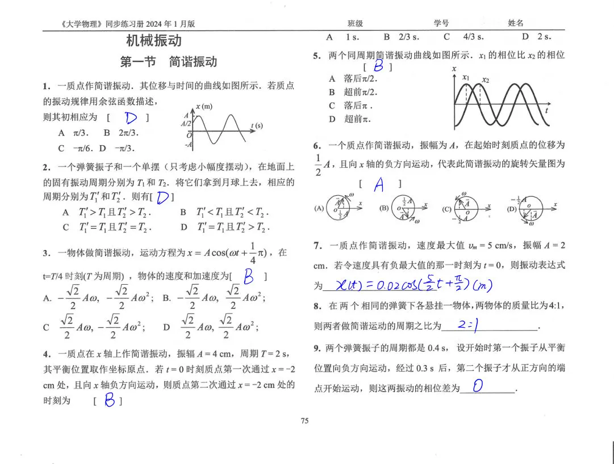
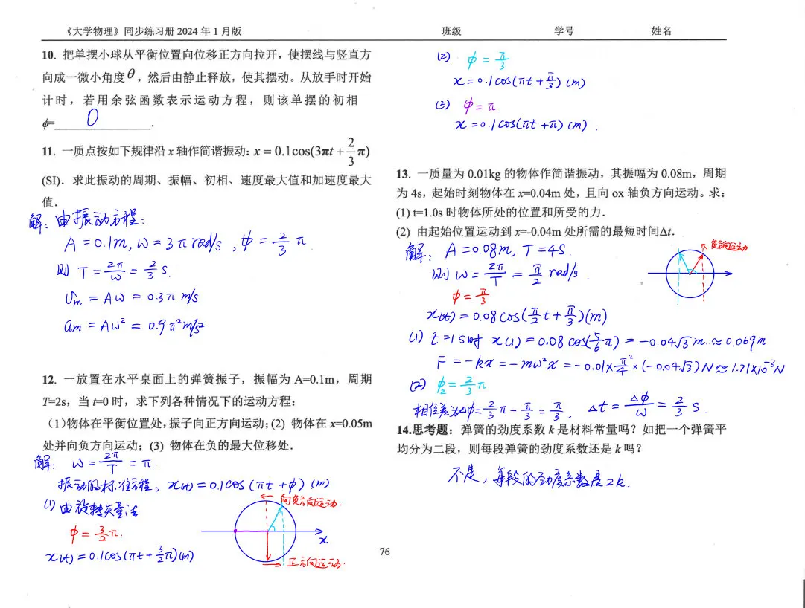
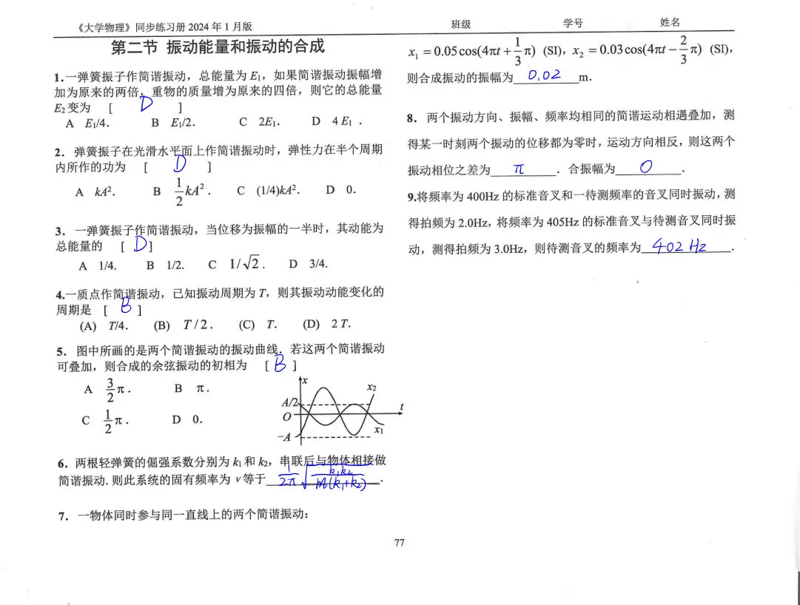
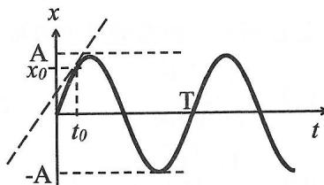
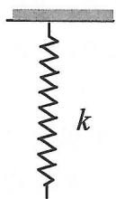
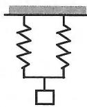
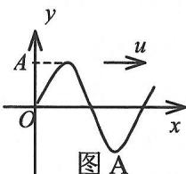
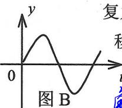
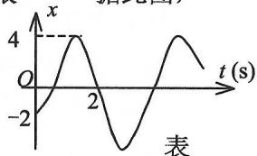
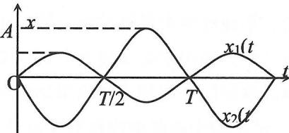

# 《大学物理》机械振动章节习题（简谐振动）

原件经识别和整理；“参考解答”是我们补的。

# 《大学物理》机械振动章节习题（简谐振动）

本资料整理自《大学物理》同步练习册 2024 年 1 月版，包含“简谐振动”与“振动能量和振动的合成”两节习题。

## 一、选择题

### 选择 1

题干：一质点作简谐振动。其位移与时间的曲线如图所示。若质点的振动规律用余弦函数描述，则其初相应为 [ D ]
A $\pi/3.$
B $2\pi/3.$
C $-\pi/6.$
D $-\pi/3.$

答案：D。

知识点：[简谐振动的动力学特征与回复力](../../../topics/大学物理/简谐振动的动力学.md)、[简谐振动的运动学方程（振幅、角频率、相位）](../../../topics/大学物理/简谐振动运动学.md)

### 选择 2

题干：一个弹簧振子和一个单摆（只考虑小幅度摆动），在地面上的固有振动周期分别为 $T_{1}$ 和 $T_{2}$ . 将它们拿到月球上去，相应的周期分别为 $T_{1}^{\prime}$ 和 $T_{2}^{\prime}$ . 则有 [D]

A $T_{1}^{\prime} > T_{1}$ 且 $T_{2}^{\prime} > T_{2}$ .
B $T_{1}^{\prime} < T_{1}$ 且 $T_{2}^{\prime} < T_{2}$ .
C $T_{1}^{\prime} = T_{1}$ 且 $T_{2}^{\prime} = T_{2}$ .
D $T_{1}^{\prime} = T_{1}$ 且 $T_{2}^{\prime} > T_{2}$ .

答案：D。

知识点：[平面简谐波的波函数 y=Acos(ω(t±x/u)+φ)](../../../topics/大学物理/平面简谐波方程.md)、[简谐振动的运动学方程（振幅、角频率、相位）](../../../topics/大学物理/简谐振动运动学.md)

### 选择 3

题干：一物体做简谐振动, 运动方程为 $x = A \cos (\omega t + \frac{1}{4} \pi)$ , 在 $t = T / 4$ 时刻 ( $T$ 为周期), 物体的速度和加速度为 [ B ]

A. $-\frac{\sqrt{2}}{2} A \omega, -\frac{\sqrt{2}}{2} A \omega^2$ ;
B. $-\frac{\sqrt{2}}{2} A \omega, \frac{\sqrt{2}}{2} A \omega^2$ ;
C $\frac{\sqrt{2}}{2} A \omega, -\frac{\sqrt{2}}{2} A \omega^2$ ;
D $\frac{\sqrt{2}}{2} A \omega, \frac{\sqrt{2}}{2} A \omega^2$ ;

答案：B。

知识点：[简谐振动的动能、势能与总机械能](../../../topics/大学物理/简谐振动的能量.md)

### 选择 4

题干：一质点在 $x$ 轴上作简谐振动, 振幅 $A = 4 \mathrm{~cm}$ , 周期 $T = 2 \mathrm{~s}$ , 其平衡位置取作坐标原点。若 $t = 0$ 时刻质点第一次通过 $x = -2 \mathrm{~cm}$ 处, 且向 $x$ 轴负方向运动, 则质点第二次通过 $x = -2 \mathrm{~cm}$ 处的时刻为 [ B ]

- A. 1 s.
- B. 2/3 s.
- C. 4/3 s.
- D. 2 s.

答案：B。

知识点：[简谐振动的动能、势能与总机械能](../../../topics/大学物理/简谐振动的能量.md)、[简谐振动的运动学方程（振幅、角频率、相位）](../../../topics/大学物理/简谐振动运动学.md)

### 选择 5

题干：两个同周期简谐振动曲线如图所示. $x_{1}$ 的相位比 $x_{2}$ 的相位 [ B ]
A 落后π/2.
B 超前π/2.
C 落后π.
D 超前π.

答案：B。

知识点：[同方向同频率简谐振动的合成](../../../topics/大学物理/简谐振动的合成.md)

### 选择 6

题干：一个质点作简谐振动, 振幅为 $A$ , 在起始时刻质点的位移为 $\frac{1}{2} A$ , 且向 $x$ 轴的负方向运动, 代表此简谐振动的旋转矢量图为 [   ]

答案：未提供具体选项字母，但根据题意分析如下：
位移 $x = A/2 > 0$，说明矢量在第一或第四象限。
向 $x$ 轴负方向运动，说明速度 $v < 0$。
在旋转矢量法中，逆时针旋转，第一象限投影速度为负（向上/左？不，$x$轴投影的速度方向取决于 $y$ 分量符号？
$v = -A\omega \sin \phi$。
若 $v < 0$，则 $\sin \phi > 0$。
$\cos \phi = x/A = 1/2$。
$\sin \phi = \pm \sqrt{3}/2$。
因 $\sin \phi > 0$，故 $\phi = \pi/3$ （第一象限）。
矢量应指向第一象限，与 $x$ 轴夹角 $60^\circ$。
*(注：由于无法直接看到图片细节，通常正确选项为矢量位于第一象限的图示)*

## 二、填空题

知识点：[用旋转矢量法确定初相与运动状态](../../../topics/大学物理/旋转矢量法.md)

### 填空 7

题干：一质点作简谐振动, 速度最大值 ${v}_{m} = 5\mathrm{\;{cm}}/\mathrm{s}$ ,振幅 $A = 2$ $\mathrm{{cm}}$ . 若令速度具有负最大值的那一时刻为 $t = 0$ ,则振动表达式为 $x\left( t\right)  = {0.02}\cos \left( {\frac{5}{2}t + \frac{\pi }{2}}\right) \left( m\right)$

答案：$x(t) = 0.02 \cos (\frac{5}{2}t + \frac{\pi}{2})$ (SI) 或 $x(t) = 2 \cos (2.5t + \frac{\pi}{2})$ (cm)

知识点：[同方向同频率简谐振动的合成](../../../topics/大学物理/简谐振动的合成.md)

### 填空 8

题干：在两个相同的弹簧下各悬挂一物体, 两物体的质量比为 $4: 1$ , 则两者做简谐运动的周期之比为 $2: 1$ .

答案：2:1

知识点：[同方向同频率简谐振动的合成](../../../topics/大学物理/简谐振动的合成.md)

### 填空 9

题干：两个弹簧振子的周期都是 $0.4 \mathrm{~s}$ , 设开始时第一个振子从平衡位置向负方向运动, 经过 $0.3 \mathrm{~s}$ 后, 第二个振子才从正方向的端点开始运动, 则这两振动的相位差为 $\underline{\text{O}}$ .

答案：$\frac{3\pi}{2}$ 或 $270^\circ$ （注：原题填空处可能有误或需根据具体相位定义，通常计算如下）

知识点：[同方向同频率简谐振动的合成](../../../topics/大学物理/简谐振动的合成.md)、[简谐振动的运动学方程（振幅、角频率、相位）](../../../topics/大学物理/简谐振动运动学.md)、[简谐振动的动能、势能与总机械能](../../../topics/大学物理/简谐振动的能量.md)

### 填空 10

题干：把单摆小球从平衡位置向位移正方向拉开，使摆线与竖直方向成一微小角度 $\theta$ ，然后由静止释放，使其摆动。从放手时开始计时，若用余弦函数表示运动方程，则该单摆的初相 $\phi = 0$ 。

答案：0

知识点：[简谐振动的运动学方程（振幅、角频率、相位）](../../../topics/大学物理/简谐振动运动学.md)

### 计算 11

题干：一质点按如下规律沿 $x$ 轴作简谐振动: $x = 0.1 \cos \left(3 \pi t + \frac{2}{3} \pi\right)$ (SI). 求此振动的周期、振幅、初相、速度最大值和加速度最大值.

解：由振动方程：
$$
A = 0.1 \mathrm{~m}, \quad \omega = 3 \pi \mathrm{~rad/s}, \quad \phi = \frac{2}{3} \pi
$$
则
$$
T = \frac{2\pi}{\omega} = \frac{2\pi}{3\pi} = \frac{2}{3} \mathrm{~s}
$$
$$
v_m = A \omega = 0.1 \times 3\pi = 0.3\pi \mathrm{~m/s}
$$
$$
a_m = A \omega^2 = 0.1 \times (3\pi)^2 = 0.9\pi^2 \mathrm{~m/s^2}
$$

答案：
周期 $T = 2/3$ s；
振幅 $A = 0.1$ m；
初相 $\phi = 2\pi/3$；
速度最大值 $v_m = 0.3\pi$ m/s；
加速度最大值 $a_m = 0.9\pi^2$ m/s²。

知识点：[简谐振动的运动学方程（振幅、角频率、相位）](../../../topics/大学物理/简谐振动运动学.md)、[速度、加速度的定义与微分关系](../../../topics/大学物理/速度与加速度定义.md)

### 计算 12

题干：一放置在水平桌面上的弹簧振子，振幅为 $A=0.1\mathrm{m}$，周期 $T=2\mathrm{s}$，当 $t=0$ 时，求下列各种情况下的运动方程：
(1) 物体在平衡位置处,振子向正方向运动;
(2) 物体在 $x=0.05\mathrm{m}$ 处并向负方向运动;
(3) 物体在负的最大位移处.

解:
$\omega = \frac{2\pi}{T} = \pi$.
振动的标准方程形式： $x(t)=A\cos(\omega t+\phi)(m)$，其中 $A=0.1$。

(1) 由旋转矢量法
$t=0$ 时，$x=0, v>0$。
$\cos \phi = 0, \sin \phi < 0$ (因为 $v = -A\omega \sin \phi > 0$)。
$\phi = \frac{3}{2} \pi$ (或 $-\frac{\pi}{2}$)。
$$
x(t) = 0.1 \cos (\pi t + \frac{3}{2} \pi) (m)
$$

(2) $t=0$ 时，$x=0.05, v<0$。
$0.05 = 0.1 \cos \phi \Rightarrow \cos \phi = 1/2$。
$v < 0 \Rightarrow \sin \phi > 0$。
$\phi = \frac{\pi}{3}$。
$$
x(t) = 0.1 \cos (\pi t + \frac{\pi}{3}) (m)
$$

(3) $t=0$ 时，$x=-0.1$。
$\cos \phi = -1 \Rightarrow \phi = \pi$。
$$
x(t) = 0.1 \cos(\pi t + \pi) (m)
$$

知识点：[简谐振动的运动学方程（振幅、角频率、相位）](../../../topics/大学物理/简谐振动运动学.md)、[用旋转矢量法确定初相与运动状态](../../../topics/大学物理/旋转矢量法.md)

### 计算 13

题干：一质量为 $0.01 \mathrm{~kg}$ 的物体作简谐振动, 其振幅为 $0.08 \mathrm{~m}$ , 周期为 $4 \mathrm{~s}$ , 起始时刻物体在 $x = 0.04 \mathrm{~m}$ 处, 且向 ox 轴负方向运动。求:
(1) $t = 1.0 \mathrm{~s}$ 时物体所处的位置和所受的力.
(2) 由起始位置运动到 $x = -0.04 \mathrm{~m}$ 处所需的最短时间 $\Delta t$ .

解：
$A=0.08\mathrm{m}, T=4\mathrm{s}$.
$\omega = \frac{2\pi}{T} = \frac{\pi}{2} \mathrm{rad/s}$.
$t=0$ 时，$x=0.04, v<0$。
$0.04 = 0.08 \cos \phi \Rightarrow \cos \phi = 1/2$。
$v < 0 \Rightarrow \sin \phi > 0$。
$\phi = \frac{\pi}{3}$。

振动方程：
$$
x(t) = 0.08 \cos (\frac{\pi}{2} t + \frac{\pi}{3}) (m)
$$

(1) $t = 1 \mathrm{~s}$ 时：
$$
x(1) = 0.08 \cos (\frac{\pi}{2} + \frac{\pi}{3}) = 0.08 \cos (\frac{5\pi}{6}) = 0.08 \times (-\frac{\sqrt{3}}{2}) = -0.04\sqrt{3} \mathrm{~m} \approx -0.069 \mathrm{~m}
$$
受力 $F = -kx = -m\omega^2 x$。
$k = m\omega^2 = 0.01 \times (\frac{\pi}{2})^2 = \frac{0.01\pi^2}{4}$。
$$
F = - 0.01 \times \frac{\pi^2}{4} \times (-0.04\sqrt{3}) = \frac{0.0004\sqrt{3}\pi^2}{4} = 0.0001\sqrt{3}\pi^2 \mathrm{~N}
$$
数值计算：
$F \approx 1.71 \times 10^{-3} \mathrm{~N}$ (方向沿 x 轴正方向)。

(2) 起始相位 $\phi_1 = \pi/3$。
目标位置 $x = -0.04 \mathrm{~m}$。
$-0.04 = 0.08 \cos \phi_2 \Rightarrow \cos \phi_2 = -1/2$。
从起始位置 ($x=0.04$, 向左运动) 到 $x=-0.04$ 的最短时间，对应相位从 $\pi/3$ 变到 $2\pi/3$ (第二象限，$x$ 为负，继续向左直到 $-A$ 再回来？不，$x$ 从 $0.04$ 到 $-0.04$ 直接过去，相位增加)。
在旋转矢量图上，$\pi/3$ 对应 $x=0.04$。
下一个 $x=-0.04$ 的位置对应相位 $2\pi/3$。
相位差 $\Delta \phi = 2\pi/3 - \pi/3 = \pi/3$。
$$
\Delta t = \frac{\Delta \phi}{\omega} = \frac{\pi/3}{\pi/2} = \frac{2}{3} \mathrm{~s}
$$

知识点：[简谐振动的运动学方程（振幅、角频率、相位）](../../../topics/大学物理/简谐振动运动学.md)、[用旋转矢量法确定初相与运动状态](../../../topics/大学物理/旋转矢量法.md)、[简谐振动的动力学特征与回复力](../../../topics/大学物理/简谐振动的动力学.md)

### 计算 14

题干：思考题：弹簧的劲度系数 $k$ 是材料常量吗？如把一个弹簧平均分为二段，则每段弹簧的劲度系数还是 $k$ 吗？

答案：不是。每段的劲度系数是 $2k$。

知识点：[常见力（重力、弹力、摩擦力）的受力分析](../../../topics/大学物理/常见力分析.md)、[简谐振动的动力学特征与回复力](../../../topics/大学物理/简谐振动的动力学.md)

### 选择 1

题干：一弹簧振子作简谐振动，总能量为 $E_{1}$ ，如果简谐振动振幅增加为原来的两倍，重物的质量增为原来的四倍，则它的总能量 $E_{2}$ 变为 [D]
A $E_{1}/4$ .
B $E_{1}/2$ .
C $2E_{1}$ .
D $4E_{1}$ .

答案：D。

知识点：[简谐振动的动力学特征与回复力](../../../topics/大学物理/简谐振动的动力学.md)、[简谐振动的运动学方程（振幅、角频率、相位）](../../../topics/大学物理/简谐振动运动学.md)

### 选择 2

题干：弹簧振子在光滑水平面上作简谐振动时, 弹性力在半个周期内所作的功为 [ D ]
A $kA^{2}$ .
B $\frac{1}{2} kA^{2}$ .
C $(1/4)kA^{2}$ .
D 0.

答案：D。

知识点：[平面简谐波的波函数 y=Acos(ω(t±x/u)+φ)](../../../topics/大学物理/平面简谐波方程.md)、[简谐振动的运动学方程（振幅、角频率、相位）](../../../topics/大学物理/简谐振动运动学.md)

### 选择 3

题干：一弹簧振子作简谐振动，当位移为振幅的一半时，其动能为总能量的 [D]
A 1/4.
B 1/2.
C $1/\sqrt{2}$ .
D 3/4.

答案：D。

知识点：[简谐振动的动能、势能与总机械能](../../../topics/大学物理/简谐振动的能量.md)

### 选择 4

题干：一质点作简谐振动，已知振动周期为 $T$ ，则其振动动能变化的周期是 [ B ]
(A) $T / 4.$
(B) $T / 2.$
(C) $T.$
(D) $2T.$

答案：B。

知识点：[简谐振动的动能、势能与总机械能](../../../topics/大学物理/简谐振动的能量.md)、[简谐振动的运动学方程（振幅、角频率、相位）](../../../topics/大学物理/简谐振动运动学.md)

### 选择 5

题干：图中所画的是两个简谐振动的振动曲线。若这两个简谐振动可叠加,则合成的余弦振动的初相为 [B]
A $\frac{3}{2}\pi .$
B $\pi .$
C $\frac{1}{2}\pi .$
D 0.

答案：B。

知识点：[同方向同频率简谐振动的合成](../../../topics/大学物理/简谐振动的合成.md)

### 填空 6

题干：两根轻弹簧的倔强系数分别为 $k_{1}$ 和 $k_{2}$ , 串联后与物体相接做简谐振动. 则此系统的固有频率为 $\nu$ 等于 $\frac{1}{2\pi}\sqrt{\frac{k_{1}k_{2}}{m(k_{1}+ k_{2})}}$ .

答案：$\frac{1}{2\pi}\sqrt{\frac{k_{1}k_{2}}{m(k_{1}+ k_{2})}}$

知识点：[简谐振动的动力学特征与回复力](../../../topics/大学物理/简谐振动的动力学.md)、[简谐振动的运动学方程（振幅、角频率、相位）](../../../topics/大学物理/简谐振动运动学.md)

### 填空 7

题干：一物体同时参与同一直线上的两个简谐振动:
$x_{1}=0.05\cos(4\pi t+\frac{1}{3}\pi)$ (SI), $x_{2}=0.03\cos(4\pi t-\frac{2}{3}\pi)$ (SI), 则合成振动的振幅为 0.02 m.

答案：0.02 m

知识点：[同方向同频率简谐振动的合成](../../../topics/大学物理/简谐振动的合成.md)

### 填空 8

题干：两个振动方向、振幅、频率均相同的简谐运动相遇叠加, 测得某一时刻两个振动的位移都为零时, 运动方向相反, 则这两个振动相位之差为 $\pi$ 。合振幅为 $\bigcirc$ 。

答案：0

知识点：[同方向同频率简谐振动的合成](../../../topics/大学物理/简谐振动的合成.md)

### 填空 9

题干：将频率为 400Hz 的标准音叉和一待测频率的音叉同时振动, 测得拍频为 $2.0 \mathrm{~Hz}$ , 将频率为 $405 \mathrm{~Hz}$ 的标准音叉与待测音叉同时振动, 测得拍频为 $3.0 \mathrm{~Hz}$ , 则待测音叉的频率为 $402 \mathrm{~Hz}$ .

答案：402 Hz

知识点：[同方向同频率简谐振动的合成](../../../topics/大学物理/简谐振动的合成.md)、[简谐振动的运动学方程（振幅、角频率、相位）](../../../topics/大学物理/简谐振动运动学.md)、[简谐振动的动能、势能与总机械能](../../../topics/大学物理/简谐振动的能量.md)

### 一、教学要求

1. 掌握振动方程的标准式及其参量的物理意义、决定因素；尤其是位相和初位相的概念；
2. 掌握旋转矢量法求解相位，进而求解简谐运动方程。
3. 学会利用谐振曲线判断质点某时刻的位移和运动方向。
4. 掌握同频率同方向简谐运动的合成，掌握不同频率同方向简谐运动中拍频的物理意义及计算方法。
5. 掌握简谐振动的动能、势能及总能量的特点。

知识点：[简谐振动的运动学方程（振幅、角频率、相位）](../../../topics/大学物理/简谐振动运动学.md)、[用旋转矢量法确定初相与运动状态](../../../topics/大学物理/旋转矢量法.md)、[同方向同频率简谐振动的合成](../../../topics/大学物理/简谐振动的合成.md)、[简谐振动的动能、势能与总机械能](../../../topics/大学物理/简谐振动的能量.md)

### 二、内容提要

1. 简谐振动方程式：$x=A\cos(\omega t+\varphi)$；$v=-A\omega\sin(\omega t+\varphi)$；$a=-A\omega^{2}\cos(\omega t+\varphi)$

2. 简谐振动振幅 $A$，圆频率 $\omega$，相位 $\phi$，初相位 $\varphi$。$A=\sqrt{x_0^2+\left(\frac{v_0}{\omega}\right)^2}$，$\omega=\sqrt{\frac{k}{m}}$，$\phi=\omega t+\varphi$

3. 旋转矢量法：振幅 $A\leftrightarrow$ 旋转矢量 $\mathbf{A}$ 的模；角频率 $\omega\leftrightarrow$ 旋转矢量 $\mathbf{A}$ 的角速度；相位 $\phi\leftrightarrow$ 旋转矢量 $\mathbf{A}$ 与 $x$ 轴正方向的夹角；位移 $x\leftrightarrow$ 旋转矢量 $\mathbf{A}$ 在 $x$ 轴上的投影坐标。

旋转矢量 $\mathbf{A}$ 的位置决定了对应的简谐振动的质点的运动状态：

- $\mathbf{A}$ 在第一象限(1)中，$x>0$；$v<0$
- $\mathbf{A}$ 在第二象限(2)中，$x<0$；$v<0$
- $\mathbf{A}$ 在第三象限(3)中，$x<0$；$v>0$
- $\mathbf{A}$ 在第四象限(4)中，$x>0$；$v>0$

注：根据质点位移 $x_0$ 来确认投影点的位置，再根据速度的正负来判断旋转矢量的确切位置：

利用谐振曲线可以知道质点在某一时刻 $t_0$ 时，质点的速度方向（通过该点的切线斜率的方向）和位移 $x_0$

5. 相位差：

1）对于同一简谐振动：$\Delta\phi=\omega\Delta t$

2）对于具有相同频率、独立的两个简谐振动：$\Delta\phi=\varphi_2-\varphi_1$，其中 $\varphi_2$ 和 $\varphi_1$ 分别为两个简谐振动质点的初相位。

6. 简谐振动的能量

1）振动动能：$E_k=\frac{1}{2}mv^2$　2）振动势能：$E_P=\frac{1}{2}kx^2$　3）振动总能量：$E=E_k+E_P=\frac{1}{2}kA^2=\frac{1}{2}m\omega^2A^2$

7. 简谐振动的合成：

1）同频率、同方向的合成：$x_1=A_1\cos(\omega t+\varphi_1)$；$x_2=A_2\cos(\omega t+\varphi_2)$，则合成的总振动仍然是简谐振动：$x=A\cos(\omega t+\varphi)$，其中

$$
A=\sqrt{A_1^2+A_2^2+2A_1A_2\cos(\varphi_2-\varphi_1)}
$$

$$
\tan\varphi=\frac{A_1\sin\varphi_1+A_2\sin\varphi_2}{A_1\cos\varphi_1+A_2\cos\varphi_2}
$$

2）不同频率、同方向的合成：拍频 $\nu=\left|\nu_2-\nu_1\right|$

## 综合练习

知识点：[简谐振动的运动学方程（振幅、角频率、相位）](../../../topics/大学物理/简谐振动运动学.md)、[用旋转矢量法确定初相与运动状态](../../../topics/大学物理/旋转矢量法.md)、[简谐振动的动能、势能与总机械能](../../../topics/大学物理/简谐振动的能量.md)

### 选择 1

一劲度系数为 $k$ 的轻弹簧截成三等份，取出其中的两根，将它们并联，下面挂一质量为 $m$ 的物体，如图所示。则振动系统的频率为

- A. $\frac{1}{2\pi}\sqrt{\frac{k}{3m}}$
- B. $\frac{1}{2\pi}\sqrt{\frac{k}{m}}$
- C. $\frac{1}{2\pi}\sqrt{\frac{3k}{m}}$
- D. $\frac{1}{2\pi}\sqrt{\frac{6k}{m}}$

答案：D

知识点：[简谐振动的动力学特征与回复力](../../../topics/大学物理/简谐振动的动力学.md)、[简谐振动的运动学方程（振幅、角频率、相位）](../../../topics/大学物理/简谐振动运动学.md)

### 选择 2

图 A 表示 $t=0$ 时的余弦波的波形图，波沿 $x$ 轴正向传播；图 B 为一余弦振动曲线。则图 A 中所表示的 $x=0$ 处振动的初相位与图 B 所表示的振动的初相位

- A. 均为零
- B. 均为 $\frac{1}{2}\pi$
- C. 均为 $-\frac{1}{2}\pi$
- D. 依次分别为 $\frac{1}{2}\pi$ 与 $-\frac{1}{2}\pi$

答案：D

知识点：[平面简谐波的波函数 y=Acos(ω(t±x/u)+φ)](../../../topics/大学物理/平面简谐波方程.md)、[简谐振动的运动学方程（振幅、角频率、相位）](../../../topics/大学物理/简谐振动运动学.md)

### 填空 3

一质点作简谐振动，其振动曲线如图所示。据图，它的周期 $T=\frac{24}{7}\,\mathrm{s}$，用余弦函数描述时初相 $\varphi=\frac{4}{3}\pi$。

知识点：[简谐振动的运动学方程（振幅、角频率、相位）](../../../topics/大学物理/简谐振动运动学.md)、[用旋转矢量法确定初相与运动状态](../../../topics/大学物理/旋转矢量法.md)

### 填空 4

一系统作简谐振动，周期为 $T$，以余弦函数描述振动时，初相为零。在 $0\leqslant t\leqslant\frac{1}{2}T$ 范围内，系统在 $t=\frac{T}{8}$，$\frac{3T}{8}$ 时刻动能和势能相等。

知识点：[简谐振动的动能、势能与总机械能](../../../topics/大学物理/简谐振动的能量.md)、[简谐振动的运动学方程（振幅、角频率、相位）](../../../topics/大学物理/简谐振动运动学.md)

### 填空 5

两个同方向的简谐振动曲线如图所示，合振动的振幅与初相位分别为____、$\frac{\pi}{2}$。

知识点：[同方向同频率简谐振动的合成](../../../topics/大学物理/简谐振动的合成.md)

### 计算 6

质量为 $2\,\mathrm{kg}$ 的质点，按方程 $x=0.2\sin\left[5t-(\pi/6)\right]$（SI）沿着 $x$ 轴振动。求：

(1) $t=0$ 时，作用于质点的力的大小；

(2) 作用于质点的力的最大值和此时质点的位置。

解：由 $x=0.2\sin\left[5t-\frac{\pi}{6}\right]$ 可知，$A=0.2\,\mathrm{m}$，$\omega=5\,\mathrm{rad/s}$

所以 $k=m\omega^{2}=50\,\mathrm{N/m}$

当 $t=0$ 时，$x=0.2\sin\left(-\frac{\pi}{6}\right)=-0.1\,\mathrm{m}$，$F=-kx=5\,\mathrm{N}$

(2) 当 $x=\pm A$ 时，作用于质点的力为最大值。$F_{\max}=kA=10\,\mathrm{N}$

知识点：[简谐振动的动力学特征与回复力](../../../topics/大学物理/简谐振动的动力学.md)、[简谐振动的运动学方程（振幅、角频率、相位）](../../../topics/大学物理/简谐振动运动学.md)

### 计算 7

一弹簧振子沿 $x$ 轴作简谐振动（弹簧为原长时振动物体的位置取作 $x$ 轴原点）。已知振动物体最大位移为 $x_m=0.4\,\mathrm{m}$，最大恢复力为 $F_m=0.8\,\mathrm{N}$，最大速度为 $v_m=0.8\pi\,\mathrm{m/s}$，又知 $t=0$ 的初位移为 $+0.2\,\mathrm{m}$，且初速度与所选 $x$ 轴方向相反。

(1) 求振动能量；

(2) 求此振动的表达式。

解：(1) $k=\frac{F_m}{x_m}=2\,\mathrm{N/m}$。

利用旋转矢量法。$E=\frac{1}{2}kA^2=\frac{1}{2}kx_m^2$，则振动能量为____，振动方程为 $y=0.4\cos\left(2\pi t+\frac{\pi}{3}\right)\ (\mathrm{m})$

(2) 振动方程需要 $A$，$\omega$，$\varphi$。

$A=0.4\,\mathrm{m}$，$\omega=\frac{v_m}{A}=2\pi\,\mathrm{rad/s}$

知识点：[简谐振动的动力学特征与回复力](../../../topics/大学物理/简谐振动的动力学.md)、[简谐振动的运动学方程（振幅、角频率、相位）](../../../topics/大学物理/简谐振动运动学.md)、[简谐振动的动能、势能与总机械能](../../../topics/大学物理/简谐振动的能量.md)
