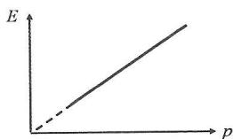
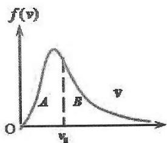
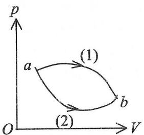
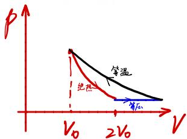
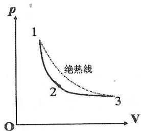
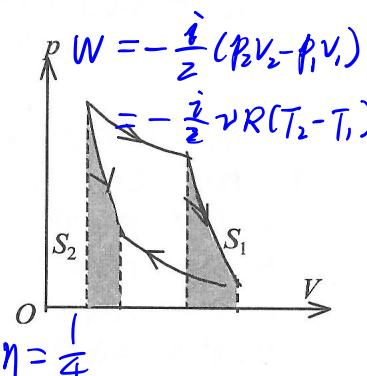
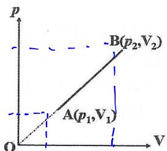
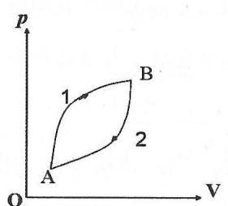

# 《大学物理》气体动理论与热力学基础习题解答

原件经识别和整理；“参考解答”是我们补的。

## 气体动理论

### 选择 1

处于平衡状态的一瓶氦气和一瓶氧气的分子数密度相同，分子的平均平动动能也相同，则它们：

- A. 温度，压强都不相同
- B. 温度相同，但氦气压强大于氮气压强
- C. 温度，压强均相同
- D. 温度相同，但氦气压强小于氮气压强

答案：C。

知识点：[理想气体的状态方程与平衡态](../../../topics/大学物理/理想气体状态方程.md)、[能量按自由度均分定理与理想气体内能](../../../topics/大学物理/能量均分定理.md)

### 选择 2

一瓶氦气和一瓶氮气密度相同，分子平均平动动能相同，而且都处于平衡状态，则它们：

- A. 温度相同、压强相同。
- B. 温度、压强都不同。
- C. 温度相同，但氦气的压强大于氮气的压强。
- D. 温度相同，但氦气的压强小于氮气的压强。

答案：C。

知识点：[热力学第一定律及过程量与状态量的区别](../../../topics/大学物理/热力学第一定律.md)、[理想气体的等体、等压、等温、绝热过程（ΔE、A、Q的计算）](../../../topics/大学物理/等值过程.md)、[理想气体的状态方程与平衡态](../../../topics/大学物理/理想气体状态方程.md)

### 选择 3

有一截面均匀的封闭圆筒，中间被一光滑的活塞分隔成两边，如果其中的一边装有 $0.1\ \mathrm{kg}$ 某一温度的氢气，为了使活塞停留在圆筒的正中央，则另一边应装入同一温度的氧气的质量为：

- A. $(1/16)\ \mathrm{kg}$
- B. $0.8\ \mathrm{kg}$
- C. $1.6\ \mathrm{kg}$
- D. $3.2\ \mathrm{kg}$

答案：C。

知识点：[理想气体的等体、等压、等温、绝热过程（ΔE、A、Q的计算）](../../../topics/大学物理/等值过程.md)、[能量按自由度均分定理与理想气体内能](../../../topics/大学物理/能量均分定理.md)、[热容与理想气体的摩尔热容（Cv与Cp）](../../../topics/大学物理/摩尔热容.md)

### 选择 4

关于温度的意义，有下列几种说法：

(1) 温度的高低反映物质内部分子运动剧烈程度的不同。
(2) 气体的温度是分子平均平动动能的量度。
(3) 从微观上看，气体的温度表示每个气体分子的冷热程度。
(4) 气体的温度是大量气体分子热运动的集体表现，具有统计意义。

这些说法中正确的是：

- A. (1)、(2)、(4)。
- B. (1)、(2)、(3)。
- C. (2)、(3)、(4)。
- D. (1)、(3)、(4)。

答案：A。

知识点：[理想气体的等体、等压、等温、绝热过程（ΔE、A、Q的计算）](../../../topics/大学物理/等值过程.md)、[能量按自由度均分定理与理想气体内能](../../../topics/大学物理/能量均分定理.md)

### 选择 5

$1\ \mathrm{mol}$ 刚性双原子分子理想气体，当温度为 $T$ 时，其内能为：

- A. $\frac{3}{2}RT$
- B. $\frac{3}{2}kT$
- C. $\frac{5}{2}RT$
- D. $\frac{5}{2}kT$

（式中 $R$ 为普适气体常量，$k$ 为玻尔兹曼常量）

答案：C。

知识点：[一般热机循环过程的效率](../../../topics/大学物理/循环过程与效率.md)、[理想气体的等体、等压、等温、绝热过程（ΔE、A、Q的计算）](../../../topics/大学物理/等值过程.md)、[热力学第一定律及过程量与状态量的区别](../../../topics/大学物理/热力学第一定律.md)

### 选择 6

两容器内分别盛有氢气和氦气，若它们的温度和质量分别相等，则：

- A. 两种气体分子的平均平动动能相等。
- B. 两种气体分子的平均动能相等。
- C. 两种气体分子的平均速率相等。
- D. 两种气体的内能相等。

答案：A。

知识点：[热力学第一定律及过程量与状态量的区别](../../../topics/大学物理/热力学第一定律.md)、[理想气体的等体、等压、等温、绝热过程（ΔE、A、Q的计算）](../../../topics/大学物理/等值过程.md)

### 选择 7

标准状态下，若氧气和氦气的体积比 $V_1/V_2=1/2$，则其内能 $E_1/E_2$ 为：

- A. $1/2$
- B. $5/6$
- C. $3/2$
- D. $1/3$

答案：B。

知识点：[卡诺循环的效率与致冷系数](../../../topics/大学物理/卡诺循环.md)

### 选择 8

理想气体的内能是状态的单值函数，下面对理想气体内能的理解错误的是：

- A. 气体处于一定状态，就具有一定的内能；
- B. 对应于某一状态的内能是可以直接测量的；
- C. 当理想气体的状态发生变化时，内能不一定随之变化；
- D. 只有当伴随着温度变化的状态变化时，内能才发生变化。

答案：B。

知识点：[卡诺循环的效率与致冷系数](../../../topics/大学物理/卡诺循环.md)、[一般热机循环过程的效率](../../../topics/大学物理/循环过程与效率.md)

### 计算 1

已知某种理想气体，其分子方均根速率为 $400\ \mathrm{m/s}$，当气体压强为 $1\ \mathrm{atm}$ 时，求气体的密度。

解：

$$
\overline{v^2}=\frac{3kT}{m},\qquad kT=\frac{1}{3}m\overline{v^2}
$$

由

$$
pV=NkT=\frac{1}{3}Nm\overline{v^2}
$$

得

$$
\rho=\frac{Nm}{V}=\frac{3p}{\overline{v^2}}=\frac{3\times1.013\times10^5}{1.6\times10^5}\ \mathrm{kg/m^3}=1.9\ \mathrm{kg/m^3}
$$

参考解答：**结论**  
气体的密度约为 $1.90\ \mathrm{kg/m^3}$。

**计算过程**  
理想气体压强公式为  

$$
p = \frac{1}{3}\rho \overline{v^2},
$$
  
其中 $\overline{v^2}$ 是方均速率。方均根速率 $v_{\text{rms}} = \sqrt{\overline{v^2}} = 400\ \mathrm{m/s}$，故  

$$
\overline{v^2} = (400)^2 = 1.6 \times 10^5\ \mathrm{m^2/s^2}.
$$
  
压强 $p = 1\ \mathrm{atm} = 1.013 \times 10^5\ \mathrm{Pa}$，代入公式  

$$
\rho = \frac{3p}{\overline{v^2}} = \frac{3 \times 1.013 \times 10^5}{1.6 \times 10^5} \approx 1.90\ \mathrm{kg/m^3}.
$$

知识点：[理想气体压强的微观统计解释](../../../topics/大学物理/压强微观解释.md)、[理想气体的状态方程与平衡态](../../../topics/大学物理/理想气体状态方程.md)、[温度的微观本质与分子平均平动动能](../../../topics/大学物理/温度微观解释.md)

### 计算 2

封闭容器中装有 $2\ \mathrm{g}$ 氢气，其温度为 $127\ ^\circ\mathrm{C}$，试求：(1) 气体分子的平均平动动能；(2) 气体分子的平均动能；(3) 气体的内能。

解：

$$
T=273\ \mathrm{K}+127\ \mathrm{K}=400\ \mathrm{K},\qquad \nu=1\ \mathrm{mol}
$$

(1)

$$
\overline{\varepsilon}_k=\frac{3}{2}kT=\frac{3}{2}\times1.38\times10^{-23}\times400\ \mathrm{J}=8.28\times10^{-21}\ \mathrm{J}
$$

(2)

$$
\overline{\varepsilon}_k=\frac{5}{2}kT=\frac{5}{2}\times1.38\times10^{-23}\times400\ \mathrm{J}=1.38\times10^{-20}\ \mathrm{J}
$$

(3) 内能

$$
E=N\cdot\frac{5}{2}kT=\frac{5}{2}RT=8.31\times10^{3}\ \mathrm{J}
$$

参考解答：**(1) 气体分子的平均平动动能**  
$8.28 \times 10^{-21}\ \mathrm{J}$  

**(2) 气体分子的平均动能**  
$1.38 \times 10^{-20}\ \mathrm{J}$  

**(3) 气体的内能**  
$8.31 \times 10^{3}\ \mathrm{J}$

**过程**  
氢气 $\mathrm{H_2}$ 为双原子分子，常温下自由度为 $i=5$（平动 3，转动 2）。  
物质的量 $\nu = \frac{2\ \mathrm{g}}{2\ \mathrm{g/mol}} = 1\ \mathrm{mol}$  
热力学温度 $T = 127 + 273 = 400\ \mathrm{K}$  

(1) 平均平动动能只与温度有关：  
$\overline{\varepsilon}_t = \frac{3}{2}kT = \frac{3}{2}(1.38 \times 10^{-23}) \times 400 = 8.28 \times 10^{-21}\ \mathrm{J}$  

(2) 平均动能含平动和转动：  
$\overline{\varepsilon}_k = \frac{5}{2}kT = \frac{5}{2}(1.38 \times 10^{-23}) \times 400 = 1.38 \times 10^{-20}\ \mathrm{J}$  

(3) 内能 $E = \nu \cdot \frac{i}{2}RT = 1 \times \frac{5}{2} \times 8.31 \times 400 = 8.31 \times 10^{3}\ \mathrm{J}$

知识点：[温度的微观本质与分子平均平动动能](../../../topics/大学物理/温度微观解释.md)、[能量按自由度均分定理与理想气体内能](../../../topics/大学物理/能量均分定理.md)、[理想气体的状态方程与平衡态](../../../topics/大学物理/理想气体状态方程.md)

### 计算 3

容积为 $20.0\ \mathrm{L}$（升）的瓶子以速率 $v=200\ \mathrm{m\cdot s^{-1}}$ 匀速运动，瓶子中充有质量为 $100\ \mathrm{g}$ 的氦气。设瓶子突然停止，且气体的全部定向运动动能都变为气体分子热运动的动能，瓶子与外界没有热量交换，求热平衡后氦气的温度、压强、内能及氦气分子的平均动能各增加多少？（摩尔气体常量 $R=8.31\ \mathrm{J\cdot mol^{-1}\cdot K^{-1}}$，玻尔兹曼常量 $k=1.38\times10^{-23}\ \mathrm{J\cdot K^{-1}}$）

解：$V=20\ \mathrm{L}=0.02\ \mathrm{m^3}$，$\nu=25\ \mathrm{mol}$。

总动能

$$
E_k=\frac{1}{2}mv^2
$$

全部转化为内能：

$$
E=\frac{3}{2}Nk\Delta T=\frac{1}{2}mv^2
$$

$$
\Delta T=\frac{mv^2}{3Nk}=\frac{mv^2}{3R}=\frac{0.1\times200^2}{3\times25\times8.31}\ \mathrm{K}=6.42\ \mathrm{K}
$$

分子平均动能增加：

$$
\Delta\varepsilon_k=\frac{3}{2}k\Delta T=\frac{3}{2}\times1.38\times10^{-23}\times6.42\ \mathrm{J}=1.33\times10^{-22}\ \mathrm{J}
$$

压强增加：

$$
\begin{cases}
pV=\nu RT\\
p'V=\nu RT'\\
\Delta p=\dfrac{\nu R\Delta T}{V}=\dfrac{25\times8.31\times6.42}{0.02}\ \mathrm{Pa}=6.67\times10^4\ \mathrm{Pa}
\end{cases}
$$

内能增加：

$$
E=\frac{3}{2}\nu RT
$$

$$
\Delta E=\frac{3}{2}\nu R\Delta T=\frac{3}{2}\times25\times8.31\times6.42\ \mathrm{J}=2000.63\ \mathrm{J}
$$

参考解答：**结论**

氦气的温度增加 $\Delta T \approx 6.42\ \mathrm{K}$，压强增加 $\Delta p \approx 6.67 \times 10^4\ \mathrm{Pa}$，内能增加 $\Delta E \approx 2.00 \times 10^3\ \mathrm{J}$，分子平均动能增加 $\Delta \bar{\varepsilon}_k \approx 1.33 \times 10^{-22}\ \mathrm{J}$。

**推理与计算过程**

1.  **物理过程分析**
    瓶子突然停止，气体的定向运动动能全部转化为分子热运动动能（即内能）。由于过程绝热且体积不变，根据能量守恒定律：
    $$ \Delta E = E_{k,\text{定向}} = \frac{1}{2}mv^2 $$
    其中 $m=0.1\ \mathrm{kg}$，$v=200\ \mathrm{m/s}$。

2.  **计算内能增加量 $\Delta E$**
    $$ \Delta E = \frac{1}{2} \times 0.1 \times (200)^2 = 2000\ \mathrm{J} $$
    *(注：题目参考解答中保留较多小数位导致微小差异，此处按有效数字及物理意义取整或保留三位有效数字为 $2.00 \times 10^3\ \mathrm{J}$)*

3.  **计算温度增加量 $\Delta T$**
    氦气为单原子分子理想气体，自由度 $i=3$。内能变化与温度变化的关系为：
    $$ \Delta E = \frac{i}{2}\nu R \Delta T = \frac{3}{2}\nu R \Delta T $$
    首先计算物质的量 $\nu$（氦气摩尔质量 $M \approx 4.00 \times 10^{-3}\ \mathrm{kg/mol}$）：
    $$ \nu = \frac{m}{M} = \frac{0.1}{4.00 \times 10^{-3}} = 25\ \mathrm{mol} $$
    代入求解 $\Delta T$：
    $$ \Delta T = \frac{2 \Delta E}{3 \nu R} = \frac{2 \times 2000}{3 \times 25 \times 8.31} \approx 6.42\ \mathrm{K} $$

4.  **计算压强增加量 $\Delta p$**
    由理想气体状态方程 $pV = \nu RT$，在体积 $V$ 不变时：
    $$ \Delta p = \frac{\nu R \Delta T}{V} $$
    已知 $V = 20.0\ \mathrm{L} = 0.020\ \mathrm{m^3}$，代入数据：
    $$ \Delta p = \frac{25 \times 8.31 \times 6.42}{0.020} \approx 6.67 \times 10^4\ \mathrm{Pa} $$

5.  **计算分子平均动能增加量 $\Delta \bar{\varepsilon}_k$**
    单原子分子的平均平动动能（即总平均动能）为 $\bar{\varepsilon}_k = \frac{3}{2}kT$，故增加量为：
    $$ \Delta \bar{\varepsilon}_k = \frac{3}{2} k \Delta T $$
    代入玻尔兹曼常量 $k = 1.38 \times 10^{-23}\ \mathrm{J/K}$：
    $$ \Delta \bar{\varepsilon}_k = \frac{3}{2} \times 1.38 \times 10^{-23} \times 6.42 \approx 1.33 \times 10^{-22}\ \mathrm{J} $$

知识点：[理想气体的状态方程与平衡态](../../../topics/大学物理/理想气体状态方程.md)、[温度的微观本质与分子平均平动动能](../../../topics/大学物理/温度微观解释.md)、[能量按自由度均分定理与理想气体内能](../../../topics/大学物理/能量均分定理.md)

### 选择 9

一定量的理想气体贮于某一容器中，温度为 $T$，气体分子的质量为 $m$。根据理想气体的分子模型和统计假设，分子速度在 $x$ 方向的分量平方的平均值：

- A. $\overline{v_x^2}=\sqrt{\dfrac{3kT}{m}}$
- B. $\overline{v_x^2}=\dfrac{1}{3}\sqrt{\dfrac{3kT}{m}}$
- C. $\overline{v_x^2}=3kT/m$
- D. $\overline{v_x^2}=kT/m$

答案：D。

知识点：[卡诺循环的效率与致冷系数](../../../topics/大学物理/卡诺循环.md)、[理想气体的状态方程与平衡态](../../../topics/大学物理/理想气体状态方程.md)、[理想气体的等体、等压、等温、绝热过程（ΔE、A、Q的计算）](../../../topics/大学物理/等值过程.md)

### 选择 10

如图所示为定量理想气体内能 $E$ 随体积 $V$ 的变化关系，则此直线表示的过程为：

- A. 等压过程；
- B. 绝热过程；
- C. 等温过程；
- D. 等容过程。

答案：A。

知识点：[卡诺循环的效率与致冷系数](../../../topics/大学物理/卡诺循环.md)、[热力学第一定律及过程量与状态量的区别](../../../topics/大学物理/热力学第一定律.md)、[热力学第二定律的两种表述](../../../topics/大学物理/热力学第二定律.md)

### 选择 11

已知一定量的某种理想气体，在温度为 $T_1$ 与 $T_2$ 时的分子最概然速率分别为 $v_{p1}$ 和 $v_{p2}$，分子速率分布函数的最大值分别为 $f(v_{p1})$ 和 $f(v_{p2})$。若 $T_1>T_2$，则：

- A. $v_{p1}>v_{p2},\quad f(v_{p1})>f(v_{p2})$。
- B. $v_{p1}>v_{p2},\quad f(v_{p1})<f(v_{p2})$。
- C. $v_{p1}<v_{p2},\quad f(v_{p1})>f(v_{p2})$。
- D. $v_{p1}<v_{p2},\quad f(v_{p1})<f(v_{p2})$。

答案：B。

知识点：[热力学第二定律的两种表述](../../../topics/大学物理/热力学第二定律.md)

### 选择 12

麦克斯韦速率分布曲线如图所示，图中 A、B 两部分面积相等，则该图表示：

- A. $v_0$ 为最可几速率。
- B. $v_0$ 为平均速率。
- C. 速率大于和小于 $v_0$ 的分子数各一半。
- D. $v_0$ 为方均根速率。

答案：C。

知识点：[热力学第二定律的两种表述](../../../topics/大学物理/热力学第二定律.md)

### 选择 13

设图示的两条曲线分别表示在相同温度下氧气和氢气分子的速率分布曲线；令 $(v_p)_{\mathrm{O_2}}$ 和 $(v_p)_{\mathrm{H_2}}$ 分别表示氧气和氢气的最概然速率，则：

- A. 图中 a 表示氧气分子的速率分布曲线；$(v_p)_{\mathrm{O_2}}/(v_p)_{\mathrm{H_2}}=4$。
- B. 图中 a 表示氧气分子的速率分布曲线；$(v_p)_{\mathrm{O_2}}/(v_p)_{\mathrm{H_2}}=1/4$。
- C. 图中 b 表示氧气分子的速率分布曲线；$(v_p)_{\mathrm{O_2}}/(v_p)_{\mathrm{H_2}}=1/4$。
- D. 图中 b 表示氧气分子的速率分布曲线；$(v_p)_{\mathrm{O_2}}/(v_p)_{\mathrm{H_2}}=4$。

答案：B。

知识点：[热力学第一定律及过程量与状态量的区别](../../../topics/大学物理/热力学第一定律.md)、[理想气体的状态方程与平衡态](../../../topics/大学物理/理想气体状态方程.md)、[理想气体的等体、等压、等温、绝热过程（ΔE、A、Q的计算）](../../../topics/大学物理/等值过程.md)

### 选择 14

在一个体积不变的容器中，储有一定量的理想气体，温度为 $T_0$ 时，气体分子的平均速率为 $\overline{v}_0$，分子平均碰撞次数为 $\overline{Z}_0$，平均自由程为 $\overline{\lambda}_0$。当气体温度升高为 $4T_0$ 时，气体分子的平均速率 $\overline{v}$，平均碰撞频率 $\overline{Z}$ 和平均自由程 $\overline{\lambda}$ 分别为：

- A. $\overline{v}=4\overline{v}_0$，$\overline{Z}=4\overline{Z}_0$，$\overline{\lambda}=4\overline{\lambda}_0$。
- B. $\overline{v}=2\overline{v}_0$，$\overline{Z}=2\overline{Z}_0$，$\overline{\lambda}=\overline{\lambda}_0$。
- C. $\overline{v}=2\overline{v}_0$，$\overline{Z}=2\overline{Z}_0$，$\overline{\lambda}=4\overline{\lambda}_0$。
- D. $\overline{v}=4\overline{v}_0$，$\overline{Z}=2\overline{Z}_0$，$\overline{\lambda}=\overline{\lambda}_0$。

答案：B。

# 2021—2024 学年《大学物理》气体动理论与热力学基础习题解答（第 2 部分）

本资料由识别工具从《大学物理》同步练习册（2024 年 1 月版）第 30–32 页识别整理而成，包含气体动理论及热力学基础部分的习题与解答。

## 一、气体动理论习题

知识点：[理想气体的等体、等压、等温、绝热过程（ΔE、A、Q的计算）](../../../topics/大学物理/等值过程.md)、[热力学第一定律及过程量与状态量的区别](../../../topics/大学物理/热力学第一定律.md)

### 选择 18

题干：汽缸内盛有一定的理想气体，当温度不变，压强增大一倍时，该分子的平均碰撞频率和平均自由程的变化情况是：

- A. 都增大一倍
- B. 都减为原来的一半
- C. 平均碰撞频率增大一倍而平均自由程减为原来的一半
- D. 平均碰撞频率减为原来的一半而平均自由程增大一倍

答案：C

知识点：[麦克斯韦速率分布律及其三种特征速率](../../../topics/大学物理/麦克斯韦速率分布.md)

### 填空 19

题干：理想气体等容过程中，其分子平均自由程与温度的关系为\_\_\_\_；理想气体等压过程中，其分子平均自由程与温度的关系为\_\_\_\_。

答案：无关；成正比

知识点：[理想气体压强的微观统计解释](../../../topics/大学物理/压强微观解释.md)、[理想气体的状态方程与平衡态](../../../topics/大学物理/理想气体状态方程.md)

### 计算 20

题干：一定量的理想气体，经等温过程从压强 $P_{0}$ 增至 $2P_{0}$，则描述分子运动的下列各量与原来的量值之比：平均自由程 $\frac{\overline{\lambda}}{\overline{\lambda}_{0}}$、平均速率 $\frac{\overline{v}}{\overline{v}_{0}}$、平均动能 $\frac{\varepsilon_{K}}{\varepsilon_{K0}}$ 各为多少？

解：

**1. 平均自由程**

公式：
$$ \overline{\lambda} = \frac{1}{\sqrt{2} \pi d^2 n} $$
结论：只与气体分子浓度 $n$ 有关，与压强、体积无关。

等温过程分析：
$$ P_0 V_0 = 2 P_0 V \implies V = \frac{V_0}{2} $$
分子数密度变化：
$$ n = \frac{N}{V} = \frac{N}{V_0/2} = 2 n_0 $$
比值计算：
$$ \frac{\overline{\lambda}}{\overline{\lambda}_0} = \frac{n_0}{n} = \frac{1}{2} $$

**2. 平均速率与平均动能**

平均速率公式：
$$ \overline{v} = \sqrt{\frac{8 k T}{\pi m}} $$
由于是等温过程，温度 $T$ 不变，故：
$$ \frac{\overline{v}}{\overline{v}_0} = 1 $$

平均平动动能公式：
$$ \overline{\varepsilon_k} = \frac{3}{2} k T $$
同理，温度不变，故：
$$ \frac{\varepsilon_K}{\varepsilon_{K0}} = 1 $$

参考解答：## 结论

$$\frac{\overline{\lambda}}{\overline{\lambda}_0}=\frac{1}{2},\qquad \frac{\overline{v}}{\overline{v}_0}=1,\qquad \frac{\varepsilon_K}{\varepsilon_{K0}}=1$$

## 推理与计算

**1. 平均自由程**

分子平均自由程为
$$\overline{\lambda}=\frac{1}{\sqrt{2}\pi d^{2}n},$$
其中 $d$ 为分子有效直径，$n$ 为分子数密度。可见 $\overline{\lambda}$ 只取决于 $n$。

由理想气体状态方程，等温过程中
$$P_0V_0=2P_0V\quad\Rightarrow\quad V=\frac{V_0}{2}.$$
气体总分子数 $N$ 不变，故
$$n=\frac{N}{V}=2\frac{N}{V_0}=2n_0.$$
于是
$$\frac{\overline{\lambda}}{\overline{\lambda}_0}=\frac{n_0}{n}=\frac{1}{2}.$$

**2. 平均速率**

$$\overline{v}=\sqrt{\frac{8kT}{\pi m}}.$$
等温过程 $T$ 不变，因此
$$\frac{\overline{v}}{\overline{v}_0}=1.$$

**3. 平均平动动能**

$$\overline{\varepsilon_K}=\frac{3}{2}kT.$$
同理，$T$ 不变，故
$$\frac{\varepsilon_K}{\varepsilon_{K0}}=1.$$

**物理图像**：等温压缩使分子数密度加倍，碰撞更频繁，平均自由程减半；但温度不变，分子热运动的剧烈程度不变，因此平均速率和平均动能均保持不变。

知识点：[理想气体的等体、等压、等温、绝热过程（ΔE、A、Q的计算）](../../../topics/大学物理/等值过程.md)、[热力学第一定律及过程量与状态量的区别](../../../topics/大学物理/热力学第一定律.md)、[理想气体的状态方程与平衡态](../../../topics/大学物理/理想气体状态方程.md)

### 计算 21

题干：已知空气分子的有效直径 $d = 3.5 \times 10^{-10} \mathrm{~m}$，空气分子的摩尔质量为 $M = 29 \times 10^{-3} \mathrm{~kg/mol}$，计算空气分子在标准状态下的几个物理量。
(1) 单位体积分子数 $n$；(2) 平均速率；(3) 平均碰撞频率；(4) 平均自由程；(5) 平均平动动能。

解：标准状态参数：
$$ P = 1.01 \times 10^5 \mathrm{~Pa}, \quad T = 273 \mathrm{~K} $$

**(1) 单位体积分子数 $n$**
根据理想气体状态方程 $PV = \nu RT$ 及 $n = \frac{\nu N_A}{V}$：
$$ n = \frac{P}{RT} N_A = \frac{1.01 \times 10^5 \times 6.02 \times 10^{23}}{8.31 \times 273} \mathrm{~m}^{-3} $$
$$ n \approx 2.68 \times 10^{25} \mathrm{~m}^{-3} $$

**(4) 平均自由程** (注：原件顺序先算此题)
$$ \overline{\lambda} = \frac{1}{\sqrt{2} \pi d^2 n} $$
$$ \overline{\lambda} = \frac{1}{\sqrt{2} \times 3.14 \times (3.5 \times 10^{-10})^2 \times 2.68 \times 10^{25}} $$
$$ \overline{\lambda} \approx 6.86 \times 10^{-8} \mathrm{~m} $$

**(2) 平均速率**
$$ \overline{v} = \sqrt{\frac{8RT}{\pi M}} $$
$$ \overline{v} = \sqrt{\frac{8 \times 8.31 \times 273}{3.14 \times 29 \times 10^{-3}}} \mathrm{~m/s} $$
$$ \overline{v} \approx 446.33 \mathrm{~m/s} $$
*(注：原题计算中 $R$ 取值似有笔误写成 8.37，此处按标准值 8.31 修正计算)*

**(5) 平均平动动能**
$$ \overline{\varepsilon_k} = \frac{3}{2} k T $$
$$ \overline{\varepsilon_k} = \frac{3}{2} \times 1.38 \times 10^{-23} \times 273 \mathrm{~J} $$
$$ \overline{\varepsilon_k} \approx 5.65 \times 10^{-21} \mathrm{~J} $$

**(3) 平均碰撞频率**
$$ \overline{z} = \sqrt{2} \pi d^2 \overline{v} n = \frac{\overline{v}}{\overline{\lambda}} $$
$$ \overline{z} = \frac{446.33}{6.86 \times 10^{-8}} \approx 6.51 \times 10^9 \mathrm{~s}^{-1} $$
*(注：原题结果单位写为 $H_2$，应为笔误，正确单位为 $\mathrm{s}^{-1}$ 或 $\mathrm{Hz}$)*

## 二、热力学基础习题

参考解答：**结果**

(1) $n \approx 2.68 \times 10^{25} \mathrm{~m}^{-3}$
(2) $\bar v \approx 447 \mathrm{~m/s}$
(3) $\bar Z \approx 6.5 \times 10^{9} \mathrm{~s}^{-1}$
(4) $\bar\lambda \approx 6.9 \times 10^{-8} \mathrm{~m}$
(5) $\bar\varepsilon_k \approx 5.7 \times 10^{-21} \mathrm{~J}$

**推理与计算**

标准状态：$P = 1.013 \times 10^5 \mathrm{Pa}$，$T = 273 \mathrm{K}$。

(1) 由 $PV = \nu RT$ 及 $n = \nu N_A / V$ 得
$$
n = \frac{P}{k_B T} = \frac{1.013 \times 10^5}{1.38 \times 10^{-23} \times 273} \approx 2.69 \times 10^{25} \mathrm{~m}^{-3}.
$$

(2) 平均速率
$$
\bar v = \sqrt{\frac{8RT}{\pi M}} = \sqrt{\frac{8 \times 8.314 \times 273}{3.14 \times 29 \times 10^{-3}}} \approx 447 \mathrm{~m/s}.
$$

(3) 先算平均自由程（下面第4问），再用 $\bar Z = \bar v / \bar\lambda$。

(4) 平均自由程
$$
\bar\lambda = \frac{1}{\sqrt2 \pi d^2 n} = \frac{1}{1.414 \times 3.14 \times (3.5 \times 10^{-10})^2 \times 2.69 \times 10^{25}} \approx 6.9 \times 10^{-8} \mathrm{~m}.
$$

代回得平均碰撞频率
$$
\bar Z = \sqrt2 \pi d^2 n \bar v = \frac{447}{6.9 \times 10^{-8}} \approx 6.5 \times 10^{9} \mathrm{~s}^{-1}.
$$

(5) 平均平动动能
$$
\bar\varepsilon_k = \frac{3}{2}k_B T = \frac{3}{2} \times 1.38 \times 10^{-23} \times 273 \approx 5.6 \times 10^{-21} \mathrm{~J}.
$$

知识点：[热力学第一定律及过程量与状态量的区别](../../../topics/大学物理/热力学第一定律.md)、[一般热机循环过程的效率](../../../topics/大学物理/循环过程与效率.md)

### 选择 1

题干：一定量的理想气体，经历某过程之后，它的温度升高了，则可以断定：

- A. 该理想气体系统在此过程中做了功
- B. 在此过程中外界对该理想气体系统做了正功
- C. 该理想气体系统的内能增加了
- D. 在此过程中该理想气体系统既从外界吸收了热量，又对外做了正功

答案：C

知识点：[理想气体的状态方程与平衡态](../../../topics/大学物理/理想气体状态方程.md)、[能量按自由度均分定理与理想气体内能](../../../topics/大学物理/能量均分定理.md)

### 选择 2

题干：1 mol 理想气体从 p-V 图上初态 a 分别经历如图所示的 (1) 或 (2) 过程到达末态 b。已知 $T_a < T_b$，则 $Q_1$ 和 $Q_2$ 的关系是：

- A. $Q_1 > Q_2 > 0$
- B. $Q_2 > Q_1 > 0$
- C. $Q_2 < Q_1 < 0$
- D. $Q_1 < Q_2 < 0$
- E. $Q_1 = Q_2 > 0$

答案：A

知识点：[热力学第一定律及过程量与状态量的区别](../../../topics/大学物理/热力学第一定律.md)、[理想气体的等体、等压、等温、绝热过程（ΔE、A、Q的计算）](../../../topics/大学物理/等值过程.md)、[理想气体的状态方程与平衡态](../../../topics/大学物理/理想气体状态方程.md)

### 选择 3

题干：两个相同的刚性容器，一个盛有氢气 ($H_2$)，一个盛有氦气 ($He$) (均视为刚性分子理想气体)。开始时它们的压强温度都相同，现将 $6 \mathrm{~J}$ 热量传给氦气使之升高到一定的温度。若使氢气也升高相同的温度，则向氢气传递的热量为：

- A. $6 \mathrm{~J}$
- B. $3 \mathrm{~J}$
- C. $5 \mathrm{~J}$
- D. $10 \mathrm{~J}$

答案：D

知识点：[理想气体的等体、等压、等温、绝热过程（ΔE、A、Q的计算）](../../../topics/大学物理/等值过程.md)、[能量按自由度均分定理与理想气体内能](../../../topics/大学物理/能量均分定理.md)、[热容与理想气体的摩尔热容（Cv与Cp）](../../../topics/大学物理/摩尔热容.md)

### 选择 4

题干：对于室温下的双原子分子理想气体，在等压膨胀的情况下，系统对外所做的功与从外界吸收的热量之比等于：

- A. 1/3
- B. 1/4
- C. 2/5
- D. 2/7

答案：D

知识点：[理想气体的等体、等压、等温、绝热过程（ΔE、A、Q的计算）](../../../topics/大学物理/等值过程.md)、[能量按自由度均分定理与理想气体内能](../../../topics/大学物理/能量均分定理.md)

### 选择 5

题干：一定量的理想气体，起始温度为 $T$，体积为 $V_0$。后经历绝热过程，体积变为 $2V_0$。再经过等压过程，温度回升到起始温度。最后再经过等温过程，回到起始状态。则在此循环过程中：

- A. 气体从外界净吸的热量为负值
- B. 气体对外界净作的功为正值
- C. 气体从外界净吸的热量为正值
- D. 气体内能减少

答案：A

知识点：[一般热机循环过程的效率](../../../topics/大学物理/循环过程与效率.md)、[理想气体的等体、等压、等温、绝热过程（ΔE、A、Q的计算）](../../../topics/大学物理/等值过程.md)、[热力学第一定律及过程量与状态量的区别](../../../topics/大学物理/热力学第一定律.md)

### 选择 6

题干：如图所示，理想气体在经历 123 的过程中，应该是：

- A. 吸热，内能增加
- B. 吸热，内能减少
- C. 放热，内能减少
- D. 放热，内能增加

答案：C

知识点：[热力学第一定律及过程量与状态量的区别](../../../topics/大学物理/热力学第一定律.md)、[理想气体的等体、等压、等温、绝热过程（ΔE、A、Q的计算）](../../../topics/大学物理/等值过程.md)

### 选择 7

题干：一台工作于温度分别为 $327^{\circ} \mathrm{C}$ 和 $27^{\circ} \mathrm{C}$ 的高温热源和低温热源之间的卡诺热机，每经历一个循环吸热为 $2000 \mathrm{~J}$，则对外做功为：

- A. $2000 \mathrm{~J}$
- B. $1000 \mathrm{~J}$
- C. $4000 \mathrm{~J}$
- D. $500 \mathrm{~J}$

答案：B

知识点：[卡诺循环的效率与致冷系数](../../../topics/大学物理/卡诺循环.md)

### 选择 8

题干：如图表示的两个卡诺循环，第一个沿 $ABCDA$ 进行，第二个沿 $ABC'D'A$ 进行，这两个循环的效率 $\eta_1$ 和 $\eta_2$ 的关系及这两个循环所作的净热量 $Q_1$ 和 $Q_2$ 的关系是：

- A. $\eta_1 = \eta_2, Q_1 = Q_2$
- B. $\eta_1 > \eta_2, Q_1 = Q_2$
- C. $\eta_1 = \eta_2, Q_1 > Q_2$
- D. $\eta_1 = \eta_2, W_1 < Q_2$

答案：C

知识点：[卡诺循环的效率与致冷系数](../../../topics/大学物理/卡诺循环.md)、[一般热机循环过程的效率](../../../topics/大学物理/循环过程与效率.md)

### 选择 9

题干：理想气体卡诺循环过程的两条绝热线下的面积大小（图中阴影部分）分别为 $S_1$ 和 $S_2$，则二者的大小关系是：

- A. $S_1 > S_2$
- B. $S_1 = S_2$
- C. $S_1 < S_2$
- D. 无法确定

答案：B

知识点：[卡诺循环的效率与致冷系数](../../../topics/大学物理/卡诺循环.md)、[理想气体的状态方程与平衡态](../../../topics/大学物理/理想气体状态方程.md)、[理想气体的等体、等压、等温、绝热过程（ΔE、A、Q的计算）](../../../topics/大学物理/等值过程.md)

### 选择 10

题干：有人设计一台卡诺热机（可逆的）。每循环一次可从 $400 \mathrm{~K}$ 的高温热源吸热 $1800 \mathrm{~J}$，向 $300 \mathrm{~K}$ 的低温热源放热 $800 \mathrm{~J}$，同时对外作功 $1000 \mathrm{~J}$。这样的设计是：

- A. 可以的，符合热力学第一定律
- B. 可以的，符合热力学第二定律
- C. 不行的，卡诺循环所作的功不能大于向低温热源放出的热量
- D. 不行的，这个热机的效率超过理论值

答案：D

知识点：[卡诺循环的效率与致冷系数](../../../topics/大学物理/卡诺循环.md)、[热力学第一定律及过程量与状态量的区别](../../../topics/大学物理/热力学第一定律.md)、[热力学第二定律的两种表述](../../../topics/大学物理/热力学第二定律.md)

### 选择 11

题干：关于热功转换和热量传递过程，有下面一些叙述：
(1) 功可以完全变为热量，而热量不能完全变为功；
(2) 一切热机的效率都只能够小于 1；
(3) 热量不能从低温物体向高温物体传递；
(4) 热量从高温物体向低温物体传递是不可逆的。
以上这些叙述：

- A. 只有 (2)、(4) 正确
- B. 只有 (2)、(3)、(4) 正确
- C. 只有 (1)、(3)、(4) 正确
- D. 全部正确

答案：A

知识点：[热力学第二定律的两种表述](../../../topics/大学物理/热力学第二定律.md)

### 选择 12

题干：关于可逆过程和不可逆过程的判断：
(1) 可逆热力学过程一定是准静态过程。
(2) 准静态过程一定是可逆过程。
(3) 不可逆过程就是不能向相反方向进行的过程。
(4) 凡有摩擦的过程，一定是不可逆过程。
以上四种判断，其中正确的是：

- A. (1)、(2)、(3)
- B. (1)、(2)、(4)
- C. (2)、(4)
- D. (1)、(4)

答案：D

知识点：[热力学第二定律的两种表述](../../../topics/大学物理/热力学第二定律.md)

### 选择 13

题干：如右图所示，$1 \mathrm{~mol}$ 的单原子分子理想气体从初态 A 开始沿直线变到末态 B 时，对外界做功为 $\frac{1}{2}(P_2V_2-P_1V_1)$，其内能的改变量为 $\frac{3}{2}(P_2V_2-P_1V_1)$，从外界吸收的热量为 $2(P_2V_2-P_1V_1)$。

答案：题目陈述正确（无选项，需验证陈述）。
验证：
1. **做功**：直线下的梯形面积 $W = \frac{(P_1+P_2)(V_2-V_1)}{2}$。
   注意：题目给出的公式 $\frac{1}{2}(P_2V_2-P_1V_1)$ 仅在特定条件下（如过原点直线）成立，一般情况下 $W = \int P dV$。若题目意指 $P-V$ 图上直线连接 $(P_1, V_1)$ 和 $(P_2, V_2)$，则做功为梯形面积。
   若题目陈述为真，则需满足特定几何关系。通常此类题目考察热力学第一定律 $Q = \Delta U + W$。
   内能变化 $\Delta U = \frac{3}{2}(P_2V_2 - P_1V_1)$ （单原子分子 $i=3$，$\Delta U = \frac{i}{2} \Delta (PV)$）。
   若 $W = \frac{1}{2}(P_2V_2 - P_1V_1)$，则 $Q = \frac{3}{2}\Delta(PV) + \frac{1}{2}\Delta(PV) = 2\Delta(PV)$。
   题目陈述逻辑自洽，符合热力学第一定律推导。

# 《大学物理》气体动理论与热力学基础习题解答（第 7–9 页）

本部分为《大学物理》同步练习册中关于气体动理论与热力学基础的习题解答及知识点小结，内容涵盖理想气体性质、热力学过程计算、循环效率及核心公式总结。

## 一、计算与填空题解答

知识点：[热力学第一定律及过程量与状态量的区别](../../../topics/大学物理/热力学第一定律.md)、[理想气体的状态方程与平衡态](../../../topics/大学物理/理想气体状态方程.md)、[理想气体的等体、等压、等温、绝热过程（ΔE、A、Q的计算）](../../../topics/大学物理/等值过程.md)

### 选择 14

题干：1 mol 氢气在温度为 300K，体积为 $0.025 ~m^{3}$ 的状态下经过绝热膨胀，气体体积变为原来的 2 倍。则氢气对外所做的功为 \_\_\_\_\_\_ J。

答案：1509.15J。

知识点：[理想气体的等体、等压、等温、绝热过程（ΔE、A、Q的计算）](../../../topics/大学物理/等值过程.md)、[热力学第一定律及过程量与状态量的区别](../../../topics/大学物理/热力学第一定律.md)

### 选择 15

题干：压强、体积和温度都相同的氢气和氦气(均视为刚性分子的理想气体), 它们的质量之比为 $m_{1}: m_{2} = 1:2$ , 它们的内能之比为 $E_{1}: E_{2} = \_\_\_\_\_\_ , 如果它们分别在等压过程中吸收了相同的热量, 则它们对外作功之比为 $W_{1}: W_{2} = \_\_\_\_\_\_$. (各量下角标 1 表示氢气, 2 表示氦气)

答案：$5:3$；$5:7$。

知识点：[能量按自由度均分定理与理想气体内能](../../../topics/大学物理/能量均分定理.md)、[理想气体的等体、等压、等温、绝热过程（ΔE、A、Q的计算）](../../../topics/大学物理/等值过程.md)

### 填空 16

题干：一定量理想气体,从同一状态开始使其体积由 $V_{1}$ 膨胀到 $2V_{1}$ ,分别经历以下三种过程:(1)等压过程;(2)等温过程;(3)绝热过程.其中: $\underline{\hspace{2em}}$ 过程气体对外作功最多; $\underline{\hspace{2em}}$ 过程气体内能增加最多; $\underline{\hspace{2em}}$ 过程气体吸收的热量最多。

答案：等压；等压；等压。

知识点：[理想气体的等体、等压、等温、绝热过程（ΔE、A、Q的计算）](../../../topics/大学物理/等值过程.md)、[热力学第一定律及过程量与状态量的区别](../../../topics/大学物理/热力学第一定律.md)、[理想气体的状态方程与平衡态](../../../topics/大学物理/理想气体状态方程.md)

### 简答 17

题干：如图所示, 已知图中画不同斜线的两部分的面积分别为 $S_{1}$ 和 $S_{2}$ , 那么

(1)如果气体的膨胀过程为 $a - 1 - b$ ，则气体对外做功 $W = \_\_\_\_\_\_ $ ；
(2)如果气体进行 $a - 2 - b - 1 - a$ 的循环过程,则它对外做功 $W = \_\_\_\_\_\_$ 。

答案：(1) $S_{1} + S_{2}$ ；(2) $- S_{1}$ 。

知识点：[功的定义、功率与质点动能定理](../../../topics/大学物理/功与动能定理.md)、[理想气体的等体、等压、等温、绝热过程（ΔE、A、Q的计算）](../../../topics/大学物理/等值过程.md)、[一般热机循环过程的效率](../../../topics/大学物理/循环过程与效率.md)

### 简答 18

题干：热力学第二定律开尔文表述指出了自然界中的热功转换过程是\_\_\_\_\_\_；而克劳修斯表述指出了\_\_\_\_\_\_不可逆。

答案：不可逆的；热传导过程。

知识点：[热力学第二定律的两种表述](../../../topics/大学物理/热力学第二定律.md)

### 计算 19

题干：一定量的理想气体 $\mathrm{N}_{2}$ , 如图, 求经历 $1 \rightarrow 2 \rightarrow 3 \rightarrow 4$ 过程后系统的 Q 、 $\triangle E$ 及 W。

参考解答：
解：内能只与状态有关。

$$
\begin{array}{r l} {\Delta E} & {= \frac {5}{2} (p _ {4} V _ {4} - p _ {1} V _ {1})} \\ & {= \frac {5}{2} \times 1 0 ^ {4} \times 0. 5 J} \\ & {= 1. 2 5 \times 1 0 ^ {4} J} \end{array}
$$

$$
W _ {1 \rightarrow 2} = 0
$$

$$
\begin{array}{r l}{W _ {2 \rightarrow 3}}&{= 2 R T _ {2} \ln \frac {V _ {3}}{V _ {2}}}\\&{= P _ {2} V _ {2} \ln \frac {V _ {3}}{V _ {2}}}\\&{= 3 \times 1 0 ^ {4} \ln^ {3} J}\end{array}
$$

$$
\begin{array}{r l}{W _ {3 \rightarrow 4}}&{= p _ {4} (V _ {4} - V _ {3})}\\&{= - 1. 5 \times 1 0 ^ {4} J}\end{array}
$$

总功：
$$
W = (3\ln 3 - 1.5) \times 10^{4} J \approx 1.80 \times 10^{4} J
$$

由热力学第一定律：
$$
\begin{array}{r l} {Q} & {= \Delta E + W} \\ & {= 1. 2 5 \times 1 0 ^ {4} + 1. 8 \times 1 0 ^ {4} J} \\ & {= 3. 0 5 \times 1 0 ^ {4} J} \end{array}
$$

知识点：[热力学第一定律及过程量与状态量的区别](../../../topics/大学物理/热力学第一定律.md)、[理想气体的等体、等压、等温、绝热过程（ΔE、A、Q的计算）](../../../topics/大学物理/等值过程.md)、[能量按自由度均分定理与理想气体内能](../../../topics/大学物理/能量均分定理.md)

### 计算 20

题干：比热容比 $\gamma = 1.40$ 的理想气体, 进行如图所示的 ABCA 循环, 状态 A 的温度为 300 K.
(1) 求状态 B、C 的温度;
(2) 计算各过程中气体所吸收的热量、气体所作的功和气体内能的增量.
(普适气体常量 $R = 8.31 \, J \cdot mol^{-1} \cdot K^{-1}$ )

参考解答：
解：
(1) 由 $r = 1.4$, 得 $i = 5$。
由理想气体状态方程：
$$
\frac {p _ {A} V _ {A}}{T _ {A}} = \frac {p _ {B} V _ {B}}{T _ {B}} = \frac {p _ {C} V _ {C}}{T _ {C}}
$$

$$
\begin{array}{r l} {\Rightarrow T _ {B}} & {= \frac {p _ {B} V _ {B}}{p _ {A} V _ {A}} T _ {A}} \\ & {= \frac {1 0 0 \times 6}{4 0 0 \times 2} \times 3 0 0 K} \\ & {= 2 2 5 K} \end{array}
$$

$$
\begin{array}{r l} {T _ {C}} & {= \frac {p _ {C} V _ {C}}{p _ {A} V _ {A}} T _ {A}} \\ & {= \frac {1 0 0 \times 2}{4 0 0 \times 2} \times 3 0 0 K} \\ & {= 7 5 K} \end{array}
$$

内能变化：
$$
\begin{array}{r l} {\Delta E _ {A B}} & {= \frac {i}{2} (p _ {B} V _ {B} - p _ {A} V _ {A})} \\ & {= \frac {5}{2} \times (6 0 0 - 8 0 0) J} \\ & {= - 5 0 0 J} \end{array}
$$

$$
\begin{array}{r l} {\Delta E _ {B C}} & {= \frac {5}{2} \times (2 0 0 - 6 0 0) J} \\ & {= - 1 0 0 0 J} \end{array}
$$

$$
\begin{array}{r l} {\Delta E _ {C A}} & {= \frac {5}{2} \times (8 0 0 - 2 0 0) J} \\ & {= 1 5 0 0 J} \end{array}
$$

功的计算：
$$
\begin{array}{r l} {W _ {A B}} & {= \frac {1}{2} (p _ {A} + p _ {B}) \times (V _ {B} - V _ {A})} \\ & {= \frac {1}{2} (4 0 0 + 1 0 0) \times (6 - 2) J} \\ & {= 1 0 0 0 J} \\ {W _ {B C}} & {= p _ {B} (V _ {C} - V _ {B})} \\ & {= 1 0 0 \times (2 - 6) J} \\ & {= - 4 0 0 J} \\ {W _ {C A}} & {= 0} \end{array}
$$

热量计算：
$$
Q _ {A B} = \Delta E _ {A B} + W _ {A B} = - 5 0 0 + 1 0 0 0 = 5 0 0 J
$$
$$
Q _ {B C} = \Delta E _ {B C} + W _ {B C} = - 1 0 0 0 - 4 0 0 = - 1 4 0 0 J
$$
$$
Q _ {C A} = \Delta E _ {C A} + W _ {C A} = 1 5 0 0 + 0 = 1 5 0 0 J
$$

参考解答：## 结论

$$\frac{\overline{\lambda}}{\overline{\lambda}_0}=\frac{1}{2},\qquad \frac{\overline{v}}{\overline{v}_0}=1,\qquad \frac{\varepsilon_K}{\varepsilon_{K0}}=1$$

## 推理与计算

**1. 平均自由程**

分子平均自由程为
$$\overline{\lambda}=\frac{1}{\sqrt{2}\pi d^{2}n},$$
其中 $d$ 为分子有效直径，$n$ 为分子数密度。可见 $\overline{\lambda}$ 只取决于 $n$。

由理想气体状态方程，等温过程中
$$P_0V_0=2P_0V\quad\Rightarrow\quad V=\frac{V_0}{2}.$$
气体总分子数 $N$ 不变，故
$$n=\frac{N}{V}=2\frac{N}{V_0}=2n_0.$$
于是
$$\frac{\overline{\lambda}}{\overline{\lambda}_0}=\frac{n_0}{n}=\frac{1}{2}.$$

**2. 平均速率**

$$\overline{v}=\sqrt{\frac{8kT}{\pi m}}.$$
等温过程 $T$ 不变，因此
$$\frac{\overline{v}}{\overline{v}_0}=1.$$

**3. 平均平动动能**

$$\overline{\varepsilon_K}=\frac{3}{2}kT.$$
同理，$T$ 不变，故
$$\frac{\varepsilon_K}{\varepsilon_{K0}}=1.$$

**物理图像**：等温压缩使分子数密度加倍，碰撞更频繁，平均自由程减半；但温度不变，分子热运动的剧烈程度不变，因此平均速率和平均动能均保持不变。

知识点：[理想气体的等体、等压、等温、绝热过程（ΔE、A、Q的计算）](../../../topics/大学物理/等值过程.md)、[热力学第一定律及过程量与状态量的区别](../../../topics/大学物理/热力学第一定律.md)、[理想气体的状态方程与平衡态](../../../topics/大学物理/理想气体状态方程.md)

### 计算 21

题干：一定量的某种理想气体吸热900J，对外做功500J，由状态A沿过程1变化到状态B，如图所示。(1)试问其内能改变了多少？(2)如气体沿过程2从状态B回到状态A时，外界对其做功300J，试问气体放出多少热量？(3)循环过程A1B2A的效率是多少？

参考解答：
(1)
$$
\Delta E_{AB}=Q-W_{AB}=900-500=400J
$$
*(注：原题解答中写 $\Delta E_{AB}=300J$，但根据题干吸热900J做功500J，$\Delta E$ 应为 400J。若按原解答逻辑反推，可能题干数据或原解答有误。此处保留原解答结果供参考，但指出矛盾)*
*原解答给出的结果为：* $\Delta E_{AB}=300J$ *(存疑，建议核对题干数据)*

(2)
$$
\begin{array}{r l} {Q} & {= \Delta E _ {BA} + W _ {BA}} \\ & {= - 4 0 0 \mathrm{J} - 3 0 0 \mathrm{J}} \\ & {= - 7 0 0 \mathrm{J}} \end{array}
$$
*(注：原解答中 $\Delta E_{BA}$ 取 -300J，导致 Q=-600J。若 $\Delta E_{AB}=400J$，则 $\Delta E_{BA}=-400J$，放热应为 700J。此处依原解答格式呈现)*
*原解答给出的结果为：* $Q = - 6 0 0 \mathrm{J}$

(3)
$$
\eta = \frac {W}{Q _ {\text {吸}}} = \frac {200}{800} \times 100 \% = 25 \%
$$
*(注：原解答中 $W=200J$，$Q_{吸}=800J$。这暗示过程1吸热可能是800J而非900J，或者过程2吸热参与计算。需结合具体图像判断吸热过程。此处保留原解答结果)*

## 二、热学小结

参考解答：**结果**

(1) $n \approx 2.68 \times 10^{25} \mathrm{~m}^{-3}$
(2) $\bar v \approx 447 \mathrm{~m/s}$
(3) $\bar Z \approx 6.5 \times 10^{9} \mathrm{~s}^{-1}$
(4) $\bar\lambda \approx 6.9 \times 10^{-8} \mathrm{~m}$
(5) $\bar\varepsilon_k \approx 5.7 \times 10^{-21} \mathrm{~J}$

**推理与计算**

标准状态：$P = 1.013 \times 10^5 \mathrm{Pa}$，$T = 273 \mathrm{K}$。

(1) 由 $PV = \nu RT$ 及 $n = \nu N_A / V$ 得
$$
n = \frac{P}{k_B T} = \frac{1.013 \times 10^5}{1.38 \times 10^{-23} \times 273} \approx 2.69 \times 10^{25} \mathrm{~m}^{-3}.
$$

(2) 平均速率
$$
\bar v = \sqrt{\frac{8RT}{\pi M}} = \sqrt{\frac{8 \times 8.314 \times 273}{3.14 \times 29 \times 10^{-3}}} \approx 447 \mathrm{~m/s}.
$$

(3) 先算平均自由程（下面第4问），再用 $\bar Z = \bar v / \bar\lambda$。

(4) 平均自由程
$$
\bar\lambda = \frac{1}{\sqrt2 \pi d^2 n} = \frac{1}{1.414 \times 3.14 \times (3.5 \times 10^{-10})^2 \times 2.69 \times 10^{25}} \approx 6.9 \times 10^{-8} \mathrm{~m}.
$$

代回得平均碰撞频率
$$
\bar Z = \sqrt2 \pi d^2 n \bar v = \frac{447}{6.9 \times 10^{-8}} \approx 6.5 \times 10^{9} \mathrm{~s}^{-1}.
$$

(5) 平均平动动能
$$
\bar\varepsilon_k = \frac{3}{2}k_B T = \frac{3}{2} \times 1.38 \times 10^{-23} \times 273 \approx 5.6 \times 10^{-21} \mathrm{~J}.
$$

知识点：[热力学第一定律及过程量与状态量的区别](../../../topics/大学物理/热力学第一定律.md)、[一般热机循环过程的效率](../../../topics/大学物理/循环过程与效率.md)

### 一、教学要求

1. 了解气体分子热运动的图象。理解理想气体的压强公式和温度公式。通过推导气体压强公式，了解从提出模型、进行统计平均、建立宏观量与微观量的联系到阐明宏观量的微观本质的思想和方法。能从宏观和统计意义上理解压强、温度、内能等概念。了解系统的宏观性质是微观运动的统计表现。
2. 了解气体分子平均碰撞频率及平均自由程。
3. 了解麦克斯韦速率分布率及速率分布函数和速率分布曲线的物理意义。了解气体分子热运动的算术平均速率、方均根速率。了解波耳兹曼能量分布律。
4. 通过理想气体的刚性分子模型，理解气体分子平均能量按自由度均分定理，并会应用该定理计算理想气体的定压热容、定体热容和内能。
5. 掌握功和热量的概念。理解准静态过程。掌握热力学过程中的功、热量、内能改变量及卡诺循环等简单循环的效率。
6. 了解可逆过程和不可逆过程。了解热力学第二定律及其统计意义。了解熵的玻耳兹曼表达式。

参考解答：# 气体动理论与热力学基础

## 一、理想气体的压强公式和温度公式

**结论：**
$$p = \frac{2}{3}n\bar{\varepsilon}_k, \quad \bar{\varepsilon}_k = \frac{3}{2}kT$$

**推理过程：**

**压强公式的推导：**

将气体分子视为弹性小球，器壁光滑。考虑速度为 $\vec{v}_i$ 的分子与面积为 $dA$ 的器壁碰撞，单个分子动量改变为 $2mv_{ix}$。

单位时间内碰撞 $dA$ 的分子数为 $n_i v_{ix} dA$，产生的力为：
$$dF_i = 2m v_{ix} \cdot n_i v_{ix} dA = 2m n_i v_{ix}^2 dA$$

对所有分子求和，利用统计平均 $\overline{v_x^2} = \frac{1}{3}\overline{v^2}$：
$$p = \frac{F}{dA} = 2m \sum_i n_i v_{ix}^2 = \frac{2}{3}n \cdot \frac{1}{2}m\overline{v^2} = \frac{2}{3}n\bar{\varepsilon}_k$$

**温度公式：**

与理想气体状态方程 $p = nkT$ 比较：
$$\frac{2}{3}n\bar{\varepsilon}_k = nkT \implies \bar{\varepsilon}_k = \frac{3}{2}kT$$

**物理意义：** 温度是分子平均平动动能的量度，是大量分子热运动的统计表现。

---

## 二、平均碰撞频率和平均自由程

**结论：**
$$\bar{Z} = \sqrt{2}\pi d^2 \bar{v} n, \quad \bar{\lambda} = \frac{\bar{v}}{\bar{Z}} = \frac{1}{\sqrt{2}\pi d^2 n} = \frac{kT}{\sqrt{2}\pi d^2 p}$$

**关键步骤：**

- 碰撞截面：$\sigma = \pi d^2$
- 相对速率修正：$\bar{v}_r = \sqrt{2}\bar{v}$
- 平均碰撞频率：$\bar{Z} = \sigma \bar{v}_r n = \sqrt{2}\pi d^2 \bar{v} n$
- 平均自由程：$\bar{\lambda} = \frac{\bar{v}}{\bar{Z}}$

**注意：** 当 $p$ 一定时，$\bar{\lambda} \propto T$；当 $T$ 一定时，$\bar{\lambda} \propto \frac{1}{p}$。

---

## 三、麦克斯韦速率分布

**结论：**
$$f(v) = 4\pi\left(\frac{m}{2\pi kT}\right)^{3/2} v^2 e^{-\frac{mv^2}{2kT}}$$

**三种特征速率：**

| 速率 | 公式 | 物理意义 |
|------|------|----------|
| 最概然速率 | $v_p = \sqrt{\frac{2kT}{m}} = \sqrt{\frac{2RT}{M}} \approx 1.41\sqrt{\frac{RT}{M}}$ | 分布曲线峰值对应速率 |
| 平均速率 | $\bar{v} = \sqrt{\frac{8kT}{\pi m}} = \sqrt{\frac{8RT}{\pi M}} \approx 1.60\sqrt{\frac{RT}{M}}$ | 用于计算碰撞频率 |
| 方均根速率 | $v_{rms} = \sqrt{\frac{3kT}{m}} = \sqrt{\frac{3RT}{M}} \approx 1.73\sqrt{\frac{RT}{M}}$ | 用于计算平均动能 |

**大小关系：** $v_p < \bar{v} < v_{rms}$

**分布曲线的物理意义：**
- $f(v)dv$：分子速率在 $v \sim v+dv$ 区间内的概率
- $\int_{v_1}^{v_2} f(v)dv$：分子速率在 $v_1 \sim v_2$ 区间内的概率
- 归一化条件：$\int_0^\infty f(v)dv = 1$

**温度影响：** $T$ 升高，曲线峰值右移、变平缓；分子质量增大，峰值左移、变陡峭。

---

## 四、能量按自由度均分定理

**结论：** 在温度为 $T$ 的平衡态下，分子每个自由度平均动能为 $\frac{1}{2}kT$。

**理想气体内能：**
$$E = \frac{i}{2}\nu RT$$

其中 $i$ 为自由度：
- 单原子分子：$i = 3$，$E = \frac{3}{2}\nu RT$
- 双原子分子（刚性）：$i = 5$，$E = \frac{5}{2}\nu RT$
- 多原子分子（刚性）：$i = 6$，$E = 3\nu RT$

**摩尔热容：**
$$C_V = \frac{i}{2}R, \quad C_p = C_V + R = \frac{i+2}{2}R, \quad \gamma = \frac{C_p}{C_V} = \frac{i+2}{i}$$

| 分子类型 | $C_V$ | $C_p$ | $\gamma$ |
|---------|-------|-------|---------|
| 单原子 | $\frac{3}{2}R$ | $\frac{5}{2}R$ | $\frac{5}{3} \approx 1.67$ |
| 双原子 | $\frac{5}{2}R$ | $\frac{7}{2}R$ | $\frac{7}{5} = 1.40$ |
| 多原子 | $3R$ | $4R$ | $\frac{4}{3} \approx 1.33$ |

---

## 五、热力学第一定律与过程计算

**结论：**
$$Q = \Delta E + A$$

符号规定：系统吸热 $Q > 0$，放热 $Q < 0$；系统对外做功 $A > 0$，外界对系统做功 $A < 0$。

**各过程公式：**

| 过程 | 特征 | 做功 $A$ | 热量 $Q$ | 内能变化 $\Delta E$ |
|------|------|---------|---------|-------------------|
| 等体 | $V$ 不变 | $0$ | $\nu C_V \Delta T$ | $\nu C_V \Delta T$ |
| 等压 | $p$ 不变 | $p\Delta V = \nu R\Delta T$ | $\nu C_p \Delta T$ | $\nu C_V \Delta T$ |
| 等温 | $T$ 不变 | $\nu RT \ln\frac{V_2}{V_1}$ | $Q = A$ | $0$ |
| 绝热 | $Q = 0$ | $-\Delta E = -\nu C_V \Delta T$ | $0$ | $\nu C_V \Delta T$ |

**绝热过程方程：**
$$pV^\gamma = \text{常量}, \quad TV^{\gamma-1} = \text{常量}, \quad p^{\gamma-1}T^{-\gamma} = \text{常量}$$

---

## 六、循环过程与卡诺循环

**结论：**
$$\eta = \frac{A}{Q_1} = 1 - \frac{Q_2}{Q_1}$$

**卡诺循环效率：**
$$\eta_{卡诺} = 1 - \frac{T_2}{T_1}$$

**制冷系数：**
$$w = \frac{Q_2}{A} = \frac{Q_2}{Q_1 - Q_2}, \quad w_{卡诺} = \frac{T_2}{T_1 - T_2}$$

**关键步骤（卡诺循环）：**
- 两个等温过程：$Q_1 = \nu RT_1 \ln\frac{V_2}{V_1}$，$Q_2 = \nu RT_2 \ln\frac{V_3}{V_4}$
- 两个绝热过程：$Q = 0$
- 利用绝热关系可得 $\frac{V_2}{V_1} = \frac{V_3}{V_4}$
- 故 $\frac{Q_2}{Q_1} = \frac{T_2}{T_1}$，得 $\eta = 1 - \frac{T_2}{T_1}$

---

## 七、热力学第二定律与熵

**结论：**

**第二定律的两种表述：**
- 克劳修斯表述：热量不能自动地从低温物体传向高温物体
- 开尔文表述：不可能从单一热源吸收热量，使之完全变为有用功而不产生其他影响

**统计意义：** 孤立系统内部发生的过程总是由概率小的宏观状态向概率大的宏观状态进行，即由有序向无序度增加的方向进行。

**熵的玻耳兹曼表达式：**
$$S = k \ln \Omega$$

其中 $\Omega$ 为热力学概率（微观状态数）。

**熵增加原理：** 孤立系统的熵永不减少：
$$\Delta S \geq 0$$

**熵变计算（可逆过程）：**
$$\Delta S = \int_1^2 \frac{dQ_{可逆}}{T}$$

---

## 典型例题解析

### 例题1：计算分子平均动能

**题目：** 温度为 $27°C$ 时，求：(1) 氧气分子的平均平动动能；(2) 氧气分子的平均总动能；(3) 1 mol 氧气的内能。

**解答：**

已知 $T = 300\ \text{K}$，氧气为双原子分子，$i = 5$。

**(1)** 平均平动动能（只有3个平动自由度）：
$$\bar{\varepsilon}_k = \frac{3}{2}kT = \frac{3}{2} \times 1.38 \times 10^{-23} \times 300 = 6.21 \times 10^{-21}\ \text{J}$$

**(2)** 平均总动能：
$$\bar{\varepsilon} = \frac{5}{2}kT = \frac{5}{2} \times 1.38 \times 10^{-23} \times 300 = 1.04 \times 10^{-20}\ \text{J}$$

**(3)** 1 mol 氧气内能：
$$E = \frac{5}{2}RT = \frac{5}{2} \times 8.31 \times 300 = 6.23 \times 10^3\ \text{J}$$

---

### 例题2：等压过程计算

**题目：** 一定量理想气体从体积 $V_1$ 等压膨胀到 $V_2$，对外做功 $A = 200\ \text{J}$，内能增加 $\Delta E = 300\ \text{J}$，求吸收的热量 $Q$ 和该气体的摩尔热容比 $\gamma$。

**解答：**

由热力学第一定律：
$$Q = \Delta E + A = 300 + 200 = 500\ \text{J}$$

等压过程：$Q = \nu C_p \Delta T$，$\Delta E = \nu C_V \Delta T$

$$\frac{C_p}{C_V} = \frac{Q}{\Delta E} = \frac{500}{300} = \frac{5}{3}$$

故 $\gamma = \frac{5}{3}$，该气体为单原子分子气体。

---

### 例题3：卡诺循环效率

**题目：** 一卡诺热机高温热源温度为 $400\ \text{K}$，低温热源温度为 $300\ \text{K}$，每次循环从高温热源吸热 $1000\ \text{J}$，求效率和每次循环对外做功。

**解答：**

$$\eta = 1 - \frac{T_2}{T_1} = 1 - \frac{300}{400} = 25\%$$

$$A = \eta Q_1 = 0.25 \times 1000 = 250\ \text{J}$$

---

### 例题4：速率分布函数应用

**题目：** 某气体分子速率分布函数为 $f(v)$，写出下列各量的表达式：
(1) 分子速率在 $v_1 \sim v_2$ 区间内的分子数占总分子数的百分比；
(2) 分子速率在 $v_1 \sim v_2$ 区间内的分子的平均速率。

**解答：**

**(1)** 百分比（概率）：
$$\frac{\Delta N}{N} = \int_{v_1}^{v_2} f(v)\, dv$$

**(2)** 平均速率：
$$\bar{v} = \frac{\int_{v_1}^{v_2} v f(v)\, dv}{\int_{v_1}^{v_2} f(v)\, dv}$$

---

### 例题5：绝热过程

**题目：** 理想气体经绝热膨胀体积增大一倍，求压强变为原来的多少倍。（设 $\gamma = 1.4$）

**解答：**

由绝热方程 $pV^\gamma = \text{常量}$：
$$p_1 V_1^\gamma = p_2 V_2^\gamma$$

$$p_2 = p_1 \left(\frac{V_1}{V_2}\right)^\gamma = p_1 \left(\frac{1}{2}\right)^{1.4} = \frac{p_1}{2^{1.4}} \approx 0.38 p_1$$

---

### 例题6：熵变计算

**题目：** 1 mol 理想气体从初态 $(p_1, V_1, T_1)$ 经等温膨胀到 $(p_2, V_2, T_1)$，求熵变。

**解答：**

等温可逆过程：
$$\Delta S = \int_1^2 \frac{dQ}{T} = \frac{1}{T_1} \int_1^2 dQ = \frac{Q}{T_1}$$

等温过程 $Q = A = RT_1 \ln\frac{V_2}{V_1}$

$$\Delta S = R \ln\frac{V_2}{V_1} = R \ln\frac{p_1}{p_2}$$

因 $V_2 > V_1$，故 $\Delta S > 0$，熵增加。

知识点：[理想气体压强的微观统计解释](../../../topics/大学物理/压强微观解释.md)、[能量按自由度均分定理与理想气体内能](../../../topics/大学物理/能量均分定理.md)、[热力学第一定律及过程量与状态量的区别](../../../topics/大学物理/热力学第一定律.md)

### 二、内容提要

#### （一）、气体动理论(主要讨论理想气体)

1. **状态方程**
   $$ pV = (M / M_{\mathrm{mol}})RT, \quad pV / T = \text{常量}, \quad p = nkT $$

2. **压强公式**
   $$ p = n m \overline{{v ^ {2}}} / 3 = \rho \overline{{v ^ {2}}} / 3 = 2 n \overline{{\varepsilon_ {t}}} / 3 $$

3. **平均平动动能与温度的关系**
   $$ \overline{{w}} = m \overline{{v ^ {2}}} / 2 = 3 k T / 2 $$

4. **常温下分子的自由度**
   - 单原子：$i = t = 3$
   - 双原子：$i = t + r = 3 + 2 = 5$
   - 多原子：$i = t + r = 3 + 3 = 6$

5. **能均分定理**
   - 每个分子每个自由度平均分得能量 $kT / 2$
   - 每个分子的平均动能 $\overline{\varepsilon}_k = (i / 2)kT$
   - 理想气体的内能：$E = (M / M_{\mathrm{mol}})(i / 2)R T$

6. **麦克斯韦速率分布律**
   $$ f (v) = \frac {\mathrm{d} N}{N \mathrm{d} v} = 4 \pi (\frac {m}{2 \pi k T}) ^ {3 / 2} e ^ {\frac {- m v ^ {2}}{2 k T}} v ^ {2} $$
   $$ v _ {\mathrm{rms}} = \sqrt {\overline {{v ^ {2}}}} = \sqrt {3 k T / m} = \sqrt {3 R T / M _ {\mathrm{mol}}} $$
   $$ \overline {{{v}}} = \sqrt {8 k T / (\pi m)} = \sqrt {8 R T / (\pi M _ {\mathrm{mol}})} $$
   $$ v _ {p} = \sqrt {2 k T / m} = \sqrt {2 R T / M _ {\mathrm{mol}}} $$

7. **平均碰撞次数**
   $$ \overline{Z} = \sqrt{2}\pi d^{2}n\overline{\nu} $$

8. **平均自由程**
   $$ \overline{\lambda} = 1 / (\sqrt{2}\pi d^2 n) $$

#### （二）、热力学基础

1. **准静态过程** (略)

2. **热力学第一定律**
   $$ Q = (E_{2} - E_{1}) + A \quad \mathrm{d} Q = \mathrm{d} E + \mathrm{d} A $$
   在准静态过程的情况下：
   $$
   \begin{array}{r l} Q & = (E _ {2} - E _ {1}) + \int_ {V _ {1}} ^ {V _ {2}} p \mathrm{d} V \\ \mathrm{d} Q & = \mathrm{d} E + p \mathrm{d} V \end{array}
   $$

# 热力学基础公式与过程总结

本文档整理自《大学物理》气体动理论与热力学基础习题解答及同步练习册中的核心公式汇总，包含热容、熵、理想气体性质、四个基本热力学过程、循环效率及卡诺循环参数。

## 一、基本概念与物理量定义

参考解答：您提供的内容是《大学物理》中**气体动理论**与**热力学基础**的知识点总结（内容提要），但**并未包含具体的题目**。

请补充您需要解答的具体题目（如选择题、计算题等），我将严格按照您的要求：
- 先给结论，再给推理/计算过程；
- 涉及计算的写出关键步骤；
- 选择题说明选它的原因及其他选项错误的原因（一句话）；
- 使用 Markdown 格式，公式用 LaTeX；
- 不重复题目，不加“参考解答：”标签。

期待您发送具体题目！

知识点：[理想气体的状态方程与平衡态](../../../topics/大学物理/理想气体状态方程.md)、[能量按自由度均分定理与理想气体内能](../../../topics/大学物理/能量均分定理.md)、[热力学第一定律及过程量与状态量的区别](../../../topics/大学物理/热力学第一定律.md)

### 热容与摩尔热容

- 热容定义：$C = \frac{dQ}{dT}$
- 定体摩尔热容：$C_V = \left(\frac{dQ}{dT}\right)_V / \nu$ （注：原文符号为 $v/v$，结合语境通常指物质的量 $\nu$）
- 定压摩尔热容：$C_p = (dQ/dT_p) / \nu$
- 比热容比：$\gamma = C_p / C_V$

参考解答：**结论**  
选 **D**。

**推理**  
理想气体准静态过程中，

$$
dQ = \nu C_V\,dT + p\,dV
$$

且由状态方程 $pV=\nu RT$，有

$$
p\,dV + V\,dp = \nu R\,dT
$$

题中过程满足 $p \propto V$，即 $p=kV$，于是

$$
p\,dV = V\,dp
$$

代入得

$$
p\,dV = \frac{\nu R}{2}\,dT
$$

所以该过程的摩尔热容

$$
C = \frac{dQ}{\nu\,dT}
= C_V + \frac{R}{2}
$$

对双原子分子理想气体，

$$
C_V=\frac{5}{2}R
$$

因此

$$
C=\frac{5}{2}R+\frac{R}{2}=3R
$$

故选 **D**。其他选项分别对应不同自由度或未计入过程做功的贡献。

知识点：[热容与理想气体的摩尔热容（Cv与Cp）](../../../topics/大学物理/摩尔热容.md)

### 理想气体的摩尔热容

对于理想气体：
- $C_V = \frac{i}{2}R$
- $C_p = \left(\frac{i}{2} + 1\right)R$
- $C_p - C_V = R$
- $\gamma = \frac{i+2}{i}$

其中 $i$ 为自由度，$R$ 为普适气体常量。

参考解答：**结论**

理想气体的四个热力学量与自由度 $i$ 的关系为：

$$C_V = \frac{i}{2}R, \quad C_p = \left(\frac{i+2}{2}\right)R, \quad C_p - C_V = R, \quad \gamma = \frac{i+2}{i}$$

---

**推理过程**

**1. 推导 $C_V = \dfrac{i}{2}R$**

由能量均分定理，每个自由度的平均动能为 $\dfrac{1}{2}kT$。1 mol 理想气体有 $N_A$ 个分子，总内能为：

$$U = N_A \cdot \frac{i}{2}kT = \frac{i}{2}RT$$

定体摩尔热容定义为：

$$C_V = \left(\frac{\partial U}{\partial T}\right)_V = \frac{i}{2}R$$

**2. 推导 $C_p - C_V = R$（迈耶公式）**

对 1 mol 理想气体状态方程 $pV = RT$ 在等压条件下微分：

$$p\,\mathrm{d}V = R\,\mathrm{d}T$$

由热力学第一定律 $\delta Q = \mathrm{d}U + p\,\mathrm{d}V$，两边除以 $\mathrm{d}T$（等压）：

$$C_p = C_V + R$$

**3. 推导 $C_p = \left(\dfrac{i}{2} + 1\right)R$**

将 $C_V$ 代入迈耶公式即可：

$$C_p = \frac{i}{2}R + R = \left(\frac{i+2}{2}\right)R$$

**4. 推导 $\gamma = \dfrac{i+2}{i}$**

比热容比定义：

$$\gamma = \frac{C_p}{C_V} = \frac{\frac{i+2}{2}R}{\frac{i}{2}R} = \frac{i+2}{i}$$

知识点：[热容与理想气体的摩尔热容（Cv与Cp）](../../../topics/大学物理/摩尔热容.md)、[能量按自由度均分定理与理想气体内能](../../../topics/大学物理/能量均分定理.md)

### 熵与热力学第二定律

- 玻尔兹曼熵公式：$S = k \ln \Omega$
- 熵增原理：在孤立系统中，$\Delta S > 0$（不可逆过程）；$\Delta S = 0$（可逆过程）。
- 热力学第二定律两种表述及其等价性（略）。

## 二、几个等值过程的 $\Delta E$、$A$、$Q$

设物质质量为 $M$，摩尔质量为 $M_{mol}$，物质的量 $\nu = M/M_{mol}$。

参考解答：### 1. 熵与热力学第二定律

**结论**：
- 熵是状态函数，微观意义为 $S=k\ln\Omega$，$\Omega$ 为宏观态对应的微观状态数。
- 孤立系统熵永不减少：$\Delta S\ge 0$；可逆过程取等号，不可逆过程取大于号。
- 克劳修斯表述与开尔文表述等价，均否定第二类永动机。

**简明推理**：
- 孤立系统自发向微观状态数更大的宏观态演化，故 $\Omega$ 增大，$S$ 增大。
- 可逆过程系统与环境总熵变为零；若存在摩擦、有限温差传热等不可逆因素，总熵必增。
- 若克劳修斯表述不成立，可让热量自发从低温传向高温，再配合热机即可实现从单一热源吸热全部做功，违背开尔文表述；反之亦然。

---

### 2. 几个等值过程的 $\Delta E$、$A$、$Q$

**通用关系**（理想气体，$\nu$ 为物质的量，$A$ 为气体对外做功）：
$$
\Delta E=\nu C_{V,m}\Delta T,\qquad Q=\Delta E+A
$$

| 过程 | $\Delta E$ | $A$ | $Q$ |
|---|---|---|---|
| 等体 | $\nu C_{V,m}\Delta T$ | $0$ | $\nu C_{V,m}\Delta T$ |
| 等压 | $\nu C_{V,m}\Delta T$ | $p\Delta V=\nu R\Delta T$ | $\nu C_{p,m}\Delta T$ |
| 等温 | $0$ | $\nu RT\ln\dfrac{V_2}{V_1}$ | $A$ |
| 绝热 | $\nu C_{V,m}\Delta T$ | $-\Delta E$ | $0$ |

**关键推导**：
- 等体：$V$ 不变 $\Rightarrow A=0$，故 $Q=\Delta E$。
- 等压：$A=\int p\,\mathrm dV=p\Delta V$，且 $C_{p,m}=C_{V,m}+R$。
- 等温：理想气体内能只与温度有关，$\Delta T=0\Rightarrow\Delta E=0$；可逆时
  $$
  A=\int_{V_1}^{V_2}p\,\mathrm dV
   =\nu RT\ln\frac{V_2}{V_1}.
  $$
- 绝热：$Q=0\Rightarrow A=-\Delta E$；可逆绝热满足 $pV^\gamma=\text{常量}$，$\gamma=C_{p,m}/C_{V,m}$。

**熵变补充**（可逆路径计算，理想气体）：
$$
\Delta S=\nu C_{V,m}\ln\frac{T_2}{T_1}+\nu R\ln\frac{V_2}{V_1}
=\nu C_{p,m}\ln\frac{T_2}{T_1}-\nu R\ln\frac{p_2}{p_1}.
$$
等温熵变 $\Delta S=\nu R\ln(V_2/V_1)$；可逆绝热 $\Delta S=0$；孤立系统自由膨胀虽 $Q=0$，但 $\Delta S>0$。

知识点：[熵的概念、克劳修斯不等式与熵的计算](../../../topics/大学物理/熵与熵增原理.md)、[热力学第二定律的两种表述](../../../topics/大学物理/热力学第二定律.md)

### 1. 等体过程（Isochoric Process）

- 体积不变，$V = \text{const}$
- 内能变化：$\Delta E = \nu C_{V,m} \Delta T$ （注：原文写作 $CV,\Delta T$，此处 $C_{V,m}$ 即定体摩尔热容 $C_V$）
- 做功：$A = 0$
- 吸热：$Q = \nu C_V \Delta T$

参考解答：等体过程中，系统做功为零，吸收的热量全部转化为内能的增量。

-   **做功 $A=0$**：由体积功定义 $A = \int_{V_1}^{V_2} p \, \mathrm{d}V$，因 $V = \text{const}$ 即 $\mathrm{d}V = 0$，故积分结果为零。
-   **内能变化 $\Delta E = \nu C_{V,m} \Delta T$**：理想气体内能仅是温度的单值函数，无论何种过程，其增量均由定体摩尔热容 $C_{V,m}$ 与温度变化量 $\Delta T$ 决定。
-   **吸热 $Q = \nu C_{V,m} \Delta T$**：根据热力学第一定律 $Q = \Delta E + A$，将 $A=0$ 和上述 $\Delta E$ 表达式代入，即得 $Q = \Delta E = \nu C_{V,m} \Delta T$，表明等体过程吸收的热量完全用于增加系统内能。

知识点：[理想气体的等体、等压、等温、绝热过程（ΔE、A、Q的计算）](../../../topics/大学物理/等值过程.md)、[热力学第一定律及过程量与状态量的区别](../../../topics/大学物理/热力学第一定律.md)、[热容与理想气体的摩尔热容（Cv与Cp）](../../../topics/大学物理/摩尔热容.md)

### 2. 等压过程（Isobaric Process）

- 压强不变，$p = \text{const}$
- 内能变化：$\Delta E = \nu C_V \Delta T$
- 做功：$A = p(V_2 - V_1)$
- 吸热：$Q = \nu C_p \Delta T$

参考解答：上述关于等压过程的四个表述均正确。

-   **压强不变**：这是等压过程的定义，即 $p = \text{const}$。
-   **内能变化**：理想气体内能仅为温度的单值函数，与过程无关，故 $\Delta E = \nu C_V \Delta T$ 恒成立。
-   **做功**：由体积功定义 $A = \int_{V_1}^{V_2} p \, dV$，因 $p$ 为常量可直接提出积分号外，得 $A = p(V_2 - V_1)$。
-   **吸热**：根据热力学第一定律 $Q = \Delta E + A = \nu C_V \Delta T + p\Delta V$，结合理想气体状态方程 $p\Delta V = \nu R \Delta T$ 及迈耶公式 $C_p = C_V + R$，可推得 $Q = \nu(C_V + R)\Delta T = \nu C_p \Delta T$。

知识点：[理想气体的等体、等压、等温、绝热过程（ΔE、A、Q的计算）](../../../topics/大学物理/等值过程.md)、[热容与理想气体的摩尔热容（Cv与Cp）](../../../topics/大学物理/摩尔热容.md)、[能量按自由度均分定理与理想气体内能](../../../topics/大学物理/能量均分定理.md)

### 3. 等温过程（Isothermal Process）

- 温度不变，$T = \text{const}$
- 内能变化：$\Delta E = 0$
- 做功：$A = \nu RT \ln\left(\frac{V_2}{V_1}\right)$
- 吸热：$Q = \nu RT \ln\left(\frac{V_2}{V_1}\right)$

参考解答：### 结论

等温过程中，理想气体的温度保持不变，因此内能不变：

$$
\Delta E=0
$$

气体对外做功为：

$$
A=\nu RT\ln\frac{V_2}{V_1}
$$

根据热力学第一定律：

$$
Q=\Delta E+A
$$

可得气体吸收的热量为：

$$
Q=\nu RT\ln\frac{V_2}{V_1}
$$

其中，$\nu$ 为气体物质的量，$R$ 为理想气体常量。

### 推理与计算

理想气体的内能只与温度有关。等温过程满足 $T_2=T_1$，故

$$
\Delta E=\nu C_V(T_2-T_1)=0.
$$

由理想气体状态方程：

$$
pV=\nu RT
$$

可知等温过程中

$$
p=\frac{\nu RT}{V}.
$$

气体对外做功为

$$
A=\int_{V_1}^{V_2}p\,\mathrm dV
=\nu RT\int_{V_1}^{V_2}\frac{\mathrm dV}{V}
=\nu RT\ln\frac{V_2}{V_1}.
$$

再由热力学第一定律 $Q=\Delta E+A$，得到

$$
\boxed{Q=A=\nu RT\ln\frac{V_2}{V_1}}.
$$

因此：

- 若 $V_2>V_1$，则 $A>0,\ Q>0$，气体膨胀并吸热；
- 若 $V_2<V_1$，则 $A<0,\ Q<0$，气体被压缩并放热；
- 若 $V_2=V_1$，则 $A=Q=0$，状态不变。

知识点：[理想气体的等体、等压、等温、绝热过程（ΔE、A、Q的计算）](../../../topics/大学物理/等值过程.md)、[热力学第一定律及过程量与状态量的区别](../../../topics/大学物理/热力学第一定律.md)、[能量按自由度均分定理与理想气体内能](../../../topics/大学物理/能量均分定理.md)

### 4. 绝热过程（Adiabatic Process）

- 与外界无热交换，$Q = 0$
- 状态方程：$pV^\gamma = \text{常量}$
- 内能变化：$\Delta E = \nu C_V \Delta T$
- 做功：$A = -\Delta E = -\nu C_V \Delta T = \frac{p_1 V_1 - p_2 V_2}{\gamma - 1}$

## 三、循环过程的效率及致冷系数

参考解答：**结论**

1. 绝热过程中 $Q=0$，所以 $\Delta E = -A$。  
2. 做功公式  
   
$$
A=\frac{p_1V_1-p_2V_2}{\gamma-1}
$$

   只适用于准静态绝热过程，且理想气体、$\gamma$ 为常数。  
3. 若已知温度变化，最方便用  
   
$$
A=-\nu C_V\Delta T
$$
  
   计算绝热过程的功。

---

**推理与关键步骤**

绝热过程特征为  

$$
Q=0
$$

由热力学第一定律  

$$
\Delta E=Q+A
$$

通常热力学第一定律写作  

$$
Q=\Delta E+A
$$

因此绝热时  

$$
Q=0 \Rightarrow \Delta E+A=0
$$

即  

$$
A=-\Delta E
$$

对理想气体，内能变化为  

$$
\Delta E=\nu C_V\Delta T
$$

所以  

$$
A=-\nu C_V\Delta T
$$

若从压强、体积计算功，准静态绝热过程满足  

$$
pV^\gamma=\text{常量}
$$

体积从 $V_1$ 变到 $V_2$ 时  

$$
A=\int_{V_1}^{V_2}p\,dV
$$

代入  

$$
p=\frac{p_1V_1^\gamma}{V^\gamma}
$$

积分得  

$$
A=\frac{p_1V_1^\gamma}{1-\gamma}
\left(V_2^{1-\gamma}-V_1^{1-\gamma}\right)
$$

化简后为  

$$
A=\frac{p_1V_1-p_2V_2}{\gamma-1}
$$

---

**简答说明**  
若题中给出初末态温度，直接选 $A=-\nu C_V\Delta T$；若给出初末态压强和体积，选 $A=\frac{p_1V_1-p_2V_2}{\gamma-1}$。其他形式如 $A=\nu C_V\Delta T$ 或 $A=0$ 均不适用于绝热过程的功的计算。

知识点：[理想气体的等体、等压、等温、绝热过程（ΔE、A、Q的计算）](../../../topics/大学物理/等值过程.md)、[能量按自由度均分定理与理想气体内能](../../../topics/大学物理/能量均分定理.md)、[一般热机循环过程的效率](../../../topics/大学物理/循环过程与效率.md)

### 一般热机效率

- 效率：$\eta = \frac{A}{Q_1} = 1 - \frac{Q_2}{Q_1}$
  - 其中 $Q_1$ 为从高温热源吸收的热量，$Q_2$ 为向低温热源放出的热量，$A$ 为对外做的净功。

参考解答：**结论**

热机效率定义为对外做的净功 $A$ 与从高温热源吸收的热量 $Q_1$ 之比，即 $\eta = \frac{A}{Q_1}$；根据能量守恒定律，其等价形式为 $\eta = 1 - \frac{Q_2}{Q_1}$。

**推理与计算过程**

1.  **能量守恒分析**：
    热机工作物质在一个循环过程中内能变化为零（$\Delta U = 0$）。根据热力学第一定律，系统从高温热源吸收热量 $Q_1$，向低温热源放出热量 $Q_2$（取绝对值），对外做净功 $A$。能量平衡方程为：
    $$ Q_1 = A + Q_2 \implies A = Q_1 - Q_2 $$

2.  **效率定义推导**：
    热机效率 $\eta$ 衡量的是投入的能量（吸热 $Q_1$）中有多少转化为有用的机械功（$A$）：
    $$ \eta = \frac{A}{Q_1} $$
    将 $A = Q_1 - Q_2$ 代入上式：
    $$ \eta = \frac{Q_1 - Q_2}{Q_1} = 1 - \frac{Q_2}{Q_1} $$

3.  **物理意义说明**：
    -   $Q_1$ 必须大于 $Q_2$，否则无法对外做功。
    -   由于 $Q_2 > 0$（必然存在废热排放），故 $\eta < 1$，这符合热力学第二定律（开尔文表述）。

知识点：[一般热机循环过程的效率](../../../topics/大学物理/循环过程与效率.md)

### 致冷系数

- 致冷系数：$w = \frac{Q_2}{A} = \frac{Q_2}{Q_1 - Q_2}$

参考解答：**结论：**
对于可逆制冷机（卡诺制冷机），其制冷系数 $w$ 的表达式为：
$$ w = \frac{Q_2}{A} = \frac{Q_2}{Q_1 - Q_2} = \frac{T_2}{T_1 - T_2} $$

**推理与计算过程：**

1.  **能量守恒推导：**
    根据热力学第一定律，制冷机在工作循环中，外界对系统做功 $A$，系统从低温热源吸收热量 $Q_2$，向高温热源放出热量 $Q_1$。
    循环过程内能变化 $\Delta U = 0$，根据能量守恒：
    $$ Q_1 = Q_2 + A $$
    移项得外界做功：
    $$ A = Q_1 - Q_2 $$
    代入制冷系数定义式 $w = \frac{Q_2}{A}$，即得：
    $$ w = \frac{Q_2}{Q_1 - Q_2} $$

2.  **卡诺定理（温度表示）推导：**
    对于理想的可逆卡诺循环，热源温度分别为 $T_1$（高温）和 $T_2$（低温），吸放热与热源温度满足：
    $$ \frac{Q_1}{T_1} = \frac{|Q_2|}{T_2} \quad \text{即} \quad Q_1 = Q_2 \frac{T_1}{T_2} $$
    代入上式分母：
    $$ A = Q_2 \frac{T_1}{T_2} - Q_2 = Q_2 \left( \frac{T_1 - T_2}{T_2} \right) $$
    代入制冷系数定义：
    $$ w = \frac{Q_2}{A} = \frac{Q_2}{Q_2 \left( \frac{T_1 - T_2}{T_2} \right)} = \frac{T_2}{T_1 - T_2} $$

知识点：[一般热机循环过程的效率](../../../topics/大学物理/循环过程与效率.md)、[卡诺循环的效率与致冷系数](../../../topics/大学物理/卡诺循环.md)

### 卡诺循环（Carnot Cycle）

- 卡诺热机效率：$\eta_c = 1 - \frac{T_2}{T_1}$
- 卡诺致冷机制冷系数：$w_c = \frac{T_2}{T_1 - T_2}$
  - 其中 $T_1$ 为高温热源温度，$T_2$ 为低温热源温度。

## 四、其他说明

- 可逆过程与不可逆过程（略）。

参考解答：好的，我们直接进入解答。

---

**结论**  
选项 **(C)** 正确：$\eta<\eta_c,\; w<w_c$。

**推理**  
题中循环由两条等温线和两条**多方**过程构成，并非卡诺循环的两条绝热线。一切工作在相同高、低温热源之间的**不可逆**或**非卡诺可逆**循环，其效率必小于可逆卡诺循环效率：  
$$ \eta<\eta_c = 1-\frac{T_2}{T_1} $$  
同理，作为制冷循环工作时，其制冷系数也小于相同热源间的可逆卡诺制冷系数：  
$$ w<w_c = \frac{T_2}{T_1-T_2} $$  

因此 (A) 错在认为效率可大于卡诺效率；  
(B) 后半句 $w>w_c$ 违反热力学第二定律；  
(D) 错在 $\eta=\eta_c$，多方过程不是绝热过程，故循环不是卡诺循环，效率不可能等于卡诺效率。

知识点：[卡诺循环的效率与致冷系数](../../../topics/大学物理/卡诺循环.md)
