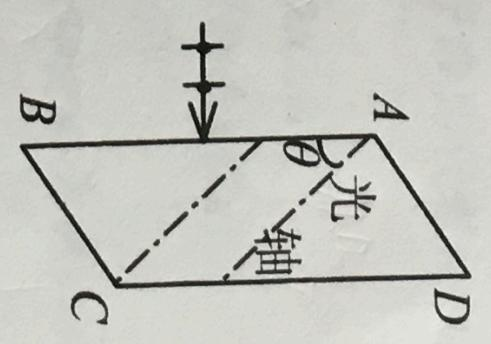

# 《大学物理》活页作业答案（光的偏振）

原件经识别和整理；“参考解答”是我们补的。

### 光的偏振

**选择 1**

题干：关于方解石晶体中的寻常光（o光）和非寻常光（e光），下列说法正确的是：

- A. 寻常光（o光）是偏振光，非寻常光（e光）是自然光；
- B. 非常光（e光）是偏振光，寻常光（o光）是自然光；
- C. 寻常光和非寻常光都是自然光。但寻常光遵循折射定律，非寻常光不遵循。
- D. 寻常光和非寻常光都是偏振光。但寻常光遵循折射定律，非寻常光不遵循。

答案：D

**选择 2**

题干：ABCD 为一块方解石的一个截面，AB 为垂直于纸面的晶体平面……（注：此处原题干因识别截断不完整，仅保留可见选项及上下文暗示的考点）

- A. 传播方向相同，电场强度的振动方向互相垂直.
- B. 传播方向相同，电场强度的振动方向不互相垂直.
- C. 传播方向不同，电场强度的振动方向互相垂直.
- D. 传播方向不同，电场强度的振动方向不互相垂直.

**计算 1**

题干：使光强为 $I_0$ 的自然光依次垂直通过三块偏振片 P1, P2 和 P3。P1 与 P2 的偏振化方向成 45°角, P2 与 P3 的偏振化方向成 45°角. 则透过三块偏振片的光强 I 为？

知识点：[自然光与偏振光、马吕斯定律与布儒斯特定律](../../../topics/大学物理/光的偏振.md)
