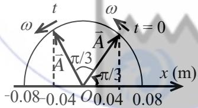

# 《大学物理》活页答案（振动和波部分）

原件经识别和整理；“参考解答”是我们补的。

# 《大学物理》活页答案（振动和波部分）

## 第一节 简谐振动

### 选择 1
答案：D

知识点：[简谐振动的动力学特征与回复力](../../../topics/大学物理/简谐振动的动力学.md)、[牛顿定律在变力问题中的应用（如 ma_t = -mg sinθ）](../../../topics/大学物理/牛顿定律应用.md)

### 选择 2
答案：D

知识点：[简谐振动的运动学方程（振幅、角频率、相位）](../../../topics/大学物理/简谐振动运动学.md)

### 选择 3
答案：B

知识点：[圆周运动的角量描述（角速度、角加速度）](../../../topics/大学物理/圆周运动描述.md)、[牛顿定律在变力问题中的应用（如 ma_t = -mg sinθ）](../../../topics/大学物理/牛顿定律应用.md)、[功能原理与机械能守恒定律](../../../topics/大学物理/功能原理与机械能守恒.md)

### 选择 4
答案：B

知识点：[简谐振动的动力学特征与回复力](../../../topics/大学物理/简谐振动的动力学.md)、[简谐振动的动能、势能与总机械能](../../../topics/大学物理/简谐振动的能量.md)、[简谐振动的运动学方程（振幅、角频率、相位）](../../../topics/大学物理/简谐振动运动学.md)

### 选择 5
答案：B

知识点：[圆周运动的角量描述（角速度、角加速度）](../../../topics/大学物理/圆周运动描述.md)、[速度、加速度的定义与微分关系](../../../topics/大学物理/速度与加速度定义.md)、[牛顿定律在变力问题中的应用（如 ma_t = -mg sinθ）](../../../topics/大学物理/牛顿定律应用.md)

### 选择 6
答案：A

知识点：[位矢及其坐标表示（直角坐标与自然坐标）](../../../topics/大学物理/位矢与坐标表示.md)、[速度、加速度的定义与微分关系](../../../topics/大学物理/速度与加速度定义.md)

### 填空 7
答案：$X=0.02\cos\left(\frac{5}{2}\pi-\frac{\pi}{2}\right)$

知识点：[理想气体的状态方程与平衡态](../../../topics/大学物理/理想气体状态方程.md)、[热力学第一定律及过程量与状态量的区别](../../../topics/大学物理/热力学第一定律.md)、[理想气体的等体、等压、等温、绝热过程（ΔE、A、Q的计算）](../../../topics/大学物理/等值过程.md)

### 填空 8
答案：2:1

知识点：[平面简谐波的波函数 y=Acos(ω(t±x/u)+φ)](../../../topics/大学物理/平面简谐波方程.md)、[简谐振动的运动学方程（振幅、角频率、相位）](../../../topics/大学物理/简谐振动运动学.md)

### 填空 9
答案：0.05m, -37°

知识点：[简谐振动的运动学方程（振幅、角频率、相位）](../../../topics/大学物理/简谐振动运动学.md)、[同方向同频率简谐振动的合成](../../../topics/大学物理/简谐振动的合成.md)

### 填空 10
答案：$\pi$ or $3\pi$

### 填空 11
答案：0

知识点：[平面简谐波的波函数 y=Acos(ω(t±x/u)+φ)](../../../topics/大学物理/平面简谐波方程.md)、[简谐振动的运动学方程（振幅、角频率、相位）](../../../topics/大学物理/简谐振动运动学.md)

### 计算 12
解：周期 $T = \frac{2\pi}{\omega} = \frac{2}{3} \text{ s}$，
振幅 $A = 0.1 \text{ m}$，
初相 $\phi = \frac{2\pi}{3}$，
最大速度 $v_{max} = A\omega = 0.3\pi \text{ m/s}$，
最大加速度 $a_{max} = A\omega^2 = 0.9\pi^2 \text{ m/s}^2$。

知识点：[平面简谐波的波函数 y=Acos(ω(t±x/u)+φ)](../../../topics/大学物理/平面简谐波方程.md)、[简谐振动的运动学方程（振幅、角频率、相位）](../../../topics/大学物理/简谐振动运动学.md)

### 计算 13
提示：旋转矢量法

(1) $x = 0.1\cos \left(\pi t - \frac{\pi}{2}\right)$

(2) $x = 0.1\cos \left(\pi t + \frac{\pi}{3}\right)$

(3) $x = 0.1 \cos (\pi t + \pi)$

知识点：[平面简谐波的波函数 y=Acos(ω(t±x/u)+φ)](../../../topics/大学物理/平面简谐波方程.md)、[简谐振动的运动学方程（振幅、角频率、相位）](../../../topics/大学物理/简谐振动运动学.md)、[波的叠加原理与干涉条件](../../../topics/大学物理/波的干涉.md)

### 计算 14
(1) $x = 0.08\cos \left(\frac{\pi}{2}t + \frac{\pi}{3}\right)$

当 $t=1$ 时，$x=-0.069\text{m}$

恢复力 $F = -kx = -\frac{m}{\omega^2} x = 2.7 \times 10^{-4} \text{ N}$

(2) 令相位 $\frac{\pi}{3} = \frac{\pi}{2} t$，解得 $t=0.67\text{s}$

## 第二节 振动能量和振动的合成

知识点：[平面简谐波的波函数 y=Acos(ω(t±x/u)+φ)](../../../topics/大学物理/平面简谐波方程.md)、[驻波的形成、波节与波腹](../../../topics/大学物理/驻波.md)、[波的叠加原理与干涉条件](../../../topics/大学物理/波的干涉.md)

### 选择 1
答案：D

知识点：[简谐振动的动力学特征与回复力](../../../topics/大学物理/简谐振动的动力学.md)、[牛顿定律在变力问题中的应用（如 ma_t = -mg sinθ）](../../../topics/大学物理/牛顿定律应用.md)

### 选择 2
答案：D

知识点：[简谐振动的运动学方程（振幅、角频率、相位）](../../../topics/大学物理/简谐振动运动学.md)

### 选择 3
答案：D

知识点：[圆周运动的角量描述（角速度、角加速度）](../../../topics/大学物理/圆周运动描述.md)、[牛顿定律在变力问题中的应用（如 ma_t = -mg sinθ）](../../../topics/大学物理/牛顿定律应用.md)、[功能原理与机械能守恒定律](../../../topics/大学物理/功能原理与机械能守恒.md)

### 选择 4
答案：B

知识点：[简谐振动的动力学特征与回复力](../../../topics/大学物理/简谐振动的动力学.md)、[简谐振动的动能、势能与总机械能](../../../topics/大学物理/简谐振动的能量.md)、[简谐振动的运动学方程（振幅、角频率、相位）](../../../topics/大学物理/简谐振动运动学.md)

### 选择 5
答案：B

知识点：[圆周运动的角量描述（角速度、角加速度）](../../../topics/大学物理/圆周运动描述.md)、[速度、加速度的定义与微分关系](../../../topics/大学物理/速度与加速度定义.md)、[牛顿定律在变力问题中的应用（如 ma_t = -mg sinθ）](../../../topics/大学物理/牛顿定律应用.md)

### 填空 6
答案：$v = \frac{1}{2\pi}\sqrt{\frac{k_1k_2}{m(k_1 + k_2)}}$
提示：弹簧串联公式等效于电阻并联

知识点：[简谐振动的动力学特征与回复力](../../../topics/大学物理/简谐振动的动力学.md)

### 填空 7
答案：0.02m

知识点：[理想气体的状态方程与平衡态](../../../topics/大学物理/理想气体状态方程.md)、[热力学第一定律及过程量与状态量的区别](../../../topics/大学物理/热力学第一定律.md)、[理想气体的等体、等压、等温、绝热过程（ΔE、A、Q的计算）](../../../topics/大学物理/等值过程.md)

### 填空 8
答案：$\pi$, 0
提示：两个旋转矢量反向

知识点：[平面简谐波的波函数 y=Acos(ω(t±x/u)+φ)](../../../topics/大学物理/平面简谐波方程.md)、[简谐振动的运动学方程（振幅、角频率、相位）](../../../topics/大学物理/简谐振动运动学.md)

### 填空 9
答案：402 Hz

知识点：[简谐振动的运动学方程（振幅、角频率、相位）](../../../topics/大学物理/简谐振动运动学.md)、[同方向同频率简谐振动的合成](../../../topics/大学物理/简谐振动的合成.md)

### 填空 10
答案：$A=0.1\text{m}$，位相等于 $113^{\circ}$
提示：两个旋转矢量垂直。

### 计算 11
由动量守恒 $\mathrm{mv}_0 = (m + M)v'$
由能量守恒 $\frac{1}{2} kA^2 = \frac{1}{2}(m + M)v'^2$
解得 $A=0.025\text{m}$

角频率 $\omega = \sqrt{\frac{k}{m + M}} = 40 \text{ rad/s}$
运动方程 $x = 0.025\cos (40t - \pi /2)$

知识点：[平面简谐波的波函数 y=Acos(ω(t±x/u)+φ)](../../../topics/大学物理/平面简谐波方程.md)、[波动过程中的能量传播与能流密度](../../../topics/大学物理/波的能量.md)

### 计算 12
$x=0.02\cos(4t+\pi/3)$

## 机械波

知识点：[平面简谐波的波函数 y=Acos(ω(t±x/u)+φ)](../../../topics/大学物理/平面简谐波方程.md)、[简谐振动的运动学方程（振幅、角频率、相位）](../../../topics/大学物理/简谐振动运动学.md)

### 第一节 简谐波

知识点：[机械波的形成、横波与纵波](../../../topics/大学物理/机械波的产生与传播.md)、[平面简谐波的波函数 y=Acos(ω(t±x/u)+φ)](../../../topics/大学物理/平面简谐波方程.md)、[波动过程中的能量传播与能流密度](../../../topics/大学物理/波的能量.md)

### 选择 1
答案：B

知识点：[简谐振动的动力学特征与回复力](../../../topics/大学物理/简谐振动的动力学.md)、[牛顿定律在变力问题中的应用（如 ma_t = -mg sinθ）](../../../topics/大学物理/牛顿定律应用.md)

### 选择 2
答案：A

知识点：[简谐振动的运动学方程（振幅、角频率、相位）](../../../topics/大学物理/简谐振动运动学.md)

### 选择 3
答案：D

知识点：[圆周运动的角量描述（角速度、角加速度）](../../../topics/大学物理/圆周运动描述.md)、[牛顿定律在变力问题中的应用（如 ma_t = -mg sinθ）](../../../topics/大学物理/牛顿定律应用.md)、[功能原理与机械能守恒定律](../../../topics/大学物理/功能原理与机械能守恒.md)

### 选择 4
答案：C

知识点：[简谐振动的动力学特征与回复力](../../../topics/大学物理/简谐振动的动力学.md)、[简谐振动的动能、势能与总机械能](../../../topics/大学物理/简谐振动的能量.md)、[简谐振动的运动学方程（振幅、角频率、相位）](../../../topics/大学物理/简谐振动运动学.md)

### 选择 5
答案：A
补充：注意图中振幅 $A = 0.01 \mathrm{~m}$

知识点：[圆周运动的角量描述（角速度、角加速度）](../../../topics/大学物理/圆周运动描述.md)、[速度、加速度的定义与微分关系](../../../topics/大学物理/速度与加速度定义.md)、[牛顿定律在变力问题中的应用（如 ma_t = -mg sinθ）](../../../topics/大学物理/牛顿定律应用.md)

### 选择 6
答案：B

知识点：[位矢及其坐标表示（直角坐标与自然坐标）](../../../topics/大学物理/位矢与坐标表示.md)、[速度、加速度的定义与微分关系](../../../topics/大学物理/速度与加速度定义.md)

### 填空 7
答案：503.2

知识点：[理想气体的状态方程与平衡态](../../../topics/大学物理/理想气体状态方程.md)、[热力学第一定律及过程量与状态量的区别](../../../topics/大学物理/热力学第一定律.md)、[理想气体的等体、等压、等温、绝热过程（ΔE、A、Q的计算）](../../../topics/大学物理/等值过程.md)

### 填空 8
答案：a向下 b向上 c向上 d向下 （追赶前方质元）

知识点：[平面简谐波的波函数 y=Acos(ω(t±x/u)+φ)](../../../topics/大学物理/平面简谐波方程.md)、[简谐振动的运动学方程（振幅、角频率、相位）](../../../topics/大学物理/简谐振动运动学.md)

### 填空 9
答案：$\pi$

知识点：[简谐振动的运动学方程（振幅、角频率、相位）](../../../topics/大学物理/简谐振动运动学.md)、[同方向同频率简谐振动的合成](../../../topics/大学物理/简谐振动的合成.md)

### 填空 10
答案：$4\pi$ 或 0

### 计算 11
解：(1) 波动方程为 $y = 0.1 \cos \left(4\pi t - \frac{2}{10}\pi x\right) = 0.1 \cos 4\pi \left(t - \frac{1}{20}x\right)$

(2) $t_1 = T / 4 = (1 / 8)\mathrm{s}$，在 $x_1 = \lambda /4 = (10 / 4)\mathrm{m}$ 处质点的位移：
$$
y _ {1} = 0. 1 \cos 4 \pi (T / 4 - \lambda / 8 0) = 0. 1 \cos 4 \pi \left(1 / 8 - \frac {1}{8}\right) = 0. 1 \mathrm{m}
$$

(3) 振速 $\nu = \frac{\partial y}{\partial t} = -0.4\pi \sin 4\pi (t - x / 20)$ 。
$t_{2}=\frac{1}{2}T=(1/4)$ s，在 $x_{1}=\lambda/4=(10/4)$ m 处质点的振速：
$$
\nu_ {2} = - 0. 4 \pi \sin (\pi - \frac {1}{2} \pi) = - 1. 2 6 \mathrm{m/s}
$$

知识点：[平面简谐波的波函数 y=Acos(ω(t±x/u)+φ)](../../../topics/大学物理/平面简谐波方程.md)、[波动过程中的能量传播与能流密度](../../../topics/大学物理/波的能量.md)

### 计算 12
已知 $\lambda = 0.4\mathrm{m}$，波速 $u = 0.05 \mathrm{m/s}$（注：原文此处数值较小，按上下文推导），
$k = \frac{\omega}{u} = \frac{2\pi}{\lambda} = 5\pi$，
$\omega = \frac{\pi}{4}$

初相 $\phi_ {0} = \frac {\pi}{2} - \frac {2 \pi}{T} \cdot \frac {T}{2} = - \frac {\pi}{2}$

波动方程 $\mathrm{y(x,t) = 0.06\cos (\frac{\pi}{4} t - 5\pi x - \frac{\pi}{2})}$
$x=0.2$ 处的振动方程 $\mathrm{y(0.2,t) = 0.06\cos (\frac{\pi}{4} t - \frac{3\pi}{2})}$

知识点：[平面简谐波的波函数 y=Acos(ω(t±x/u)+φ)](../../../topics/大学物理/平面简谐波方程.md)、[简谐振动的运动学方程（振幅、角频率、相位）](../../../topics/大学物理/简谐振动运动学.md)

### 计算 13
P点振动方程：
$$
\begin{aligned} y _ {P} & = \frac {1}{2} (\sqrt {3} \sin \omega t - \cos \omega t) \times 1 0 ^ {- 2} \\
& = \frac {1}{2} [\sqrt {3} \cos (\omega t - \frac {1}{2} \pi) + \cos (\omega t + \pi)] \times 1 0 ^ {- 2} \\
& = 1 \times 1 0 ^ {- 2} \cos (\omega t + 4 \pi / 3) \quad (\mathrm{SI}).
\end{aligned}
$$

波的表达式为:
$$
\begin{aligned}
y & = 1 \times 1 0 ^ {- 2} \cos [ \omega t + \frac {4}{3} \pi - 2 \pi \frac {x - \lambda / 2}{\lambda} ] \\
& = 1 \times 1 0 ^ {- 2} \cos (\omega t - 2 \pi \frac {x}{\lambda} + \frac {1}{3} \pi) \quad (\mathrm{SI})
\end{aligned}
$$

知识点：[平面简谐波的波函数 y=Acos(ω(t±x/u)+φ)](../../../topics/大学物理/平面简谐波方程.md)、[简谐振动的运动学方程（振幅、角频率、相位）](../../../topics/大学物理/简谐振动运动学.md)、[波的叠加原理与干涉条件](../../../topics/大学物理/波的干涉.md)

### 第二节 波的干涉 驻波 电磁波

知识点：[波的叠加原理与干涉条件](../../../topics/大学物理/波的干涉.md)、[驻波的形成、波节与波腹](../../../topics/大学物理/驻波.md)、[机械波的形成、横波与纵波](../../../topics/大学物理/机械波的产生与传播.md)

### 选择 1
答案：D

知识点：[简谐振动的动力学特征与回复力](../../../topics/大学物理/简谐振动的动力学.md)、[牛顿定律在变力问题中的应用（如 ma_t = -mg sinθ）](../../../topics/大学物理/牛顿定律应用.md)

### 选择 2
答案：C

知识点：[简谐振动的运动学方程（振幅、角频率、相位）](../../../topics/大学物理/简谐振动运动学.md)

### 选择 3
答案：D

知识点：[圆周运动的角量描述（角速度、角加速度）](../../../topics/大学物理/圆周运动描述.md)、[牛顿定律在变力问题中的应用（如 ma_t = -mg sinθ）](../../../topics/大学物理/牛顿定律应用.md)、[功能原理与机械能守恒定律](../../../topics/大学物理/功能原理与机械能守恒.md)

### 选择 4
答案：B

知识点：[简谐振动的动力学特征与回复力](../../../topics/大学物理/简谐振动的动力学.md)、[简谐振动的动能、势能与总机械能](../../../topics/大学物理/简谐振动的能量.md)、[简谐振动的运动学方程（振幅、角频率、相位）](../../../topics/大学物理/简谐振动运动学.md)

### 选择 5
答案：B

知识点：[圆周运动的角量描述（角速度、角加速度）](../../../topics/大学物理/圆周运动描述.md)、[速度、加速度的定义与微分关系](../../../topics/大学物理/速度与加速度定义.md)、[牛顿定律在变力问题中的应用（如 ma_t = -mg sinθ）](../../../topics/大学物理/牛顿定律应用.md)

### 选择 6
答案：A

知识点：[位矢及其坐标表示（直角坐标与自然坐标）](../../../topics/大学物理/位矢与坐标表示.md)、[速度、加速度的定义与微分关系](../../../topics/大学物理/速度与加速度定义.md)

### 选择 7
答案：C

知识点：[圆周运动的角量描述（角速度、角加速度）](../../../topics/大学物理/圆周运动描述.md)、[自然参数下的切向加速度与法向加速度](../../../topics/大学物理/自然坐标系下的运动.md)

### 填空 8
答案：$y = -2A\cos (\omega t)$，$\frac{\partial y}{\partial t} = 2A\omega \sin (\omega t)$

知识点：[平面简谐波的波函数 y=Acos(ω(t±x/u)+φ)](../../../topics/大学物理/平面简谐波方程.md)、[简谐振动的运动学方程（振幅、角频率、相位）](../../../topics/大学物理/简谐振动运动学.md)

### 填空 9
答案：2A
提示：两振动同相

知识点：[简谐振动的运动学方程（振幅、角频率、相位）](../../../topics/大学物理/简谐振动运动学.md)、[同方向同频率简谐振动的合成](../../../topics/大学物理/简谐振动的合成.md)

### 填空 10
答案：0.5m

### 填空 11
答案：$A\cos2\pi\left(\frac{t}{T}-\frac{x}{\lambda}\right)$，A

知识点：[平面简谐波的波函数 y=Acos(ω(t±x/u)+φ)](../../../topics/大学物理/平面简谐波方程.md)、[简谐振动的运动学方程（振幅、角频率、相位）](../../../topics/大学物理/简谐振动运动学.md)

### 填空 12
答案：> 70.8 Hz

知识点：[简谐振动的运动学方程（振幅、角频率、相位）](../../../topics/大学物理/简谐振动运动学.md)

### 填空 13
答案：$7.96 \times 10^{-2} \mathrm{~W} / \mathrm{m}^{2}$

知识点：[波动过程中的能量传播与能流密度](../../../topics/大学物理/波的能量.md)

### 计算 14
解：(1) 反射点是固定端，所以反射有相位突变 $\pi$ ，且反射波振幅为 $A$ ，因此反射波的表达式为 $y_{2} = A\cos [2\pi (x / \lambda -t / T) + \pi ]$

(2) 驻波的表达式是 $y = y_{1} + y_{2}$
$=2A\cos(2\pi x/\lambda+\frac{1}{2}\pi)\cos(2\pi t/T-\frac{1}{2}\pi)$

(3) 波腹位置: $2\pi x / \lambda + \frac{1}{2}\pi = n\pi$ ,
$$
x = \frac {1}{2} (n - \frac {1}{2}) \lambda , \quad n = 1, 2, 3, 4, \dots
$$

波节位置： $2\pi x / \lambda +\frac{1}{2}\pi = n\pi +\frac{1}{2}\pi$
$$
x = \frac {1}{2} n \lambda , n = 1, 2, 3, 4, \dots
$$

知识点：[平面简谐波的波函数 y=Acos(ω(t±x/u)+φ)](../../../topics/大学物理/平面简谐波方程.md)、[驻波的形成、波节与波腹](../../../topics/大学物理/驻波.md)、[波的叠加原理与干涉条件](../../../topics/大学物理/波的干涉.md)

### 计算 15
解：(1) 与波动的标准表达式 $y = A\cos 2\pi (\nu t - x / \lambda)$ 对比可得：
$$
\nu = 4 \mathrm{Hz}, \quad \lambda = 1. 5 0 \mathrm{m},
$$
波速 $u = \lambda \nu = 6. 0 0 \mathrm{m} / \mathrm{s}$

(2) 节点位置
$$
4 \pi x / 3 = \pm (n \pi + \frac {1}{2} \pi)
$$
$$
x = \pm 3 (n + \frac {1}{2}) \mathrm{m}, n = 0, 1, 2, 3,
$$

(3) 波腹位置
$$
4 \pi x / 3 = \pm n \pi
$$
$$
x = \pm 3 n / 4 \mathrm{m}, \quad n = 0, 1, 2, 3, \dots
$$

知识点：[平面简谐波的波函数 y=Acos(ω(t±x/u)+φ)](../../../topics/大学物理/平面简谐波方程.md)、[驻波的形成、波节与波腹](../../../topics/大学物理/驻波.md)
