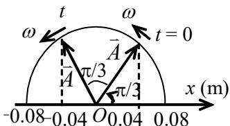

# 《大学物理》活页答案：振动和波部分

原件经识别和整理；“参考解答”是我们补的。

## 第一节 简谐振动

### 选择 1

答案：D

知识点：[牛顿三定律与惯性系](../../../topics/大学物理/牛顿三定律.md)、[常见力（重力、弹力、摩擦力）的受力分析](../../../topics/大学物理/常见力分析.md)

### 选择 2

答案：D

知识点：[圆周运动的角量描述（角速度、角加速度）](../../../topics/大学物理/圆周运动描述.md)、[自然参数下的切向加速度与法向加速度](../../../topics/大学物理/自然坐标系下的运动.md)

### 选择 3

答案：B

知识点：[圆周运动的角量描述（角速度、角加速度）](../../../topics/大学物理/圆周运动描述.md)、[自然参数下的切向加速度与法向加速度](../../../topics/大学物理/自然坐标系下的运动.md)、[牛顿定律在变力问题中的应用（如 ma_t = -mg sinθ）](../../../topics/大学物理/牛顿定律应用.md)

### 选择 4

答案：B

知识点：[圆周运动的角量描述（角速度、角加速度）](../../../topics/大学物理/圆周运动描述.md)、[牛顿三定律与惯性系](../../../topics/大学物理/牛顿三定律.md)、[常见力（重力、弹力、摩擦力）的受力分析](../../../topics/大学物理/常见力分析.md)

### 选择 5

答案：B

知识点：[刚体定轴转动的角量描述](../../../topics/大学物理/刚体定轴转动运动学.md)、[转动惯量的计算与平行轴定理](../../../topics/大学物理/转动惯量.md)、[刚体定轴转动定律（M=Jα）](../../../topics/大学物理/刚体转动定律.md)

### 选择 6

答案：A

知识点：[用旋转矢量法确定初相与运动状态](../../../topics/大学物理/旋转矢量法.md)、[简谐振动的动力学特征与回复力](../../../topics/大学物理/简谐振动的动力学.md)

### 填空 7

答案：$X = 0.02\cos \left(\frac{5}{2}\pi -\frac{\pi}{2}\right)$

知识点：[速度、加速度的定义与微分关系](../../../topics/大学物理/速度与加速度定义.md)、[自然参数下的切向加速度与法向加速度](../../../topics/大学物理/自然坐标系下的运动.md)、[圆周运动的角量描述（角速度、角加速度）](../../../topics/大学物理/圆周运动描述.md)

### 填空 8

答案：2:1

知识点：[简谐振动的运动学方程（振幅、角频率、相位）](../../../topics/大学物理/简谐振动运动学.md)、[同方向同频率简谐振动的合成](../../../topics/大学物理/简谐振动的合成.md)

### 填空 9

答案：$0.05\mathrm{m}$，$-37^{\circ}$

知识点：[同方向同频率简谐振动的合成](../../../topics/大学物理/简谐振动的合成.md)、[简谐振动的运动学方程（振幅、角频率、相位）](../../../topics/大学物理/简谐振动运动学.md)

### 填空 10

答案：$\pi$ 或 $3\pi$

知识点：[自然参数下的切向加速度与法向加速度](../../../topics/大学物理/自然坐标系下的运动.md)、[速度、加速度的定义与微分关系](../../../topics/大学物理/速度与加速度定义.md)

### 填空 11

答案：0

知识点：[平面简谐波的波函数 y=Acos(ω(t±x/u)+φ)](../../../topics/大学物理/平面简谐波方程.md)、[简谐振动的运动学方程（振幅、角频率、相位）](../../../topics/大学物理/简谐振动运动学.md)、[机械波的形成、横波与纵波](../../../topics/大学物理/机械波的产生与传播.md)

### 计算 12

解：周期 $T = 2\pi /\omega = 2 / 3\ \mathrm{s}$，振幅 $A = 0.1\mathrm{m}$，初相 $\phi = 2\pi /3$，

$$
v_{\max} = A\omega = 0.3\pi\ \mathrm{m/s},
$$

$$
a_{\max} = \omega^{2} A = 0.9\pi^{2}\ \mathrm{m/s^{2}}
$$

知识点：[平面简谐波的波函数 y=Acos(ω(t±x/u)+φ)](../../../topics/大学物理/平面简谐波方程.md)、[简谐振动的运动学方程（振幅、角频率、相位）](../../../topics/大学物理/简谐振动运动学.md)

### 简答 13

提示：旋转矢量法

(1) $x = 0.1\cos \left(\pi t - \frac{\pi}{2}\right)$

(2) $x = 0.1 \cos \left( \pi t + \frac{\pi}{3} \right)$

(3) $x = 0.1\cos (\pi t + \pi)$

知识点：[用旋转矢量法确定初相与运动状态](../../../topics/大学物理/旋转矢量法.md)、[简谐振动的运动学方程（振幅、角频率、相位）](../../../topics/大学物理/简谐振动运动学.md)

### 计算 14

(1) $x = 0.08\cos \left(\frac{\pi}{2}t + \frac{\pi}{3}\right)$

$t=1$ 时 $x=-0.069\mathrm{m}$，$F=-kx=-\frac{m}{\omega^{2}}x=2.7\times10^{-4}$

(2) $\frac{\pi}{3} = \frac{\pi}{2} t$，$t=0.67\mathrm{s}$

## 第二节 振动能量和振动的合成

知识点：[驻波的形成、波节与波腹](../../../topics/大学物理/驻波.md)、[平面简谐波的波函数 y=Acos(ω(t±x/u)+φ)](../../../topics/大学物理/平面简谐波方程.md)

### 选择 1

答案：D

知识点：[牛顿三定律与惯性系](../../../topics/大学物理/牛顿三定律.md)、[常见力（重力、弹力、摩擦力）的受力分析](../../../topics/大学物理/常见力分析.md)

### 选择 2

答案：D

知识点：[圆周运动的角量描述（角速度、角加速度）](../../../topics/大学物理/圆周运动描述.md)、[自然参数下的切向加速度与法向加速度](../../../topics/大学物理/自然坐标系下的运动.md)

### 选择 3

答案：D

知识点：[圆周运动的角量描述（角速度、角加速度）](../../../topics/大学物理/圆周运动描述.md)、[自然参数下的切向加速度与法向加速度](../../../topics/大学物理/自然坐标系下的运动.md)、[牛顿定律在变力问题中的应用（如 ma_t = -mg sinθ）](../../../topics/大学物理/牛顿定律应用.md)

### 选择 4

答案：B

知识点：[圆周运动的角量描述（角速度、角加速度）](../../../topics/大学物理/圆周运动描述.md)、[牛顿三定律与惯性系](../../../topics/大学物理/牛顿三定律.md)、[常见力（重力、弹力、摩擦力）的受力分析](../../../topics/大学物理/常见力分析.md)

### 选择 5

答案：B

知识点：[刚体定轴转动的角量描述](../../../topics/大学物理/刚体定轴转动运动学.md)、[转动惯量的计算与平行轴定理](../../../topics/大学物理/转动惯量.md)、[刚体定轴转动定律（M=Jα）](../../../topics/大学物理/刚体转动定律.md)

### 填空 6

答案：$v = \frac{1}{2\pi}\sqrt{\frac{k_1k_2}{m(k_1 + k_2)}}$ 提示：弹簧串联公式等效于电阻并联

知识点：[简谐振动的动力学特征与回复力](../../../topics/大学物理/简谐振动的动力学.md)

### 填空 7

答案：0.02m

知识点：[速度、加速度的定义与微分关系](../../../topics/大学物理/速度与加速度定义.md)、[自然参数下的切向加速度与法向加速度](../../../topics/大学物理/自然坐标系下的运动.md)、[圆周运动的角量描述（角速度、角加速度）](../../../topics/大学物理/圆周运动描述.md)

### 填空 8

答案：$\pi$，0 提示：两个旋转矢量反向

知识点：[简谐振动的运动学方程（振幅、角频率、相位）](../../../topics/大学物理/简谐振动运动学.md)、[同方向同频率简谐振动的合成](../../../topics/大学物理/简谐振动的合成.md)

### 填空 9

答案：402Hz

知识点：[同方向同频率简谐振动的合成](../../../topics/大学物理/简谐振动的合成.md)、[简谐振动的运动学方程（振幅、角频率、相位）](../../../topics/大学物理/简谐振动运动学.md)

### 填空 10

答案：$A=0.1\mathrm{m}$，位相等于 $113^{\circ}$ 提示：两个旋转矢量垂直。

知识点：[自然参数下的切向加速度与法向加速度](../../../topics/大学物理/自然坐标系下的运动.md)、[速度、加速度的定义与微分关系](../../../topics/大学物理/速度与加速度定义.md)

### 计算 11

解：$mv_0 = (m + M)v'$，$\frac{1}{2} kA^2 = \frac{1}{2}(m + M)v'^2$，$A=0.025\mathrm{m}$

$\omega = \sqrt{\frac{k}{m + M}} = 40$

$x = 0.025\cos (40t - \pi /2)$

知识点：[平面简谐波的波函数 y=Acos(ω(t±x/u)+φ)](../../../topics/大学物理/平面简谐波方程.md)、[机械波的形成、横波与纵波](../../../topics/大学物理/机械波的产生与传播.md)

### 计算 12

$x=0.02\cos(4t+\pi/3)$（SI）

## 第一节 简谐波

知识点：[平面简谐波的波函数 y=Acos(ω(t±x/u)+φ)](../../../topics/大学物理/平面简谐波方程.md)、[简谐振动的运动学方程（振幅、角频率、相位）](../../../topics/大学物理/简谐振动运动学.md)

### 选择 1

答案：B

知识点：[牛顿三定律与惯性系](../../../topics/大学物理/牛顿三定律.md)、[常见力（重力、弹力、摩擦力）的受力分析](../../../topics/大学物理/常见力分析.md)

### 选择 2

答案：A

知识点：[圆周运动的角量描述（角速度、角加速度）](../../../topics/大学物理/圆周运动描述.md)、[自然参数下的切向加速度与法向加速度](../../../topics/大学物理/自然坐标系下的运动.md)

### 选择 3

答案：D

知识点：[圆周运动的角量描述（角速度、角加速度）](../../../topics/大学物理/圆周运动描述.md)、[自然参数下的切向加速度与法向加速度](../../../topics/大学物理/自然坐标系下的运动.md)、[牛顿定律在变力问题中的应用（如 ma_t = -mg sinθ）](../../../topics/大学物理/牛顿定律应用.md)

### 选择 4

答案：C

知识点：[圆周运动的角量描述（角速度、角加速度）](../../../topics/大学物理/圆周运动描述.md)、[牛顿三定律与惯性系](../../../topics/大学物理/牛顿三定律.md)、[常见力（重力、弹力、摩擦力）的受力分析](../../../topics/大学物理/常见力分析.md)

### 选择 5

答案：A（注意图缺：振幅 $A = 0.01\mathrm{m}$）

知识点：[刚体定轴转动的角量描述](../../../topics/大学物理/刚体定轴转动运动学.md)、[转动惯量的计算与平行轴定理](../../../topics/大学物理/转动惯量.md)、[刚体定轴转动定律（M=Jα）](../../../topics/大学物理/刚体转动定律.md)

### 选择 6

答案：B

知识点：[用旋转矢量法确定初相与运动状态](../../../topics/大学物理/旋转矢量法.md)、[简谐振动的动力学特征与回复力](../../../topics/大学物理/简谐振动的动力学.md)

### 填空 7

答案：503.2

知识点：[速度、加速度的定义与微分关系](../../../topics/大学物理/速度与加速度定义.md)、[自然参数下的切向加速度与法向加速度](../../../topics/大学物理/自然坐标系下的运动.md)、[圆周运动的角量描述（角速度、角加速度）](../../../topics/大学物理/圆周运动描述.md)

### 填空 8

答案：a向下 b向上 c向上 d向下（追赶前方质元）

知识点：[简谐振动的运动学方程（振幅、角频率、相位）](../../../topics/大学物理/简谐振动运动学.md)、[同方向同频率简谐振动的合成](../../../topics/大学物理/简谐振动的合成.md)

### 填空 9

答案：$\pi$

知识点：[同方向同频率简谐振动的合成](../../../topics/大学物理/简谐振动的合成.md)、[简谐振动的运动学方程（振幅、角频率、相位）](../../../topics/大学物理/简谐振动运动学.md)

### 填空 10

答案：$4\pi$ 或 0

知识点：[自然参数下的切向加速度与法向加速度](../../../topics/大学物理/自然坐标系下的运动.md)、[速度、加速度的定义与微分关系](../../../topics/大学物理/速度与加速度定义.md)

### 计算 11

解：(1) $y = 0.1\cos (4\pi t - \frac{2}{10}\pi x) = 0.1\cos 4\pi (t - \frac{1}{20} x)$

(2) $t_1 = T / 4 = (1 / 8)\mathrm{s}$，$x_1 = \lambda /4 = (10 / 4)\mathrm{m}$ 处质点的位移

$$
y_{1} = 0.1 \cos 4 \pi (T / 4 - \lambda / 80) = 0.1 \cos 4 \pi \left(1 / 8 - \frac{1}{8}\right) = 0.1 \mathrm{m}
$$

(3) 振速 $\nu = \frac{\partial y}{\partial t} = -0.4\pi \sin 4\pi (t - x / 20)$

$t_{2}=\frac{1}{2}T=(1/4)\ \mathrm{s}$，在 $x_{1}=\lambda/4=(10/4)\ \mathrm{m}$ 处质点的振速

$$
\nu_{2} = - 0.4 \pi \sin (\pi - \frac{1}{2} \pi) = - 1.26 \mathrm{m/s}
$$

知识点：[平面简谐波的波函数 y=Acos(ω(t±x/u)+φ)](../../../topics/大学物理/平面简谐波方程.md)、[机械波的形成、横波与纵波](../../../topics/大学物理/机械波的产生与传播.md)

### 计算 12

$$
\lambda = 0.4 \mathrm{m} \quad u = 0.05 \quad k = \frac{\omega}{u} = \frac{2 \pi}{\lambda} = 5 \pi \quad \omega = \frac{\pi}{4}
$$

$$
\phi_{0} = \frac{\pi}{2} - \frac{2 \pi}{T} \cdot \frac{T}{2} = - \frac{\pi}{2}
$$

$$
y(x, t) = 0.06 \cos (\frac{\pi}{4} t - 5 \pi x - \frac{\pi}{2}) \quad y(0.2, t) = 0.06 \cos (\frac{\pi}{4} t - \frac{3 \pi}{2})
$$

知识点：[平面简谐波的波函数 y=Acos(ω(t±x/u)+φ)](../../../topics/大学物理/平面简谐波方程.md)、[简谐振动的运动学方程（振幅、角频率、相位）](../../../topics/大学物理/简谐振动运动学.md)

### 计算 13

$$
\begin{array}{r l}
y_{P} & = \frac{1}{2} (\sqrt{3} \sin \omega t - \cos \omega t) \times 10^{-2} \\
& = \frac{1}{2} [\sqrt{3} \cos (\omega t - \frac{1}{2} \pi) + \cos (\omega t + \pi)] \times 10^{-2} \\
& = 1 \times 10^{-2} \cos (\omega t + 4 \pi / 3) \quad (\mathrm{SI}).
\end{array}
$$

波的表达式为：

$$
\begin{array}{r l}
y & = 1 \times 10^{-2} \cos [\omega t + \frac{4}{3} \pi - 2 \pi \frac{x - \lambda / 2}{\lambda}] \\
& = 1 \times 10^{-2} \cos (\omega t - 2 \pi \frac{x}{\lambda} + \frac{1}{3} \pi) \quad (\mathrm{SI})
\end{array}
$$

## 第二节 波的干涉 驻波 电磁波

知识点：[平面简谐波的波函数 y=Acos(ω(t±x/u)+φ)](../../../topics/大学物理/平面简谐波方程.md)、[波的叠加原理与干涉条件](../../../topics/大学物理/波的干涉.md)、[驻波的形成、波节与波腹](../../../topics/大学物理/驻波.md)

### 选择 1

答案：D

知识点：[牛顿三定律与惯性系](../../../topics/大学物理/牛顿三定律.md)、[常见力（重力、弹力、摩擦力）的受力分析](../../../topics/大学物理/常见力分析.md)

### 选择 2

答案：C

知识点：[圆周运动的角量描述（角速度、角加速度）](../../../topics/大学物理/圆周运动描述.md)、[自然参数下的切向加速度与法向加速度](../../../topics/大学物理/自然坐标系下的运动.md)

### 选择 3

答案：D

知识点：[圆周运动的角量描述（角速度、角加速度）](../../../topics/大学物理/圆周运动描述.md)、[自然参数下的切向加速度与法向加速度](../../../topics/大学物理/自然坐标系下的运动.md)、[牛顿定律在变力问题中的应用（如 ma_t = -mg sinθ）](../../../topics/大学物理/牛顿定律应用.md)

### 选择 4

答案：B

知识点：[圆周运动的角量描述（角速度、角加速度）](../../../topics/大学物理/圆周运动描述.md)、[牛顿三定律与惯性系](../../../topics/大学物理/牛顿三定律.md)、[常见力（重力、弹力、摩擦力）的受力分析](../../../topics/大学物理/常见力分析.md)

### 选择 5

答案：B

知识点：[刚体定轴转动的角量描述](../../../topics/大学物理/刚体定轴转动运动学.md)、[转动惯量的计算与平行轴定理](../../../topics/大学物理/转动惯量.md)、[刚体定轴转动定律（M=Jα）](../../../topics/大学物理/刚体转动定律.md)

### 选择 6

答案：A

知识点：[用旋转矢量法确定初相与运动状态](../../../topics/大学物理/旋转矢量法.md)、[简谐振动的动力学特征与回复力](../../../topics/大学物理/简谐振动的动力学.md)

### 选择 7

答案：C

知识点：[位矢及其坐标表示（直角坐标与自然坐标）](../../../topics/大学物理/位矢与坐标表示.md)、[速度、加速度的定义与微分关系](../../../topics/大学物理/速度与加速度定义.md)、[自然参数下的切向加速度与法向加速度](../../../topics/大学物理/自然坐标系下的运动.md)

### 填空 8

答案：$y = -2A\cos (\omega t)$，$\frac{\partial y}{\partial t} = 2A\omega \sin (\omega t)$

知识点：[简谐振动的运动学方程（振幅、角频率、相位）](../../../topics/大学物理/简谐振动运动学.md)、[同方向同频率简谐振动的合成](../../../topics/大学物理/简谐振动的合成.md)

### 填空 9

答案：2A（提示：两振动同相）

知识点：[同方向同频率简谐振动的合成](../../../topics/大学物理/简谐振动的合成.md)、[简谐振动的运动学方程（振幅、角频率、相位）](../../../topics/大学物理/简谐振动运动学.md)

### 填空 10

答案：0.5m

知识点：[自然参数下的切向加速度与法向加速度](../../../topics/大学物理/自然坐标系下的运动.md)、[速度、加速度的定义与微分关系](../../../topics/大学物理/速度与加速度定义.md)

### 填空 11

答案：$A\cos2\pi(\frac{t}{T}-\frac{x}{\lambda})$，$A$

知识点：[平面简谐波的波函数 y=Acos(ω(t±x/u)+φ)](../../../topics/大学物理/平面简谐波方程.md)、[简谐振动的运动学方程（振幅、角频率、相位）](../../../topics/大学物理/简谐振动运动学.md)、[机械波的形成、横波与纵波](../../../topics/大学物理/机械波的产生与传播.md)

### 填空 12

答案：$> 70.8\mathrm{Hz}$

知识点：[平面简谐波的波函数 y=Acos(ω(t±x/u)+φ)](../../../topics/大学物理/平面简谐波方程.md)、[驻波的形成、波节与波腹](../../../topics/大学物理/驻波.md)、[波的叠加原理与干涉条件](../../../topics/大学物理/波的干涉.md)

### 填空 13

答案：$7.96 \times 10^{-2}\ \mathrm{W/m^{2}}$

知识点：[波动过程中的能量传播与能流密度](../../../topics/大学物理/波的能量.md)

### 计算 14

解：(1) 反射点是固定端，所以反射有相位突变 $\pi$，且反射波振幅为 $A$，因此反射波的表达式为 $y_{2} = A\cos [2\pi (x / \lambda -t / T) + \pi ]$

(2) 驻波的表达式是 $y = y_{1} + y_{2}$

$$
= 2 A \cos (2 \pi x / \lambda + \frac{1}{2} \pi) \cos (2 \pi t / T - \frac{1}{2} \pi)
$$

(3) 波腹位置：

$$
2 \pi x / \lambda + \frac{1}{2} \pi = n \pi
$$

$$
x = \frac{1}{2} (n - \frac{1}{2}) \lambda, \quad n = 1, 2, 3, 4, \dots
$$

波节位置：$2\pi x / \lambda +\frac{1}{2}\pi = n\pi +\frac{1}{2}\pi$

$$
x = \frac{1}{2} n \lambda, \quad n = 1, 2, 3, 4, \dots
$$

知识点：[驻波的形成、波节与波腹](../../../topics/大学物理/驻波.md)、[平面简谐波的波函数 y=Acos(ω(t±x/u)+φ)](../../../topics/大学物理/平面简谐波方程.md)

### 计算 15

解：(1) 与波动的标准表达式 $y = A \cos 2\pi (\nu t - x / \lambda)$ 对比可得：

$$
\nu = 4 \mathrm{Hz}, \quad \lambda = 1.50 \mathrm{m},
$$

波速

$$
u = \lambda \nu = 6.00 \mathrm{m/s}
$$

(2) 节点位置

$$
4 \pi x / 3 = \pm (n \pi + \frac{1}{2} \pi)
$$

$$
x = \pm 3 \left(n + \frac{1}{2}\right) \mathrm{m}, \quad n = 0, 1, 2, 3, \dots
$$

(3) 波腹位置 $4\pi x / 3 = \pm n\pi$

$$
x = \pm 3 n / 4 \mathrm{m}, \quad n = 0, 1, 2, 3, \dots
$$

知识点：[平面简谐波的波函数 y=Acos(ω(t±x/u)+φ)](../../../topics/大学物理/平面简谐波方程.md)、[驻波的形成、波节与波腹](../../../topics/大学物理/驻波.md)
