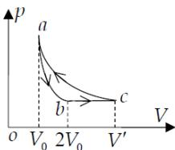

# 《大学物理》热力学基础部分练习册答案

原件经识别和整理；“参考解答”是我们补的。

## 一、选择题

### 选择 1
内能: $E = \nu \frac{i}{2} RT$ 是温度的单值函数, 温度升高, 内能增加。

答案：C。

知识点：[能量按自由度均分定理与理想气体内能](../../../topics/大学物理/能量均分定理.md)、[理想气体的状态方程与平衡态](../../../topics/大学物理/理想气体状态方程.md)

### 选择 2
$Q = \Delta E + W$ ，在两个过程中 $\Delta E > 0$ ， $W > 0$ ，所以 $Q > 0$ 。另外 $\Delta E_1 = \Delta E_2$ ， $W_1 > W_2$ ，所以 $Q_1 > Q_2 > 0$ 。

答案：A。

知识点：[热力学第一定律及过程量与状态量的区别](../../../topics/大学物理/热力学第一定律.md)、[理想气体的等体、等压、等温、绝热过程（ΔE、A、Q的计算）](../../../topics/大学物理/等值过程.md)

### 选择 3
刚性容器，体积不变， $W=0,\quad Q=\Delta E,\quad \Delta E=\nu\frac{i}{2}R\Delta T$ ，氢气 i=5， $\Delta E=6J$ ；氦气 i=3， $\Delta E=10J$ 。

答案：D。

知识点：[能量按自由度均分定理与理想气体内能](../../../topics/大学物理/能量均分定理.md)、[理想气体的状态方程与平衡态](../../../topics/大学物理/理想气体状态方程.md)、[热力学第一定律及过程量与状态量的区别](../../../topics/大学物理/热力学第一定律.md)

### 选择 4
等压过程， $W = p\Delta V, Q = \Delta E + W = \nu \frac{i}{2} R\Delta T + W = \nu \frac{5}{2} R\Delta T + W$ ，结合 $pV = \nu RT$ ， $Q = \frac{5}{2} p\Delta V + W$ ，因此 W:Q = 2:7

答案：D。

知识点：[理想气体的等体、等压、等温、绝热过程（ΔE、A、Q的计算）](../../../topics/大学物理/等值过程.md)、[热力学第一定律及过程量与状态量的区别](../../../topics/大学物理/热力学第一定律.md)、[理想气体的状态方程与平衡态](../../../topics/大学物理/理想气体状态方程.md)

### 选择 5
该循环中 $\Delta E = 0$ ，逆时针循环 $W < 0$ ，所以 $Q < 0$ 。

答案：A。

知识点：[一般热机循环过程的效率](../../../topics/大学物理/循环过程与效率.md)、[热力学第一定律及过程量与状态量的区别](../../../topics/大学物理/热力学第一定律.md)

### 选择 6
绝热过程中 $Q_{绝热} = 0$ ， $W_{绝热} > 0$ ，所以 $\Delta E_{绝热} = -W_{绝热} < 0$ ；123 过程里 $\Delta E_{123} = \Delta E_{绝热} < 0$ ， $W_{123} < W_{绝热}$ ， $Q_{123} < 0$

答案：C。

知识点：[热力学第一定律及过程量与状态量的区别](../../../topics/大学物理/热力学第一定律.md)、[理想气体的等体、等压、等温、绝热过程（ΔE、A、Q的计算）](../../../topics/大学物理/等值过程.md)

### 选择 7
卡诺循环： $\eta=1-\frac{T_{低}}{T_{高}}=1-\frac{300}{600}=0.5=\frac{W}{Q_{吸}}$

答案：B。

知识点：[卡诺循环的效率与致冷系数](../../../topics/大学物理/卡诺循环.md)

### 选择 8
卡诺循环的效率只与温度有关，所以效率相同，两循环的面积决定做功大小。

答案：D。

知识点：[卡诺循环的效率与致冷系数](../../../topics/大学物理/卡诺循环.md)、[热力学第一定律及过程量与状态量的区别](../../../topics/大学物理/热力学第一定律.md)、[一般热机循环过程的效率](../../../topics/大学物理/循环过程与效率.md)

### 选择 9
两条绝热线，所以两个过程 Q = 0 ，工作在相同的温度间，因此两个过程内能增量相同，所以两过程做功相同，面积相同。

答案：B。

知识点：[理想气体的状态方程与平衡态](../../../topics/大学物理/理想气体状态方程.md)、[理想气体的等体、等压、等温、绝热过程（ΔE、A、Q的计算）](../../../topics/大学物理/等值过程.md)、[一般热机循环过程的效率](../../../topics/大学物理/循环过程与效率.md)

### 选择 10
不符合卡诺定理 $\eta=1-\frac{T_{低}}{T_{高}}=\frac{W}{Q_{吸}}$

$$
\frac {(p _ {2} - p _ {1}) (V _ {2} + V _ {1})}{2} = \frac {p _ {2} V _ {2} - p _ {1} V _ {1}}{2}; \frac {3}{2} (p _ {2} V _ {2} - p _ {1} V _ {1}); \underline {{2 (p _ {2} V _ {2} - p _ {1} V _ {1})}}
$$

答案：D。

## 二、填空题

知识点：[卡诺循环的效率与致冷系数](../../../topics/大学物理/卡诺循环.md)、[理想气体的等体、等压、等温、绝热过程（ΔE、A、Q的计算）](../../../topics/大学物理/等值过程.md)、[热力学第一定律及过程量与状态量的区别](../../../topics/大学物理/热力学第一定律.md)

### 填空 14
$\Delta E_{1} = \Delta E_{2} = \Delta E_{3} = \nu C_{V}\Delta T = \frac{M}{M_{\mathrm{mol}}} C_{V}\Delta T$ ； $Q_{1} = \frac{M}{M_{\mathrm{mol}}} C_{V}\Delta T$ ，

$$
Q _ {2} = \frac {M}{M _ {\mathrm{mol}}} \left(C _ {V} + R\right) \Delta T, \quad \underline {{{Q _ {3} = 0}}}; \quad \underline {{{A _ {1} = 0}}}, \quad A _ {2} = \frac {M}{M _ {\mathrm{mol}}} R \Delta T, \quad A _ {3} = - \frac {M}{M _ {\mathrm{mol}}} C _ {V} \Delta T
$$

知识点：[理想气体的等体、等压、等温、绝热过程（ΔE、A、Q的计算）](../../../topics/大学物理/等值过程.md)、[热容与理想气体的摩尔热容（Cv与Cp）](../../../topics/大学物理/摩尔热容.md)、[理想气体的状态方程与平衡态](../../../topics/大学物理/理想气体状态方程.md)

### 填空 15
$W = -\Delta E = \nu \frac{i}{2} R(T_1 - T_2)$ , 根据 $p_1V_1^\gamma = p_2V_2^\gamma$ 和 $\frac{p_1V_1}{T_1} = \frac{p_2V_2}{T_2}$

可得 $T_{2} = T_{1}\left(\frac{V_{1}}{V_{2}}\right)^{\gamma -1},\quad \gamma = \frac{i + 2}{i} = 1.4$

所以 $T_{2} = 300(0.5)^{0.4}$ ，所以

$$
W = \frac {5}{2} \times 8. 3 1 \times 3 0 0 (1 - 0. 5 ^ {0. 4}) = \underline {{1 5 0 9 J}}
$$

知识点：[理想气体的等体、等压、等温、绝热过程（ΔE、A、Q的计算）](../../../topics/大学物理/等值过程.md)、[热力学第一定律及过程量与状态量的区别](../../../topics/大学物理/热力学第一定律.md)

### 填空 16
由于两气体的 $p, V, T$ 都相同，据 $pV = \frac{m}{M}RT$ 可得： $\frac{m_1}{M_1} = \frac{m_2}{M_2}$ 所以 $m_1: m_2 = M_1: M_2 = 1: 2$ ，

内能 $E=\frac{m}{M}\frac{i}{2}RT$ $\therefore E_{1}:E_{2}=\frac{i_{2}}{i_{1}}=5:3$

等压过程吸热： $Q=\frac{m}{M}(\frac{i}{2}+1)R\Delta T$ ，据题可知 $Q_{1}=Q_{2}$ 所以 $\frac{\Delta T_{1}}{\Delta T_{2}}=\frac{5}{7}$ 。而等压过程做功 $W=\frac{m}{M}R\Delta T$ ， $\therefore W_{1}:W_{2}=\frac{\Delta T_{1}}{\Delta T_{2}}=5:7$

知识点：[理想气体的状态方程与平衡态](../../../topics/大学物理/理想气体状态方程.md)、[能量按自由度均分定理与理想气体内能](../../../topics/大学物理/能量均分定理.md)、[理想气体的等体、等压、等温、绝热过程（ΔE、A、Q的计算）](../../../topics/大学物理/等值过程.md)

### 填空 16.2
(1) $W = S_{1} + S_{2}$
(2) $W = -S_{1}$

知识点：[功的定义、功率与质点动能定理](../../../topics/大学物理/功与动能定理.md)、[保守力及其势能、中心力场与有效势](../../../topics/大学物理/保守力与势能.md)、[功能原理与机械能守恒定律](../../../topics/大学物理/功能原理与机械能守恒.md)

### 填空 17
等压，等压，等压

根据题目可画出三个过程的 p-V 图，1-2 等压，1-3 等温，1-4 绝热，根据面积法可得，等压过程做功最大，再看内能的增量，

1-2 过程 $\Delta E = \nu \frac{i}{2} R(T_{2} - T_{1}) = \frac{i}{2}(p_{2} V_{2} - p_{1} V_{1}) > 0$

1-3 过程 $\Delta E = 0$

1-4 过程 $\Delta E = -W < 0$

所以等压过程内能增加最多，根据 $Q = \Delta E + W$

显然等压过程吸热最多

知识点：[理想气体的等体、等压、等温、绝热过程（ΔE、A、Q的计算）](../../../topics/大学物理/等值过程.md)、[热力学第一定律及过程量与状态量的区别](../../../topics/大学物理/热力学第一定律.md)、[功能原理与机械能守恒定律](../../../topics/大学物理/功能原理与机械能守恒.md)

### 填空 18
功热转换；热传递

## 三、计算题

知识点：[热力学第一定律及过程量与状态量的区别](../../../topics/大学物理/热力学第一定律.md)、[理想气体的等体、等压、等温、绝热过程（ΔE、A、Q的计算）](../../../topics/大学物理/等值过程.md)、[一般热机循环过程的效率](../../../topics/大学物理/循环过程与效率.md)

### 计算 19
解: $p_{1}V_{1} = \nu RT_{1}$ $p_{4}V_{4} = \nu RT_{4}$ $T_{4} = 1.5T_{1}$

$$
\Delta E = \nu \cdot \frac {i}{2} R \cdot \left(T _ {4} - T _ {1}\right) = \frac {5}{2} \left(p _ {4} V _ {4} - p _ {1} V _ {1}\right) = 1. 2 5 \times 1 0 ^ {4}
$$

$$
\begin{array}{r l} W & = W _ {1 2} + W _ {2 3} + W _ {3 4} \\ & = 0 + \nu R T _ {2} \ln \frac {V _ {3}}{V _ {2}} + p _ {3} (V _ {4} - V _ {3}) = 1. 8 \times 1 0 ^ {4} \quad Q = \Delta E + W = 3. 0 5 \times 1 0 ^ {4} \end{array}
$$

知识点：[理想气体的状态方程与平衡态](../../../topics/大学物理/理想气体状态方程.md)、[理想气体的等体、等压、等温、绝热过程（ΔE、A、Q的计算）](../../../topics/大学物理/等值过程.md)、[热力学第一定律及过程量与状态量的区别](../../../topics/大学物理/热力学第一定律.md)

### 计算 20
解：(1) $\gamma=\frac{i+2}{i}=1.4,\quad i=5,\quad\frac{p_{A}V_{A}}{T_{A}}=\frac{p_{B}V_{B}}{T_{B}}=\frac{p_{C}V_{C}}{T_{C}}$ 将数据代入

$$
\frac {4 0 0 \times 2}{3 0 0} = \frac {1 0 0 \times 6}{T _ {B}} = \frac {1 0 0 \times 2}{T _ {C}}
$$

得 $T_{B} = 225K$ $T_{C} = 75K$

$$
\mathrm{A} \rightarrow \mathrm{B}: W = \frac {1}{2} (1 0 0 + 4 0 0) \times 4 = 1 0 0 0 (J)
$$

$$
\Delta E = \nu \frac {i}{2} R (T _ {B} - T _ {A}) = \frac {i}{2} (p _ {B} V _ {B} - p _ {A} V _ {A}) = - 5 0 0 (J) Q = W + \Delta E = 5 0 0 (J)
$$

$$
\mathrm{B} \rightarrow \mathrm{C}: \quad W = - (1 0 0 \times 4) = - 4 0 0 (J)
$$

$$
\Delta E = \nu \frac {i}{2} R (T _ {C} - T _ {B}) = \frac {5}{2} (p _ {C} V _ {C} - p _ {B} V _ {B}) = - 1 0 0 0 (J) Q = W + \Delta E = - 1 4 0 0 (J)
$$

$$
\Delta E = \nu \frac {i}{2} R \left(T _ {A} - T _ {C}\right) = \frac {5}{2} \left(p _ {A} V _ {A} - p _ {C} V _ {C}\right) = 1 5 0 0 (J) Q = W + \Delta E = 1 5 0 0 (J)
$$

知识点：[理想气体的状态方程与平衡态](../../../topics/大学物理/理想气体状态方程.md)、[热力学第一定律及过程量与状态量的区别](../../../topics/大学物理/热力学第一定律.md)、[理想气体的等体、等压、等温、绝热过程（ΔE、A、Q的计算）](../../../topics/大学物理/等值过程.md)

### 计算 21*
解：（1） $W=\int_{V_{1}}^{V_{2}}pdV=\int_{V_{1}}^{V_{2}}\left(\frac{a}{V}\right)^{2}dV=\frac{a^{2}(V_{2}-V_{1})}{V_{1}V_{2}}$

(2) $p_{1} = \left(\frac{a}{V_{1}}\right)^{2}$ , $p_{1}V_{1} = \frac{a^{2}}{V_{1}} = \nu RT_{1}$ ①

$$
p _ {2} = \left(\frac {a}{V _ {2}}\right) ^ {2}, \quad p _ {2} V _ {2} = \frac {a ^ {2}}{V _ {2}} = \nu R T _ {2} \tag {②}
$$

① /②: $\frac{T_{1}}{T_{2}}=\frac{V_{2}}{V_{1}}$

知识点：[热力学第一定律及过程量与状态量的区别](../../../topics/大学物理/热力学第一定律.md)、[理想气体的状态方程与平衡态](../../../topics/大学物理/理想气体状态方程.md)

### 计算 22
解：（1） $Q_{A1B} = \Delta E_{A1B} + W_{A1B} \Rightarrow 800 = \Delta E_{A1B} + 500$ $\therefore \Delta E_{A1B}=300J$

$$
\Delta E _ {B 2 A} = - \Delta E _ {A 1 B} = - 3 0 0 J \quad Q _ {B 2 A} = \Delta E _ {B 2 A} + W _ {B 2 A} = - 6 0 0 J \tag {2}
$$

$$
\eta = 1 - \frac {\left| Q _ {\text {放}} \right|}{Q _ {\text {吸}}} = 1 - \frac {600}{800} = 25 \% \tag{3}
$$

知识点：[热力学第一定律及过程量与状态量的区别](../../../topics/大学物理/热力学第一定律.md)、[一般热机循环过程的效率](../../../topics/大学物理/循环过程与效率.md)

### 计算 23
解: $\eta = \frac{W}{Q_{\text {吸}}}$ , 循环中

$$
W = W _ {A B} + W _ {C D} = \int_ {A} ^ {B} p d V + \int_ {C} ^ {D} p d V = \int_ {V _ {1}} ^ {V _ {2}} \frac {\nu R T _ {1}}{V} d V + \int_ {V _ {2}} ^ {V _ {1}} \frac {\nu R T _ {2}}{V} d V = \nu R (T _ {1} - T _ {2}) \ln 2 = 1 0 0 \nu R \ln 2
$$

$$
Q _ {\text {吸}} = Q _ {A B} + Q _ {D A} = \int_ {A} ^ {B} p d V + \Delta E _ {D A} = \int_ {V _ {1}} ^ {V _ {2}} \frac {\nu R T _ {1}}{V} d V + \nu C _ {V, \mathrm{m}} \left(T _ {1} - T _ {2}\right) = 3 0 0 \nu R \ln 2 + 2 5 0 \nu R
$$

$$
\eta = \frac {W}{Q _ {\text {吸}}} = \frac {1 0 0 \ln 2}{3 0 0 \ln 2 + 2 5 0} \times 1 0 0 \% = 1 5 \%
$$

知识点：[一般热机循环过程的效率](../../../topics/大学物理/循环过程与效率.md)、[理想气体的等体、等压、等温、绝热过程（ΔE、A、Q的计算）](../../../topics/大学物理/等值过程.md)

### 计算 24
解：（1） $Q_{ab} = \Delta E_{ab} + W_{ab} = \Delta E_{ab} = \frac{3}{2} R(T_b - T_a)$

$$
\because \frac {p _ {b}}{T _ {b}} = \frac {p _ {a}}{T _ {a}} \Rightarrow T _ {b} = 9 T _ {0}
$$

$$
Q _ {a b} = \frac {3}{2} R \times 8 T _ {0} = 1 2 R T _ {0}
$$

C 点: $9p_{0} = \frac{p_{0}}{V_{0}^{2}} V_{C}^{2} \Rightarrow V_{C} = 3V_{0} \quad \frac{V_{b}}{T_{b}} = \frac{V_{C}}{T_{C}} \Rightarrow T_{C} = 3T_{b} = 27T_{0}$

$$
Q _ {b c} = \nu C _ {p, m} (T _ {c} - T _ {b}) = 1 \cdot \frac {5}{2} R \times 1 8 T _ {0} = 4 5 R T _ {0}
$$

$$
W _ {c a} = \int_ {V _ {c}} ^ {V _ {a}} p d V = \int_ {3 V _ {0}} ^ {V _ {0}} \frac {p _ {0}}{V _ {0} ^ {2}} V ^ {2} d V = - \frac {2 6}{3} R T _ {0}
$$

$$
\Delta E _ {c a} = \nu \cdot \frac {3}{2} R (T _ {a} - T _ {c}) = - 3 9 R T _ {0}
$$

$$
Q _ {c a} = W _ {c a} + \Delta E _ {c a} = - \frac {1 4 3}{3} R T _ {0}
$$

$$
\eta = 1 - \frac {\left| Q _ {\text {放}} \right|}{Q _ {\text {吸}}} = 1 - \frac {143 R T _ {0} / 3}{12 R T _ {0} + 45 R T _ {0}} \approx 16.4 \% \tag{2}
$$

知识点：[理想气体的状态方程与平衡态](../../../topics/大学物理/理想气体状态方程.md)、[理想气体的等体、等压、等温、绝热过程（ΔE、A、Q的计算）](../../../topics/大学物理/等值过程.md)、[一般热机循环过程的效率](../../../topics/大学物理/循环过程与效率.md)
