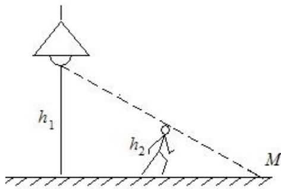

# 《大学物理》物理概论及运动学基础习题及答案

原件经识别和整理；“参考解答”是我们补的。

## 第一章

### 简答 1

举例说明物理学对社会发展的影响、对高科技发展的促进作用。

物理学在人类近代社会发生的三次技术革命中，起到关键性的作用。

第一次技术革命开始于 18 世纪 60 年代，主要标志是蒸汽机的广泛应用，这是牛顿力学和热力学发展的结果；

第二次技术革命发生在 19 世纪 70 年代，主要标志是电力的广泛应用和无线电通信的实现，这是电、磁现象的研究和经典电磁场理论的重大突破所带来的辉煌成果；

第三次技术革命从 20 世纪 40 年代开始并一直延续到今天，这是建立在相对论和量子力学发展的基础上，其特点是出现了以微电子技术为代表的一系列新学科、新材料、新能源、新技术的兴起和发展，如核反应堆、晶体管、激光器，医学上的超声、核磁共振和湮没技术等等。

参考解答：## 结论

④ 系统动量不守恒、机械能守恒；⑤ 系统动量不守恒、机械能守恒。但两者守恒条件不同：④ 中斜面会后退，水平方向动量守恒；⑤ 中斜面固定，水平方向动量不守恒。

## 推理

**④ 斜面置于光滑水平面**

- 系统外力：重力（地球与物体间为内力）、水平面支持力（竖直方向）。水平方向无外力，故**水平方向动量守恒**；竖直方向有支持力作用，总动量不守恒。
- 斜面与物体间弹力为内力，且接触面光滑无摩擦，只有重力做功，故**机械能守恒**。

**⑤ 斜面固定**

- 斜面固定于地面，地面对斜面有摩擦力（固定装置提供），系统水平方向受外力，故**动量不守恒**。
- 斜面对物体的支持力垂直于位移不做功，只有重力做功，故**机械能仍守恒**。

**关键区别**：④ 中斜面可动，水平方向无外力→水平动量守恒；⑤ 中斜面被固定，外力存在→动量不守恒。两者均只有重力做功→机械能均守恒。

知识点：[法拉第电磁感应定律与楞次定律](../../../topics/大学物理/法拉第电磁感应定律.md)、[感生电动势与涡旋电场](../../../topics/大学物理/感生电动势.md)

### 简答 2

简述物理学的研究对象及研究范围。

物理学的研究对象：物理学研究宇宙间物质存在的基本形式、物质的性质、物质的运动规律、物质之间如何相互作用和相互转化以及各种物质形态内部结构的基本规律。

物理学的研究范围：

（1）时间上大到宇宙的起源，小到夸克的寿命；

（2）空间上大到宇宙的范围，小到夸克的线度；

（3）速度上从静止物体到物质运动速度的极限光速 $3 \times 10^8 \mathrm{m/s}$；

（4）质量上研究范围很大，例如中微子质量只有 $10^{-38}\ \mathrm{kg}$，太阳质量是 $2 \times 10^{30}\ \mathrm{kg}$，两者的数量级相差 $10^{68}$。

## 第二章（1）

参考解答：**结论：** 否。该力不做功并不代表对质点运动没有影响。

**推理过程：**

根据牛顿第二定律 $\vec{F}_{\text{合}} = m\vec{a}$，质点的加速度由其所受合力决定，因此任何一个分力都会改变合力，从而影响质点的加速度和运动状态。

力做功的定义为 $W = \int \vec{F} \cdot d\vec{r} = \int \vec{F} \cdot \vec{v}\, dt$。当某力始终与速度方向垂直（即 $\vec{F} \perp \vec{v}$）时，$\vec{F} \cdot \vec{v} = 0$，该力不做功，但它仍然提供了加速度，改变了速度的方向。

**典型例子：**
- 匀速圆周运动中的向心力：始终指向圆心，与速度垂直，不做功，但正是它使质点不断改变运动方向而维持圆周运动。
- 沿固定斜面下滑的质点所受支持力：与运动方向垂直，不做功，但影响了合力的大小和方向。

知识点：[电磁波的基本性质](../../../topics/大学物理/电磁波.md)

### 选择 1

一个质点在 $xoy$ 平面内运动，运动方程为 $y = 3t - 4$，$x = 3t + 5$。则 $t = 2\ \mathrm{s}$ 时该质点的运动方程和速度分别为（C）

- A. $11\vec{i} + 4\vec{j}$，$3\vec{i} - 4\vec{j}$
- B. $11\vec{i} + 4\vec{j}$，$3\vec{i} + 4\vec{j}$
- C. $11\vec{i} + 4\vec{j}$，$3\vec{i} + 5\vec{j}$
- D. $11\vec{i} + 4\vec{j}$，$0$

参考解答：**答案：** A

J.J. 汤姆逊通过阴极射线实验测定粒子荷质比，确认其比原子小得多，从而发现电子。  
卢瑟福主要提出核式结构；居里夫人研究放射性元素；贝克勒尔发现天然放射性。

知识点：[平面简谐波的波函数 y=Acos(ω(t±x/u)+φ)](../../../topics/大学物理/平面简谐波方程.md)

### 选择 2

一运动质点在某瞬时位于矢径 $\vec{r}(x, y)$ 的端点处，其速度大小为（C）

- A. $\dfrac{dr}{dt}$
- B. $\dfrac{d\vec{r}}{dt}$
- C. $\sqrt{\left(\dfrac{dx}{dt}\right)^2 + \left(\dfrac{dy}{dt}\right)^2}$
- D. 几个答案都不对

参考解答：- **结论：** 正确的是 **①**。

- **推理：**
  静电场的环路定理为
  $$\oint_L \mathbf{E} \cdot \mathrm{d}\mathbf{l} = 0$$
  因此单位正电荷沿闭合回路一周，静电力做功
  $$W_{\mathrm{e}} = q \oint_L \mathbf{E} \cdot \mathrm{d}\mathbf{l} = 1 \times 0 = 0$$
  即静电力是保守力，绕行一周总功必为零，与外电路做正功、内电路做负功的路径细节无关，故 **① 正确**。

- **其他选项为什么不对：**
  - **② 非静电力所做总功为零（不对）：**  
    非静电力只存在于电源内部，把单位正电荷从负极搬到正极，所做的功正是电源电动势 $\mathcal{E} \neq 0$，绕闭合回路一周非静电力做功不为零。
  - **③ 静电力和非静电力所做功代数和为零（不对）：**  
    单位电荷绕行一周动能变化为零，由动能定理：  
    $$W_{\mathrm{e}} + W_{\mathrm{n}} = \Delta E_k = 0$$  
    然而这里的功必须包含静电力、非静电力以及（若考虑稳恒电流情形）电阻上的耗能对应的等效做功；仅说“静电力和非静电力所做功代数和为零”遗漏了电源内阻、外电阻上的能量耗散，表述不准确。更准确地说，非静电力做的功等于整个回路中电能消耗的总和，而不是仅与静电力做功相消。
  - **④ 在电源内只有非静电力做功，在外电路只有静电力做功（不对）：**  
    电源内部既存在非静电力（化学作用等），也存在静电力（两极积累电荷产生的库仑场），两者同时做功；外电路虽然主要是静电力驱动电荷，但说“只有静电力”也忽略了可能存在的其他等效作用，且“只有”的绝对化表述与事实不符。

知识点：[波的叠加原理与干涉条件](../../../topics/大学物理/波的干涉.md)、[杨氏双缝干涉实验与条纹间距](../../../topics/大学物理/杨氏双缝干涉.md)、[光程、光程差与反射时的半波损失](../../../topics/大学物理/光程与半波损失.md)

### 选择 3

某质点的运动方程为 $x = 3t - 5t^3 + 6\ (\mathrm{SI})$，则该质点作（D）

- A. 匀加速直线运动，加速度为正值
- B. 匀加速直线运动，加速度为负值
- C. 变加速直线运动，加速度为正值
- D. 变加速直线运动，加速度为负值

答案：D。对此方程进行二次求导即可。

知识点：[光栅方程、缺级现象与光谱分辨](../../../topics/大学物理/衍射光栅.md)、[平面简谐波的波函数 y=Acos(ω(t±x/u)+φ)](../../../topics/大学物理/平面简谐波方程.md)、[波动过程中的能量传播与能流密度](../../../topics/大学物理/波的能量.md)

### 选择 4

某质点的速度为 $\vec{\nu} = 2\vec{i} - 8\vec{j}$，已知 $t = 0$ 时它过 $(3, -7)$，则该质点的运动方程为（B）

- A. $2t\vec{i} - 4t^2\vec{j}$
- B. $(2t + 3)\vec{i} - (4t^2 + 7)\vec{j}$
- C. $-8\vec{j}$
- D. 不能确定

参考解答：**结论：B**

**推理与计算过程：**

1.  **分析题意隐含条件**：
    题目给出的速度表达式 $\vec{v} = 2\vec{i} - 8\vec{j}$ 若理解为恒定速度，则运动方程应为线性函数 $\vec{r} = (2t+3)\vec{i} + (-8t-7)\vec{j}$，但这与所有选项均不符。观察选项 B 中的 $y$ 分量含有 $t^2$ 项，且系数对应关系暗示题目中的 $\vec{v}$ 实为**加速度** $\vec{a}$（或题目存在印刷错误，将 $\vec{a}$ 误写为 $\vec{v}$，或者 $\vec{v}$ 是随时间变化的函数但漏写了 $t$，结合选项反推，最合理的物理模型是匀变速运动，且给定的矢量常量为加速度 $\vec{a} = 2\vec{i} - 8\vec{j}$，或者速度分量为 $v_x=2, v_y=-8t$）。
    
    *修正理解*：让我们重新审视选项 B 的导数。
    若运动方程为 $\vec{r} = (2t + 3)\vec{i} - (4t^2 + 7)\vec{j}$，
    则速度 $\vec{v} = \frac{d\vec{r}}{dt} = 2\vec{i} - 8t\vec{j}$。
    此时，若题目原意是“某质点的速度为 $\vec{v} = 2\vec{i} - 8t\vec{j}$”（漏印了 $t$），或者题目给出的是加速度 $\vec{a} = 2\vec{i} - 8\vec{j}$ 且初速度为0？
    
    让我们再次仔细看题干：“某质点的速度为 $\vec{v} = 2\vec{i} - 8\vec{j}$”。如果这是恒定速度，位移是线性的。没有线性选项匹配初始位置。
    
    通常这类经典题库中的题目，往往考察的是**由速度求位置**，或者**由加速度求位置**。
    如果假设题目中的 $\vec{v}$ 其实是**加速度** $\vec{a} = 2\vec{i} - 8\vec{j}$，且隐含初速度 $\vec{v}_0 = \vec{0}$：
    $\vec{v}(t) = \int \vec{a} dt = 2t\vec{i} - 8t\vec{j}$
    $\vec{r}(t) = \int \vec{v} dt = t^2\vec{i} - 4t^2\vec{j} + \vec{C}$
    代入 $t=0, \vec{r}_0 = 3\vec{i} - 7\vec{j}$，得 $\vec{C} = 3\vec{i} - 7\vec{j}$。
    $\vec{r} = (t^2+3)\vec{i} - (4t^2+7)\vec{j}$。这与 B 选项的 $x$ 分量 $(2t+3)$ 不符。

    如果假设题目中的表达式指的是**速度分量** $v_x = 2$ 和 $v_y = -8t$（即题干漏印了 $t$，或者是 $\vec{v} = 2\vec{i} - 8t\vec{j}$）：
    $$ \vec{r}(t) = \int \vec{v}(t) dt = \int (2\vec{i} - 8t\vec{j}) dt $$
    $$ \vec{r}(t) = 2t\vec{i} - 4t^2\vec{j} + \vec{C} $$
    利用初始条件 $t=0$ 时，$\vec{r}(0) = 3\vec{i} - 7\vec{j}$：
    $$ \vec{C} = 3\vec{i} - 7\vec{j} $$
    代回原式：
    $$ \vec{r}(t) = (2t + 3)\vec{i} + (-4t^2 - 7)\vec{j} = (2t + 3)\vec{i} - (4t^2 + 7)\vec{j} $$
    这与选项 B 完全一致。因此，题干应理解为速度 $\vec{v} = 2\vec{i} - 8t\vec{j}$ 或类似变加速运动，而选项 B 是唯一符合积分逻辑且满足初始条件的解。

2.  **验证选项 B**：
    对 $\vec{r} = (2t + 3)\vec{i} - (4t^2 + 7)\vec{j}$ 求导：
    $$ \vec{v} = \frac{d\vec{r}}{dt} = 2\vec{i} - 8t\vec{j} $$
    当 $t=0$ 时，$\vec{r} = 3\vec{i} - 7\vec{j}$，符合题意。

3.  **排除其他选项**：
    *   **A**：$t=0$ 时位置为 $(0,0)$，不满足初始位置 $(3, -7)$。
    *   **C**：这不是一个完整的运动方程（缺少 $\vec{i}$ 分量和时间依赖性），且量纲/形式不对。
    *   **D**：既然能推导出符合逻辑的选项 B，则并非不能确定。

知识点：[光电效应的实验规律与爱因斯坦光子理论](../../../topics/大学物理/光电效应.md)

### 选择 5

某质点做匀速圆周运动，则下列说法正确的是（B）

- A. 切向加速度不变，法向加速度也不变
- B. 切向加速度不变，法向加速度变
- C. 切向加速度变，法向加速度不变
- D. 切向加速度变，法向加速度也变

参考解答：## 结论

**选 B：切向加速度不变（为零），法向加速度变（方向时刻改变）。**

## 推理

匀速圆周运动速率 $v$ 不变。

**切向加速度**：
$$a_\tau = \frac{dv}{dt} = 0$$
大小恒为零，故"不变"。

**法向（向心）加速度**：
$$a_n = \frac{v^2}{R}$$
大小虽不变，但方向始终指向圆心，随质点位置变化而时刻改变，故"变"。

## 各选项分析

- **A**：法向加速度方向在变，并非"不变"，错。
- **B**：切向加速度恒为零（不变），法向加速度方向时刻变（变），正确。
- **C**：切向加速度恒为零，并不"变"，错。
- **D**：切向加速度不变，并非"也变"，错。

知识点：[黑体辐射规律与普朗克能量子假设](../../../topics/大学物理/黑体辐射与普朗克假设.md)

### 填空 1

一质点的运动方程为 $x = 6t - t^2\ (\mathrm{SI})$，则由 0 至 4 s 的时间间隔内，质点的位移大小为 8 m，路程为 10 m，第 2 s 质点的速度大小为 2 m/s，加速度 $-2\ \mathrm{m/s^2}$。

参考解答：四个公式依次为：

1. 静电场高斯定理：$\displaystyle\oint_S \vec{E} \cdot d\vec{S} = \frac{\sum q}{\varepsilon_0}$
2. 静电场环路定理：$\displaystyle\oint_L \vec{E} \cdot d\vec{l} = 0$
3. 稳恒磁场高斯定理：$\displaystyle\oint_S \vec{B} \cdot d\vec{S} = 0$
4. 稳恒磁场环路定理（安培环路定理）：$\displaystyle\oint_L \vec{B} \cdot d\vec{l} = \mu_0 \sum I$

---

**推理与物理含义：**

- **静电场高斯定理**：电场是有源场，通过任意闭合曲面的电通量等于该曲面所包围的净电荷除以 $\varepsilon_0$。电力线起于正电荷、止于负电荷。

- **静电场环路定理**：静电场是保守场（无旋场），沿任意闭合路径做功为零，因此可以引入电势概念。

- **稳恒磁场高斯定理**：磁场是无源场（不存在磁单极子），磁力线是闭合曲线，穿入闭合曲面的磁通量必等于穿出的磁通量，故总磁通量为零。

- **稳恒磁场环路定理**：磁场是有旋场（非保守场），$\vec{B}$ 沿闭合路径的环量等于 $\mu_0$ 乘以穿过该回路所围面积的电流代数和 $\sum I$（电流方向与积分绕行方向满足右手螺旋关系时取正）。

知识点：[电通量的概念与静电场的高斯定理](../../../topics/大学物理/电通量与高斯定理.md)、[安培环路定理及其应用](../../../topics/大学物理/安培环路定理.md)、[磁通量与磁场中的高斯定理](../../../topics/大学物理/磁场中的高斯定理.md)

### 简答 1

举例说明在某一时刻物体的速度很大，此时其加速度是否也一定很大？反之，如果在某一时刻它的加速度很大，此时其速度是否也一定很大？

答案：不一定，不一定。

参考解答：## 结论

④ 系统动量不守恒、机械能守恒；⑤ 系统动量不守恒、机械能守恒。但两者守恒条件不同：④ 中斜面会后退，水平方向动量守恒；⑤ 中斜面固定，水平方向动量不守恒。

## 推理

**④ 斜面置于光滑水平面**

- 系统外力：重力（地球与物体间为内力）、水平面支持力（竖直方向）。水平方向无外力，故**水平方向动量守恒**；竖直方向有支持力作用，总动量不守恒。
- 斜面与物体间弹力为内力，且接触面光滑无摩擦，只有重力做功，故**机械能守恒**。

**⑤ 斜面固定**

- 斜面固定于地面，地面对斜面有摩擦力（固定装置提供），系统水平方向受外力，故**动量不守恒**。
- 斜面对物体的支持力垂直于位移不做功，只有重力做功，故**机械能仍守恒**。

**关键区别**：④ 中斜面可动，水平方向无外力→水平动量守恒；⑤ 中斜面被固定，外力存在→动量不守恒。两者均只有重力做功→机械能均守恒。

知识点：[法拉第电磁感应定律与楞次定律](../../../topics/大学物理/法拉第电磁感应定律.md)、[感生电动势与涡旋电场](../../../topics/大学物理/感生电动势.md)

### 简答 2

质点在平面内运动。矢径 $\vec{r} = \vec{r}(t)$，速度 $\vec{\nu} = \vec{\nu}(t)$，分别指出下列四种情况中质点作何种特征的运动。

① $\dfrac{dr}{dt} = 0$

② $\dfrac{d\vec{r}}{dt} = 0$

③ $\dfrac{dv}{dt} = 0$

④ $\dfrac{d\vec{v}}{dt} = 0$

答：

① 质点到参考点距离的大小不随时间变化，表示质点绕参考点作圆周运动或相对于参考点静止。

② 质点对参考点的位矢不随时间变化，表示质点相对于参考点静止。

③ 质点对参考点的速率不随时间变化，即切向加速度 $a_\tau = 0$，表示质点相对于参考点作匀速率运动。

④ 质点对参考点的速度不随时间变化，即总加速度 $\vec{\alpha} = \mathbf{0}$，表示质点相对参考点作匀速率直线运动。

参考解答：**结论：** 否。该力不做功并不代表对质点运动没有影响。

**推理过程：**

根据牛顿第二定律 $\vec{F}_{\text{合}} = m\vec{a}$，质点的加速度由其所受合力决定，因此任何一个分力都会改变合力，从而影响质点的加速度和运动状态。

力做功的定义为 $W = \int \vec{F} \cdot d\vec{r} = \int \vec{F} \cdot \vec{v}\, dt$。当某力始终与速度方向垂直（即 $\vec{F} \perp \vec{v}$）时，$\vec{F} \cdot \vec{v} = 0$，该力不做功，但它仍然提供了加速度，改变了速度的方向。

**典型例子：**
- 匀速圆周运动中的向心力：始终指向圆心，与速度垂直，不做功，但正是它使质点不断改变运动方向而维持圆周运动。
- 沿固定斜面下滑的质点所受支持力：与运动方向垂直，不做功，但影响了合力的大小和方向。

知识点：[电磁波的基本性质](../../../topics/大学物理/电磁波.md)

### 计算 1

飞机离地起飞时需达到一起飞速率为 $\nu_0$，因此需要在一条长度为 $s$ 的跑道上从静止状态开始不断加速到 $\nu_0$，且假定是匀加速运动。

（a）设一架飞机 A 的加速度为 $a$，求证 $s = \nu_0^2 / 2a$。

（b）设另一架飞机 B 的加速度也为 $a$，但需要 $\nu_0$ 值为飞机 A 的两倍，问跑道长度需增加到几倍？

参考解答：### (a) 结论

$$s = \frac{\nu_0^2}{2a}$$

**推导过程：**

飞机从静止开始做匀加速直线运动，初速度 $v_i = 0$，末速度 $v_f = \nu_0$，加速度为 $a$。由匀变速直线运动的速度—位移关系：

$$v_f^2 - v_i^2 = 2as$$

代入已知条件：

$$\nu_0^2 - 0 = 2as$$

解得：

$$s = \frac{\nu_0^2}{2a}$$

---

### (b) 结论

跑道长度需增加到 **4 倍**。

**计算过程：**

对飞机 A，由 (a) 的结果：

$$s_A = \frac{\nu_0^2}{2a}$$

对飞机 B，起飞速率为 $2\nu_0$，加速度仍为 $a$：

$$s_B = \frac{(2\nu_0)^2}{2a} = \frac{4\nu_0^2}{2a} = 4s_A$$

因此跑道长度需增加到原来的 4 倍。

知识点：[功的定义、功率与质点动能定理](../../../topics/大学物理/功与动能定理.md)

### 计算 2

路灯距地面高度为 $h_1$。一个人身高为 $h_2$，在灯底下以匀速率 $\nu_0$ 沿水平直线行走，如图。则他的头顶在地面上的影子 M 点沿地面移动的速度 $\nu_M$ 为多少？

答案：$\nu_M = h_2 \nu_0 / (h_1 - h_2)$

## 第二章（2）

知识点：[光电效应的实验规律与爱因斯坦光子理论](../../../topics/大学物理/光电效应.md)

### 填空 1

质点运动状态变化的根本原因是 作用的结果；（力）使刚体转动状态发生变化的根本原因是 作用的结果。（力矩）

参考解答：四个公式依次为：

1. 静电场高斯定理：$\displaystyle\oint_S \vec{E} \cdot d\vec{S} = \frac{\sum q}{\varepsilon_0}$
2. 静电场环路定理：$\displaystyle\oint_L \vec{E} \cdot d\vec{l} = 0$
3. 稳恒磁场高斯定理：$\displaystyle\oint_S \vec{B} \cdot d\vec{S} = 0$
4. 稳恒磁场环路定理（安培环路定理）：$\displaystyle\oint_L \vec{B} \cdot d\vec{l} = \mu_0 \sum I$

---

**推理与物理含义：**

- **静电场高斯定理**：电场是有源场，通过任意闭合曲面的电通量等于该曲面所包围的净电荷除以 $\varepsilon_0$。电力线起于正电荷、止于负电荷。

- **静电场环路定理**：静电场是保守场（无旋场），沿任意闭合路径做功为零，因此可以引入电势概念。

- **稳恒磁场高斯定理**：磁场是无源场（不存在磁单极子），磁力线是闭合曲线，穿入闭合曲面的磁通量必等于穿出的磁通量，故总磁通量为零。

- **稳恒磁场环路定理**：磁场是有旋场（非保守场），$\vec{B}$ 沿闭合路径的环量等于 $\mu_0$ 乘以穿过该回路所围面积的电流代数和 $\sum I$（电流方向与积分绕行方向满足右手螺旋关系时取正）。

知识点：[电通量的概念与静电场的高斯定理](../../../topics/大学物理/电通量与高斯定理.md)、[安培环路定理及其应用](../../../topics/大学物理/安培环路定理.md)、[磁通量与磁场中的高斯定理](../../../topics/大学物理/磁场中的高斯定理.md)

### 填空 2

第二宇宙速度是指 这个概念最先是由 提出的。（逃离地球的速度，牛顿。）

参考解答：**类比**

库仑在研究静电力时，发现电荷间作用力与万有引力在数学形式上高度相似（均与距离平方成反比、与源强度乘积成正比），这种基于已知规律推测未知规律的思维方法即为类比法；其他方法如归纳、演绎或实验验证虽在物理学中重要，但题干明确强调“借鉴……规律而建立”，特指跨领域的形式对应关系，故只能填“类比”。

知识点：[电荷守恒定律与库仑定律](../../../topics/大学物理/电荷守恒与库仑定律.md)

### 填空 3

牛顿出版的一部划时代的著作叫《自然 的数学原理》。（哲学）

参考解答：避雷针；雷电现象

本杰明·富兰克林通过著名的风筝实验证实了闪电的本质是电，从而系统研究了**雷电现象**；基于尖端放电原理，他发明了**避雷针**以引导雷电流安全入地，保护建筑物免受雷击。这两个成就构成了他在电学领域最核心的贡献，且与题干中“发现尖端放电”形成逻辑递进关系。

知识点：[电荷守恒定律与库仑定律](../../../topics/大学物理/电荷守恒与库仑定律.md)

### 填空 4

牛顿在科学研究上取得的巨大成就与他自觉运用科学的思维方法是分不开的，其科学的思想方法可概括为 原理、 原理、 原理及 原理。

参考解答：**答案：** 奥斯特；平行；垂直

奥斯特发现，通电导线附近存在磁场。若磁针与通电导线平行，通电后磁针会发生偏转，并最终转向与导线垂直的方向。因此三空依次填：**奥斯特、平行、垂直**。

知识点：[磁场与磁感应强度的定义](../../../topics/大学物理/磁感应强度.md)

### 选择 1

关于摩擦力，有种种说法，下列说法正确的是（B）

- A. 摩擦力总是做负功
- B. 滑动摩擦力的方向总是与物体的相对运动方向相反
- C. 摩擦力总是阻碍物体的运动
- D. 静摩擦力总是与静摩擦系数有关

参考解答：**答案：** A

J.J. 汤姆逊通过阴极射线实验测定粒子荷质比，确认其比原子小得多，从而发现电子。  
卢瑟福主要提出核式结构；居里夫人研究放射性元素；贝克勒尔发现天然放射性。

知识点：[平面简谐波的波函数 y=Acos(ω(t±x/u)+φ)](../../../topics/大学物理/平面简谐波方程.md)

### 填空 5

一个质量为 5 kg 的物体（视为质点）在平面上运动，其运动方程为 $\vec{r} = 6\vec{i} - 3t^2\vec{j}\ (\mathrm{SI})$，则物体所受合外力 $\vec{F}$ 的大小为 ，其方向为 。（$30\ \mathrm{N}$，$-\vec{j}$）

参考解答：**结论：** 电磁感应定律；建立“场”的概念。

**依据：** 法拉第通过实验发现了电磁感应现象并总结出电磁感应定律；更重要的是他最早引入“场”（电场、磁场）来描述电磁作用，突破了超距作用观念，为麦克斯韦电磁场理论奠定基础。爱因斯坦评价其“想象力比知识更重要”，正是针对“场”这一超越当时实验直接可见的概念创造。

知识点：[法拉第电磁感应定律与楞次定律](../../../topics/大学物理/法拉第电磁感应定律.md)

### 填空 6

你体检时测量的血压是 80–120，数字的意思是 。（收缩压为 120 mmHg，舒张压为 80 mmHg）

参考解答：**结论**：收缩压为 $120\ \text{mmHg}$，舒张压为 $80\ \text{mmHg}$。  

**说明**：血压读数通常写为“收缩压/舒张压”，前者对应心脏收缩时动脉内的最高压力，后者对应心脏舒张时的最低压力。

知识点：[理想气体的状态方程与平衡态](../../../topics/大学物理/理想气体状态方程.md)

### 简答 1

为什么苹果会落到地上，而月亮却挂在天上不会掉下来？

参考解答：## 结论

④ 系统动量不守恒、机械能守恒；⑤ 系统动量不守恒、机械能守恒。但两者守恒条件不同：④ 中斜面会后退，水平方向动量守恒；⑤ 中斜面固定，水平方向动量不守恒。

## 推理

**④ 斜面置于光滑水平面**

- 系统外力：重力（地球与物体间为内力）、水平面支持力（竖直方向）。水平方向无外力，故**水平方向动量守恒**；竖直方向有支持力作用，总动量不守恒。
- 斜面与物体间弹力为内力，且接触面光滑无摩擦，只有重力做功，故**机械能守恒**。

**⑤ 斜面固定**

- 斜面固定于地面，地面对斜面有摩擦力（固定装置提供），系统水平方向受外力，故**动量不守恒**。
- 斜面对物体的支持力垂直于位移不做功，只有重力做功，故**机械能仍守恒**。

**关键区别**：④ 中斜面可动，水平方向无外力→水平动量守恒；⑤ 中斜面被固定，外力存在→动量不守恒。两者均只有重力做功→机械能均守恒。

知识点：[法拉第电磁感应定律与楞次定律](../../../topics/大学物理/法拉第电磁感应定律.md)、[感生电动势与涡旋电场](../../../topics/大学物理/感生电动势.md)

### 简答 2

用一根细线吊一个质量为 5 kg 的重物，重物下系一根同样的细线。设细线最多能经受 70 N 拉力。现在突然用力向下拉一下下面的线，并设此力最大值为 50 N，则重物上、下所系的线是否会断？

答：重物下面系的线受向下 $F = 50\ \mathrm{N}$ 的拉力，未超过其所能承受力的极限 70 N，故不会断。由于是突然猛拉下面的线，力的作用时间很短，重物在一刹那间由于惯性还来不及运动，所以下面受到的冲力传不到上面的线，上面的线也不会断。（具体来说物体并没有处于平衡状态）如果是缓慢增加拉力，则作用力会传到上面的线，上面的线受到的拉力等于重物重力和物体传递的拉力之和，其值 $F = mg + F_m = 100\ \mathrm{N}$，已超过其受力极限，则上面的线会断。

参考解答：**结论：** 否。该力不做功并不代表对质点运动没有影响。

**推理过程：**

根据牛顿第二定律 $\vec{F}_{\text{合}} = m\vec{a}$，质点的加速度由其所受合力决定，因此任何一个分力都会改变合力，从而影响质点的加速度和运动状态。

力做功的定义为 $W = \int \vec{F} \cdot d\vec{r} = \int \vec{F} \cdot \vec{v}\, dt$。当某力始终与速度方向垂直（即 $\vec{F} \perp \vec{v}$）时，$\vec{F} \cdot \vec{v} = 0$，该力不做功，但它仍然提供了加速度，改变了速度的方向。

**典型例子：**
- 匀速圆周运动中的向心力：始终指向圆心，与速度垂直，不做功，但正是它使质点不断改变运动方向而维持圆周运动。
- 沿固定斜面下滑的质点所受支持力：与运动方向垂直，不做功，但影响了合力的大小和方向。

知识点：[电磁波的基本性质](../../../topics/大学物理/电磁波.md)

### 简答 3

什么叫质点？一个物体可以抽象地定义为质点的物理条件是什么？为什么要把物体抽象为质点？

忽略物体的形状、大小，把它看成一个具有质量的点。

把一个物体抽象为质点的物理条件是在我们所研究的问题中，物体的大小和形状不起作用，或所起的作用不显著，如：若物体的限度比它运动的空间范围小很多时（绕太阳公转的地球）或者当物体作平动时，其上各部分的运动情况（速度、加速度）完全相同时即可以将其作为质点。

把物体抽象为质点是为使所研究的复杂问题简化，突出主要矛盾，体现了辩证法的哲学思想。

参考解答：不对。

内力虽然不改变系统的**总动量**，但会改变各质点的**动量分配**，因此各质点的运动情况一般不同。

对质点系中某个质点：

$$
\Delta \vec p_i=\int_{t_1}^{t_2}\left(\vec F_{i,\text{内}}+\vec F_{i,\text{外}}\right)dt
$$

对单个质点而言，其动量变化同时取决于内力和外力。只有外力相同而内力不同，质点的动量变化就不同，运动情况自然也不同。所以原说法不成立。

知识点：[惠更斯原理与波的衍射](../../../topics/大学物理/惠更斯原理.md)

### 计算 1

质量 $m = 1$ 千克的物体，在地面上受地球引力的大小为 $F = 9.8$ 牛顿。已知地球的半径和万有引力常数分别为 $r = 6.4 \times 10^6\ \mathrm{m}$，$G = 6.67 \times 10^{-11}\ \mathrm{m^3/(kg \cdot s^2)}$。

用以上数据求出地球的质量 $M$。

答案：$M = 6 \times 10^{24}\ \mathrm{kg}$

## 第三章

参考解答：### (a) 结论

$$s = \frac{\nu_0^2}{2a}$$

**推导过程：**

飞机从静止开始做匀加速直线运动，初速度 $v_i = 0$，末速度 $v_f = \nu_0$，加速度为 $a$。由匀变速直线运动的速度—位移关系：

$$v_f^2 - v_i^2 = 2as$$

代入已知条件：

$$\nu_0^2 - 0 = 2as$$

解得：

$$s = \frac{\nu_0^2}{2a}$$

---

### (b) 结论

跑道长度需增加到 **4 倍**。

**计算过程：**

对飞机 A，由 (a) 的结果：

$$s_A = \frac{\nu_0^2}{2a}$$

对飞机 B，起飞速率为 $2\nu_0$，加速度仍为 $a$：

$$s_B = \frac{(2\nu_0)^2}{2a} = \frac{4\nu_0^2}{2a} = 4s_A$$

因此跑道长度需增加到原来的 4 倍。

知识点：[功的定义、功率与质点动能定理](../../../topics/大学物理/功与动能定理.md)

### 填空 1

质量等于 1 kg 的物体，从静止开始出发在水平面内沿 $x$ 轴运动，其所受的合力方向与运动方向相同，合力大小为 $F = 2 + 5x\ (\mathrm{SI})$。那么，物体在开始运动的 3 m 内，合力作的功 $W =$ 。

答案：由变力做功得到 $A = \int_0^3 F\,dx = \int_0^3 (2 + 5x) = 28.5\ \mathrm{J}$

参考解答：四个公式依次为：

1. 静电场高斯定理：$\displaystyle\oint_S \vec{E} \cdot d\vec{S} = \frac{\sum q}{\varepsilon_0}$
2. 静电场环路定理：$\displaystyle\oint_L \vec{E} \cdot d\vec{l} = 0$
3. 稳恒磁场高斯定理：$\displaystyle\oint_S \vec{B} \cdot d\vec{S} = 0$
4. 稳恒磁场环路定理（安培环路定理）：$\displaystyle\oint_L \vec{B} \cdot d\vec{l} = \mu_0 \sum I$

---

**推理与物理含义：**

- **静电场高斯定理**：电场是有源场，通过任意闭合曲面的电通量等于该曲面所包围的净电荷除以 $\varepsilon_0$。电力线起于正电荷、止于负电荷。

- **静电场环路定理**：静电场是保守场（无旋场），沿任意闭合路径做功为零，因此可以引入电势概念。

- **稳恒磁场高斯定理**：磁场是无源场（不存在磁单极子），磁力线是闭合曲线，穿入闭合曲面的磁通量必等于穿出的磁通量，故总磁通量为零。

- **稳恒磁场环路定理**：磁场是有旋场（非保守场），$\vec{B}$ 沿闭合路径的环量等于 $\mu_0$ 乘以穿过该回路所围面积的电流代数和 $\sum I$（电流方向与积分绕行方向满足右手螺旋关系时取正）。

知识点：[电通量的概念与静电场的高斯定理](../../../topics/大学物理/电通量与高斯定理.md)、[安培环路定理及其应用](../../../topics/大学物理/安培环路定理.md)、[磁通量与磁场中的高斯定理](../../../topics/大学物理/磁场中的高斯定理.md)

### 选择 1

对于一个质点系来说，在下列条件中，哪种情况下系统的机械能守恒？（B）

- A. 合外力为零
- B. 合外力和非保守内力都不作功
- C. 合外力不作功
- D. 合外力和保守内力都不作功

参考解答：**答案：** A

J.J. 汤姆逊通过阴极射线实验测定粒子荷质比，确认其比原子小得多，从而发现电子。  
卢瑟福主要提出核式结构；居里夫人研究放射性元素；贝克勒尔发现天然放射性。

知识点：[平面简谐波的波函数 y=Acos(ω(t±x/u)+φ)](../../../topics/大学物理/平面简谐波方程.md)

### 简答 1

在水平冰面上以一定速度向东行驶的炮车，向东南方向斜上方发射一枚炮弹，如果忽略冰面的摩擦和空气阻力，在此过程中，对于炮车和炮弹系统，下列哪种说法是正确的？

① 总动量守恒；

② 总动量在炮身前进方向上的分量守恒，其它方向分量不守恒；

③ 总动量在水平面上任意方向的分量守恒，竖直方向分量不守恒；

④ 总动量在任意方向的分量均不守恒。

答：③ 正确。由于忽略冰面摩擦和空气阻力，炮车和炮弹系统所受合外力在水平面内任意方向的分量为零，故总动量在水平面上任意方向的分量守恒。而由于炮车的反冲对地面的冲力作用很大，地面反作用力也很大，合外力在竖直方向上的分量不为零，所以系统总动量的竖直方向分量不守恒，系统总动量也不守恒。

参考解答：## 结论

④ 系统动量不守恒、机械能守恒；⑤ 系统动量不守恒、机械能守恒。但两者守恒条件不同：④ 中斜面会后退，水平方向动量守恒；⑤ 中斜面固定，水平方向动量不守恒。

## 推理

**④ 斜面置于光滑水平面**

- 系统外力：重力（地球与物体间为内力）、水平面支持力（竖直方向）。水平方向无外力，故**水平方向动量守恒**；竖直方向有支持力作用，总动量不守恒。
- 斜面与物体间弹力为内力，且接触面光滑无摩擦，只有重力做功，故**机械能守恒**。

**⑤ 斜面固定**

- 斜面固定于地面，地面对斜面有摩擦力（固定装置提供），系统水平方向受外力，故**动量不守恒**。
- 斜面对物体的支持力垂直于位移不做功，只有重力做功，故**机械能仍守恒**。

**关键区别**：④ 中斜面可动，水平方向无外力→水平动量守恒；⑤ 中斜面被固定，外力存在→动量不守恒。两者均只有重力做功→机械能均守恒。

知识点：[法拉第电磁感应定律与楞次定律](../../../topics/大学物理/法拉第电磁感应定律.md)、[感生电动势与涡旋电场](../../../topics/大学物理/感生电动势.md)

### 选择 2

在下列几种情况中，机械能守恒的系统是：

① 当物体在空气中下落时，以物体和地球为系统。

② 当地球表面物体匀速上升时（不计空气阻力），以物体和地球为系统。

③ 子弹水平地射入放在光滑水平桌面上的木块内，以子弹和木块为系统。

---
title: 《大学物理》物理概论及运动学基础习题及答案（第2部分）
kind: 习题
course: 大学物理
source: 识别工具读取内容（第5-9页）
---

# 《大学物理》物理概论及运动学基础习题及答案（第2部分）

本资料整理自《大学物理》物理概论及运动学基础习题及答案的第2部分，主要涵盖动量、角动量、机械振动、机械波以及静电场与稳恒磁场的基础概念辨析。

## 一、简答题与概念辨析

参考解答：- **结论：** 正确的是 **①**。

- **推理：**
  静电场的环路定理为
  $$\oint_L \mathbf{E} \cdot \mathrm{d}\mathbf{l} = 0$$
  因此单位正电荷沿闭合回路一周，静电力做功
  $$W_{\mathrm{e}} = q \oint_L \mathbf{E} \cdot \mathrm{d}\mathbf{l} = 1 \times 0 = 0$$
  即静电力是保守力，绕行一周总功必为零，与外电路做正功、内电路做负功的路径细节无关，故 **① 正确**。

- **其他选项为什么不对：**
  - **② 非静电力所做总功为零（不对）：**  
    非静电力只存在于电源内部，把单位正电荷从负极搬到正极，所做的功正是电源电动势 $\mathcal{E} \neq 0$，绕闭合回路一周非静电力做功不为零。
  - **③ 静电力和非静电力所做功代数和为零（不对）：**  
    单位电荷绕行一周动能变化为零，由动能定理：  
    $$W_{\mathrm{e}} + W_{\mathrm{n}} = \Delta E_k = 0$$  
    然而这里的功必须包含静电力、非静电力以及（若考虑稳恒电流情形）电阻上的耗能对应的等效做功；仅说“静电力和非静电力所做功代数和为零”遗漏了电源内阻、外电阻上的能量耗散，表述不准确。更准确地说，非静电力做的功等于整个回路中电能消耗的总和，而不是仅与静电力做功相消。
  - **④ 在电源内只有非静电力做功，在外电路只有静电力做功（不对）：**  
    电源内部既存在非静电力（化学作用等），也存在静电力（两极积累电荷产生的库仑场），两者同时做功；外电路虽然主要是静电力驱动电荷，但说“只有静电力”也忽略了可能存在的其他等效作用，且“只有”的绝对化表述与事实不符。

知识点：[波的叠加原理与干涉条件](../../../topics/大学物理/波的干涉.md)、[杨氏双缝干涉实验与条纹间距](../../../topics/大学物理/杨氏双缝干涉.md)、[光程、光程差与反射时的半波损失](../../../topics/大学物理/光程与半波损失.md)

### 简答 1

**题干：**
④ 斜面置于光滑水平面上，一物体沿斜面无摩擦下滑，以物体和地球为系统。
⑤ 物体沿光滑固定斜面下滑，以物体和地球为系统。

*(注：原题此处仅列出两种情境描述，未给出具体问题或答案，根据上下文推测可能涉及系统动量或能量守恒条件的对比，但原文缺失具体问答内容，故保留原描述。)*

参考解答：## 结论

④ 系统动量不守恒、机械能守恒；⑤ 系统动量不守恒、机械能守恒。但两者守恒条件不同：④ 中斜面会后退，水平方向动量守恒；⑤ 中斜面固定，水平方向动量不守恒。

## 推理

**④ 斜面置于光滑水平面**

- 系统外力：重力（地球与物体间为内力）、水平面支持力（竖直方向）。水平方向无外力，故**水平方向动量守恒**；竖直方向有支持力作用，总动量不守恒。
- 斜面与物体间弹力为内力，且接触面光滑无摩擦，只有重力做功，故**机械能守恒**。

**⑤ 斜面固定**

- 斜面固定于地面，地面对斜面有摩擦力（固定装置提供），系统水平方向受外力，故**动量不守恒**。
- 斜面对物体的支持力垂直于位移不做功，只有重力做功，故**机械能仍守恒**。

**关键区别**：④ 中斜面可动，水平方向无外力→水平动量守恒；⑤ 中斜面被固定，外力存在→动量不守恒。两者均只有重力做功→机械能均守恒。

知识点：[法拉第电磁感应定律与楞次定律](../../../topics/大学物理/法拉第电磁感应定律.md)、[感生电动势与涡旋电场](../../../topics/大学物理/感生电动势.md)

### 简答 2

**题干：**
5、质点运动过程中，作用于质点的某力一直没有做功，这是否表明该力在这一过程中对质点的运动没有发生任何影响？

**答案：** 否。

**参考解答：**
在牛顿第二定律 $\vec{F} = m\vec{a}$ 中，$\vec{F}$ 为质点所受的合力。所以凡质点所受的力都要对质点的运动产生影响。如果其中某力始终与质点运动的速度方向垂直，在运动过程中就不对质点做功，但仍然对质点的加速度产生影响。例如：作匀速率圆周运动质点所受的向心力，沿固定斜面下滑的质点所受的斜面支持力等。

参考解答：**结论：** 否。该力不做功并不代表对质点运动没有影响。

**推理过程：**

根据牛顿第二定律 $\vec{F}_{\text{合}} = m\vec{a}$，质点的加速度由其所受合力决定，因此任何一个分力都会改变合力，从而影响质点的加速度和运动状态。

力做功的定义为 $W = \int \vec{F} \cdot d\vec{r} = \int \vec{F} \cdot \vec{v}\, dt$。当某力始终与速度方向垂直（即 $\vec{F} \perp \vec{v}$）时，$\vec{F} \cdot \vec{v} = 0$，该力不做功，但它仍然提供了加速度，改变了速度的方向。

**典型例子：**
- 匀速圆周运动中的向心力：始终指向圆心，与速度垂直，不做功，但正是它使质点不断改变运动方向而维持圆周运动。
- 沿固定斜面下滑的质点所受支持力：与运动方向垂直，不做功，但影响了合力的大小和方向。

知识点：[电磁波的基本性质](../../../topics/大学物理/电磁波.md)

### 简答 3

**题干：**
6、有人说，因为内力不改变系统的总动量，所以无论系统内各质点有无内力的作用，只要外力相同，各质点的运动情况就相同，这话对吗？

**答案：** 不对。

**参考解答：**
这话不对。对质点系内任一质点：

$$
\vec{I}_i = \int_{t_1}^{t_2} (\vec{F}_{\text{内}} + \vec{F}_{\text{外}}) \mathrm{d}t = \Delta \vec{p}_i
$$

因此，内力虽不改变系统的总动量，但可以改变总动量在质点系内的分配。

参考解答：不对。

内力虽然不改变系统的**总动量**，但会改变各质点的**动量分配**，因此各质点的运动情况一般不同。

对质点系中某个质点：

$$
\Delta \vec p_i=\int_{t_1}^{t_2}\left(\vec F_{i,\text{内}}+\vec F_{i,\text{外}}\right)dt
$$

对单个质点而言，其动量变化同时取决于内力和外力。只有外力相同而内力不同，质点的动量变化就不同，运动情况自然也不同。所以原说法不成立。

知识点：[惠更斯原理与波的衍射](../../../topics/大学物理/惠更斯原理.md)

### 简答 4

**题干：**
7、如果不计摩擦阻力，作单摆运动的质点，角动量是否守恒？为什么？

**答案：** 不守恒。

**参考解答：**
即使不计摩擦阻力，作单摆运动的质点对悬挂点的角动量也不守恒。因为摆动过程中质点所受重力对悬挂点的力矩不为零，不满足角动量守恒的条件。在摆动过程中，质点对悬挂点的转动惯量不变，但角速度的大小、方向周期性变化，所以角动量也随之周期性变化。

参考解答：**不守恒。**

单摆运动中，质点受到重力 $m\vec{g}$ 和绳的张力 $\vec{T}$。以悬挂点为参考点：

- 张力 $\vec{T}$ 沿径向，其力矩为零；
- 重力 $m\vec{g}$ 竖直向下，当摆线与竖直方向夹角为 $\theta$（$\theta \neq 0$）时，重力对悬挂点的力矩大小为：

$$M = mgl\sin\theta \neq 0$$

根据角动量定理 $\dfrac{d\vec{L}}{dt} = \vec{M}$，合外力矩不为零，故角动量不守恒。

从运动学角度看，质点对悬挂点的转动惯量 $I = ml^2$ 恒定，但角速度 $\omega$ 的大小在摆动过程中周期性变化（最低点最大、最高点为零），因此角动量 $L = I\omega$ 也随时间周期性变化，不守恒。

知识点：[波的叠加原理与干涉条件](../../../topics/大学物理/波的干涉.md)

### 简答 5

**题干：**
8、两个半径相同的轮子，质量相同，但一个轮子的质量聚集在边缘附近，另一个轮子的质量分布比较均匀。试问：
① 如果它们的角动量相同，哪个轮子转得快？
② 如果它们的角速度相同，哪个轮子的角动量大？

*(注：原题未提供具体答案，以下为基于物理原理的分析补充)*

**参考解答：**
设两轮质量均为 $M$，半径均为 $R$。
对于质量聚集在边缘的轮子（近似 hoop），转动惯量 $I_1 \approx MR^2$；
对于质量分布均匀的轮子（近似 disk），转动惯量 $I_2 = \frac{1}{2}MR^2$。
显然 $I_1 > I_2$。

① 由角动量 $L = I\omega$，若 $L_1 = L_2$，则 $\omega_1 = L/I_1$，$\omega_2 = L/I_2$。因为 $I_1 > I_2$，所以 $\omega_1 < \omega_2$。即质量分布均匀的轮子转得快。
② 由角动量 $L = I\omega$，若 $\omega_1 = \omega_2$，则 $L_1 = I_1\omega$，$L_2 = I_2\omega$。因为 $I_1 > I_2$，所以 $L_1 > L_2$。即质量聚集在边缘的轮子角动量大。

参考解答：质量集中在边缘的轮子转动惯量较大，质量分布均匀的轮子转动惯量较小。

设两轮质量均为 $M$，半径均为 $R$，则边缘轮近似为圆环：

$$
I_1 \approx MR^2
$$

均匀轮近似为圆盘：

$$
I_2=\frac12 MR^2
$$

故 $I_1>I_2$。

① 角动量 $L=I\omega$。若 $L$ 相同，则

$$
\omega=\frac{L}{I}
$$

转动惯量越大，角速度越小，所以**质量分布均匀的轮子转得快**。

② 若角速度 $\omega$ 相同，则

$$
L=I\omega
$$

转动惯量越大，角动量越大，所以**质量聚集在边缘附近的轮子角动量大**。

知识点：[自然光与偏振光、马吕斯定律与布儒斯特定律](../../../topics/大学物理/光的偏振.md)

### 简答 6

**题干：**
9、一人躺在地上，身上压一块重石板，另一个人用重锤猛击石板，但见石板碎裂，而下面的人毫无损伤，这是为什么？

**答案：** 见参考解答。

**参考解答：**
在重锤与石板碰撞的极短时间内，合外力远小于内力，系统动量守恒，设重锤撞后停下，其动量传递给石板，而石板质量很大，故获得的速率很小。于是在相撞的极短时间内，石板向下的位移也很小，还不至于挤压人体致伤。实际上，石板还来不及将打击力传递给人便破碎了（注意：未经训练者请勿作此实验）。

参考解答：石板因质量大获得的速度极小，且在力传递至人体前已破碎，故人不受损伤。

重锤与石板碰撞时间 $\Delta t$ 极短，内力远大于外力，系统动量守恒。设重锤质量为 $m$、初速为 $v_0$，石板质量为 $M$，碰后重锤停止，则石板获得速度：
$$
V = \frac{m v_0}{M}
$$
由于 $M \gg m$，故 $V$ 很小，在 $\Delta t$ 内石板向下位移 $\Delta x = V \Delta t$ 微乎其微，不足以对人体产生显著挤压。同时，石板为脆性材料，应力波尚未传至底部即因局部应力超过强度极限而碎裂，冲击力未有效传递到人体。

知识点：[黑体辐射规律与普朗克能量子假设](../../../topics/大学物理/黑体辐射与普朗克假设.md)

### 简答 7

**题干：**
10、在游乐场中一个人缚在滑车内从高度为 $h$ 的 A 点沿光滑轨道下滑，进入一半径为 $R$ 的圆轨道后，到达高为 $2R$ 的顶点 B 时，人刚好处于失重状态。试证明初始高度需达到 $h = \frac{5}{2}R$。（摩擦力略去不计）

*(注：原题未提供证明过程，以下为标准证明)*

**参考解答：**
1. **在最高点 B 分析受力：**
   人刚好处于失重状态，意味着轨道对人的支持力 $N=0$，仅由重力提供向心力。
   $$ mg = m\frac{v_B^2}{R} \implies v_B^2 = gR $$

2. **从 A 到 B 应用机械能守恒：**
   取最低点为零势能面（或者以 B 点为参考，这里以 A 点高度 $h$ 和 B 点高度 $2R$ 计算重力势能差）。
   $$ E_A = E_B $$
   $$ mgh = mg(2R) + \frac{1}{2}mv_B^2 $$

3. **代入 $v_B^2$ 求解 $h$：**
   $$ mgh = 2mgR + \frac{1}{2}m(gR) $$
   $$ gh = 2gR + \frac{1}{2}gR = \frac{5}{2}gR $$
   $$ h = \frac{5}{2}R $$
   证毕。

参考解答：初始高度需满足 $h = \frac{5}{2}R$。

1.  **B 点临界条件**：人在圆轨道顶点 B 刚好处于失重状态，表明轨道支持力 $N=0$，仅由重力提供向心力：
    $$ mg = m\frac{v_B^2}{R} \implies v_B^2 = gR $$

2.  **机械能守恒**：轨道光滑无摩擦，系统机械能守恒。以地面为零势能面，A 点势能为 $mgh$、动能为 0；B 点高度为 $2R$，则有：
    $$ mgh = mg(2R) + \frac{1}{2}mv_B^2 $$

3.  **联立求解**：将 $v_B^2 = gR$ 代入能量方程并消去 $m$：
    $$ gh = 2gR + \frac{1}{2}gR = \frac{5}{2}gR \implies h = \frac{5}{2}R $$

知识点：[德布罗意物质波假设](../../../topics/大学物理/实物粒子的波动性.md)、[瑞利判据与光学仪器的分辨本领](../../../topics/大学物理/光学仪器分辨本领.md)

### 简答 8

**题干：**
11、给你两个鸡蛋，一个是生的，一个是熟的，你用什么办法来判断？是分析之。

*(注：原题未提供答案，以下为常见判断方法)*

**参考解答：**
**方法一：旋转法。**
将鸡蛋放在水平桌面上，用手使其绕竖直轴快速旋转。
- **熟鸡蛋：** 整体是刚体，容易旋转且转速稳定，停止触碰后迅速静止。
- **生鸡蛋：** 内部液体由于惯性，阻碍蛋壳的转动，导致旋转困难、转速慢且不稳。停止触碰后，由于内部液体的惯性，蛋壳会再次微微转动或难以立即静止。

**方法二：光照法（辅助）。**
在暗处用强光照射。熟鸡蛋透光性相对均匀（取决于蛋白凝固程度），生鸡蛋内部液态蛋黄位置可能移动或不透光区域明显不同。

参考解答：**结论：**可用“旋转法”判断：熟鸡蛋转得平稳、容易迅速起转；生鸡蛋起转困难，转动不稳定，停止触碰后常还会继续微微转动。

**推理：**熟鸡蛋内部已凝固，可近似看作一个整体刚体；生鸡蛋内部蛋液和蛋黄仍可相对流动，转动时内部液体的惯性产生阻碍，并带动蛋壳继续运动。

**操作与判断：**

1. 将鸡蛋放在光滑水平面上，快速拨动使其绕竖直轴旋转。
2. 若转动平稳、停止拨动后很快静止，则为熟鸡蛋。
3. 若起转困难、转速变化明显，停止拨动后仍出现短暂继续转动或回摆，则为生鸡蛋。

也可辅助采用光照法：熟鸡蛋内部凝固，透光通常较均匀；生鸡蛋内部液体可流动，透光分布常不均匀。但这种方法受蛋壳厚度、蛋黄位置等影响，判断不如旋转法可靠。

知识点：[德布罗意物质波假设](../../../topics/大学物理/实物粒子的波动性.md)

### 简答 9

**题干：**
12、芭蕾舞蹈演员在舞台上旋转时，突然把双臂收回来紧贴在身体上，整个身子便加速旋转起来了，这是为什么？（以上两题利用合外力矩 $M=0$ 时，角动量守恒即： $I_1 \omega_1 = I_2 \omega_2$ 分析）

**答案：** 见参考解答。

**参考解答：**
当演员双臂展开时，转动惯量 $I_1$ 较大；当双臂收回紧贴身体时，质量分布更靠近转轴，转动惯量 $I_2$ 减小。
由于忽略空气阻力和地面摩擦，合外力矩近似为零，系统角动量守恒：
$$ I_1 \omega_1 = I_2 \omega_2 $$
因为 $I_2 < I_1$，所以 $\omega_2 > \omega_1$，即角速度增大，旋转加快。

参考解答：**结论**：双臂收回后转动惯量减小，在角动量守恒下角速度必然增大，所以演员加速旋转。

**分析**：  
演员在舞台上旋转时，可近似认为合外力矩为零，因此角动量守恒：

$$
I_1 \omega_1 = I_2 \omega_2
$$

双臂展开时质量分布离转轴较远，转动惯量 $I_1$ 较大；双臂收回紧贴身体后，质量分布靠近转轴，转动惯量 $I_2$ 变小。由于角动量保持不变，必有

$$
\omega_2 = \frac{I_1}{I_2}\omega_1 > \omega_1
$$

即角速度增大，旋转加快。

知识点：[德布罗意物质波假设](../../../topics/大学物理/实物粒子的波动性.md)

### 简答 10

**题干：**
13、客观世界具有对称性，与物理守恒定律之间存在密切的联系，如空间平移对称性（或称空间均匀性）与 动量守恒 定律相关联；空间旋转对称性（空间各向同性）与 角动量守恒 定律相关联；时间平移对称性（时间均匀性）与 能量守恒 定律相关联。

*(注：此为陈述性知识，无题目形式，保留原文)*

## 二、第四章 机械振动与机械波

参考解答：根据诺特定理（Noether's theorem），作用量的每一种连续对称性都对应一个守恒量：

1. **空间平移对称性**（空间均匀性：物理规律不随空间绝对位置的改变而变化） $\Rightarrow$ **动量守恒定律**：由拉格朗日量对空间平移坐标的不变性导出广义动量守恒。
2. **空间旋转对称性**（空间各向同性：物理规律不随空间方向的改变而变化） $\Rightarrow$ **角动量守恒定律**：由拉格朗日量对空间转动的不变性导出角动量守恒。
3. **时间平移对称性**（时间均匀性：物理规律不随时间绝对点的改变而变化） $\Rightarrow$ **能量守恒定律**：由拉格朗日量对时间平移的不变性导出哈密顿量（能量）守恒。

该陈述正确表达了客观世界对称性与物理守恒定律之间的对应关系。

知识点：[光电效应的实验规律与爱因斯坦光子理论](../../../topics/大学物理/光电效应.md)

### 选择 1

**题干：**
1、下列运动中哪些是谐振动？说明理由。
(1) 拍皮球的运动；
(2) 悬线下小球在水平面内作圆周运动(圆锥摆)；
(3) 小球在半径很大的光滑凹球面底部的小幅摆动；
(4) 荡秋千；

**答案：** (3) 是谐振动，其余不是。

**参考解答：**
(1) **拍皮球的运动不是谐振动。** 分析皮球在运动过程中的受力情况，无论是手拍皮球时给予皮球的冲力，皮球与地面碰撞时所受的冲力，还是皮球在运动过程中所受的重力和空气阻力，都不是回复力，它们的合力更不是回复力，不满足谐振动的判据之一——物体所受的回复力与位移正比且反向，所以拍皮球时皮球的运动不是谐振动。

(2) **圆锥摆小球的运动不是谐振动。** 小球在运动过程中始终受到摆线的拉力、重力及空气阻力的作用。忽略空气阻力，拉力与重力的合力是大小不变，方向始终指向定点(圆心)的向心力，它不满足谐振动的判据 $F = -kx$。所以不是谐振动，而是在水平面内的匀速圆周运动。

(3) **小球在半径很大的光滑凹球面底部的小幅度摆动是谐振动。** 如图所示，小球在任一角位置 $\theta$，忽略摩擦力和空气阻力，只受到重力 $mg$ 和凹球面的支持力 $N$ 的作用，二者合力的切向分量大小为：$-mg\sin\theta$（负号表示与 $\theta$ 增加的方向相反，沿切向斜向下）。

$$
-mg \sin \theta = m R \frac{\mathrm{d}^2 \theta}{\mathrm{d} t^2}
$$

根据牛顿第二定律：
对于小幅度摆动，$\theta$ 很小，$\sin \theta \approx \theta$，所以上式可以写成：
$$
\frac{\mathrm{d}^2 \theta}{\mathrm{d} t^2} = -\frac{g}{R} \theta
$$
令：$\frac{g}{R} = \omega^2$，则有
$$
\frac{\mathrm{d}^2 \theta}{\mathrm{d} t^2} = -\omega^2 \theta
$$
符合谐振动的判据，所以小球的运动是谐振动。

(4) **荡秋千的运动不是谐振动。** 荡秋千的运动过程比较复杂，人的质心位置、人与秋千之间的相互作用都在变化，不能将这一系统简单地抽象为单摆，它的摆角也很大，不符合谐振动的判据，所以它不是谐振动。

参考解答：**答案：** A

J.J. 汤姆逊通过阴极射线实验测定粒子荷质比，确认其比原子小得多，从而发现电子。  
卢瑟福主要提出核式结构；居里夫人研究放射性元素；贝克勒尔发现天然放射性。

知识点：[平面简谐波的波函数 y=Acos(ω(t±x/u)+φ)](../../../topics/大学物理/平面简谐波方程.md)

### 简答 11

**题干：**
2、当物体作简谐振动时，如果初始条件不变，系统的总机械能在下列情况下如何变化？
(1) $k$ 不变，$m$ 减小为原来的一半；
(2) $k$ 不变，$A$ 减小为原来的一半。（注：原题符号识别有误，结合上下文及物理常识，通常考察 $k, m, A$ 的关系。原题写的是 $\varkappa_8$ 和 $\dot{\kappa}$ 等乱码，根据后续解答逻辑推断：第一问对应 $k$ 变或 $m$ 变？看解答：“第一项减小一半...第二项不变”。简谐振动能量 $E = \frac{1}{2}kA^2$。若初始条件指 $x_0, v_0$ 不变，则 $A$ 会变。
让我们仔细看原题解答部分的逻辑：
解答写道：$E = \frac{1}{2} k A^2 = \frac{1}{2} k x_0^2 + \frac{1}{2} m v_0^2$。
如果系统的初始条件不变(即 $x_0, v_0$ 一定)，则：
(1) [乱码] 不变，[乱码] 减小为原来的一半，总机械能式中第一项减小一半，第二项不变；
(2) [乱码] 不变，[乱码] 减小为原来的一半时，总机械能式中第二项减小一半，第一项不变。

根据公式 $E = \frac{1}{2} k x_0^2 + \frac{1}{2} m v_0^2$：
第一项含 $k$，第二项含 $m$。
所以 (1) 应该是 $k$ 不变，$m$ 减半？不对，如果是 $m$ 减半，第二项减小。
看解答 (1) 说“第一项减小一半”，说明 $k$ 变了？或者 $x_0$ 变了？题目说“初始条件不变”，通常指 $x_0, v_0$ 固定。
若 $x_0, v_0$ 固定：
情形1：若 $k$ 减半，第一项 $\frac{1}{2}(\frac{k}{2})x_0^2$ 减半，第二项 $\frac{1}{2}mv_0^2$ 不变。符合解答描述。
情形2：若 $m$ 减半，第一项 $\frac{1}{2}kx_0^2$ 不变，第二项 $\frac{1}{2}(\frac{m}{2})v_0^2$ 减半。符合解答描述。

因此，修正后的题意应为：
(1) $x_0, v_0$ 不变，$k$ 减小为原来的一半；
(2) $x_0, v_0$ 不变，$m$ 减小为原来的一半。

**答案：** 见参考解答。

**参考解答：**
物体作谐振动时，系统的总机械能为：
$$
E = \frac{1}{2} k A^2 = \frac{1}{2} k x_0^2 + \frac{1}{2} m v_0^2
$$
如果系统的初始条件不变(即 $x_0, v_0$ 一定)，则：
(1) $x_0, v_0$ 不变，$k$ 减小为原来的一半，总机械能式中第一项减小一半，第二项不变；
(2) $x_0, v_0$ 不变，$m$ 减小为原来的一半时，总机械能式中第二项减小一半，第一项不变。

参考解答：**结论**
(1) 总机械能减小，因为势能部分减半，动能部分不变。
(2) 总机械能减小，因为动能部分减半，势能部分不变。

**推理与计算**
简谐振动系统的总机械能可写为
$$E = \frac{1}{2}kA^2 = \frac{1}{2}kx_0^2 + \frac{1}{2}mv_0^2$$
初始条件不变即 $x_0$ 与 $v_0$ 固定。

- **(1) $k$ 减小为原来的一半**  
  第一项 $\frac{1}{2}kx_0^2$ 变为原来的一半；第二项 $\frac{1}{2}mv_0^2$ 与 $k$ 无关，保持不变。总能量减小。

- **(2) $m$ 减小为原来的一半**  
  第一项 $\frac{1}{2}kx_0^2$ 不变；第二项 $\frac{1}{2}mv_0^2$ 变为原来的一半。总能量减小。

（题干文字识别有误，以上解答按“初始条件 $x_0,v_0$ 不变”的情形修正后的合理物理情境给出。）

知识点：[爱因斯坦的两个基本假设](../../../topics/大学物理/狭义相对论基本原理.md)

### 简答 12

**题干：**
3、说明下列几组概念的区别和联系：
(1) 振动和波动；
(2) 振动曲线和波形曲线；
(3) 振动速度和波速；
(4) 振动能量和波动能量；
(5) 机械波和电磁波

**答案：** 见参考解答。

**参考解答：**
(1) **振动和波动：** 振动在空间传播的过程叫做波动。以机械波为例，弹性介质中的各质元(视为质点)都只在各自平衡位置附近振动，并未向波传播的方向传播，因此波的传播不是介质质元的传播；介质中各质元的振动有联系又有不同：靠近波源振动的质元依靠介质质元间弹性力的作用逐个带动离波源较远的质元的振动，对于平面波且介质无吸收时，先后振动的质元振动的频率、振幅、振动方向都相同，区别在于它们的相位逐渐依次落后，所以说波动是振动相位的传播，又振动状态由相位决定，因此也可以说波动是振动状态的传播。

(2) **振动曲线和波形曲线：** 振动曲线是质点位移随时间变化的曲线，它反映一个质点在不同时刻的位移状况；波形曲线则反映某个时刻沿波线介质中质元位移随质元平衡位置的坐标变化的曲线，它反映某个时刻各个质元位移状况。振动曲线一定要标明是哪一个质元的，波形曲线上则应标明相应的时刻及波动传播的方向。

(3) **振动速度和波速：** 振动速度是质点的位移对时间的导数，它反映质点振动的快慢。对于简谐振动，振动速度也按简谐振动规律变化。而波速则是振动状态在空间传播的速度，不是质点真实运动的速度。在均匀介质中，波速是一个常量 ($u = \frac{\lambda}{T} = \lambda \nu$)，波速取决于介质的性质。

(4) **振动能量和波动能量：** 振动能量是振动系统的机械能，对于简谐振动，振动能量 $E = E_K + E_p = \frac{1}{2} k A^2$ 是个恒量。波的能量是指介质元振动时的动能与因形变而具有的势能之和。动能和势能随时间和位置作同步的周期性的变化。波的能量在介质中是连续分布的。因而用能量密度(单位体积介质具有的能量)来反映能量的分布。能量密度随时间和位置周期性变化说明能量是随着波的传播而传播的。

(5) **机械波和电磁波：** 机械波是机械振动在介质中的传播，电磁波则是电磁振动(变化的电场和磁场)在空间的传播，这是它们本质上的区别，因而二者在产生、传播机理上是不同的。机械振动必须在弹性介质中才能传播，而变化的电磁场在真空和介质中都能传播。机械波和电磁波都是波动，都必须有波源，有相似的传播特性和规律，因而可用相同的数学表达式来描述。

参考解答：### (1) 振动和波动

**结论**：振动是波动的源，波动是振动的传播；振动是个体现象，波动是集体现象。

**推理与联系**：
*   **区别**：
    *   **振动**：指单个质点（或系统）在平衡位置附近的往复运动。
    *   **波动**：指振动状态（相位）在空间中的传播过程。介质中的质点并不随波迁移，仅在各自平衡位置附近振动。
*   **联系**：
    *   波动源于振动，没有振动就没有波动。
    *   对于平面简谐波，介质中各质点的振动频率、振幅相同，但相位沿传播方向依次落后。因此，**波动本质上是振动相位（或振动状态）的传播**。

### (2) 振动曲线和波形曲线

**结论**：振动曲线描述“一个质点”随“时间”的变化；波形曲线描述“所有质点”在“某一时刻”的空间分布。

**推理与联系**：
*   **振动曲线 ($y-t$ 图)**：
    *   **横轴**：时间 $t$。
    *   **物理意义**：反映**某一个特定质点**的位移随时间的变化规律。
    *   **关键标识**：需指明是哪个质点。
*   **波形曲线 ($y-x$ 图)**：
    *   **横轴**：平衡位置坐标 $x$。
    *   **物理意义**：反映**某一特定时刻**，介质中**所有质点**的位移随位置的变化规律（即波的形状）。
    *   **关键标识**：需指明时刻 $t$ 及波的传播方向。

### (3) 振动速度和波速

**结论**：振动速度是质点运动速度，随时间周期性变化；波速是相位传播速度，由介质决定，通常为常量。

**推理与联系**：
*   **振动速度 ($v$)**：
    *   **定义**：质点位移对时间的导数，$v = \frac{\partial y}{\partial t}$。
    *   **性质**：反映质点振动的快慢，对于简谐波，$v$ 随时间作简谐变化，最大值为 $A\omega$。
*   **波速 ($u$ 或 $v_p$)**：
    *   **定义**：振动状态（相位）在空间中传播的速度，$u = \frac{\lambda}{T} = \lambda \nu$。
    *   **性质**：反映波传播的快慢。在均匀介质中，波速是**常量**，仅取决于介质的弹性性质和惯性性质（如密度），与波源频率无关。
*   **核心区别**：质点不随波迁移，故振动速度 $\neq$ 波速。

### (4) 振动能量和波动能量

**结论**：孤立简谐振子的总能量守恒；波动中质元的动能与势能同相变化，总能量不守恒，能量随波传播。

**推理与联系**：
*   **振动能量（孤立简谐振子）**：
    *   动能 $E_k$ 和势能 $E_p$ 相互转化，相位差 $\pi/2$。
    *   总机械能 $E = E_k + E_p = \frac{1}{2}kA^2$ 为**恒量**，守恒。
*   **波动能量（介质元）**：
    *   介质元既振动又发生形变。对于行波，介质元的动能和势能**同相变化**（同时达到最大，同时为零）。
    *   介质元的总能量随时间周期性变化，**不守恒**。
    *   **能量传播**：能量以波速向前传播，用**能流密度**（坡印廷矢量）或**能量密度**描述。

### (5) 机械波和电磁波

**结论**：机械波依赖介质，本质是力学振动；电磁波可在真空传播，本质是电磁场振荡。二者均满足波动方程。

**推理与联系**：
*   **区别**：
    *   **产生机理**：机械波由机械振动产生；电磁波由变化的电场和磁场相互激发产生。
    *   **传播条件**：机械波**必须**在弹性介质中传播，不能在真空中传播；电磁波**可以**在真空中传播，也可以在介质中传播。
    *   **波的类型**：机械波可以是横波或纵波；电磁波在真空中是横波。
*   **联系**：
    *   都具有波的共性：反射、折射、干涉、衍射、偏振（横波）。
    *   数学形式相似：均可用波动方程 $\frac{\partial^2 y}{\partial t^2} = u^2 \frac{\partial^2 y}{\partial x^2}$ 描述（具体变量不同）。

知识点：[相对论动能、静能与质能关系（E=mc²）](../../../topics/大学物理/相对论能量.md)

### 简答 13

**题干：**
4、关于波长的下列说法是否一致？
(1) 同一波线上，相位差为 $2\pi$ 的两个质点间的距离；
(2) 在一个周期内波所传播的距离；
(3) 同一波线上相邻的振动状态相同的两点间的距离；
(4) 两个相邻波峰(或波谷)之间的距离，或两个相邻密部(或疏部)中心间的距离。

**答案：** 一致。

**参考解答：**
以上说法是一致的。波长定义为振动状态在空间重复的最小距离，上述四种描述均符合波长的定义。

参考解答：**结论：** 一致。

**推理：**

设波沿 $x$ 轴传播，波函数为 $y(x,t)=A\cos(\omega t-kx+\varphi)$。

**(1)** 同一波线上两点相位差为 $2\pi$，即 $k\Delta x=2\pi$，得 $\Delta x=\dfrac{2\pi}{k}=\lambda$。

**(2)** 波速 $u=\dfrac{\lambda}{T}$，故一个周期内传播距离 $uT=\lambda$。

**(3)** 振动状态相同即相位相同（相差 $2\pi$ 的整数倍），相邻两点满足 $k\Delta x=2\pi$，得 $\Delta x=\lambda$。

**(4)** 相邻波峰（或波谷）对应相位差 $2\pi$，间距为 $\lambda$；纵波中相邻密部（或疏部）中心同理，间距亦为 $\lambda$。

四种表述均刻画振动状态在空间重复的最小距离，故一致。

知识点：[伽利略变换与牛顿绝对时空观的局限性](../../../topics/大学物理/伽利略变换与绝对时空观.md)、[洛伦兹坐标变换与速度变换](../../../topics/大学物理/洛伦兹变换.md)

### 简答 14

**题干：**
5、波的相干条件是什么？两波源发出振动方向相同、频率相同的波，当它们在空中相遇时，是否一定观察到干涉现象？为什么？

**答案：** 不一定。

**参考解答：**
波的相干条件是频率相同、振动方向相同和相位差恒定。两波源发出振动方向相同、频率相同的波，在空间相遇时不一定发生干涉现象。因为：
(1) 两列波在相遇点引起的振动的相位差不能保持恒定时，相遇区域没有稳定的强弱分布，不发生干涉现象；
(2) 若两列波振幅差别很大，相遇区域强弱分布不显著，也观察不到干涉现象。

参考解答：**结论：** 不一定观察到干涉现象。

**相干条件：** 两列波频率相同、振动方向相同、相位差恒定。

**原因：**

1. **相位差可能不恒定。** 若两波源为相互独立的普通光源（或声源），其初相位各自无规则变化，使得两列波在相遇点的相位差
   $$
   \Delta\varphi = \varphi_{20}-\varphi_{10}-\frac{2\pi}{\lambda}(r_2-r_1)
   $$
   随时间随机改变，无法形成稳定的强弱分布，故观察不到干涉。

2. **振幅相差过大。** 干涉条纹的明暗对比度由振幅决定，对比度
   $$
   V=\frac{2A_1A_2}{A_1^2+A_2^2}
   $$
   若 $A_1 \gg A_2$，则 $V \to 0$，条纹极不明显，实际上也观察不到干涉现象。

因此，仅凭频率相同和振动方向相同并不足以保证观察到干涉，还必须满足相位差恒定，且两波振幅不能相差过大。

知识点：[相对论中的质量与动量](../../../topics/大学物理/相对论动量与质量.md)、[相对论动能、静能与质能关系（E=mc²）](../../../topics/大学物理/相对论能量.md)、[爱因斯坦的两个基本假设](../../../topics/大学物理/狭义相对论基本原理.md)

### 简答 15

**题干：**
6、当我们站在火车站台上，列车飞速驶来时，听到它的汽笛声分外尖厉，当它一过我们身边而高速离去时，其汽笛声立刻变为低沉。这是由于声音的 ______ 发生变化，这种现象称为 ______ 。（频率；多普勒效应。）

**答案：** 频率；多普勒效应。

参考解答：**结论：** 频率；多普勒效应。

**推理：**

当波源与观察者存在相对运动时，观察者接收到的频率会发生改变。设声源静止频率为 $f_0$，声速为 $v$：

- **驶近时**：声源朝向观察者运动，接收频率
$$f=\frac{v}{v-v_s}f_0>f_0$$
频率升高，所以声音听起来尖厉。

- **远离时**：声源背向观察者运动，接收频率
$$f'=\frac{v}{v+v_s}f_0<f_0$$
频率降低，所以声音变得低沉。

这种因波源与观察者相对运动而使接收频率发生变化的现象，称为**多普勒效应**。

知识点：[同时的相对性、时间膨胀与长度收缩](../../../topics/大学物理/狭义相对论时空观.md)、[相对论中的质量与动量](../../../topics/大学物理/相对论动量与质量.md)、[洛伦兹坐标变换与速度变换](../../../topics/大学物理/洛伦兹变换.md)

### 简答 16

**题干：**
7、产生共振的条件是什么？举例说明在实际生活中有何利弊？

**答案：** 见参考解答。

**参考解答：**
**共振条件：** 驱动力的圆频率与振动系统的固有圆频率接近。

**利（应用）：**
如音响设备中扬声器纸盆的振动，各种弦乐器中音腔在共鸣箱中的振动等利用了“力学共振”；电磁波的接收和发射（如收音机的调频）利用了“电磁共振”；激光的产生利用了“光学共振”；医疗技术中则有已经非常普及的“核磁共振”等，建筑中的混凝土振捣器、选矿用的共振筛都是利用共振的应用。

**弊（危害）：**
由于共振现象能毁坏桥梁、能加剧地震的危害等等。

## 三、第六章 静电场与稳恒磁场

参考解答：**结论：** 产生共振的条件是驱动力的圆频率 $\omega$ 与振动系统的固有圆频率 $\omega_0$ 相等或非常接近，即 $\omega \approx \omega_0$。

**推理过程：**

受迫振动的稳态振幅为：

$$A = \frac{f_0}{\sqrt{(\omega_0^2 - \omega^2)^2 + 4\beta^2\omega^2}}$$

其中 $f_0$ 为驱动力幅值对应的加速度，$\beta$ 为阻尼系数。当驱动力圆频率 $\omega$ 趋近于系统固有圆频率 $\omega_0$ 时，分母中 $(\omega_0^2 - \omega^2)^2$ 项趋于零，振幅 $A$ 达到极大值，即为共振。阻尼越小，共振峰越尖锐，振幅越大。

**实际生活中的利（应用）：**

- **力学共振**：弦乐器共鸣箱利用共振放大声音；混凝土振捣器、共振筛利用共振提高工作效率。
- **电磁共振**：收音机通过调节 LC 回路固有频率使之与电台电磁波频率一致来选台。
- **光学/量子共振**：激光谐振腔利用光学共振产生相干光；核磁共振（MRI）用于医学成像。

**实际生活中的弊（危害）：**

- 军队齐步过桥可能使桥梁发生共振而坍塌（如1831年英国布劳顿吊桥事故），因此需便步过桥以破坏周期性驱动力。
- 地震中某些频率成分若与建筑物固有频率接近，会因共振大幅加剧建筑损毁。
- 机械运转中旋转部件不平衡引起的周期性激振力若与机身固有频率吻合，会导致剧烈振动甚至设备损坏。

知识点：[同时的相对性、时间膨胀与长度收缩](../../../topics/大学物理/狭义相对论时空观.md)

### 选择 1

**题干：**
1、谁发现了电子？
A．J．J．汤姆逊； B．卢瑟福； C．居里夫人； D．贝克勒尔。

**答案：** A

**参考解答：**
J.J. 汤姆逊通过阴极射线实验发现了电子。

参考解答：**答案：** A

J.J. 汤姆逊通过阴极射线实验测定粒子荷质比，确认其比原子小得多，从而发现电子。  
卢瑟福主要提出核式结构；居里夫人研究放射性元素；贝克勒尔发现天然放射性。

知识点：[平面简谐波的波函数 y=Acos(ω(t±x/u)+φ)](../../../topics/大学物理/平面简谐波方程.md)

### 填空 1

**题干：**
2、静电场中高斯定理 $\oint_S \vec{E} \cdot d\vec{S} = \frac{\sum q}{\epsilon_0}$ ；环路定理 $\oint_L \vec{E} \cdot d\vec{l} = 0$ 。稳恒磁场中的高斯定理 $\oint_S \vec{B} \cdot d\vec{S} = 0$ 。稳恒磁场中的环路定理 $\oint_L \vec{B} \cdot d\vec{l} = \mu_0 \sum I$ 。

*(注：原题留空，此处补全标准公式)*

参考解答：四个公式依次为：

1. 静电场高斯定理：$\displaystyle\oint_S \vec{E} \cdot d\vec{S} = \frac{\sum q}{\varepsilon_0}$
2. 静电场环路定理：$\displaystyle\oint_L \vec{E} \cdot d\vec{l} = 0$
3. 稳恒磁场高斯定理：$\displaystyle\oint_S \vec{B} \cdot d\vec{S} = 0$
4. 稳恒磁场环路定理（安培环路定理）：$\displaystyle\oint_L \vec{B} \cdot d\vec{l} = \mu_0 \sum I$

---

**推理与物理含义：**

- **静电场高斯定理**：电场是有源场，通过任意闭合曲面的电通量等于该曲面所包围的净电荷除以 $\varepsilon_0$。电力线起于正电荷、止于负电荷。

- **静电场环路定理**：静电场是保守场（无旋场），沿任意闭合路径做功为零，因此可以引入电势概念。

- **稳恒磁场高斯定理**：磁场是无源场（不存在磁单极子），磁力线是闭合曲线，穿入闭合曲面的磁通量必等于穿出的磁通量，故总磁通量为零。

- **稳恒磁场环路定理**：磁场是有旋场（非保守场），$\vec{B}$ 沿闭合路径的环量等于 $\mu_0$ 乘以穿过该回路所围面积的电流代数和 $\sum I$（电流方向与积分绕行方向满足右手螺旋关系时取正）。

知识点：[电通量的概念与静电场的高斯定理](../../../topics/大学物理/电通量与高斯定理.md)、[安培环路定理及其应用](../../../topics/大学物理/安培环路定理.md)、[磁通量与磁场中的高斯定理](../../../topics/大学物理/磁场中的高斯定理.md)

### 简答 17

**题干：**
3、由静电场环路定理说明电场线不可能是闭合曲线。

**答案：** 见参考解答。

**参考解答：**
静电场环路定理 $\oint_L \vec{E} \cdot d\vec{l} = 0$ 说明静电力是保守力，静电场是保守力场。如果其电场线是闭合曲线，我们就可以将其电场线作为积分回路，由于回路上各点 $\vec{E}$ 沿环路切向，得 $\oint \vec{E} \cdot d\vec{l} \neq 0$ ，这与静电场环路定理矛盾，说明静电场的电场线不可能闭合。

参考解答：**结论：** 静电场的电场线不可能是闭合曲线。

**推理：**  
静电场环路定理为

$$
\oint_L \vec E\cdot d\vec l=0 .
$$

假设存在一条闭合电场线，取它为积分回路，并沿电场方向积分。电场线上 $\vec E$ 处处与 $d\vec l$ 同向，且 $\vec E\neq 0$，所以

$$
\oint_L \vec E\cdot d\vec l=\oint_L E\,dl>0,
$$

与环路定理矛盾。因此假设不成立，静电场线不能闭合。

知识点：[爱因斯坦的两个基本假设](../../../topics/大学物理/狭义相对论基本原理.md)

### 填空 2

**题干：**
4、著名的库仑定律是借鉴了万有引力定律中万有引力与距离平方成反比的规律而建立起来的，从中可以看到 **类比** 在科学研究中所起的重大作用。

**答案：** 类比

参考解答：**类比**

库仑在研究静电力时，发现电荷间作用力与万有引力在数学形式上高度相似（均与距离平方成反比、与源强度乘积成正比），这种基于已知规律推测未知规律的思维方法即为类比法；其他方法如归纳、演绎或实验验证虽在物理学中重要，但题干明确强调“借鉴……规律而建立”，特指跨领域的形式对应关系，故只能填“类比”。

知识点：[电荷守恒定律与库仑定律](../../../topics/大学物理/电荷守恒与库仑定律.md)

### 填空 3

**题干：**
5、曾参加起草独立宣言的美国政治活动家富兰克林，也对电学现象有深入的研究，发现了尖端放电，发明了 **避雷针** ，研究了 **雷电现象** 。

**答案：** 避雷针；雷电现象

参考解答：避雷针；雷电现象

本杰明·富兰克林通过著名的风筝实验证实了闪电的本质是电，从而系统研究了**雷电现象**；基于尖端放电原理，他发明了**避雷针**以引导雷电流安全入地，保护建筑物免受雷击。这两个成就构成了他在电学领域最核心的贡献，且与题干中“发现尖端放电”形成逻辑递进关系。

知识点：[电荷守恒定律与库仑定律](../../../topics/大学物理/电荷守恒与库仑定律.md)

### 填空 4

**题干：**
6、电流的磁效应是由丹麦物理学家 **奥斯特** 发现的。他发现与通电导线 **平行** 的磁针将转向 **垂直** 的方向。

**答案：** 奥斯特；平行；垂直

参考解答：**答案：** 奥斯特；平行；垂直

奥斯特发现，通电导线附近存在磁场。若磁针与通电导线平行，通电后磁针会发生偏转，并最终转向与导线垂直的方向。因此三空依次填：**奥斯特、平行、垂直**。

知识点：[磁场与磁感应强度的定义](../../../topics/大学物理/磁感应强度.md)

### 填空 5

**题干：**
7、法拉第发现了 **电磁感应定律** ，但他对物理学更大的贡献是 **建立“场”的概念** ，为此爱因斯坦说，“想象力比知识更重要”。

**答案：** 电磁感应定律；建立“场”的概念

参考解答：**结论：** 电磁感应定律；建立“场”的概念。

**依据：** 法拉第通过实验发现了电磁感应现象并总结出电磁感应定律；更重要的是他最早引入“场”（电场、磁场）来描述电磁作用，突破了超距作用观念，为麦克斯韦电磁场理论奠定基础。爱因斯坦评价其“想象力比知识更重要”，正是针对“场”这一超越当时实验直接可见的概念创造。

知识点：[法拉第电磁感应定律与楞次定律](../../../topics/大学物理/法拉第电磁感应定律.md)

### 选择 2

**题干：**
8、单位正电荷从电源正极出发，沿闭合回路一周，又回到电源正极时，下列说法，哪种正确？
① 静电力所做总功为零；
② 非静电力所做总功为零；
③ 静电力和非静电力所做功代数和为零；
④ 在电源内只有非静电力做功，在外电路只有静电力做功。

**答案：** ①

**参考解答：**
静电力是保守力，搬运单位正电荷时在外电路做正功，内电路做负功，绕闭合回路一周所做总功为零，第①种说法是正确的。

参考解答：- **结论：** 正确的是 **①**。

- **推理：**
  静电场的环路定理为
  $$\oint_L \mathbf{E} \cdot \mathrm{d}\mathbf{l} = 0$$
  因此单位正电荷沿闭合回路一周，静电力做功
  $$W_{\mathrm{e}} = q \oint_L \mathbf{E} \cdot \mathrm{d}\mathbf{l} = 1 \times 0 = 0$$
  即静电力是保守力，绕行一周总功必为零，与外电路做正功、内电路做负功的路径细节无关，故 **① 正确**。

- **其他选项为什么不对：**
  - **② 非静电力所做总功为零（不对）：**  
    非静电力只存在于电源内部，把单位正电荷从负极搬到正极，所做的功正是电源电动势 $\mathcal{E} \neq 0$，绕闭合回路一周非静电力做功不为零。
  - **③ 静电力和非静电力所做功代数和为零（不对）：**  
    单位电荷绕行一周动能变化为零，由动能定理：  
    $$W_{\mathrm{e}} + W_{\mathrm{n}} = \Delta E_k = 0$$  
    然而这里的功必须包含静电力、非静电力以及（若考虑稳恒电流情形）电阻上的耗能对应的等效做功；仅说“静电力和非静电力所做功代数和为零”遗漏了电源内阻、外电阻上的能量耗散，表述不准确。更准确地说，非静电力做的功等于整个回路中电能消耗的总和，而不是仅与静电力做功相消。
  - **④ 在电源内只有非静电力做功，在外电路只有静电力做功（不对）：**  
    电源内部既存在非静电力（化学作用等），也存在静电力（两极积累电荷产生的库仑场），两者同时做功；外电路虽然主要是静电力驱动电荷，但说“只有静电力”也忽略了可能存在的其他等效作用，且“只有”的绝对化表述与事实不符。

知识点：[波的叠加原理与干涉条件](../../../topics/大学物理/波的干涉.md)、[杨氏双缝干涉实验与条纹间距](../../../topics/大学物理/杨氏双缝干涉.md)、[光程、光程差与反射时的半波损失](../../../topics/大学物理/光程与半波损失.md)

### 简答 18

**题干：**
9、载流螺绕环外 $\vec{B} \equiv 0, \quad \frac {\mathrm{d} \vec{B}}{\mathrm{d} t} = 0$ ，所以螺绕环外不可能产生感生电场，这种说法对否？为什么？

*(注：原题未提供完整答案，以下为补充分析)*

**参考解答：**
这种说法是**错误**的。

虽然稳恒电流产生的静磁场在螺绕环外近似为零（理想情况下为零），但如果螺绕环中的电流是**变化**的，那么 $\frac{\mathrm{d}\vec{B}}{\mathrm{d}t}$ 并不一定处处为零，或者更准确地说，变化的磁场会在空间激发涡旋电场（感生电场）。
根据麦克斯韦方程组的积分形式：
$$
\oint_L \vec{E}_{ind} \cdot d\vec{l} = - \frac{d\Phi_B}{dt}
$$
即使螺绕环外的磁通量 $\Phi_B$ 在某些对称路径下可能为零或很小，但在一般情况下，变化的电流会产生变化的磁场，进而产生感生电场。特别是在螺绕环外部空间，如果存在变化的磁通量穿过以回路为边界的曲面，就会产生感生电场。
*更正：* 对于理想的无限长螺绕环或紧密缠绕的螺绕环，外部磁场确实近似为0。但是，如果电流随时间变化，根据法拉第电磁感应定律，空间中依然存在感生电场。然而，对于理想的螺绕环，由于其对称性，外部一点的感生电场往往也被认为是很小的或者是特定的分布。
但在一般物理教学中，这个命题的陷阱在于：**磁场为零的地方，感生电场不一定为零**。感生电场是由变化的磁通量激发的，而不是直接由该点的磁场决定的。如果取一个包围螺绕环的回路，磁通量变化率不为零，则回路上的感生电场积分不为零，这意味着回路各点存在感生电场。因此，螺绕环外是可以产生感生电场的。

---
title: 《大学物理》物理概论及运动学基础习题及答案（第 3 部分）
kind: 习题
course: 大学物理
term: 
source: 识别工具读出内容（第 10–14 页）
---

# 《大学物理》物理概论及运动学基础习题及答案（第 3 部分）

本资料整理自《大学物理》物理概论及运动学基础习题及答案的第 3 部分，涵盖电磁感应、光学、量子物理初步及狭义相对论等章节的习题与解答。

## 一、简答题

参考解答：**结论**  
这种说法是**错误**的。

**推理**  
由法拉第电磁感应定律  

$$
\oint_L \mathbf{E}_{\text{感}} \cdot d\mathbf{l} = -\frac{d\Phi_B}{dt}
$$
  
感生电场直接依赖于穿过回路所围曲面的磁通量变化率 $\frac{d\Phi_B}{dt}$，而非该点的磁场 $\mathbf{B}$ 本身。  
在理想螺绕环中，外部磁场虽近似为零，但若环内电流变化，变化的磁场产生的变化磁通量仍可穿过环外某回路，从而在环外激发涡旋状的感生电场。因此，“磁场为零处感生电场必为零”的推理不成立。

知识点：[同时的相对性、时间膨胀与长度收缩](../../../topics/大学物理/狭义相对论时空观.md)、[伽利略变换与牛顿绝对时空观的局限性](../../../topics/大学物理/伽利略变换与绝对时空观.md)

### 简答 1

题干：只要空间存在变化磁场，则整个空间就会存在感生电场，如果在螺绕环中通以随时间变化的电流，则在螺绕环内外空间均有感生电场存在。本题的说法是不正确的。

答案：正确。

参考解答：只要空间存在变化磁场，则整个空间就会存在感生电场。如果在螺绕环中通以随时间变化的电流，则在螺绕环内外空间均有感生电场存在。原题说法认为“只有螺绕环内有”或类似限制是错误的，实际上感生电场遍布全空间。

参考解答：## 结论

④ 系统动量不守恒、机械能守恒；⑤ 系统动量不守恒、机械能守恒。但两者守恒条件不同：④ 中斜面会后退，水平方向动量守恒；⑤ 中斜面固定，水平方向动量不守恒。

## 推理

**④ 斜面置于光滑水平面**

- 系统外力：重力（地球与物体间为内力）、水平面支持力（竖直方向）。水平方向无外力，故**水平方向动量守恒**；竖直方向有支持力作用，总动量不守恒。
- 斜面与物体间弹力为内力，且接触面光滑无摩擦，只有重力做功，故**机械能守恒**。

**⑤ 斜面固定**

- 斜面固定于地面，地面对斜面有摩擦力（固定装置提供），系统水平方向受外力，故**动量不守恒**。
- 斜面对物体的支持力垂直于位移不做功，只有重力做功，故**机械能仍守恒**。

**关键区别**：④ 中斜面可动，水平方向无外力→水平动量守恒；⑤ 中斜面被固定，外力存在→动量不守恒。两者均只有重力做功→机械能均守恒。

知识点：[法拉第电磁感应定律与楞次定律](../../../topics/大学物理/法拉第电磁感应定律.md)、[感生电动势与涡旋电场](../../../topics/大学物理/感生电动势.md)

### 简答 2

题干：真空中电磁波的速度是多少？

答案：$3.00 \times 10^8 \, \text{m/s}$。

参考解答：真空中电磁波的传播速度为光速 $c = 3.00 \times 10^8 \, \text{m/s}$。

参考解答：**结论：** 否。该力不做功并不代表对质点运动没有影响。

**推理过程：**

根据牛顿第二定律 $\vec{F}_{\text{合}} = m\vec{a}$，质点的加速度由其所受合力决定，因此任何一个分力都会改变合力，从而影响质点的加速度和运动状态。

力做功的定义为 $W = \int \vec{F} \cdot d\vec{r} = \int \vec{F} \cdot \vec{v}\, dt$。当某力始终与速度方向垂直（即 $\vec{F} \perp \vec{v}$）时，$\vec{F} \cdot \vec{v} = 0$，该力不做功，但它仍然提供了加速度，改变了速度的方向。

**典型例子：**
- 匀速圆周运动中的向心力：始终指向圆心，与速度垂直，不做功，但正是它使质点不断改变运动方向而维持圆周运动。
- 沿固定斜面下滑的质点所受支持力：与运动方向垂直，不做功，但影响了合力的大小和方向。

知识点：[电磁波的基本性质](../../../topics/大学物理/电磁波.md)

### 简答 3

题干：为什么在偏远山区容易收到无线电波却不容易收到电视信号？

答案：这是由于电磁波的衍射现象。无线电波的波长较长，与大山这一障碍物的尺度相当，可以发生衍射过去；而电视信号的波长远小于大山的尺度，不能发生明显的衍射，故收不到。

参考解答：发生明显衍射的条件是障碍物或小孔的尺寸比波长小或跟波长差不多。无线电波波长长，易衍射；电视信号波长短，直线传播性强，不易绕过障碍物。

参考解答：不对。

内力虽然不改变系统的**总动量**，但会改变各质点的**动量分配**，因此各质点的运动情况一般不同。

对质点系中某个质点：

$$
\Delta \vec p_i=\int_{t_1}^{t_2}\left(\vec F_{i,\text{内}}+\vec F_{i,\text{外}}\right)dt
$$

对单个质点而言，其动量变化同时取决于内力和外力。只有外力相同而内力不同，质点的动量变化就不同，运动情况自然也不同。所以原说法不成立。

知识点：[惠更斯原理与波的衍射](../../../topics/大学物理/惠更斯原理.md)

### 简答 4

题干：为什么在日常生活中声波的衍射比光波的衍射更加显著？

答案：声波波长较长，大约在米的数量级，与如门缝、房屋等障碍物尺寸相当，容易绕过这些障碍物而发生衍射现象；而可见光的波长在几百纳米的范围，比起一般障碍物尺寸小得太多，会被一般的障碍物阻挡，因此不易发生衍射现象。

参考解答：衍射显著程度取决于波长与障碍物尺寸的比值。声波波长（米级）与日常障碍物相当，衍射显著；光波波长（纳米级）远小于日常障碍物，衍射不明显。

参考解答：**不守恒。**

单摆运动中，质点受到重力 $m\vec{g}$ 和绳的张力 $\vec{T}$。以悬挂点为参考点：

- 张力 $\vec{T}$ 沿径向，其力矩为零；
- 重力 $m\vec{g}$ 竖直向下，当摆线与竖直方向夹角为 $\theta$（$\theta \neq 0$）时，重力对悬挂点的力矩大小为：

$$M = mgl\sin\theta \neq 0$$

根据角动量定理 $\dfrac{d\vec{L}}{dt} = \vec{M}$，合外力矩不为零，故角动量不守恒。

从运动学角度看，质点对悬挂点的转动惯量 $I = ml^2$ 恒定，但角速度 $\omega$ 的大小在摆动过程中周期性变化（最低点最大、最高点为零），因此角动量 $L = I\omega$ 也随时间周期性变化，不守恒。

知识点：[波的叠加原理与干涉条件](../../../topics/大学物理/波的干涉.md)

### 简答 5

题干：为什么看立体电影要带眼镜？

答案：这要从人眼看物体说起。人的两只眼睛同时观察物体，不但能扩大视野，而且能判断物体的远近，产生立体感。这是由于人的两只眼睛同时观察物体时，在视网膜上形成的像并不完全相同，左眼看到物体的左侧面较多，右眼看到物体的右侧面较多，这两个像经过大脑综合以后就能区分物体的前后、远近，从而产生立体视觉。

立体电影是用两个镜头如人眼那样从两个不同方向同时拍摄下景物的像，制成电影胶片。在放映时，通过两个放映机，把用两个摄影机拍下的两组胶片同步放映，使这略有差别的两幅图像重叠在银幕上。这时如果用眼睛直接观看，看到的画面是模糊不清的。要看到立体电影，就要在每架电影机前装一块偏振片，它的作用相当于起偏器。从两架放映机射出的光，通过偏振片后，就成了偏振光。左右两架放映机前的偏振片的偏振化方向互相垂直，因而产生的两束偏振光的偏振方向也互相垂直。这两束偏振光投射到银幕上再反射到观众处，偏振光方向不改变。观众用上述的偏振眼镜观看，每只眼睛只看到相应的偏振光图像，即左眼只能看到左机映出的画面，右眼只能看到右机映出的画面，这样就会像直接观看那样产生立体感觉。

参考解答：利用光的偏振特性，通过左右眼分别接收具有不同偏振方向的图像，在大脑中合成具有深度感的立体影像。

参考解答：质量集中在边缘的轮子转动惯量较大，质量分布均匀的轮子转动惯量较小。

设两轮质量均为 $M$，半径均为 $R$，则边缘轮近似为圆环：

$$
I_1 \approx MR^2
$$

均匀轮近似为圆盘：

$$
I_2=\frac12 MR^2
$$

故 $I_1>I_2$。

① 角动量 $L=I\omega$。若 $L$ 相同，则

$$
\omega=\frac{L}{I}
$$

转动惯量越大，角速度越小，所以**质量分布均匀的轮子转得快**。

② 若角速度 $\omega$ 相同，则

$$
L=I\omega
$$

转动惯量越大，角动量越大，所以**质量聚集在边缘附近的轮子角动量大**。

知识点：[自然光与偏振光、马吕斯定律与布儒斯特定律](../../../topics/大学物理/光的偏振.md)

### 简答 6

题干：什么是黑体？为什么从远处看高楼的窗户总是黑的？而高楼房间里的人总感觉房间里是亮堂堂的？

答案：黑体是能 100％吸收投射到它上面的电磁辐射而没有任何反射的物体。

从远处看高楼的窗户相当于是一个庞大物体上开个小口，光从窗户进入屋子里，当光照射的墙壁或者其他物体表面时发生反射，可是经过多次反射后几乎没有光线能够被反射出窗口，由于从远处看窗户没有反射光线，所以是黑的。而在屋子的人，屋子里的光线直接进入人眼，所以感觉屋子是亮堂堂。

参考解答：黑体模型解释窗户黑的原因：空腔小孔近似黑体，进入的光经多次反射吸收极少逸出。室内亮是因为光源直接照明或反射光进入人眼。

参考解答：石板因质量大获得的速度极小，且在力传递至人体前已破碎，故人不受损伤。

重锤与石板碰撞时间 $\Delta t$ 极短，内力远大于外力，系统动量守恒。设重锤质量为 $m$、初速为 $v_0$，石板质量为 $M$，碰后重锤停止，则石板获得速度：
$$
V = \frac{m v_0}{M}
$$
由于 $M \gg m$，故 $V$ 很小，在 $\Delta t$ 内石板向下位移 $\Delta x = V \Delta t$ 微乎其微，不足以对人体产生显著挤压。同时，石板为脆性材料，应力波尚未传至底部即因局部应力超过强度极限而碎裂，冲击力未有效传递到人体。

知识点：[黑体辐射规律与普朗克能量子假设](../../../topics/大学物理/黑体辐射与普朗克假设.md)

### 简答 7

题干：电子显微镜是应用电子的什么特性而研制的？与普通光学显微镜相比有何优势？

答案：电子显微镜是应用电子的波动特性而研制的，由于电子的德布罗意波长只是可见光的波长的近千分之一，所以普通光学显微镜能将被测物体放大千余倍，而电子显微镜能放大至几十万倍。

参考解答：利用电子的波动性（德布罗意波），其波长远小于可见光，从而提高分辨率和放大倍数。

参考解答：初始高度需满足 $h = \frac{5}{2}R$。

1.  **B 点临界条件**：人在圆轨道顶点 B 刚好处于失重状态，表明轨道支持力 $N=0$，仅由重力提供向心力：
    $$ mg = m\frac{v_B^2}{R} \implies v_B^2 = gR $$

2.  **机械能守恒**：轨道光滑无摩擦，系统机械能守恒。以地面为零势能面，A 点势能为 $mgh$、动能为 0；B 点高度为 $2R$，则有：
    $$ mgh = mg(2R) + \frac{1}{2}mv_B^2 $$

3.  **联立求解**：将 $v_B^2 = gR$ 代入能量方程并消去 $m$：
    $$ gh = 2gR + \frac{1}{2}gR = \frac{5}{2}gR \implies h = \frac{5}{2}R $$

知识点：[德布罗意物质波假设](../../../topics/大学物理/实物粒子的波动性.md)、[瑞利判据与光学仪器的分辨本领](../../../topics/大学物理/光学仪器分辨本领.md)

### 简答 8

题干：什么是物质波？物质波的能量和动量的两个基本表示式是什么？你已经学习过水波、电磁波。那么你认为物质波与水波、电磁波有什么不同？

答案：一个质量为 m 的以速度 v 作匀速直线运动的自由粒子，既具有以能量 E 和动量 p 所描述的粒子性，也具有以频率 $\nu$ 和波长 $\lambda$ 所描述的波动性，这种波成为德布罗意波，即称为物质波。物质波的能量和动量的两个基本表示式是：
$$E = h\nu, \quad p = h/\lambda$$

水波是机械波，其形成需要波源和传播振动的介质；电磁波也需要有波源，但可以在真空中传播；前两者都可以测量到它们的物理实在。而物质波既无法被人们感觉到，也不是通常物理介质中的波，更无法对它进行任何形式的测量，它是一种纯数学的抽象概念，一个信息数学库，如电子的物质波不代表电子本身，但它提供了关于电子的信息，通过物质波，可以得出电子在空间出现的“分布概率”。

参考解答：物质波是描述微观粒子波动性的概率波，不同于经典机械波和电磁波，它不是介质振动或场强的传播，而是粒子出现概率的描述。

参考解答：**结论：**可用“旋转法”判断：熟鸡蛋转得平稳、容易迅速起转；生鸡蛋起转困难，转动不稳定，停止触碰后常还会继续微微转动。

**推理：**熟鸡蛋内部已凝固，可近似看作一个整体刚体；生鸡蛋内部蛋液和蛋黄仍可相对流动，转动时内部液体的惯性产生阻碍，并带动蛋壳继续运动。

**操作与判断：**

1. 将鸡蛋放在光滑水平面上，快速拨动使其绕竖直轴旋转。
2. 若转动平稳、停止拨动后很快静止，则为熟鸡蛋。
3. 若起转困难、转速变化明显，停止拨动后仍出现短暂继续转动或回摆，则为生鸡蛋。

也可辅助采用光照法：熟鸡蛋内部凝固，透光通常较均匀；生鸡蛋内部液体可流动，透光分布常不均匀。但这种方法受蛋壳厚度、蛋黄位置等影响，判断不如旋转法可靠。

知识点：[德布罗意物质波假设](../../../topics/大学物理/实物粒子的波动性.md)

### 简答 9

题干：“百米飞人”跑得很快，可我们也没看到他“波动”起来，为什么？

答案：由物质波波长公式 $\lambda = h/p$ 可以得出，其对应的波长大约在 $10^{-36} \, \text{m}$，由于其数值太小，我们还无法测量出来而已。

参考解答：宏观物体质量大，动量大，导致德布罗意波长极短，远小于任何探测尺度，因此波动性不显著，表现为粒子性。

参考解答：**结论**：双臂收回后转动惯量减小，在角动量守恒下角速度必然增大，所以演员加速旋转。

**分析**：  
演员在舞台上旋转时，可近似认为合外力矩为零，因此角动量守恒：

$$
I_1 \omega_1 = I_2 \omega_2
$$

双臂展开时质量分布离转轴较远，转动惯量 $I_1$ 较大；双臂收回紧贴身体后，质量分布靠近转轴，转动惯量 $I_2$ 变小。由于角动量保持不变，必有

$$
\omega_2 = \frac{I_1}{I_2}\omega_1 > \omega_1
$$

即角速度增大，旋转加快。

知识点：[德布罗意物质波假设](../../../topics/大学物理/实物粒子的波动性.md)

### 简答 10

题干：牛顿提出的光的粒子说与爱因斯坦的光子说有什么不同？

答案：牛顿认为光是一种实物，是如小钢球一样的微粒，其运动规律遵守牛顿运动定律，能解释光的直进、反射和折射现象。爱因斯坦的光子说认为，光子是静止质量为零而以光速运动的粒子，同时还是波动，其粒子性的能量与其波动性的频率成正比，其动量与波长成反比；能解释光电效应与康普顿效应现象。

参考解答：牛顿微粒说是经典力学框架下的实物粒子；爱因斯坦光子说是量子概念，具有波粒二象性，能量量子化 $E=h\nu$。

## 二、选择题

参考解答：根据诺特定理（Noether's theorem），作用量的每一种连续对称性都对应一个守恒量：

1. **空间平移对称性**（空间均匀性：物理规律不随空间绝对位置的改变而变化） $\Rightarrow$ **动量守恒定律**：由拉格朗日量对空间平移坐标的不变性导出广义动量守恒。
2. **空间旋转对称性**（空间各向同性：物理规律不随空间方向的改变而变化） $\Rightarrow$ **角动量守恒定律**：由拉格朗日量对空间转动的不变性导出角动量守恒。
3. **时间平移对称性**（时间均匀性：物理规律不随时间绝对点的改变而变化） $\Rightarrow$ **能量守恒定律**：由拉格朗日量对时间平移的不变性导出哈密顿量（能量）守恒。

该陈述正确表达了客观世界对称性与物理守恒定律之间的对应关系。

知识点：[光电效应的实验规律与爱因斯坦光子理论](../../../topics/大学物理/光电效应.md)

### 选择 1

题干：可见光波长的范围（ ）

- A．400mm—760mm
- B．400nm--760nm
- C．400μm—760μm
- D．$400 \, \text{\AA} - 760 \, \text{\AA}$

答案：B

参考解答：可见光波长范围通常在 400 纳米到 760 纳米之间。

参考解答：**答案：** A

J.J. 汤姆逊通过阴极射线实验测定粒子荷质比，确认其比原子小得多，从而发现电子。  
卢瑟福主要提出核式结构；居里夫人研究放射性元素；贝克勒尔发现天然放射性。

知识点：[平面简谐波的波函数 y=Acos(ω(t±x/u)+φ)](../../../topics/大学物理/平面简谐波方程.md)

### 选择 2

题干：有一盏钠光灯，发出波长相同的光，照射到空间某点 P，问能否产生干涉？如果只用一盏钠光灯，并用黑纸盖住钠光灯的中部，使未被遮住的两部分光同时照射到点 P，问能否产生干涉？

（注：原题此处为简答形式，根据上下文归类为概念辨析，若作为选择题需补充选项，此处按原文保留问答逻辑，或视为非标准选择题。鉴于格式要求，若必须为选择题，请补充选项。此处按原文简答处理，或归入简答类。*修正：原文中此题无选项，且为问答形式，故归入简答类或作为特殊题型。但在“选择题”标题下，若强行归类，可能为识别错误。根据规范，无选项不做强行选择题化处理，建议移至简答或作为判断题。此处为了保持原结构，暂列如下，实际应为简答逻辑*）

*注：原题文本中该题位于“选择题”标题下，但无 ABCD 选项，且为问答形式。根据规范“不编造”，此处仅记录题干与答案。*

题干：有两盏钠光灯...问能否产生干涉？...如果只用一盏钠光灯...问能否产生干涉？

答案：
（1）两盏钠光不能发生干涉，不是相干光源，振动频率不同，振动方向不同，在空间各点的位相差不恒定。
（2）一盏灯可以发生干涉，满足相干光的条件，振动频率相同，振动方向相同，在空间各点的位相差恒定。

参考解答：相干条件包括频率相同、振动方向相同、相位差恒定。独立光源（两盏灯）不满足；同一光源分束（杨氏双缝类比）满足。

现代皮秒技术能制造出曝光时间很小的照相机，可以记录下该瞬间空间明暗条纹分布。

参考解答：- **结论：** 正确的是 **①**。

- **推理：**
  静电场的环路定理为
  $$\oint_L \mathbf{E} \cdot \mathrm{d}\mathbf{l} = 0$$
  因此单位正电荷沿闭合回路一周，静电力做功
  $$W_{\mathrm{e}} = q \oint_L \mathbf{E} \cdot \mathrm{d}\mathbf{l} = 1 \times 0 = 0$$
  即静电力是保守力，绕行一周总功必为零，与外电路做正功、内电路做负功的路径细节无关，故 **① 正确**。

- **其他选项为什么不对：**
  - **② 非静电力所做总功为零（不对）：**  
    非静电力只存在于电源内部，把单位正电荷从负极搬到正极，所做的功正是电源电动势 $\mathcal{E} \neq 0$，绕闭合回路一周非静电力做功不为零。
  - **③ 静电力和非静电力所做功代数和为零（不对）：**  
    单位电荷绕行一周动能变化为零，由动能定理：  
    $$W_{\mathrm{e}} + W_{\mathrm{n}} = \Delta E_k = 0$$  
    然而这里的功必须包含静电力、非静电力以及（若考虑稳恒电流情形）电阻上的耗能对应的等效做功；仅说“静电力和非静电力所做功代数和为零”遗漏了电源内阻、外电阻上的能量耗散，表述不准确。更准确地说，非静电力做的功等于整个回路中电能消耗的总和，而不是仅与静电力做功相消。
  - **④ 在电源内只有非静电力做功，在外电路只有静电力做功（不对）：**  
    电源内部既存在非静电力（化学作用等），也存在静电力（两极积累电荷产生的库仑场），两者同时做功；外电路虽然主要是静电力驱动电荷，但说“只有静电力”也忽略了可能存在的其他等效作用，且“只有”的绝对化表述与事实不符。

知识点：[波的叠加原理与干涉条件](../../../topics/大学物理/波的干涉.md)、[杨氏双缝干涉实验与条纹间距](../../../topics/大学物理/杨氏双缝干涉.md)、[光程、光程差与反射时的半波损失](../../../topics/大学物理/光程与半波损失.md)

### 选择 3

题干：一束白光垂直照射在一个光栅上，在形成的同一级光栅光谱中，偏离中央明纹最近的是（ ）

- A．紫光
- B. 绿光
- C. 黄光
- D. 红光

答案：A

参考解答：光栅方程 $d \sin \theta = k \lambda$。对于同一级 $k$，波长 $\lambda$ 越小，$\sin \theta$ 越小，偏离中央明纹越近。紫光波长最短，故偏离最近。

知识点：[光栅方程、缺级现象与光谱分辨](../../../topics/大学物理/衍射光栅.md)、[平面简谐波的波函数 y=Acos(ω(t±x/u)+φ)](../../../topics/大学物理/平面简谐波方程.md)、[波动过程中的能量传播与能流密度](../../../topics/大学物理/波的能量.md)

### 选择 4

题干：用频率为 $\nu$ 的单色光照射某金属时，逸出光电子的最大初动能为 $E_K$，若改用频率为 $2\nu$ 的单色光照射此种金属时，则逸出光电子的最大初动能 $E'_K$ 为（ ）

- A. $2 E_K$
- B. $2 h\nu - E_K$
- C. $h\nu - E_K$
- D. $h\nu + E_K$

答案：D

参考解答：根据光电效应方程 $E_K = h\nu - W_0$，其中 $W_0$ 为逸出功。
当频率为 $\nu$ 时：$E_K = h\nu - W_0 \Rightarrow W_0 = h\nu - E_K$
当频率为 $2\nu$ 时：$E'_K = h(2\nu) - W_0 = 2h\nu - (h\nu - E_K) = h\nu + E_K$

参考解答：**结论：B**

**推理与计算过程：**

1.  **分析题意隐含条件**：
    题目给出的速度表达式 $\vec{v} = 2\vec{i} - 8\vec{j}$ 若理解为恒定速度，则运动方程应为线性函数 $\vec{r} = (2t+3)\vec{i} + (-8t-7)\vec{j}$，但这与所有选项均不符。观察选项 B 中的 $y$ 分量含有 $t^2$ 项，且系数对应关系暗示题目中的 $\vec{v}$ 实为**加速度** $\vec{a}$（或题目存在印刷错误，将 $\vec{a}$ 误写为 $\vec{v}$，或者 $\vec{v}$ 是随时间变化的函数但漏写了 $t$，结合选项反推，最合理的物理模型是匀变速运动，且给定的矢量常量为加速度 $\vec{a} = 2\vec{i} - 8\vec{j}$，或者速度分量为 $v_x=2, v_y=-8t$）。
    
    *修正理解*：让我们重新审视选项 B 的导数。
    若运动方程为 $\vec{r} = (2t + 3)\vec{i} - (4t^2 + 7)\vec{j}$，
    则速度 $\vec{v} = \frac{d\vec{r}}{dt} = 2\vec{i} - 8t\vec{j}$。
    此时，若题目原意是“某质点的速度为 $\vec{v} = 2\vec{i} - 8t\vec{j}$”（漏印了 $t$），或者题目给出的是加速度 $\vec{a} = 2\vec{i} - 8\vec{j}$ 且初速度为0？
    
    让我们再次仔细看题干：“某质点的速度为 $\vec{v} = 2\vec{i} - 8\vec{j}$”。如果这是恒定速度，位移是线性的。没有线性选项匹配初始位置。
    
    通常这类经典题库中的题目，往往考察的是**由速度求位置**，或者**由加速度求位置**。
    如果假设题目中的 $\vec{v}$ 其实是**加速度** $\vec{a} = 2\vec{i} - 8\vec{j}$，且隐含初速度 $\vec{v}_0 = \vec{0}$：
    $\vec{v}(t) = \int \vec{a} dt = 2t\vec{i} - 8t\vec{j}$
    $\vec{r}(t) = \int \vec{v} dt = t^2\vec{i} - 4t^2\vec{j} + \vec{C}$
    代入 $t=0, \vec{r}_0 = 3\vec{i} - 7\vec{j}$，得 $\vec{C} = 3\vec{i} - 7\vec{j}$。
    $\vec{r} = (t^2+3)\vec{i} - (4t^2+7)\vec{j}$。这与 B 选项的 $x$ 分量 $(2t+3)$ 不符。

    如果假设题目中的表达式指的是**速度分量** $v_x = 2$ 和 $v_y = -8t$（即题干漏印了 $t$，或者是 $\vec{v} = 2\vec{i} - 8t\vec{j}$）：
    $$ \vec{r}(t) = \int \vec{v}(t) dt = \int (2\vec{i} - 8t\vec{j}) dt $$
    $$ \vec{r}(t) = 2t\vec{i} - 4t^2\vec{j} + \vec{C} $$
    利用初始条件 $t=0$ 时，$\vec{r}(0) = 3\vec{i} - 7\vec{j}$：
    $$ \vec{C} = 3\vec{i} - 7\vec{j} $$
    代回原式：
    $$ \vec{r}(t) = (2t + 3)\vec{i} + (-4t^2 - 7)\vec{j} = (2t + 3)\vec{i} - (4t^2 + 7)\vec{j} $$
    这与选项 B 完全一致。因此，题干应理解为速度 $\vec{v} = 2\vec{i} - 8t\vec{j}$ 或类似变加速运动，而选项 B 是唯一符合积分逻辑且满足初始条件的解。

2.  **验证选项 B**：
    对 $\vec{r} = (2t + 3)\vec{i} - (4t^2 + 7)\vec{j}$ 求导：
    $$ \vec{v} = \frac{d\vec{r}}{dt} = 2\vec{i} - 8t\vec{j} $$
    当 $t=0$ 时，$\vec{r} = 3\vec{i} - 7\vec{j}$，符合题意。

3.  **排除其他选项**：
    *   **A**：$t=0$ 时位置为 $(0,0)$，不满足初始位置 $(3, -7)$。
    *   **C**：这不是一个完整的运动方程（缺少 $\vec{i}$ 分量和时间依赖性），且量纲/形式不对。
    *   **D**：既然能推导出符合逻辑的选项 B，则并非不能确定。

知识点：[光电效应的实验规律与爱因斯坦光子理论](../../../topics/大学物理/光电效应.md)

### 选择 5

题干：量子概念的核心内容，就是分立性或不连续性，即物质或能量是不连续的，是一份一份的。最早的量子化概念是在研究热辐射能量的规律性时提出的，提出人是：（ ）

- A. 普朗克
- B. 爱因斯坦
- C. 玻尔
- D. 惠更斯

答案：A

参考解答：普朗克在研究黑体辐射时提出了能量量子化假说，标志着量子力学的诞生。

参考解答：## 结论

**选 B：切向加速度不变（为零），法向加速度变（方向时刻改变）。**

## 推理

匀速圆周运动速率 $v$ 不变。

**切向加速度**：
$$a_\tau = \frac{dv}{dt} = 0$$
大小恒为零，故"不变"。

**法向（向心）加速度**：
$$a_n = \frac{v^2}{R}$$
大小虽不变，但方向始终指向圆心，随质点位置变化而时刻改变，故"变"。

## 各选项分析

- **A**：法向加速度方向在变，并非"不变"，错。
- **B**：切向加速度恒为零（不变），法向加速度方向时刻变（变），正确。
- **C**：切向加速度恒为零，并不"变"，错。
- **D**：切向加速度不变，并非"也变"，错。

知识点：[黑体辐射规律与普朗克能量子假设](../../../topics/大学物理/黑体辐射与普朗克假设.md)

### 选择 6

题干：狭义相对论的基本原理中，关于“光速不变原理”下列说法中正确的是（ ）

- （A）在所有的坐标系中测得光在真空中的速度都等于 c
- （B）在所有的惯性坐标系中测得光在真空中沿各方向的速度都等于 c
- （C）在各种介质中测得光沿各方向的速度都等于 c
- （D）以上的说法都不对

答案：B

参考解答：光速不变原理特指在**所有惯性系**中，真空中的光速 $c$ 都是常数，与光源和观察者的运动无关。非惯性系不适用狭义相对论基本原理，介质中光速不为 $c$。

知识点：[爱因斯坦的两个基本假设](../../../topics/大学物理/狭义相对论基本原理.md)、[伽利略变换与牛顿绝对时空观的局限性](../../../topics/大学物理/伽利略变换与绝对时空观.md)

### 选择 7

题干：已知惯性系 $s'$ 相对于惯性系 s 以 $0.5c$ 的匀速度沿 X 轴的负方向运动，若从 $s'$ 系的坐标原点沿 X 轴正方向发出一光波，则 s 系中测得此光波的波速为（ ）

- A. $0.5c$
- B. $c$
- C. $0.8c$
- D. $0.6c$

答案：B

参考解答：根据狭义相对论的光速不变原理，在任何惯性系中测量真空中的光速，结果均为 $c$，与参考系的相对运动速度无关。

知识点：[爱因斯坦的两个基本假设](../../../topics/大学物理/狭义相对论基本原理.md)、[洛伦兹坐标变换与速度变换](../../../topics/大学物理/洛伦兹变换.md)

### 选择 8

题干：相对论的时空观是指：（ ）

- A. 时间是绝对不变的，空间也是绝对不变的，二者毫无关系
- B. 时间不是绝对不变的，但是和空间没有任何联系
- C. 时间与空间有密切联系，不存在绝对时间和空间

答案：C

参考解答：狭义相对论揭示了时间和空间不是独立的，而是构成统一的四维时空，时间和空间的测量依赖于观察者的运动状态。

## 三、计算题

知识点：[爱因斯坦的两个基本假设](../../../topics/大学物理/狭义相对论基本原理.md)、[同时的相对性、时间膨胀与长度收缩](../../../topics/大学物理/狭义相对论时空观.md)

### 计算 1

题干：新华楼有阶梯教室 20 个，每个教室安有 40 瓦的日光灯 50 个，每天开灯 6 小时，每学期按 120 天计算，问每学期这些教室耗电多少度（即千瓦时）？当地电价是 0.75 元，问这些电量费用多少？

答案：28800 度，21600 元

参考解答：
1. 总功率 $P = 20 \times 50 \times 40 \, \text{W} = 40000 \, \text{W} = 40 \, \text{kW}$
2. 总时间 $t = 120 \times 6 \, \text{h} = 720 \, \text{h}$
3. 总耗电量 $W = P \times t = 40 \, \text{kW} \times 720 \, \text{h} = 28800 \, \text{kWh} \text{（度）}$
4. 总费用 $Cost = 28800 \times 0.75 = 21600 \, \text{元}$

参考解答：### (a) 结论

$$s = \frac{\nu_0^2}{2a}$$

**推导过程：**

飞机从静止开始做匀加速直线运动，初速度 $v_i = 0$，末速度 $v_f = \nu_0$，加速度为 $a$。由匀变速直线运动的速度—位移关系：

$$v_f^2 - v_i^2 = 2as$$

代入已知条件：

$$\nu_0^2 - 0 = 2as$$

解得：

$$s = \frac{\nu_0^2}{2a}$$

---

### (b) 结论

跑道长度需增加到 **4 倍**。

**计算过程：**

对飞机 A，由 (a) 的结果：

$$s_A = \frac{\nu_0^2}{2a}$$

对飞机 B，起飞速率为 $2\nu_0$，加速度仍为 $a$：

$$s_B = \frac{(2\nu_0)^2}{2a} = \frac{4\nu_0^2}{2a} = 4s_A$$

因此跑道长度需增加到原来的 4 倍。

知识点：[功的定义、功率与质点动能定理](../../../topics/大学物理/功与动能定理.md)

### 计算 2

题干：可见光的平均波长是 $\lambda = 550 \, \text{nm}$，问一只 40 瓦的灯管每秒钟能放出多少个光子？（普朗克常数 $h = 6.63 \times 10^{-34} \, \text{J}\cdot\text{s}$）

答案：光子数 $1.1 \times 10^{20}$

参考解答：
1. 单个光子的能量 $E = h\nu = h \frac{c}{\lambda}$
   $$E = 6.63 \times 10^{-34} \times \frac{3.00 \times 10^8}{550 \times 10^{-9}} \approx 3.616 \times 10^{-19} \, \text{J}$$
2. 灯管每秒发出的总能量 $W = P \times t = 40 \, \text{W} \times 1 \, \text{s} = 40 \, \text{J}$
3. 光子数 $N = \frac{W}{E} = \frac{40}{3.616 \times 10^{-19}} \approx 1.106 \times 10^{20}$

## 四、简答题（续）

知识点：[光电效应的实验规律与爱因斯坦光子理论](../../../topics/大学物理/光电效应.md)

### 简答 11

题干：爱因斯坦建立狭义相对论的两个基本假设是：① ；② 。

答案：
① 光速不变原理：在所有惯性系中，自由空间（真空）中的光速 c 具有相同的量值 $c$ ($c = 3 \times 10^8 \, \text{m}\cdot\text{s}^{-1}$)，与光源运动情况无关。
② 相对性原理：物理学定律在所有惯性系中都有相同的表达形式，也就是说，物理学定律与惯性系的选择无关，所有惯性系都是等价的。

参考解答：这是狭义相对论的两大基石。

参考解答：**结论**
(1) 总机械能减小，因为势能部分减半，动能部分不变。
(2) 总机械能减小，因为动能部分减半，势能部分不变。

**推理与计算**
简谐振动系统的总机械能可写为
$$E = \frac{1}{2}kA^2 = \frac{1}{2}kx_0^2 + \frac{1}{2}mv_0^2$$
初始条件不变即 $x_0$ 与 $v_0$ 固定。

- **(1) $k$ 减小为原来的一半**  
  第一项 $\frac{1}{2}kx_0^2$ 变为原来的一半；第二项 $\frac{1}{2}mv_0^2$ 与 $k$ 无关，保持不变。总能量减小。

- **(2) $m$ 减小为原来的一半**  
  第一项 $\frac{1}{2}kx_0^2$ 不变；第二项 $\frac{1}{2}mv_0^2$ 变为原来的一半。总能量减小。

（题干文字识别有误，以上解答按“初始条件 $x_0,v_0$ 不变”的情形修正后的合理物理情境给出。）

知识点：[爱因斯坦的两个基本假设](../../../topics/大学物理/狭义相对论基本原理.md)

### 简答 12

题干：爱因斯坦的质能关系式是？

答案：$E = mc^2$

参考解答：质量与能量等价，$E$ 为能量，$m$ 为质量，$c$ 为光速。

参考解答：### (1) 振动和波动

**结论**：振动是波动的源，波动是振动的传播；振动是个体现象，波动是集体现象。

**推理与联系**：
*   **区别**：
    *   **振动**：指单个质点（或系统）在平衡位置附近的往复运动。
    *   **波动**：指振动状态（相位）在空间中的传播过程。介质中的质点并不随波迁移，仅在各自平衡位置附近振动。
*   **联系**：
    *   波动源于振动，没有振动就没有波动。
    *   对于平面简谐波，介质中各质点的振动频率、振幅相同，但相位沿传播方向依次落后。因此，**波动本质上是振动相位（或振动状态）的传播**。

### (2) 振动曲线和波形曲线

**结论**：振动曲线描述“一个质点”随“时间”的变化；波形曲线描述“所有质点”在“某一时刻”的空间分布。

**推理与联系**：
*   **振动曲线 ($y-t$ 图)**：
    *   **横轴**：时间 $t$。
    *   **物理意义**：反映**某一个特定质点**的位移随时间的变化规律。
    *   **关键标识**：需指明是哪个质点。
*   **波形曲线 ($y-x$ 图)**：
    *   **横轴**：平衡位置坐标 $x$。
    *   **物理意义**：反映**某一特定时刻**，介质中**所有质点**的位移随位置的变化规律（即波的形状）。
    *   **关键标识**：需指明时刻 $t$ 及波的传播方向。

### (3) 振动速度和波速

**结论**：振动速度是质点运动速度，随时间周期性变化；波速是相位传播速度，由介质决定，通常为常量。

**推理与联系**：
*   **振动速度 ($v$)**：
    *   **定义**：质点位移对时间的导数，$v = \frac{\partial y}{\partial t}$。
    *   **性质**：反映质点振动的快慢，对于简谐波，$v$ 随时间作简谐变化，最大值为 $A\omega$。
*   **波速 ($u$ 或 $v_p$)**：
    *   **定义**：振动状态（相位）在空间中传播的速度，$u = \frac{\lambda}{T} = \lambda \nu$。
    *   **性质**：反映波传播的快慢。在均匀介质中，波速是**常量**，仅取决于介质的弹性性质和惯性性质（如密度），与波源频率无关。
*   **核心区别**：质点不随波迁移，故振动速度 $\neq$ 波速。

### (4) 振动能量和波动能量

**结论**：孤立简谐振子的总能量守恒；波动中质元的动能与势能同相变化，总能量不守恒，能量随波传播。

**推理与联系**：
*   **振动能量（孤立简谐振子）**：
    *   动能 $E_k$ 和势能 $E_p$ 相互转化，相位差 $\pi/2$。
    *   总机械能 $E = E_k + E_p = \frac{1}{2}kA^2$ 为**恒量**，守恒。
*   **波动能量（介质元）**：
    *   介质元既振动又发生形变。对于行波，介质元的动能和势能**同相变化**（同时达到最大，同时为零）。
    *   介质元的总能量随时间周期性变化，**不守恒**。
    *   **能量传播**：能量以波速向前传播，用**能流密度**（坡印廷矢量）或**能量密度**描述。

### (5) 机械波和电磁波

**结论**：机械波依赖介质，本质是力学振动；电磁波可在真空传播，本质是电磁场振荡。二者均满足波动方程。

**推理与联系**：
*   **区别**：
    *   **产生机理**：机械波由机械振动产生；电磁波由变化的电场和磁场相互激发产生。
    *   **传播条件**：机械波**必须**在弹性介质中传播，不能在真空中传播；电磁波**可以**在真空中传播，也可以在介质中传播。
    *   **波的类型**：机械波可以是横波或纵波；电磁波在真空中是横波。
*   **联系**：
    *   都具有波的共性：反射、折射、干涉、衍射、偏振（横波）。
    *   数学形式相似：均可用波动方程 $\frac{\partial^2 y}{\partial t^2} = u^2 \frac{\partial^2 y}{\partial x^2}$ 描述（具体变量不同）。

知识点：[相对论动能、静能与质能关系（E=mc²）](../../../topics/大学物理/相对论能量.md)

### 简答 13

题干：如果光速是无限大，是否还有同时性的相对性？

答案：如果光速是无限大，就不存在同时性的相对性了。

参考解答：由洛仑兹变换：
$$\Delta t' = \frac{1}{\sqrt{1 - \frac{u^2}{c^2}}} (\Delta t - \frac{u^2}{c^2} \Delta x)$$
当 $c \to \infty$ 时，$\frac{u}{c} \to 0$，则 $\Delta t' = \Delta t$，说明不同惯性系中有相同的同时性概念，即同时性是绝对的。

参考解答：**结论：** 一致。

**推理：**

设波沿 $x$ 轴传播，波函数为 $y(x,t)=A\cos(\omega t-kx+\varphi)$。

**(1)** 同一波线上两点相位差为 $2\pi$，即 $k\Delta x=2\pi$，得 $\Delta x=\dfrac{2\pi}{k}=\lambda$。

**(2)** 波速 $u=\dfrac{\lambda}{T}$，故一个周期内传播距离 $uT=\lambda$。

**(3)** 振动状态相同即相位相同（相差 $2\pi$ 的整数倍），相邻两点满足 $k\Delta x=2\pi$，得 $\Delta x=\lambda$。

**(4)** 相邻波峰（或波谷）对应相位差 $2\pi$，间距为 $\lambda$；纵波中相邻密部（或疏部）中心同理，间距亦为 $\lambda$。

四种表述均刻画振动状态在空间重复的最小距离，故一致。

知识点：[伽利略变换与牛顿绝对时空观的局限性](../../../topics/大学物理/伽利略变换与绝对时空观.md)、[洛伦兹坐标变换与速度变换](../../../topics/大学物理/洛伦兹变换.md)

### 简答 14

题干：能把一个粒子加速到光速吗？为什么？

答案：无法将实物粒子加速到真空中的光速的大小。因为随着粒子速度增大，其质量也增大，惯性增大，要继续加速它就越困难。实验证明，$c$ 是自然界的极限速率。粒子速率只能逼近 $c$ 而无法达到 $c$。

参考解答：根据相对论质量公式 $m = \frac{m_0}{\sqrt{1-v^2/c^2}}$，当 $v \to c$ 时，$m \to \infty$，需要无穷大的能量才能加速到光速。

参考解答：**结论：** 不一定观察到干涉现象。

**相干条件：** 两列波频率相同、振动方向相同、相位差恒定。

**原因：**

1. **相位差可能不恒定。** 若两波源为相互独立的普通光源（或声源），其初相位各自无规则变化，使得两列波在相遇点的相位差
   $$
   \Delta\varphi = \varphi_{20}-\varphi_{10}-\frac{2\pi}{\lambda}(r_2-r_1)
   $$
   随时间随机改变，无法形成稳定的强弱分布，故观察不到干涉。

2. **振幅相差过大。** 干涉条纹的明暗对比度由振幅决定，对比度
   $$
   V=\frac{2A_1A_2}{A_1^2+A_2^2}
   $$
   若 $A_1 \gg A_2$，则 $V \to 0$，条纹极不明显，实际上也观察不到干涉现象。

因此，仅凭频率相同和振动方向相同并不足以保证观察到干涉，还必须满足相位差恒定，且两波振幅不能相差过大。

知识点：[相对论中的质量与动量](../../../topics/大学物理/相对论动量与质量.md)、[相对论动能、静能与质能关系（E=mc²）](../../../topics/大学物理/相对论能量.md)、[爱因斯坦的两个基本假设](../../../topics/大学物理/狭义相对论基本原理.md)

### 简答 15

题干：静止时一立方体的体积为 $V_0$、质量为 $m_0$。现沿其一棱边的方向以速率 v（接近光速 c）运动进行测量，体积和密度是否发生变化，由公式说明原因？

答案：体积和密度都发生变化。

参考解答：
1. **体积变化**：由于沿着一棱边方向运动，因长度收缩效应 $l' = l \sqrt{1 - \frac{v^2}{c^2}}$，其长度会收缩，而其余两边长度不变，故体积会变小。
   $$V = V_0 \sqrt{1 - \frac{v^2}{c^2}}$$
2. **质量变化**：质量随速度增加而增加，$m = \frac{m_0}{\sqrt{1 - v^2/c^2}}$
3. **密度变化**：
   $$\rho' = \frac{m}{V} = \frac{\frac{m_0}{\sqrt{1 - v^2/c^2}}}{V_0 \sqrt{1 - v^2/c^2}} = \frac{m_0}{V_0 (1 - v^2/c^2)} = \frac{\rho_0}{1 - v^2/c^2}$$
   即密度变大。

参考解答：**结论：** 频率；多普勒效应。

**推理：**

当波源与观察者存在相对运动时，观察者接收到的频率会发生改变。设声源静止频率为 $f_0$，声速为 $v$：

- **驶近时**：声源朝向观察者运动，接收频率
$$f=\frac{v}{v-v_s}f_0>f_0$$
频率升高，所以声音听起来尖厉。

- **远离时**：声源背向观察者运动，接收频率
$$f'=\frac{v}{v+v_s}f_0<f_0$$
频率降低，所以声音变得低沉。

这种因波源与观察者相对运动而使接收频率发生变化的现象，称为**多普勒效应**。

知识点：[同时的相对性、时间膨胀与长度收缩](../../../topics/大学物理/狭义相对论时空观.md)、[相对论中的质量与动量](../../../topics/大学物理/相对论动量与质量.md)、[洛伦兹坐标变换与速度变换](../../../topics/大学物理/洛伦兹变换.md)

### 简答 16

题干：爱因斯坦狭义相对论的三个主要结论是什么？

答案：
（1）长度缩短（运动尺度收缩）
（2）时间膨胀（运动时钟变慢）
（3）同时的相对性

参考解答：这是狭义相对论时空观的三个核心推论。

参考解答：**结论：** 产生共振的条件是驱动力的圆频率 $\omega$ 与振动系统的固有圆频率 $\omega_0$ 相等或非常接近，即 $\omega \approx \omega_0$。

**推理过程：**

受迫振动的稳态振幅为：

$$A = \frac{f_0}{\sqrt{(\omega_0^2 - \omega^2)^2 + 4\beta^2\omega^2}}$$

其中 $f_0$ 为驱动力幅值对应的加速度，$\beta$ 为阻尼系数。当驱动力圆频率 $\omega$ 趋近于系统固有圆频率 $\omega_0$ 时，分母中 $(\omega_0^2 - \omega^2)^2$ 项趋于零，振幅 $A$ 达到极大值，即为共振。阻尼越小，共振峰越尖锐，振幅越大。

**实际生活中的利（应用）：**

- **力学共振**：弦乐器共鸣箱利用共振放大声音；混凝土振捣器、共振筛利用共振提高工作效率。
- **电磁共振**：收音机通过调节 LC 回路固有频率使之与电台电磁波频率一致来选台。
- **光学/量子共振**：激光谐振腔利用光学共振产生相干光；核磁共振（MRI）用于医学成像。

**实际生活中的弊（危害）：**

- 军队齐步过桥可能使桥梁发生共振而坍塌（如1831年英国布劳顿吊桥事故），因此需便步过桥以破坏周期性驱动力。
- 地震中某些频率成分若与建筑物固有频率接近，会因共振大幅加剧建筑损毁。
- 机械运转中旋转部件不平衡引起的周期性激振力若与机身固有频率吻合，会导致剧烈振动甚至设备损坏。

知识点：[同时的相对性、时间膨胀与长度收缩](../../../topics/大学物理/狭义相对论时空观.md)

### 简答 17

题干：引力的本质是什么？

答案：引力的本质就是一个弯曲的时空。

参考解答：广义相对论认为引力不是一种力，而是物质和能量导致时空弯曲的表现。

参考解答：**结论：** 静电场的电场线不可能是闭合曲线。

**推理：**  
静电场环路定理为

$$
\oint_L \vec E\cdot d\vec l=0 .
$$

假设存在一条闭合电场线，取它为积分回路，并沿电场方向积分。电场线上 $\vec E$ 处处与 $d\vec l$ 同向，且 $\vec E\neq 0$，所以

$$
\oint_L \vec E\cdot d\vec l=\oint_L E\,dl>0,
$$

与环路定理矛盾。因此假设不成立，静电场线不能闭合。

知识点：[爱因斯坦的两个基本假设](../../../topics/大学物理/狭义相对论基本原理.md)

### 简答 18

题干：“引力时间延缓”和狭义相对论中的“钟慢效应”有何区别？

答案：
**引力时间延缓**：靠近太阳的钟比远离太阳的钟走得要慢一些，受到引力场的影响。
**狭义相对论中“时间延缓”**：一个时钟由一个与它做相对运动的观察者来看时，就比与它相对静止的观察者看到的走得慢些，这是受速度的影响。

参考解答：前者源于引力势（广义相对论），后者源于相对运动速度（狭义相对论）。

参考解答：**结论**  
这种说法是**错误**的。

**推理**  
由法拉第电磁感应定律  

$$
\oint_L \mathbf{E}_{\text{感}} \cdot d\mathbf{l} = -\frac{d\Phi_B}{dt}
$$
  
感生电场直接依赖于穿过回路所围曲面的磁通量变化率 $\frac{d\Phi_B}{dt}$，而非该点的磁场 $\mathbf{B}$ 本身。  
在理想螺绕环中，外部磁场虽近似为零，但若环内电流变化，变化的磁场产生的变化磁通量仍可穿过环外某回路，从而在环外激发涡旋状的感生电场。因此，“磁场为零处感生电场必为零”的推理不成立。

知识点：[同时的相对性、时间膨胀与长度收缩](../../../topics/大学物理/狭义相对论时空观.md)、[伽利略变换与牛顿绝对时空观的局限性](../../../topics/大学物理/伽利略变换与绝对时空观.md)

### 简答 19

题干：广义相对论的三个著名预言是？

答案：
第一个预言：水星近日点的进动
第二个预言：引力红移。
第三个预言：光线在引力场中弯曲。

参考解答：这三个预言均已被实验观测证实，支持了广义相对论。

知识点：[爱因斯坦的两个基本假设](../../../topics/大学物理/狭义相对论基本原理.md)
