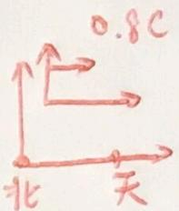

# 《大学物理》狭义相对论习题作业参考答案

原件经识别和整理；“参考解答”是我们补的。

# 狭义相对论习题作业参考答案

本资料由识别工具读取《大学物理》狭义相对论习题作业参考答案第 1–1 页内容整理而成。

## 一、填空题

### 填空 1

题干：牛顿绝对时空观认为时间和空间是相互 ______ 的。

答案：独立。

知识点：[伽利略变换与牛顿绝对时空观的局限性](../../../topics/大学物理/伽利略变换与绝对时空观.md)

### 填空 2

题干：1905年，爱因斯坦在麦克尔逊一莫雷实验的事实上提出了狭义相对论的两个基本假设—— ______ 原理和 ______ 原理。

答案：光速不变；相对性。

## 二、选择题

知识点：[爱因斯坦的两个基本假设](../../../topics/大学物理/狭义相对论基本原理.md)

### 选择 1

题干：有下列几种说法：
①所有惯性系对物理基本规律都是等价的。
②在真空中，光的速度与光的频率、光源的运动状态无关。
③在任何惯性系中，光在真空中沿任意方向的传播速率都相同。
若问其中哪些说法是正确的，答案是：

- A. 只有①②是正确的。
- B. 只有①③是正确的。
- C. 只有②③是正确的。
- D. 三种说法都是正确的。

答案：D。

知识点：[爱因斯坦的两个基本假设](../../../topics/大学物理/狭义相对论基本原理.md)、[洛伦兹坐标变换与速度变换](../../../topics/大学物理/洛伦兹变换.md)

### 选择 2

题干：一飞船的固有长度为 $L$ ，相对于地面以速度 $v_{1}$ 作匀速直线运动，从飞船的后端向飞船中的前端的一个靶子发射一颗相对于飞船的速度为 $v_{2}$ 的子弹。在飞船上测得子弹从射出到击中靶的时间间隔为：

- A. $\frac {L}{v _ {1} + v _ {2}}$
- B. $\frac {L}{v _ {1} - v _ {2}}$
- C. $\frac {L}{v _ {2}}$
- D. $\frac {L}{v _ {1} \sqrt {1 - \left(v _ {1} / c\right) ^ {2}}}$

答案：C。

知识点：[爱因斯坦的两个基本假设](../../../topics/大学物理/狭义相对论基本原理.md)、[洛伦兹坐标变换与速度变换](../../../topics/大学物理/洛伦兹变换.md)、[同时的相对性、时间膨胀与长度收缩](../../../topics/大学物理/狭义相对论时空观.md)

### 选择 3

题干：天津和北京相距 120Km。在北京于某日上午 9 时正有一工厂因过载而断电。同日天津于 9 点 0 分 0.0003 秒发生一交通事故。试求在以 $u=0.8c$ 的速率沿北京到天津方向飞行的飞船中，观察到的这两个事件之间的时间间隔为 $-3.33 \times 10^{-5}$ s，先发生的事件为 ______ 。（填“北京”或“天津”）

答案：天津。

知识点：[洛伦兹坐标变换与速度变换](../../../topics/大学物理/洛伦兹变换.md)、[同时的相对性、时间膨胀与长度收缩](../../../topics/大学物理/狭义相对论时空观.md)、[伽利略变换与牛顿绝对时空观的局限性](../../../topics/大学物理/伽利略变换与绝对时空观.md)

### 选择 4

题干：设 $S'$ 系以速率 $v = 0.6c$ 相对于 $S$ 系沿 $xx'$ 轴运动，且在 $t = t' = 0$ 时， $x = x' = 0$ 。
(1) 若有一事件，在 $S$ 系中发生于 $t = 2.0 \times 10^{-7}$ s， $x = 50 \text{m}$ 处，则该事件在 $S'$ 系中发生时刻为 ______ 。
(2) 如有另一事件发生于 $S$ 系中 $t = 3.0 \times 10^{-7} \mathrm{~s}$ ， $x = 10 \mathrm{~m}$ 处，在 $S'$ 系中测得这两个事件的时间间隔为 ______ 。

- A. (1) $1.25 \times 10^{-7} \text{s}$; (2) $2.25 \times 10^{-7} \text{s}$
- B. ... (其他选项省略，原题未完整列出其他选项，但给出了部分计算过程和最终填空值)

答案：(1) $1.25 \times 10^{-7} \text{s}$; (2) $2.25 \times 10^{-7} \text{s}$ (注：原题此处似为填空或简答形式，结合识别文本中的计算过程得出)。

知识点：[洛伦兹坐标变换与速度变换](../../../topics/大学物理/洛伦兹变换.md)、[同时的相对性、时间膨胀与长度收缩](../../../topics/大学物理/狭义相对论时空观.md)

### 简答 1

题干：一列火车以速度 $v$ 匀速行驶, 车头、车尾各有一盏灯, 某时刻路基上的人看见两灯同时亮了, 那么从车厢顶上看见的情况是车尾灯先亮还是车头灯先亮？

- A. 车头灯先亮
- B. 车尾灯先亮

答案：B。

知识点：[同时的相对性、时间膨胀与长度收缩](../../../topics/大学物理/狭义相对论时空观.md)、[洛伦兹坐标变换与速度变换](../../../topics/大学物理/洛伦兹变换.md)
