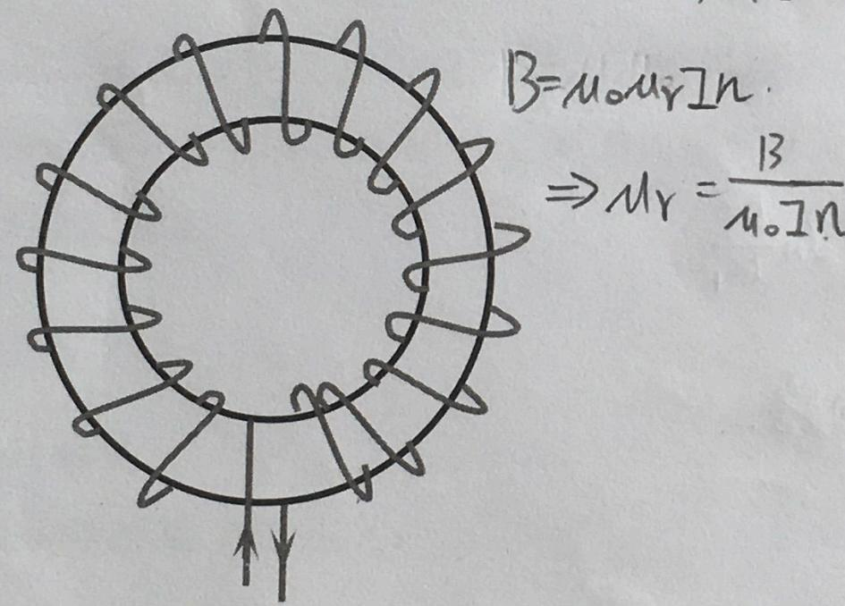
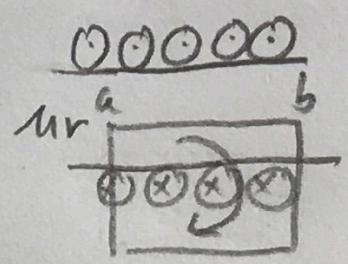
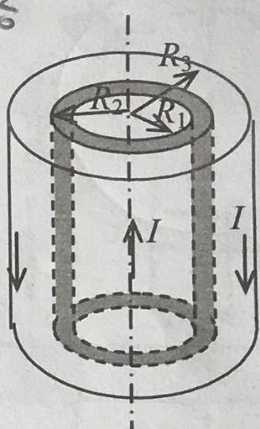

# 《大学物理》稳恒磁场 同步练习册

原件经识别和整理；“参考解答”是我们补的。

本资料为《大学物理》课程中“稳恒磁场”章节的同步练习题，主要涉及磁场中的磁介质、螺绕环、同轴电缆等内容的计算与概念辨析。内容已整理为标准 Markdown 格式。

## 一、选择题

### 选择 1

1. 磁介质有三种, 用相对磁导率 $\mu_{r}$ 表征它们的特性时 [C]
- A. 顺磁质 $\mu_{r} > 0$ , 抗磁质 $\mu_{r} < 0$ , 铁磁质 $\mu_{r} >> 1$ .
- B. 顺磁质 $\mu_{r} > 1$ , 抗磁质 $\mu_{r} = 1$ , 铁磁质 $\mu_{r} >> 1$ .
- C. 顺磁质 $\mu_{r} > 1$ , 抗磁质 $\mu_{r} < 1$ , 铁磁质 $\mu_{r} >> 1$ .
- D. 顺磁质 $\mu_{r} < 0$ , 抗磁质 $\mu_{r} < 1$ , 铁磁质 $\mu_{r} > 0$ .

答案：C。

知识点：[磁介质的分类、磁化强度与磁介质中的安培环路定理（H矢量）](../../../topics/大学物理/磁场中的磁介质.md)

### 选择 2

2. 如图所示的一细螺绕环，它由表面绝缘的导线在铁环上密绕而成，每厘米绕10匝。当导线中的电流I为2.0A时，测得铁环内的磁感应强度的大小B为1.0T，则可求得铁环的相对磁导率 $\mu_{r}$ 为 $n=10\text{匝}/cm=1000\text{匝}/m$ [B]

- A. $7.96 \times 10^{2}$
- B. $3.98 \times 10^{2}$
- C. $1.99 \times 10^{2}$
- D. 63.3

答案：B。

知识点：[安培环路定理及其应用](../../../topics/大学物理/安培环路定理.md)、[磁介质的分类、磁化强度与磁介质中的安培环路定理（H矢量）](../../../topics/大学物理/磁场中的磁介质.md)

### 选择 3

3. 螺绕环中心周长为 $l$ ，环上均匀密绕线圈 $N$ 匝，线圈中通有电流 $I$ 。管内充满相对磁导率 $\mu_r$ 的磁介质。求管内磁感应强度的大小为 $\mu_{0}\mu_{r}\frac{N}{L}I$

*(注：原题此处似乎为填空题或简答题形式，但被标记为选择题序号3，且题干直接给出了求解目标或结论片段。根据上下文，这更像是一个推导题或填空题的题干部分。若作为选择题，选项缺失。此处按原文保留题干及给出的中间步骤提示)*

补充：
根据安培环路定理：
$$ \oint \vec{H} \cdot d\vec{l} = NI $$
由于对称性，$H \cdot l = NI \implies H = \frac{NI}{l} = nI$ （其中 $n=N/l$）
磁感应强度 $B$ 为：
$$ B = \mu H = \mu_0 \mu_r H = \mu_0 \mu_r \frac{N}{l} I $$

## 二、计算题

知识点：[安培环路定理及其应用](../../../topics/大学物理/安培环路定理.md)、[磁介质的分类、磁化强度与磁介质中的安培环路定理（H矢量）](../../../topics/大学物理/磁场中的磁介质.md)

### 计算 1

4. 一根同轴电缆由半径为 $R_{1}$ 的长导线和套在它外面的内半径为 $R_{2}$ 、外半径为 $R_{3}$ 的同轴导体圆筒组成。中间充满磁导率为 $\mu$ 的各向同性均匀非铁磁绝缘材料，如图。传导电流 $I$ 沿导线向上流去，由圆筒向下流回，在它们的截面上电流都是均匀分布的。求同轴线内外的磁场强度和磁感应强度的分布。

解: 由安培环路定理, 作同轴圆为回路
由 $\oint \vec{H} \cdot d\vec{l} = \sum I_i$

**区域 1：** $0 < r < R_{1}$
$$ H \cdot 2\pi r = I \frac{r^2}{R_1^2} $$
$$ H = \frac {I r}{2 \pi R _ {1} ^ {2}} $$
$$ B = \mu H = \frac {\mu I r}{2 \pi R _ {1} ^ {2}} $$

**区域 2：** $R _ {1} < r < R _ {2}$
$$ 2 \pi r \cdot H = I $$
$$ H = \frac {I}{2 \pi r}, \quad B = \mu H = \frac {\mu I}{2 \pi r} $$

**区域 3：** $R _ {2} < r < R _ {3}$
$$ 2 \pi r \cdot H = I - I \frac {r ^ {2} - R _ {2} ^ {2}}{R _ {3} ^ {2} - R _ {2} ^ {2}} $$
$$ H = \frac {I}{2 \pi r} \left(1 - \frac {r ^ {2} - R _ {2} ^ {2}}{R _ {3} ^ {2} - R _ {2} ^ {2}}\right) $$
$$ B = \mu H = \frac {\mu I}{2 \pi r} \left(1 - \frac {r ^ {2} - R _ {2} ^ {2}}{R _ {3} ^ {2} - R _ {2} ^ {2}}\right) $$

**区域 4：** $r > R_{3}$
$$ H = 0, \quad B = 0 $$

知识点：[安培环路定理及其应用](../../../topics/大学物理/安培环路定理.md)、[磁场与磁感应强度的定义](../../../topics/大学物理/磁感应强度.md)
