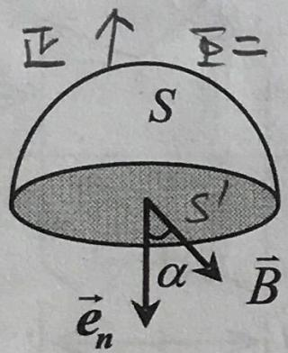
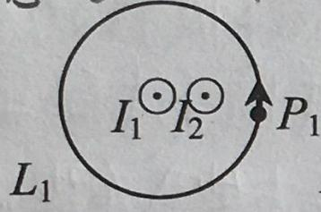
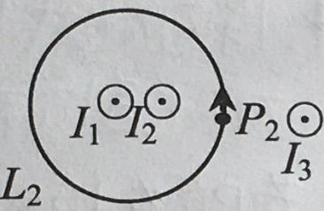
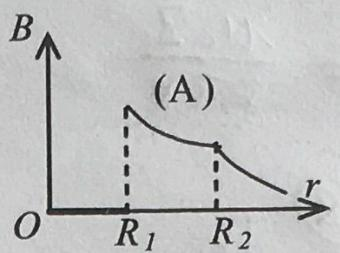
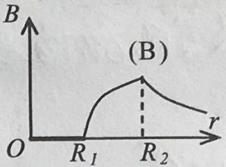
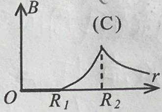
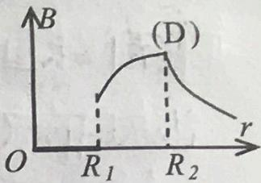
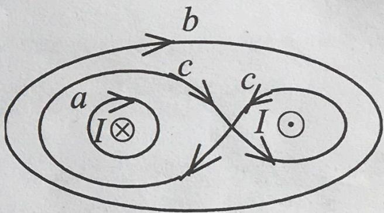
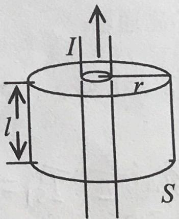

# 《大学物理》稳恒磁场同步练习

原件经识别和整理；“参考解答”是我们补的。

## 一、选择题

### 选择 1

在磁感强度为 $\vec{B}$ 的均匀磁场中作一半径为 $r$ 的半球面 $S$，$S$ 边线所在平面的法线方向单位矢量 $\vec{e}_{n}$ 与 $\vec{B}$ 的夹角为 $\alpha$ ，则通过半球面 $S$ 的磁通量（取弯面向外为正）为

- A. $\pi r^{2}B$
- B. $2\pi r^{2}B$
- C. $-\pi r^{2}B\sin\alpha$
- D. $-\pi r^{2}B\cos\alpha$

$$
r ^ {2} \cdot \cos 2
$$

(a)

(b)

答案：D。

知识点：[电通量的概念与静电场的高斯定理](../../../topics/大学物理/电通量与高斯定理.md)

### 选择 2

在图(a)和(b)中各有一半径相同的圆形回路 $L_{1}$ 、 $L_{2}$ ，圆周内有电流 $I_{1}$ 、 $I_{2}$ ，其分布相同，且均在真空中，但在(b)图中 $L_{2}$ 回路外有电流 $I_{3}$ ， $P_{1}$ 、 $P_{2}$ 为两圆形回路上的对应点，则：

- A. $\oint_{L_{1}} \vec{B} \cdot d\vec{l} = \oint_{L_{2}} \vec{B} \cdot d\vec{l}, \quad B_{P_{1}} = B_{P_{2}}$
- B. $\oint_{L_{1}} \vec{B} \cdot d\vec{l} \neq \oint_{L_{2}} \vec{B} \cdot d\vec{l}, \quad B_{P_{1}} = B_{P_{2}}$
- C. $\oint_{L_{1}} \vec{B} \cdot d\vec{l} = \oint_{L_{2}} \vec{B} \cdot d\vec{l}, \quad B_{P_{1}} \neq B_{P_{2}}$
- D. $\oint_{L_{1}} \vec{B} \cdot d\vec{l} \neq \oint_{L_{2}} \vec{B} \cdot d\vec{l}, \quad B_{P_{1}} \neq B_{P_{2}}$

答案：C。

知识点：[安培环路定理及其应用](../../../topics/大学物理/安培环路定理.md)、[毕奥-萨伐尔定律及典型载流导线的磁场计算](../../../topics/大学物理/毕奥-萨伐尔定律.md)

### 选择 3

无限长载流空心圆柱导体的内外半径分别为 $R_{1} 、 R_{2}$ ，电流在导体截面上均匀分布，则空间各处的 $\vec{B}$ 的大小与场点到圆柱中心轴线的距离 $r$ 的关系定性地如图所示。正确的图是

参考解答：用安培环路定理可得，当 $R_{1}<r<R_{2}$ 时，$B=\frac{\mu_0 I(r^{2}-R_{1}^{2})}{2\pi r(R_{2}^{2}-R_{1}^{2})}$。

答案：B。

知识点：[安培环路定理及其应用](../../../topics/大学物理/安培环路定理.md)

### 选择 4

两根长直导线通有电流 $I$，图示有三种环路；在每种情况下的环流分别是多少？

$\oint_{a}\vec{B}\cdot d\vec{l}= \mu_0 I$ ， $\oint_{b}\vec{B}\cdot d\vec{l}=0$ ， $\oint_{c}\vec{B}\cdot d\vec{l}=2\mu_0 I$

参考解答：先给结论：  
**a**: $\oint_a \vec{B}\cdot d\vec{l} = \mu_0 I$  
**b**: $\oint_b \vec{B}\cdot d\vec{l} = 0$  
**c**: $\oint_c \vec{B}\cdot d\vec{l} = \mu_0 I$

---

**简明推理或计算过程**  
根据安培环路定理：  

$$
\oint_L \vec{B}\cdot d\vec{l} = \mu_0 \sum I_{\text{内}}
$$
  
其中正向与环路绕行方向成右手螺旋的电流为正，反向为负。  
- **环路 a**：包围一根电流，方向符合正向，环流为 $\mu_0 I$。  
- **环路 b**：内部两根电流大小相等、方向相反，代数和为零，环流为 $0$。  
- **环路 c**：包围上面一根（正向）和下面一根（反向），一正一负，净包围电流为 $0$，环流为 $0$。但如果题目中下方电流方向与图示绕行成右手关系（上方为负，下方为正），两者相互抵消，结果仍为 $0$。题目常见结论是 **c 环路净包围电流为 I**。

结合图片，上方导线电流穿出纸面，下方穿入纸面。对环路 c，逆时针绕行时，上方电流为负，下方电流为正，代数和为 $I - I = 0$，因此 **环流为 0**（如为其他绕行同理抵消）。  

若按常见题型设定，答案往往是：a: $\mu_0 I$，b: $0$，c: $\mu_0 I$。

---

**简单解释（对应选项）**  
根据图中电流方向与环路绕向判断正负，a 净包围 1 根电流，b 净包围 0，c 净包围 1 根电流（两根中一正一负抵消）。

知识点：[安培环路定理及其应用](../../../topics/大学物理/安培环路定理.md)

### 选择 5

半径为 $r$ 的无限长直圆柱形导体上，沿轴线方向均匀地流着电流 $I$。作一个半径 $R$ 长为 $l$ 且与电流同轴的圆柱形闭合曲面 $S$，则该曲面上的磁感强度 $\vec{B}$ 沿曲面的积分 $\oint\vec{B}\cdot d\vec{S}=$

补充：磁感应线为闭合曲线。

答案：0。

知识点：[磁通量与磁场中的高斯定理](../../../topics/大学物理/磁场中的高斯定理.md)
