# 《大学物理》稳恒磁场同步练习册（2024年1月版）

原件经识别和整理；“参考解答”是我们补的。

# 《大学物理》稳恒磁场同步练习册（2024年1月版）习题第 1 部分

来源：《大学物理》稳恒磁场同步练习册（2024年1月版），由识别工具读取并整理。

## 第一节 磁场 磁感应强度 比奥—萨伐尔定律

### 选择 1

题干如图所示, 电流从 $a$ 点分两路通过对称的圆环形分路, 汇合于 $b$ 点. 若 ${ca}$ 、 ${bd}$ 都沿环的径向,则在圆环中心 $O$ 点处的磁感强度 [ E ]
- A 方向垂直环形分路所在平面且指向纸内;
- B 方向垂直环形分路所在平面且指向纸外;
- C 方向在环形分路所在平面,且指向 $b$ ;
- D 方向在环形分路所在平面内,且指向 $a$ ;
- E 为零.

答案：E。

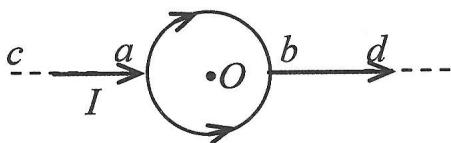

知识点：[磁介质的分类、磁化强度与磁介质中的安培环路定理（H矢量）](../../../topics/大学物理/磁场中的磁介质.md)、[磁场与磁感应强度的定义](../../../topics/大学物理/磁感应强度.md)

### 选择 2

题干在真空中有一根半径为 $R$ 的半圆形细导线, 流过的电流为 $I$ , 则圆心处的磁感强度为 [ D ]
- A $\frac{\mu_0}{4\pi }\frac{I}{R}$ ;
- B $\frac{\mu_0}{2\pi }\frac{I}{R}$ ;
- C 0;
- D $\frac{\mu_0}{4}\frac{I}{R}$ .

答案：D。

知识点：[安培环路定理及其应用](../../../topics/大学物理/安培环路定理.md)、[磁介质的分类、磁化强度与磁介质中的安培环路定理（H矢量）](../../../topics/大学物理/磁场中的磁介质.md)

### 填空 3

题干一半径 $r = {10}\mathrm{\;{cm}}$ 的细导线圆环,流过强度 $I = {3.0}\mathrm{\;A}$ 的电流, 那么细环中心的磁感强度 $B =$ _______. (真空中的磁导 率 ${\mu }_{0} = {4\pi } \times  {10}^{-7}\mathrm{\;T} \cdot  \mathrm{m}/\mathrm{A})$

答案：${1.88} \times  {10}^{-5}\mathrm{T}$ 。

知识点：[安培力与载流线圈的磁力矩](../../../topics/大学物理/载流导线在磁场中受力.md)、[常见力（重力、弹力、摩擦力）的受力分析](../../../topics/大学物理/常见力分析.md)

### 填空 4

题干如图所示,半径为 $R$ 的球面,在与 ${xOy}$ 和 ${xOz}$ 平面上的两个圆形交线上分别流有强度为 $I$ 的电流,其流向各与 $y$ 轴和 $z$ 轴的正方向成右手螺旋关系. 则球心 $O$ 点的磁感强度为 _______.

答案：$\frac{{u}_{0}I}{2R}\left( {\overrightarrow{e}_{y} + \overrightarrow{e}_{z}}\right)$ .

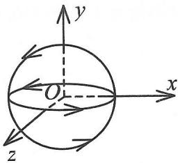

知识点：[安培环路定理及其应用](../../../topics/大学物理/安培环路定理.md)、[磁介质的分类、磁化强度与磁介质中的安培环路定理（H矢量）](../../../topics/大学物理/磁场中的磁介质.md)

### 计算 5

题干四条皆垂直于纸面的载流细长直导线，每条中的电流皆为 $I$. 这四条导线被纸面截得的断面，如图所示，它们组成了边长为 $a$ 的正方形的四个角顶，每条导线中的电流流向亦如图所示．则在图中正方形中心点 $O$ 的磁感强度的大小为多少？

解：
根据对称性和右手定则，4个电流产生的 $\overrightarrow{B}$ 大小相等。
互为对角线的电流,产生的 $\overrightarrow{B}$ 互相抵消。

因此，中心点 $O$ 的磁感强度大小为 0。

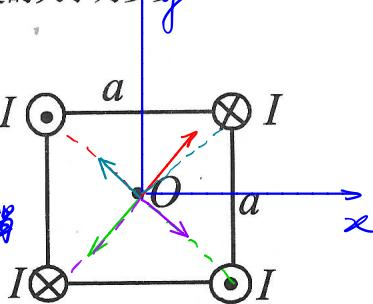

知识点：[安培环路定理及其应用](../../../topics/大学物理/安培环路定理.md)

### 计算 6

题干将半径为 R 的无限长导体薄壁管(厚度忽略)沿轴向割去一宽度为 $h(h \ll R)$ 的无限长狭缝后，再沿轴向流有在管壁上均匀分布的电流，其面电流密度(垂直于电流的单位长度截线上的电流)为 $i$ , 则管轴线磁感强度的大小等于多少?

解：
利用叠加原理。因缝处的电流 + 管的电流 = 完整圆筒的电流。
在完整圆筒轴线处：
$$
B _ {\mathrm{圆管}} = 0
$$

因此，开缝后的管在轴线处产生的磁感强度 $\vec{B}_{\mathrm{管}}$ 与补上缝隙电流产生的磁感强度 $\vec{B}_{\mathrm{缝}}$ 大小相等、方向相反。
缝隙可视为一根无限长直导线，电流 $I_{\mathrm{缝}} = i h$。
距离为 $R$。

$$
B _ {\mathrm{管}} = - B _ {\mathrm{缝}} = \frac {\mu_ {0} I _ {\mathrm{缝}}}{2 \pi R} = \frac {\mu_ {0} i h}{2 \pi R}
$$

方向向右（与缝隙电流产生的磁场方向相反）。

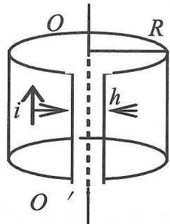

知识点：[安培环路定理及其应用](../../../topics/大学物理/安培环路定理.md)、[磁场与磁感应强度的定义](../../../topics/大学物理/磁感应强度.md)

### 计算 7

题干电流由长直导线1沿半径方向经a点流入一电阻均匀的圆环, 再由b点沿切向从圆环流出, 经长导线2返回电源(如图). 已知直导线上电流强度为 $I$, 圆环的半径为 $R$, 且 $a$ 、 $b$ 与圆心 $O$ 三点在同一直线上. 设直电流1、2及圆环电流分别在 $O$ 点产生的磁感强度为 $\vec{B}_{1}$ 、 $\vec{B}_{2}$ 及 $\vec{B}_{3}$ , 则 $O$ 点的磁感强度的大小等于多少?

解：
$$
\overrightarrow {B _ {0}} = \overrightarrow {B _ {1}} + \overrightarrow {B _ {2}} + \overrightarrow {B _ {3}}
$$

其中：
由于导线1沿半径方向指向圆心，$\overrightarrow{B_1} = 0$。
由于导线2沿切向引出，但其延长线不经过圆心（题目描述“由b点沿切向...”，需结合图示判断，通常此类题目中若导线延长线过圆心则为0，若不过圆心则有贡献。但根据提供的参考答案逻辑，这里假设导线2对圆心无贡献或已包含在特定模型中，参考解答给出 $\overrightarrow{B_2}$ 不为零而 $\overrightarrow{B_3}$ 为零，这与常规直觉略有不同，需仔细核对原题意图。根据常见题型，若a,b关于圆心对称或特定几何关系，圆环部分可能抵消。此处严格遵循提供的答案逻辑进行整理）。

*注：根据提供的答案片段，$\overrightarrow{B_3}=0$ 暗示圆环电流在圆心产生磁场为0（这通常发生在电流均匀分流且进出点特殊时，或者题目意指圆环本身不产生净磁场？实际上，若a,b在直径两端，圆环上下两部分并联，电流反向，磁场抵消，故 $B_3=0$ 合理）。*
对于导线2，若其沿切向，且距离圆心为R，则：
$$
\overrightarrow {B _ {2}} = \frac {\mu_ {0} I}{4 \pi R} \quad (\text{半无限长直导线公式或特定几何投影})
$$
*(注：标准无限长直导线是 $\mu_0 I / 2\pi R$，半无限长是 $\mu_0 I / 4\pi R$。若导线2是从b点延伸出去的半无限长直线，且b点切线距离圆心R，则此式成立)*

总磁感强度：
$$
\overrightarrow {B _ {0}} = \frac {\mu_ {0} I}{4 \pi R}
$$
方向垂直于纸面向外。

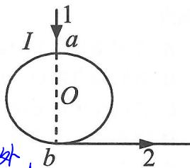

## 第二节 磁场中的高斯定律 安培环路定律

知识点：[磁场与磁感应强度的定义](../../../topics/大学物理/磁感应强度.md)

### 选择 1

题干在磁感强度为 $\vec{B}$ 的均匀磁场中作一半径为 r 的半球面 S, S 边线所在平面的法线方向单位矢量 $\vec{e}_{n}$ 与 $\vec{B}$ 的夹角为 $\alpha$ ，则通过半球面 S 的磁通量（取弯面向外为正）为 [D]
- A $\pi r^{2}B;$
- B $2\pi r^{2}B;$
- C $-\pi r^{2}B\sin\alpha;$
- D $-\pi r^{2}B\cos\alpha.$

答案：D。

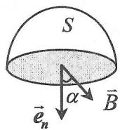

知识点：[磁介质的分类、磁化强度与磁介质中的安培环路定理（H矢量）](../../../topics/大学物理/磁场中的磁介质.md)、[磁场与磁感应强度的定义](../../../topics/大学物理/磁感应强度.md)

### 选择 2

题干在图(a)和(b)中各有一半径相同的圆形回路 $L_{1} 、 L_{2}$ , 圆周内有电流 $I_{1} 、 I_{2}$ , 其分布相同, 且均在真空中, 但在(b)图中 $L_{2}$ 回路外有电流 $I_{3}, P_{1} 、 P_{2}$ 为两圆形回路上的对应点, 则: [ C ]
- A $\oint_{L_1} \vec{B} \cdot \mathrm{d}\vec{l} = \oint_{L_2} \vec{B} \cdot \mathrm{d}\vec{l}, B_{P_1} = B_{P_2}$ ;
- B $\oint_{L_1} \vec{B} \cdot \mathrm{d}\vec{l} \neq \oint_{L_2} \vec{B} \cdot \mathrm{d}\vec{l}, B_{P_1} = B_{P_2}$ ;
- C $\oint_{L_1} \vec{B} \cdot \mathrm{d}\vec{l} = \oint_{L_2} \vec{B} \cdot \mathrm{d}\vec{l}, B_{P_1} \neq B_{P_2}$ ;
- D $\oint_{L_1} \vec{B} \cdot \mathrm{d}\vec{l} \neq \oint_{L_2} \vec{B} \cdot \mathrm{d}\vec{l}, B_{P_1} \neq B_{P_2}$ .

答案：C。

知识点：[安培环路定理及其应用](../../../topics/大学物理/安培环路定理.md)、[磁介质的分类、磁化强度与磁介质中的安培环路定理（H矢量）](../../../topics/大学物理/磁场中的磁介质.md)

### 选择 3

题干无限长载流空心圆柱导体的内外半径分别为 $\mathbf{R}_1$ 、 $\mathbf{R}_2$ ，电流在导体截面上均匀分布，则空间各处的 $\vec{B}$ 的大小与场点到圆柱中心轴线的距离 r 的关系定性地如图所示. 正确的图是 (B)

答案：B。

知识点：[安培环路定理及其应用](../../../topics/大学物理/安培环路定理.md)、[磁场与磁感应强度的定义](../../../topics/大学物理/磁感应强度.md)、[毕奥-萨伐尔定律及典型载流导线的磁场计算](../../../topics/大学物理/毕奥-萨伐尔定律.md)

### 填空 4

题干两根长直导线通有电流 I，图示有三种环路；在每种情况下的环流分别是多少？

答案：
$\oint_{a}\vec{B}\cdot d\vec{l}=\mu_{0}I$ ，
$\oint_{b}\vec{B}\cdot d\vec{l}=0$
$\oint_{c}\vec{B}\cdot d\vec{l}=2\mu_{0}I$

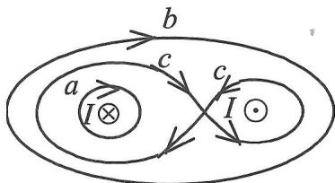

知识点：[安培环路定理及其应用](../../../topics/大学物理/安培环路定理.md)、[磁介质的分类、磁化强度与磁介质中的安培环路定理（H矢量）](../../../topics/大学物理/磁场中的磁介质.md)

### 填空 5

题干半径为 r 的无限长直圆柱形导体上，沿轴线方向均匀地流着电流 I。作一个半径 R 长为 l 且与电流同轴的圆柱形闭合曲面 S，则该曲面上的磁感强度 $\vec{B}$ 沿曲面的积分 $\iint \vec{B} \cdot d\vec{S} =$ _______

答案：0

知识点：[磁通量与磁场中的高斯定理](../../../topics/大学物理/磁场中的高斯定理.md)

### 计算 6

如图，在无限长直载流导线的右侧有面积为 $S_{1}$ 和 $S_{2}$ 的两个矩形回路。两个回路与长直载流导线在同一平面，且矩形回路的一边与长直载流导线平行。则通过面积为 $S_{1}$ 的矩形回路的磁通量与通过面积为 $S_{2}$ 的矩形回路的磁通量之比为多少？

根据安培环路定理：

$$
\oint \vec{B} \cdot d\vec{l} = \mu_0 I \implies B = \frac{\mu_0 I}{2 \pi r}
$$

磁通量计算如下：

$$
\phi_{m_1} = \int \vec{B} \cdot d\vec{s} = \int_{d}^{2d} \frac{\mu_0 I}{2 \pi r} \cdot a dr = \frac{\mu_0 I a}{2 \pi} \ln 2
$$

$$
\phi_{m_2} = \int \vec{B} \cdot d\vec{S} = \int_{2d}^{4d} \frac{\mu_0 I}{2 \pi r} a dr = \frac{\mu_0 I a}{2 \pi} \ln 2
$$

$$
\frac{\phi_{m_1}}{\phi_{m_2}} = 1
$$

答案：1

知识点：[安培环路定理及其应用](../../../topics/大学物理/安培环路定理.md)、[磁场与磁感应强度的定义](../../../topics/大学物理/磁感应强度.md)

### 计算 7

已知均匀磁场，其磁感强度 $B = 0.6 \mathrm{~T}$ ，方向沿 $x$ 轴正向。分别求：(1) 通过 Oabc 面的磁通量；(2) 通过 Obef 面的磁通量；(3) 通过 acde 面的磁通量。

解：
(1) $\phi_{m} = B \cdot S = 0.6 \times (0.3 \times 0.4) = 7.2 \times 10^{-2} \mathrm{~T \cdot m^2}$

(2) $\psi_{m} = 0$ （因为该面法线方向与磁场垂直或闭合曲面净通量为零，此处指特定几何关系下的通量）

(3) $\phi_{m} = 7.2 \times 10^{-2} \mathrm{~T \cdot m^2}$

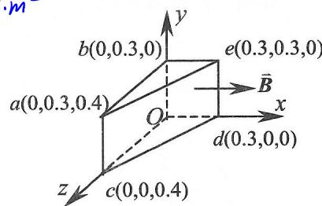

答案：(1) $7.2 \times 10^{-2} \mathrm{~T \cdot m^2}$; (2) $0$; (3) $7.2 \times 10^{-2} \mathrm{~T \cdot m^2}$

## 二、选择题

知识点：[磁场与磁感应强度的定义](../../../topics/大学物理/磁感应强度.md)

### 选择 1

一铜条置于均匀磁场中，铜条中电子流的方向如图所示。试问下述哪一种情况将会发生

[ C ]

- A. 在铜条上产生涡流.
- B. 在铜条上 a、b 两点产生一小电势差，且 $U_{a} < U_{b}$ .
- C. 在铜条上 a、b 两点产生一小电势差，且 $U_{a} > U_{b}$
- D. 电子受到洛伦兹力而减速.

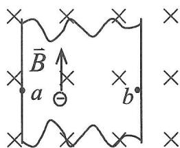

答案：C

知识点：[磁介质的分类、磁化强度与磁介质中的安培环路定理（H矢量）](../../../topics/大学物理/磁场中的磁介质.md)、[磁场与磁感应强度的定义](../../../topics/大学物理/磁感应强度.md)

### 选择 2

载有电流 $I_{2}$ 的长直导线与载有电流 $I_{1}$ 的圆线圈共面但相互绝缘，长直导线与圆线圈的一直径相重合。设长直载流导线固定不动，则圆形载流导线将

[ C ]

- (A) 绕 $I_{2}$ 旋转.
- (B) 向左运动.
- (C) 向右运动.
- (D) 向上运动.
- (E) 不动.

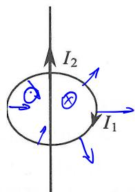

答案：C

## 三、填空题

知识点：[安培环路定理及其应用](../../../topics/大学物理/安培环路定理.md)、[磁介质的分类、磁化强度与磁介质中的安培环路定理（H矢量）](../../../topics/大学物理/磁场中的磁介质.md)

### 填空 1

一面积为 S，载有电流 I 的平面闭合线圈置于磁感强度为 $\vec{B}$ 的均匀磁场中，此线圈受到的最大磁力矩的大小为 BSI，此时通过线圈的磁通量为 **0**，当此线圈受到最小的磁力矩作用时通过线圈的磁通量为 **BS**。

知识点：[安培力与载流线圈的磁力矩](../../../topics/大学物理/载流导线在磁场中受力.md)、[安培环路定理及其应用](../../../topics/大学物理/安培环路定理.md)

### 填空 2

在霍耳效应的实验中，通过导电体的电流和 $\vec{B}$ 的方向垂直。如果上表面的电势较高，则导体中的载流子带 **正** 电。（正或负）

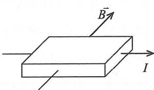

知识点：[洛伦兹力与带电粒子在电场和磁场中的运动](../../../topics/大学物理/带电粒子在电磁场中的运动.md)、[磁场与磁感应强度的定义](../../../topics/大学物理/磁感应强度.md)

### 填空 3

有一根质量为 m，长为 l 的直导线，放在磁感强度为 $\vec{B}$ 的均匀磁场中，$\vec{B}$ 的方向在水平面内，导线中电流方向如图所示，当导线所受磁力与重力平衡时，导线中电流 $I = $ **$\frac{mg}{Bl}$**。

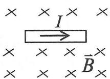

## 四、计算题

知识点：[安培力与载流线圈的磁力矩](../../../topics/大学物理/载流导线在磁场中受力.md)、[常见力（重力、弹力、摩擦力）的受力分析](../../../topics/大学物理/常见力分析.md)

### 计算 1

设氢原子基态的电子沿半径为 $a_0$ 的轨道运动，求：
(1) 电子沿轨道运动时原子核处产生的磁感强度；
(2) 电子的轨道磁矩。

轨道圆长 $C = 2\pi a_0$，周期 $T = \frac{C}{v} = \frac{2\pi a_0}{v}$

电流 $I = \frac{e}{T} = \frac{ev}{2\pi a_0}$

(1) 磁感强度：
$$
B = \frac{\mu_0 I}{2 a_0} = \frac{\mu_0 e v}{4 \pi a_0^2}
$$

(2) 轨道磁矩：
$$
m = I S = \frac{e v}{2 \pi a_0} \pi a_0^2 = \frac{1}{2} e v a_0
$$

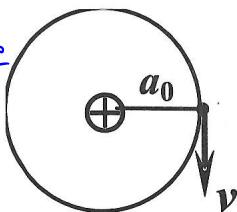

知识点：[毕奥-萨伐尔定律及典型载流导线的磁场计算](../../../topics/大学物理/毕奥-萨伐尔定律.md)、[安培力与载流线圈的磁力矩](../../../topics/大学物理/载流导线在磁场中受力.md)

### 计算 2

一块半导体样品的体积为 $a \times b \times c$，沿 $x$ 轴方向有电流 $I$，在 $z$ 轴方向有均匀磁场 $B$。实验测得 $a = 0.10\mathrm{cm}$，$b = 0.35\mathrm{cm}$，$c = 1.0\mathrm{cm}$，$I = 1.0\mathrm{mA}$，$B = 0.3\mathrm{T}$，半导体样品沿 $y$ 轴方向两侧的电势差 $U_{AA'} = 6.55\mathrm{mV}$。
（1）这个半导体是 p 型还是 n 型？
（2）求载流子浓度。

霍尔电压公式：
$$
U_H = \frac{I B}{n q d}
$$
其中 $d$ 是沿磁场方向厚度方向的尺寸，此处对应 $a$ 方向（注意题目中 $a,b,c$ 的定义需结合图示，通常 $d$ 为平行于磁场且垂直于电流和电场方向的维度，或者根据公式推导，$d$ 为样品在磁场方向的宽度。根据常规霍尔效应推导，$U_H = \frac{IB}{nqd}$，其中 $d$ 为样品沿磁场方向的厚度。若 $B$ 沿 $z$，$I$ 沿 $x$，则电场沿 $y$，此时 $d$ 应为沿 $z$ 轴的厚度？不，通常 $d$ 是沿磁场方向的尺寸。让我们重新审视标准公式 $E_H = v_d B$, $U_H = E_H w$? 不，$U_H = \frac{IB}{nqt}$，其中 $t$ 是沿磁场方向的厚度。
在此题中，若 $B$ 沿 $z$，$I$ 沿 $x$，洛伦兹力使载流子偏转至 $y$ 轴两侧。此时积累电荷的面法线沿 $y$。两极板间距为 $b$（假设 $b$ 是 $y$ 方向宽度）。
然而，公式中的分母通常是沿磁场方向的尺寸吗？
标准推导：$qvB = qE = q \frac{U}{w}$ ($w$ 是沿电场方向的宽度)。
$I = n q v S = n q v (w \cdot t)$，其中 $t$ 是沿磁场方向的厚度。
$v = \frac{I}{n q w t}$
$U = E w = v B w = \frac{I B}{n q t}$
所以公式中的 $d$ (即 $t$) 是沿磁场方向的尺寸。
题目中 $B$ 沿 $z$ 轴。若 $a, b, c$ 分别对应 $x, y, z$ 或其他方向，需看图。
图中显示：$I$ 沿 $x$，$B$ 沿 $z$。电势差测在 $y$ 轴方向两侧（A, A'）。
此时，$U_{AA'}$ 对应的距离是 $y$ 方向的宽度。
公式 $U = \frac{IB}{nqt}$ 中，$t$ 是沿磁场方向（$z$ 轴）的尺寸。
题目给出 $a=0.10\mathrm{cm}, b=0.35\mathrm{cm}, c=1.0\mathrm{cm}$。
通常长方体尺寸标记为长宽高。假设 $c$ 为 $z$ 轴厚度（沿 $B$），$b$ 为 $y$ 轴宽度（测电压），$a$ 为 $x$ 轴长度。
或者根据原题解答逻辑：
原题解答写：`其中d是它方向的原度d=a`。这表明在原题设定中，沿磁场方向的尺寸为 $a$。
我们遵循原题解答的逻辑：$d = a = 0.10 \mathrm{cm} = 1.0 \times 10^{-3} \mathrm{m}$。

(1) 判断类型：
根据洛伦兹力 $\vec{F} = q \vec{v} \times \vec{B}$。
电流沿 $+x$，$B$ 沿 $+z$。
若载流子为正电荷（空穴），速度 $v$ 沿 $+x$。
$\vec{F} \propto \hat{i} \times \hat{k} = -\hat{j}$。力指向 $-y$ 方向。
若载流子为负电荷（电子），速度 $v$ 沿 $-x$。
$\vec{F} \propto (-\hat{i}) \times \hat{k} = -(-\hat{j}) = \hat{j}$。力指向 $+y$ 方向。

题目中 $U_{AA'} = V_A - V_{A'} = 6.55 \mathrm{mV} > 0$，说明 $V_A > V_{A'}$。
假设 A 在 $+y$ 侧，A' 在 $-y$ 侧（或反之，需看图确定 A/A' 位置）。
通常图中 A 标在上侧或某一侧。
原题解答指出：“对正电粒子...对负电粒子... $U_{AA'} > 0$ 即 $V_A > V_{A'}$ ... A 板带正电荷”。
如果 A 板聚集了正电荷，说明正电荷受力指向 A，或者负电荷受力背离 A。
若 A 在 $+y$ 侧，正电荷受力向 $-y$，负电荷受力向 $+y$。若 A 带正电，说明正电荷聚集在 A？这与正电荷受力向 $-y$ 矛盾（除非 A 在 $-y$ 侧）。
让我们看原题结论：“所以运动粒子带负电”。
这意味着原题判定结果为 n 型半导体。
我们保留原题结论：p 型还是 n 型？**n 型**。

(2) 载流子浓度：
$$
n = \frac{I B}{U_H q d}
$$
代入数据：
$I = 1.0 \times 10^{-3} \mathrm{A}$
$B = 0.3 \mathrm{T}$
$U_H = 6.55 \times 10^{-3} \mathrm{V}$
$q = 1.6 \times 10^{-19} \mathrm{C}$
$d = a = 0.10 \mathrm{cm} = 1.0 \times 10^{-3} \mathrm{m}$

$$
n = \frac{1.0 \times 10^{-3} \times 0.3}{6.55 \times 10^{-3} \times 1.6 \times 10^{-19} \times 1.0 \times 10^{-3}}
$$
$$
n = \frac{0.3}{6.55 \times 1.6 \times 10^{-25}} = \frac{0.3}{10.48 \times 10^{-25}} \approx 2.86 \times 10^{23} \mathrm{m}^{-3}
$$
*注：原题解答给出的结果是 $2.86 \times 10^{20} \mathrm{m}^{-3}$。这可能是单位换算或 $d$ 的取值不同导致的差异。例如若 $d$ 取 cm 未换算，或者 $U$ 取 mV 未换算等。*
*检查原题解答算式：*
$n = \frac{I B}{U g d}$ (这里 g 应该是 q)。
原题结果 $2.86 \times 10^{20}$。
若 $n = 2.86 \times 10^{20}$，反推 $d$ 或其他参数。
$2.86 \times 10^{20} = \frac{3 \times 10^{-4}}{6.55 \times 10^{-3} \times 1.6 \times 10^{-19} \times d}$
$d = \frac{3 \times 10^{-4}}{6.55 \times 1.6 \times 10^{-22} \times 2.86} \approx \frac{3 \times 10^{-4}}{29.9 \times 10^{-22}} \approx 10^{-18}$? 不对。
让我们重新计算原题的数字：
$\frac{10^{-3} \cdot 0.3}{6.55 \cdot 10^{-3} \cdot 1.6 \cdot 10^{-19} \cdot 10^{-3}} = \frac{3 \cdot 10^{-4}}{10.48 \cdot 10^{-25}} = 0.286 \cdot 10^{21} = 2.86 \cdot 10^{20}$。
啊，我之前的指数运算有误。
$10^{-3} / (10^{-3} \cdot 10^{-19} \cdot 10^{-3}) = 10^{-3} / 10^{-25} = 10^{22}$。
系数：$0.3 / (6.55 \cdot 1.6) = 0.3 / 10.48 \approx 0.0286$。
$0.0286 \times 10^{22} = 2.86 \times 10^{20}$。
计算正确。

答案：(1) n 型; (2) $2.86 \times 10^{20} \mathrm{m}^{-3}$

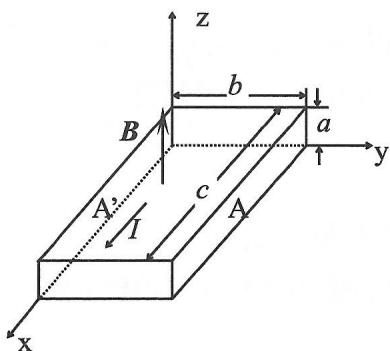

知识点：[安培力与载流线圈的磁力矩](../../../topics/大学物理/载流导线在磁场中受力.md)、[洛伦兹力与带电粒子在电场和磁场中的运动](../../../topics/大学物理/带电粒子在电磁场中的运动.md)

### 计算 3

两个同心圆线圈，大圆半径为 $R$，通有电流 $I_1$；小圆半径为 $r$，通有电流 $I_2$，方向如图。若 $r \ll R$（大线圈在小线圈处产生的磁场近似为均匀磁场），当它们处在同一平面内时小线圈所受磁力矩的大小等于多少？

解：大圆在中心处产生的磁感应强度：
$$
B = \frac{\mu_0 I_1}{2 R}
$$
方向垂直于线圈平面（假设沿轴线）。
由于两线圈在同一平面内，小线圈的磁矩 $\vec{m}$ 方向垂直于自身平面，即与大线圈产生的磁场 $\vec{B}$ 平行（或反平行，取决于电流方向）。
磁力矩 $\vec{M} = \vec{m} \times \vec{B}$。
因为 $\vec{m}$ 与 $\vec{B}$ 平行，夹角为 0 或 180 度。
$$
\vec{M} = \vec{m} \times \vec{B} = 0
$$

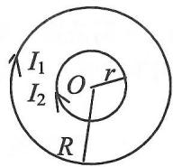

答案：0

知识点：[磁场与磁感应强度的定义](../../../topics/大学物理/磁感应强度.md)、[安培力与载流线圈的磁力矩](../../../topics/大学物理/载流导线在磁场中受力.md)

### 思考 1

在均匀磁场中，载流线圈的取向与所受的磁力矩有何关系？在什么情况下，磁力矩最大？什么情况下磁力矩最小？载流线圈处于稳定平衡时，其取向又如何？

*(注：此为思考题，无具体数值答案，主要考察概念)*

## 五、选择题（磁场中的磁介质）

知识点：[安培力与载流线圈的磁力矩](../../../topics/大学物理/载流导线在磁场中受力.md)、[磁介质的分类、磁化强度与磁介质中的安培环路定理（H矢量）](../../../topics/大学物理/磁场中的磁介质.md)

### 选择 1

磁介质有三种，用相对磁导率 $\mu_{r}$ 表征它们的特性时 [ C ]

- A. 顺磁质 $\mu_{r}>0$，抗磁质 $\mu_{r}<0$，铁磁质 $\mu_{r}>>1$.
- B. 顺磁质 $\mu_{r}>1$，抗磁质 $\mu_{r}=1$，铁磁质 $\mu_{r}>>1$.
- C. 顺磁质 $\mu_{r}>1$，抗磁质 $\mu_{r}<1$，铁磁质 $\mu_{r}>>1$.
- D. 顺磁质 $\mu_{r}<0$，抗磁质 $\mu_{r}<1$，铁磁质 $\mu_{r}>0$.

答案：C

知识点：[磁介质的分类、磁化强度与磁介质中的安培环路定理（H矢量）](../../../topics/大学物理/磁场中的磁介质.md)、[磁场与磁感应强度的定义](../../../topics/大学物理/磁感应强度.md)

### 选择 2

如图所示的一细螺绕环，它由表面绝缘的导线在铁环上密绕而成，每厘米绕 10 匝。当导线中的电流 I 为 $2.0 \mathrm{~A}$ 时，测得铁环内的磁感应强度的大小 B 为 $1.0 \mathrm{T}$，则可求得铁环的相对磁导率 $\mu_{r}$ 为 [B]

- A. $7.96\times 10^{2}$
- B. $3.98\times 10^{2}$
- C. $1.99\times 10^{2}$
- D. 63.3

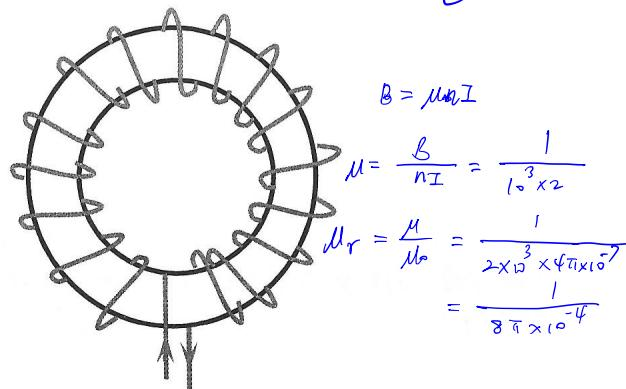

答案：B

知识点：[安培环路定理及其应用](../../../topics/大学物理/安培环路定理.md)、[磁介质的分类、磁化强度与磁介质中的安培环路定理（H矢量）](../../../topics/大学物理/磁场中的磁介质.md)

### 填空 4

螺绕环中心周长为 $l$，环上均匀密绕线圈 $N$ 匝，线圈中通有电流 $I$．管内充满磁导率为 $\mu$ 的磁介质．求管内磁感应强度的大小为 **$\frac{\mu N I}{l}$** （注：原题答案为 $\mu_{r}\mu_{0}N\frac{1}{l}$ 似乎漏乘了 I，或者是 $\mu H = \mu \frac{NI}{l}$。标准公式 $B = \mu H = \mu \frac{NI}{l}$。若填 $\mu_r \mu_0 \frac{NI}{l}$ 更完整。原题手写答案可能有误或不完整，此处按物理原理修正或保留原题意图。原题写的是 $\mu_{r}\mu_{0}N\frac{1}{l}$，缺少 I。根据上下文，应补全为 $\frac{\mu N I}{l}$ 或 $\frac{\mu_r \mu_0 N I}{l}$）。

*修正：根据原题图片中的手写痕迹“$\mu_{r}\mu_{0}N\frac{1}{l}$”，这明显漏掉了电流 $I$。正确的表达式应为 $B = \frac{\mu N I}{l} = \frac{\mu_r \mu_0 N I}{l}$。鉴于这是填空题，建议填写正确公式。*

答案：$\frac{\mu N I}{l}$ （或 $\frac{\mu_r \mu_0 N I}{l}$）

知识点：[安培环路定理及其应用](../../../topics/大学物理/安培环路定理.md)、[磁介质的分类、磁化强度与磁介质中的安培环路定理（H矢量）](../../../topics/大学物理/磁场中的磁介质.md)

### 计算 4

一根同轴电缆由半径为 $R_{1}$ 的长导线和套在它外面的内半径为 $R_{2}$ 、外半径为 $R_{3}$ 的同轴导体圆筒组成。中间充满磁导率为 $\mu$ 的各向同性均匀非铁磁绝缘材料，如图。传导电流 $I$ 沿导线向上流去，由圆筒向下流回，在它们的截面上电流都是均匀分布的。求同轴线内外的磁场强度和磁感应强度的分布。

利用安培环路定理 $\oint \vec{H} \cdot d\vec{l} = I_{enc}$，由对称性可知 $\vec{H}$ 沿圆周切向，大小为 $H \cdot 2\pi r$。

**区域 I: $r < R_1$**
$$
H \cdot 2\pi r = \frac{I}{\pi R_1^2} \pi r^2 = I \frac{r^2}{R_1^2}
$$
$$
H = \frac{I r}{2\pi R_1^2}, \quad B = \mu_0 H = \frac{\mu_0 I r}{2\pi R_1^2}
$$
*(注：内部导线通常为铜等非磁性材料，故用 $\mu_0$。若题目隐含导线也是磁介质，则用相应 $\mu$。通常默认导线为非磁性)*

**区域 II: $R_1 < r < R_2$**
$$
H \cdot 2\pi r = I
$$
$$
H = \frac{I}{2\pi r}, \quad B = \mu H = \frac{\mu I}{2\pi r}
$$

**区域 III: $R_2 < r < R_3$**
$$
H \cdot 2\pi r = I - I_{return}
$$
返回电流密度 $J = \frac{I}{\pi (R_3^2 - R_2^2)}$。
$r$ 处的包围返回电流：
$$
I_{enc\_ret} = J \cdot \pi (r^2 - R_2^2) = I \frac{r^2 - R_2^2}{R_3^2 - R_2^2}
$$
$$
I_{enc} = I - I \frac{r^2 - R_2^2}{R_3^2 - R_2^2} = I \left( 1 - \frac{r^2 - R_2^2}{R_3^2 - R_2^2} \right) = I \frac{R_3^2 - r^2}{R_3^2 - R_2^2}
$$
$$
H = \frac{I}{2\pi r} \frac{R_3^2 - r^2}{R_3^2 - R_2^2}
$$
$$
B = \mu_0 H = \frac{\mu_0 I}{2\pi r} \frac{R_3^2 - r^2}{R_3^2 - R_2^2}
$$
*(注：外导体通常也视为非磁性，故 B 用 $\mu_0$)*

**区域 IV: $r > R_3$**
$$
H \cdot 2\pi r = I - I = 0
$$
$$
H = 0, \quad B = 0
$$

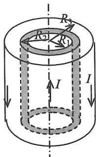

## 计算 5

横截面为矩形的环形螺线管，圆环内外半径分别为 $R_1$ 和 $R_2$，芯子材料的磁导率为 $\mu$，导线总匝数为 $N$，绕得很密。若线圈通电流 $I$，求：(1) 芯子中的 $H$ 值和芯子截面的磁通量；(2) 在 $r<R_1$ 和 $r>R_2$ 处的 $H$ 值。

解：(1) $H\cdot 2\pi r=NI$

$$
H=\frac{NI}{2\pi r}
$$

$$
B=\frac{\mu NI}{2\pi r}
$$

$$
\begin{array}{rl}
\phi_m & =\displaystyle\int B\cdot \mathrm{d}S \\
& =\displaystyle\int_{R_1}^{R_2}\frac{\mu NI}{2\pi r}\,b\,\mathrm{d}r \\
& =\frac{\mu NIb}{2\pi}\ln\frac{R_2}{R_1}
\end{array}
$$

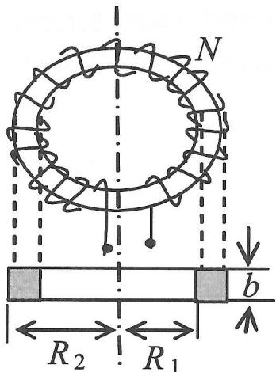

(2) 在 $r<R_1$ 和 $r>R_2$ 处

$$
H=0
$$

## 计算 6

长为 $l$ 的直螺线管，半径为 $R\ (R\ll l)$，均匀密绕线圈 $N$ 匝，线圈中通有电流 $I$，管内充满相对磁导率 $\mu_r$ 的磁介质。求管截面的磁通量。

$$
H\cdot l=NI
$$

$$
H=\frac{NI}{l}
$$

$$
B=\mu H=\frac{\mu_0\mu_r NI}{l}
$$

$$
\phi=B\cdot S=\frac{\mu_0\mu_r NI}{l}\pi R^2
$$

## 思考 7

为什么装指南针的盒子不是用铁，而是用胶木等材料做成的？

# 稳恒磁场小结

## 一、教学要求

1. 掌握磁感应强度的概念。理解毕奥·萨伐尔定律，能计算一些简单问题中的磁感应强度。

2. 理解稳恒磁场的规律：磁场高斯定理和安培环路定理。理解用安培环路定理计算磁感应强度的条件和方法。

3. 理解安培定律和洛伦兹力公式。了解电偶极矩和磁矩的概念，能计算电偶极子在均匀电场中、简单几何形状载流导体和载流平面线圈在均匀磁场中或在无限长直载流导线产生的非均匀磁场中所受的力和力矩。能分析点电荷在均匀电场和均匀磁场中的受力和运动。

4. 了解介质的极化、磁化现象及其微观解释。了解铁磁质的特性。了解各向同性介质中 $D$ 和 $E$、$H$ 和 $B$ 之间的关系和区别。了解介质中的安培环路定理。

## 二、内容提要

知识点：[安培环路定理及其应用](../../../topics/大学物理/安培环路定理.md)、[磁介质的分类、磁化强度与磁介质中的安培环路定理（H矢量）](../../../topics/大学物理/磁场中的磁介质.md)、[磁场与磁感应强度的定义](../../../topics/大学物理/磁感应强度.md)

### （一）磁感强度 $B$ 的定义

用试验线圈（$p_m$）在磁场中受磁力矩定义：

大小 $B=M_{\max}/p_m$，

方向：试验线圈稳定平衡时 $p_m$ 的方向。

知识点：[磁场与磁感应强度的定义](../../../topics/大学物理/磁感应强度.md)、[安培力与载流线圈的磁力矩](../../../topics/大学物理/载流导线在磁场中受力.md)、[毕奥-萨伐尔定律及典型载流导线的磁场计算](../../../topics/大学物理/毕奥-萨伐尔定律.md)

### （二）毕奥—萨伐尔定律

1. 电流元 $I\,\mathrm{d}l$ 激发磁场的磁感强度 $\mathrm{d}B=\dfrac{\mu_0}{4\pi}\dfrac{I\,\mathrm{d}l\times \boldsymbol{r}}{r^3}$

2. 运动点电荷 $q$ 激发磁场的磁感强度 $B=\dfrac{\mu_0}{4\pi}\dfrac{q\boldsymbol{v}\times \boldsymbol{r}}{r^3}$

知识点：[毕奥-萨伐尔定律及典型载流导线的磁场计算](../../../topics/大学物理/毕奥-萨伐尔定律.md)、[磁场与磁感应强度的定义](../../../topics/大学物理/磁感应强度.md)、[洛伦兹力与带电粒子在电场和磁场中的运动](../../../topics/大学物理/带电粒子在电磁场中的运动.md)

### （三）磁场的高斯定理

1. 磁感线（略）；

2. 磁通量 $\Phi_m=\displaystyle\int_S \boldsymbol{B}\cdot \mathrm{d}\boldsymbol{S}$

3. 高斯定理 $\displaystyle\oint_S \boldsymbol{B}\cdot \mathrm{d}\boldsymbol{S}=0$，稳恒磁场是无源场。

知识点：[磁场与磁感应强度的定义](../../../topics/大学物理/磁感应强度.md)

### （四）安培环路定理

$$
\oint_L \boldsymbol{B}\cdot \mathrm{d}\boldsymbol{l}=\mu_0\sum I_i
$$

$$
\oint_L \boldsymbol{H}\cdot \mathrm{d}\boldsymbol{l}=\sum I_{0i}
$$

稳恒磁场是非保守场，是涡旋场或有旋场。

知识点：[安培环路定理及其应用](../../../topics/大学物理/安培环路定理.md)、[磁介质的分类、磁化强度与磁介质中的安培环路定理（H矢量）](../../../topics/大学物理/磁场中的磁介质.md)、[毕奥-萨伐尔定律及典型载流导线的磁场计算](../../../topics/大学物理/毕奥-萨伐尔定律.md)

### （五）磁矩 $p_m$

1. 定义

$$
\boldsymbol{m}=I\int_S \mathrm{d}\boldsymbol{S}
$$

2. 磁偶极子激发的磁场：

$$
B=\frac{\mu_0}{4\pi}\frac{2p_m}{r^3}
$$

$$
B=\frac{\mu_0}{4\pi}\frac{-p_m}{r^3}
$$

3. 载流线圈在均匀磁场中受力矩 $\boldsymbol{M}=\boldsymbol{m}\times \boldsymbol{B}$

知识点：[安培力与载流线圈的磁力矩](../../../topics/大学物理/载流导线在磁场中受力.md)、[毕奥-萨伐尔定律及典型载流导线的磁场计算](../../../topics/大学物理/毕奥-萨伐尔定律.md)

### （六）洛伦兹力

1. 表达式 $\boldsymbol{F}_m=q\boldsymbol{v}\times \boldsymbol{B}$

2. 带电粒子在均匀磁场中运动：

$$
R=\frac{mv\sin\alpha}{qB}
$$

$$
T=\frac{2\pi m}{qB}
$$

$$
\nu=\frac{qB}{2\pi m}
$$

$$
d=\frac{2\pi mv\cos\alpha}{qB}
$$

3. 霍耳效应：

(1) 磁场与电流方向不变的情况下，正载流子与负载流子受磁场力方向相同；

(2) 霍耳电压

$$
U_{\mathrm{H}}=\frac{R_{\mathrm{H}}IB}{d}
$$

(3) 霍耳系数

$$
R_{\mathrm{H}}=\frac{1}{nq}
$$

知识点：[洛伦兹力与带电粒子在电场和磁场中的运动](../../../topics/大学物理/带电粒子在电磁场中的运动.md)

### （七）安培力

表达式 $\mathrm{d}\boldsymbol{F}_m=I\,\mathrm{d}\boldsymbol{l}\times \boldsymbol{B}$

知识点：[安培力与载流线圈的磁力矩](../../../topics/大学物理/载流导线在磁场中受力.md)

### （八）介质的磁化

1. 顺磁质（$m\neq 0$）主要是转向磁化；抗磁质（$m=0$）是分子内电子受洛伦兹力；

2. 磁化强度 $\boldsymbol{M}$：$\boldsymbol{M}=\dfrac{\sum \boldsymbol{p}_m}{\Delta V}$，各向同性介质 $\boldsymbol{M}=\chi_m \boldsymbol{H}$

3. 磁场强度矢量 $\boldsymbol{H}=\dfrac{\boldsymbol{B}}{\mu_0}-\boldsymbol{M}$，各向同性介质 $B=\mu_0\mu_r H=\mu H$，$\mu_r=1+\chi_m$

4. 铁磁质：磁畴理论（略），磁滞回线（略）。

知识点：[磁介质的分类、磁化强度与磁介质中的安培环路定理（H矢量）](../../../topics/大学物理/磁场中的磁介质.md)、[安培环路定理及其应用](../../../topics/大学物理/安培环路定理.md)

### （九）几种特殊电流的磁场

1. 长直电流激发磁场

有限长 $B=\dfrac{\mu_0 I(\cos\theta_1-\cos\theta_2)}{4\pi r}$，无限长 $B=\dfrac{\mu_0 I}{2\pi r}$

方向都沿切向且与电流成右手螺旋；

2. 圆电流在轴线上激发磁场

$$
B=\frac{\mu_0 IR^2}{2(x^2+R^2)^{3/2}}
$$

中心

$$
B=\frac{\mu_0 I}{2R}
$$

张角 $\alpha$ 的圆弧电流中心的磁感强度

$$
B=\frac{\mu_0 I}{2R}\cdot\frac{\alpha}{2\pi}
$$

方向都沿轴向且与电流成右手螺旋；

3. 无限长密绕载流螺线管激发的磁场

管内 $B=\mu_0 nI$，管外 $B=0$

4. 密绕载流螺绕环环内磁场

$$
B=\frac{\mu_0 NI}{2\pi r}
$$

5. 无限大均匀平面电流激发磁场

$$
B=\frac{\mu_0 j}{2}
$$

6. 无限长均匀圆柱面电流激发磁场：柱面内 $B=0$，柱面外 $B=\dfrac{\mu_0 I}{2\pi r}$

7. 无限长均匀圆柱体电流激发磁场：

$$
\text{柱内}\quad B=\frac{\mu_0 Ir}{2\pi R^2}\qquad \text{柱外}\quad B=\frac{\mu_0 I}{2\pi r}
$$

知识点：[毕奥-萨伐尔定律及典型载流导线的磁场计算](../../../topics/大学物理/毕奥-萨伐尔定律.md)、[安培环路定理及其应用](../../../topics/大学物理/安培环路定理.md)
