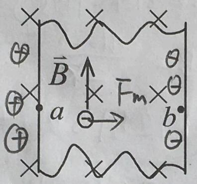
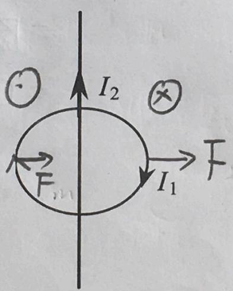
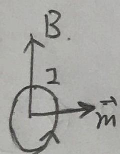
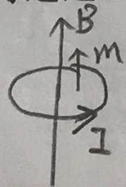
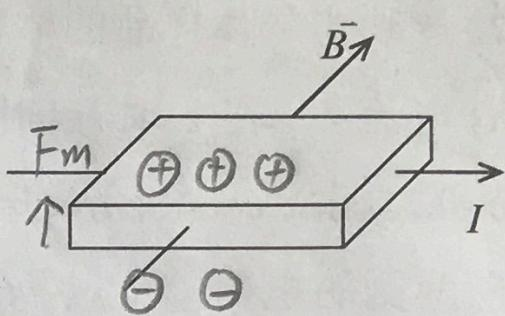
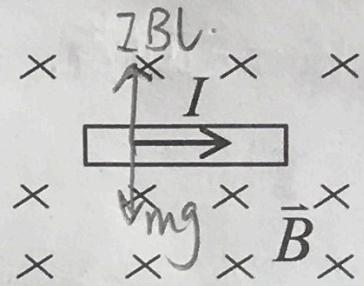
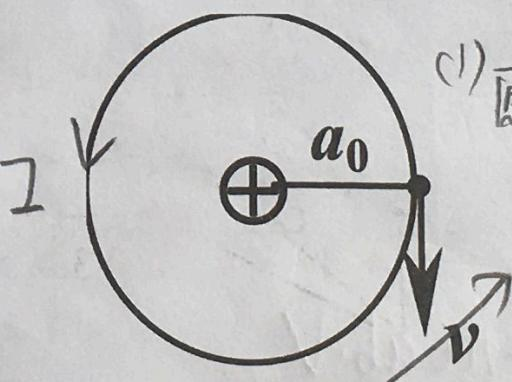

# 《大学物理》稳恒磁场同步练习册（带电粒子在电磁场中的运动及载流导线受力）

原件经识别和整理；“参考解答”是我们补的。

## 第三节 带电粒子在电场和磁场中的运动 及载流导线在磁场中所受的力

### 选择 1

一铜条置于均匀磁场中，铜条中电子流的方向如图所示。试问下述哪一种情况将会发生？

- A. 在铜条上产生涡流。
- B. 在铜条上 $a$、$b$ 两点产生一小电势差，且 $U_{a} < U_{b}$。
- C. 在铜条上 $a$、$b$ 两点产生一小电势差，且 $U_{a} > U_{b}$。
- D. 电子受到洛伦兹力而减速。

答案：C。

知识点：[洛伦兹力与带电粒子在电场和磁场中的运动](../../../topics/大学物理/带电粒子在电磁场中的运动.md)

### 选择 2

载有电流 $I_{2}$ 的长直导线与载有电流 $I_{1}$ 的圆线圈共面但相互绝缘，长直导线与圆线圈的一直径相重合，如图所示。设长直载流导线固定不动，则圆形载流导线将

- A. 绕 $I_{2}$ 旋转。
- B. 向左运动。
- C. 向右运动。
- D. 向上运动。
- E. 不动。

答案：C。

知识点：[安培力与载流线圈的磁力矩](../../../topics/大学物理/载流导线在磁场中受力.md)、[毕奥-萨伐尔定律及典型载流导线的磁场计算](../../../topics/大学物理/毕奥-萨伐尔定律.md)

### 填空 1

一面积为 $S$、载有电流 $I$ 的平面闭合线圈置于磁感强度为 $\vec{B}$ 的均匀磁场中，此线圈受到的最大磁力矩的大小为 \_\_\_\_，此时通过线圈的磁通量为 \_\_\_\_，当此线圈受到最小的磁力矩作用时通过线圈的磁通量为 \_\_\_\_。

答案：$ISB$；$0$；$BS$。

知识点：[安培力与载流线圈的磁力矩](../../../topics/大学物理/载流导线在磁场中受力.md)、[磁场与磁感应强度的定义](../../../topics/大学物理/磁感应强度.md)

### 填空 2

在霍耳效应的实验中，通过导电体的电流和 $\vec{B}$ 的方向垂直（如图）。如果上表面的电势较高，则导体中的载流子带 \_\_\_\_ 电。（正或负）

答案：正。

知识点：[洛伦兹力与带电粒子在电场和磁场中的运动](../../../topics/大学物理/带电粒子在电磁场中的运动.md)

### 填空 3

有一根质量为 $m$、长为 $l$ 的直导线，放在磁感强度为 $\vec{B}$ 的均匀磁场中，$\vec{B}$ 的方向在水平面内，导线中电流方向如图所示。当导线所受磁力与重力平衡时，导线中电流 $I = \_\_\_\_$。

答案：$\dfrac{mg}{Bl}$。

知识点：[安培力与载流线圈的磁力矩](../../../topics/大学物理/载流导线在磁场中受力.md)、[常见力（重力、弹力、摩擦力）的受力分析](../../../topics/大学物理/常见力分析.md)、[牛顿三定律与惯性系](../../../topics/大学物理/牛顿三定律.md)

### 计算 1

设氢原子基态的电子沿半径为 $a_{0}$ 的轨道运动（如图），求：(1) 电子沿轨道运动时原子核处产生的磁感强度；(2) 电子的轨道磁矩。

解：电子做圆周运动的周期是 $T = \dfrac{2\pi a_{0}}{v}$，等效的电流强度为 $I = \dfrac{e}{T} = \dfrac{ev}{2\pi a_{0}}$。

原子核处的磁感应强度为

$$
B = \frac{\mu_{0} I}{2a_{0}} = \frac{\mu_{0}ev}{4\pi a_{0}^{2}}
$$

用毕奥-萨伐尔定律求 $B$：

$$
B = \oint \mathrm{d}B = \oint \frac{\mu_{0}}{4\pi}\cdot\frac{I\,\mathrm{d}\boldsymbol{l}\times\boldsymbol{e}_{r}}{r^{2}}
= \frac{\mu_{0}}{4\pi}\frac{I}{r^{2}}\oint \mathrm{d}l
= \frac{\mu_{0}I}{4\pi r^{2}}\cdot 2\pi r = \frac{\mu_{0}I}{2r}
$$

即 $B = \dfrac{\mu_{0}I}{2a_{0}}$，方向 $\odot$。

(2) 电子的轨道磁矩：

$$
m = IS = \frac{ev}{2\pi a_{0}}\cdot\pi a_{0}^{2} = \frac{eva_{0}}{2}
$$

参考解答：**结论**  
(1) 磁感强度 $B = \dfrac{\mu_0 e v}{4\pi a_0^2}$，方向垂直纸面向外 $\odot$  
(2) 轨道磁矩 $m = \dfrac{e v a_0}{2}$  

**简明推理（关键步骤）**  
- 电子以速率 $v$ 沿半径 $a_0$ 做圆周运动，周期 $T = \dfrac{2\pi a_0}{v}$，等效电流 $I = \dfrac{e}{T} = \dfrac{e v}{2\pi a_0}$。  
- 载流圆环在圆心（核处）产生的磁场为 $B = \dfrac{\mu_0 I}{2a_0}$（由毕奥‑萨伐尔定律，磁场方向由右手定则判定为 ⊙）。  
  代入 $I$ 得 $B = \dfrac{\mu_0 e v}{4\pi a_0^2}$。  
- 轨道磁矩定义为 $m = I S$，其中圆面积 $S = \pi a_0^2$，于是 $m = \dfrac{e v}{2\pi a_0} \cdot \pi a_0^2 = \dfrac{e v a_0}{2}$。

知识点：[毕奥-萨伐尔定律及典型载流导线的磁场计算](../../../topics/大学物理/毕奥-萨伐尔定律.md)、[安培力与载流线圈的磁力矩](../../../topics/大学物理/载流导线在磁场中受力.md)
