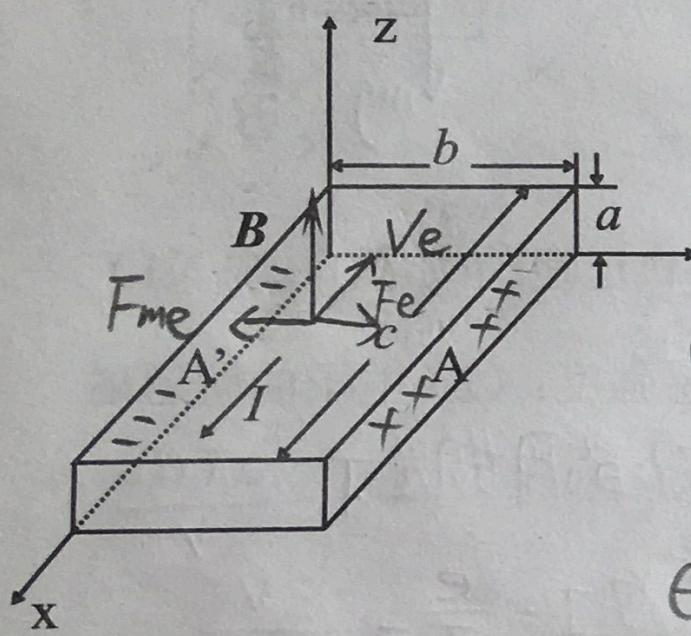
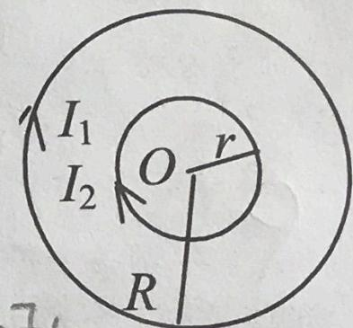

# 《大学物理》稳恒磁场章节同步练习册解答

原件经识别和整理；“参考解答”是我们补的。

# 《大学物理》稳恒磁场章节同步练习册解答

## 计算题 7

**题干：**
一块半导体样品的体积为 $a \times b \times c$，如图所示，沿 $x$ 轴方向有电流 $I$，在 $z$ 轴方向有均匀磁场 $B$。实验测得 $a = 0.10 \mathrm{~cm}$，$b = 0.35 \mathrm{~cm}$，$c = 1.0 \mathrm{~cm}$，$I = 1.0 \mathrm{~mA}$，$B = 0.3 \mathrm{T}$，半导体样品沿 $y$ 轴方向两侧的电势差 $U_{\mathrm{AA}'} = 6.55 \mathrm{mV}$。
（1）这个半导体是 $\mathbf{p}$ 型还是 $\mathbf{n}$ 型？
（2）求载流子浓度。

**选项：**
- A. n 型；载流子是电子
- B. p 型；载流子是正电荷

答案：A。

参考解答：
假设是 n 型，则电子在洛伦兹力 $F_m$ 作用下会聚集在 A' 板，A 板为正电荷，则 $U_{AA'} > 0$，与题意符合，则半导体为 n 型。

(2) 平衡时 $F_m = F_e$，即 $eE = evB$，故 $E = vB$。

$$
\left\{ \begin{array}{l} E = vB \\ E = \frac {U _ {A A ^ {\prime}}}{b} \\ I = n e s v = n e a b \cdot v \end{array} \right.
$$

由此解得载流子浓度 $n$：
$$
n = \frac {I}{e a b v} = \frac {I}{e a b \cdot \frac {U _ {A A ^ {\prime}}}{b B}} = \frac {I B}{e a U _ {A A ^ {\prime}}}
$$

---

## 计算题 8

**题干：**
两个同心圆线圈，大圆半径为 $R$，通有电流 $I_1$；小圆半径为 $r$，通有电流 $I_2$，方向如图。若 $r \ll R$（大线圈在小线圈处产生的磁场近似为均匀磁场），当它们处在同一平面内时，小线圈所受磁力矩的大小等于多少？

参考解答：
圆环在圆心附近产生的磁场公式为 $B = \frac{\mu_0 I}{2 r}$。
故大线圈在圆心处产生的磁场大小为：
$$
B = \frac{\mu_0 I_1}{2 R}
$$
方向垂直纸面向里（或根据右手定则判断，此处设为方向②）。

小线圈的磁矩大小：
$$
P_m = I_2 \cdot S = I_2 \cdot \pi r^2
$$
方向同样垂直纸面向里（方向②），与磁场 $B$ 同方向。

磁力矩 $\overrightarrow{M}$ 的计算公式为：
$$
\overrightarrow{M} = \overrightarrow{P_m} \times \overrightarrow{B}
$$
由于 $\overrightarrow{P_m}$ 与 $\overrightarrow{B}$ 同向（夹角为 $0^\circ$），故：
$$
M = P_m \cdot B \cdot \sin 0^\circ = 0
$$

答案：0。
