# 《大学物理》第 5 章 静电场 5-4 电通量 高斯定理（课件）

原件的每一页，下面附识别出的文字。

### 5-4 电通量 高斯定理

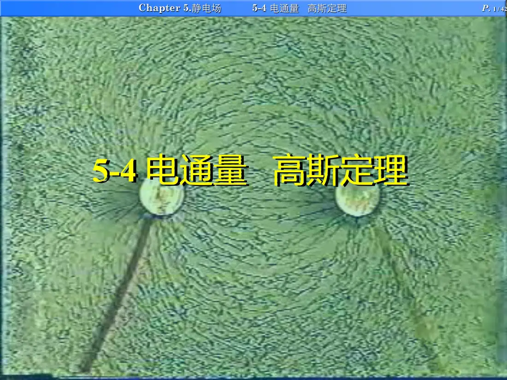

原文：

5-4 电通量 高斯定理

Chapter 5.静电场

5-4 电通量 高斯定理

### 一、电场线模型

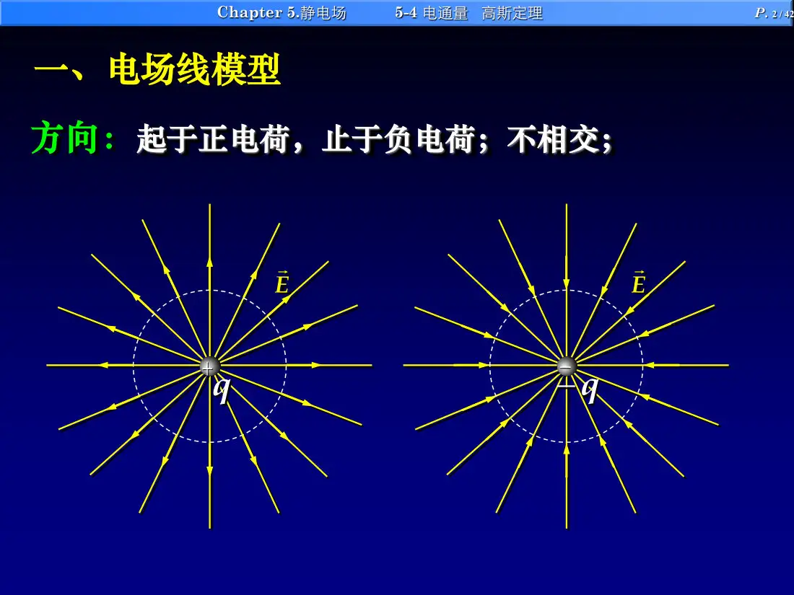

原文：

一、电场线模型

方向：起于正电荷，止于负电荷；不相交；

Chapter 5.静电场 5-4 电通量 高斯定理

P. 2 / 42

### 一、电场线模型

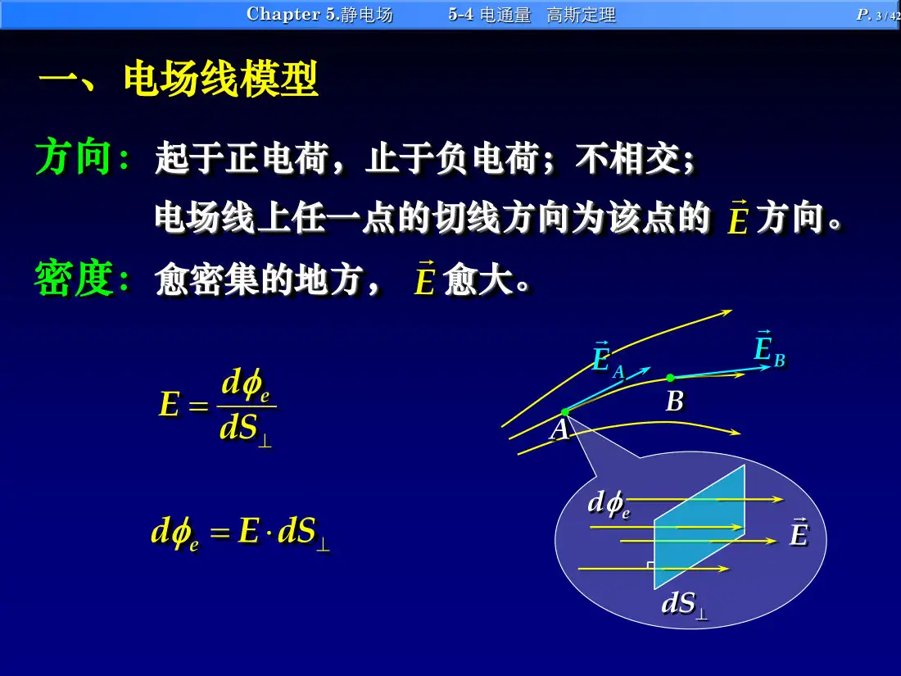

原文：

一、电场线模型

方向：起于正电荷，止于负电荷；不相交；电场线上任一点的切线方向为该点的 $\vec{E}$ 方向。

密度：愈密集的地方， $\vec{E}$ 愈大。

$$
E = \frac {d \phi_ {e}}{d S _ {\perp}}
$$

$$
d \phi_ {e} = E \cdot d S _ {\perp}
$$

Chapter 5.静电场 5-4 电通量 高斯定理

P. 3 / 42

### 等量异号电荷

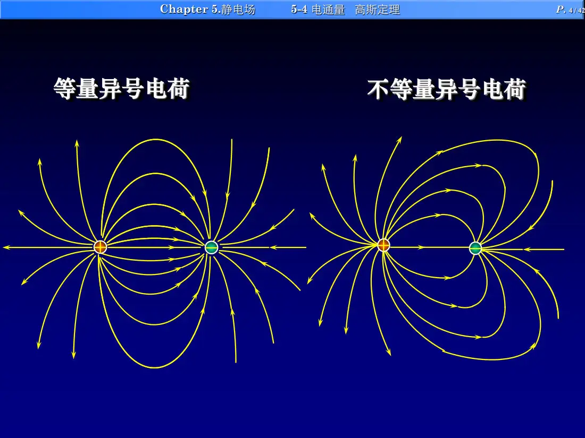

原文：

等量异号电荷

不等量异号电荷

Chapter 5.静电场 5-4 电通量 高斯定理

P. 4/42

### 等量同号电荷

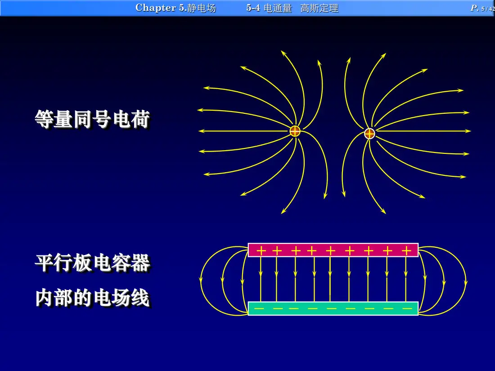

原文：

等量同号电荷

平行板电容器
内部的电场线

Chapter 5.静电场

5-4 电通量 高斯定理

P. 5/42

### 二、电通量

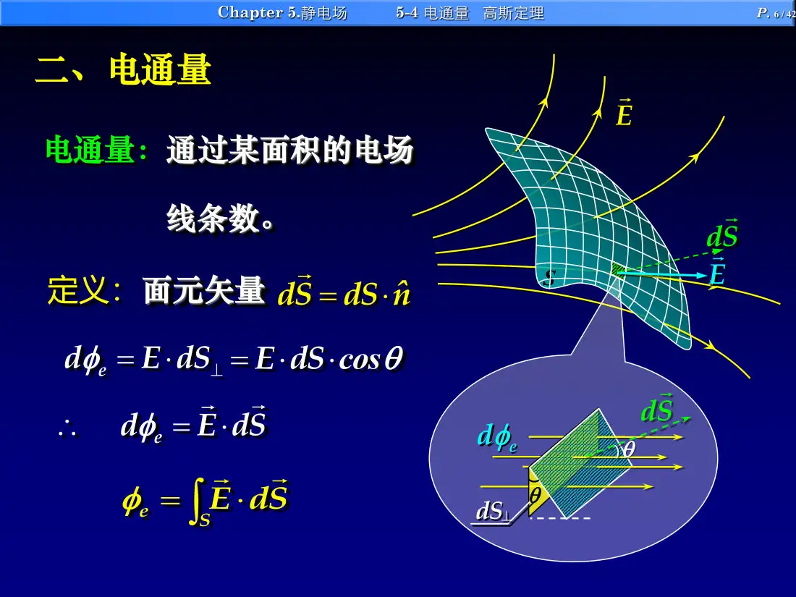

原文：

二、电通量

电通量：通过某面积的电场

线条数。

定义: 面元矢量 $d \vec {S} = d S \cdot \hat {n}$

$$
d \phi_ {e} = E \cdot d S _ {\perp} = E \cdot d S \cdot \cos \theta
$$

$\therefore d\phi_{e} = \vec{E}\cdot d\vec{S}$

$$
\phi_ {e} = \int_ {S} \vec {E} \cdot d \vec {S}
$$

Chapter 5.静电场 5-4 电通量 高斯定理

P. 6 / 42

### 对闭合曲面:

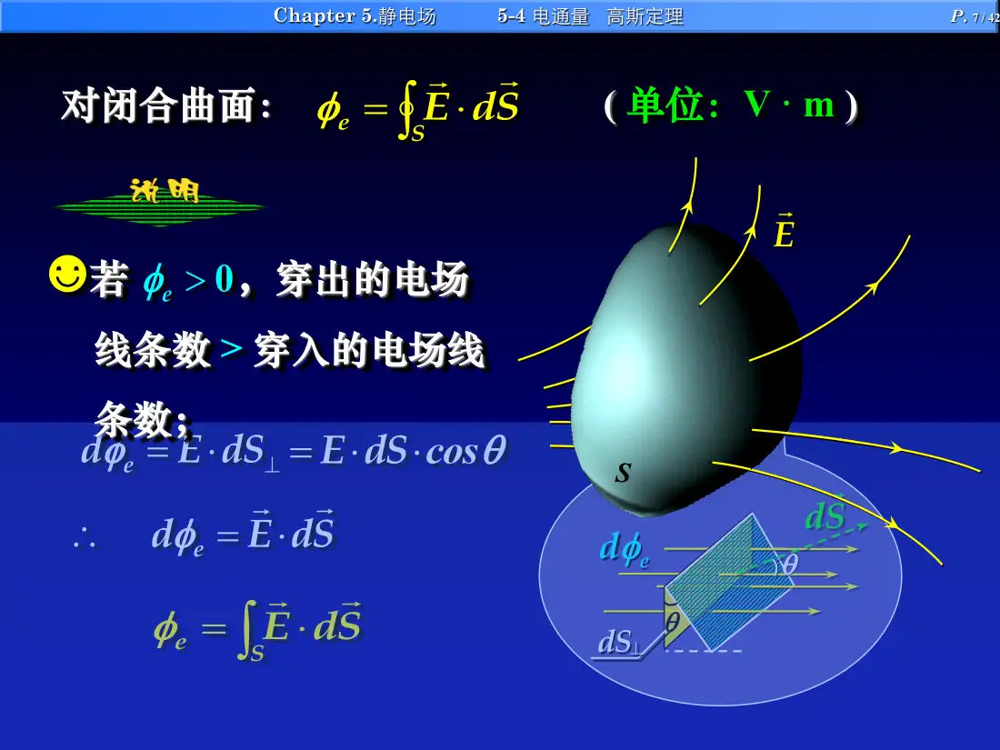

原文：

对闭合曲面:

$$
\phi_ {e} = \oint_ {S} \vec {E} \cdot d \vec {S}
$$

说明

若 $\phi_{e} > 0$ ，穿出的电场线条数 $>$ 穿入的电场线

条数； $d\phi_{e}=E\cdot dS_{\perp}=E\cdot dS\cdot cos\theta$

$$
\therefore d \phi_ {e} = \vec {E} \cdot d \vec {S}
$$

$$
\phi_ {e} = \int_ {S} \vec {E} \cdot d \vec {S}
$$

(单位: V·m)

Chapter 5.静电场 5-4 电通量 高斯定理

P. 7 / 42

### 对闭合曲面:

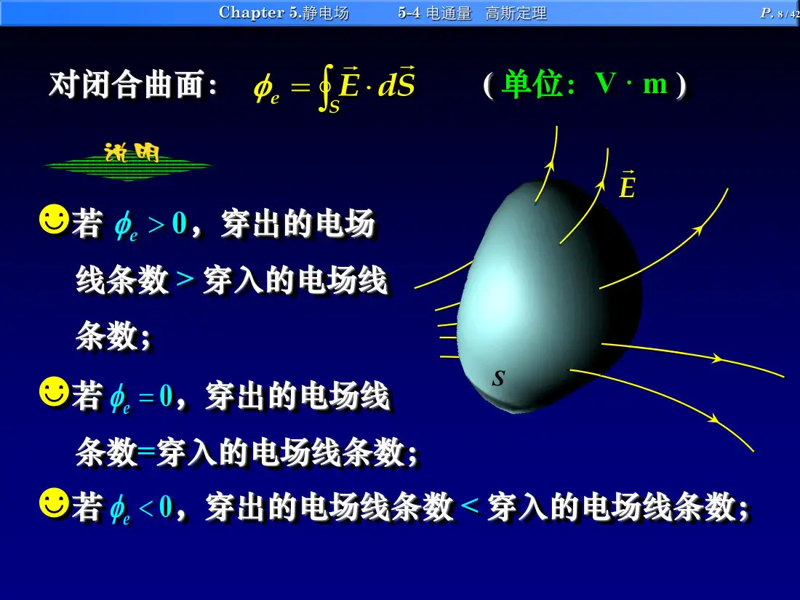

原文：

对闭合曲面:

$$
\phi_ {e} = \oint_ {S} \vec {E} \cdot d \vec {S}
$$

(单位: V·m)

说明

若 $\phi_{e} > 0$ ，穿出的电场线条数 $>$ 穿入的电场线条数；

若 $\phi_{e} = 0$ ，穿出的电场线条数 $=$ 穿入的电场线条数；

若 $\phi_{e} < 0$ ，穿出的电场线条数 $<$ 穿入的电场线条数；

Chapter 5.静电场

5-4 电通量 高斯定理

P. 8 / 42

### 例 求通过以点电荷+q为球心的球面的电通量。

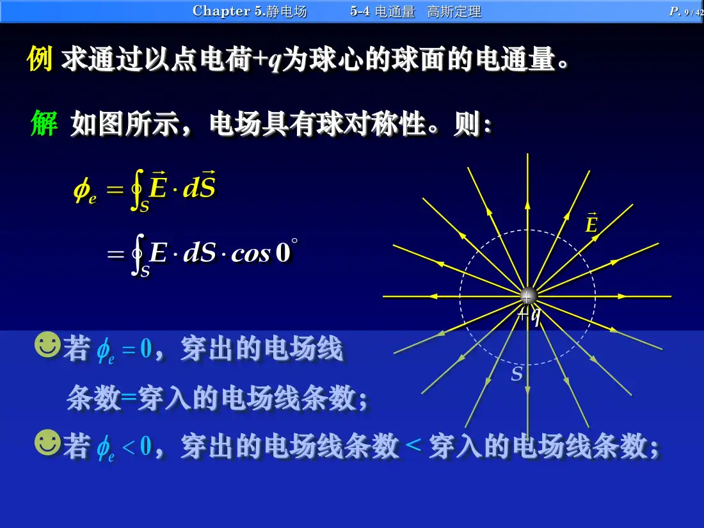

原文：

例 求通过以点电荷+q为球心的球面的电通量。

解 如图所示，电场具有球对称性。则：

$$
\begin{array}{r l} \phi_ {e} & = \oint_ {S} \vec {E} \cdot d \vec {S} \\ & = \oint_ {S} E \cdot d S \cdot c o s 0 ^ {\circ} \end{array}
$$

若 $\phi_{e} = 0$ ，穿出的电场线

条数=穿入的电场线条数;

若 $\phi_{e} < 0$ ，穿出的电场线条数 $<$ 穿入的电场线条数；

Chapter 5.静电场

5-4 电通量 高斯定理

P. 9 / 42

### 例 求通过以点电荷+q为球心的球面的电通量。

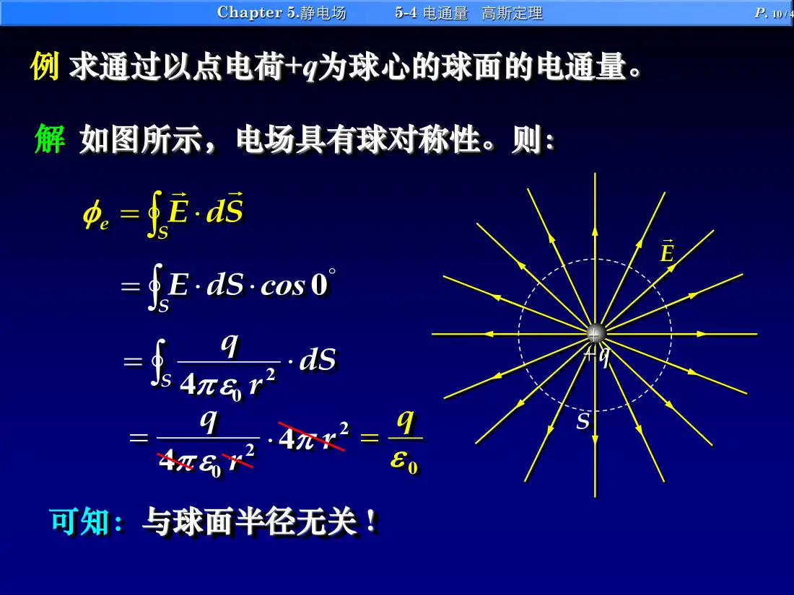

原文：

例 求通过以点电荷+q为球心的球面的电通量。

解 如图所示，电场具有球对称性。则：

$$
\begin{array}{r l} \phi_ {e} & = \oint_ {S} \vec {E} \cdot d \vec {S} \\ & = \oint_ {S} E \cdot d S \cdot \cos 0 ^ {\circ} \\ & = \oint_ {S} \frac {q}{4 \pi \varepsilon_ {0} r ^ {2}} \cdot d S \\ & = \frac {q}{4 \pi \varepsilon_ {0} r ^ {2}} \cdot 4 \pi r ^ {2} = \frac {q}{\varepsilon_ {0}} \end{array}
$$

可知：与球面半径无关！

Chapter 5.静电场

5-4 电通量 高斯定理

P. 10/4

### 三、高斯定理

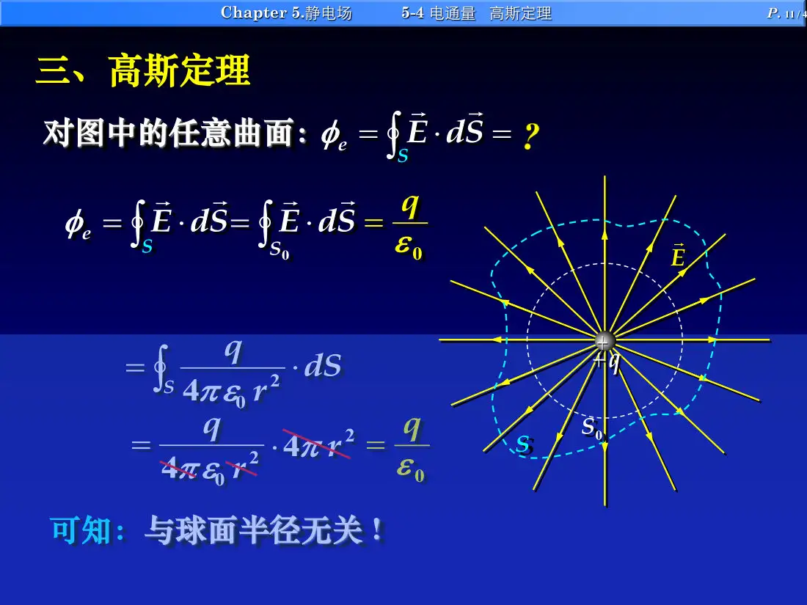

原文：

三、高斯定理

对图中的任意曲面: $\phi_{e} = \oint_{S} \vec{E} \cdot d\vec{S} = ?$

$$
\phi_ {e} = \oint_ {S} \vec {E} \cdot d \vec {S} = \oint_ {S _ {0}} \vec {E} \cdot d \vec {S} = \frac {q}{\varepsilon_ {0}}
$$

$$
\begin{array}{l} = \oint_ {S} \frac {q}{4 \pi \varepsilon_ {0} r ^ {2}} \cdot d S \\ = \frac {q}{4 \pi \varepsilon_ {0} r ^ {2}} \cdot 4 \pi r ^ {2} = \frac {q}{\varepsilon_ {0}} \end{array}
$$

可知：与球面半径无关！

Chapter 5.静电场

5-4 电通量 高斯定理

P. 11/4

### 三、高斯定理

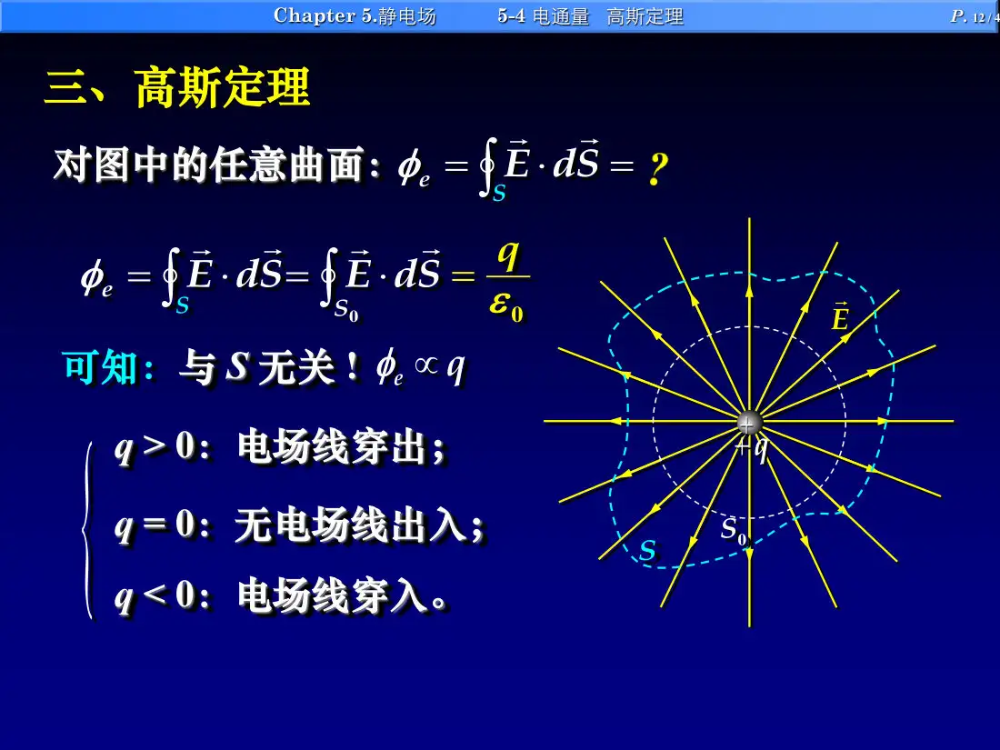

原文：

三、高斯定理

对图中的任意曲面: $\phi_{e} = \oint_{S} \vec{E} \cdot d\vec{S} = ?$

$$
\phi_ {e} = \oint_ {S} \vec {E} \cdot d \vec {S} = \oint_ {S _ {0}} \vec {E} \cdot d \vec {S} = \frac {q}{\varepsilon_ {0}}
$$

可知：与 $S$ 无关！ $\phi_{e} \propto q$

$q > 0$ ：电场线穿出；

$q = 0$ ：无电场线出入；

$q < 0$ ：电场线穿入。

Chapter 5.静电场 5-4 电通量 高斯定理

P. 12 / 4

### 由于: 穿入的电场线条数 $=$ 穿出的电场线条数

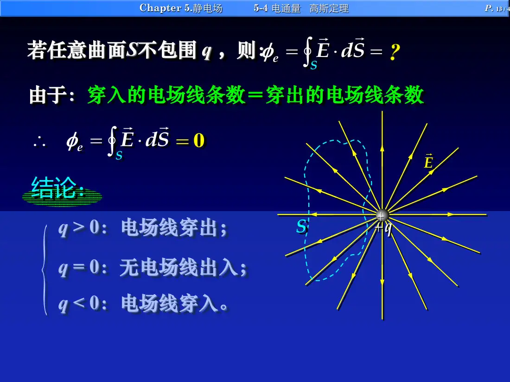

原文：

若任意曲面S不包围 q ，则 $\phi_{e}=\oint_{S}\vec{E}\cdot d\vec{S}=$ ?

由于: 穿入的电场线条数 $=$ 穿出的电场线条数

$$
\therefore \quad \phi_ {e} = \oint_ {S} \vec {E} \cdot d \vec {S} = 0
$$

结论:

$q > 0$ ：电场线穿出；

$q = 0$ ：无电场线出入；

$q < 0$ : 电场线穿入。

Chapter 5.静电场

5-4 电通量 高斯定理

P. 13 / 4

### 由于: 穿入的电场线条数=穿出的电场线条数

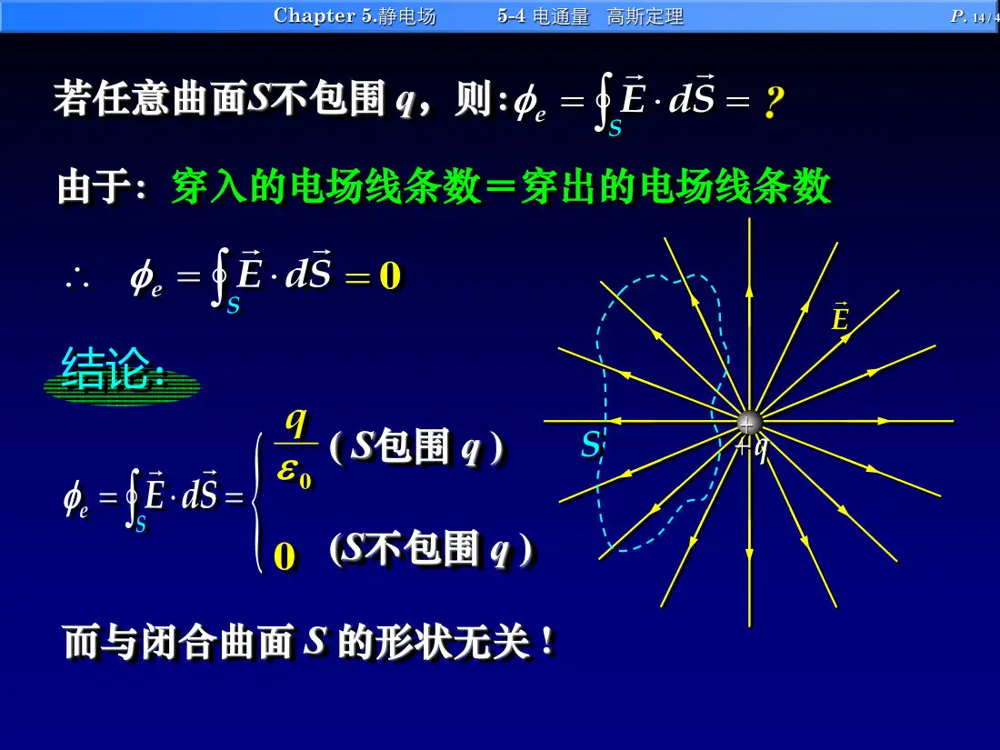

原文：

若任意曲面S不包围 q，则: $\phi_{e} = \oint_{S} \vec{E} \cdot d\vec{S} = ?$

由于: 穿入的电场线条数=穿出的电场线条数

$$
\therefore \quad \phi_ {e} = \oint_ {S} \vec {E} \cdot d \vec {S} = 0
$$

结论:

$\phi_{e} = \oint_{S}\vec{E}\cdot d\vec{S} = \left\{ \begin{array}{ll}\frac{q}{\varepsilon_{0}} (S\text{包围} q)\\ 0 & (S\text{不包围} q) \end{array} \right.$

而与闭合曲面 $S$ 的形状无关！

Chapter 5.静电场

5-4 电通量 高斯定理

P. 14/4

### S内： $q_{1}, q_{2}, \cdots, q_{m}$

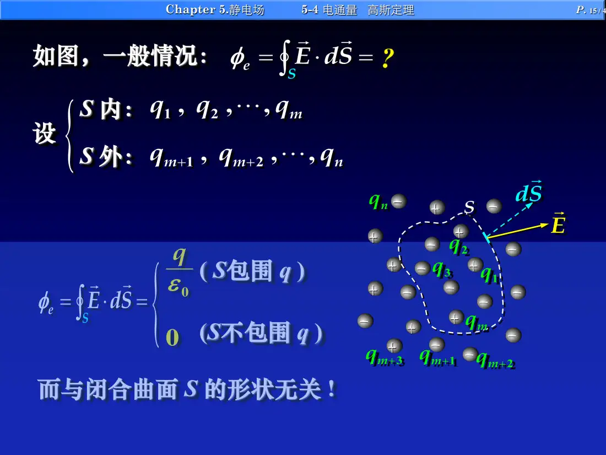

原文：

如图，一般情况： $\phi_{e} = \oint_{S} \vec{E} \cdot d \vec{S} = ?$

S内： $q_{1}, q_{2}, \cdots, q_{m}$

设

S外: $q_{m+1}$ , $q_{m+2}$ , $\cdots$ , $q_{n}$

$$
\phi_ {e} = \oint_ {S} \vec {E} \cdot d \vec {S} = \left\{ \begin{array}{l l} \frac {q}{\varepsilon_ {0}} (S \text {包围} q) \\ 0 & (S \text {不包围} q) \end{array} \right.
$$

$$
\begin{array}{c} q _ {n} \\ \text {   +   } \\ \text {   +   } \\ q _ {2} \\ \text {   +   } \\ q _ {3} \\ \text {   +   } \\ q _ {1} \\ \text {   +   } \\ q _ {m} \\ \text {   +   } \\ q _ {m + 3} \\ \text {   +   } \\ q _ {m + 1} \\ \text {   +   } \\ q _ {m + 2} \end{array}
$$

而与闭合曲面 $S$ 的形状无关！

Chapter 5.静电场

5-4 电通量 高斯定理

P. 15/4

### $$

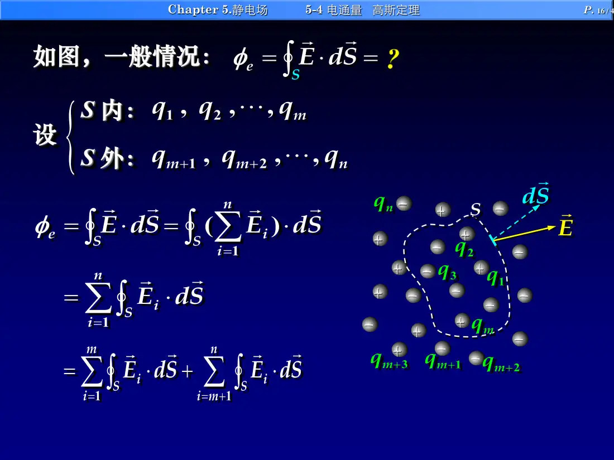

原文：

如图，一般情况： $\phi_{e} = \oint_{S} \vec{E} \cdot d \vec{S} = ?$

设 $\left\{\begin{aligned}S\text{内: } q_{1}, &q_{2}, \cdots, q_{m}\\ S\text{外: } &q_{m+1}, &q_{m+2}, \cdots, q_{n}\end{aligned}\right.$

$$
\begin{array}{r l} & {\phi_ {e} = \oint_ {S} \vec {E} \cdot d \vec {S} = \oint_ {S} (\sum_ {i = 1} ^ {n} \vec {E} _ {i}) \cdot d \vec {S}} \\ & {\qquad = \sum_ {i = 1} ^ {n} \oint_ {S} \vec {E} _ {i} \cdot d \vec {S}} \\ & {\qquad = \sum_ {i = 1} ^ {m} \oint_ {S} \vec {E} _ {i} \cdot d \vec {S} + \sum_ {i = m + 1} ^ {n} \oint_ {S} \vec {E} _ {i} \cdot d \vec {S}} \end{array}
$$

$$
\begin{array}{c} q _ {n} \\ \text {   } \\ q _ {m + 3} \\ q _ {m + 1} \\ q _ {m + 2} \end{array} \quad \begin{array}{c} S \\ \text {   } \\ q _ {2} \\ q _ {3} \\ q _ {1} \\ q _ {m} \end{array} \quad \begin{array}{c} d \vec {S} \\ \text {   } \\ \text {   } \\ \text {   } \\ \text {   } \end{array} \quad \begin{array}{c} \vec {E} \\ \text {   } \\ \text {   } \end{array}
$$

Chapter 5.静电场

5-4 电通量 高斯定理

P. 16/4

### S 被称作 “高斯面”。

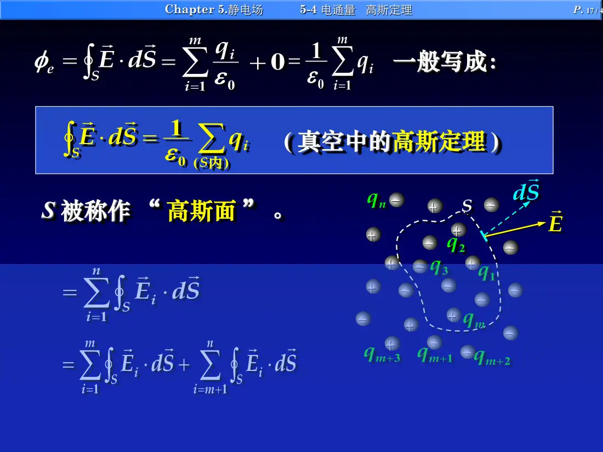

原文：

$\phi_{e} = \oint_{S}\vec{E}\cdot d\vec{S} = \sum_{i = 1}^{m}\frac{q_{i}}{\varepsilon_{0}} +0 = \frac{1}{\varepsilon_{0}}\sum_{i = 1}^{m}q_{i}$ 一般写成：

$\oint_{S} \vec{E} \cdot d\vec{S} = \frac{1}{\varepsilon_0} \sum_{(S \text{内})} q_i$ （真空中的高斯定理）

S 被称作 “高斯面”。

$$
= \sum_ {i = 1} ^ {n} \oint_ {S} \vec {E} _ {i} \cdot d \vec {S}
$$

$$
= \sum_ {i = 1} ^ {m} \oint_ {S} \vec {E} _ {i} \cdot d \vec {S} + \sum_ {i = m + 1} ^ {n} \oint_ {S} \vec {E} _ {i} \cdot d \vec {S}
$$

$$
\begin{array}{c} q _ {n} - \\ \text {   +   } \\ \text {   +   } \\ q _ {2} - \\ \text {   +   } \\ q _ {3} - \\ \text {   +   } \\ q _ {1} - \\ \text {   +   } \\ q _ {m} - \\ q _ {m + 3} - \\ q _ {m + 1} - \\ q _ {m + 2} - \end{array}
$$

Chapter 5.静电场

5-4 电通量 高斯定理

P. 17/4

### Chapter 5.静电场

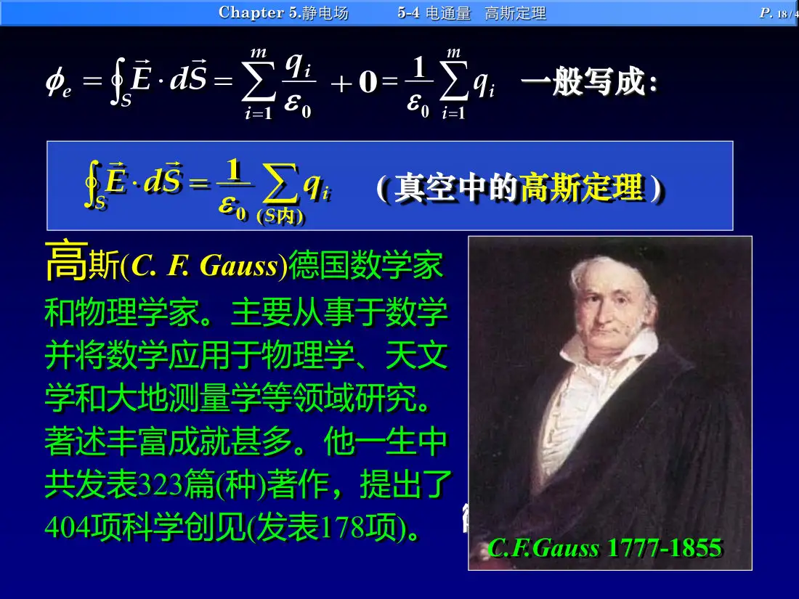

原文：

$\phi_{e} = \oint_{S}\vec{E}\cdot d\vec{S} = \sum_{i = 1}^{m}\frac{q_{i}}{\varepsilon_{0}} +0 = \frac{1}{\varepsilon_{0}}\sum_{i = 1}^{m}q_{i}$ 一般写成：

$\oint_{S} \vec{E} \cdot d\vec{S} = \frac{1}{\varepsilon_0} \sum_{(S \text{内})} q_i$ （真空中的高斯定理）

高斯(C. F. Gauss)德国数学家和物理学家。主要从事于数学并将数学应用于物理学、天文学和大地测量学等领域研究。著述丰富成就甚多。他一生中共发表323篇(种)著作，提出了404项科学创见(发表178项)。

Chapter 5.静电场

5-4 电通量 高斯定理

P. 18/4

C.F.Gauss 1777-1855

### 即：穿过高斯面 $S$ 的电通量等

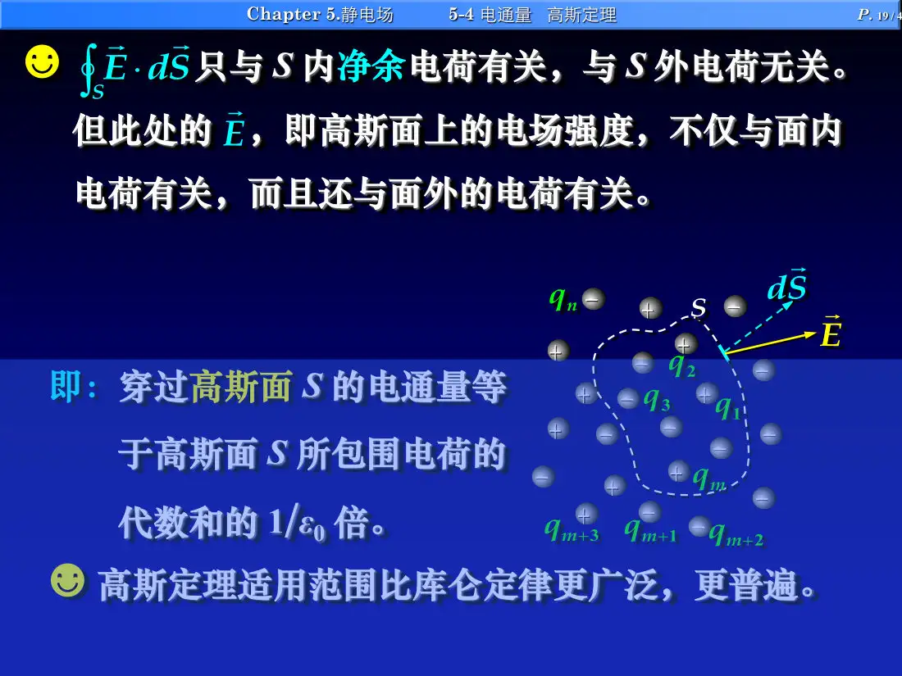

原文：

$\oint_{S} \vec{E} \cdot d\vec{S}$ 只与 $S$ 内净余电荷有关，与 $S$ 外电荷无关。但此处的 $\vec{E}$ ，即高斯面上的电场强度，不仅与面内电荷有关，而且还与面外的电荷有关。

即：穿过高斯面 $S$ 的电通量等

于高斯面 S 所包围电荷的

代数和的 $1 / \varepsilon_0$ 倍。

高斯定理适用范围比库仑定律更广泛，更普遍。

Chapter 5.静电场

5-4 电通量 高斯定理

P. 19/4

### $\vec{E}=\vec{E}_{1}+\vec{E}_{2}$ : 变！

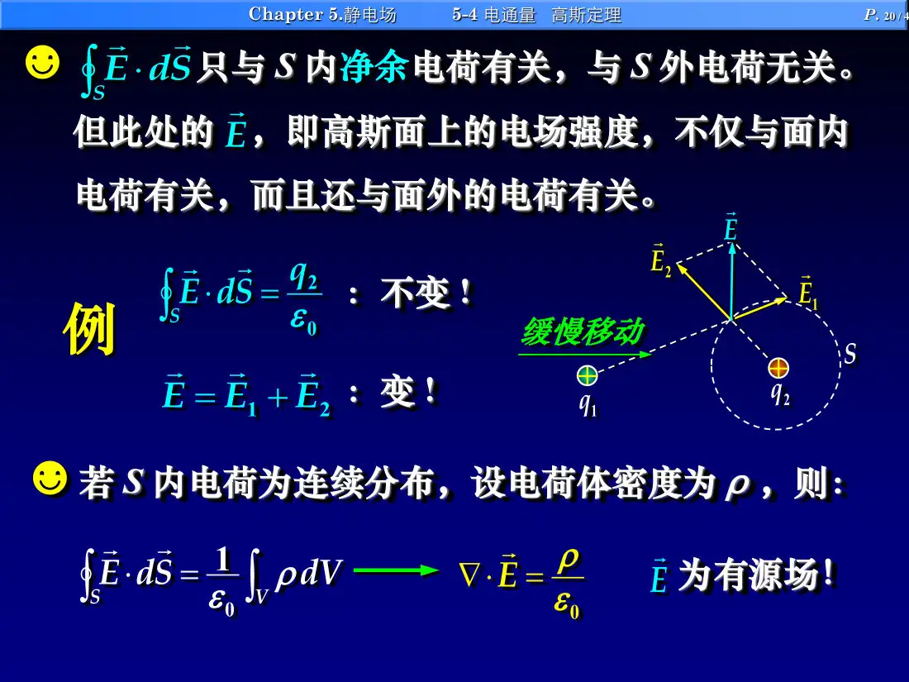

原文：

oint $\vec{E} \cdot d\vec{S}$ 只与 $S$ 内净余电荷有关，与 $S$ 外电荷无关。但此处的 $\vec{E}$ ，即高斯面上的电场强度，不仅与面内电荷有关，而且还与面外的电荷有关。

例

$\oint_{S}\vec{E}\cdot d\vec{S}=\frac{q_{2}}{\varepsilon_{0}}$ : 不变！

$\vec{E}=\vec{E}_{1}+\vec{E}_{2}$ : 变！

缓慢移动

😊 若 S 内电荷为连续分布，设电荷体密度为 $\rho$ ，则：

$\oint_{S} \vec{E} \cdot d\vec{S} = \frac{1}{\varepsilon_0} \int_V \rho dV \longrightarrow \nabla \cdot \vec{E} = \frac{\rho}{\varepsilon_0}$ $\vec{E}$ 为有源场！

Chapter 5.静电场

5-4 电通量 高斯定理

P. 20 / 4

### $\oint_{S} \vec{E} \cdot d \vec{S} = 0$

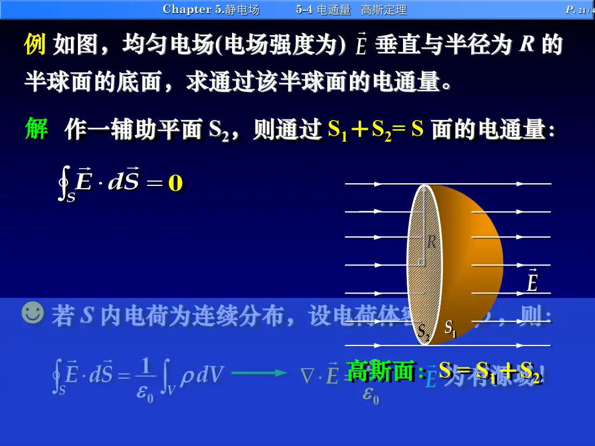

原文：

例如图，均匀电场(电场强度为) $\vec{E}$ 垂直与半径为 $R$ 的半球面的底面，求通过该半球面的电通量。

解 作一辅助平面 $\mathrm{S}_2$ ，则通过 $\mathrm{S}_1 + \mathrm{S}_2 = \mathrm{S}$ 面的电通量：

$\oint_{S} \vec{E} \cdot d \vec{S} = 0$

😊 若 S 内电荷为连续分布，设电荷体等

$\oint_{S} \vec{E} \cdot d\vec{S} = \frac{1}{\varepsilon_0} \int_V \rho dV \longrightarrow \nabla \cdot \vec{E}$ 高斯面: $\vec{E}$ 为有源场2例如图, 均匀电场(电场强度为) $\vec{E}$ 垂直与半径为 $R$ 的半球面的底面, 求通过该半球面的电通量。

Chapter 5.静电场

5-4 电通量 高斯定理

P. 21 / 4

### $$

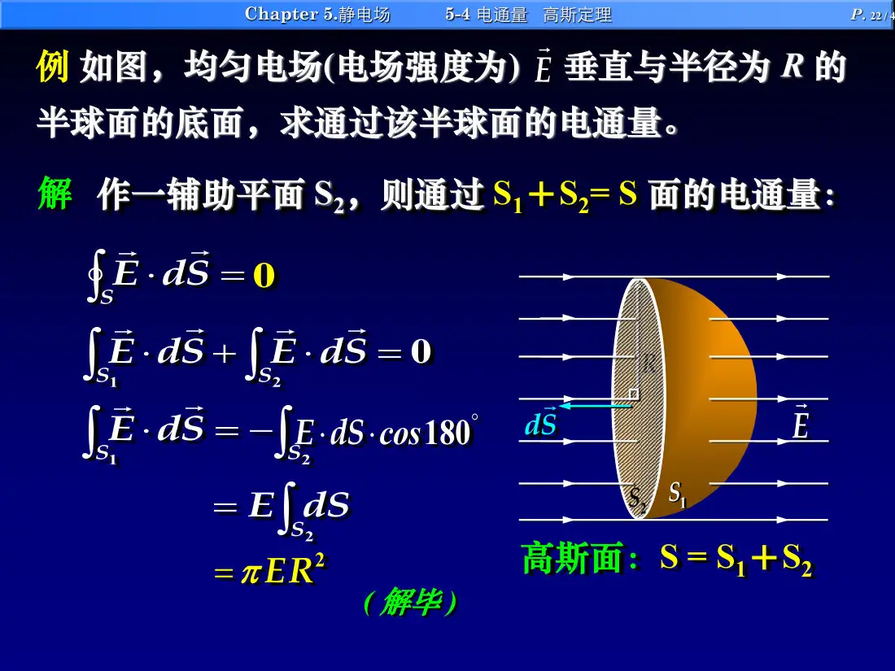

原文：

解 作一辅助平面 $\mathrm{S}_2$ ，则通过 $\mathrm{S}_1 + \mathrm{S}_2 = \mathrm{S}$ 面的电通量：

$$
\oint_ {S} \vec {E} \cdot d \vec {S} = 0
$$

$$
\int_ {S _ {1}} \vec {E} \cdot d \vec {S} + \int_ {S _ {2}} \vec {E} \cdot d \vec {S} = 0
$$

$$
\begin{array}{r l} \int_ {S _ {1}} \vec {E} \cdot d \vec {S} & = - \int_ {S _ {2}} E \cdot d S \cdot \cos 1 8 0 ^ {\circ} \\ & = E \int_ {S _ {2}} d S \\ & = \pi E R ^ {2} \end{array}
$$

(解毕)

高斯面： $S = S_{1} + S_{2}$

Chapter 5.静电场 5-4 电通量 高斯定理

P. 22 / 4

### 课堂练习 如图，点电荷 q 位于立方体中心，求通过该立方体某一面的电通量。

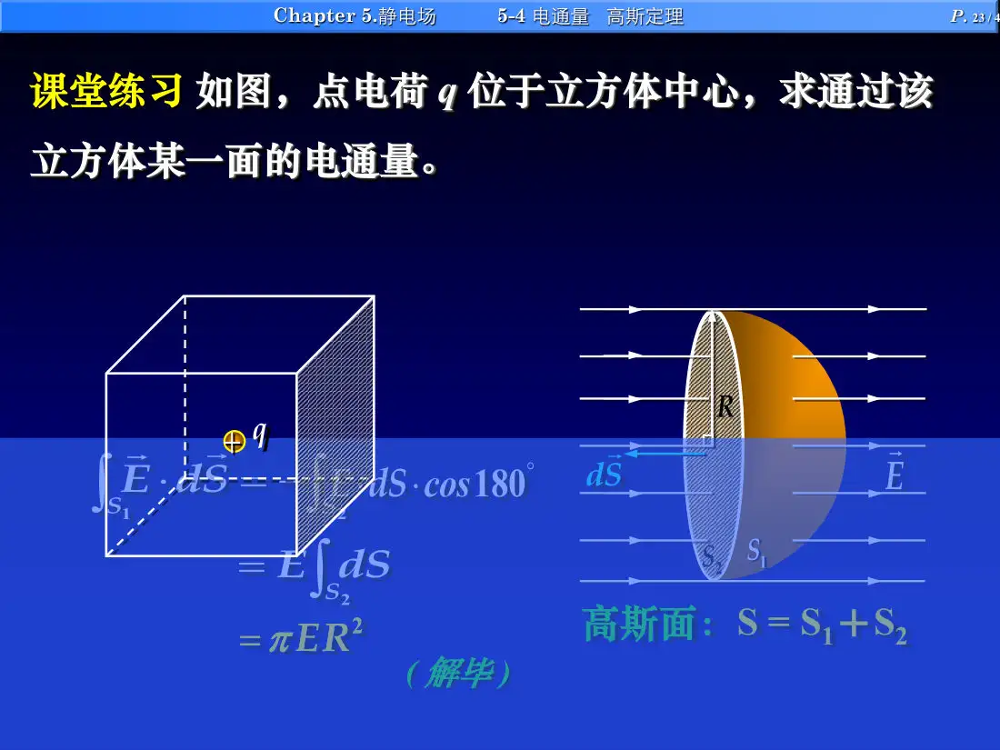

原文：

课堂练习 如图，点电荷 q 位于立方体中心，求通过该立方体某一面的电通量。

dS·cos180°

(解毕)

高斯面： $S = S_{1} + S_{2}$

Chapter 5.静电场

5-4 电通量 高斯定理

P. 23/4

### 课堂练习 如图，点电荷 q 位于立方体中心，求通过该立方体某一面的电通量。

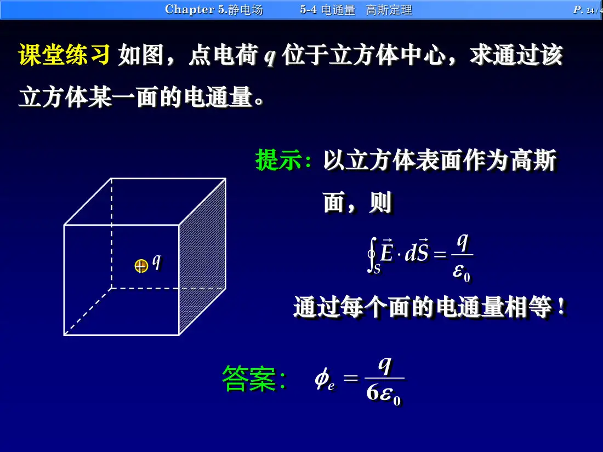

原文：

课堂练习 如图，点电荷 q 位于立方体中心，求通过该立方体某一面的电通量。

提示: 以立方体表面作为高斯面, 则

$\oint_{S} \vec{E} \cdot d\vec{S} = \frac{q}{\varepsilon_0}$ 通过每个面的电通量相等！

答案: $\phi_{e} = \frac{q}{6\varepsilon_{0}}$

Chapter 5.静电场

5-4 电通量 高斯定理

P. 24/4

### 四、高斯定理的应用——求对称场 $\vec{E}$

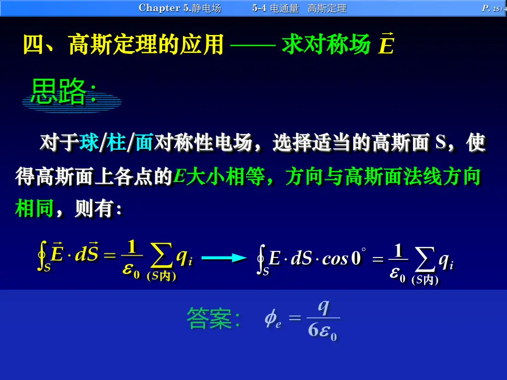

原文：

四、高斯定理的应用——求对称场 $\vec{E}$

思路：

对于球/柱/面对称性电场，选择适当的高斯面 S，使得高斯面上各点的 E 大小相等，方向与高斯面法线方向相同，则有：

$$
\oint_ {S} \vec {E} \cdot d \vec {S} = \frac {1}{\varepsilon_ {0}} \sum_ {(S \text {内})} q _ {i} \longrightarrow \oint_ {S} E \cdot d S \cdot \cos 0 ^ {\circ} = \frac {1}{\varepsilon_ {0}} \sum_ {(S \text {内})} q _ {i}
$$

答案: $\phi_{e} = \frac{q}{6\varepsilon_{0}}$

Chapter 5.静电场

5-4 电通量 高斯定理

P. 25/4

### 四、高斯定理的应用——求对称场 $\vec{E}$

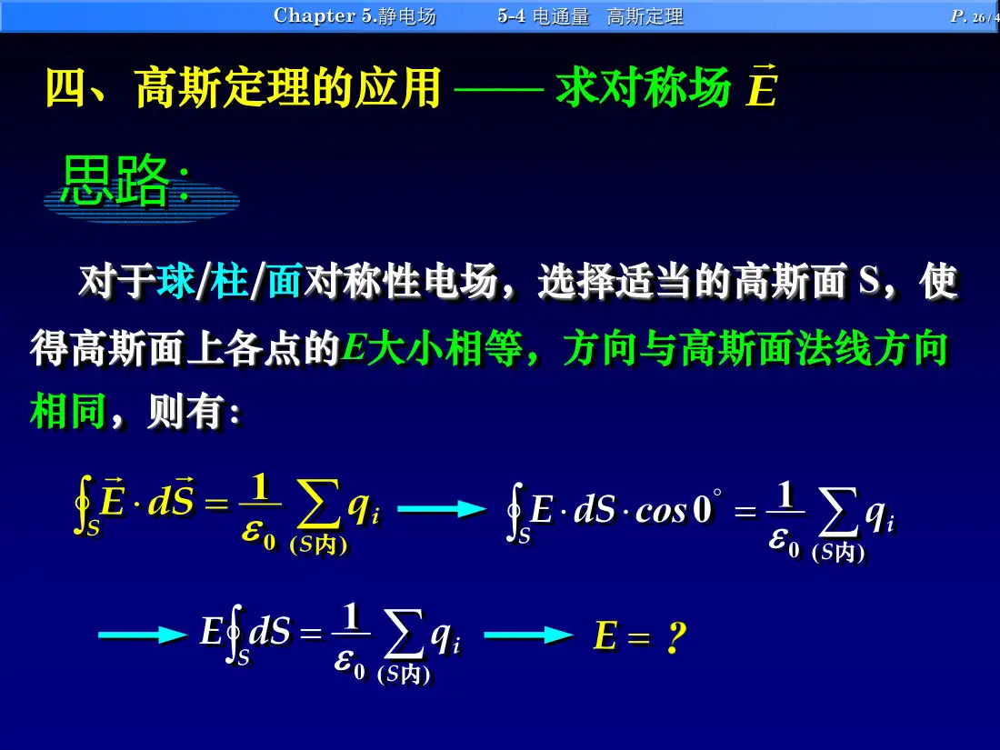

原文：

四、高斯定理的应用——求对称场 $\vec{E}$

思路：

对于球/柱/面对称性电场，选择适当的高斯面 S，使得高斯面上各点的 E 大小相等，方向与高斯面法线方向相同，则有：

$$
\oint_ {S} \vec {E} \cdot d \vec {S} = \frac {1}{\varepsilon_ {0}} \sum_ {(S \text {内})} q _ {i} \longrightarrow \oint_ {S} E \cdot d S \cdot \cos 0 ^ {\circ} = \frac {1}{\varepsilon_ {0}} \sum_ {(S \text {内})} q _ {i}
$$

$$
\longrightarrow E \oint_ {S} d S = \frac {1}{\varepsilon_ {0}} \sum_ {(S \text {内})} q _ {i} \longrightarrow E = ?
$$

Chapter 5.静电场

5-4 电通量 高斯定理

P. 26/4

### 例 求均匀带电球面(或薄球壳)的电场分布。(设球面半径为R，带电Q)

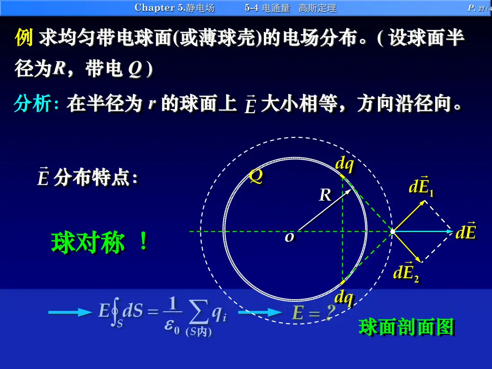

原文：

例 求均匀带电球面(或薄球壳)的电场分布。(设球面半径为R，带电Q)

分析: 在半径为 $r$ 的球面上 $\vec{E}$ 大小相等, 方向沿径向。

$\vec{E}$ 分布特点:

球对称！

$$
\longrightarrow E \oint_ {S} d S = \frac {1}{\varepsilon_ {0}} \sum_ {(S \text {内})} q _ {i} \longrightarrow E = ?
$$

球面剖面图

P. 27/4

Chapter 5.静电场

5-4 电通量 高斯定理

### 例 求均匀带电球面(或薄球壳)的电场分布。(设球面半径为R，带电Q)

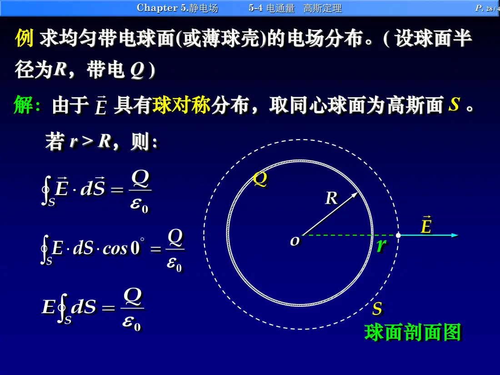

原文：

例 求均匀带电球面(或薄球壳)的电场分布。(设球面半径为R，带电Q)

解：由于 $\vec{E}$ 具有球对称分布，取同心球面为高斯面 $S$ 。

若 $r > R$ ，则：

$$
\oint_ {S} \vec {E} \cdot d \vec {S} = \frac {Q}{\varepsilon_ {0}}
$$

$$
\oint_ {S} \boldsymbol {E} \cdot d \boldsymbol {S} \cdot \cos 0 ^ {\circ} = \frac {\boldsymbol {Q}}{\varepsilon_ {0}}
$$

$$
E \oint_ {S} d S = \frac {Q}{\varepsilon_ {0}}
$$

球面剖面图

Chapter 5.静电场 5-4 电通量 高斯定理

P. 28/4

### $$

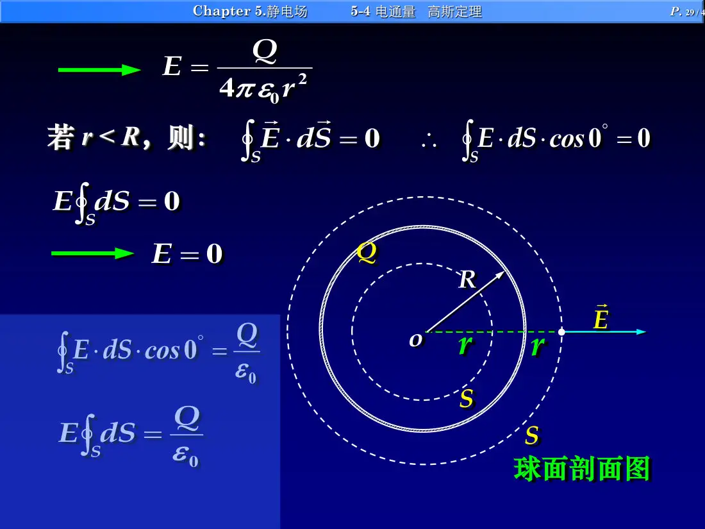

原文：

$$
E = \frac {Q}{4 \pi \varepsilon_ {0} r ^ {2}}
$$

若 $r < R$ ，则： $\oint_{S} \vec{E} \cdot d\vec{S} = 0$ $\therefore \oint_{S} E \cdot dS \cdot cos 0^{\circ} = 0$

$E\oint_{S}dS = 0$

$$
\longrightarrow E = 0
$$

$$
\oint_ {S} \boldsymbol {E} \cdot d \boldsymbol {S} \cdot \cos 0 ^ {\circ} = \frac {\boldsymbol {Q}}{\varepsilon_ {0}}
$$

$$
E \oint_ {S} d S = \frac {Q}{\varepsilon_ {0}}
$$

球面剖面图

Chapter 5.静电场

5-4 电通量 高斯定理

P. 29/4

### $$

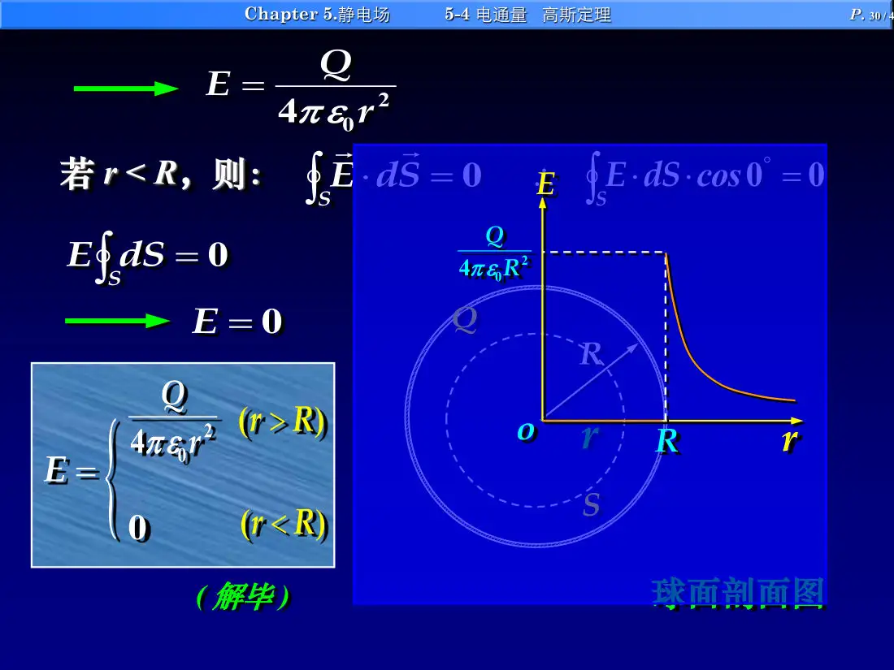

原文：

$$
E = \frac {Q}{4 \pi \varepsilon_ {0} r ^ {2}}
$$

若 $r < R$ ，则：

$E\oint_{S}dS = 0$

$$
E \equiv 0
$$

$$
E = \left\{ \begin{array}{l l} \frac {Q}{4 \pi \varepsilon_ {0} r ^ {2}} & (r > R) \\ 0 & (r <   R) \end{array} \right.
$$

(解毕)

Chapter 5.静电场

5-4 电通量 高斯定理

P. 30 / 4

球面剖面图

### 例 求无限长均匀带电圆柱体的电场分布。(设圆柱体半径为R，电荷体密度为ρ)

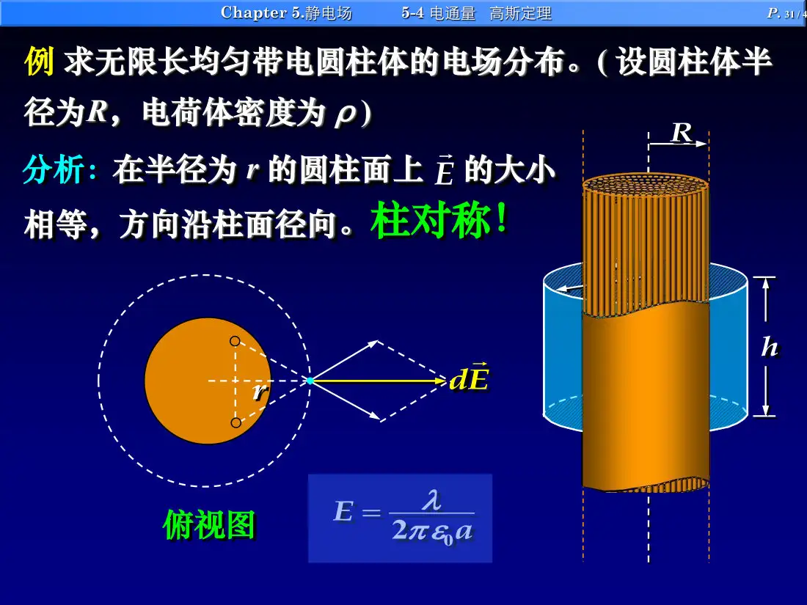

原文：

例 求无限长均匀带电圆柱体的电场分布。(设圆柱体半径为R，电荷体密度为ρ)

分析: 在半径为 $r$ 的圆柱面上 $\vec{E}$ 的大小相等, 方向沿柱面径向。柱对称!

俯视图

$$
E = \frac {\lambda}{2 \pi \varepsilon_ {0} a}
$$

Chapter 5.静电场 5-4电通量 高斯定理

P. 31/4

### 例 求无限长均匀带电圆柱体的电场分布。(设圆柱体半径为R，电荷体密度为ρ)

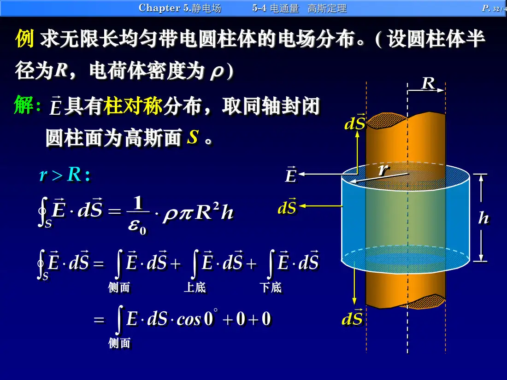

原文：

例 求无限长均匀带电圆柱体的电场分布。(设圆柱体半径为R，电荷体密度为ρ)

解: $\vec{E}$ 具有柱对称分布, 取同轴封闭圆柱面为高斯面 $S$ 。

$r \geq R:$

$$
\oint_ {S} \vec {E} \cdot d \vec {S} = \frac {1}{\varepsilon_ {0}} \cdot \rho \pi R ^ {2} h
$$

$\oint_{S}\vec{E}\cdot d\vec{S} = \int_{\text{侧面}}\vec{E}\cdot d\vec{S} + \int_{\text{上底}}\vec{E}\cdot d\vec{S} + \int_{\text{下底}}\vec{E}\cdot d\vec{S}$ $= \int_{\text{侧面}}E\cdot dS\cdot cos0^{\circ} + 0 + 0$

Chapter 5.静电场

5-4 电通量 高斯定理

P. 32 / 4

### 侧面

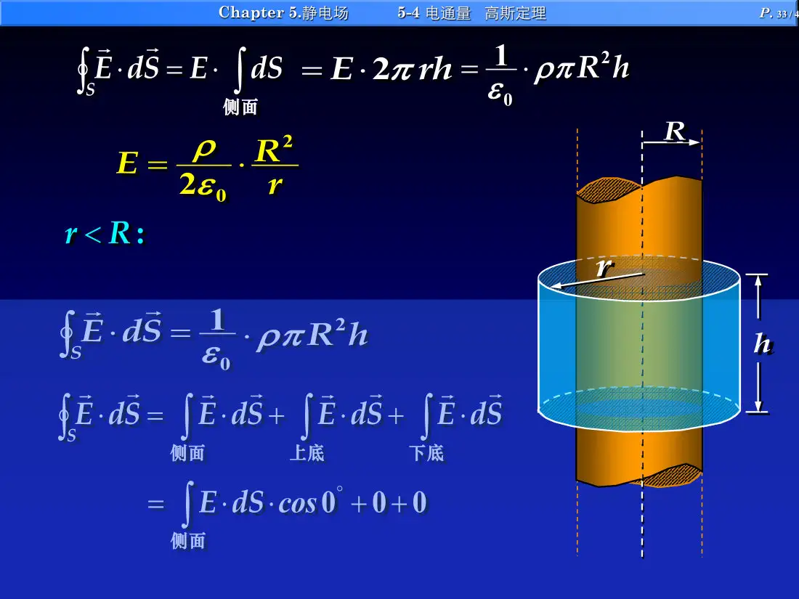

原文：

侧面

$$
E = \frac {\rho}{2 \varepsilon_ {0}} \cdot \frac {R ^ {2}}{r}
$$

$$
r <   R:
$$

$$
\oint_ {S} \vec {E} \cdot d \vec {S} = \frac {1}{\varepsilon_ {0}} \cdot \rho \pi R ^ {2} h
$$

$\oint_{S}\vec{E}\cdot d\vec{S} = \int_{\text{侧面}}\vec{E}\cdot d\vec{S} + \int_{\text{上底}}\vec{E}\cdot d\vec{S} + \int_{\text{下底}}\vec{E}\cdot d\vec{S}$ $= \int_{\text{侧面}}E\cdot dS\cdot cos0^{\circ} + 0 + 0$

Chapter 5.静电场

5-4 电通量 高斯定理

P. 33 / 4

### $$

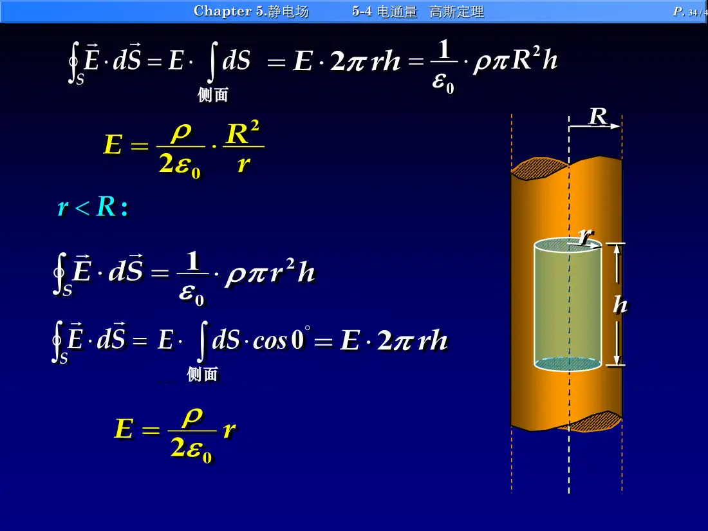

原文：

$\oint_{S} \vec{E} \cdot d\vec{S} = E \cdot \int_{\text{侧面}} dS = E \cdot 2\pi rh = \frac{1}{\varepsilon_0} \cdot \rho \pi R^2 h$

$$
E = \frac {\rho}{2 \varepsilon_ {0}} \cdot \frac {R ^ {2}}{r}
$$

$r < R:$

$\oint_{S} \vec{E} \cdot d\vec{S} = \frac{1}{\varepsilon_0} \cdot \rho \pi r^2 h$

$\oint_{S}\vec{E}\cdot d\vec{S} = E\cdot \int_{侧面}dS\cdot cos0^{\circ} = E\cdot 2\pi rh$

$$
E = \frac {\rho}{2 \varepsilon_ {0}} r
$$

Chapter 5.静电场

5-4 电通量 高斯定理

P. 34 / 4

### $$

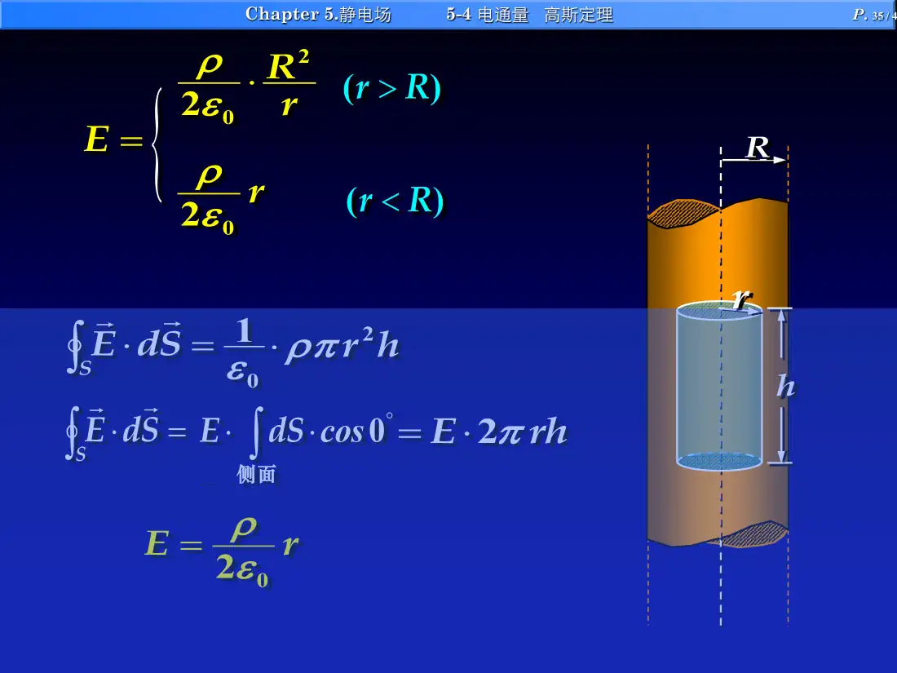

原文：

$$
E = \left\{ \begin{array}{l l} \frac {\rho}{2 \varepsilon_ {0}} \cdot \frac {R ^ {2}}{r} & (r > R) \\ \frac {\rho}{2 \varepsilon_ {0}} r & (r <   R) \end{array} \right.
$$

$\oint_{S} \vec{E} \cdot d\vec{S} = \frac{1}{\varepsilon_0} \cdot \rho \pi r^2 h$

$\oint_{S} \vec{E} \cdot d\vec{S} = E \cdot \int_{侧面} dS \cdot cos 0^{\circ} = E \cdot 2\pi rh$

$$
E = \frac {\rho}{2 \varepsilon_ {0}} r
$$

Chapter 5.静电场

5-4 电通量 高斯定理

P. 35 / 4

### $$

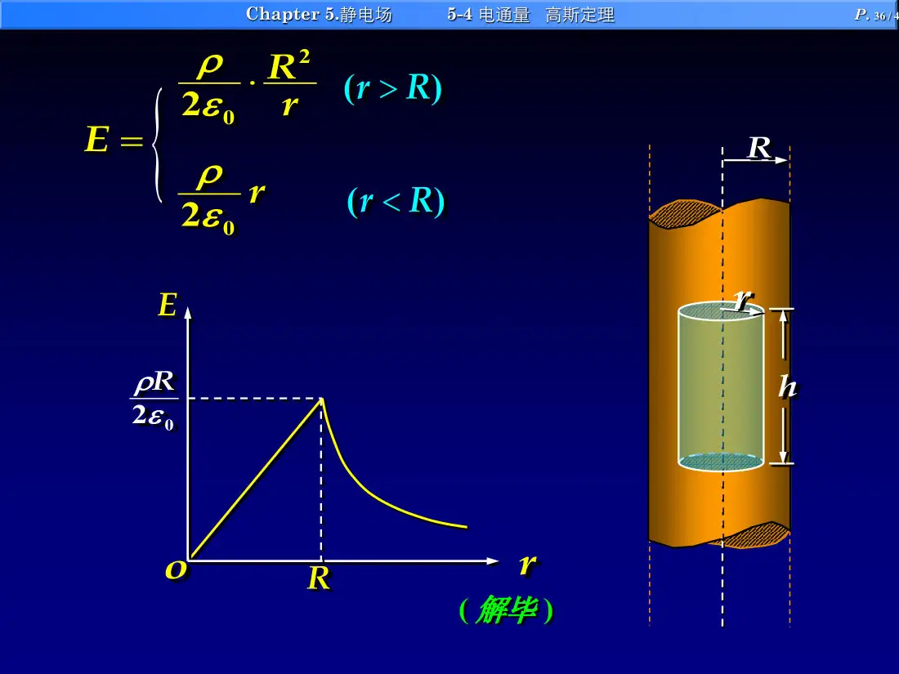

原文：

$$
E = \left\{ \begin{array}{l l} \frac {\rho}{2 \varepsilon_ {0}} \cdot \frac {R ^ {2}}{r} & (r > R) \\ \frac {\rho}{2 \varepsilon_ {0}} r & (r <   R) \end{array} \right.
$$

Chapter 5.静电场

5-4 电通量 高斯定理

P. 36 / 4

### 例 求无限大均匀带电平面的电场分布。(设电荷面密度为 $\sigma$ )

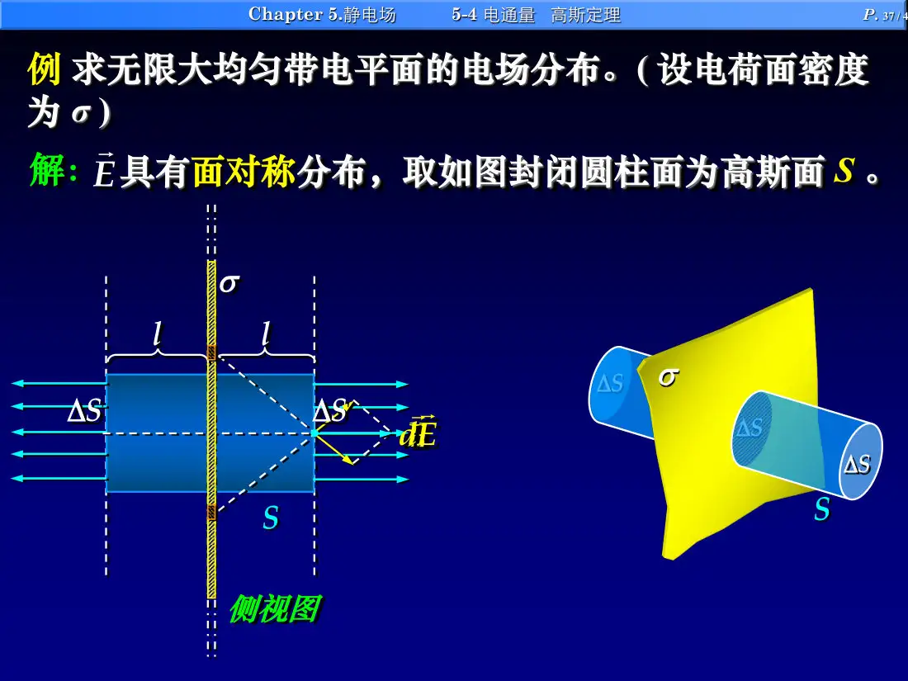

原文：

例 求无限大均匀带电平面的电场分布。(设电荷面密度为 $\sigma$ )

解: $\vec{E}$ 具有面对称分布, 取如图封闭圆柱面为高斯面 $S$ 。

Chapter 5.静电场 5-4 电通量 高斯定理

P. 37/4

### 例 求无限大均匀带电平面的电场分布。(设电荷面密度为 $\sigma$ )

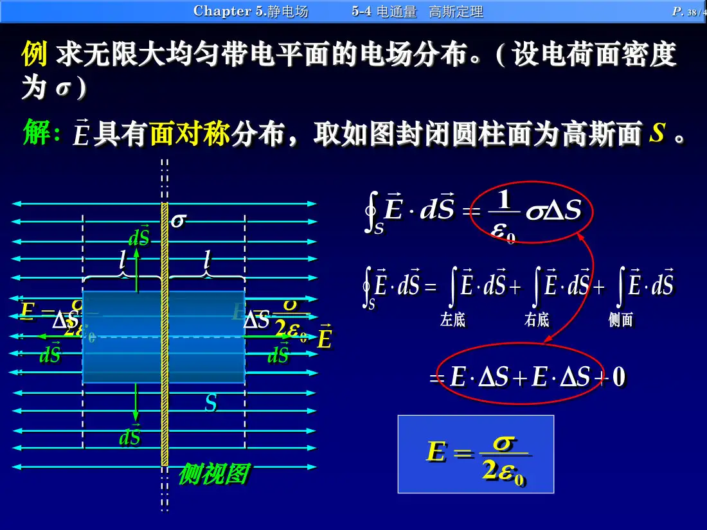

原文：

例 求无限大均匀带电平面的电场分布。(设电荷面密度为 $\sigma$ )

解: $\vec{E}$ 具有面对称分布, 取如图封闭圆柱面为高斯面 $S$ 。

侧视图

$$
\oint_ {S} \vec {E} \cdot d \vec {S} = \frac {1}{\varepsilon_ {0}} \sigma \Delta S
$$

$$
\oint_ {S} \vec {E} \cdot d \vec {S} = \int_ {\text {左底}} \vec {E} \cdot d \vec {S} + \int_ {\text {右底}} \vec {E} \cdot d \vec {S} + \int_ {\text {侧面}} \vec {E} \cdot d \vec {S}
$$

$= E \cdot \Delta S + E \cdot \Delta S + 0$

$$
E = \frac {\sigma}{2 \varepsilon_ {0}}
$$

Chapter 5.静电场 5-4 电通量 高斯定理

P. 38/4

### 例 求无限大均匀带电平面的电场分布。(设电荷面密度为 $\sigma$ )

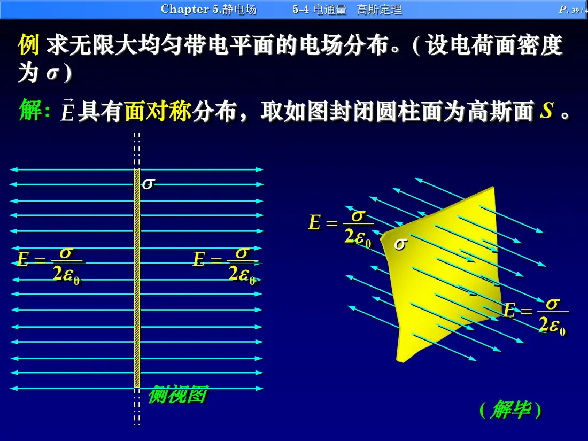

原文：

例 求无限大均匀带电平面的电场分布。(设电荷面密度为 $\sigma$ )

解: $\vec{E}$ 具有面对称分布, 取如图封闭圆柱面为高斯面 $S$ 。

(解毕)

Chapter 5.静电场 5-4电通量 高斯定理

P. 39/4

### $$

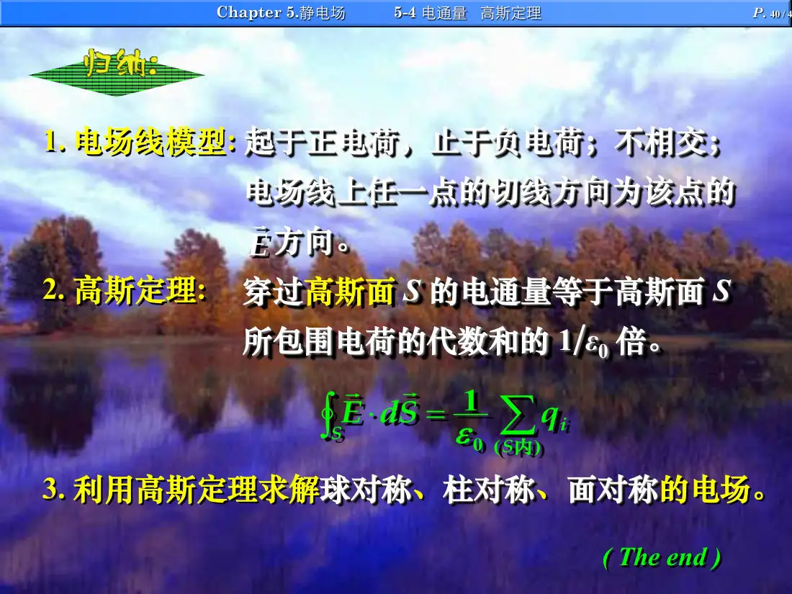

原文：

1. 电场线模型: 起于正电荷, 止于负电荷; 不相交; 电场线上任一点的切线方向为该点的 $\vec{E}$ 方向。

2. 高斯定理: 穿过高斯面 S 的电通量等于高斯面 S 所包围电荷的代数和的 $1/\varepsilon_{0}$ 倍。

$$
\oint_ {S} \vec {E} \cdot d \vec {S} = \frac {1}{\varepsilon_ {0}} \sum_ {(S \text {内})} q _ {i}
$$

3. 利用高斯定理求解球对称、柱对称、面对称的电场。

$$
(\text { The   end })
$$

Chapter 5.静电场 5-4 电通量 高斯定理

P. 40 / 4
