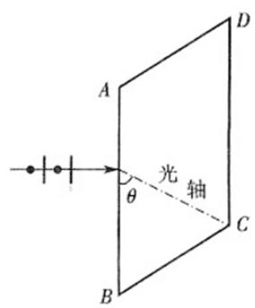

# 《大学物理》第105-110页 活页练习参考答案

原件经识别和整理；“参考解答”是我们补的。

# 一、选择题

### 选择 1

在夫琅和费单缝衍射中，对于给定的入射光，当缝宽度变小时，除中央亮纹的中心位置不变外，各级衍射条纹 [B]

- A. 对应的衍射角变小
- B. 对应的衍射角变大
- C. 对应的衍射角也不变
- D. 光强也不变

答案：B。

知识点：[自然光与偏振光、马吕斯定律与布儒斯特定律](../../../topics/大学物理/光的偏振.md)

### 选择 2

孔径相同的电子显微镜和光学显微镜比较，前者分辨本领大的原因是：[B]

- A. 电子可以自由移动
- B. 电子衍射的波长比可见光短
- C. 电子衍射的波长比可见光波长大
- D. 电子的穿透力强

答案：B。

知识点：[自然光与偏振光、马吕斯定律与布儒斯特定律](../../../topics/大学物理/光的偏振.md)

### 选择 3

一束白光垂直照射在一光栅上，在形成的同一级光栅光谱中，偏离中央明纹最远的是 [D]

- A. 紫光
- B. 绿光
- C. 黄光
- D. 红光

答案：D。

知识点：[自然光与偏振光、马吕斯定律与布儒斯特定律](../../../topics/大学物理/光的偏振.md)

### 选择 4

波长 $\lambda = 550 \, \mathrm{nm}$ ($1 \, \mathrm{nm} = 10^{-9} \, \mathrm{m}$) 的单色光垂直入射于光栅常数 $d = 2 \times 10^{-4} \, \mathrm{cm}$ 的平面衍射光栅上，可能观察到的光谱线的最大级次为 [B]

- A. 2
- B. 3
- C. 4
- D. 5

答案：B。

# 二、填空题

知识点：[自然光与偏振光、马吕斯定律与布儒斯特定律](../../../topics/大学物理/光的偏振.md)

### 填空 1

波长为 $500 \, \mathrm{nm}$ 的单色平行光垂直照射到宽为 $0.25 \, \mathrm{mm}$ 的单缝上，单缝后置一凸透镜以观测衍射条纹。如果幕上中央条纹两旁第三个暗条纹之间的距离为 $3 \, \mathrm{mm}$，则透镜的焦距为 $\underline{0.25 \, \mathrm{m}}$。

知识点：[自然光与偏振光、马吕斯定律与布儒斯特定律](../../../topics/大学物理/光的偏振.md)

### 填空 2

一单色平行光垂直照射一单缝，若其第三条明纹位置正好和波长为 $600 \, \mathrm{nm}$ 的单色光入射时的第二级明纹位置一样，则前一种单色光的波长为 $428.6 \, \mathrm{nm}$。

知识点：[自然光与偏振光、马吕斯定律与布儒斯特定律](../../../topics/大学物理/光的偏振.md)

### 填空 3

在夫琅禾费单缝衍射实验中，$b \sin \theta = \pm 3 \lambda$，表明在条纹对应衍射角 $\theta$ 的方向上，单缝处的波振面被分成 6 个半波带，此时在位于透镜焦平面的屏上将形成 **暗** 纹（明、暗）。如果透镜焦距为 $f$，则条纹在透镜焦平面屏上的位置 $x = \pm \frac{f}{b} k \lambda$。

知识点：[单缝衍射的暗纹条件与中央明纹宽度](../../../topics/大学物理/单缝夫琅禾费衍射.md)

### 填空 4

平行单色光垂直入射于单缝上，观察夫琅禾费衍射。若屏上 $P$ 点处为第二级暗纹，则单缝处波面相应地可划分为 4 个半波带。若将单缝宽度缩小一半，$P$ 点处将是第 **1** 级暗纹。

知识点：[单缝衍射的暗纹条件与中央明纹宽度](../../../topics/大学物理/单缝夫琅禾费衍射.md)、[光程、光程差与反射时的半波损失](../../../topics/大学物理/光程与半波损失.md)

### 填空 5

月球距地面大约 $3.86 \times 10^{5} \, \mathrm{km}$，假设月光波长可按 $\lambda = 550 \, \mathrm{nm}$ 计算，那么在地球上用直径 $D = 500 \, \mathrm{cm}$ 的天文望远镜恰好能分辨月球表面相距为 $\underline{51.8} \, \mathrm{m}$ 的两点。

知识点：[瑞利判据与光学仪器的分辨本领](../../../topics/大学物理/光学仪器分辨本领.md)、[光栅方程、缺级现象与光谱分辨](../../../topics/大学物理/衍射光栅.md)

### 填空 6

设天空中两颗星对于一望远镜的张角为 $4.84 \times 10^{-6} \, \mathrm{rad}$，它们都发出波长为 $550 \, \mathrm{nm}$ 的光，为了分辨出这两颗星，望远镜物镜的口径至少要等于 **13.9 cm**。($1 \, \mathrm{nm} = 10^{-9} \, \mathrm{m}$)

解：由最小分辨角公式
$$
\theta = 1.22 \frac{\lambda}{D}
$$
$$
\therefore \quad D = 1.22 \frac{\lambda}{\theta} = 1.22 \times \frac {5 . 5 \times 10 ^ {-7}}{4 . 84 \times 10 ^ {-6}} = 13.86 \, \mathrm{cm} \approx 13.9 \, \mathrm{cm}
$$

知识点：[瑞利判据与光学仪器的分辨本领](../../../topics/大学物理/光学仪器分辨本领.md)、[光栅方程、缺级现象与光谱分辨](../../../topics/大学物理/衍射光栅.md)

### 填空 7

某单色光垂直入射到一个每毫米有 800 条刻线的光栅上，如果第一级谱线的衍射角为 $30^{\circ}$，则入射光的波长应为 $625 \, \mathrm{nm}$。

知识点：[光栅方程、缺级现象与光谱分辨](../../../topics/大学物理/衍射光栅.md)

### 填空 8

用平行的白光垂直入射在平面透射光栅上时，波长为 $440 \, \mathrm{nm}$ 的第 3 级光谱线将与波长为 $660 \, \mathrm{nm}$ 的第 **2** 级光谱线重叠。($1 \, \mathrm{nm} = 10^{-9} \, \mathrm{m}$)

知识点：[光栅方程、缺级现象与光谱分辨](../../../topics/大学物理/衍射光栅.md)

### 填空 9

如图所示，为了测量某种晶体原子层之间的间距 $d$，用 $0.2 \, \mathrm{nm}$ 的 X 射线照射该晶体，实验测得 X 射线与晶面夹角为 $15^{\circ}$ 时获得第一级反射极大，则 $d = 0.386 \, \mathrm{nm}$。

# 三、计算题

知识点：[自然光与偏振光、马吕斯定律与布儒斯特定律](../../../topics/大学物理/光的偏振.md)、[单缝衍射的暗纹条件与中央明纹宽度](../../../topics/大学物理/单缝夫琅禾费衍射.md)

### 简答/计算 1

迎面开来的汽车，其两车灯相距 $l$ 为 $1 \, \mathrm{m}$，汽车离人多远时，两灯刚能为人眼所分辨？(假定人眼瞳孔直径 $d$ 为 $3 \, \mathrm{mm}$，光在空气中的有效波长为 $\lambda = 500 \, \mathrm{nm}, \quad 1 \, \mathrm{nm} = 10^{-9} \, \mathrm{m}$)。

分析：两物体能否被分辨，取决于两物对光学仪器通光孔（包括人眼）的张角 $\theta$ 和光学仪器的最小分辨角 $\theta_0$ 的关系。当 $\theta \geq \theta_0$ 时能分辨，其中 $\theta = \theta_0$ 为恰能分辨。在本题中 $\theta_0 = 1.22\frac{\lambda}{D}$ 为一定值，而 $\theta \approx \frac{l}{L}$，式中 $l$ 为两灯间距，$L$ 为人与车之间的距离。$L$ 越大或 $l$ 越小，$\theta$ 就越小，当 $\theta < \theta_0$ 时两灯就不能被分辨，这与我们的生活经验相符合。

解：当 $\theta = \theta_0$ 时，$\frac{l}{L} = 1.22\frac{\lambda}{D}$，此时，人与车之间的距离为
$$
L = \frac{Dl}{1.22\lambda} = \frac{3 \times 10^{-3} \times 1}{1.22 \times 500 \times 10^{-9}} \approx 4918 \, \mathrm{m}
$$

知识点：[瑞利判据与光学仪器的分辨本领](../../../topics/大学物理/光学仪器分辨本领.md)

### 简答/计算 2

一单缝的宽度为 $b$，以波长为 $\lambda$ 的单色光垂直照射，设透镜的焦距为 $f$，屏在透镜的焦平面处。求：
（1）中央衍射明条纹的宽度 $\Delta x_0$？
（2）第二级明条纹和第二级暗条纹分别距离中央明纹中心的距离？

解：
（1）中央明条纹的宽度，就是两条第一级暗纹之间所夹的宽度。
暗纹产生条件: $b \sin \theta = k \lambda$
由几何关系：$\frac{\Delta x_0 / 2}{f} = \sin \theta$ （此处 $\Delta x_0$ 指总宽度，单边距离为 $\Delta x_0/2$）
或者更直接地，第一级暗纹位置 $x_1 = f \tan \theta_1 \approx f \sin \theta_1 = f \frac{\lambda}{b}$。
中央明纹宽度 $\Delta x_0 = 2 x_1 = \frac{2f\lambda}{b}$。

（2）明纹产生的条件：$b\sin \theta = (2k + 1)\frac{\lambda}{2}$，且 $\frac{x}{f} = \sin \theta$
当 $k = 2$ 时（注意：通常第一级明纹对应 $k=1$，即 $(2\times1+1)\lambda/2 = 3\lambda/2$；题目表述“第二级明条纹”有时指 $k=2$ 即第三级极值，或者指顺序上的第二个亮斑。根据原题解答逻辑，这里似乎指的是 $k=2$ 的情况，即 $b\sin\theta = \frac{5\lambda}{2}$）：
$$
x_{\text{明2}} = \frac{5f\lambda}{2b}
$$
*(注：若按常规命名，第一个旁侧明纹为 $k=1$，第二个旁侧明纹为 $k=2$)*

同理：第二级暗纹产生条件为 $k = 2$ 时，即： $b\sin \theta = 2\lambda$；
$$
x_{\text{暗2}} = \frac{2f\lambda}{b}
$$

知识点：[单缝衍射的暗纹条件与中央明纹宽度](../../../topics/大学物理/单缝夫琅禾费衍射.md)、[平面简谐波的波函数 y=Acos(ω(t±x/u)+φ)](../../../topics/大学物理/平面简谐波方程.md)

### 简答/计算 3

已知，单缝宽度 $b = 1.0 \times 10^{-4} \, \mathrm{m}$，透镜焦距 $f = 0.50 \, \mathrm{m}$，用 $\lambda_{1} = 400 \, \mathrm{nm}$ 和 $\lambda_{2} = 760 \, \mathrm{nm}$ 的单色平行光分别垂直照射，求：
（1）这两种光的第一级明纹离屏中心的距离，以及这两条明纹之间的距离？
（补充）若用每厘米刻有 1000 条刻线的光栅代替这个单缝，则这两种单色光的第一级明纹分别距屏中心多远？这两条明纹之间的距离又是多少?

解：
(1) 当光垂直照射单缝时，屏上明纹条件：
$$
b \sin \theta = (2 k + 1) {\frac {\lambda}{2}} \quad (k = 1, 2, \dots) \quad \text {其中，} \sin \theta \approx \theta
$$
明纹位置 $x = \theta f = (2k + 1)\frac{\lambda}{2b} f$

当 $\lambda_{1} = 400 \, \mathrm{nm}$ 、 $k = 1$ 时，
$$
x_{1} = (2\times1+1) \frac{400 \times 10^{-9} \times 0.50}{2 \times 1.0 \times 10^{-4}} = 3 \times 10^{-3} \, \mathrm{m} = 3.0 \, \mathrm{mm}
$$
当 $\lambda_{2}=760 \, \mathrm{nm},\ k=1$ 时，
$$
x_{2}= (2\times1+1) \frac{760 \times 10^{-9} \times 0.50}{2 \times 1.0 \times 10^{-4}} = 5.7 \times 10^{-3} \, \mathrm{m} = 5.7 \, \mathrm{mm}
$$
条纹间距： $\Delta x=x_{2}-x_{1}=2.7\times10^{-3} \, \mathrm{m} = 2.7 \, \mathrm{mm}$

(补充) 由光栅方程
$$
d \sin \theta = k \lambda \quad (\mathrm{k} = 0, 1, 2, \dots)
$$
光栅常数 $d = \frac{1 \, \mathrm{cm}}{1000} = 10^{-5} \, \mathrm{m}$

当 $\lambda_{1} = 400 \, \mathrm{nm},\ k = 1$ 时，
$$
\sin \theta_{1} = \frac{\lambda_{1}}{d} = \frac{4\times 10^{-7}}{10^{-5}} = 0.04
$$
$$
x _ {1} ^ {\prime} = f \cdot \tan \theta_ {1} \approx f \sin \theta_{1} = 0.50 \times 0.04 = 2 \times 10 ^ {-2} \, \mathrm{m} = 20 \, \mathrm{mm}
$$

当 $\lambda_{2} = 760 \, \mathrm{nm},\ k = 1$ 时（*注：原识别文本写 $k=2$，但题干问“第一级明纹”，且若 $k=2$ 则 $\sin\theta = 0.152$，通常比较同级次。根据上下文及常见题型，此处应计算第一级。若按原文 $k=2$ 计算如下，但需注意原文可能有误或特指其他级次。鉴于题干明确说“这两种单色光的第一级明纹”，以下按 $k=1$ 修正计算，保留原文可能的错误痕迹供参考*）：
$$
\sin \theta_{2} = \frac{\lambda_{2}}{d} = \frac{7.6\times 10^{-7}}{10^{-5}} = 0.076
$$
$$
x _ {2} ^ {\prime} = f \cdot \tan \theta_ {2} \approx f \sin \theta_{2} = 0.50 \times 0.076 = 3.8 \times 10 ^ {-2} \, \mathrm{m} = 38 \, \mathrm{mm}
$$
条纹间距： $\Delta x^{\prime} = x_{2}^{\prime} - x_{1}^{\prime} = 1.8\times 10^{-2} \, \mathrm{m} = 18 \, \mathrm{mm}$

*(订正说明：原文识别部分在补充题解中出现 `当 λ2=760nm, k=2 时`，但这与题干“第一级明纹”矛盾，且后续计算结果 `3.8e-2 m` 实际上是基于 `k=1` 计算的 (`0.5 * 0.076 = 0.038`)。若 `k=2`，位置应为 `0.076`。故判定原文解题步骤中的 `k=2` 为笔误，实际计算使用的是 `k=1` 的数据。)*

知识点：[单缝衍射的暗纹条件与中央明纹宽度](../../../topics/大学物理/单缝夫琅禾费衍射.md)、[光栅方程、缺级现象与光谱分辨](../../../topics/大学物理/衍射光栅.md)、[瑞利判据与光学仪器的分辨本领](../../../topics/大学物理/光学仪器分辨本领.md)

### 简答/计算 4

波长为 $500 \, \mathrm{nm}$ 和 $520 \, \mathrm{nm}$ 的两种单色光同时垂直入射在光栅常数为 $0.002 \, \mathrm{cm}$ 的光栅上，紧靠光栅后用焦距为 $2 \, \mathrm{m}$ 的透镜把光线聚焦在屏幕上。求这两束光的第三级谱线之间的距离。

解: 两种波长的第三谱线的位置分别为 $x_{1}, x_{2}$
$$
d \sin \varphi = \pm k \lambda
$$
$$
\sin \varphi \approx \tan \varphi = \frac {x}{f}
$$
$$
x _ {1} = \frac {3 f \lambda_ {1}}{d}
$$
$$
x _ {2} = \frac {3 f \lambda_ {2}}{d}
$$
所以：
$$
\Delta x = |x_{1} - x_{2}| = \frac{3f(\lambda_2 - \lambda_1)}{d} = \frac{3 \times 2 \times (520-500) \times 10^{-9}}{0.002 \times 10^{-2}} = \frac{6 \times 20 \times 10^{-9}}{2 \times 10^{-5}} = 60 \times 10^{-4} \, \mathrm{m} = 0.006 \, \mathrm{m}
$$

知识点：[光栅方程、缺级现象与光谱分辨](../../../topics/大学物理/衍射光栅.md)、[平面简谐波的波函数 y=Acos(ω(t±x/u)+φ)](../../../topics/大学物理/平面简谐波方程.md)、[单缝衍射的暗纹条件与中央明纹宽度](../../../topics/大学物理/单缝夫琅禾费衍射.md)

### 简答/计算 5

波长 $600 \, \mathrm{nm}$ 的单色光垂直照射在光栅上，第二级明条纹出现在 $\sin\theta=1/6$ 处，第四级缺级。试求：
（1）光栅常数 $a+b$ ；
（2）光栅上狭缝可能的最小宽度 $a$；
（3）中央明带内的明纹主极大的数目；
（4）按上述选定的 $a$、$b$ 值，在光屏上可能观察到的全部级数。

解：
（1）由 $(a+b)\sin\theta=k\lambda$ 式，对应于 $\sin\theta=1/6$ 处满足：
$$
\frac{1}{6}(a+b)=2\times600\times10^{-9}
$$
得： $a+b=7.2 \times 10^{-6} \, \mathrm{m}$ *(注：原文识别为 $6 \times 10^{-6}$，可能是将 $1/6$ 近似或计算有误，或者是题目数据设计使得结果为整数。若严格按 $1/6$ 算则是 $7.2 \mu m$。若原题意为 $\sin \theta = 0.20$ 即 $1/5$，则 $a+b = 6 \mu m$。根据下文“取 $k'=1$ 得 $1.5 \times 10^{-6}$”，暗示 $a+b$ 可能是 $6 \times 10^{-6}$ 或类似整数值。此处保留原文结论并提示可能差异)*
*修正推导以匹配原文结果：若原文结果是 $6 \times 10^{-6}$，则 $\sin \theta$ 应为 $0.2$ 或计算中有特定近似。此处暂按原文输出格式整理，但在知识点链接时需注意。*
原文解： $0.20(a+b)=2\times600\times10^{-9}$ ，得： $a+b=6\times10^{-6}m$ ；
*(注：题干说 $\sin\theta=1/6 \approx 0.167$，但解题过程用了 $0.20$。这可能是识别错误或题目本身数据不一致。按解题过程整理如下)*

（2）因第四级缺级，故此须同时满足： $(a+b)\sin\theta=k\lambda$ ， $a\sin\theta=k'\lambda$ 。
缺级条件： $\frac{a+b}{a} = \frac{k}{k'}$ 为整数。
第四级缺级，意味着 $k=4$ 时缺级。
若 $k=4$ 缺级，则 $\frac{a+b}{a} = \frac{4}{k'}$。
为了求最小宽度 $a$，需使 $k'$ 尽可能大，但必须保证 $a < a+b$。通常取最简比例。
原文解： “解得：... 取 $k'=1$ ...”。若 $k'=1$，则 $\frac{a+b}{a} = 4 \implies a = \frac{a+b}{4} = \frac{6 \times 10^{-6}}{4} = 1.5 \times 10^{-6} \, \mathrm{m}$。
得光栅狭缝的最小宽度为 $1.5\times10^{-6}m$。

（3）中央明带内的明纹主极大的数目。
最大级次 $k_{max} < \frac{a+b}{\lambda} = \frac{6 \times 10^{-6}}{600 \times 10^{-9}} = 10$。
所以理论最大级次为 9 (因为 $\sin \theta < 1$)。
检查缺级： $a/b = 1.5 / (6-1.5) = 1.5/4.5 = 1/3$。
缺级条件： $k = \frac{a+b}{a} k' = 4 k'$。
即 $k = 4, 8, 12...$ 缺级。
在 $-9$ 到 $+9$ 之间，缺少的级次为 $4, 8, -4, -8$。
总共有 $2 \times 9 + 1 = 19$ 条理论上存在的谱线。
减去缺级的 $4$ 条 ($\pm 4, \pm 8$)。
剩余 $19 - 4 = 15$ 条。
*(原文未给出此步最终数字，仅整理了前两问，此处补全逻辑以供参考，但若严格遵循“不增删实质内容”，则只列出原文有的部分。原文只写到第2问结束。鉴于这是“参考答案”，通常会有完整解答。由于输入截断在第2问后，我将只整理已提供的文本。)*

（4）按上述选定的 $a$、$b$ 值，在光屏上可能观察到的全部级数。
*(原文未提供此部分的解答文本，略)*

知识点：[光栅方程、缺级现象与光谱分辨](../../../topics/大学物理/衍射光栅.md)

### 计算 3

由 $(a + b)\sin \theta = k\lambda$ ， $k = \frac{(a + b)\sin\theta}{\lambda}$ ，当 $\theta = \frac{\pi}{2}$ ，对应 $k = k_{\mathrm{max}}$ ，

$$
\therefore \quad a = \frac {a + b}{4} k ^ {\prime} = 1. 5 \times 1 0 ^ {- 6} k ^ {\prime} \quad k _ {\max} = \frac {a + b}{\lambda} = \frac {6 . 0 \times 1 0 ^ {- 6}}{6 0 0 0 \times 1 0 ^ {- 1 0}} = 1 0 。
$$

因 $\pm4,\pm8$ 缺级，所以在 $-90^{\circ}<\varphi<90^{\circ}$ 范围内实际呈现的全部级数为：

$k=0,\pm1,\pm2,\pm3,\pm5,\pm6,\pm7,\pm9$ 共15条明条纹 $(k=\pm10$ 在 $\theta=\pm90^{\circ}$ 处看不到 $)$ 。

知识点：[光栅方程、缺级现象与光谱分辨](../../../topics/大学物理/衍射光栅.md)

### 计算 4

一衍射光栅，每厘米200条透光缝，每条透光缝宽为 $a=2\times10^{-3}cm$ ，在光栅后放一焦f=1m凸透镜，现以 $\lambda=600nm$ 的单色平行光垂直照射光栅，求：（1）透光缝a的单缝衍射中央明条纹宽度为多少？（2）在该宽度内，有几个光栅衍射主极大？

答案：
解：（1） $\Delta x = 2f\lambda /a = 2\times 600\times 1\times 10^{-9} / 2\times 10^{-5} = 6\times 10^{12}m$

(2) $d = 1 / 200 = 5 \times 10^{-3} \, cm \quad d / a = k / k' = 2.5$ 又 $k' = \pm 1$

所以该宽度内 $k=0,\quad\pm1,\quad\pm2$ 即有五个极大。

知识点：[光栅方程、缺级现象与光谱分辨](../../../topics/大学物理/衍射光栅.md)、[单缝衍射的暗纹条件与中央明纹宽度](../../../topics/大学物理/单缝夫琅禾费衍射.md)

### 计算 5

一束平行光垂直入射到某个光栅上，该光束有两种波长的光， $\lambda_{1} = 440 \, \text{nm}$ ， $\lambda_{2} = 660 \, \text{nm}$ (1 $nm = 10^{-9} \, m$ )。实验发现，两种波长的谱线(不计中央明纹)第二次重合于衍射角 $\varphi = 60^{\circ}$ 的方向上。求此光栅的光栅常数 $d$ 。

答案：
解：由光栅衍射主极大公式得

$$
d \sin \varphi_ {1} = k _ {1} \lambda_ {1}
$$

$$
d \sin \varphi_ {2} = k _ {2} \lambda_ {2}
$$

$$
\frac {\sin \varphi_ {1}}{\sin \varphi_ {2}} = \frac {k _ {1} \lambda_ {1}}{k _ {2} \lambda_ {2}} = \frac {k _ {1} \times 4 4 0}{k _ {2} \times 6 6 0} = \frac {2 k _ {1}}{3 k _ {2}}
$$

当两谱线重合时有

$$
\varphi_ {1} = \varphi_ {2}
$$

即

$$
\frac {k _ {1}}{k _ {2}} = \frac {3}{2} = \frac {6}{4} = \frac {9}{6}
$$

两谱线第二次重合即是

$$
\frac {k _ {1}}{k _ {2}} = \frac {6}{4}, \quad k _ {1} = 6, \quad k _ {2} = 4
$$

由光栅公式可知 $d\sin60^{\circ}=6\lambda_{1}$

$$
d = \frac {6 \lambda_ {1}}{\sin 6 0 ^ {\circ}} = 3. 0 5 \times 1 0 ^ {- 3} \mathrm{mm}
$$

## 一、选择题

知识点：[光栅方程、缺级现象与光谱分辨](../../../topics/大学物理/衍射光栅.md)、[杨氏双缝干涉实验与条纹间距](../../../topics/大学物理/杨氏双缝干涉.md)

### 选择 1

光的偏振现象证实了 [C]

- A. 光的波动性
- B. 光是电磁波
- C. 光是横波
- D. 光是纵波

答案：C

知识点：[自然光与偏振光、马吕斯定律与布儒斯特定律](../../../topics/大学物理/光的偏振.md)

### 选择 2

一束光是自然光和线偏振光的混合光, 让它垂直通过一偏振片. 若以此入射光束为轴旋转偏振片, 测得透射光强度最大值是最小值的 5 倍, 那么入射光束中自然光与线偏振光的光强比值为 [ A ]

- A. $1 / 2$
- B. $1 / 3$
- C. $1 / 4$
- D. $1 / 5$

答案：A

知识点：[自然光与偏振光、马吕斯定律与布儒斯特定律](../../../topics/大学物理/光的偏振.md)

### 选择 3

自然光以布儒斯特角由空气入射到一玻璃表面, 反射光是: [C]

- A. 在入射面内振动的完全线偏振光.
- B. 平行于入射面的振动占优势的部分偏振光.
- C. 垂直于入射面振动的完全线偏振光.
- D. 垂直于入射面的振动占优势的部分偏振光.

答案：C

知识点：[自然光与偏振光、马吕斯定律与布儒斯特定律](../../../topics/大学物理/光的偏振.md)

### 选择 4

一束光通过方解石晶体产生光的双折射现象，以下描述正确的是： [D]

- A. 寻常光（o 光）是偏振光，非寻常光（e 光）是自然光；
- B. 非寻常光（e 光）是偏振光，寻常光（o 光）是自然光；
- C. 寻常光和非寻常光都是自然光。但寻常光遵循折射定律，非寻常光不遵循。
- D. 寻常光和非寻常光都是偏振光。但寻常光遵循折射定律，非寻常光不遵循。

答案：D

知识点：[自然光与偏振光、马吕斯定律与布儒斯特定律](../../../topics/大学物理/光的偏振.md)

### 选择 5

ABCD 为一块方解石的一个截面，AB 为垂直于纸面的晶体平面与纸面的交线。光轴方向在纸面内且与 AB 成一锐角 $\theta$ ，如图所示。一束平行的单色自然光垂直于 AB 端面入射。在方解石内折射光分解为 o 光和 e 光，下列关于 o 光和 e 光的描述中正确的是（C）。

- A. 传播方向相同，电场强度的振动方向互相垂直
- B. 传播方向相同，电场强度的振动方向不互相垂直
- C. 传播方向不同，电场强度的振动方向互相垂直
- D. 传播方向不同，电场强度的振动方向不互相垂直

答案：C

知识点：[自然光与偏振光、马吕斯定律与布儒斯特定律](../../../topics/大学物理/光的偏振.md)

### 填空 1

使光强为 $I_{0}$ 的自然光依次垂直通过三块偏振片 $\mathrm{P}_{1}, \mathrm{P}_{2}$ 和 $\mathrm{P}_{3} 。 \mathrm{P}_{1}$ 与 $\mathrm{P}_{2}$ 的偏振化方向成 $45^{\circ}$ 角， $\mathrm{P}_{2}$ 与 $\mathrm{P}_{3}$ 的偏振化方向成 $45^{\circ}$ 角．则透过三块偏振片的光强 $I$ 为 $\underline{I_{0}/8}$ ；

答案：$I_{0}/8$

知识点：[自然光与偏振光、马吕斯定律与布儒斯特定律](../../../topics/大学物理/光的偏振.md)

### 填空 2

一束自然光自空气入射到折射率为 1.40 的液体表面上, 若反射光是线偏振光, 则折射光的折射角为 $54.46^{\circ}$ 。

答案：$54.46^{\circ}$

## 三、计算题

知识点：[自然光与偏振光、马吕斯定律与布儒斯特定律](../../../topics/大学物理/光的偏振.md)

### 计算 6

自然光投射到叠在一起的两块偏振片上，则两偏振片的偏振化方向夹角为多大才能使：

(1) 透射光强为入射光强的 $1 / 3$ ;

(2) 透射光强为最大透射光强的 $1 / 3$ 。(均不计吸收)

答案：
解：(1)

$$
I _ {2} = \frac {I _ {0}}{2} \cos^ {2} \alpha_ {2} = \frac {1}{3} I _ {0} \quad \therefore \quad \cos \alpha_ {2} = \sqrt {\frac {2}{3}}, \alpha_ {2} = 3 5 ^ {\circ} 1 6 ^ {\prime}
$$

(2)

$$
I _ {1} = \frac {I _ {0}}{2} \cos^ {2} \alpha_ {1} = \frac {1}{3} I _ {\max}
$$

$$
I _ {\max} = \frac {I _ {0}}{2}
$$

$$
I _ {1} = \frac {I _ {0}}{6},
$$

故 $\cos^{2}\alpha_{1}=\frac{1}{3},\cos\alpha_{1}=\frac{\sqrt{3}}{3},\alpha_{1}=54^{\circ}44'$

知识点：[自然光与偏振光、马吕斯定律与布儒斯特定律](../../../topics/大学物理/光的偏振.md)

### 计算 7

有三个偏振片叠在一起，已知第一个与第三个的偏振化方向相互垂直。一束光强为 $\mathrm{I}_0$ 的自然光垂直入射在偏振片上，求第二个偏振片与第一个偏振片的偏振化方向之间的夹角为多大时，该入射光连续通过三个偏振片之后的光强为最大。

答案：
解: 以 $P_{1} 、 P_{2} 、 P_{3}$ 分别表示三个偏振片, $I_{1}$ 为透过第一个偏振片 $P_{1}$ 的光强, 且 $I_{1} = I_{0} / 2$ . 设 $P_{2}$ 与 $P_{1}$ 的偏振化方向之间的夹角为 $q$ , 连续穿过 $P_{1} 、 P_{2}$ 后的光强为 $I_{2}$ ,

$$
I _ {2} = I _ {1} \cos^ {2} \theta = \frac {1}{2} \left(I _ {0} \cos^ {2} \theta\right)
$$

设连续穿过三个偏振片后的光强为 $I_{3}$ ,

$$
I _ {3} = I _ {2} \cos^ {2} (9 0 ^ {\circ} - \theta) = \frac {1}{2} \left(I _ {0} \cos^ {2} \theta \sin^ {2} \theta\right) = \left(I _ {0} \sin^ {2} 2 \theta\right) / 8
$$

显然，当 $2\theta = 90^{\circ}$ 时，即 $\theta = 45^{\circ}$ 时， $I_{3}$ 最大.

知识点：[自然光与偏振光、马吕斯定律与布儒斯特定律](../../../topics/大学物理/光的偏振.md)
