# 《大学物理》第10章 §10.1 机械波的产生与传播（课件）

原件的每一页，下面附识别出的文字。

### §14.1 0 机械波的产生与传播 机械波的产生与传播

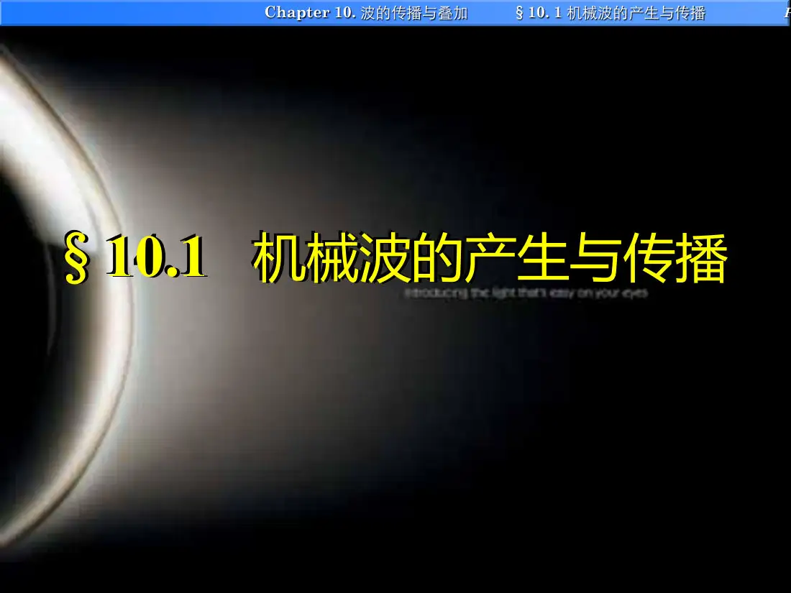

原文：

§14.1 0 机械波的产生与传播 机械波的产生与传播

### 一、机械波的产生

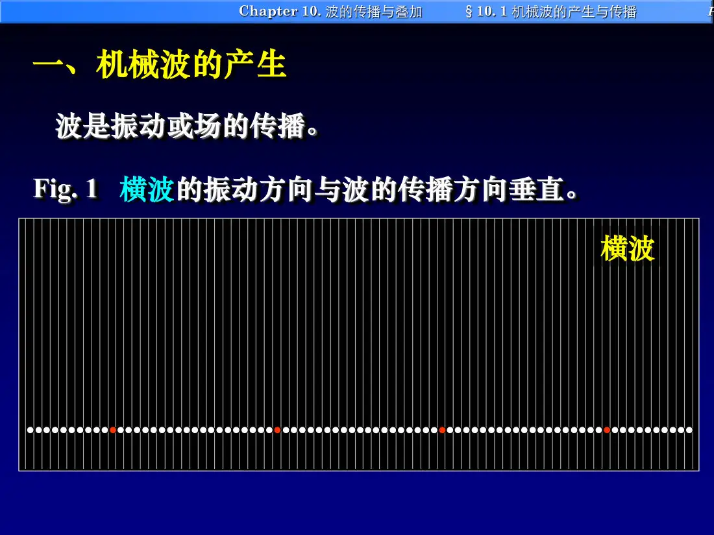

原文：

一、机械波的产生

波是振动或场的传播。

Fig. 1 横波的振动方向与波的传播方向垂直。

Chapter 10.作者：杨茂田 波的传播与叠加 §10. 1 机械波的产生与传播

### 第 3 页

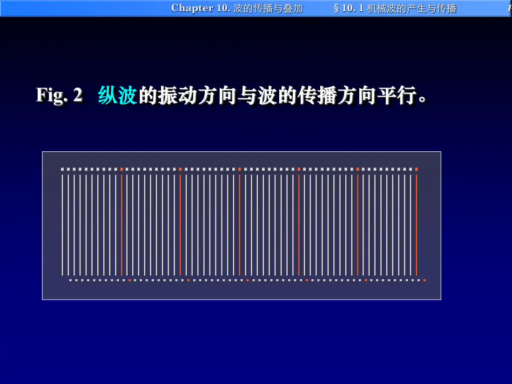

原文：

Chapter 10.作者：杨茂田波的传播与叠加 §10. 1 机械波的产生与传播

### Chapter 10.作者：杨茂田 波的传播与叠加

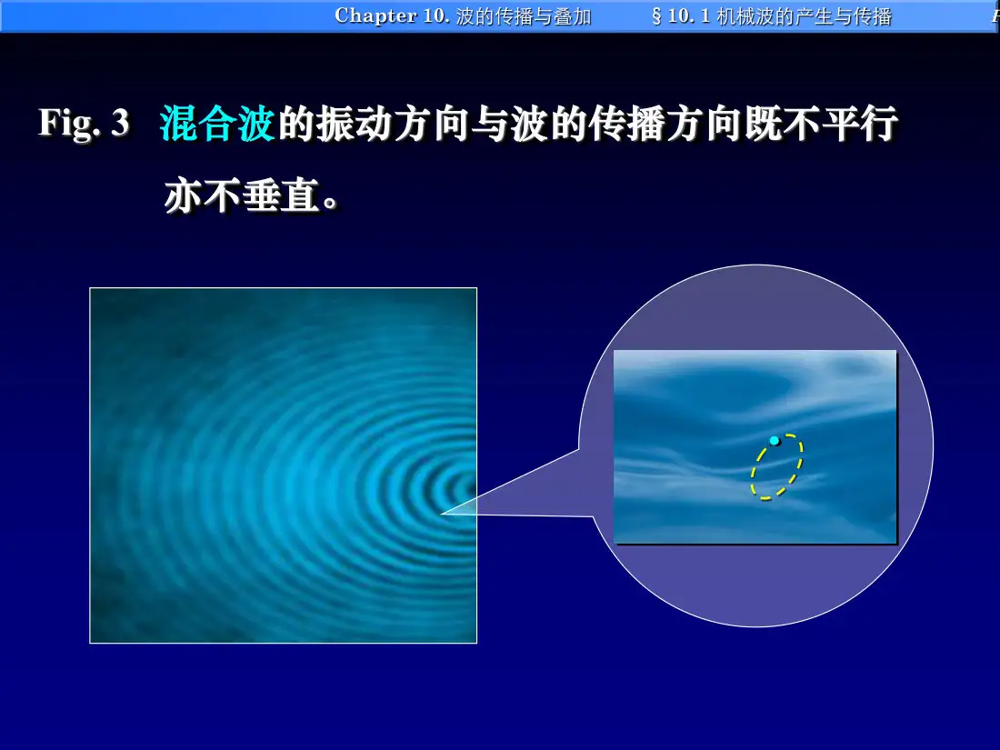

原文：

Chapter 10.作者：杨茂田 波的传播与叠加

§10. 1 机械波的产生与传播

### 机械波的产生条件：

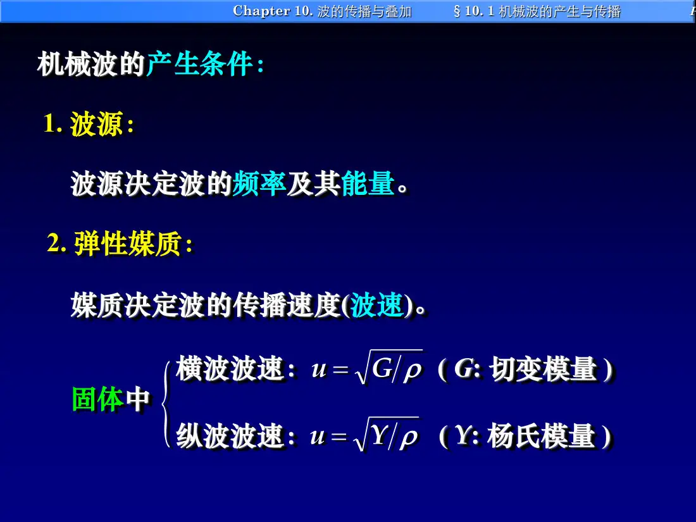

原文：

机械波的产生条件：

1. 波源：

波源决定波的频率及其能量。

2. 弹性媒质：

媒质决定波的传播速度(波速)。

横波波速： $U _ { 2 } = \sqrt { \left( \mathbf { e } / \sqrt { v ^ { 2 } } \right) }$ ( G: 切变模量 )

固体中

纵波波速： $U _ { 2 } = \sqrt { \left( \sqrt { U _ { 2 } } \right) }$ ( Y: 杨氏模量 )

Chapter 10.作者：杨茂田 波的传播与叠加

§10. 1 机械波的产生与传播

### 平面简谐波：媒质中各质点的运动为简谐振动。

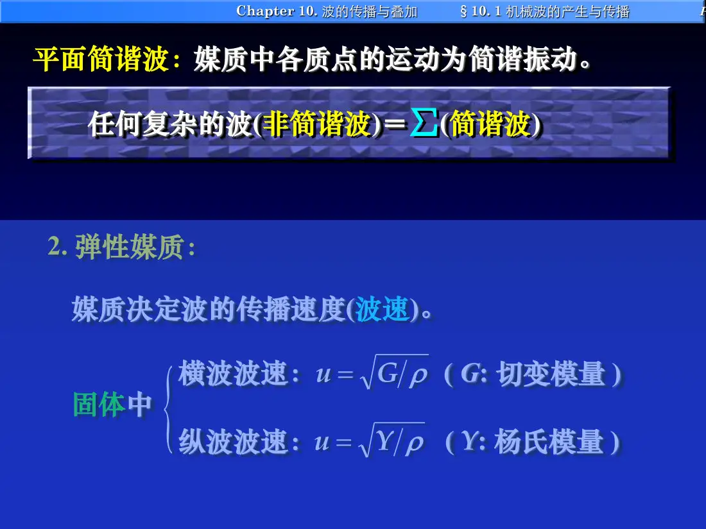

原文：

平面简谐波：媒质中各质点的运动为简谐振动。

任何复杂的波(非简谐波)＝∑(简谐波)

2. 弹性媒质：

媒质决定波的传播速度(波速)。

横波波速： $U B = \sqrt { ( \mathbf { q } / \mathbf { \lambda } ) }$ ( G: 切变模量 )

固体中

纵波波速： $U _ { 2 } = \sqrt { 1 0 ^ { \prime } / \lambda ^ { \prime } }$ ( Y: 杨氏模量 )

Chapter 10.作者：杨茂田 波的传播与叠加

§10. 1 机械波的产生与传播

### 平面简谐波：媒质中各质点的运动为简谐振动。

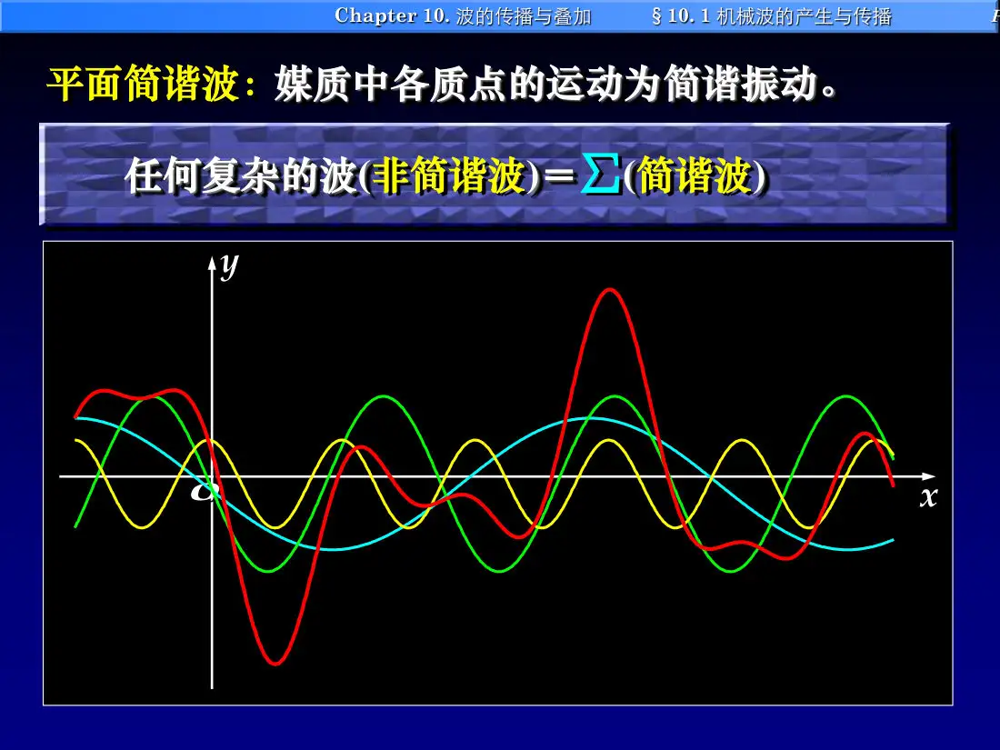

原文：

平面简谐波：媒质中各质点的运动为简谐振动。

任何复杂的波(非简谐波)＝∑(简谐波)

Chapter 10.作者：杨茂田 波的传播与叠加

§10. 1 机械波的产生与传播

### 二、波阵面和波线

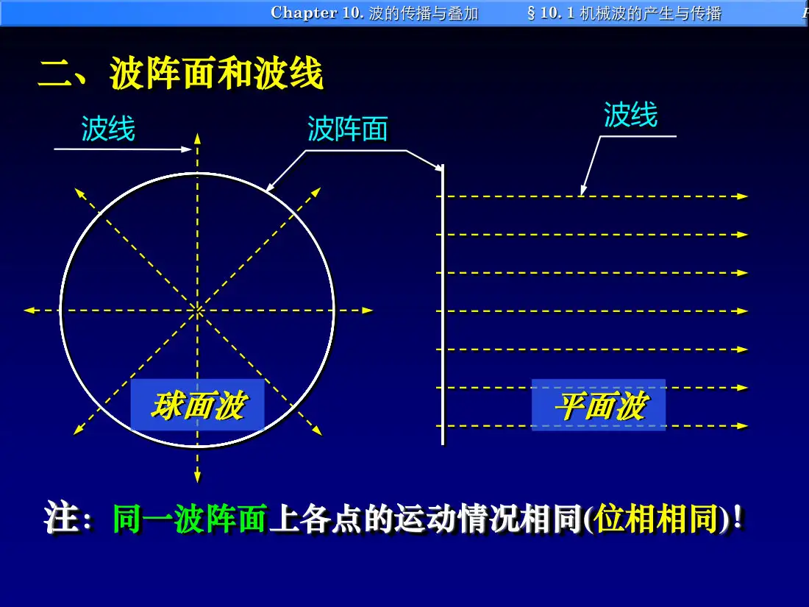

原文：

二、波阵面和波线

波线

波阵面

球面波

平面波

注：同一波阵面上各点的运动情况相同(位相相同)！

Chapter 10.作者：杨茂田 波的传播与叠加

§10. 1 机械波的产生与传播

### 二、波长、周期、波速

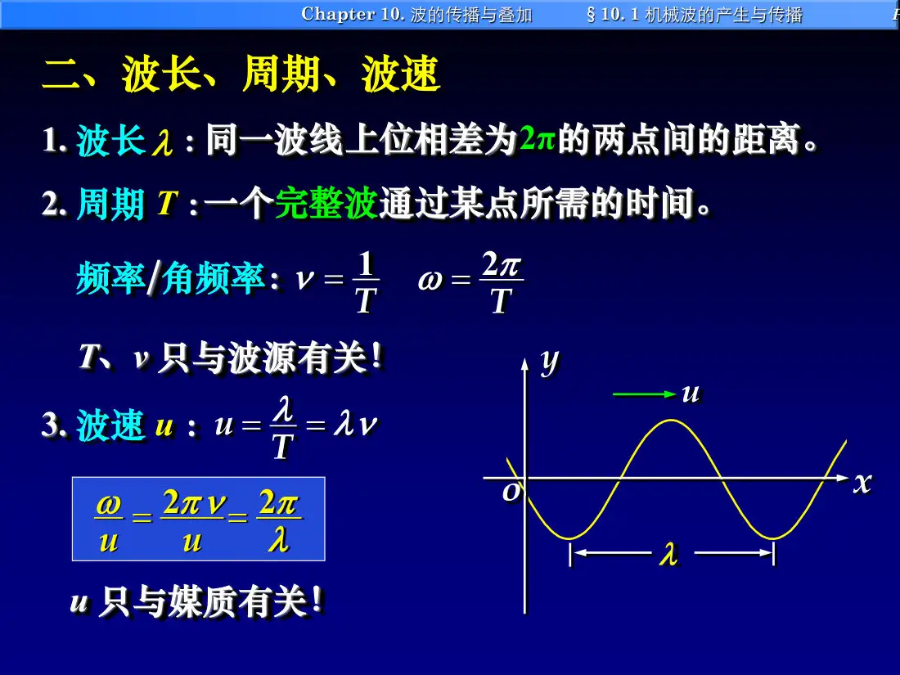

原文：

二、波长、周期、波速

1. 波长 ：同一波线上位相差为2π的两点间的距离。

2. 周期 T ：一个完整波通过某点所需的时间。

频率/角频率： $( 2 - \frac { 1 1 } { 1 1 } ) \times ( 2 - \frac { 1 1 } { 1 1 } ) \times ( 2 - \frac { 1 1 } { 1 1 } )$

T、ν 只与波源有关！

3. 波速 $1 7 7 \div \cdots 1 7 5$

$$
\frac {\omega}{u} = \frac {2 \pi \nu}{u} = \frac {2 \pi}{\lambda}
$$

u 只与媒质有关！

Chapter 10.作者：杨茂田 波的传播与叠加

§10. 1 机械波的产生与传播

### 归纳：

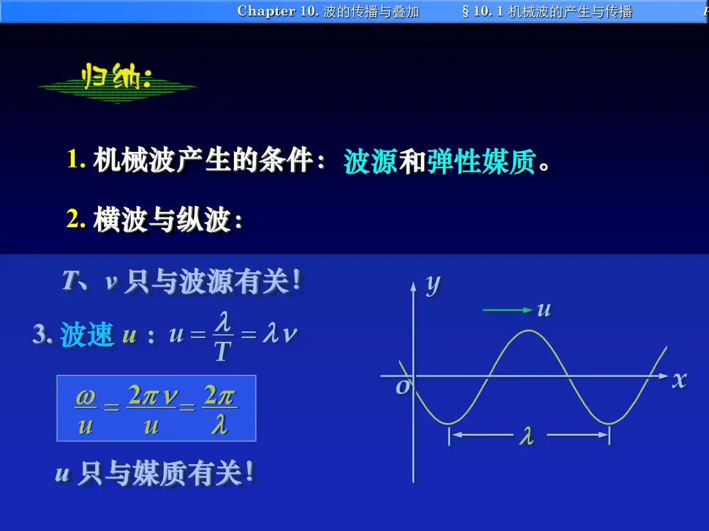

原文：

归纳：

1. 机械波产生的条件：波源和弹性媒质。

2. 横波与纵波：

T、ν 只与波源有关！

3. 波速 $1 4 8 \div 1 4 = \frac { 1 } { 1 1 } = \frac { 1 } { 1 }$

$$
\frac {\omega}{u} = \frac {2 \pi \nu}{u} = \frac {2 \pi}{\lambda}
$$

u 只与媒质有关！

Chapter 10.作者：杨茂田 波的传播与叠加

§10. 1 机械波的产生与传播

### 归纳：

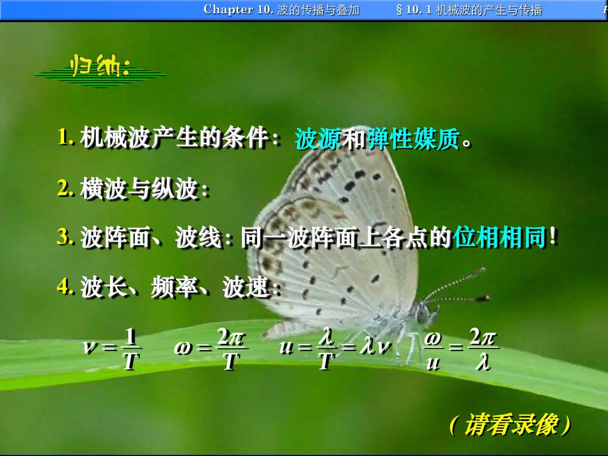

原文：

归纳：

1. 机械波产生的条件：波源和弹性媒质。

2. 横波与纵波：

3. 波阵面、波线：同一波阵面上各点的位相相同！

4. 波长、频率、波速：

$$
\nu = \frac {1}{T}
$$

$$
\omega = \frac {2 \pi}{T}
$$

$$
\boldsymbol {u} = \frac {\lambda}{T} = \lambda \boldsymbol {v}
$$

$$
\frac {\omega}{u} = \frac {2 \pi}{\lambda}
$$

请看录像 )

Chapter 10.作者：杨茂田 波的传播与叠加

§10. 1 机械波的产生与传播

### 三·机械波

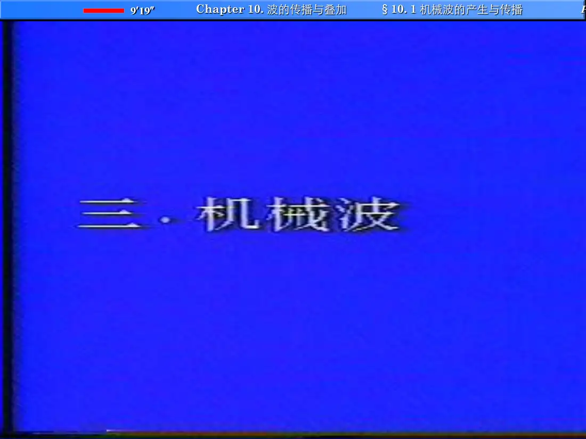

原文：

三·机械波

9'19″ Chapter 10.作者：杨茂田 波的传播与叠加 §10. 1 机械波的产生与传播
