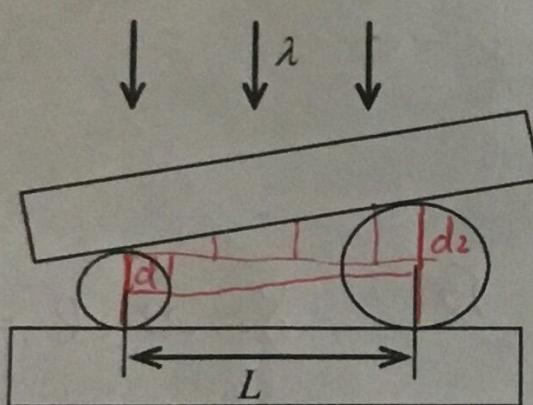
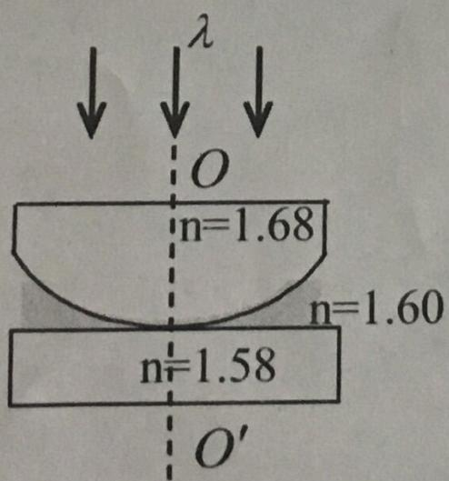
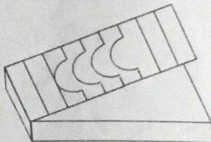

# 《大学物理》第10章 光的干涉 习题作业参考答案（劈尖、牛顿环、迈克尔逊干涉仪）

原件经识别和整理；“参考解答”是我们补的。

## 选择题

### 选择 1

若把由平凸玻璃和平玻璃（折射率 1.50）制成的牛顿环装置由空气搬入水中（折射率 1.33），则干涉条纹

- A. 中心暗环变成明环
- B. 条纹间距变疏
- C. 条纹间距变密
- D. 条纹间距不变

答案：C

知识点：[等倾干涉与等厚干涉（劈尖、牛顿环）](../../../topics/大学物理/薄膜干涉.md)、[光程、光程差与反射时的半波损失](../../../topics/大学物理/光程与半波损失.md)

### 选择 2

如图所示，两个直径有微小差别的彼此平行的滚柱之间的距离为 $L$，夹在两块平晶的中间，形成空气劈尖，当单色光垂直入射时，产生等厚干涉条纹。如果两滚柱之间的距离 $L$ 变大，则在 $L$ 范围内干涉条纹的

- A. 数目增加，间距不变
- B. 数目减少，间距变大
- C. 数目增加，间距变小
- D. 数目不变，间距变大

答案：D

知识点：[光程、光程差与反射时的半波损失](../../../topics/大学物理/光程与半波损失.md)、[等倾干涉与等厚干涉（劈尖、牛顿环）](../../../topics/大学物理/薄膜干涉.md)

### 选择 3

如图所示，平板玻璃和凸透镜构成牛顿环装置，全部浸入 $n=1.60$ 的液体中，凸透镜可沿 $OO'$ 移动，用波长 $\lambda=500\ \mathrm{nm}\ (1\ \mathrm{nm}=10^{-9}\ \mathrm{m})$ 的单色光垂直入射。从上向下观察，看到中心是一个暗斑，此时凸透镜顶点距平板玻璃的距离最少是

- A. 156.3 nm
- B. 148.8 nm
- C. 78.1 nm
- D. 74.4 nm
- E. 0

答案：C

参考解答：中心暗斑满足 $2ne = \dfrac{\lambda}{2}$，故 $e = \dfrac{\lambda}{4n} = \dfrac{500}{4 \times 1.16}\ \mathrm{nm} \approx 78.1\ \mathrm{nm}$。

知识点：[等倾干涉与等厚干涉（劈尖、牛顿环）](../../../topics/大学物理/薄膜干涉.md)、[光程、光程差与反射时的半波损失](../../../topics/大学物理/光程与半波损失.md)

### 选择 4

如图所示，用劈尖干涉检测工件的表面，当波长为 $\lambda$ 的单色光垂直入射时，观察到的干涉条纹中间向劈尖棱边弯曲，每一条弯曲部分的顶点恰好与左邻的直线部分的连线相切，则工件表面：

- A. 有一凹陷的槽，深为 $\lambda/4$
- B. 有一凹陷的槽，深为 $\lambda/2$
- C. 有一凸起的埂，高为 $\lambda/2$
- D. 有一凸起的埂，高为 $\lambda/4$

答案：B

## 填空题

知识点：[等倾干涉与等厚干涉（劈尖、牛顿环）](../../../topics/大学物理/薄膜干涉.md)

### 填空 1

两块平玻璃构成空气劈形膜，左边为棱边，用单色平行光垂直入射。若上面的平玻璃慢慢地向上平移，则干涉条纹向 $\underline{\text{棱边（左）}}$ 平移，条纹间隔 $\underline{\text{不变}}$。

参考解答：干涉条纹向**棱边（左）**平移，条纹间隔**不变**。

空气劈尖等厚干涉中，第 $k$ 级明纹对应的空气膜厚度满足 $2d_k + \frac{\lambda}{2} = k\lambda$。当上玻璃板垂直向上平移时，任意位置处的空气膜厚度 $d$ 均增加，原厚度 $d_k$ 对应的位置向左（棱边方向）移动，故条纹整体向棱边平移。条纹间距 $\Delta x = \frac{\lambda}{2\theta}$ 仅取决于入射光波长 $\lambda$ 和劈尖角 $\theta$，上板平行上移不改变 $\theta$，因此条纹间隔保持不变。

知识点：[等倾干涉与等厚干涉（劈尖、牛顿环）](../../../topics/大学物理/薄膜干涉.md)、[光程、光程差与反射时的半波损失](../../../topics/大学物理/光程与半波损失.md)

### 填空 2

已知在迈克耳逊干涉仪中使用波长为 $\lambda$ 的单色光，在干涉仪的可动反射镜移动一距离 $d$ 的过程中，干涉条纹将移动 $\underline{\quad}$ 条。

参考解答：
$$
\boxed{\frac{2d}{\lambda}}
$$

反射镜移动 $d$ 时，光程差改变 $2d$。相邻条纹对应光程差改变一个波长 $\lambda$，故移动的条纹数为

$$
N=\frac{2d}{\lambda}.
$$

知识点：[迈克尔逊干涉仪的原理与应用](../../../topics/大学物理/迈克尔逊干涉仪.md)、[光程、光程差与反射时的半波损失](../../../topics/大学物理/光程与半波损失.md)

### 填空 3

设入射光的波长为 589 nm，把折射率 $n=1.40$ 的薄膜放入迈克耳孙干涉仪的一臂，如果由此产生了 7.0 条条纹的移动，则膜厚为 $\underline{5153.75\ \mathrm{nm}}$。

参考解答：薄膜插入光路后，光程差改变为  

$$
\Delta L = 2(n-1)d
$$

条纹移动数 $N = 7.0$，满足  

$$
\Delta L = N\lambda
$$

所以  

$$
2(n-1)d = N\lambda
$$

解得  

$$
d = \frac{N\lambda}{2(n-1)}
$$

代入数据  

$$
d = \frac{7.0 \times 589}{2 \times (1.40 - 1)}\ \text{nm}
$$

$$
d = \frac{4123}{0.80}\ \text{nm} = 5153.75\ \text{nm}
$$

结论：膜厚为 **5153.75 nm**。

知识点：[迈克尔逊干涉仪的原理与应用](../../../topics/大学物理/迈克尔逊干涉仪.md)、[光程、光程差与反射时的半波损失](../../../topics/大学物理/光程与半波损失.md)

### 填空 4

在空气中有一劈形透明膜，其劈尖角 $\theta = 1.0 \times 10^{-4}\ \mathrm{rad}$，在波长 $\lambda = 700\ \mathrm{nm}$ 的单色光垂直照射下，测得两相邻干涉明条纹间距 $l = 0.25\ \mathrm{cm}$，由此可知此透明材料的折射率 $n = \underline{\quad}$（$1\ \mathrm{nm}=10^{-9}\ \mathrm{m}$）。

参考解答：由 $l = \dfrac{\lambda}{2n\theta}$ 得 $n = \dfrac{\lambda}{2\theta l} = \dfrac{700 \times 10^{-9}}{2 \times 1.0 \times 10^{-4} \times 0.25 \times 10^{-2}} = 1.4$。

知识点：[光程、光程差与反射时的半波损失](../../../topics/大学物理/光程与半波损失.md)、[等倾干涉与等厚干涉（劈尖、牛顿环）](../../../topics/大学物理/薄膜干涉.md)、[杨氏双缝干涉实验与条纹间距](../../../topics/大学物理/杨氏双缝干涉.md)

### 填空 5

波长 $\lambda=600\ \mathrm{nm}$ 的单色光垂直照射到牛顿环装置上，第二个明环与第五个明环所对应的空气膜厚度之差为 $\underline{\quad}\ \mathrm{nm}$（$1\ \mathrm{nm}=10^{-9}\ \mathrm{m}$）。

参考解答：**结论**  
$900\ \mathrm{nm}$

**简明推理**  
牛顿环明环条件为  
$$2d + \frac{\lambda}{2} = k\lambda \quad (k=1,2,3,\dots)$$  
空气膜厚度为  
$$d = \left(k - \frac12\right)\frac{\lambda}{2}$$  
第二个明环 $k=2$、第五个明环 $k=5$，膜厚差  
$$\Delta d = d_5 - d_2 = \left[\left(5-\frac12\right) - \left(2-\frac12\right)\right]\frac{\lambda}{2} = 3\cdot\frac{\lambda}{2}$$  
代入 $\lambda=600\ \mathrm{nm}$  
$$\Delta d = 3 \times 300 = 900\ \mathrm{nm}$$

知识点：[等倾干涉与等厚干涉（劈尖、牛顿环）](../../../topics/大学物理/薄膜干涉.md)、[光程、光程差与反射时的半波损失](../../../topics/大学物理/光程与半波损失.md)、[迈克尔逊干涉仪的原理与应用](../../../topics/大学物理/迈克尔逊干涉仪.md)
